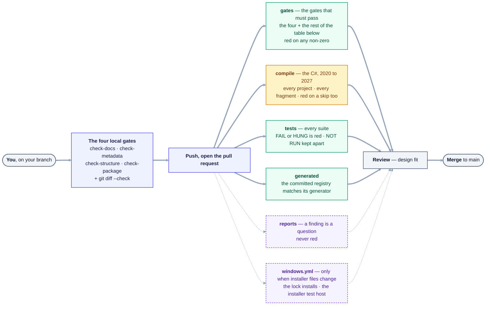

# Contributing to Heron AI

Thank you for considering it. Heron AI is a platform for BIM professionals, and contributions from
people who actually do BIM work are worth more than contributions from people who only write code.

> **Current stage: built ahead of what is proven, though less far than it was.** Phase 0 — the whole
> path from a sentence to a selection changing on screen — is proven in real Revit 2020 and 2024. The
> add-in has since loaded in Revit 2020, 2024, 2026 and 2027
> ([Group EQ](docs/needs-checking/group-eq.md)), and D-28's executor compiles a fragment's C# inside
> Revit's own process, so fragments do now meet real models — on every one of those but 2026, where no
> fragment could run until a repair that has not yet been run in Revit
> ([Group GW](docs/needs-checking/group-gw.md)). The [README's Status](README.md#status) says what else
> has met a real Revit.
>
> **Most fragments are `PROVEN`** — each on a recorded run against a named model. **The rest are
> `DRAFT`**, which is Heron's word for *not proven as it stands* - most of those have never met a
> model, and some were proved before their code changed. **Every skill is still `DRAFT`** —
> `grep -h '^heron-status:' brain/skills/*.yaml | sort | uniq -c`; this line said *"twenty-four"*
> after a twenty-fifth was added.
> No count is typed here, on purpose: every fragment pull request moved it and conflicted with the next.
>
> Derive it rather than believing this line —
> `grep -h '^heron-status:' brain/fragments/*/fragment.yaml | sort | uniq -c`.
>
> This paragraph used to carry both figures, in the one form `tools/check-docs.py` can verify; it
> carries none since 2026-10-04, because a number nobody types cannot drift. It also said *"167 of the 360 carry a recorded proof"* and *"193 fragments have still never
> met a model"* until 2026-09-21 — **wrong by 160**, in wording three words outside the pattern the
> gate matches, directly above its own instruction to derive it
> ([row 5b-50](docs/FRAGMENT-ISSUES.md)).
>
> So the most useful contributions are **proof** rather than more code, and the architecture questions
> that are genuinely still open — see [Open Questions](docs/OPEN-QUESTIONS.md).
> `python tools/check-gaps.py` is computed from disk on every run and prints what is truly unfinished
> separately from what is only waiting on a machine with Revit on it. Where it and any sentence in
> this repository disagree, the tool is right.

---

## Before you start

Read these three, in order:

1. **[docs/14-golden-rules.md](docs/14-golden-rules.md)** — the non-negotiables. Anything that
   contradicts a Golden Rule will be declined, however good it is otherwise.
2. **[docs/README.md](docs/README.md)** — the documentation index.
3. **[docs/DECISIONS.md](docs/DECISIONS.md)** — what has already been decided and why. If you disagree
   with a decision, open a discussion about *that decision* rather than a PR that quietly works around it.

---

## Ways to contribute

### Architecture and design

The [open questions](docs/OPEN-QUESTIONS.md) are genuinely open. If you have run into these problems
before — Revit API threading, multi-version support, RAG over technical corpora — your experience is
valuable. Open an issue or a discussion.

### Fragments and skills

The most valuable long-term contribution. A **fragment** is a reusable implementation unit;
a **skill** is a user-facing capability. See [docs/09-skills-and-fragments.md](docs/09-skills-and-fragments.md).

Every contributed fragment must include:

- [ ] Complete, schema-valid metadata
- [ ] A stated purpose, inputs and expected output
- [ ] **Declared and tested** Revit version compatibility — declared alone is not enough
- [ ] Tests that pass on at least one .NET Framework and one .NET 8 Revit version
- [ ] A declared risk level
- [ ] No duplicate of an existing fragment (search first — Golden Rule 3)

Contributed fragments enter the lifecycle at `DISCOVERED`. Nothing becomes production knowledge because
a contributor said it works (Golden Rule 6).

### Bug reports

Include the Revit version, the Heron version, what you asked for, what happened, and — if a model was
modified — whether undo restored it correctly. That last one matters more than it sounds.

### Documentation

Corrections and clarifications are always welcome. Note that
[docs/00-master-specification.md](docs/00-master-specification.md) and the other three parts of the
specification are a **historical record**. Since [D-139](docs/DECISIONS.md) a word in them is corrected
in place only when it is wrong as a fact or an accepted decision already settled it, with the original
words kept beside the correction; a change to intent is still recorded as a decision first.

---

## Absolute rules

These will get a pull request closed immediately, without review:

| Never commit | Why |
|---|---|
| **Real client models or project data** | Confidentiality. Permanent once pushed — forks and caches propagate. |
| **Real `.rvt` files from live projects** | Same. Test models must be synthetic. |
| **Credentials, API keys, tokens** | Anything committed to a public repository is compromised forever. |
| **Personal data of any kind** | Yours or anyone else's. |
| **Redistributed `RevitAPI.dll` / `RevitAPIUI.dll`** | Autodesk's, not redistributable. Reference them with *Copy Local = false*. |

If you commit any of these by accident, **report it privately** via
[SECURITY.md](SECURITY.md) rather than force-pushing over it.

---

## Pull request process

1. **Open an issue first** for anything beyond a small fix. It saves you writing something that will be
   declined for architectural reasons.
2. **One concern per pull request.** Mirrors Golden Rule 2 — one responsibility.
3. **Explain the "why", not just the "what".** The reasoning is what gets reviewed.
4. **Never break a working version** (Golden Rule 4). If your change affects Revit version support,
   say which versions you tested and how.
5. **Tests, written to fail before your fix.**
6. **Run the checks.** These four need nothing but Python 3 — no Revit, no Windows, no .NET SDK —
   and all four must exit 0, with `git diff --check` clean:

   ```
   python tools/check-structure.py    # parts in place, no layering violation
   python tools/check-docs.py         # every link and every stated count
   python tools/check-metadata.py     # headers, and the registry against the code
   python tools/check-package.py      # the manifest Revit reads before anything else
   git diff --check                   # no whitespace errors
   ```

   They are not all of CI's checks. The `gates` job in
   [`.github/workflows/gates.yml`](.github/workflows/gates.yml) also runs `check-signatures`,
   `check-licence`, `check-narrow-errors`, `check-secrets`, `check-products`, `check-decision-titles`,
   `check-routing` and `check-intrusion`, and a non-zero from any of them turns a pull request red.
   `check-secrets` is the one that answers the *credentials* row of the table above before a reviewer
   has to ([D-143](docs/DECISIONS.md)). Some need something
   first: `check-decision-titles` needs the whole git history, and `check-routing` and
   `check-intrusion` need a knowledge store - an empty folder named by `HERON_KNOWLEDGE` will do. The
   [`heron-ship`](.claude/skills/heron-ship/SKILL.md) skill says what each one catches and how to run it.

   `python tools/check-gaps.py` exits non-zero while real work is outstanding, which is its job — read
   it, but do not expect a 0. [tools/README.md](tools/README.md) explains the rest.
7. **Be ready to discuss.** Review here is about design fit, not gatekeeping.

### What happens to a pull request

Every job is read from [`.github/workflows/gates.yml`](.github/workflows/gates.yml) and
[`.github/workflows/windows.yml`](.github/workflows/windows.yml). **Red** means a non-zero exit turns
the pull request red; the reports job never does.



<details>
<summary>Same thing as plain text</summary>

```text
You, on your branch
  -> the four local gates: check-docs, check-metadata, check-structure, check-package, git diff --check
  -> push, open the pull request
  -> CI, gates.yml, side by side:
       gates      the four + check-signatures, check-licence, check-narrow-errors, check-secrets,
                  check-products, check-decision-titles, check-routing,
                  check-intrusion                                       red on any non-zero
       compile    every C# project and every fragment, Revit 2020 to 2027 red on a failure or a skip
       tests      every suite                                           red on FAIL, HUNG, or an
                                                                        unexpected NOT RUN
       generated  docs/28-agent-registry.md matches its generator       red when stale
       reports    check-reachable, check-revit-gate, agent-count,       never red
                  check-declared-questions
     windows.yml, only when the installer, the lock, heron-ready or the release builder change
  -> review, for design fit
  -> merge to main
```

</details>

**The gates job, one row per command.** What each catches is the
[`heron-ship`](.claude/skills/heron-ship/SKILL.md) skill's words. List them from the workflow rather than
counting this table:
`sed -n '/^  gates:/,/^  compile:/p' .github/workflows/gates.yml | grep -oE 'python tools/check-[a-z-]+\.py' | sort -u`

| Gate | What it catches | Needs anything first? |
|---|---|---|
| `check-docs` | A broken link; a stated count that disagrees with the derived one; a file in `tools/` or a skill folder its README never names; a control character, double-encoded text or a merge-conflict marker | No |
| `check-metadata` | A missing or malformed five-field header, and an agent id the registry does not know | No |
| `check-structure` | A layering violation, and the Revit vendor namespace anywhere but `revit/` and `tools/` — a comment counts. `tools/` is exempt because a script talks about the code rather than being it ([D-69](docs/DECISIONS.md)) | No |
| `check-package` | `Heron.addin` naming an entry class or assembly that does not exist, or a `<ManifestSettings>` element, which crashes Revit 2025 and older | No |
| `check-signatures` | A fragment somebody signed that still sits at `DRAFT` — a signature going unused. A proof whose code moved under it is reported and does not fail | **PyYAML** — it reads every `fragment.yaml` (CI installs it first) |
| `check-licence` | A licence header, and what may not be redistributed | No |
| `check-narrow-errors` | An `sqlite3.OperationalError` handler that swallows a fault without narrowing first ([D-52](docs/DECISIONS.md)) | No |
| `check-secrets` | A credential shape in a tracked file, or a tracked file whose name the Secrets block of `.gitignore` refuses ([D-143](docs/DECISIONS.md)) | **git** - it asks git which files are tracked |
| `check-products` | In `platform/heron-products.json`: a duplicate `addInId`, a `partOf` typo, a stale Revit list | No |
| `check-decision-titles` | A decision number that stopped meaning its decision | **The whole git history** — `git fetch --unshallow` in a shallow clone, or it exits 2 |
| `check-routing` | A routing row naming a capability no fragment declares — exit 1. A fragment outranked for its own words is reported and exits 0 | **A knowledge store** — an empty folder named by `HERON_KNOWLEDGE`, or it exits 2 — and PyYAML. `--targets` gives the failing half alone, with no store |
| `check-intrusion` | One fragment crowding out another — reported, exit 0; it turns red only when it cannot run | **A knowledge store**, the same way, and PyYAML |

---

## Code style

Most of this is enforced by a script rather than left to review, so run the checks before you open a
pull request — see below.

- **C#** — standard .NET conventions. `Autodesk.Revit` types may appear **only inside `revit/`**;
  `check-structure.py` fails the moment one appears anywhere else, because the brain has to stay
  runnable and testable on a machine with no Revit on it.
- **Python** — standard formatting and type hints. Nothing touching the Revit API.
- **Every `.cs`, `.py` and `.ps1` file carries the five-field Heron header** — agent, step, status,
  since, layer ([docs/29-metadata-standard.md](docs/29-metadata-standard.md)). `check-metadata.py`
  rejects a missing or malformed one, and checks the agent id against the registry in both
  directions. Fragments under `brain/fragments/` are the exception: their metadata lives in their
  own `fragment.yaml`, so that one fact has one home.
- Version-conditional code lives **only in adapters**, never in core logic
  ([docs/16-version-support-strategy.md](docs/16-version-support-strategy.md)).

---

## A note on scale

The [agent registry](docs/28-agent-registry.md) is a **target organisation chart**, not a to-do list.
**Do not trust a number typed here** — this line read *about 70* for nine days after it stopped being
true, and *"most of them are built by now"* until 2026-09-21, by which time none was left to build.
`python tools/agent-count.py` reconciles the register against the code and prints, in one line, how
many are built, how many the host provides, how many a decision deferred and how many are genuinely
left. Please do not open a pull request implementing forty of them.

The project is built one working vertical slice at a time — see [docs/ROADMAP.md](docs/ROADMAP.md).
A contribution that makes one real thing work end-to-end is worth more than one that adds ten
components nobody has exercised.
