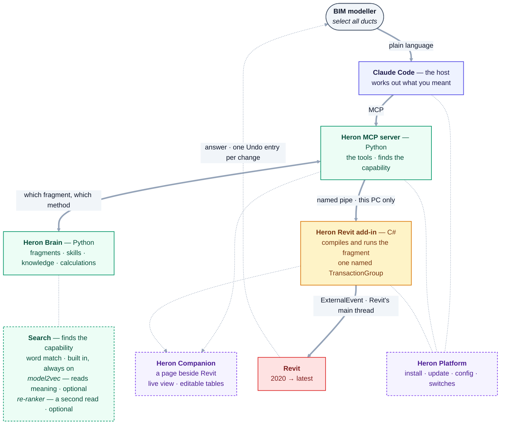

# Heron AI

> **Dear Modelers — please do not install this yet.**
>
> This repo is public only so the work is open. It is still not finished.
> Let me complete everything first. I will announce it on LinkedIn and on the
> website when it is ready to install.
>
> Until then, feel free to read and follow along.
>
> **Programmers and AI engineers — your thoughts are very welcome.**
> Please read the code and share your suggestions, ideas or corrections
> through an Issue or a Discussion. That help is what I am asking for now,
> not installs.

**A modular, agent-based AI engineering platform for BIM.**

> The user focuses on BIM. Heron AI focuses on everything behind the BIM work.

---

## What it is

Heron AI lets a BIM Modeler, BIM Coordinator or engineer drive Revit by describing the work in ordinary
language:

```
"Select all ducts."
"Move them 200 mm up."
"Which views have no template?"
"Lay out sprinklers in these rooms."
"Build me a parametric door family."
```

Behind that sentence, Heron finds the right capability, runs it inside Revit, checks the result and
keeps a record. The user never has to know C#, the Revit API, MCP, RAG, vector databases, build systems
or version compatibility.

It is **not** a chatbot, a coding assistant, or a plain MCP server.

## Four parts

| Part | Responsibility | Folder |
|---|---|---|
| **Heron Revit** | The add-in, the ribbon, and everything touching the Revit API | [`revit/`](revit/README.md) |
| **Heron MCP** | The controlled bridge between the AI and Revit, and the Companion page | [`mcp/`](mcp/README.md) |
| **Heron Brain** | Fragments, skills, capabilities, knowledge, design calculations | [`brain/`](brain/README.md) |
| **Heron Platform** | Install, update, configuration, switches, packages | [`platform/`](platform/README.md) |

---

## What you can ask it today

Every request goes through Heron's **MCP tools**. Print the full list, with what each one may do to the
model, with:

```bash
python mcp/server/heron_tools.py
```

They fall into five groups:

| Group | What it does | Main tools |
|---|---|---|
| **Read the model** | Answers questions and changes nothing — views, sheets, schedules, families, levels, rooms, systems, parameters, links, imports, phases, worksets, groups, annotation | `revit_read` and the `revit_views`, `revit_sheets`, `revit_systems`… family |
| **Show on screen** | Selects, zooms, isolates. Changes what you see, never the model | `revit_select_by_category`, `revit_show`, `revit_isolate_temporary` |
| **Change the model** | Renames, sets parameters, changes types, places and builds — one named Undo entry per change | `revit_change`, `revit_apply_move` |
| **Work it out** | HVAC and fire-protection calculations, building loads, sprinkler layout and hydraulics | `heron_hvac`, `heron_fire`, `revit_building_loads`, `revit_sprinkler_layout`, `revit_sprinkler_hydraulics` |
| **Know the job** | Finds the right capability, gives the method for a job of several steps (a family above all), answers standards questions against their sources | `heron_lookup`, `heron_method`, `heron_standards`, `heron_check` |

**What sits behind the tools is the fragment library.** A fragment is one small Revit job written in C#
— *"add an elbow to the grid heads in this view"* — compiled and run inside Revit. The AI never names a
fragment: it asks a tool for a **capability**, and Heron picks the fragment. Each fragment is `DRAFT`
until it has one recorded proof against a named real model, with a negative case
([D-30](docs/DECISIONS.md)); then it is `PROVEN`. Count both with:

```bash
grep -h '^heron-status:' brain/fragments/*/fragment.yaml | sort | uniq -c
```

---

## How it fits together



**Solid arrows are the live request path.** Dotted is what comes back, the Companion page showing what
Heron does, and Heron Platform holding the other parts up — it installs, updates and configures them
rather than sitting in the call chain.

**Search is how the brain finds the capability for your words.** The word match is built in and always
runs. Two optional installs sharpen it: **model2vec** reads meaning, so *"stop the air going the wrong
way"* can reach the flow-direction check without sharing a word with it, and the **re-ranker** gives the
top picks a second, slower read. Without them Heron falls back to the word match, and every answer says
which search ran. Measured on 2026-09-24, model2vec found more of the owner's questions; the re-ranker
was worse at picking tools and is the largest download in Heron —
[WHAT-TO-INSTALL §2](docs/WHAT-TO-INSTALL.md#2-optional--the-two-search-add-ons) has the figures and how
to install or remove either.

<details>
<summary>Same thing as plain text</summary>

```text
BIM modeller          plain language
     |
Claude Code           host: works out what the modeller meant (D-01)
     |  MCP
Heron MCP server      Python: the tools, finds the capability  <->  Heron Brain: fragments, skills,
     |  named pipe, this PC only                                      knowledge, calculations
     |                                                                Search: word match (built in),
     |                                                                model2vec, re-ranker (optional)
Heron Revit add-in    C#: compiles and runs the fragment, one named TransactionGroup
     |  ExternalEvent, Revit's main thread
Revit                 2020 -> latest

Heron Companion       a page beside Revit: live view of Heron's work, editable tables
Heron Platform        install, update, config, switches - under all of them
```

</details>

### One request, step by step

1. You type *"set the Mark of these doors to D-01"*.
2. Claude Code asks `heron_lookup` which capability serves it. Heron's search matches your words — by
   meaning too, when model2vec is installed.
3. It calls `revit_change` with your words. The server sends the job down the named pipe to the add-in.
4. The add-in compiles the fragment and runs it on Revit's main thread, inside one named
   `TransactionGroup`.
5. With **Ask to Keep** on, Revit shows the change and asks **Keep or Discard**; Discard, Esc or closing
   the box rolls it back ([D-126](docs/DECISIONS.md)). With it off — the default — the change is kept at
   once ([D-138](docs/DECISIONS.md)).
6. Either way the change is **one** entry in Revit's Undo list, named *"Heron: …"*. Ctrl+Z takes it back.

**Off Windows there is no Revit to reach**, so the server serves only its library tools and no `revit_`
tool ([D-132](docs/DECISIONS.md)). Everything that needs a model runs on the modeller's Windows PC.

---

## What keeps the model safe

| Guard | What it does | Where |
|---|---|---|
| **Changes** button | Heron may read the model and nothing else until you turn it on. `write.enabled` defaults to `false` | [D-19](docs/DECISIONS.md) · `platform/Heron.Core/HeronConfig.cs` |
| **Ask to Keep** button | Revit asks Keep or Discard before a change from a chat is kept. Off by default; its box can keep the rest of one job without asking | [D-126](docs/DECISIONS.md), [D-138](docs/DECISIONS.md) |
| **Admin** and **Publish** buttons | Off by default, and only the owner turns them on | [D-106](docs/DECISIONS.md) |
| One request, one Undo | Every change is one named `TransactionGroup`; on any failure the whole of it rolls back | [Golden Rule 16](docs/14-golden-rules.md) |
| The right model | With more than one Revit open Heron sends nothing until you choose; once bound it stays bound to that document | [Golden Rule 20](docs/14-golden-rules.md) · [Article 12a](HERON_CONSTITUTION.md) |
| A run that never ends | A fragment carries a run clock, and the bridge can stop Heron; the stop lasts until Revit restarts | [D-129](docs/DECISIONS.md), [D-130](docs/DECISIONS.md) |
| Never on its own | No Sync With Central, no publish, no export to a shared place unless you ask | [Article 10](HERON_CONSTITUTION.md) |

---

## Status

**Built and proven are different words here, on purpose.** A compile is not a proof and a passing test
is not a proof: a proof is a recorded run against a **named real model**, with a negative case
([D-30](docs/DECISIONS.md)). [HANDOVER.md §3](docs/HANDOVER.md) keeps the witnessed list item by item,
and [NEEDS-CHECKING.md](docs/NEEDS-CHECKING.md) holds everything still owed a real Revit.

| | State | Evidence |
|---|---|---|
| **Phase 0 — the bridge** (Steps 1–5) | ✅ **Proven** in Revit 2020 and 2024. One button connects; the thread hop counted `5,844` elements in 2024 and `3,167` in 2020; *"select all ducts"* highlighted 4 in both; with two Revits open Heron refused to guess and stopped when the chosen one closed | [HANDOVER §3](docs/HANDOVER.md) · [field notes](docs/00e-field-notes-proven-bridge.md) |
| **Step 6 — the first write** | ⚠️ **Measured on one release.** On 2026-10-17 three ducts in a copy of Autodesk's MEP sample moved **+200.0000 mm** each in Revit 2024, read two ways, a pinned duct beside them did not move, and **one** Ctrl+Z put them back. A forced failure mid-move and the other rails are still owed | [Group D](docs/needs-checking/group-d.md) |
| **Keep or Discard, and the safety rails** | ⚠️ **Run in Revit 2024 and 2027 on 2026-10-18** on the owner's laptop — Keep, Discard, Esc and Undo pressed by hand. Faults found were logged, not hidden | [Group ET](docs/needs-checking/group-et.md) · [FRAGMENT-ISSUES](docs/FRAGMENT-ISSUES.md) rows 5b-1090 to 5b-1095 |
| **The fragment library** | Mostly `PROVEN`, the rest `DRAFT` — count with the `grep` above. A `DRAFT` is *not proven as it stands*: new, or sent back when its code changed | [D-30](docs/DECISIONS.md) · [FRAGMENT-ISSUES](docs/FRAGMENT-ISSUES.md) |
| **A fragment cannot end Revit** | ✅ **Proved in front of Revit on 2026-09-16.** A runaway recursion comes back as a finding, with Revit still running. `python tests/test_stack_guard.py` prints how many fragments carry the guard | [J9](docs/needs-checking/group-j.md) |
| **Reading a model beyond counting it** | Four of five ran against real models on 2026-09-19 — `revit_phases`, `revit_systems`, `revit_parameters`, `revit_groups`; `revit_links` never has. **Those records are stale now**: the tools' code has changed since they were signed — `python tools/prove-agent.py check` | [`brain/agent-proofs/`](brain/agent-proofs/README.md) |
| **Phase 2 — the brain** (Steps 7–14) | Built in full, mostly unproven: the fragment store, one knowledge store per scope, word and meaning search behind a hard Revit-version filter, the capability registry, the dependency graph | [27 — Build order](docs/27-build-order.md) |
| **Skills** | Every one `DRAFT` — `grep -h '^heron-status:' brain/skills/*.yaml \| sort \| uniq -c` | [`brain/README.md`](brain/README.md) |
| **Companion, HVAC, fire, building loads, sprinkler layout and hydraulics, family building** | Built, **not proven** — each page's status line says exactly how far | [40](docs/40-heron-companion.md) · [41](docs/41-hvac-design.md) · [42](docs/42-fire-protection-design.md) · [43](docs/43-building-revit-families.md) · [44](docs/44-building-loads-from-the-model.md) · [46](docs/46-sprinkler-hydraulics-from-the-model.md) · [47](docs/47-sprinkler-layout-from-the-model.md) |
| **Compiles** | Every C# project on all eight releases, 2020 to 2027 — a compile, not a proof | `python tools/check-compile.py` |
| **What is unfinished** | Derived, never typed — the tool separates what failed from what only waits for a Revit, a dependency or the owner | `python tools/check-gaps.py` |
| **Waiting on the owner** | One page, and it holds no list — the tool derives it from the registers | [FOR-THE-OWNER.md](docs/FOR-THE-OWNER.md) · `python tools/owner-queue.py` |
| **Open questions** | The Progress line at the top is derived and checked by `tools/check-docs.py`. Nothing gates any phase | [OPEN-QUESTIONS.md](docs/OPEN-QUESTIONS.md) |

**Do not type the counts in this file — derive them.** They move every hour a proving session runs, and
every typed copy has gone stale.

### Decided

| | |
|---|---|
| **Host** | Claude Code plugin — skills, subagents, the MCP server, the Revit add-in ([D-01](docs/DECISIONS.md)) |
| **Revit support** | **2020 → latest**, and every future release ([D-05](docs/DECISIONS.md)). Declared support and tested releases are different lists — `heron_compatibility` tells them apart |
| **Languages** | C# for everything touching Revit · Python for the brain and the MCP side ([D-06](docs/DECISIONS.md)) |
| **Transport** | Named pipes — the add-in is the server, local-only by construction ([D-02](docs/DECISIONS.md)) |
| **Revit threading** | One `ExternalEvent`, one request queue, one handler ([D-09](docs/DECISIONS.md)) |
| **MCP tools** | Narrow tools, each with its own declared risk level ([D-03](docs/DECISIONS.md)). Fragments are reached by **capability** through them, never by id |
| **Generated code** | Hybrid ([D-04](docs/DECISIONS.md)) — C# compiled at run time inside Revit's process while a fragment is unproven, compiled into an assembly for production ([D-28](docs/DECISIONS.md)) |
| **Licence** | Apache 2.0 ([D-08](docs/DECISIONS.md)) |
| **Distribution** | Free and **open source** on public GitHub; Autodesk App Store later, also free ([D-07](docs/DECISIONS.md)) |
| **Building on** | The owner's earlier brain and Revit-connector work, upgraded to this architecture |

---

## Picking this up

| If you are… | Start at |
|---|---|
| **the owner, or continuing work** | [**HANDOVER.md**](docs/HANDOVER.md) — what exists, what is proven versus built, what will bite you, and what is waiting on a decision |
| **an AI agent** | [**AGENTS.md**](AGENTS.md) — short, and the only file written for you |
| **a developer** | [**docs/PROJECT-MAP.md**](docs/PROJECT-MAP.md) — which folder owns what, where to start a change, which source wins — then [CONTRIBUTING.md](CONTRIBUTING.md) |
| **a BIM modeller** | [01 — Vision & Principles](docs/01-vision-and-principles.md), then **What keeps the model safe** above. The switch keeps you safe, not the library |
| **setting up a PC** | [**docs/WHAT-TO-INSTALL.md**](docs/WHAT-TO-INSTALL.md) — everything a PC needs, Python first, and what is optional. **An early build, [v0.1.0](https://github.com/Ajmalpshaik/Heron-AI/releases/tag/v0.1.0), is published for testing only** — unsigned, and the note at the top of this page still stands |
| **a BIM manager** | [16 — Version Support](docs/16-version-support-strategy.md) and [12 — Security & Permissions](docs/12-security-and-permissions.md) |

Full routes, with what to read at each stop: [**PROJECT-MAP §E**](docs/PROJECT-MAP.md#e-routes-by-role).

## Documentation

Full index: **[docs/README.md](docs/README.md)**

**Read first:**

- [**AGENTS.md**](AGENTS.md) — rules and reading order for an AI agent
- [**Project Map**](docs/PROJECT-MAP.md) — folders, entry points, change routes, truth hierarchy
- [Vision & Principles](docs/01-vision-and-principles.md) — what this is and why
- [Constitution](HERON_CONSTITUTION.md) — the 30 binding Articles
- [Golden Rules](docs/14-golden-rules.md) — the non-negotiables
- [Decisions](docs/DECISIONS.md) — why it is built this way
- [Master Specification](docs/00-master-specification.md) — the complete original spec
- [Roadmap](docs/ROADMAP.md) and [**Build Order**](docs/27-build-order.md) — what gets built, in what order, each step with its gate
- [**Agent Registry**](docs/28-agent-registry.md) — every agent and what it does; `python tools/agent-count.py` reconciles the register
- [Open Questions](docs/OPEN-QUESTIONS.md) — what must still be decided
- [tools/](tools/README.md) — the scripts that check links and derive every count from source

---

## The Golden Rules

1. User focuses on BIM. Heron handles technical complexity.
2. One agent should have one primary responsibility.
3. Reuse proven knowledge before creating new knowledge.
4. Never break a working Revit version unnecessarily.
5. Personal knowledge must remain separate from company knowledge.
6. Experimental knowledge must remain separate from production knowledge.
7. One agent creates; another agent validates.
8. Background work must not interfere with user work.
9. High-risk actions require controlled approval.
10. Every important object must have identity, version and lifecycle.
11. Vector DB is an index, not the canonical source of truth.
12. No automatic external publishing of private knowledge.
13. No uncontrolled self-modification of production architecture.
14. Every important autonomous operation must be auditable.
15. The platform must be modular enough that agents, skills and fragments can be replaced without redesigning the system.
16. One user action, one undo — per document.
17. No autonomous write to a live model without a preview or a proven fragment.
18. Generated code never touches a live model on its first run.
19. No text Heron reads may raise Heron's own permission level.
20. Bind the document, not just the session.
21. Re-read before acting. A preview expires.

All 21 are official and binding; [docs/14](docs/14-golden-rules.md) is the list, with the reason for each.

---

## Thanks — what was studied, and the rule that governs it

Heron is built by people who read other people's work. **[D-25](docs/DECISIONS.md) is the rule:
studied and re-authored, never imported.** No code, no dependency and no name is taken from any
project below — what is taken is the *thinking*, rewritten in Heron's own shape, and every capability
starts at `DRAFT` here whatever status it held where it was read.

The repositories read at file level are written up in
[33 — External repository research](docs/33-external-repository-research.md), with what each one
became in [34 — The patterns behind them](docs/34-patterns-adapted.md) — including the ones that were
**measured and rejected**, because a rejection with a number saves the next person a week.

Named here because something in Heron is different for having read them:

| | For |
|---|---|
| [jamwithai](https://github.com/jamwithai) — `observable-job-agent`, `production-agentic-rag-course` | A way to check a generated claim against its source that **calls no model at all** — and *"the human applies, the agent never submits"*, which this repository had reached independently as [D-30](docs/DECISIONS.md) |
| [Anthropic — Contextual Retrieval](https://www.anthropic.com/engineering/contextual-retrieval) | The observation that a chunk is embedded having lost its document. For a numbered standard, its heading path answers it for free |
| [LightRAG](https://github.com/HKUDS/LightRAG) · [RAGFlow](https://github.com/infiniflow/ragflow) | Read and **not adopted** — both need servers Heron may not have. RAGFlow's reviewable chunk boundaries stayed |
| [Docling](https://docling.org/) | A local document parser, still an open question rather than a dependency |
| [`sqlite-vec`](https://github.com/asg017/sqlite-vec) | The one that made [D-23](docs/DECISIONS.md) possible — vector search in a single file, with no server to install |

**Where a project's licence forbade reading its source, its source was not read** — that is recorded
per row in [33](docs/33-external-repository-research.md), not assumed.

---

## A note on this repository

**It is public.** [D-07](docs/DECISIONS.md) still reads *"has not been done"*; that file is
append-only, so the mismatch is logged as **F38** in [PROPOSALS.md](docs/PROPOSALS.md) for the owner
to close.

Of the four conditions D-07 set, three are plainly met — the licence is chosen (Apache 2.0,
[D-08](docs/DECISIONS.md)), and [DISCLAIMER.md](DISCLAIMER.md) and [SECURITY.md](SECURITY.md) are
written. The fourth is **the public-code / private-knowledge separation being verified**, and *no record
of that verification exists in this repository*. Client project data must never be able to reach a
public repository, so an unrecorded check is not a passed one.

What is in place by construction: knowledge lives outside the repository entirely, under `%APPDATA%`
or `HERON_KNOWLEDGE` ([`brain/heron_scope.py`](brain/heron_scope.py)), and [D-26](docs/DECISIONS.md)
keeps Revit model files from leaving the machine at all. **That is an argument, not a verification** —
F38 is where somebody writes down having actually looked.
See [17 — Open Source & Distribution](docs/17-open-source-and-distribution.md).

---

**Owner:** Ajmal PS · **Domain:** BIM / Revit engineering automation
