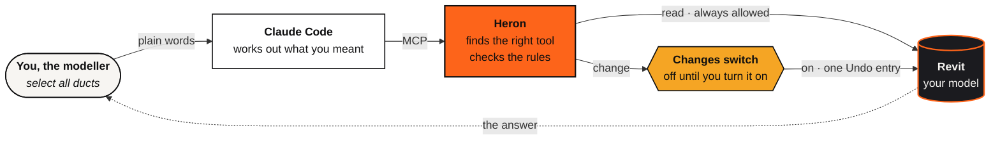

<p align="center">
  
</p>

<p align="center">
  <a href="LICENSE"></a>
  <a href="https://github.com/Ajmalpshaik/Heron-AI/actions/workflows/gates.yml"></a>
  <a href="#status"></a>
  <a href="#status"></a>
</p>

<p align="center">
  <a href="#what-it-is">What it is</a> ·
  <a href="#how-it-fits-together">How it fits together</a> ·
  <a href="#where-to-go-next">Where to go next</a> ·
  <a href="docs/README.md">Documentation</a> ·
  <a href="CONTRIBUTING.md">Contributing</a>
</p>

# Heron AI

> [!IMPORTANT]
> **Dear Modelers — please do not install this yet.**
>
> This repo is public only so the work is open. **It is still not finished.**
> Let me complete everything first. I will announce it on LinkedIn and on the
> website when it is ready to install.
>
> - **Until then, feel free to read and follow along.**
> - The early build on the Releases page, [v0.1.0](https://github.com/Ajmalpshaik/Heron-AI/releases/tag/v0.1.0),
>   is **for testing only** and is **unsigned**. This notice still stands.
>
> **Programmers and AI engineers — your thoughts are very welcome.**
> Please read the code and share your suggestions, ideas or corrections
> through an Issue or a Discussion. That help is what I am asking for now,
> not installs.

**A modular, agent-based AI engineering platform for BIM.**

> The user focuses on BIM. Heron AI focuses on everything behind the BIM work.

## What it is

Heron AI lets a BIM Modeler, BIM Coordinator or engineer **drive Revit by describing the work in
plain words** — *"select all ducts"*, *"which views have no template?"*, *"lay out sprinklers in these
rooms"*.

Claude Code works out what you meant. Heron finds the right tool, runs it inside Revit, checks the
result and keeps a record. You never need to know C#, the Revit API or anything else behind it.

It is **not** a chatbot, a coding assistant, or a plain MCP server.
More on what you can ask: [**Using Heron**](docs/guide/using-heron.md).

## How it fits together



<details>
<summary>Same thing as plain text</summary>

```text
You, the modeller   "select all ducts"
     |  plain words
Claude Code         works out what you meant
     |  MCP
Heron               finds the right tool, checks the rules
     |-- read ------------------------------------> Revit  (always allowed)
     |-- change -> Changes switch, off by default -> Revit  (one Undo entry)
Revit -> the answer comes back to you
```

</details>

**Heron reads your model freely and changes nothing until you turn the Changes switch on.** Every change
it makes is one entry in Revit's Undo list. The full picture, part by part:
[**How Heron works**](docs/guide/how-heron-works.md).

## Where to go next

| You are… | Go to | You will find |
|---|---|---|
| **a BIM modeller** | [**Using Heron**](docs/guide/using-heron.md) | What you can ask, and what keeps your model safe |
| **setting up a PC** | [**What to install**](docs/WHAT-TO-INSTALL.md) · [**System requirements**](docs/guide/system-requirements.md) | Everything a PC needs, Python first, what is optional, and what each piece costs on disk |
| **changing Heron** | [**Changing Heron**](docs/guide/changing-heron.md) | Where each kind of code lives, the rules, and the checks before a pull request |
| **checking what is proven** | [**What is proven**](docs/guide/what-is-proven.md) | Built versus proven, item by item, and the commands that count it |

**Anyone else:** the owner starts at [FOR-THE-OWNER](docs/FOR-THE-OWNER.md) · an AI agent at
[AGENTS.md](AGENTS.md) · a BIM manager at [16 — Version Support](docs/16-version-support-strategy.md)
and [12 — Security & Permissions](docs/12-security-and-permissions.md). **Every document:**
[the documentation front door](docs/README.md).

## In short

Each card is the one-line version of a page. Click through for the whole of it.

### Four parts

**Heron Revit** (the add-in, in `revit/`) · **Heron MCP** (the bridge to the AI, in `mcp/`) ·
**Heron Brain** (the library and the calculations, in `brain/`) · **Heron Platform** (install,
update, settings, in `platform/`).
→ [How Heron works — Four parts](docs/guide/how-heron-works.md#four-parts)

### One request, step by step

You type; Claude Code asks Heron which tool fits; Heron runs it inside Revit in one named
`TransactionGroup`; the change is **one** entry in Revit's Undo list.
→ [How Heron works — One request, step by step](docs/guide/how-heron-works.md#one-request-step-by-step)

### What keeps the model safe

Heron only reads until **Changes** is on ([D-19](docs/DECISIONS.md)). A change from the chat runs
only a `PROVEN` tool ([D-117](docs/DECISIONS.md)); with **Ask to Keep** on, Revit asks **Keep or
Discard** first ([D-126](docs/DECISIONS.md)); and Ctrl+Z takes the whole change back.
→ [What keeps the model safe](docs/guide/safety.md)

### Status

**Built and proven are different words here, on purpose.** The bridge — Phase 0 — is proven in Revit
2020 and 2024 ([HANDOVER §3](docs/HANDOVER.md), [field notes](docs/00e-field-notes-proven-bridge.md));
most other parts are built and still owed a real Revit. No count is typed on these pages:
`python tools/check-gaps.py` derives what is unfinished.
→ [What is proven](docs/guide/what-is-proven.md)

---

**Licence:** [Apache 2.0](LICENSE) · [Disclaimer](DISCLAIMER.md) · [Security](SECURITY.md) ·
**Owner:** Ajmal PS · **Domain:** BIM / Revit engineering automation
