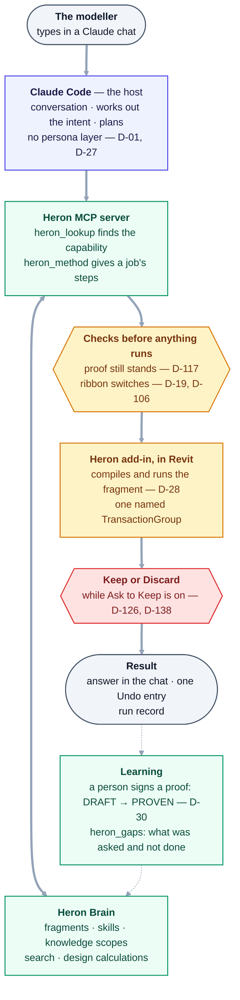
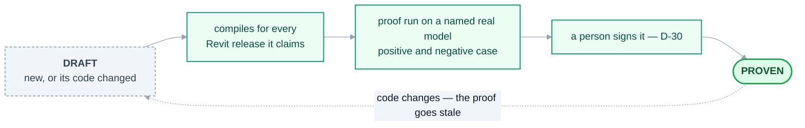
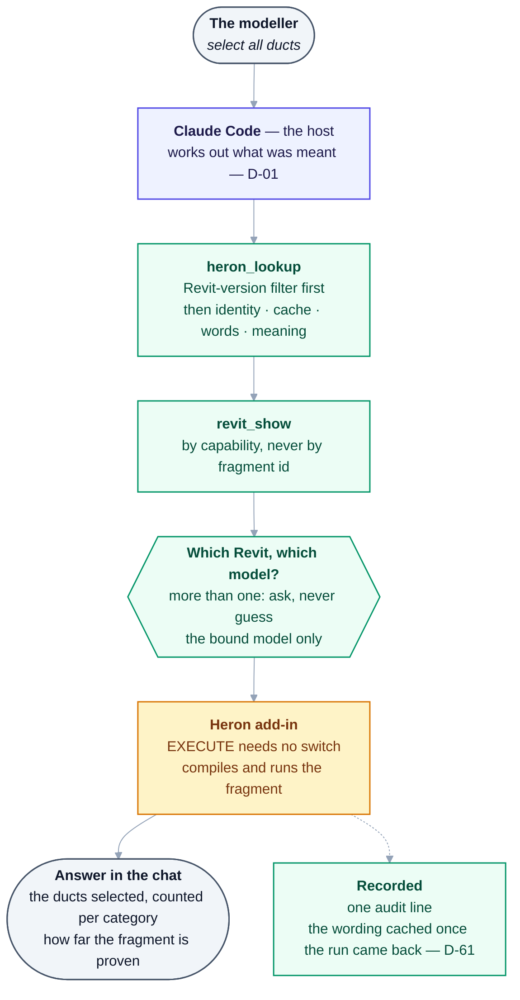
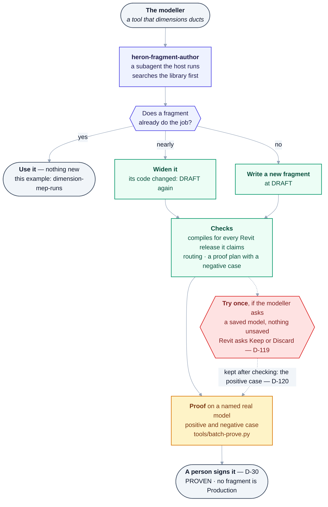

# Heron AI — Master Platform Handover & Architecture Specification

> **The original specification, kept as the owner wrote it on 2026-08-27. It says what Heron was asked
> to be, not what is built.** What runs today is in
> [02 §7a](02-architecture-overview.md#7a-as-built--the-parts-that-run-today), the [README](../README.md)
> and the [project map](PROJECT-MAP.md). Where this file and [DECISIONS.md](DECISIONS.md) differ,
> **DECISIONS.md wins** ([PROJECT-MAP §D](PROJECT-MAP.md#d-truth-hierarchy--which-source-wins)).
> Its text, tables and diagrams are kept verbatim. Where a section's data no longer matches what is
> built, a dated **As built (2026-10-18)** note sits directly under it, with its evidence; a section with
> no note was checked that day and still holds. A count that moves is never typed in a note: the note
> names the command that derives it.

> **Status:** Source-of-truth record, **part 1 of 4**, as provided by the owner on 2026-08-27.
> Part 1 specifies **the platform and its organisation**.
> Part 2 — [00b — Agent Operating System](00b-master-specification-agent-os.md) — specifies
> **how Heron operates internally** as an autonomous engineering organisation.
> Part 3 — [00c — Handover Baseline](00c-master-handover-baseline.md) — consolidates both, and is
> **authoritative on the Golden Rules**, replacing this part's ten with fifteen.
> Part 4 — [00d — Additional Requirements](00d-additional-requirements.md) — adds the Kernel, the
> Workflow Engine, the Constitution and 30 mandatory components.
>
> This file is the **verbatim architectural intent**. It is not a build plan.
> Engineering annotations, gaps and decisions live in the sibling documents —
> see [PROPOSALS.md](PROPOSALS.md), [OPEN-QUESTIONS.md](OPEN-QUESTIONS.md) and [DECISIONS.md](DECISIONS.md).
> Do not edit this file to "fix" it. Record changes as decisions instead.

| Field | Value |
|---|---|
| Project Name | Heron AI |
| Platform Type | Modular AI Engineering Platform |
| Primary Domain | BIM / Revit Engineering Automation |
| Primary Interface | Conversational AI |
| Core Integration | Revit Add-in + MCP Server + AI Brain + RAG + Skills + Fragments + Memory |
| Architecture Principle | One Responsibility per Agent |
| User Principle | User does BIM work. Heron AI does everything else. |

> **As built (2026-10-18):** the primary interface is a chat in Claude Code, the host
> ([D-01](DECISIONS.md)). Talking to Heron from inside Revit was built and removed
> ([D-105](DECISIONS.md)); the Companion page beside Revit shows Heron's work and edits tables, and is
> never a second place to talk ([D-108](DECISIONS.md)). The "AI Brain" makes no model call of its own:
> the model is the host's, and the brain is the fragment library, the skills, one knowledge store per
> scope, search and the design calculations ([D-58](DECISIONS.md),
> [02 §7a](02-architecture-overview.md#7a-as-built--the-parts-that-run-today)).

---

## 1. Executive Vision

Heron AI is not intended to be a normal chatbot, coding assistant, or simple MCP server.

Heron AI is a self-improving AI engineering platform designed to allow a normal BIM Modeler, BIM Coordinator, or Developer to work with complex Revit/BIM automation using simple natural language.

The user should not need to understand:

- C#
- .NET
- Revit API
- MCP
- GitHub
- RAG
- Vector databases
- Embeddings
- Fragments
- Skills
- Agent architecture
- Package management
- Build systems
- Deployment
- Version compatibility

The user should simply describe the work. Example:

- "Select all ducts."
- "Move these ducts 200 mm up."
- "Add end caps."
- "Create dimensions."
- "Check this model against our BIM standard."
- "Fix this issue."

Behind the scenes, Heron AI should perform all required analysis, knowledge retrieval, code generation, validation, testing, execution, logging, learning, and maintenance. The user experience must remain simple.

> **As built (2026-10-18):** where each example stands. A fragment's status is read from its card,
> `grep -h '^heron-status:' brain/fragments/<name>/fragment.yaml`; a PROVEN card means one recorded proof
> on a named real model ([D-30](DECISIONS.md)), not every Revit release.
>
> | The example | What answers it today | Evidence |
> |---|---|---|
> | *"Select all ducts."* | `revit_select_by_category`, or the `select-elements` skill through `revit_show` | Ran in Revit 2020 and 2024 in Phase 0: the ducts were highlighted in both ([README Status](../README.md#status), [field notes](00e-field-notes-proven-bridge.md)) |
> | *"Move these ducts 200 mm up."* | `revit_preview_move`, then `revit_apply_move` | Measured in Revit 2024 on 2026-10-17: three ducts moved +200.0000 mm, a pinned one did not, and one Ctrl+Z put them back ([Group D](needs-checking/group-d.md)). Other releases not run |
> | *"Add end caps."* | `cap-open-pipe-ends`, through `revit_change` — pipes only: its card says the Revit API has no matching call for ducts | card PROVEN |
> | *"Create dimensions."* | `create-dimension`, `dimension-mep-runs` and their siblings, through `revit_change` | some PROVEN, some DRAFT — `grep -l '^capability: .*DIMENSION' brain/fragments/*/fragment.yaml \| xargs grep -h '^heron-status:' \| sort \| uniq -c` |
> | *"Check this model against our BIM standard."* | `check-model-standards` against naming patterns the person supplies (DRAFT); `heron_standards` and `heron_check` for a question about a standard; the `heron-model-auditor` subagent for the open model | A passing check is never called compliant ([`host.chat.yaml`](../brain/instructions/host.chat.yaml)) · [Group AG](needs-checking/group-ag.md) |
> | *"Fix this issue."* | No general fixer. A refusal names the switch or step that is missing ([D-21](DECISIONS.md)); `heron_gaps` reports what was asked and not done ([D-63](DECISIONS.md)) | — |
>
> Behind the scenes: code generation is the host's [`heron-fragment-author`](../.claude/agents/heron-fragment-author.md)
> subagent writing a fragment at DRAFT; testing in a real Revit is a person running
> `tools/batch-prove.py` on a named model and signing the proof ([D-30](DECISIONS.md)); learning and
> maintenance are not automatic (§48, §69).

## 2. Core Philosophy

### 2.1 User First

The user interacts with Heron AI as a BIM professional, not as a programmer.

### 2.2 Background Intelligence

Agents should work primarily in the background. The user should not see:

- Agent chains
- Technical debugging
- RAG operations
- Vector searches
- Code compilation
- API compatibility checks
- Fragment evaluation
- Git operations
- Internal routing

The user should see only useful progress such as `Working...` / `Checking...` / `Completed.`

If an important decision is required, Heron AI asks the user.

> **As built (2026-10-18):** agent chains, compiles and git work stay out of sight, but the modeller
> deliberately sees more than *Working…*. Revit shows a banner saying what Heron is doing and whether it
> is reading or changing ([D-50](DECISIONS.md)); a long tool call sends progress notes to the chat
> ([Group EJ](needs-checking/group-ej.md)); and an answer from the library says how far its fragment is
> proven and which search ran ([23 §6](23-heron-kernel.md), [05 §6](05-heron-brain.md)). Heron asks
> once for an input it does not have, and never assumes it ([D-33](DECISIONS.md)).

## 3. Main Architecture

```text
USER
 |
 v
CONVERSATION / PERSONA LAYER
 |
 v
INTENT + ORCHESTRATOR
 |
 +-------------------------------+
 |                               |
 v                               v
TASK / WORKFLOW ENGINE       KNOWLEDGE SYSTEM
 |                               |
 v                               v
SPECIALIZED AGENTS           RAG / LIBRARY / MEMORY
 |
 v
VALIDATION
 |
 v
EXECUTION
 |
 v
RESULT
 |
 v
LEARNING / MEMORY / FRAGMENT EVOLUTION
```

The platform should never become one huge AI brain. It must remain modular.

> **As built (2026-10-18)** — the diagram above is kept as the owner wrote it. This is the same path as
> it runs today; [02 §7a](02-architecture-overview.md#7a-as-built--the-parts-that-run-today) has it part
> by part, and the [README](../README.md) has it step by step.



| The specification's layer | As built | Where |
|---|---|---|
| Conversation / persona layer | Claude Code, the host. There is no persona: Heron has one voice | [D-01](DECISIONS.md), [D-27](DECISIONS.md) |
| Intent + orchestrator | The host works out what was meant; Heron never classifies intent. `heron_lookup` finds the capability | [D-01](DECISIONS.md), [05 §4.1](05-heron-brain.md) |
| Task / workflow engine | `heron_method` serves a job's steps in order. `heron_workflow` exists, DRAFT, and no tool reaches it | [04 §8.7](04-heron-mcp.md), [23](23-heron-kernel.md) |
| Knowledge system · RAG / library / memory | `brain/`: the fragment library, skills, one knowledge store per scope, word and meaning search | [05](05-heron-brain.md), [10](10-memory-and-knowledge.md) |
| Specialized agents | The agent register — most agents are plain modules that make no model call | [28](28-agent-registry.md), [D-58](DECISIONS.md), `python tools/agent-count.py` |
| Validation | Before: the proof must still stand and the ribbon switches be on. After: what the change touched is counted from Revit's own `DocumentChanged` and kept in a run record (`RevitChangedSet.cs`; in Revit, [Group EV](needs-checking/group-ev.md)) | [D-117](DECISIONS.md), [12 §3a](12-security-and-permissions.md) |
| Execution | The fragment's C# compiled and run inside Revit, in one named `TransactionGroup` | [D-28](DECISIONS.md), Golden Rule 16 |
| Result | The answer in the chat, one entry in Revit's Undo list, a run record (`heron_run_record`) | [README](../README.md) |
| Learning / memory / fragment evolution | A person signs a proof ([D-30](DECISIONS.md)); `heron_gaps` reports what was asked and not done. The split, merge and evolve agents only propose | [09 §5.1](09-skills-and-fragments.md), [21](21-resilience-and-operations.md) |

<details>
<summary>Same thing as plain text</summary>

```text
The modeller (types in a Claude chat)
  -> Claude Code, the host: conversation, intent, plan (no persona layer - D-01, D-27)
  -> Heron MCP server: heron_lookup finds the capability, heron_method gives a job's steps
       <-> Heron Brain: fragments, skills, knowledge scopes, search, design calculations
  -> checks before anything runs: the proof still stands (D-117), the ribbon switches (D-19, D-106)
  -> Heron add-in in Revit: compiles and runs the fragment (D-28), one named TransactionGroup
  -> Keep or Discard, while Ask to Keep is on (D-126, D-138)
  -> result: the answer in the chat, one Undo entry, a run record
  .. learning: a person signs a proof, DRAFT -> PROVEN (D-30); heron_gaps reports what was not done
```

</details>

## 4. Four Major Product Parts

### PART 1 — Heron Revit

Responsible for everything directly related to Revit:

Revit Add-in, Revit ribbon, Revit connection, Revit document, Revit views, elements, parameters, transactions, families, worksets, links, warnings, selection, model operations, Revit API, Revit versions, deployment.

> **As built (2026-10-18):** the folder [`revit/`](../revit/README.md), the only place the Revit API may
> be referenced (`tools/check-structure.py`). It holds the Heron tab — the **Heron** connect button, the
> **Changes**, **Admin**, **Publish** and **Ask to Keep** switches and **Companion** — the named-pipe
> server (`Heron.Bridge`), the in-Revit C# compiler that runs fragments (`Heron.Scripting`,
> [D-28](DECISIONS.md)), the Keep or Discard box, the run clock and the run guard. The model operations
> themselves are fragments in `brain/fragments/`, sent across the pipe when they run. Deployment is not
> here: the installer is in [`platform/`](../platform/README.md) and the copy into Revit's add-ins folder
> is `tools/deploy-addin.ps1`.

## 5. PART 2 — Heron MCP

Responsible for communication between AI and the Revit environment:

MCP Server, MCP tools, tool registration, connection management, request routing, authentication, health monitoring, connection recovery, capability discovery, MCP version compatibility.

The MCP layer should not contain business logic unnecessarily. It should act as a controlled communication bridge.

> **As built (2026-10-18):** the folder [`mcp/`](../mcp/README.md) — the server, which speaks MCP over
> stdio and is started by the `.mcp.json` in the Heron folder; the pipe client; and the Companion page
> ([40](40-heron-companion.md)). Its tools and each one's risk: `python mcp/server/heron_tools.py`. The
> tools are thick and specific, and the fragment library is reached by **capability** through
> `revit_read`, `revit_show` and `revit_change`, never by fragment id ([D-03](DECISIONS.md),
> [04 §3](04-heron-mcp.md)). Authentication is the pipe itself — local only, limited to the current
> Windows user ([D-02](DECISIONS.md)) — and the lease that refuses a second chat
> ([D-22](DECISIONS.md)). Version compatibility is the bridge's protocol number
> ([04 §5](04-heron-mcp.md)) and the MCP SDK tracked across major versions ([D-45](DECISIONS.md)).
> Capability discovery is `heron_lookup` and `heron_capabilities`. Off Windows the server serves its
> library tools only ([D-132](DECISIONS.md)).

## 6. PART 3 — Heron Brain

The intelligence and knowledge layer:

Skills, Fragments, RAG, Vector database, Embeddings, Knowledge library, Personal memory, Project memory, Company knowledge, Community knowledge, Fragment lifecycle, Fragment evolution, Knowledge validation, Knowledge ranking.

> **As built (2026-10-18):** the folder [`brain/`](../brain/README.md), which runs and is tested on a PC
> with no Revit. Built: the fragment library and the skills (count each with
> `grep -h '^heron-status:' brain/fragments/*/fragment.yaml | sort | uniq -c`, and the same over
> `brain/skills/*.yaml`), one SQLite knowledge store per scope with word and meaning search
> ([D-23](DECISIONS.md), [D-24](DECISIONS.md)), and the lifecycle in each card. **Not built:** community
> knowledge ([D-41](DECISIONS.md)), and fragment evolution beyond proposals (§21–§23). **Not in this
> list but built:** the HVAC and fire-protection calculations, building loads, sprinkler layout and
> sprinkler hydraulics, each built and not proven ([41](41-hvac-design.md), [42](42-fire-protection-design.md),
> [44](44-building-loads-from-the-model.md), [46](46-sprinkler-hydraulics-from-the-model.md),
> [47](47-sprinkler-layout-from-the-model.md)). Every brain module's header reads DRAFT or below:
> `grep -rhoE 'Heron-Status: *[A-Z]+' brain/*.py | sort | uniq -c`.

## 7. PART 4 — Heron Platform

The platform management layer:

Installer, Update system, Package manager, Agent registry, Agent creator, Agent training, Agent validation, Workspace management, GitHub integration, Security, Logging, Backup, Recovery, Health monitoring, Configuration, Documentation, Release management.

> **As built (2026-10-18):** a smaller part than this list, because the host provides the agent
> framework, MCP configuration and its own updates ([02 §7](02-architecture-overview.md)).
>
> | The specification lists | As built | Where |
> |---|---|---|
> | Installer | `HeronInstaller.exe` (the window) and `heron-install` (the command line) over one engine; run on the owner's PC and laptop, not every row passed | [`platform/`](../platform/README.md), [Group EP](needs-checking/group-ep.md) |
> | Configuration, Security, Logging | `Heron.Core`: the switches in `heron.config`, the permission ladder, the audit trail and run records | [`platform/Heron.Core`](../platform/README.md), [12](12-security-and-permissions.md) |
> | Update system | a check whether a newer release exists, and the update rules as refusals; nothing updates on its own (§10) | `UpdateCheck.cs`, `brain/heron_update.py` |
> | Package manager | the product list as data, and a DRAFT resolver (§61) | `platform/heron-products.json`, [D-93](DECISIONS.md) |
> | Agent registry, creator, training, validation | brain modules, DRAFT; the register is [28](28-agent-registry.md) (§37–§40) | `python tools/agent-count.py` |
> | Workspace management, Backup, Recovery | the path manager is built and used everywhere; backup and restore are a tool run by hand (§32) | `HeronPaths.cs`, `tools/heron-backup.py` |
> | GitHub integration | DRAFT modules no tool reaches (§36) | `brain/heron_github.py` and its siblings |
> | Health monitoring | on request, not continuous (§13) | `revit_health`, `heron_diagnose` |
> | Documentation, Release management | hand-written documents checked by a gate; releases built by CI on a tag, unsigned (§63) | `tools/check-docs.py`, [`release.yml`](../.github/workflows/release.yml) |

## 8. User Experience

A new user may know nothing about programming. Installation should therefore be almost completely automatic.

1. User installs Claude Code.
2. User points Heron AI to a workspace folder.
3. Heron AI detects the environment.
4. Heron AI checks installed Revit versions.
5. Heron AI checks required dependencies.
6. Heron AI installs required packages.
7. Heron AI builds required components.
8. Heron AI deploys the Revit Add-in.
9. Heron AI configures MCP.
10. Heron AI registers Heron tools.
11. Heron Brain is initialized.
12. RAG database is initialized.
13. Required skills are installed.
14. Required fragments are indexed.
15. Health checks are performed.
16. User is informed that installation is complete.

The user should not manually edit configuration files unless they intentionally choose an advanced developer mode.

> **As built (2026-10-18):** one installer run now does most of this, DRAFT
> ([07 §1](07-installation-and-update.md)). It has run on the owner's laptop on 2026-10-17 and
> 2026-10-18 from a local build of `main`, not yet from a published release that carries the Python
> half ([Group EP](needs-checking/group-ep.md)); the [README](../README.md) still asks modellers not to
> install.
>
> | Step | As built |
> |---|---|
> | 1 | Claude Code is still needed ([D-01](DECISIONS.md)). A Microsoft Store Claude is refused: its private copy of AppData hides an install from Revit (`ClaudeAppCopy.cs`, EP4) |
> | 2 | The Heron folder is unzipped from `heron-project.zip`, and Claude Code is opened in it. Heron's own data lives in `%USERPROFILE%\.heron` ([D-135](DECISIONS.md)), and the project being worked on is the open Revit model |
> | 3–4 | `HeronInstaller.exe` or `heron-install` finds the Revit releases installed (`tools/HeronRevit.ps1`) |
> | 5–6 | After the add-in, it installs the pinned Python packages from `requirements-lock.txt` — said before Install is pressed, never Python itself (`PythonSetup.cs`) |
> | 7 | **Not on the user's PC.** CI builds every release on a `v*` tag; the installer downloads the zip and checks it against `checksums.txt` ([D-91](DECISIONS.md), [D-96](DECISIONS.md)). The one release, v0.1.0, is unsigned |
> | 8 | `tools/deploy-addin.ps1`, per user, no administrator rights ([D-90](DECISIONS.md)); it waits while Revit is open and never closes it |
> | 9–10 | `.mcp.json` ships in the Heron folder; the server declares its own tools when it starts |
> | 11–14 | Skills and fragments ship as files; `tools/heron-ready.py` builds the knowledge store, and the server rebuilds an empty or stale one at start |
> | 15–16 | `heron-ready --check` says READY or names what to fix; the window reports per product, per Revit release |
>
> Configuration: the ribbon's switches are the only settings a modeller meets, all off by default
> (`HeronConfig.cs`). There is no developer mode ([22 §3](22-users-modes-and-extensibility.md)).

## 9. Installation Agents

| Agent | Responsibility |
|---|---|
| Installation Orchestrator Agent | Controls the complete installation workflow |
| Environment Detection Agent | Detects Windows, Revit versions, .NET versions, installed dependencies, workspace, available storage, required runtimes |
| Revit Installation Agent | Handles Revit Add-in installation |
| Revit Deployment Agent | Builds and deploys the Add-in |
| MCP Installation Agent | Installs and configures MCP |
| Dependency Agent | Checks and installs dependencies |
| Configuration Agent | Creates required configuration |
| Brain Initialization Agent | Initializes Heron Brain |
| RAG Initialization Agent | Creates vector database, indexes, embedding configuration, knowledge directories |
| Health Check Agent | Checks that everything is working |

> **As built (2026-10-18):** each is a row of the register's *Installation & Update* department
> ([28](28-agent-registry.md)); `grep -rl 'HERON-INS-' brain mcp platform tools` finds the files that
> claim them. What has actually installed Heron on a real PC is the C# installer, recorded in
> [Group AB](needs-checking/group-ab.md), [Group AC](needs-checking/group-ac.md) and
> [Group EP](needs-checking/group-ep.md).
>
> | Agent | As built |
> |---|---|
> | Installation Orchestrator | `InstallEngine` — plan, wait while Revit is open, deploy, report — behind the window and `heron-install` |
> | Environment Detection | `tools/HeronRevit.ps1` for the Revit releases; `ClaudeAppCopy.cs` for a Store Claude |
> | Revit Installation | `InstallEngine` and `WindowsAdapters` |
> | Revit Deployment | `tools/deploy-addin.ps1` — the copy only, refusing a build whose runtime does not match the release. The build is CI's `release.yml`. The register keeps this row in the Revit department, not here |
> | MCP Installation | `.mcp.json` in the Heron folder; `mcp/server/heron_register.py` is DRAFT |
> | Dependency | `PythonSetup.cs`, asked first ([Q-39](open-questions/answered.md)) |
> | Configuration | `heron.config`, written with every switch off and never overwritten by an update — measured on 2026-09-19 ([07 §10.5](07-installation-and-update.md)) |
> | Brain and RAG Initialization | `tools/heron-ready.py` builds the knowledge store; `heron_brain_init.py` and `heron_rag_init.py` are DRAFT |
> | Health Check | `heron-ready --check`, and `PythonSetup` runs it as the install's verdict |

## 10. Update System

Heron AI must have automatic update detection. The platform should periodically check the official Heron AI source/repository and determine: installed version, latest version, changed components, compatibility, required migrations, security updates.

User receives: *"A new Heron AI update is available. Update now?"*

The update system must support: version detection, update download, dependency update, component update, migration, validation, rollback.

Existing working functionality must never be unnecessarily broken.

> **As built (2026-10-18): half built, and nothing updates on its own.** `UpdateCheck.cs` says whether a
> newer published release exists — up to date, newer, ahead, or cannot tell — when the installer runs,
> and `brain/heron_update.py` holds [07 §7](07-installation-and-update.md)'s update rules as refusals.
> There is no periodic check and no *"Update now?"*. An update is an install over the old one — install
> replaces ([D-94](DECISIONS.md)) — which keeps the old files in `%LOCALAPPDATA%\Heron\install-backup`
> and never touches `heron.config`. Measured on the owner's PC on 2026-09-19: an upgrade left
> `heron.config` byte-identical, and a rollback restored every file on Revit 2020, 2024 and 2027
> ([07 §10](07-installation-and-update.md)). **Not run:** an update to a newer published version with
> its consent, a migration, and version pinning ([07 §10.10](07-installation-and-update.md)). A new
> add-in takes effect only when Revit restarts.

## 11. Reverse Compatibility Principle

**NEVER BREAK A WORKING VERSION.**

Example: a fragment works in Revit 2020, 2021, 2022. A new Revit 2023 API capability becomes available. Heron AI must not simply replace the old implementation. It should determine:

1. Can the existing implementation work?
2. Can the new capability be added without affecting old versions?
3. Is an adapter required?
4. Is a version-specific implementation required?

Only when necessary should Heron AI create a version-specific branch.

> **As built (2026-10-18):** one source tree, built once per Revit release. Every fragment has one
> implementation, `impl/any/fragment.cs`; where releases differ it branches on the compile symbols
> (`REVIT2024_OR_GREATER` and the rest), and that branch is both the adapter and the version-specific
> implementation of this list ([16 §5](16-version-support-strategy.md),
> [11 §5](11-orchestration-and-workflows.md)). CI compiles the add-in for every release and each fragment
> for every release it claims (`tools/check-compile.py`, `tools/check-fragments-compile.py`), and
> `tools/check-api-surface.py` checks every Revit member Heron calls. A compile is not a run: Revit 2026
> loaded the add-in and then no fragment could run, and the repair has not yet run in Revit
> ([Group EQ](needs-checking/group-eq.md), [Group GW](needs-checking/group-gw.md)).

## 12. Revit Agent Department

Each agent should have one clear responsibility.

- Revit Connection Agent
- Revit Document Agent
- Revit Application Agent
- Revit UI Agent
- Revit Ribbon Agent
- Revit Selection Agent
- Revit Element Agent
- Revit Category Agent
- Revit Parameter Agent
- Revit Family Agent
- Revit View Agent
- Revit Workset Agent
- Revit Link Agent
- Revit Transaction Agent
- Revit Warning Agent
- Revit Performance Agent
- Revit Export Agent
- Revit Import Agent
- Revit API Agent
- Revit Version Agent
- Revit Compatibility Agent
- Revit Deployment Agent

> **As built (2026-10-18):** every name here is a row of the register's *Revit Engineering* department
> ([28](28-agent-registry.md)), with an id, a tier and a risk, beside rows the register added (schedules,
> levels and grids, rooms, sheets, MEP systems, units and more). `python tools/agent-count.py` says how
> many are built, which means a source file claims the id — not that it has met a Revit. Most are plain
> C# in the add-in, or a fixed read such as `revit_views`, and make no model call
> ([02 §6](02-architecture-overview.md)). The Transaction Agent is the add-in's write path: one named
> `TransactionGroup` per change (`RevitWrite.cs`, `RevitFragment.cs`, [D-18](DECISIONS.md)). The Revit
> API Agent, `brain/heron_revit_api.py` (DRAFT), only frames a novel operation's question with the
> releases it must hold on; the answer is the host's model call. Which add-in agents have a signed run in Revit is
> [`brain/agent-proofs/`](../brain/agent-proofs/README.md) — check whether each still stands with
> `python tools/prove-agent.py check`.

## 13. Revit Plugin Health

A dedicated **Revit Plugin Health Agent** must verify:

- Is Revit installed?
- Is the required Revit version available?
- Is Heron Add-in installed?
- Is the Add-in loaded?
- Is the ribbon available?
- Is the MCP connection active?
- Is the correct MCP version running?
- Is the Revit document available?
- Are required tools registered?

> **As built (2026-10-18):** built as three checks, run on request rather than continuously.
> [`heron_health.assess()`](../mcp/server/heron_health.py) gives each part and the whole one state —
> HEALTHY, WARNING, DEGRADED or FAILED — and no Revit connected is a WARNING, not a failure; the chat
> reaches it through `revit_health`, and `heron_diagnose` asks every layer in turn. Before any chat,
> `python tools/heron-ready.py --check` answers the install questions: is the add-in installed for a
> Revit, do Heron's packages load, does the server start. *"The correct MCP version"* is the bridge's
> protocol number: a bridge on another one is refused with *"Restart that Revit to finish updating"*
> ([03 §3](03-heron-revit.md), [04 §5](04-heron-mcp.md)).

## 14. MCP Agents

- MCP Connection Agent
- MCP Server Agent
- MCP Tool Registry Agent
- MCP Configuration Agent
- MCP Health Agent
- MCP Authentication Agent
- MCP Version Agent
- MCP Compatibility Agent
- MCP Recovery Agent
- MCP Logging Agent
- MCP Security Agent

> **As built (2026-10-18):** these are the register's *MCP / Bridge* department
> ([28](28-agent-registry.md)), counted by `python tools/agent-count.py`. What they come to in the
> code:
>
> | Agent | As built |
> |---|---|
> | Server, Tool Registry | `mcp/server/heron_mcp_server.py` over stdio; every tool and its risk in `heron_tools.TOOLS` |
> | Connection, Recovery | the pipe client finds the Revit and the bound model, and never guesses which ([Article 12a](../HERON_CONSTITUTION.md)); failure analysis is a table, not a model call ([D-21](DECISIONS.md)) |
> | Configuration | `.mcp.json` in the Heron folder |
> | Health | `revit_health`, `heron_diagnose` (§13) |
> | Authentication | the named pipe is local only and limited to the current Windows user (`BridgeServer.cs`, [D-02](DECISIONS.md)); a second chat is refused ([D-22](DECISIONS.md)) |
> | Version, Compatibility | `heron_version`; the bridge's protocol number gates the pair ([04 §5](04-heron-mcp.md)); the MCP SDK is tracked across major versions ([D-45](DECISIONS.md)) |
> | Logging | one audit line per request (`HeronAudit.cs`) |
> | Security | the gate is in the add-in, not the server; a call above what the switches allow is refused by name — no code returns `REQUIRES_CONFIRMATION` ([12 §3](12-security-and-permissions.md)) |

## 15. Heron Brain

Heron Brain should not be one database containing everything. Knowledge must be separated.

```text
CORE KNOWLEDGE
|
+-- COMPANY KNOWLEDGE
|
+-- PROJECT KNOWLEDGE
|
+-- USER KNOWLEDGE
|
+-- COMMUNITY KNOWLEDGE
|
+-- TEMPORARY KNOWLEDGE
|
+-- EXPERIMENTAL KNOWLEDGE
```

This prevents the brain from becoming polluted and difficult to search.

> **As built (2026-10-18):** six scopes, one store each — `global` (this diagram's CORE), `company`,
> `project`, `user`, `temporary` and `experimental` (`brain/heron_scope.py`, `SCOPES`). A query asks one
> scope at a time; `ATTACH` is refused by name. **COMMUNITY KNOWLEDGE is not built** — there is no
> community store ([D-41](DECISIONS.md): single user now, company knowledge is a git repo). Where each
> store lives on the PC is [10 §1.1](10-memory-and-knowledge.md) — `%USERPROFILE%\.heron` on Windows
> since [D-135](DECISIONS.md).

## 16. Skill System

Skills represent reusable capabilities. Examples: Select Ducts, Select Cable Trays, Create Dimension, Add End Cap, Move Elements, Check Parameters, Fix Warnings, Export Model, Check BIM Standard.

Skill metadata:

```text
Skill ID
Name
Description
Domain
Required Agents
Required Fragments
Revit Versions
.NET Versions
Dependencies
Risk Level
Status
Success Rate
Created Date
Updated Date
```

> **As built (2026-10-18):** skills are files, [`brain/skills/*.yaml`](../brain/skills/), checked by
> `python brain/heron_skill.py` against its `REQUIRED` fields. Every skill is DRAFT:
> `grep -h '^heron-status:' brain/skills/*.yaml | sort | uniq -c`. The chat gets a skill's steps from
> `heron_method` ([09 §1](09-skills-and-fragments.md)). Most of the examples above are single
> capabilities reached through the three doors, not skills; the skills are jobs of several steps, such
> as `family-creation`, `duct-layout` or `drawing-set` (`ls brain/skills`).
>
> | The specification's field | In a skill file |
> |---|---|
> | Skill ID, Name, Domain, Risk Level, Status, Revit Versions | `id`, `name`, `domain`, `risk`, `heron-status`, `revit` |
> | Description | `purpose` |
> | Required Fragments, Dependencies | `needs` — **capabilities, never fragments**, so a fragment can be replaced without editing the skill ([D-29](DECISIONS.md)) — and `preconditions` |
> | Required Agents | not kept |
> | .NET Versions | not kept: the runtime follows the Revit release (`Directory.Build.props`) |
> | Success Rate | not on the card. `brain/heron_performance.py` (DRAFT) reports per release, and a rate never promotes anything ([D-30](DECISIONS.md)) |
> | Created Date, Updated Date | `heron-since` (a version, not a date) and `git log` |
> | *(added)* | `utterances` — the words a modeller says — and `source` |

## 17. Fragment System

Fragments are reusable knowledge/action units. A fragment is **not** simply a piece of code. A fragment should contain:

- purpose
- inputs
- expected output
- implementation
- API requirements
- dependencies
- version compatibility
- validation rules
- usage history
- success rate
- failure history
- related fragments
- related skills

> **As built (2026-10-18):** one folder per fragment, `brain/fragments/<name>/`, holding `fragment.yaml`,
> `impl/any/fragment.cs` and `tests/cases.yaml`; `python brain/heron_fragment.py` validates every card
> ([09 §4](09-skills-and-fragments.md)). A fragment is a composable piece with a declared contract, not
> a whole answer ([D-29](DECISIONS.md)).
>
> | The specification's item | As built |
> |---|---|
> | purpose, inputs, expected output | `purpose`, and the `contract`'s `needs` and `provides` |
> | implementation | `impl/any/fragment.cs`, one file for every release |
> | API requirements | not a field: `tools/check-api-surface.py` derives the Revit members it calls |
> | dependencies, related fragments, related skills | derived, not typed: a need is met by another fragment's `provides`, and the dependency graph stores only derived edges ([D-40](DECISIONS.md)); a skill names the capabilities it needs |
> | version compatibility | `revit:` and `runtime:` (§24) |
> | validation rules | `tests/cases.yaml`, and the proof's negative case ([D-30](DECISIONS.md)) |
> | usage history | not on the card: the audit trail and the run records (`HeronAudit.cs`, `HeronRuns.cs`) |
> | success rate | not kept; promotion is one recorded proof, not a count ([D-30](DECISIONS.md)) |
> | failure history | [FRAGMENT-ISSUES](FRAGMENT-ISSUES.md) |
> | *(added)* | `id`, `semantic-identity`, `capability`, `risk`, `utterances`, and the `proof:` block |

## 18. Fragment Lifecycle

```text
DISCOVERED
   |
   v
DRAFT
   |
   v
TESTING
   |
   v
VALIDATED
   |
   v
PROVEN
   |
   v
PRODUCTION
   |
   v
DEPRECATED
   |
   v
ARCHIVED
```

A fragment should not automatically become production knowledge simply because it worked once.

> **As built (2026-10-18):** the code knows all eight stages (`brain/heron_fragment.py`, `STATUSES`), but
> the library uses **two** — `DRAFT` and `PROVEN` — and no fragment has reached `PRODUCTION`. A fragment
> is promoted by **one recorded proof** on a named real model, with a negative case, signed by a person
> ([D-30](DECISIONS.md)); `TESTING` and `VALIDATED` are not used. Count both with
> `grep -h '^heron-status:' brain/fragments/*/fragment.yaml | sort | uniq -c`.



[09 §5.1](09-skills-and-fragments.md) has each step with its command. A `DRAFT` can be tried once on a
saved model behind Revit's Keep or Discard box ([D-119](DECISIONS.md)); only a `PROVEN` fragment's change
is kept from a chat ([D-117](DECISIONS.md)).

<details>
<summary>Same thing as plain text</summary>

```text
DRAFT (new, or its code changed) -> compiles for every Revit release it claims
  -> proof run on a named real model, a positive and a negative case
  -> a person signs it (D-30) -> PROVEN
PROVEN -> its code changes -> the proof goes stale -> DRAFT again
```

</details>

## 19. Fragment Validation Agent

Checks:

- Is the fragment logically correct?
- Is the API correct?
- Is the .NET version correct?
- Are dependencies correct?
- Is the metadata correct?
- Does it follow Heron architecture?
- Does it duplicate another fragment?
- Is it reusable?

> **As built (2026-10-18):** no single agent; each check is held somewhere else, and none of them can
> answer the first question.
>
> | Check | As built |
> |---|---|
> | Logically correct? | only a recorded proof on a named real model, with a negative case, signed by a person ([D-30](DECISIONS.md)). The proving tool, `heron_validate.py`, never writes `heron-status`, and its `accept` needs a person's name |
> | API correct? .NET correct? | compiled for every release it claims, in CI (`tools/check-fragments-compile.py`), and its Revit members checked (`tools/check-api-surface.py`). A compile is not a proof |
> | Dependencies correct? | each need is matched to what another fragment provides, and an orphan is reported per need ([D-102](DECISIONS.md)) |
> | Metadata correct? | `heron_fragment.REQUIRED`, and `tools/check-metadata.py` for the header |
> | Follows Heron architecture? | a fragment on the read or show path that would open a transaction of its own is refused before it compiles (`HeronSourceScan.cs`), and each door refuses a fragment above its risk ceiling |
> | Duplicates another? | a new fragment is refused `REUSE_EXISTS` when one already does the job (`heron_generate.py`) |
> | Reusable? | its contract — a composable piece ([D-29](DECISIONS.md)) |

## 20. Fragment Performance Agent

Tracks: success, failure, execution time, user corrections, repeated use, version compatibility, error frequency.

This information helps determine whether a fragment is truly proven.

> **As built (2026-10-18):** `brain/heron_runs.py` (DRAFT) counts runs **per Revit release**, never
> averaged across releases, and looks for runs that contradict a proof, which are reported
> ([D-133](DECISIONS.md)); no MCP tool reaches it. It does **not** decide whether a fragment is proven:
> one recorded proof does, never a count of runs ([D-30](DECISIONS.md)). What failed lately and what is
> slow is `heron_gaps`.

## 21. Fragment Split Agent

Suppose one fragment contains:

```text
Select elements
Filter category
Check parameter
Move elements
Create transaction
Validate result
```

The Fragment Split Agent determines whether it should become reusable fragments:

```text
Select Elements
Filter Category
Check Parameter
Move Elements
Validate Result
```

A generic `Select Elements` fragment may then be reused by Select Ducts, Select Pipes, Select Cable Trays, Select Equipment, Select Doors.

> **As built (2026-10-18):** `brain/heron_split.py` (DRAFT) proposes a split only where two real
> consumers exist, and writes nothing; no tool reaches it ([09 §6](09-skills-and-fragments.md)). The
> library already has this shape: a filter such as `select-by-categories` provides `elements`, and
> `SET_SELECTION` consumes it. *Create transaction* is never a fragment: the add-in opens one named
> `TransactionGroup` around the whole change ([Golden Rule 16](14-golden-rules.md)).

## 22. Fragment Merge Agent

If multiple fragments are effectively identical, Heron AI should detect them and propose: merge, replace, keep separate, or deprecate duplicate.

> **As built (2026-10-18):** `brain/heron_merge.py` (DRAFT) proposes exactly these four and applies
> none; no tool reaches it ([09 §6](09-skills-and-fragments.md)). A new duplicate is stopped earlier:
> authoring refuses with `REUSE_EXISTS` when a fragment already does the job (`heron_generate.py`).

## 23. Fragment Evolution Agent

Decides whether a fragment should: remain unchanged, be improved, receive an adapter, receive a version-specific implementation, split, merge, or become deprecated. Essential for self-growing knowledge.

> **As built (2026-10-18):** `brain/heron_evolve.py` (DRAFT) routes each verdict to the agent that owns
> it and applies none; no tool reaches it ([09 §6](09-skills-and-fragments.md)). An adapter and a
> version-specific implementation are both `#if` branches inside the fragment's one
> `impl/any/fragment.cs` (§11). A fragment whose code changes goes back to DRAFT until it is proved
> again ([D-30](DECISIONS.md)).

## 24. Version Compatibility

Every code-related fragment must record compatibility.

```text
Revit:
2020, 2021, 2022, 2023, 2024, 2025, 2026, 2027

.NET:
4.7.2 ...
```

The actual supported versions should be determined by the implementation and build environment, **not guessed**.

> **As built (2026-10-18)** — from [`Directory.Build.props`](../Directory.Build.props), not guessed:
>
> | Revit | .NET |
> |---|---|
> | 2020 | `net472` |
> | 2021 – 2024 | `net48` |
> | 2025 – 2026 | `net8.0-windows` |
> | 2027 | `net10.0-windows` |
>
> Every fragment records the releases it claims in its `revit:` line and their runtimes in `runtime:`,
> and `tools/check-fragments-compile.py` compiles each one for every release it claims, in CI. A compile
> is not a proof: which releases Heron has actually loaded and run on is
> [16 §6](16-version-support-strategy.md), and which releases the proofs name is
> [Group EQ](needs-checking/group-eq.md).

## 25. Regression Testing Agent

Whenever an existing fragment changes:

1. Identify supported versions.
2. Build/test each supported implementation.
3. Compare previous behaviour.
4. Detect breaking changes.
5. Reject unsafe changes.
6. Preserve previous working implementation.

> **As built (2026-10-18):** steps 1 and 2 are each card's `revit:` list and
> `tools/check-fragments-compile.py` in CI, which builds and does not run. Steps 3 to 5 are
> `brain/heron_regression.py`, which compares results it is handed with what the card claims and
> refuses a claimed release with no result, and `brain/heron_buildmatrix.py` against
> `brain/regression-matrix.json` — both DRAFT, and no tool reaches either
> ([09 §8](09-skills-and-fragments.md)). Step 6 is the proof's fingerprint: a changed fragment's proof
> goes stale, it is DRAFT until proved again, and `revit_change` keeps nothing from it in the meantime
> ([D-30](DECISIONS.md), [D-117](DECISIONS.md)). No Revit runs in CI ([13 §3](13-testing-and-quality.md)).

## 26. RAG Department

| Agent | Responsibility |
|---|---|
| RAG Librarian Agent | Determines where useful knowledge is located |
| Knowledge Discovery Agent | Finds potentially relevant information |
| Retriever Agent | Retrieves candidate knowledge |
| Fragment Matcher Agent | Matches the request against existing fragments |
| Skill Matcher Agent | Finds applicable skills |
| Ranking Agent | Ranks retrieved information |
| Context Builder Agent | Creates the context required for the task |
| Embedding Agent | Creates embeddings |
| Vector Search Agent | Searches the vector database |
| Index Manager Agent | Maintains indexes |
| Re-index Agent | Updates indexes when knowledge changes |
| Duplicate Detection Agent | Finds duplicate knowledge |
| Knowledge Validation Agent | Checks retrieved information |
| Citation/Source Agent | Tracks where knowledge originated |
| Knowledge Evolution Agent | Updates knowledge structure when required |

> **As built (2026-10-18):** modules, not running agents. Each module's header names the agent it
> implements (`grep -l 'HERON-RAG' brain/*.py mcp/server/*.py`), every one is DRAFT, and
> [28](28-agent-registry.md) is the register ([05 §3](05-heron-brain.md)). What runs for a request is
> `heron_lookup`, in this order: a hard Revit-version filter, then identity and the wording cache, then
> word search and — when model2vec is installed — meaning search, then an optional re-ranker
> ([05 §4.1](05-heron-brain.md), [D-134](DECISIONS.md)). It returns ranked candidates to the host and
> makes no model call ([D-58](DECISIONS.md)); every answer says which search ran. Citation is
> `heron_check`, which checks a drafted standards answer against the clauses it cites, and
> `heron_research`, which marks an outside answer that cites nothing `UNCITED`
> ([05 §8](05-heron-brain.md)).

## 27. Vector Database

Heron AI should automatically maintain its vector database. Background operations: new fragment indexing, updated fragment indexing, deleted fragment removal, embedding updates, duplicate detection, index repair, stale knowledge detection, metadata synchronization.

The user should not manually manage the vector database.

> **As built (2026-10-18):** one SQLite file per knowledge scope, with FTS5 for words and the vectors in
> the same file — `sqlite-vec` when it loads, the same cosine in Python when it does not
> ([D-23](DECISIONS.md)). Embeddings are computed on the PC ([D-24](DECISIONS.md),
> [D-26](DECISIONS.md)). There is no background agent: indexing is content-hashed, the server prepares
> the store once when it starts (`heron_brain.warm_store`), a card changed on disk reaches its row on the
> next lookup, and a store that has drifted from the cards is named in the `heron_lookup` answer. The
> store is derived and never the source: `python brain/heron_scope.py --rebuild` puts it back from the
> files ([05 §7](05-heron-brain.md), [Golden Rule 11](14-golden-rules.md)).

## 28. Knowledge Import System

A user may say: *"Import this folder into Heron."* Heron should automatically:

1. Scan the folder.
2. Identify file types.
3. Identify code.
4. Identify fragments.
5. Identify skills.
6. Identify documentation.
7. Identify metadata.
8. Identify duplicates.
9. Identify compatibility.
10. Classify content.
11. Rename where necessary.
12. Move into correct architecture.
13. Update metadata.
14. Validate.
15. Index.
16. Save.

This requires a dedicated Knowledge Import & Migration Department.

> **As built (2026-10-18): not reachable from a chat.** The pipeline is `brain/heron_pipeline.py`: it
> reads its step order from this section, never modifies the source folder, and maps each step to an
> agent; `brain/heron_import.py` prepares a manifest for a person's review, and everything enters at
> `DISCOVERED`. Both are DRAFT and no MCP tool serves either ([10 §5](10-memory-and-knowledge.md)).
> Other projects' libraries are studied and re-authored, never imported ([D-25](DECISIONS.md)), and a
> re-authored fragment starts unproven, whatever it was elsewhere ([D-44](DECISIONS.md)).

## 29. Import Agents

Import Agent, File Discovery Agent, Content Classification Agent, Fragment Extraction Agent, Skill Extraction Agent, Metadata Extraction Agent, Duplicate Detection Agent, Compatibility Agent, Migration Agent, Rename Agent, Architecture Matching Agent, Validation Agent, Indexing Agent, Approval Agent.

> **As built (2026-10-18):** the register's *Import & Migration* department ([28](28-agent-registry.md)).
> Every file that claims one is DRAFT and none is imported by the MCP server —
> `grep -l 'Heron-Agent:.*HERON-IMP' brain/*.py` lists them, and
> `grep -hE '^(import|from) heron_' mcp/server/*.py` lists what the server imports.

## 30. Knowledge Identity

Heron must not identify fragments only by filename. Every fragment should have a stable identity:

```text
Fragment ID
Semantic Identity
Domain
Capability
Version
Dependencies
Metadata
History
```

If a file is renamed, Heron should still recognize it as the same knowledge object.

> **As built (2026-10-18): built for fragments.** A card carries `id`, `semantic-identity`, `domain`,
> `capability` and `version`; its dependencies are its contract's `needs`; its metadata is the
> five-field header; its history is `git log` over its folder, and its proof carries the fingerprint of
> the code it proved ([09 §4](09-skills-and-fragments.md), [23 §7](23-heron-kernel.md)). Identity is the
> card's `id`, never its folder name, and the chat reaches a fragment by capability, never by id
> ([10 §6](10-memory-and-knowledge.md)). A project's store is named by the model's own
> `CreationGUID`, never its file name — built, under [D-113](DECISIONS.md), which is still proposed.
> `heron_rename.py` refuses to rename
> anything before its identity exists, and `heron_references.py` lists what a rename must update; both
> are DRAFT and write nothing.

## 31. Naming & Taxonomy Department

Agents:

- Naming Agent
- Naming Validation Agent
- Auto Rename Agent
- Taxonomy Agent
- Keyword Agent
- Metadata Agent
- Reference Update Agent

Naming should be predictable and searchable.

> **As built (2026-10-18):** `brain/heron_naming.py` generates and checks a name — six parts, lower
> case, hyphenated, the version last ([D-79](DECISIONS.md)). `heron_rename.py`, `heron_taxonomy.py`,
> `heron_keywords.py` and `heron_references.py` are the other rows; all are DRAFT and none is reached
> by a tool. The Metadata Agent is folded into `tools/check-metadata.py`, which CI runs
> ([D-78](DECISIONS.md)). The words a modeller says for a capability are the card's `utterances`,
> written by hand and checked for routing in CI (`tools/check-routing.py`).

## 32. Folder Architecture Department

Agents:

- Workspace Architect Agent
- Folder Creation Agent
- Folder Validation Agent
- Folder Repair Agent
- File Placement Agent
- Template Agent
- Path Manager Agent
- Migration Agent
- Cleanup Agent
- Backup Agent
- Restore Agent
- File Registry Agent

The system should maintain a controlled folder architecture.

> **As built (2026-10-18):** the agent that runs everywhere is the Path Manager — `HeronPaths.cs` in the
> add-in and `brain/heron_paths.py` on the Python side, the only code that builds a Heron path, with
> product, data and derived kept apart ([D-31](DECISIONS.md), [06 §2](06-heron-platform.md)). Backup and
> Restore are `tools/heron-backup.py`, run by hand. Workspace architect, folder creation, placement,
> cleanup and migration are DRAFT modules no tool reaches (`heron_workspace.py`, `heron_folders.py`,
> `heron_placement.py`, `heron_cleanup.py`, `heron_migration.py`). In the repository the layout is held
> by `tools/check-structure.py`, which fails the build ([PROJECT-MAP §B](PROJECT-MAP.md)); it also
> carries the Architecture Monitor's id.

## 33. Memory Architecture

Memory must be separated.

| Scope | Contents |
|---|---|
| Global Memory | General Heron knowledge |
| Company Memory | Company standards and approved knowledge |
| Project Memory | Project-specific information |
| User Memory | Individual user's working preferences and successful patterns |
| Temporary Memory | Short-term task context |
| Experimental Memory | Unproven knowledge |

These must never be mixed blindly.

## 34. Personal Learning

If a user repeatedly performs a workflow successfully, Heron may learn the pattern.

Example: user repeatedly asks *"Select all ducts and then move them 200 mm up."* — Heron may recognize the workflow as a reusable personal pattern.

However: personal knowledge should remain personal by default. It should not automatically become community knowledge.

> **As built (2026-10-18): not built.** Nothing recognises a repeated workflow or offers to save one.
> `brain/heron_userskills.py` plans raising a personal skill one step at a time — user, then company,
> then global — and moves nothing; `brain/heron_memory.py` decides what may be remembered and writes
> nothing. Both are DRAFT and no tool reaches either ([10 §3](10-memory-and-knowledge.md)). What does
> persist is narrower: a wording is cached only once its fragment has run and come back
> ([D-61](DECISIONS.md)). The last line holds — there is no community store, and nothing leaves the PC on
> its own ([Golden Rule 12](14-golden-rules.md)).

## 35. Community Knowledge

Community knowledge should be controlled. Lifecycle:

```text
User Knowledge
      |
      v
Candidate
      |
      v
Review
      |
      v
Validation
      |
      v
Community Proposal
      |
      v
GitHub Pull Request
      |
      v
Review
      |
      v
Approved
      |
      v
Community Knowledge
```

User approval should be required before personal knowledge is submitted externally.

> **As built (2026-10-18): not built as a path.** There is no community store and no submission flow
> ([D-41](DECISIONS.md)). Code for the parts exists — `brain/heron_contribution.py` and
> `brain/heron_pullrequest.py`, DRAFT — and no tool reaches it. Nothing leaves the PC on its own
> ([Golden Rule 12](14-golden-rules.md), [Article 10](../HERON_CONSTITUTION.md)).

## 36. GitHub Department

Agents:

- GitHub Agent
- Repository Agent
- Branch Agent
- Commit Agent
- Pull Request Agent
- Issue Agent
- Release Agent
- Version Agent
- Change Detection Agent
- Community Contribution Agent

GitHub should never be treated as the user's private memory automatically.

> **As built (2026-10-18):** each agent is a DRAFT module that no MCP tool reaches — `heron_github.py`,
> `heron_repository.py`, `heron_branch.py`, `heron_commit.py`, `heron_pullrequest.py`, `heron_issue.py`,
> `heron_tag.py` (releases), `heron_versioning.py`, `heron_upstream.py` (change detection) and
> `heron_contribution.py`. Heron does not push, open pull requests or publish releases for a modeller;
> for that, [Golden Rule 12](14-golden-rules.md) is policy only. Heron's own repository is worked by
> developers in Claude Code, and its releases are built by
> [`release.yml`](../.github/workflows/release.yml) on a `v*` tag — the one published, v0.1.0, is
> unsigned ([07](07-installation-and-update.md)). The last line holds: a user's knowledge lives outside
> the repository, in `%USERPROFILE%\.heron` ([17 §2](17-open-source-and-distribution.md)).

## 37. Agent Creation System

Heron AI needs an **Agent Creator Agent**. Its purpose is to determine: *"Does this new capability require a new agent?"*

If yes:

1. Analyze requirement.
2. Determine responsibility.
3. Check existing agents.
4. Check for overlap.
5. Design new agent.
6. Generate specification.
7. Generate implementation.
8. Generate tests.
9. Validate.
10. Register.
11. Request approval where required.
12. Activate.

> **As built (2026-10-18):** `brain/heron_creator.py` (DRAFT) may only ever assign `PROPOSED`, so steps
> 9 to 12 are never its to take; nothing calls it ([06 §6](06-heron-platform.md)). In practice a new
> agent is a register row that a developer session builds: `python tools/new-agent.py <ID>` scaffolds its
> contract, its module and a test that fails until it is written, and `python tools/agent-count.py`
> reconciles the register. A new **tool for the modeller** is a fragment, written at DRAFT by the
> [`heron-fragment-author`](../.claude/agents/heron-fragment-author.md) subagent and promoted only by a
> person's signed proof ([D-30](DECISIONS.md)).

## 38. Agent Registry

Every agent must have a registry entry:

```text
Agent ID
Agent Name
Department
Responsibility
Capabilities
Inputs
Outputs
Dependencies
Required Skills
Allowed Tools
Version
Status
Health
Owner
```

Possible statuses:

```text
PROPOSED
DEVELOPMENT
TESTING
APPROVED
ACTIVE
DISABLED
DEPRECATED
ARCHIVED
```

> **As built (2026-10-18):** the register is [28](28-agent-registry.md), written by hand: id, name, what
> it does, tier, risk and build step. Each agent's contract is a YAML file in
> [`brain/agents/`](../brain/agents/) — input, output, failures, retry, allowed tools and a timeout. A
> source file claims an agent with its `Heron-Agent` header, and its status is that file's
> `Heron-Status` header. `python tools/agent-count.py` reconciles the three and exits 1 when they
> disagree. **These statuses are not used.** The headers carry the fragment words, nearly all `DRAFT`
> (`grep -rhoE 'Heron-Status: *[A-Z]+' brain mcp platform revit tools tests | sort | uniq -c`). Of these
> eight, only `PROPOSED` — the one status the Agent Creator may assign — and `DEPRECATED` and `ARCHIVED`,
> which the DRAFT retirement module shares with the fragment lifecycle, appear in code. Unifying
> the vocabularies is still only proposed ([D-14](DECISIONS.md)). *Health* and *Owner* are not kept, and
> "built" in the register is not proven ([D-30](DECISIONS.md)).

## 39. Agent Training Agent

A newly created agent may not understand company/project standards. A Training Agent should provide:

- architecture rules
- coding standards
- company standards
- naming standards
- security rules
- domain knowledge
- required examples
- approved fragments
- approved skills

Only after training and validation should an agent become active.

> **As built (2026-10-18):** `brain/heron_trainer.py` (DRAFT) assembles what a new agent would be given,
> and refuses when no approved example exists — an approved example is one at `PROVEN` or `PRODUCTION`;
> nothing calls it. What a chat is actually given is the server's instructions,
> [`host.chat.yaml`](../brain/instructions/host.chat.yaml), with the Constitution's Articles assembled
> into it at start-up ([23 §9](23-heron-kernel.md)). A developer session gets the house rules in
> [`.claude/skills/`](../.claude/skills/README.md).

## 40. Agent QA

No agent should approve itself. Use the principle: **one agent creates, another agent validates.**

For important workflows:

```text
Requirement
   |
   v
Architecture
   |
   v
Implementation
   |
   v
Review
   |
   v
Build
   |
   v
Test
   |
   v
Revit Test
   |
   v
QA
   |
   v
Approval
   |
   v
Release
```

> **As built (2026-10-18):** *one creates, another validates* is held in code for fragments: the proving
> tool never writes `heron-status`, leaves a draft's `by:` empty, and `accept` needs a person's name
> (`heron_validate.py`; [14](14-golden-rules.md), rule 7). The pipeline, as Heron's own work runs it:
>
> | Stage | As built |
> |---|---|
> | Requirement, Architecture | the change states its intent first, and is judged against it afterwards: `tools/check-change.py` ([D-68](DECISIONS.md)) |
> | Implementation, Review | a developer session in Claude Code, then a pull request |
> | Build, Test | CI: [`gates.yml`](../.github/workflows/gates.yml) compiles every Revit release and runs the gates and the tests; `windows.yml` runs the installer's tests on a Windows runner |
> | Revit Test | `tools/batch-prove.py` against a named real model on the owner's PC — never in CI ([13 §3](13-testing-and-quality.md)) |
> | QA, Approval | a person signs the proof ([D-30](DECISIONS.md)); what is still owed a real Revit is [NEEDS-CHECKING](NEEDS-CHECKING.md) |
> | Release | [`release.yml`](../.github/workflows/release.yml) on a `v*` tag; unsigned so far |

## 41. Development Agents

For new code:

- Requirement Agent
- Planning Agent
- Architecture Agent
- Code Generation Agent
- C# Agent
- .NET Agent
- Revit API Agent
- Code Review Agent
- Security Review Agent
- Build Agent
- Unit Test Agent
- Integration Test Agent
- Revit Test Agent
- Regression Test Agent
- Performance Agent
- QA Agent
- Documentation Agent
- Release Agent

> **As built (2026-10-18):** the register's *Development* department ([28](28-agent-registry.md)). The
> Requirement, Planning, Architecture, Code Generation and Revit API Domain rows are the host's, because
> the host is the model ([D-80](DECISIONS.md)); `python tools/agent-count.py` shows the rest. A
> Development agent acts on Heron itself, not on what Heron builds for a modeller
> ([D-75](DECISIONS.md)).

## 42. Code Generation Rule

Generated code must follow the Heron architecture. The Code Generation Agent must know:

- folder structure
- naming conventions
- metadata standards
- coding standards
- supported Revit versions
- supported .NET versions
- existing services
- existing fragments
- existing agents
- dependency rules

The agent must reuse existing approved components whenever possible.

> **As built (2026-10-18): enforced.** The code generator is the host, run as the
> [`heron-fragment-author`](../.claude/agents/heron-fragment-author.md) subagent: it searches first and
> widens an existing fragment rather than adding a second. Authoring is refused with `REUSE_EXISTS` when
> a fragment already does the job, and the Fragment Matcher answers `matched`, `partial` or neither,
> never a score (`heron_generate.py`, `heron_matcher.py`, [09 §9](09-skills-and-fragments.md)). What it
> must know is written as house rules in [`.claude/skills/`](../.claude/skills/README.md) and held by
> the gates: `tools/check-structure.py`, `tools/check-metadata.py` and
> `tools/check-fragments-compile.py`.

## 43. BIM Modeler Persona

A dedicated Communication/Persona Agent should translate technical operations into BIM language.

For a BIM Modeler: *"Select all ducts."*

Not: *"Execute FilteredElementCollector using OST_DuctCurves."*

The technical work happens in the background.

> **As built (2026-10-18):** there is no persona agent. Heron has one voice — plain BIM language,
> always — and the shape of the answer follows the shape of the question ([D-27](DECISIONS.md)). The
> host writes the reply ([D-01](DECISIONS.md); register row `HERON-ORC-PER-003`, host-provided), and
> the rule reaches every chat in the server's instructions: *"Answer in Revit words … never in code
> words"* ([`host.chat.yaml`](../brain/instructions/host.chat.yaml)).

## 44. Developer Persona

If the user is working as a developer, technical information may be exposed.

Example: *"Create a Revit 2020 C# command using the approved transaction service."*

The system can then provide C#, .NET, Revit API, architecture, and build details.

The communication layer must understand the user's working role.

> **As built (2026-10-18): not built.** Persona is not inferred and is not a setting
> ([D-27](DECISIONS.md)), and there are no modes ([22 §3](22-users-modes-and-extensibility.md)). A
> developer works on Heron itself by opening its repository in Claude Code, where
> [`AGENTS.md`](../AGENTS.md) and the house rules apply; the modeller's chat never needs them.

## 45. Communication Agent

Responsibilities:

- detect user intent
- detect technical level
- detect working persona
- select response style
- hide unnecessary technical complexity
- expose technical details when useful

Core rule: **show the user what they need, not everything the system is doing.**

> **As built (2026-10-18):** the host does all six; Heron never classifies intent
> ([D-01](DECISIONS.md)). The one place the request's kind crosses into Heron is `heron_lookup`'s
> `question` flag: a request the host calls a question is never offered a capability that changes the
> model ([D-128](DECISIONS.md)). Technical level and persona are not detected ([D-27](DECISIONS.md)).
> The core rule holds.

## 46. BIM Standards Department

Standards should be optional and explicitly requested where appropriate. Agents can include:

- BIM Standard Agent
- Company Standard Agent
- ISO Standards Agent
- Naming Standard Agent
- Modeling Standard Agent
- QA/QC Standard Agent
- LOD Agent
- Documentation Standard Agent
- Project Standard Agent

Example: *"Check this model against our company standard."* — Heron then activates the appropriate standards workflow.

> **As built (2026-10-18):** the rows are one agent with a subject, not one file each
> ([D-76](DECISIONS.md)): `brain/heron_company.py` carries the BIM, company, modelling, QA/QC, LOD and
> documentation standard rows, and `heron_iso.py`, `heron_project.py` and `heron_modelqa.py` the ISO,
> project and model QA rows — all DRAFT, and none reached by a tool. What a chat can use today: the
> `check-model-standards` fragment (DRAFT) checks names and required parameters against patterns the
> person supplies, never a standard it knows; `heron_standards` asks each knowledge scope on its own
> and decides nothing; a project's governing standards are asked once and kept for that project
> ([D-111](DECISIONS.md)); and the [`heron-model-auditor`](../.claude/agents/heron-model-auditor.md)
> subagent audits the open model through read tools ([Group AG](needs-checking/group-ag.md)).

## 47. ISO / External Standard Verification

Standards-related requests should trigger controlled verification. The system should identify:

- requested standard
- applicable version
- source
- relevant requirement
- evidence
- compliance result

Heron should not invent standards requirements. If external standards are used, the system should maintain source/reference information.

> **As built (2026-10-18):** an answer about a standard is checked, not invented. `heron_research` says
> what Heron holds and what an outside answer must carry, and marks one that cites nothing `UNCITED`; a
> well-formed citation stays `UNVERIFIED` until the document it cites is ingested; `heron_check` checks
> a drafted answer against the clauses it cites and flags an added fact; `heron_standards` reports where
> two scopes disagree and settles nothing ([05 §8](05-heron-brain.md)). The last item, a *compliance
> result*, is deliberately not given: a passing check means the model meets the values that were
> checked, and Heron never calls a model, a system or a design compliant
> ([`host.chat.yaml`](../brain/instructions/host.chat.yaml), [DISCLAIMER](../DISCLAIMER.md)).
> `heron_iso.py` is DRAFT and no tool reaches it.

## 48. Background System

The following tasks should normally happen in the background:

update checking, dependency checking, vector indexing, re-indexing, duplicate detection, fragment scoring, fragment validation, fragment evolution, memory organization, knowledge cleanup, agent health checks, plugin health checks, MCP health checks, compatibility checks, backup, log processing, performance analysis, documentation synchronization.

The user should not need to manually start these processes.

> **As built (2026-10-18): almost none of this runs in the background.**
>
> | Task | Today |
> |---|---|
> | vector indexing, re-indexing | the server prepares the knowledge store once, on a background thread, when it starts; a card changed on disk reaches its row on the next lookup ([05 §7](05-heron-brain.md)) |
> | update checking | only when the installer runs (`UpdateCheck.cs`) |
> | plugin, MCP and agent health checks | on request: `revit_health`, `heron_diagnose` |
> | backup | by hand: `tools/heron-backup.py` |
> | documentation synchronisation | `tools/check-docs.py`, a CI gate rather than a background job |
> | dependency and compatibility checks | CI, on every pull request: the gates in [`gates.yml`](../.github/workflows/gates.yml), and Dependabot for the CI actions |
> | duplicate detection, fragment scoring, validation and evolution, memory organisation, knowledge cleanup, log processing | DRAFT modules no tool calls |
>
> What does run beside the modeller: the add-in writes which model and view are in front once a second,
> for the Companion ([03 §4](03-heron-revit.md)), and the
> [`heron-model-auditor`](../.claude/agents/heron-model-auditor.md) subagent runs in the background of a
> chat when asked ([Group AG](needs-checking/group-ag.md)).

## 49. Background Scheduler Agent

A dedicated Scheduler Agent manages background work. Priority levels:

```text
P0 — User task
P1 — Required validation
P2 — Required maintenance
P3 — Knowledge improvement
P4 — Optimization
P5 — Cleanup
```

User-facing BIM tasks always have priority. Background work must not significantly reduce interactive performance.

> **As built (2026-10-18):** Part 2 widened this ladder to seven levels, P0 to P6, and added that
> background work **yields** to the user rather than merely ranking below
> ([21 §12](21-resilience-and-operations.md)). The queue and the scheduler use that ladder and fail
> closed — when they cannot tell whether a user task is running, background work waits
> (`heron_queue.py`, `heron_scheduler.py`) — but both are DRAFT and the MCP server calls neither
> ([11 §7](11-orchestration-and-workflows.md)).

## 50. Orchestrator

The Orchestrator is the central coordinator. It should **not** become a giant monolithic brain. Its responsibilities are:

1. Understand request.
2. Identify required capability.
3. Select relevant agents.
4. Build workflow.
5. Execute workflow.
6. Handle failures.
7. Validate result.
8. Return result.
9. Trigger background learning.

Example:

```text
User: "Select all ducts."

Orchestrator
 |
 v
Intent Agent
 |
 v
BIM Modeler Persona
 |
 v
Fragment Librarian
 |
 v
Revit Selection Agent
 |
 v
Revit API Agent
 |
 v
Execution
 |
 v
Validation
 |
 v
Result
 |
 v
Memory / Learning
```

> **As built (2026-10-18):** the Orchestrator is the host, Claude Code ([D-01](DECISIONS.md),
> [D-80](DECISIONS.md)): it understands the request, plans, calls the tools and writes the reply.
> Heron's part of each step:
>
> | Step | Heron's part |
> |---|---|
> | 2. Identify required capability | `heron_lookup` |
> | 3–4. Select agents, build workflow | for a job of several steps, `heron_method` hands over the steps in order with each capability's risk ([04 §8.7](04-heron-mcp.md)). The workflow engine with checkpoints, `heron_workflow.py`, is DRAFT and no tool calls it ([23 §3](23-heron-kernel.md)) |
> | 5. Execute | `revit_read`, `revit_show`, `revit_change`, and the fixed `revit_` tools |
> | 6. Handle failures | a refusal names the switch or step that is missing (§51) |
> | 7. Validate result | the reply says what the fragment did and how far it is proven ([23 §6](23-heron-kernel.md)); while Ask to Keep is on, the modeller checks a change in Revit's Keep or Discard box ([D-126](DECISIONS.md), [D-138](DECISIONS.md)) |
> | 9. Trigger background learning | none; `heron_gaps` reports what was asked and not done ([D-63](DECISIONS.md)) |
>
> The example's path as it runs today is under §65.

## 51. Failure Handling

```text
Task
 |
 v
Agent A
 |
 v
FAILED
 |
 v
Failure Analysis Agent
 |
 v
Find reason
 |
 v
Select Fix Agent
 |
 v
Fix
 |
 v
Re-test
 |
 v
Validation
 |
 v
Continue
```

The system should not blindly retry the same failed action repeatedly.

> **As built (2026-10-18):** no Failure Analysis → Fix → Re-test loop runs. Failure analysis is a table,
> not a model call ([D-21](DECISIONS.md), `mcp/server/heron_failure.py`), and a refusal names the switch
> or step that is missing. The add-in tells *Revit is busy* from *the work is slow*; an unknown outcome
> on an operation that can write is never classified as retryable; and a modeller's **Discard** is their
> answer, never retried ([11 §6](11-orchestration-and-workflows.md),
> [Article 25](../HERON_CONSTITUTION.md)). A generated fragment gets one run on the model, not a repair
> loop ([D-119](DECISIONS.md)). A failed change rolls back whole ([Golden Rule 16](14-golden-rules.md)).
> The Fix Agent, `brain/heron_fix.py`, is DRAFT and no tool reaches it.

## 52. Self-Healing

Heron should eventually support controlled self-healing:

| Condition | Response |
|---|---|
| MCP disconnected | reconnect |
| missing dependency | install |
| stale index | rebuild |
| invalid fragment | quarantine |
| duplicate fragment | merge proposal |
| failed code | send to repair workflow |
| outdated package | update proposal |

Critical changes should still require approval.

> **As built (2026-10-18):** `brain/heron_healing.py` holds this table's rules, DRAFT, reached only by
> its own command line ([21](21-resilience-and-operations.md)). What happens today:
>
> | Condition | As built |
> |---|---|
> | MCP disconnected | the client looks for the bridge again, but with more than one Revit it sends nothing until the modeller chooses, and if the bound Revit closed it stops and says so — it never slides onto another ([Article 12a](../HERON_CONSTITUTION.md), [25](25-multi-session-and-binding.md)) |
> | missing dependency | named with the command that fixes it, never installed unasked (`tools/heron-ready.py`); the installer installs the pinned packages only after saying so ([07 §9](07-installation-and-update.md)) |
> | stale index | rebuilt: the server rebuilds an empty or stale store at start, and `python brain/heron_scope.py --rebuild` does it on purpose |
> | invalid fragment | one broken card costs that one fragment, never the library ([D-48](DECISIONS.md)); a fragment whose code changed is DRAFT until proved again |
> | duplicate fragment | `heron_merge.py` proposes, DRAFT, no tool (§22) |
> | failed code | no repair workflow; a new fragment gets one try (§51) |
> | outdated package | Python packages are pinned in `requirements-lock.txt` and moved by a person; Dependabot proposes updates to the CI actions only (`.github/dependabot.yml`) |

## 53. Security

High-risk operations include:

- deleting files
- deleting Revit elements
- purge
- replacing code
- modifying GitHub repositories
- pushing code
- publishing releases
- changing configuration
- installing external packages

These should require appropriate permission levels.

> **As built (2026-10-18):** a Revit operation's risk is declared in code and gated inside the add-in
> ([12 §1a](12-security-and-permissions.md)); everything else on this list is kept away from the
> modeller's chat altogether.
>
> | Operation | As built |
> |---|---|
> | deleting Revit elements, purge | `MODIFY`: the owner's Changes switch. [Article 7](../HERON_CONSTITUTION.md)'s explicit yes for that operation is asked in the chat before the call — `revit_change`'s own description says so — which is policy, not a separate level |
> | publishing, exporting | `PUBLISH`: Changes and the owner's Publish switch ([D-106](DECISIONS.md), [D-107](DECISIONS.md)); while a job runs, the run guard cancels a save, sync, export or print it did not ask for (`HeronRunGuard.cs`) |
> | changing configuration | `heron.config` has `Load` and `Save` and no `ApplyFromRequest`: nothing in a request can set a switch ([Golden Rule 19](14-golden-rules.md)) |
> | deleting files | `HeronPaths.IsSafeToDelete` says yes only inside the derived folders |
> | installing external packages | the installer says what Install will do before it is pressed; `tools/heron-ready.py` installs nothing |
> | replacing code, modifying GitHub repositories, pushing code, publishing releases | never done for a modeller; for developers, review and policy ([14](14-golden-rules.md), rule 12) |
>
> [12 §2](12-security-and-permissions.md) adds Sync With Central, bulk parameter writes, family reloads,
> workset changes, view templates and anything touching a linked model.

## 54. Permission Levels

```text
READ
ANALYZE
SUGGEST
EXECUTE
MODIFY
PUBLISH
ADMIN
```

Normal BIM operations can be automated. High-risk operations require confirmation.

> **As built (2026-10-18):** the same seven, in this order, are `HeronRisk` in `HeronPermissions.cs` and
> the levels in `heron_tools.py`; `python mcp/server/heron_tools.py` lists every MCP tool with its level,
> and no tool declares `SUGGEST`. Below `MODIFY` nothing needs a switch. `MODIFY` needs the owner's
> **Changes** switch on Revit's ribbon; `PUBLISH` and `ADMIN` need Changes and a switch of their own; all
> three are off by default ([D-19](DECISIONS.md), [D-106](DECISIONS.md)). As built, `PUBLISH` is a Revit
> export, print, save or sync, and `ADMIN` is project or global parameters, worksets or a new family file.
> With Changes on, a change is kept at once unless **Ask to Keep** is on — also off by default — so the
> confirmation is the owner's switch, recorded as a break of [Golden Rule 17](14-golden-rules.md)
> ([D-138](DECISIONS.md), [12 §1a](12-security-and-permissions.md)). In Revit 2024.3 on 2026-10-18, with
> the switches off, a new duct came back `write_disabled` and a save came back `publish_disabled`, and
> with Publish on the same save ran ([Group ES](needs-checking/group-es.md),
> [Group EX](needs-checking/group-ex.md) row EX1). Ask to Keep has not run in Revit
> ([Group HG](needs-checking/group-hg.md)).

## 55. Audit Log

Heron should maintain audit information for important actions:

user request, selected agents, selected fragment, execution, result, errors, changes, approvals, version, timestamp.

This is important for debugging and trust.

> **As built (2026-10-18):** `HeronAudit.cs` writes one append-only JSON line per request, keyed by its
> Workflow ID, under the data folder, and never prunes it. Each kept change also has a run record
> holding every element id it changed and its whole reply (`HeronRuns.cs`, pruned after
> `runs.retainDays`), which `heron_run_record` reads back without Revit. The brain writes its own audit
> file beside it ([D-62](DECISIONS.md), [12 §5](12-security-and-permissions.md)). *Selected agents* are
> not recorded: the host chose them.

## 56. Performance Architecture

Even with hundreds of agents, Heron should not execute all agents for every request.

Simple request — *"Select all ducts."*:

```text
Intent
Orchestrator
Fragment Librarian
Revit Selection
Execution
Validation
```

Complex coding request:

```text
Requirement
Architecture
RAG
Revit API
.NET
Code Generation
Review
Build
Testing
Revit Test
QA
Release
```

The Orchestrator dynamically selects the required agents.

> **As built (2026-10-18):** the simple request makes no model call on Heron's side
> ([D-58](DECISIONS.md)). The host works out the intent, and a request in a PROVEN capability's declared
> words, with every value given, runs in one tool call ([04 §8.5](04-heron-mcp.md));
> `tools/measure-routes.py` measures how often Heron answered with no model needed. Most agents in the
> register are plain code that never calls a model — `python tools/agent-count.py` prints the register
> by tier ([02 §6](02-architecture-overview.md)). The complex coding request is the host's
> `heron-fragment-author` subagent (§66).

## 57. One Responsibility per Agent

Core Heron architecture rule.

| Bad | Good |
|---|---|
| `RevitSuperAgent` | `Revit Selection Agent` |
| `KnowledgeEverythingAgent` | Librarian / Retriever / Ranking / Context Builder / Validator |

Small responsibilities improve testing, debugging, replacement, scalability and reliability.

> **As built (2026-10-18):** the register applies it, with departments as the outer boundary
> ([02 §9](02-architecture-overview.md)), and folds rows that turned out to be one job: the Standards
> rows are one agent with a subject ([D-76](DECISIONS.md)), two Documentation rows fold into
> `tools/check-docs.py` ([D-77](DECISIONS.md)), and the Metadata Agent into `tools/check-metadata.py`
> ([D-78](DECISIONS.md)).

## 58. Agent Communication

Agents should communicate through controlled contracts. Each agent should define:

```text
INPUT
PROCESS
OUTPUT
ERROR
STATUS
DEPENDENCIES
```

Avoid uncontrolled agent-to-agent communication. The Workflow/Orchestrator layer should coordinate important workflows.

> **As built (2026-10-18):** each agent's contract is a YAML file in
> [`brain/agents/`](../brain/agents/) — input, output, failures, retry, allowed tools and a timeout — not
> a JSON Schema; its status is its module's header ([02 §8](02-architecture-overview.md)). Modules
> import one another directly; the event bus, `heron_events.py`, is DRAFT and nothing listens to it
> ([19 §6](19-context-and-cost.md)). What keeps the coupling controlled is
> `tools/check-structure.py`, which fails the build when a part reaches one it may not
> ([23](23-heron-kernel.md)).

## 59. Project Context

Each project should have its own context.

```text
Heron AI
 |
 +-- Company
 |
 +-- Project A
 |     +-- Standards
 |     +-- Skills
 |     +-- Fragments
 |     +-- Memory
 |     +-- Documents
 |
 +-- Project B
       +-- Standards
       +-- Skills
       +-- Fragments
       +-- Memory
       +-- Documents
```

Project information should not accidentally contaminate another project.

> **As built (2026-10-18):** what is per project is the knowledge, not the skills or the fragments,
> which ship with Heron and serve every model. A project's store is keyed by the model's own
> `Document.CreationGUID` (built, under [D-113](DECISIONS.md), still proposed) and holds the answers that
> project gave, such as its governing standards, asked once ([D-111](DECISIONS.md)). On Revit 2020 to
> 2023 a model has no id of its own, so nothing is kept for it and each answer says so. A store may not
> open another, so one project's answers cannot reach another's ([10 §2](10-memory-and-knowledge.md)).
> There is no per-project *Documents* folder, and company knowledge is a git repository when there is
> demand ([D-41](DECISIONS.md)).

## 60. Workspace Architecture

The exact physical folder names can be finalized during implementation, but the architecture should conceptually separate:

```text
Heron
|
+-- Core
+-- Agents
+-- Revit
+-- MCP
+-- Brain
+-- RAG
+-- Skills
+-- Fragments
+-- Memory
+-- Projects
+-- Company
+-- Community
+-- Packages
+-- Configuration
+-- Logs
+-- Tests
+-- Documentation
+-- Cache
+-- Backup
```

The Folder Architecture Agent owns the final physical structure.

> **As built (2026-10-18):** two layouts, each owned by code rather than an agent. The repository's
> folders, and what each may depend on, are [PROJECT-MAP §B](PROJECT-MAP.md), held by
> `tools/check-structure.py`. The PC's folders are built only by `HeronPaths.cs` and
> `brain/heron_paths.py` — `python brain/heron_paths.py --where` names them on a PC.
>
> | The specification's folder | As built |
> |---|---|
> | Core | `platform/Heron.Core` — paths, configuration, audit, permissions, the lease |
> | Agents | contracts in `brain/agents/`; the code in the module that claims each one |
> | Revit, MCP | `revit/`, `mcp/` |
> | Brain, RAG, Skills, Fragments | `brain/`, `brain/skills/`, `brain/fragments/` |
> | Memory, Projects, Company | one SQLite store per scope under Heron's home on the PC, `%USERPROFILE%\.heron\knowledge` ([10 §1.1](10-memory-and-knowledge.md)) |
> | Community | none ([D-41](DECISIONS.md)) |
> | Packages | `platform/heron-products.json`, `requirements-lock.txt` |
> | Configuration | `%APPDATA%\Heron\config\heron.config`, beside the audit trail |
> | Logs, Cache | derived, safe to delete: `%LOCALAPPDATA%\Heron` — logs, run records, captures, the bridges' files |
> | Tests, Documentation | `tests/`, `docs/` |
> | Backup | `tools/heron-backup.py`; the installer keeps the previous add-in in `%LOCALAPPDATA%\Heron\install-backup` |

## 61. Package System

Optional components should be installable independently. Examples:

- additional BIM skills
- additional Revit tools
- OCR
- document analysis
- image analysis
- speech
- GraphRAG
- additional AI providers
- additional BIM platforms

The user should be able to say: *"Install this capability."* The Package Manager handles dependencies and compatibility.

> **As built (2026-10-18): no *"Install this capability"*.** Heron's own products are listed as data in
> `platform/heron-products.json` ([D-93](DECISIONS.md)) and ticked per Revit tab in the installer
> ([D-89](DECISIONS.md)); Heron's Python packages are pinned in `requirements-lock.txt`; the two optional
> search add-ons are installed by hand ([WHAT-TO-INSTALL](WHAT-TO-INSTALL.md)). The Package Manager's
> resolver, `brain/heron_packages.py`, is DRAFT: it works out an install order and refuses to guess one
> ([06 §10](06-heron-platform.md)). OCR, document and image analysis, speech, GraphRAG and other BIM
> platforms are not built. One provider adapter, a local Ollama, is built and nothing uses it
> ([37](37-the-provider-adapter.md)).

## 62. Heron Marketplace / Community

Future architecture may support a controlled marketplace. Possible packages: Skills, Fragments, Agent packs, BIM standards, Revit tools, Project templates, Company extensions.

Every community package should have: version, author, dependencies, compatibility, quality score, approval status, security status.

> **As built (2026-10-18): not built.** GitHub now, the Autodesk App Store kept possible, and nothing
> built for it ([D-38](DECISIONS.md)). A shared fragment may carry code, and one without an approval
> record — the same recorded proof every fragment needs — is refused, not warned about
> ([D-35](DECISIONS.md)).

## 63. Documentation Agents

Documentation should be generated and maintained automatically.

- API Documentation Agent
- Agent Documentation Agent
- Skill Documentation Agent
- Fragment Documentation Agent
- Release Notes Agent
- Architecture Documentation Agent
- README Agent
- Change Log Agent

> **As built (2026-10-18):** the documents are written by hand, and the rule is held the other way
> round: a number a command can derive is never typed, and `python tools/check-docs.py`, a CI gate,
> checks every link and every count it can derive ([06 §12](06-heron-platform.md)). The README and
> Architecture Documentation rows fold into that gate ([D-77](DECISIONS.md)). Some pages are generated
> — the fragment and skill catalogues, the agent map, the contract reference and the API docs
> (`tools/generate-*.py`). The Release Notes and Change Log rows are deferred by D-77; the Release
> Notes trigger, a first release tag, has fired with v0.1.0, and the row waits for D-77 to be
> revisited ([28](28-agent-registry.md)).

## 64. Testing Strategy

| Level | Scope |
|---|---|
| 1 | Agent unit testing |
| 2 | Fragment testing |
| 3 | Skill testing |
| 4 | MCP testing |
| 5 | Revit integration testing |
| 6 | Version regression testing |
| 7 | Full workflow testing |
| 8 | User acceptance testing |

> **As built (2026-10-18):** no Revit runs in CI, so levels 5 to 8 are a written register run by hand at
> the owner's PC ([13 §3](13-testing-and-quality.md)). Four states are kept apart: PASS, FAIL, NOT RUN
> and NEEDS REAL REVIT.
>
> | Level | As built |
> |---|---|
> | 1 Agent unit | the suites in `tests/`, run by `python tools/check-gaps.py`; a suite exiting 3 could not run, which is not a pass ([tests/README](../tests/README.md)). Heron's C# runs with no Revit in the .NET test hosts, such as `tests/Heron.Kernel.TestHost` |
> | 2 Fragment | each card's `tests/cases.yaml`, and every fragment compiled for every release it claims in CI; it is proven only on a named real model ([D-30](DECISIONS.md)) |
> | 3 Skill | `python brain/heron_skill.py` validates; `tools/prove-skill.py`; every skill is DRAFT |
> | 4 MCP | the server's suites, such as `tests/test_mcp_serves.py`, in CI and on a Windows runner (`windows.yml`) |
> | 5 Revit integration | `tools/batch-prove.py` runs fragments against the open model and writes a proof draft that a person signs |
> | 6 Version regression | every release compiled in CI; a proof on another release is an entry of `proof.releases` ([D-131](DECISIONS.md)); which releases the proofs name is [Group EQ](needs-checking/group-eq.md) |
> | 7 Full workflow | rows of [NEEDS-CHECKING](NEEDS-CHECKING.md) run in Revit, such as the move ([Group D](needs-checking/group-d.md)) and Keep or Discard ([Group ET](needs-checking/group-et.md)) |
> | 8 User acceptance | the owner's own runs, in the same register; the [README](../README.md) still asks modellers not to install |

## 65. Reference Workflow — Simple BIM Task

User: *"Select all ducts."*

```text
Intent Detection
 |
 v
BIM Persona
 |
 v
Task Classification
 |
 v
Fragment Librarian
 |
 v
Existing Fragment Found
 |
 v
Compatibility Check
 |
 v
Revit Connection Check
 |
 v
Execute
 |
 v
Validate Selection
 |
 v
Return Result
 |
 v
Record Success
```

If an approved fragment already exists, Heron should reuse it. It should not generate new code unnecessarily.

> **As built (2026-10-18)** — the diagram above is kept as the owner wrote it. The same request as it
> runs today, read from [11 §2](11-orchestration-and-workflows.md),
> [PROJECT-MAP §A](PROJECT-MAP.md#a-how-a-request-travels) and the README's
> [one request, step by step](../README.md#one-request-step-by-step). A fixed tool such as
> `revit_select_by_category` can also be called straight away, through the same pipe and gate.



<details>
<summary>Same thing as plain text</summary>

```text
The modeller: "select all ducts"
  -> Claude Code, the host: works out what was meant (D-01)
  -> heron_lookup: Revit-version filter first, then identity, cache, words, meaning
  -> revit_show: by capability, never by fragment id
  -> which Revit, which model? more than one: ask, never guess; the bound model only
  -> Heron add-in: EXECUTE needs no switch; compiles and runs the fragment
  -> answer in the chat: the ducts selected, counted per category, how far the fragment is proven
  .. recorded: one audit line; the wording cached once the run came back (D-61)
```

</details>

| The specification's step | As built |
|---|---|
| Intent Detection, BIM Persona, Task Classification | the host ([D-01](DECISIONS.md)); one voice, no persona ([D-27](DECISIONS.md)) |
| Fragment Librarian, Existing Fragment Found | `heron_lookup` — a candidate, never a decision ([D-61](DECISIONS.md)) |
| Compatibility Check | the Revit-version filter runs before anything is searched, against each card's `revit:` list ([05 §4](05-heron-brain.md)) |
| Revit Connection Check | the pipe client binds one Revit and one model, and never guesses ([Article 12a](../HERON_CONSTITUTION.md)) |
| Execute, Validate Selection | the add-in compiles and runs the fragment on Revit's main thread ([D-28](DECISIONS.md), [D-09](DECISIONS.md)); the fragment reports what it selected |
| Return Result, Record Success | the answer, one audit line, and the wording cached once the run has come back |

*"Select all ducts"* highlighted the ducts in Revit 2020 and 2024 in Phase 0
([README Status](../README.md#status), [field notes](00e-field-notes-proven-bridge.md)).

## 66. Reference Workflow — New Tool

User: *"Create a tool that automatically dimensions ducts."*

```text
Requirement Agent
 |
 v
Librarian Agent
 |
 v
Existing Skill/Fragment Search
 |
 v
Architecture Agent
 |
 v
Revit API Agent
 |
 v
.NET Agent
 |
 v
Code Generation Agent
 |
 v
Code Review Agent
 |
 v
Build Agent
 |
 v
Test Agent
 |
 v
Revit Test Agent
 |
 v
Regression Agent
 |
 v
QA Agent
 |
 v
Fragment Creation
 |
 v
Skill Creation
 |
 v
Documentation
 |
 v
Approval
 |
 v
Production
```

> **As built (2026-10-18)** — the diagram above is kept as the owner wrote it. A new tool today is a new
> fragment, made by the host's [`heron-fragment-author`](../.claude/agents/heron-fragment-author.md)
> subagent and promoted by a person, read from [11 §3](11-orchestration-and-workflows.md) and
> [09 §5.1](09-skills-and-fragments.md). This example would end at *Use it*: `dimension-mep-runs`
> already puts a dimension between ducts.



<details>
<summary>Same thing as plain text</summary>

```text
The modeller: "a tool that dimensions ducts"
  -> heron-fragment-author, a subagent the host runs: searches the library first
  -> does a fragment already do the job?
       yes    -> use it, nothing new (this example: dimension-mep-runs)
       nearly -> widen it (its code changed: DRAFT again)
       no     -> write a new fragment at DRAFT
  -> checks: compiles for every Revit release it claims, routing, a proof plan with a negative case
  -> proof on a named real model, a positive and a negative case (tools/batch-prove.py)
  -> a person signs it (D-30): PROVEN. No fragment is Production.
  .. if the modeller asks: try once on a saved model with nothing unsaved, behind Keep or Discard
     (D-119, D-121); a run kept after checking can be the proof's positive case (D-120)
```

</details>

| The specification's step | As built |
|---|---|
| Requirement, Librarian, Existing Skill/Fragment Search | the subagent's search; authoring is refused `REUSE_EXISTS` when one already does the job |
| Architecture, Revit API, .NET, Code Generation | the host is the model that writes the code ([D-80](DECISIONS.md)), held to the house rules in `.claude/skills/` |
| Code Review, Build, Regression | the gates and `tools/check-fragments-compile.py` in CI, every release it claims |
| Test, Revit Test | `tools/batch-prove.py` against a named real model; the subagent's own tools never reach Revit |
| QA, Approval | a person signs the proof ([D-30](DECISIONS.md)) |
| Skill Creation | only for a job of several steps, as a skill file the chat reads through `heron_method` |
| Documentation | none generated; the card's `purpose` is the documentation |
| Production | not used: the top of the ladder in use is `PROVEN` (§18) |

## 67. Reference Workflow — Existing Fragment Import

User provides an external folder.

```text
Import Agent
 |
 v
Scan
 |
 v
Classify
 |
 v
Extract
 |
 v
Identify Fragments
 |
 v
Compare Existing Knowledge
 |
 v
Duplicate Check
 |
 v
Compatibility Check
 |
 v
Naming Agent
 |
 v
Architecture Agent
 |
 v
Migration
 |
 v
Validation
 |
 v
Index
 |
 v
Approval
 |
 v
Save
```

> **As built (2026-10-18): not reachable from a chat** (§28). `brain/heron_pipeline.py` maps each step
> to an agent and never modifies the source folder; `brain/heron_import.py` prepares a manifest for a
> person's review, and everything enters at `DISCOVERED`; both are DRAFT
> ([10 §5](10-memory-and-knowledge.md)). What has been brought in from other libraries was studied and
> re-authored by hand, starting at DRAFT ([D-25](DECISIONS.md), [D-44](DECISIONS.md),
> [31](31-studying-the-existing-libraries.md)).

## 68. Reference Workflow — Fragment Update

Existing fragment covers Revit 2020–2022. A new Revit 2023 implementation is discovered.

```text
Discovery
 |
 v
Compatibility Analysis
 |
 v
Existing Fragment Analysis
 |
 v
Can Existing Code Work?
 |
 +-- YES --> Keep existing implementation
 |
 +-- NO
       |
       v
   Adapter required?
       |
       +-- YES --> Add adapter
       |
       +-- NO  --> Version-specific implementation
```

Then:

```text
Regression Testing
 |
 v
2020 Test / 2021 Test / 2022 Test / 2023 Test
 |
 v
QA
 |
 v
Approve
```

Existing versions must remain functional.

> **As built (2026-10-18):**
>
> | The specification's step | As built |
> |---|---|
> | Can existing code work? Adapter? Version-specific implementation? | all three live in the fragment's one `impl/any/fragment.cs`, branched on the compile symbols ([11 §5](11-orchestration-and-workflows.md)) |
> | 2020 / 2021 / 2022 / 2023 Test | automatic only as a compile: CI builds every fragment for every release it claims. A run in Revit on a further release is an entry of `proof.releases` ([D-131](DECISIONS.md)), and a run that contradicts one is reported ([D-133](DECISIONS.md)). On 2026-10-17 the proofs named Revit 2024 and 2020, with one on 2022 ([Group EQ](needs-checking/group-eq.md)) |
> | QA, Approve | a person's signature on the proof, never a machine's ([D-30](DECISIONS.md)) |
>
> A changed fragment's proof goes stale at once, and `revit_change` keeps nothing from it until it is
> proved again ([D-117](DECISIONS.md)).

## 69. Self-Growing System

```text
User Work
 |
 v
Execution
 |
 v
Result
 |
 v
Success / Failure
 |
 v
Analysis
 |
 v
Knowledge Update
 |
 v
Fragment Evaluation
 |
 v
Skill Improvement
 |
 v
Memory Update
 |
 v
Future Better Execution
```

However, self-improvement must be **controlled**. The platform must not blindly modify production knowledge.

> **As built (2026-10-18): the loop is not automatic, by design.** Heron may propose changes to its core
> and never apply them ([Golden Rule 13](14-golden-rules.md)).
>
> | Step | As built |
> |---|---|
> | Execution, Result | the add-in's run, one audit line, a run record for a kept change |
> | Success / Failure, Analysis | `heron_gaps` reports what was asked, what failed and what is slow ([D-63](DECISIONS.md)) |
> | Knowledge Update | a wording is cached only once its fragment has run and come back ([D-61](DECISIONS.md)) |
> | Fragment Evaluation | a person proves and signs ([D-30](DECISIONS.md)); a run that contradicts a proof is reported ([D-133](DECISIONS.md)) |
> | Skill Improvement | a person edits the skill file |
> | Memory Update | `heron_memory.py` decides what may be remembered and writes nothing, DRAFT (§34) |

## 70. Self-Growing Agents

- Agent Creator
- Agent Evaluator
- Agent Trainer
- Agent Registry
- Agent Optimizer
- Agent Retirement Agent
- Architecture Monitor
- Capability Gap Agent

The Capability Gap Agent identifies: *"The system repeatedly needs capability X, but no suitable agent exists."* It can propose a new agent.

> **As built (2026-10-18):** every row has a file, and only one is reached from a chat.
>
> | Agent | As built |
> |---|---|
> | Agent Creator | `heron_creator.py` — may only ever assign `PROPOSED` (§37) |
> | Agent Evaluator, Trainer, Optimizer, Retirement | `heron_evaluator.py`, `heron_trainer.py`, `heron_optimizer.py`, `heron_retirement.py` — DRAFT, nothing calls them |
> | Agent Registry | `heron_agents.py` assembles each agent's record; the register itself is written by hand and reconciled by `python tools/agent-count.py` (§38) |
> | Architecture Monitor | `tools/check-structure.py`, a CI gate |
> | Capability Gap | `heron_gaps.py`, served as the `heron_gaps` tool. A want is recorded when a capability is asked for by name and nothing provides it ([D-63](DECISIONS.md)); it proposes, and a person builds |

## 71. Agent Retirement

Agents should be retired when: unused, duplicated, unreliable, replaced, incompatible, or insecure.

Retirement should preserve history and allow rollback.

> **As built (2026-10-18):** `brain/heron_retirement.py` (DRAFT) moves an agent to `DEPRECATED` with its
> reason and keeps its record; nothing calls it. Where a row was folded or deferred instead, the register
> keeps the row and names the decision that did it ([D-77](DECISIONS.md), [D-78](DECISIONS.md)), and git
> keeps the history.

## 72. Heron AI Golden Rules

Permanent architecture rules.

| # | Rule |
|---|---|
| 1 | User does BIM work. Heron AI does everything else. |
| 2 | One Agent = One Responsibility. |
| 3 | Never break a working implementation unnecessarily. |
| 4 | Reuse proven fragments before generating new code. |
| 5 | Do not mix personal, project, company and community knowledge. |
| 6 | Unproven knowledge must not automatically become production knowledge. |
| 7 | One agent creates; another agent validates. |
| 8 | Background work should remain invisible unless user attention is required. |
| 9 | High-risk actions require controlled permission. |
| 10 | Every important component must have identity, version and lifecycle. |

> **As built (2026-10-18): superseded twice.** Part 3 replaced these ten with fifteen
> ([D-12](DECISIONS.md)), and rules 16 to 21 were accepted on 2026-08-28, closing Q-19. All are official
> and binding, and [14](14-golden-rules.md) is the list — the status block at the top of this file still
> says *fifteen*. Where these ten went, and what holds each in code today, from 14's *At a glance*:
>
> | Here | In 14 | Held in code |
> |---|---|---|
> | 1 | 1 | policy only — the server's instructions ask for Revit words |
> | 2 | 2 | policy only |
> | 3 | 4 | in part: CI compiles every release; a compile is not a run |
> | 4 | 3 | in part: a new fragment is refused `REUSE_EXISTS` |
> | 5 | 5 | one SQLite file per scope, and a store may not attach another. There is no community scope |
> | 6 | 6 | `revit_change` keeps a change only from a fragment whose proof still stands ([D-117](DECISIONS.md)) |
> | 7 | 7 | the proving tool never writes `heron-status`, and `accept` needs a person's name |
> | 8 | 8 | in part: Revit's banner never takes a click or the focus; the scheduler is DRAFT |
> | 9 | 9 | the add-in's gate: the Changes, Admin and Publish switches |
> | 10 | 10 | `tools/check-metadata.py`, and a card's `id`, `version` and `heron-status` are required |
>
> Two of the later rules are broken on the record: 17 by the owner's Ask to Keep switch, off by default
> ([D-138](DECISIONS.md)), and 18 by a DRAFT's one run behind Keep or Discard ([D-119](DECISIONS.md)).

## 73. Final Heron AI Organization

Conceptually, Heron AI should behave like a large engineering company.

```text
                    HERON AI
                       |
                 CEO / ORCHESTRATOR
                       |
       +---------------+----------------+
       |               |                |
   ENGINEERING      KNOWLEDGE       PLATFORM
       |               |                |
     Revit            RAG             Install
     MCP              Brain           Update
     .NET             Memory          Package
     Coding           Skills          Security
     QA               Fragments       Workspace
     Testing          Library         GitHub
       |               |                |
       +---------------+----------------+
                       |
                 COMMUNICATION
                       |
                  BIM USER
```

The internal system can eventually contain hundreds of specialized agents. But the user experience should remain simple.

> **As built (2026-10-18):** the top and the bottom of this chart are the host. Claude Code orchestrates
> and writes the reply, in one voice ([D-01](DECISIONS.md), [D-27](DECISIONS.md)). Between them sit
> Heron's four parts — `revit/`, `mcp/`, `brain/` and `platform/` ([README](../README.md#four-parts)) —
> and the register's departments, which `python tools/agent-count.py` prints. Most agents are plain code
> that never calls a model ([02 §6](02-architecture-overview.md)), and "built" in the register means a
> file claims the id, not that it has met a Revit ([D-30](DECISIONS.md)).

## 74. Target User Experience

A completely new BIM user should be able to install Heron AI without understanding the technology. After installation:

> Open Revit. Open Heron. Say what you want.

- "Select all ducts."
- "Move them 200 mm up."
- "Add end caps."
- "Check the model."
- "Fix the issue."
- "Create dimensions."

Heron handles the technical workflow in the background.

> **As built (2026-10-18):** *open Revit, open Heron, say what you want* is today: open Revit and press
> **Heron** on the Heron tab to connect; open Claude Code in the Heron folder; type in the chat
> ([README](../README.md#one-request-step-by-step)). A change also needs the owner's **Changes** switch
> on, and it is off by default ([D-19](DECISIONS.md)). Where each request stands is §1's note; *"Check
> the model"* is the `heron-model-auditor` subagent. Installing is not yet for a modeller: the README
> asks modellers not to install, and the one release, v0.1.0, is for testing only and unsigned.

## 75. Long-Term Expansion

The architecture should not permanently lock Heron AI to Revit. Future adapters can include: AutoCAD, Navisworks, IFC, Rhino, Civil 3D, Blender, other BIM platforms.

The core architecture should remain unchanged. Only new platform-specific agents/modules need to be added.

> **As built (2026-10-18): not built** — Revit is the only platform. What keeps the door open is the
> layering: the Revit API may be referenced only inside `revit/`, which the `heron-guard` hook and
> `tools/check-structure.py` enforce, and the brain runs and is tested on a PC with no Revit
> ([PROJECT-MAP §B](PROJECT-MAP.md)). The MCP tools are named for Revit (`revit_…`), so a second
> platform would add tools of its own rather than reuse these.

## 76. Final Platform Definition

Heron AI is a modular, agent-based, self-improving AI engineering platform that hides software complexity from the user and exposes a simple natural-language BIM workflow.

The user should not need to become a programmer to use it. The programmer should not need to manually manage every repetitive engineering process.

Heron AI's internal organization should behave like a professional engineering company:

```text
Understand
-> Plan
-> Retrieve
-> Build
-> Review
-> Test
-> Validate
-> Execute
-> Learn
-> Improve
```

while the user simply:

```text
Ask
-> Work
-> Review Result
```

> **As built (2026-10-18):** *Understand* and *Plan* are the host's. *Retrieve* is `heron_lookup` and
> `heron_method`. *Build* is a DRAFT fragment written by the host's `heron-fragment-author` subagent and
> compiled for every Revit release. *Review* and *Test* are the CI gates and a proof run on a named real
> model. *Validate* is a person's signature ([D-30](DECISIONS.md)). *Execute* is the add-in, inside one
> named `TransactionGroup`. *Learn* is `heron_gaps`, and *Improve* is a person. The user's *Review
> Result* is the answer in the chat and, while Ask to Keep is on, Revit's Keep or Discard box
> ([D-126](DECISIONS.md), [D-138](DECISIONS.md)).

The ultimate design principle is:

> **The user focuses on BIM. Heron AI focuses on everything behind the BIM work.**
