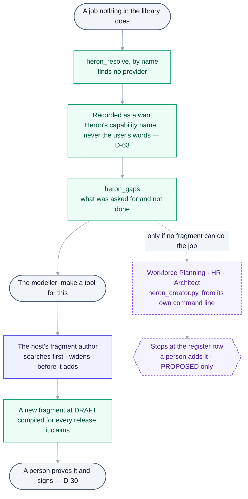
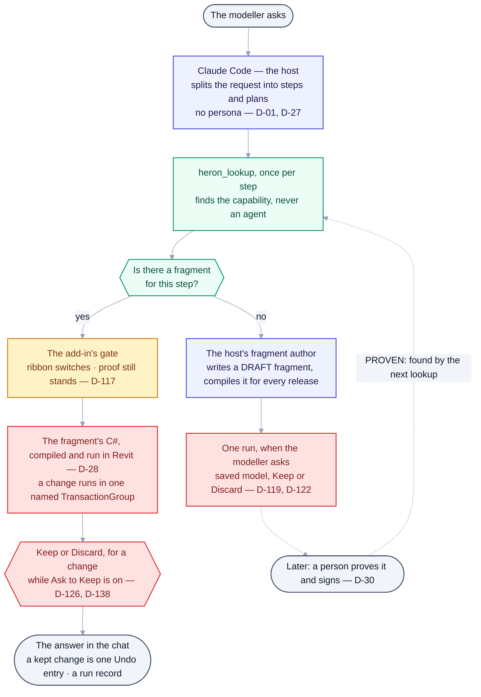

# Heron AI — Advanced Internal Architecture, Agent Operating System & Self-Evolution Specification

> **The original specification, kept as the owner wrote it on 2026-08-27. It says what Heron was asked
> to be, not what is built.** What runs today is in
> [02 §7a](02-architecture-overview.md#7a-as-built--the-parts-that-run-today), the [README](../README.md)
> and the [project map](PROJECT-MAP.md). Where this file and [DECISIONS.md](DECISIONS.md) differ,
> **DECISIONS.md wins** ([PROJECT-MAP §D](PROJECT-MAP.md#d-truth-hierarchy--which-source-wins)).
> Its text and diagrams are kept as the owner wrote them: where a word is corrected in place, the
> original stays beside it, struck through or folded; where a section no longer matches what is built, a
> dated **As built** note sits directly under it.

> **Status:** Source-of-truth record, **part 2 of 4**, as provided by the owner on 2026-08-27.
> Part 1 is [00 — Master Specification](00-master-specification.md) (the platform and its organisation).
> Part 3 is [00c — Handover Baseline](00c-master-handover-baseline.md), **authoritative on Golden
> Rules 1–15**; rules 16–21 were accepted on 2026-08-28 ([Q-19](open-questions/answered.md)), and
> [14 — Golden Rules](14-golden-rules.md) holds every rule. Part 4 is
> [00d — Additional Requirements](00d-additional-requirements.md).
> This part specifies **how Heron operates internally** as an autonomous engineering organisation.
>
> This file is the **verbatim architectural intent**. Do not edit it to "fix" it —
> record changes as decisions in [DECISIONS.md](DECISIONS.md).
> The one correction a decision allows so far is [D-139](DECISIONS.md#d-139--the-four-parts-of-the-specification-are-corrected-in-place-where-a-fact-is-wrong-or-an-accepted-decision-settled-it-and-the-original-words-stay-beside-the-correction)'s: a wrong fact, or words an accepted decision has settled, corrected in place with the original kept beside it, ~~struck through~~, and a wrong diagram folded under *Original diagram, as written*.

| Field | Value |
|---|---|
| Document Type | Advanced Technical Architecture / System Design Handover |
| Platform | Heron AI |
| Primary Domain | BIM / Revit / MEP Engineering Automation |
| Architecture | Modular Multi-Agent + RAG + MCP + Knowledge Graph + Vector Database |
| Primary Principle | Human simplicity, machine complexity |
| Target | Production-grade, scalable, self-improving engineering platform |

---

## 1. Executive Definition

Heron AI should be designed as an **AI Engineering Operating System**, not as a collection of independent AI agents. The platform should behave similarly to a large engineering organization.

A user gives a requirement. The user should not need to decide:

- which agent should handle it
- which fragment should be used
- which skill is appropriate
- which Revit API is required
- which .NET version is required
- whether existing code can be reused
- whether new code is required
- how the code should be tested
- where the resulting files should be stored
- how metadata should be created
- whether the knowledge already exists
- whether the knowledge should become a new fragment
- whether an existing fragment should be updated
- whether the Vector DB needs updating

~~Heron AI makes those decisions internally.~~ **Heron AI and its host, Claude Code, make those decisions between them: what the user meant, the plan and any new code are the host's ([D-01](DECISIONS.md), [D-80](DECISIONS.md)).** The platform therefore consists of two very different worlds.

**Human World**

```text
User -> Natural Language -> Result
```

**Machine World**

```text
Intent (the host's) -> Context -> Planning (the host's) -> Agent Selection -> Knowledge Retrieval
-> Capability Selection -> Implementation (the host's, where no fragment does the job)
-> Validation -> Execution -> Testing -> Learning -> Knowledge Evolution
```

<details><summary>Original block, as written - corrected under D-139</summary>

```text
Intent -> Context -> Planning -> Agent Selection -> Knowledge Retrieval
-> Capability Selection -> Implementation -> Validation -> Execution
-> Testing -> Learning -> Knowledge Evolution
```

</details>

The complexity belongs inside Heron AI.

> **As built (2026-10-18):** the user still decides none of the list above, but the deciding is split
> between two programs. Claude Code, the host, works out what was meant, plans and writes the reply
> ([D-01](DECISIONS.md)); Heron supplies the library, the lookups and the gate in Revit. The machine
> world as it runs:
>
> | The specification says | As built | Where |
> |---|---|---|
> | Intent | The host. Heron never classifies intent. The one kind that crosses is `heron_lookup`'s `question` flag, which keeps every capability that changes the model out of the answer | [D-01](DECISIONS.md), [D-128](DECISIONS.md) |
> | Context | `heron_context` assembles what a step may be given and refuses the rest | [`heron_context.py`](../brain/heron_context.py) |
> | Planning | The host. For a job of several steps Heron hands it the steps in order through `heron_method` | [04 §8.7](04-heron-mcp.md) |
> | Agent selection · capability selection | One step: `heron_lookup` matches the request to a capability, and the capability's provider is a fragment, never an agent | [`heron_capability.py`](../brain/heron_capability.py) |
> | Knowledge retrieval | The identity route first, then words and meaning, fused | [`heron_search.py`](../brain/heron_search.py), [`heron_retrieve.py`](../brain/heron_retrieve.py) |
> | Implementation | Nothing is written when a fragment covers the job. When none does, the host writes a new `DRAFT` fragment | [`heron-fragment-author`](../.claude/agents/heron-fragment-author.md) |
> | Validation · execution | The add-in's gate - the ribbon switches, and a change is kept only from a fragment whose proof still stands - then the fragment's C# compiled and run in Revit, in one named `TransactionGroup` | [D-19](DECISIONS.md), [D-106](DECISIONS.md), [D-117](DECISIONS.md), [D-28](DECISIONS.md) |
> | Testing | Not per request. A fragment is proved once, on a named real model, with a negative case, and a person signs | [D-30](DECISIONS.md) |
> | Learning · knowledge evolution | Nothing learns by itself. `heron_gaps` reports what was asked for and not done; the agents that would evolve knowledge only propose | [`heron_gaps.py`](../brain/heron_gaps.py), [`heron_evolve.py`](../brain/heron_evolve.py) |
>
> *Which .NET version* is answered by [`Directory.Build.props`](../Directory.Build.props), *where files
> are stored* by the path manager alone ([`HeronPaths.cs`](../platform/Heron.Core/HeronPaths.cs),
> [`heron_paths.py`](../brain/heron_paths.py)), *how metadata is created* by the metadata header that
> [`tools/check-metadata.py`](../tools/check-metadata.py) checks, and *whether the Vector DB needs
> updating* by the store itself: a lookup says when the store and the cards on disk differ, and
> `python brain/heron_scope.py --rebuild` re-indexes.
>
> **Corrected in place** ([D-139](DECISIONS.md#d-139--the-four-parts-of-the-specification-are-corrected-in-place-where-a-fact-is-wrong-or-an-accepted-decision-settled-it-and-the-original-words-stay-beside-the-correction)): *"Heron AI makes those decisions internally"* now names the host's share, and the machine world marks intent, planning and implementation as the host's - [D-01](DECISIONS.md) (the host decides what the user meant, and Heron never classifies it, as [D-128](DECISIONS.md) keeps it), [D-80](DECISIONS.md) (intent, planning, architecture and code generation are host-provided rows), [Golden Rule 3](14-golden-rules.md) (new code only where nothing reusable does the job).

## 2. Core Architectural Principle

> **Simple outside. Extremely intelligent inside.**

The platform should expose a very small interface while internally operating potentially hundreds or thousands of specialized components.

The number of agents should **not be fixed**. The architecture must allow 10 → 50 → 200 → 1,000 agents → potentially much more, **without redesigning the core platform**.

> **As built (2026-10-18):** the count is not fixed and is never typed. [28](28-agent-registry.md) lists
> every agent, and `python tools/agent-count.py` sorts each into built, provided by the host, deferred by
> a decision, or left. A large count stays cheap because Heron's agents make no model call: a T2 or T3
> tier says where the judgement happens, and the host makes it ([D-58](DECISIONS.md),
> [D-80](DECISIONS.md)). A new agent needs a register row that a person adds, and Workforce Planning
> ([`heron_workforce.py`](../brain/heron_workforce.py)) refuses one that a capability or an existing
> agent already covers.

## 3. Heron AI as an Organization

```text
                         HERON AI
                            |
                    Executive Orchestrator
                            |
       +--------------------+--------------------+
       |                    |                    |
   Engineering          Knowledge             Platform
       |                    |                    |
   Revit                 RAG                 Infrastructure
   .NET                  Memory               Updates
   C#                    Skills               Packages
   MCP                   Fragments            Security
   Testing               Library              GitHub
   QA                    Standards            Workspace
       |                    |                    |
       +--------------------+--------------------+
                            |
                       User Interface
                            |
                          USER
```

This should be a **logical** organization, not necessarily separate software processes for every agent.

> **As built (2026-10-18):** the organisation is the register's departments, which
> `python tools/agent-count.py` prints. It is logical, as this section asks: most agents are Python
> modules in `brain/` and the Revit ones are C# in `revit/`, and what a chat reaches runs in two
> processes - the MCP server and the add-in inside Revit. The register has no three-way split; the
> nearest grouping is:
>
> | The chart | As built | Where |
> |---|---|---|
> | Executive Orchestrator | Claude Code, the host. The Orchestration rows Heron would have built are the host's, shown under HOST, never as work left | [D-01](DECISIONS.md), [D-80](DECISIONS.md) |
> | Engineering | Revit Engineering, MEP Design Engineering, Standards & BIM QA, Development | [28](28-agent-registry.md) |
> | Knowledge | Knowledge & RAG, Fragment Lifecycle, Skill Lifecycle, Learning & Self-Growth, User & Personalization, Import & Migration, Naming & Taxonomy | [28](28-agent-registry.md) |
> | Platform | Kernel & Platform, MCP / Bridge, Session & Bridge Management, Installation & Update, Operations, Health & Resilience, Workspace & Folder Architecture, GitHub, Agent Lifecycle & HR, Documentation, Reporting & Output | [28](28-agent-registry.md) |
> | User Interface | The Claude chat; the Revit ribbon and its switches; the Companion page beside Revit, which shows the model and is never a second place to talk | [D-01](DECISIONS.md), [D-106](DECISIONS.md), [D-108](DECISIONS.md) |
>
> **Left as written** ([D-139](DECISIONS.md#d-139--the-four-parts-of-the-specification-are-corrected-in-place-where-a-fact-is-wrong-or-an-accepted-decision-settled-it-and-the-original-words-stay-beside-the-correction) point 4): the parts draw the organisation differently and no accepted decision picks one picture; the choice is open and is put to the owner in [OPEN-QUESTIONS](OPEN-QUESTIONS.md).

## 4. Agent Operating System

The internal agent framework should be treated as an **Agent Operating System**. The Agent OS manages:

agent registration · discovery · activation · execution · communication · permissions · health · versions · dependencies · lifecycle · performance · retirement · replacement

Agents should not independently manage these responsibilities.

> **As built (2026-10-18):** there is no single Agent OS or Kernel object that every agent goes through
> ([23 §1](23-heron-kernel.md)). Each responsibility has a part of its own:
>
> | The Agent OS manages | As built | Where |
> |---|---|---|
> | registration | A row in the register, and the `Heron-Agent` header of the file that implements it; `tools/check-metadata.py` checks every header | [28](28-agent-registry.md), [29](29-metadata-standard.md) |
> | discovery | By capability, never by agent: `heron_lookup`, `heron_capabilities` | [`heron_capability.py`](../brain/heron_capability.py) |
> | activation · execution | The host calls an MCP tool and the add-in runs it. Nothing activates an agent on its own | [D-01](DECISIONS.md) |
> | communication | Modules import one another directly; there is no message bus between agents | [23 §1](23-heron-kernel.md) |
> | permissions | The add-in's gate and the ribbon switches; each contract's `allowed-tools` | [D-19](DECISIONS.md), [D-106](DECISIONS.md), [`brain/agents/`](../brain/agents/) |
> | health · performance | Reported as UNMEASURED: they need real runs | [`heron_agents.py`](../brain/heron_agents.py) |
> | versions | Each contract's `version`, each file's `Heron-Since` | [`brain/agents/`](../brain/agents/) |
> | dependencies | Derived from the files, never stored twice | [`heron_graph.py`](../brain/heron_graph.py), [D-40](DECISIONS.md) |
> | lifecycle | The deployment ladder returns a record of an allowed move; a person edits the status | [`heron_deployment.py`](../brain/heron_deployment.py), [D-30](DECISIONS.md) |
> | retirement · replacement | Archive, never delete; refused while another file still names the agent | [`heron_retirement.py`](../brain/heron_retirement.py) |

## 5. Agent Registry

Every agent must have a permanent identity:

```text
Agent ID / Agent Name / Department / Role / Version / Status / Capabilities
Required Skills / Required Knowledge / Allowed Tools / Permissions / Dependencies
Input Contract / Output Contract / Health / Performance Score
Creation Date / Last Updated / Owner
```

Example:

```text
Agent ID:        HERON-REVIT-SEL-001
Name:            Revit Selection Agent
Department:      Revit Engineering
Responsibility:  Element selection
Supported:       Revit 2020-2027
Status:          PRODUCTION
```

> **As built (2026-10-18):** the record is assembled from where each fact already lives, never stored
> twice ([D-40](DECISIONS.md)). `python brain/heron_agents.py <agent id>` prints it:
>
> | The specification's field | As built | Where |
> |---|---|---|
> | Agent ID · Name · Department · Role | One register row each. The id format is `HERON-{DEPT}-{ABBR}-{NNN}` | [28](28-agent-registry.md) |
> | Status · Version | The implementing file's `Heron-Status` header; the contract's `version` | [29](29-metadata-standard.md) |
> | Capabilities | Not on the agent: a capability's provider is a fragment | [`heron_capability.py`](../brain/heron_capability.py) |
> | Allowed Tools · Input Contract · Output Contract | The contract, `brain/agents/<id>.yaml`, with a timeout, declared failures and retry. Not every agent has one: `python brain/heron_contract.py` prints how many of the register's agents do | [`brain/agents/`](../brain/agents/) |
> | Permissions | The register's Risk column; the gate itself is in the add-in | [12](12-security-and-permissions.md) |
> | Dependencies | Derived | [`heron_graph.py`](../brain/heron_graph.py) |
> | Health · Performance Score | UNMEASURED, by name - never 0, never a green tick | [`heron_agents.py`](../brain/heron_agents.py) |
> | Required Skills · Required Knowledge · Creation Date · Last Updated · Owner | Not held. The dates are in git | - |
>
> The example agent is `HERON-REVIT-SEL-008` in the register, not `-001`. Like every file that claims an
> agent, it is `DRAFT`; no agent has reached `PRODUCTION`. Its run in a real Revit was signed by a person
> into [`brain/agent-proofs/`](../brain/agent-proofs/README.md), and on 2026-10-18
> `python tools/prove-agent.py check` reported every proof there STALE: each agent's source has changed
> since it was signed.

## 6. Capability Registry

**Agent identity and capability identity should be separate.** An agent may provide multiple capabilities.

```text
Capability:  SELECT_DUCTS
Required:    Revit Selection Agent
Related:     OST_DuctCurves
```

The Orchestrator should search the **Capability Registry** rather than blindly searching agent names. This allows Heron to replace an agent without changing the user workflow.

> **As built (2026-10-18):** built as [`heron_capability.py`](../brain/heron_capability.py)
> (`HERON-KRN-CAP-008`, DRAFT) and served as `heron_capabilities` and `heron_lookup`. Two things differ
> from the example:
>
> - **The provider is a fragment, not an agent.** Providers, contract, releases and status are derived
> from the fragment cards on every rebuild. A capability's risk is the highest of its providers', and two
> providers that disagree on risk are reported as a defect.
>
> - **The category is an input, not part of the name.** There is no `SELECT_DUCTS`: "select all ducts"
> reaches `FILTER_ELEMENTS_BY_CATEGORY` with the category Ducts, resolved by name in Revit, and then
> `SET_SELECTION` ([`select-elements`](../brain/skills/select-elements.yaml)).
>
> `python brain/heron_capability.py` lists every capability with its providers, and the gaps.

## 7. Dynamic Agent Discovery

Request: *"Find all unconnected ducts."*

```text
Intent:        DUCT_CONNECTION_ANALYSIS - worked out by the host, Claude Code;
               Heron never classifies intent, and starts from the request's own words
Capabilities:  Revit element discovery
               Duct analysis
               Connection analysis
               Result reporting
```

<details><summary>Original block, as written - corrected under D-139</summary>

```text
Intent:        DUCT_CONNECTION_ANALYSIS
Capabilities:  Revit element discovery
               Duct analysis
               Connection analysis
               Result reporting
```

</details>

It then searches the capability registry. It does **not** select an agent because its name contains "duct".

> **As built (2026-10-18):** the intent is the host's ([D-01](DECISIONS.md)); Heron starts from the
> request's own words. Asked `heron_lookup` with *"find all unconnected ducts"* as a question on
> 2026-10-18, it answered `SELECT_BY_CONNECTION_STATUS` (provided by `FRG-MEP-033`), found by words and
> by nearness together, with the runners-up and how close the contest was. Because it was asked as a
> question, nothing that changes the model was offered ([D-128](DECISIONS.md)). The search reads fragment
> cards - their purpose and the phrasings people type - never an agent's name. That run used the
> spelling-only nearness of a cloud session; the trained backend on the owner's PC can rank differently.
>
> **Corrected in place** ([D-139](DECISIONS.md#d-139--the-four-parts-of-the-specification-are-corrected-in-place-where-a-fact-is-wrong-or-an-accepted-decision-settled-it-and-the-original-words-stay-beside-the-correction)): the example's intent line now says the host works it out - [D-01](DECISIONS.md), as [D-128](DECISIONS.md) keeps it (Heron never classifies intent); the HOST row `HERON-ORC-INT-002` in [28](28-agent-registry.md), under [D-80](DECISIONS.md).

## 8. Dynamic Agent Creation

Heron should identify missing capabilities. If a user repeatedly requests something no capability covers:

```text
Capability Gap Detected -> Gap Analysis Agent -> Check Existing Agents
-> Check Existing Skills -> Check Existing Fragments -> Check External Knowledge
-> Determine Requirement -> Reuse what exists, or extend it
-> only when nothing can be reused or extended: a new fragment, unproven,
   or Propose New Agent - which stops at PROPOSED until a person decides
```

<details><summary>Original block, as written - corrected under D-139</summary>

```text
Capability Gap Detected -> Gap Analysis Agent -> Check Existing Agents
-> Check Existing Skills -> Check Existing Fragments -> Check External Knowledge
-> Determine Requirement -> Propose New Agent
```

</details>

> **As built (2026-10-18):** a gap ends in a new **fragment**, not a new agent, and only a person adds an
> agent. The flow as it runs:



<details>
<summary>Same thing as plain text</summary>

```text
A job nothing in the library does
  -> heron_resolve, asked by name, finds no provider
  -> recorded as a want, under Heron's capability name, never the user's words (D-63)
  -> heron_gaps reports what was asked for and not done
  -> the modeller asks for a tool
  -> the host's fragment author searches first and widens before it adds
  -> a new fragment at DRAFT, compiled for every release it claims
  -> a person proves it and signs (D-30)
Only if no fragment can do the job:
  .. Workforce Planning, HR, Architect (heron_creator.py, run from its own command line)
  .. stops at the register row: a person adds it, and nothing goes past PROPOSED
```

</details>

> `heron_gaps` is served as an MCP tool. The hiring chain -
> [`heron_workforce.py`](../brain/heron_workforce.py), [`heron_hr.py`](../brain/heron_hr.py),
> [`heron_architect.py`](../brain/heron_architect.py), run by
> [`heron_creator.py`](../brain/heron_creator.py) - is DRAFT, and no MCP tool reaches it. *Check external
> knowledge* is `heron_research`, which says what Heron's own knowledge missed; the host has the network.
> The fragment author is
> [`.claude/agents/heron-fragment-author.md`](../.claude/agents/heron-fragment-author.md).
>
> **Corrected in place** ([D-139](DECISIONS.md#d-139--the-four-parts-of-the-specification-are-corrected-in-place-where-a-fact-is-wrong-or-an-accepted-decision-settled-it-and-the-original-words-stay-beside-the-correction)): the flow's one exit was a new agent; it now reuses or extends what exists first, and only then adds a new fragment or proposes an agent - [Golden Rule 3](14-golden-rules.md) (reuse before creating; generation is the last resort), [Golden Rule 4](14-golden-rules.md) (keep, extend, adapt, or version-branch, in that order), [Article 3](../HERON_CONSTITUTION.md), [Article 20](../HERON_CONSTITUTION.md) (a new fragment or agent starts unproven), [Golden Rule 13](14-golden-rules.md) (a new agent reaches PROPOSED and goes no further without a human). The As-built diagram above is how the corrected flow runs today.

## 9. Agent HR System

Agent creation behaves like an HR department.

| Role | Function |
|---|---|
| Executive Orchestrator | *"We need a new capability."* |
| Agent HR | Job description, responsibility, required capabilities, dependencies, knowledge, tools |
| Agent Architect | Designs the agent |
| Agent Builder | Creates implementation |
| Training Agent | Provides required knowledge |
| QA Agent | Tests it |
| Registry Agent | Registers it |
| Deployment Agent | ~~Activates it~~ **Activates it only after a person has approved it** |

This creates a controlled self-expanding organization.

> **As built (2026-10-18):** every role but the first is a module in `brain/`, all DRAFT, run from their
> own command lines; no MCP tool reaches them. `tests/test_chain.py` walks one agent through the whole
> chain on the real modules; it has passed only in a Linux container, never on real work
> ([Group K](needs-checking/group-k.md)).
>
> | Role | As built | Where |
> |---|---|---|
> | Executive Orchestrator | The host | [D-01](DECISIONS.md) |
> | *(added)* Workforce Planning | Says no first: does a capability or an existing agent already cover this, and is it a fragment rather than an agent | [`heron_workforce.py`](../brain/heron_workforce.py) |
> | Agent HR | Writes the job description, and only after asking Workforce Planning itself whether the proposal is cleared | [`heron_hr.py`](../brain/heron_hr.py) |
> | Agent Architect | Turns the job into a contract, adds nothing the job did not ask for, and designs only for an id already in the register | [`heron_architect.py`](../brain/heron_architect.py) |
> | Agent Builder | Derives the implementation from the contract, writes no test, runs nothing | [`heron_builder.py`](../brain/heron_builder.py) |
> | Training Agent | Assembles the Constitution's rules for the agent's risk level, never copies them | [`heron_trainer.py`](../brain/heron_trainer.py), [`heron_instructions.py`](../brain/heron_instructions.py) |
> | QA Agent | Agent Validation - never the agent that built it | [`heron_validation.py`](../brain/heron_validation.py) |
> | Registry Agent | Stores nothing. The register row a person adds is the hiring decision | [`heron_agents.py`](../brain/heron_agents.py) |
> | Deployment Agent | Returns a record of an allowed move; a person changes the status | [`heron_deployment.py`](../brain/heron_deployment.py) |
>
> **Corrected in place** ([D-139](DECISIONS.md#d-139--the-four-parts-of-the-specification-are-corrected-in-place-where-a-fact-is-wrong-or-an-accepted-decision-settled-it-and-the-original-words-stay-beside-the-correction)): the Deployment Agent activates an agent only once a person has approved it - [Golden Rule 13](14-golden-rules.md) (new agents reach PROPOSED on their own and go no further without a human), [Article 20](../HERON_CONSTITUTION.md) (a human grants production), [Golden Rule 7](14-golden-rules.md) (the tester is not the deployer).

## 10. Agent Onboarding

A newly created agent should **never** immediately become trusted.

```text
PROPOSED -> DESIGNED -> IMPLEMENTED -> TRAINING -> TESTING
-> SHADOW MODE -> APPROVED, by a person -> PRODUCTION
```

<details><summary>Original block, as written - corrected under D-139</summary>

```text
PROPOSED -> DESIGNED -> IMPLEMENTED -> TRAINING -> TESTING
-> SHADOW MODE -> APPROVED -> PRODUCTION
```

</details>

**Shadow Mode:** the agent can observe and make recommendations **without actually modifying production data**. This is extremely important for safe self-evolution.

> **As built (2026-10-18):** the ladder that is enforced is the trust model's ([24](24-trust-model.md)):
> `DISCOVERED` → `DRAFT` → `TESTING` → `VALIDATED` → `SHADOW` → `PROVEN` → `PRODUCTION`, each with a gate
> to enter, in [`heron_deployment.py`](../brain/heron_deployment.py). It refuses a skipped stage, a
> machine signing, and a move with no evidence. The Agent Creator may assign `PROPOSED` and nothing else
> ([`heron_creator.py`](../brain/heron_creator.py)). Shadow Mode is
> [`heron_shadow.py`](../brain/heron_shadow.py) (`HERON-OPS-SHD-012`): its product is a log of
> disagreements, and leaving shadow needs one explained disagreement and a person's signature, never a
> count of agreements ([D-39](DECISIONS.md)). No agent has been through the ladder: every file that
> claims an agent is `DRAFT`. One status vocabulary for agents, fragments and knowledge is
> [D-14](DECISIONS.md), still Proposed.
>
> **Corrected in place** ([D-139](DECISIONS.md#d-139--the-four-parts-of-the-specification-are-corrected-in-place-where-a-fact-is-wrong-or-an-accepted-decision-settled-it-and-the-original-words-stay-beside-the-correction)): `APPROVED` now names its approver, a person - [Golden Rule 13](14-golden-rules.md), [Golden Rule 7](14-golden-rules.md) (no agent approves itself), [Article 20](../HERON_CONSTITUTION.md), and for leaving shadow [D-39](DECISIONS.md) (a person's signature). **Left as written:** the stage names. This ladder and the trust model's differ, and `heron_creator.py` assigns `PROPOSED`, which the enforced ladder lacks; code does not pick between them, and the choice is open ([D-14](DECISIONS.md) is Proposed) and is put to the owner in [OPEN-QUESTIONS](OPEN-QUESTIONS.md).

## 11. Agent Trust Score

Every agent has a dynamic trust score, factoring: successful executions, failed executions, user corrections, QA results, regression results, performance, security incidents, compatibility, age, usage frequency.

```text
Trust Score: 96.4%   ->  not a promotion: Production needs recorded evidence
                         and a person's signature, never a score
Trust Score: Unproven ->  newly created agent
```

<details><summary>Original block, as written - corrected under D-139</summary>

```text
Trust Score: 96.4%   ->  Production
Trust Score: Unproven ->  newly created agent
```

</details>

> **As built (2026-10-18):** no trust percentage exists, on purpose. A fragment is promoted by one
> recorded proof on a named real model, signed by a person, not by a count of runs
> ([D-30](DECISIONS.md)), and a percentage would invite a threshold ([D-39](DECISIONS.md)). Until a score
> exists the lifecycle is the trust: the Capability Registry prefers a `PROVEN` provider to a `DRAFT` one
> ([`heron_capability.py`](../brain/heron_capability.py), `TRUST`). The Evaluator,
> [`heron_evaluator.py`](../brain/heron_evaluator.py) (`HERON-AHR-EVL-007`, DRAFT), scores an agent only
> after activation, against its own contract, and does not count a warranted refusal as a failure.
> `python brain/heron_agents.py` reports health and performance as UNMEASURED.
> [`heron_trust.py`](../brain/heron_trust.py) is a different thing: content trust under Golden Rule 19.
>
> **Corrected in place** ([D-139](DECISIONS.md#d-139--the-four-parts-of-the-specification-are-corrected-in-place-where-a-fact-is-wrong-or-an-accepted-decision-settled-it-and-the-original-words-stay-beside-the-correction)): a score no longer leads to Production - [D-30](DECISIONS.md) (one recorded proof, not a count of runs), [D-39](DECISIONS.md) (leaving shadow needs an explained disagreement and a human signature; a percentage would invite a threshold), [Article 4](../HERON_CONSTITUTION.md) and [Article 20](../HERON_CONSTITUTION.md) (`PRODUCTION` requires a human). The score itself and its factors are left as written.

## 12. Agent Performance Monitoring

Continuously monitored: Success Rate · Failure Rate · Average Execution Time · ~~Token Usage~~ **(token usage is the host's: Heron makes no model call)** · Tool Usage · User Corrections · Rollback Frequency · Error Types · Compatibility Failures.

This feeds the Agent Optimizer.

> **As built (2026-10-18):** nothing watches agents continuously. Each measure is a report run on demand,
> and the modules are DRAFT:
>
> | Measure | As built | Where |
> |---|---|---|
> | Success · failure · user corrections | Read from recorded runs, failures first; a success somebody had to correct is a failure signal | [`heron_observe.py`](../brain/heron_observe.py) |
> | Execution time | Latency, Heron's own and measured | [`heron_observability.py`](../brain/heron_observability.py), [`tools/measure-brain.py`](../tools/measure-brain.py) |
> | Token usage | The host's. Heron makes no model call and cannot see tokens | [D-58](DECISIONS.md) |
> | Rollbacks · error types | The add-in's audit trail and run records; a failure's kind is read from a table, never asked of a model | [`HeronRuns.cs`](../platform/Heron.Core/HeronRuns.cs), [`heron_failure.py`](../mcp/server/heron_failure.py), [D-21](DECISIONS.md) |
> | Compatibility failures | Per Revit release, never blended | [`heron_performance.py`](../brain/heron_performance.py), [`heron_matrix.py`](../brain/heron_matrix.py) |
>
> The Agent Optimizer is [`heron_optimizer.py`](../brain/heron_optimizer.py) (risk SUGGEST): it proposes
> and changes nothing, and it refuses to offer a looser standard - a longer timeout, a newly declared
> failure - as an improvement.
>
> **Corrected in place** ([D-139](DECISIONS.md#d-139--the-four-parts-of-the-specification-are-corrected-in-place-where-a-fact-is-wrong-or-an-accepted-decision-settled-it-and-the-original-words-stay-beside-the-correction)): token usage is struck from what Heron monitors - [D-58](DECISIONS.md) (Heron makes no model call; token usage and cost per request are host-provided).

## 13. Agent Retirement

```text
Active -> Under Review -> Replacement Found -> Migration -> Deprecated -> Archived
```

The old agent remains recoverable. **Never permanently delete important historical knowledge automatically.**

> **As built (2026-10-18):** [`heron_retirement.py`](../brain/heron_retirement.py) (`HERON-AHR-RET-010`,
> DRAFT) archives and holds no delete call, which its test checks against the source. It refuses a
> retirement whose record could not bring the agent back, and one while another file still names the
> agent unless a successor is named. Nothing has been retired through it. Register rows the owner folded
> into another tool stay in the register and say where they went ([D-77](DECISIONS.md),
> [D-78](DECISIONS.md)).
>
> **Left as written** ([D-139](DECISIONS.md#d-139--the-four-parts-of-the-specification-are-corrected-in-place-where-a-fact-is-wrong-or-an-accepted-decision-settled-it-and-the-original-words-stay-beside-the-correction) point 4): the retirement stages are one more status ladder beside §10's and §21's; one vocabulary is open ([D-14](DECISIONS.md) is Proposed) and is put to the owner in [OPEN-QUESTIONS](OPEN-QUESTIONS.md).

## 14. Agent Communication Protocol

Structured messages only:

```text
REQUEST / TASK / CONTEXT / INPUT / EXPECTED_OUTPUT / CONSTRAINTS
RESULT / ERROR / CONFIDENCE / STATUS
```

Agents should not dump huge amounts of context into one another. The **Context Manager** decides what information each agent actually needs.

> **As built (2026-10-18):** agents do not send each other messages. Modules import one another directly,
> and [`tools/check-structure.py`](../tools/check-structure.py) holds the layering
> ([23 §1](23-heron-kernel.md)). Each contract in [`brain/agents/`](../brain/agents/) declares input,
> output, allowed tools, a timeout, its failures and its retry, and `python brain/heron_contract.py`
> validates them. No contract declares `CONFIDENCE`; what an answer carries instead is evidence - how
> contested a lookup was, and how far the fragment it ran is proven ([23 §6](23-heron-kernel.md)).
> Between Heron and Revit the messages are structured: an MCP tool call, then one JSON request per
> operation down the named pipe ([D-02](DECISIONS.md)).

## 15. Context Manager

A critical component. AI systems fail when given too much irrelevant information. The Context Manager decides:

what the user said · what project is active · what Revit version is active · what knowledge is relevant · what fragment is relevant · what skill is relevant · what previous conversation is relevant · what technical information is required

**Only required information should be passed to the agent.**

> **As built (2026-10-18):** built as [`heron_context.py`](../brain/heron_context.py)
> (`HERON-RAG-CTX-007`, DRAFT) and served as `heron_context`. Its useful half is refusing: a named list
> of what each kind of request may carry, and an error for anything outside it. *What kind of request* is
> an input from the host - it does not classify ([D-01](DECISIONS.md)). The project and the Revit release
> come from the session the chat is bound to ([25](25-multi-session-and-binding.md)).

## 16. Context Compression

With 20,000 fragments, 5,000 skills, 500 agents and thousands of documents, the Orchestrator must never send all of them to the model.

```text
User Request -> Semantic Classification (the host's) -> Relevant Domain -> Relevant Project
-> Relevant Capability -> Relevant Knowledge -> Minimal Context
```

<details><summary>Original block, as written - corrected under D-139</summary>

```text
User Request -> Semantic Classification -> Relevant Domain -> Relevant Project
-> Relevant Capability -> Relevant Knowledge -> Minimal Context
```

</details>

Reduces token usage, latency, confusion, hallucination and cost.

> **As built (2026-10-18):** semantic classification is the host's. What Heron sends back is small by
> construction: `heron_lookup` returns one capability, the values the caller must supply and a few
> runners-up; `heron_method` returns one job's steps; a request the host calls a question is shown
> nothing that changes the model ([D-128](DECISIONS.md)). Every tool description has a word budget, and
> one over it stops a pull request ([D-118](DECISIONS.md)). The library's real size is counted, never
> typed: `ls -d brain/fragments/*/ | wc -l`, `ls brain/skills/*.yaml | wc -l`, and
> `python tools/agent-count.py`.
>
> **Corrected in place** ([D-139](DECISIONS.md#d-139--the-four-parts-of-the-specification-are-corrected-in-place-where-a-fact-is-wrong-or-an-accepted-decision-settled-it-and-the-original-words-stay-beside-the-correction)): semantic classification of the request is marked the host's - [D-01](DECISIONS.md), as [D-128](DECISIONS.md) keeps it (Heron never classifies what the user meant). The token usage and cost this section saves are the host's ([D-58](DECISIONS.md)), so those words stand.

## 17. Model Router

~~Heron~~ **The host, Claude Code, which makes every model call,** should not always use the most expensive AI model.

| Task | Model |
|---|---|
| Simple task | Fast model |
| Complex reasoning | Stronger reasoning model |
| Code generation | Coding model |
| Document classification | Efficient model |
| Critical architectural decision | High-reasoning model + validation |

This creates an AI model hierarchy.

> **As built (2026-10-18):** Heron makes no model call ([D-58](DECISIONS.md)), so the host chooses every
> model. Task to model class, and routing round a failed provider, were handed to the host
> ([D-65](DECISIONS.md)), closing the conflict [D-11](DECISIONS.md) recorded.
> [`heron_router.py`](../brain/heron_router.py) (`HERON-KRN-MDL-010`, DRAFT) declares an intent -
> CLASSIFY, EXTRACT, SCORE, SUMMARISE, REASON - and chooses who resolves it, never a model; a
> confidential project narrows it to an adapter on the machine. Nothing the MCP server runs reaches it,
> nor the one adapter built, [`heron_provider.py`](../brain/heron_provider.py), a local Ollama that has
> not met a provider ([37](37-the-provider-adapter.md)).
>
> **Corrected in place** ([D-139](DECISIONS.md#d-139--the-four-parts-of-the-specification-are-corrected-in-place-where-a-fact-is-wrong-or-an-accepted-decision-settled-it-and-the-original-words-stay-beside-the-correction)): the model router is the host's, not Heron's - [D-58](DECISIONS.md) (Heron makes no model call), [D-65](DECISIONS.md) (task to model class is the host's, retired from Heron's specification). The table is left as written: it is now a statement of what the host weighs.

## 18. Model Fallback

```text
Primary Model -> Failure -> Fallback Model            (the host's routing)
-> Validation: Heron marks the result degraded, and it never counts toward promotion
```

<details><summary>Original block, as written - corrected under D-139</summary>

```text
Primary Model -> Failure -> Fallback Model -> Validation
```

</details>

The system should never silently produce an inferior result without awareness.

> **As built (2026-10-18):** routing to a fallback is the host's ([D-65](DECISIONS.md)). Heron keeps the
> last clause: a result produced after a provider failed is marked degraded and never counts as evidence
> toward promotion - [`heron_availability.py`](../brain/heron_availability.py) (`HERON-KRN-MAV-017`,
> DRAFT) - and the Evaluator does not score a degraded run. In Heron's own search the same rule shows:
> with no trained encoder, nearness falls back to spelling-only n-grams and the answer says so on its own
> line ([D-49](DECISIONS.md)).
>
> **Corrected in place** ([D-139](DECISIONS.md#d-139--the-four-parts-of-the-specification-are-corrected-in-place-where-a-fact-is-wrong-or-an-accepted-decision-settled-it-and-the-original-words-stay-beside-the-correction)): the fallback is split as [D-65](DECISIONS.md) splits it - routing round a failed provider is the host's, and marking the result degraded so it never counts as evidence toward promotion is Heron's.

## 19. RAG Operating System

RAG is not one simple "search documents" function. It is a complete retrieval pipeline:

```text
User Request -> Intent -> Domain (both the host's) -> Knowledge Scope
-> Metadata Filtering -> Keyword Search + Semantic Search (the same route as vector search),
   over what the filter kept
-> Candidate Ranking -> Conflict Detection -> Knowledge Validation -> Context Assembly
```

<details><summary>Original block, as written - corrected under D-139</summary>

```text
User Request -> Intent -> Domain -> Knowledge Scope
-> Semantic Search -> Keyword Search -> Metadata Filtering -> Vector Search
-> Candidate Ranking -> Conflict Detection -> Knowledge Validation -> Context Assembly
```

</details>

> **As built (2026-10-18):** the order that runs is [`heron_retrieve.py`](../brain/heron_retrieve.py)'s,
> and it puts the metadata filter first, so a fragment for another Revit release is absent rather than
> ranked lower. Ahead of any search, the identity route answers a request that is a fragment's own
> phrasing with one lookup. [20 §1](20-knowledge-trust-and-conflict.md) has the detail.
>
> | The specification says | As built | Where |
> |---|---|---|
> | Intent · Domain | The host | [D-01](DECISIONS.md) |
> | Knowledge scope · metadata filtering | First, as a plain SQL filter: scope, release, status | [`heron_retrieve.py`](../brain/heron_retrieve.py) |
> | Keyword search | SQLite FTS5 over the cards | [`heron_search.py`](../brain/heron_search.py) |
> | Semantic search · vector search | One route, *nearness*: a local encoder, nothing sent to a cloud, or spelling-only n-grams when none is installed | [D-24](DECISIONS.md), [`heron_embed.py`](../brain/heron_embed.py) |
> | Candidate ranking | Reciprocal rank fusion, a status nudge for near-ties, an optional re-rank; the answer says how contested it was | [D-134](DECISIONS.md), [`heron_rerank.py`](../brain/heron_rerank.py) |
> | Conflict detection | Across scopes in `heron_standards`: surfaced, never settled | [`heron_conflict.py`](../brain/heron_conflict.py) |
> | Knowledge validation | `heron_check`, a host's draft against the cited clauses | [`heron_ground.py`](../brain/heron_ground.py) |
> | Context assembly | `heron_context` | [`heron_context.py`](../brain/heron_context.py) |
>
> **Corrected in place** ([D-139](DECISIONS.md#d-139--the-four-parts-of-the-specification-are-corrected-in-place-where-a-fact-is-wrong-or-an-accepted-decision-settled-it-and-the-original-words-stay-beside-the-correction)): intent and domain are marked the host's - [D-01](DECISIONS.md), as [D-128](DECISIONS.md) keeps it; *semantic* and *vector* search, listed as two steps, are one route - [`heron_retrieve.py`](../brain/heron_retrieve.py) runs two searches, words (FTS5) and meaning ([`heron_embed.py`](../brain/heron_embed.py): a trained sentence model where one is installed, else spelling-only n-grams); and the metadata filter moves ahead of both, because `heron_retrieve.eligible` runs first and the searches read only what it kept, the version wall [D-128](DECISIONS.md) item 2 names (*"left out before ranking"*). Fusion, the status nudge and the optional re-ranker ([D-134](DECISIONS.md)) are *Candidate Ranking*.

## 20. Knowledge Hierarchy

Knowledge has priority:

```text
1. Active Project Knowledge
2. Approved Company Knowledge
3. Proven User Knowledge
4. Approved Community Knowledge
5. General Heron Knowledge
6. Experimental Knowledge
7. Temporary Knowledge
```

Project-specific information should override generic information ~~when appropriate~~ **where the user has said it governs; where that is not known, Heron asks, once, rather than judging it**.

> **As built (2026-10-18):** one SQLite store per scope - `global`, `company`, `project`, `user`,
> `temporary` and `experimental` ([`heron_scope.py`](../brain/heron_scope.py), `SCOPES`;
> [D-23](DECISIONS.md)). A store holds one scope and SQLite's `ATTACH` is refused, so no query mixes two.
> The priority list is named and **not applied**: `heron_standards` returns each scope's answer under its
> own label and settles nothing ([20 §2](20-knowledge-trust-and-conflict.md)). There is no community
> store ([D-41](DECISIONS.md)). Proven, experimental and temporary are not levels of one list here:
> *proven* is a fragment's status, *experimental* and *temporary* are scopes.
>
> **Corrected in place** ([D-139](DECISIONS.md#d-139--the-four-parts-of-the-specification-are-corrected-in-place-where-a-fact-is-wrong-or-an-accepted-decision-settled-it-and-the-original-words-stay-beside-the-correction)): *"when appropriate"* left Heron to judge which knowledge wins; it now asks - [D-33](DECISIONS.md) (Heron never supplies a value the user did not give; it asks, and asks once), as [D-111](DECISIONS.md) applies it to a project's governing standards. **Left as written** (D-139 point 4): the list itself, which mixes scopes with statuses and differs from the scopes the other parts name; one list of knowledge scopes is open - `SCOPES` in `heron_scope.py` is code, not the pick - and is put to the owner in [OPEN-QUESTIONS](OPEN-QUESTIONS.md).

## 21. Knowledge Trust

Every knowledge object has a trust level:

```text
EXPERIMENTAL -> UNVERIFIED -> TESTED -> VALIDATED -> PROVEN -> PRODUCTION -> DEPRECATED
```

RAG should prefer high-trust knowledge.

> **As built (2026-10-18):** a fragment carries one status, `heron-status`, and the library uses two
> values, `DRAFT` and `PROVEN`:
> `grep -h '^heron-status:' brain/fragments/*/fragment.yaml | sort | uniq -c`. The code knows Part 1's
> lifecycle (`heron_fragment.STATUSES`), not this section's, and nothing has reached `PRODUCTION`.
> `PROVEN` means one recorded proof on a named real model, with a negative case and a fingerprint, signed
> by a person ([D-30](DECISIONS.md)). Retrieval prefers it twice: only a `PROVEN` fragment may run off an
> exact match unasked, and a status nudge settles near-ties. One vocabulary for all of this is
> [D-14](DECISIONS.md), still Proposed.
>
> **Left as written** ([D-139](DECISIONS.md#d-139--the-four-parts-of-the-specification-are-corrected-in-place-where-a-fact-is-wrong-or-an-accepted-decision-settled-it-and-the-original-words-stay-beside-the-correction) point 4): the trust ladder, including where `PROVEN` sits beside `PRODUCTION`; the status vocabulary is open and is put to the owner in [OPEN-QUESTIONS](OPEN-QUESTIONS.md).

## 22. Knowledge Conflict Resolution

If two fragments disagree, Heron must not randomly choose one.

```text
Conflict Detected -> Compare Version -> Compare Source -> Compare Trust
-> Compare Project Context -> Compare Test History
-> Conflict Resolution Agent -> Decision
```

~~If confidence is insufficient:~~ **When the disagreement is over a value the user gives - a size, a clearance, which standard applies - there is no confidence bar:** **ask the user.** **Once.**

> **As built (2026-10-18):** Heron surfaces a conflict and never decides it.
> [`heron_conflict.py`](../brain/heron_conflict.py) (`HERON-RAG-CNF-015`) adds a sentence when two scopes
> give one question different values, and removes nothing; it has no winner and no resolve, which
> `tests/test_conflict.py` holds. Deciding is the host's and, past the host, the modeller's, who is asked
> once ([D-33](DECISIONS.md)). Two fragments for one capability do not compete at run time: a provider is
> chosen by Revit release, and two that disagree on risk are reported as a defect
> ([`heron_capability.py`](../brain/heron_capability.py)).
>
> **Corrected in place** ([D-139](DECISIONS.md#d-139--the-four-parts-of-the-specification-are-corrected-in-place-where-a-fact-is-wrong-or-an-accepted-decision-settled-it-and-the-original-words-stay-beside-the-correction)): *"if confidence is insufficient"* set a confidence bar for asking, which [D-33](DECISIONS.md) refused - Heron never supplies a value the user did not give, asks instead, and asks once. D-33's one boundary stands: a purely technical choice is Heron's, and it says what it chose.

## 23. Fragment Identity System

Identity must be independent of filename, folder, code formatting, author and storage location. It is based on:

semantic purpose · capability · implementation identity · metadata · relationships

This prevents duplicate knowledge.

> **As built (2026-10-18):** a fragment's identity is the `id:` in its card - `FRG-ELE-001`, for one -
> and its `semantic-identity:` sentence, never its folder ([09 §4](09-skills-and-fragments.md)). Its
> implementation identity is the fingerprint of its code, which is also what makes a proof go stale
> ([D-30](DECISIONS.md)). Capability, contract and relationships are in the same card, and the graph is
> derived from them ([`heron_graph.py`](../brain/heron_graph.py)).

## 24. Fragment Duplicate Detection

```text
New Fragment -> Identity Extraction -> Semantic Comparison -> Metadata Comparison
-> Code Comparison -> Existing Fragment Search
```

| Result | Action |
|---|---|
| Exact duplicate | Already exists. No update required. |
| Similar | Existing fragment may be improved. |
| New | Create new fragment. |
| Conflict | Human / Resolution Agent review required. |

> **As built (2026-10-18):** [`heron_duplicates.py`](../brain/heron_duplicates.py) (`HERON-IMP-DUP-007`,
> DRAFT) compares an incoming item by capability, then contract signature, then name, and answers
> *already here*, *new*, *completes a release matrix*, or *unchecked* when it had nothing to compare.
> *Similar* and *conflict* are not its verdicts: whether two things read alike is language, and that is
> the host's ([D-34](DECISIONS.md)). Near-identical library fragments are
> [`heron_merge.py`](../brain/heron_merge.py)'s, which proposes and merges nothing. No MCP tool reaches
> either.

## 25. Fragment Versioning

```text
Fragment: DUCT-ENDCAP
  v1.0  Revit 2020
  v1.1  Revit 2020-2022
  v2.0  Revit 2020-2027
```

Older implementations remain available if still supported.

> **As built (2026-10-18):** a fragment carries one whole-number `version:`, raised when its behaviour
> changes; earlier versions are in git, not kept beside it ([23 §7](23-heron-kernel.md)). Its releases
> are an explicit `revit:` list, never a range. Evidence per release is kept apart from that claim: the
> proof names one release, and each further release is one signed entry of `proof.releases`
> ([D-131](DECISIONS.md)); [Group EQ](needs-checking/group-eq.md) holds what is still owed. A change to
> the code makes the proof stale, and a change from a chat is then refused until the fragment is proved
> again ([D-117](DECISIONS.md)).

## 26. Fragment Branching

```text
Common Fragment
       |
       +-- Revit 2020-2021 implementation
       |
       +-- Revit 2022-2023 implementation
       |
       +-- Revit 2024 implementation   (ElementId becomes 64-bit)
       |
       +-- Revit 2025-2027 implementation
```

<details><summary>Original block, as written - corrected under D-139</summary>

```text
Common Fragment
       |
       +-- Revit 2020-2021 implementation
       |
       +-- Revit 2022-2024 implementation
       |
       +-- Revit 2025-2027 implementation
```

</details>

The common **semantic capability remains one fragment**. Implementation details may branch internally. This is preferable to creating completely unrelated fragments.

> **As built (2026-10-18):** one fragment, one implementation file - `impl/any/fragment.cs` - for every
> release (`ls brain/fragments/*/impl/ | sort | uniq -c`). Where releases differ, the file branches
> inside on the compile symbols (`REVIT2024_OR_GREATER` and the rest), which the add-in hands the
> compiler in Revit ([16](16-version-support-strategy.md)). `python tools/check-fragments-compile.py`
> compiles each fragment against every release it claims, in CI.
>
> **Corrected in place** ([D-139](DECISIONS.md#d-139--the-four-parts-of-the-specification-are-corrected-in-place-where-a-fact-is-wrong-or-an-accepted-decision-settled-it-and-the-original-words-stay-beside-the-correction)): the 2022-2024 branch spanned the break at 2024, where `ElementId.IntegerValue` gives way to `Value` and old integer casts of built-in enums throw - [16 §2](16-version-support-strategy.md) (*Break 1*), the `REVIT2024_OR_GREATER` symbol in [`Directory.Build.props`](../Directory.Build.props), and D-139's own list of breaks (2021, 2022, 2024, 2025, 2026, 2027). It now splits there. A fragment branches where its own code meets a break; the full table is in the [`revit-version-support`](../.claude/skills/revit-version-support/SKILL.md) skill.

## 27. Fragment Evolution Engine

Decides: `KEEP` · `UPDATE` · `EXTEND` · `SPLIT` · `MERGE` · `BRANCH` · `DEPRECATE` · `ARCHIVE`

The main mechanism for keeping the knowledge base clean.

> **As built (2026-10-18):** [`heron_evolve.py`](../brain/heron_evolve.py) (`HERON-FRG-EVO-005`, risk
> SUGGEST, DRAFT) decides none of the eight. It says which are open for a fragment, who owns each - split
> ([`heron_split.py`](../brain/heron_split.py)), merge ([`heron_merge.py`](../brain/heron_merge.py)),
> branch ([`heron_branch.py`](../brain/heron_branch.py)) - and in what order Golden Rule 4 prefers them;
> every verdict is a proposal, and no MCP tool reaches it. In practice the library is kept clean by the
> fragment author's rule - one job, one fragment, widened rather than duplicated
> ([`heron-fragment-author`](../.claude/agents/heron-fragment-author.md)) - and by a person.

## 28. Skill Architecture

A skill represents a reusable capability and can use multiple fragments.

```text
SMART DUCT DIMENSIONING SKILL
  Duct discovery fragment
  Geometry fragment
  Dimension placement fragment
  Revit transaction fragment
  Validation fragment
```

> **As built (2026-10-18):** a skill is a card in [`brain/skills/`](../brain/skills/): its purpose, the
> phrasings people type, the **capabilities** it `needs` - never fragment ids, so a fragment can be
> replaced - its preconditions and its releases. `heron_method` serves a skill's steps to the host in
> order, and `heron_lookup` names the skill a request looks like one step of. On 2026-10-18 every skill
> card was `DRAFT`. `python tools/prove-skill.py` holds both halves of a skill's proof: every phrasing
> reaching a declared capability, and the capabilities run in order on a real model. There is no *Smart
> Duct Dimensioning* skill; `ls brain/skills/` lists those there are.

## 29. Skill Composition

A complex skill can be built from smaller skills.

```text
MODEL QA SKILL
 +-- Element Validation Skill
 +-- Parameter Validation Skill
 +-- Naming Skill
 +-- Geometry Skill
 +-- Standard Checking Skill
 +-- Reporting Skill
```

> **As built (2026-10-18):** no skill names another skill yet; each `needs` capabilities only, so
> composition is one level deep ([20 §8](20-knowledge-trust-and-conflict.md)).
> [`heron_composition.py`](../brain/heron_composition.py) (`HERON-SKL-CMP-005`, DRAFT) is written for
> when one does: it names a cycle, and refuses a declared risk lower than what the skill composes. There
> is no *Model QA* skill. Model checks are fragments - `CHECK_MODEL_STANDARDS` among them - and the
> host's background subagent `heron-model-auditor`, run once and not proven
> ([Group AG](needs-checking/group-ag.md)).

## 30. Personal Memory Architecture

```text
USER: Ajmal
 +-- Preferences
 +-- Working Style
 +-- Successful Workflows
 +-- Personal Skills
 +-- Personal Fragments
 +-- Personal Projects
```

This should not automatically become company knowledge.

> **As built (2026-10-18):** the `user` scope is one store on the PC, shared with nobody
> ([10](10-memory-and-knowledge.md)). [`heron_memory.py`](../brain/heron_memory.py) decides what may be
> remembered and writes nothing - a candidate carrying a credential is refused whole;
> [`heron_profile.py`](../brain/heron_profile.py) holds declared facts, never inferred ones;
> [`heron_userskills.py`](../brain/heron_userskills.py) plans raising a personal skill one step at a
> time - user, company, global - and moves nothing. All three are DRAFT and no MCP tool reaches them, so
> nothing personal becomes company knowledge.

## 31. Company Memory

BIM standards · naming standards · project standards · coding standards · approved workflows · approved fragments · approved skills.

Company knowledge has higher trust than experimental personal knowledge.

> **As built (2026-10-18):** the `company` scope is a store like the others. Shared company knowledge
> becomes a private git repository when there is demand, and its admin is whoever reviews the pull
> requests ([D-41](DECISIONS.md)). Every fragment and skill today is Heron's own (`source: OFFICIAL`); no
> company-approved fragment or skill exists. `heron_standards` answers a standards question scope by
> scope, company among them, each labelled and never pooled.

## 32. Project Memory

```text
Project A
 +-- BIM Standards / Revit Models / Project Skills
 +-- Project Fragments / Project Decisions / Project Memory
```

Project B must not automatically inherit Project A's project-specific decisions.

> **As built (2026-10-18):** the `project` store is keyed by the model's own `Document.CreationGUID`,
> never its file name, and refuses when there is no key ([D-113](DECISIONS.md)). A project's governing
> standards are asked once and kept for that project ([D-111](DECISIONS.md)). Models made from one
> template share its id, so answers kept under that id are asked about, and copied into the open model's
> own files only on the modeller's word (`heron_earlier_answers`). Nothing is inherited silently.

## 33. Community Knowledge

External until validated.

```text
Community -> Import -> Security Scan -> Compatibility Check
-> Quality Check -> Testing -> Approval -> Community Knowledge
```

> **As built (2026-10-18):** not built: there is no community store and no submission path
> ([D-41](DECISIONS.md), [10](10-memory-and-knowledge.md)). The rules for what comes in are decided: a
> shared fragment may carry code, and one without an approval record is refused ([D-35](DECISIONS.md)); a
> re-authored fragment starts unproven whatever it was elsewhere ([D-44](DECISIONS.md)).
> [`heron_contribution.py`](../brain/heron_contribution.py) and
> [`heron_pullrequest.py`](../brain/heron_pullrequest.py) are DRAFT, and no MCP tool reaches them.

## 34. External Folder Intelligence

The user provides `C:\MyOldTools`. Heron understands it without manual organization, inspecting: code, documentation, configuration, fragments, skills, images, metadata, dependencies, project files, manifests.

> **As built (2026-10-18):** the import pipeline is [`heron_pipeline.py`](../brain/heron_pipeline.py)
> (`HERON-IMP-MAIN-001`, DRAFT), run from its own command line; no MCP tool serves it. Run on 2026-10-18,
> it walked the folder and named the file types, then stopped at *identify code*: that step is T2, so the
> evidence goes to the host with a question. It never changes the source folder. Existing tool libraries
> are studied and re-authored, never imported ([D-25](DECISIONS.md),
> [31](31-studying-the-existing-libraries.md)).

## 35. Intelligent Migration

Imported content should never simply be copied.

```text
SCAN -> UNDERSTAND -> CLASSIFY -> COMPARE -> RENAME
-> TRANSFORM -> VALIDATE -> PLACE -> INDEX
```

Only after successful validation does content enter the production architecture.

> **As built (2026-10-18):** the pipeline reads its steps from Part 1 §28
> ([00](00-master-specification.md)), not from this section, and maps every step to a built import agent,
> a few of them on a reading rather than on a register row. Everything imported enters at `DISCOVERED`,
> one rung below what Heron writes itself, and [`heron_import.py`](../brain/heron_import.py) prepares the
> manifest for a person to accept. Part 1's list moves content into place (its step 12) before validating
> it (step 14), while this section validates before placing. Today's pipeline writes nothing, so the
> difference has not yet had an effect.
>
> **Left as written** ([D-139](DECISIONS.md#d-139--the-four-parts-of-the-specification-are-corrected-in-place-where-a-fact-is-wrong-or-an-accepted-decision-settled-it-and-the-original-words-stay-beside-the-correction)): of the two orders, this section's - validate, then place - is the one the accepted rules hold: [Golden Rule 6](14-golden-rules.md) (experimental knowledge stays apart from production), [Article 4](../HERON_CONSTITUTION.md) (validate before promotion), [Article 11](../HERON_CONSTITUTION.md) (newly imported code runs in a sandbox or on a detached copy first). The pipeline reading Part 1's order is code, and does not decide it.

## 36. File Naming Intelligence

The Naming Agent understands: What is this? What does it do? Which domain? Which platform? Which version? Which component? — then generates a predictable name.

**Filename alone should never be the primary knowledge identity.**

> **As built (2026-10-18):** [`heron_naming.py`](../brain/heron_naming.py) (`HERON-NAM-GEN-001`,
> `HERON-NAM-VAL-002`, DRAFT) generates and checks names, reading every rule from the file that owns it.
> A generated name is six parts, lower case, hyphenated, with the version last ([D-79](DECISIONS.md)).
> Identity is never the filename: a fragment's is its `id:`, and a project's store is named by the
> model's own id. Renaming waits until identity exists ([`heron_rename.py`](../brain/heron_rename.py)).

## 37. Folder Architecture Intelligence

The Folder Architect maintains hierarchy, naming, ownership, dependencies, permissions, lifecycle and location.

```text
Folder Validator -> Detect -> Classify -> Recommend/Repair
```

Depending on permissions, Heron may automatically correct misplaced files.

> **As built (2026-10-18):** the Folder Validator is
> [`tools/check-structure.py`](../tools/check-structure.py) (`HERON-WSP-VAL-003`), which fails the build
> when a file sits where its layer may not. Repair is [`heron_repair.py`](../brain/heron_repair.py)
> (`HERON-WSP-REP-004`, DRAFT): a dry run by default, with no setting that flips it, and never a move
> across the product, data and derived line. [`heron_workspace.py`](../brain/heron_workspace.py) sees the
> department's plans together. Nothing moves a file automatically.

## 38. GitHub Intelligence

```text
Requirement -> Branch -> Implementation -> Testing -> Commit -> Review
-> Pull Request -> Validation -> Merge -> Release
```

Heron should never blindly push experimental code into production.

> **As built (2026-10-18):** Heron's own GitHub agents post nothing: every contract in the department
> declares `allowed-tools: []`, and [`heron_github.py`](../brain/heron_github.py) reads them and says so.
> The host does the git work ([D-01](DECISIONS.md)). A pull request is decided by CI
> ([`gates.yml`](../.github/workflows/gates.yml)): the gates, the C# compiled against every release, and
> every suite, NOT RUN kept apart from FAILED. [`release.yml`](../.github/workflows/release.yml) builds a
> draft release with checksums, and nothing in it is signed yet. Opening a pull request needs a
> confirmation naming the head it opens, every time
> ([`heron_pullrequest.py`](../brain/heron_pullrequest.py)).

## 39. Repository Intelligence

The GitHub Agent understands repository structure, branches, tags, releases, issues, pull requests, commits, project files, dependencies and version history — and detects changes that may affect fragments and skills.

> **As built (2026-10-18):** [`heron_repository.py`](../brain/heron_repository.py) (`HERON-GIT-REP-002`)
> answers which remotes are declared; structure is `tools/check-structure.py`'s.
> [`heron_upstream.py`](../brain/heron_upstream.py) (`HERON-GIT-CHG-009`) takes the paths a change
> touched and names the fragments it reached, and the skills reached through their capabilities. Both are
> DRAFT, run from their own command lines; the host has the network.

## 40. Automatic Update Intelligence

Update monitoring at multiple levels: Heron version · Agent version · Skill version · Fragment version · MCP version · Revit compatibility · .NET compatibility · Dependencies · Knowledge sources.

A change in one component triggers dependency analysis.

> **As built (2026-10-18):** nothing watches for updates in the background. `heron_version` reports
> Heron's version, the bridge protocol and each connected add-in's, and whether they agree. The installer
> reads the product manifest and downloads from a named GitHub release ([D-93](DECISIONS.md),
> [D-96](DECISIONS.md)); an install replaces the last, with no separate upgrade path
> ([D-94](DECISIONS.md)). [`heron_update.py`](../brain/heron_update.py) (`HERON-OPS-UPD-010`, DRAFT) is
> the update rules written as refusals, the first *never without consent*. The MCP SDK is tracked across
> major versions as Revit is ([D-45](DECISIONS.md)). What a change reaches is computed by
> `heron_upstream.py` and `heron_graph.py`.

## 41. Dependency Graph

```text
Skill -> Fragment -> Revit API -> .NET -> Package
```

If .NET changes:

```text
.NET Update -> Dependency Graph -> Affected Fragments
-> Affected Skills -> Affected Agents -> Testing
```

This enables controlled updates.

> **As built (2026-10-18):** [`heron_graph.py`](../brain/heron_graph.py) (`HERON-KRN-DEP-013`, DRAFT),
> SQLite, every edge derived before it is stored ([D-40](DECISIONS.md)): capability to fragment, fragment
> to fragment through their contracts, fragment to Revit release and to runtime from its card. Skill to
> capability is the one edge stored. Revit API members come from the compiled assembly
> ([`tools/check-api-surface.py`](../tools/check-api-surface.py)), and the runtime of each release from
> [`Directory.Build.props`](../Directory.Build.props). Packages are not in the graph.
> `python brain/heron_graph.py FRG-ELE-001` says what breaks if that fragment changes.

## 42. Build Pipeline

```text
Requirement -> Architecture -> Code -> Static Analysis -> Build
-> Unit Tests -> Integration Tests -> Revit Tests -> Regression Tests
-> QA -> Package -> Release
```

**No component should enter production by simply compiling successfully.**

> **As built (2026-10-18):** the pipeline is CI's, in [`gates.yml`](../.github/workflows/gates.yml): the
> gates; every project compiled against every Revit release from 2020 to 2027, and every fragment against
> each release it claims; the generated files made again and compared; the reports; and every test suite,
> NOT RUN kept apart from FAILED. [`windows.yml`](../.github/workflows/windows.yml) runs the installer's
> Windows half, and [`release.yml`](../.github/workflows/release.yml) builds an unsigned draft release.
> Revit tests are not in CI, because no Revit can be there; they are proofs on the owner's PC (§43). The
> rule in bold holds as [D-30](DECISIONS.md): a compile is not a proof.

## 43. Revit Testing

Verify: document state · transactions · element validity · geometry · parameters · worksets · views · selection · performance · version compatibility.

Where possible, tests should run against supported Revit versions.

> **As built (2026-10-18):** a fragment is tested inside Revit by its proof: a positive and a negative
> case on a named real model, a fingerprint of the code, and a person's signature ([D-30](DECISIONS.md)).
> Proofs are run in batches by [`tools/batch-prove.py`](../tools/batch-prove.py) (`HERON-DEV-RVT-013`)
> with the [`fragment-proving`](../.claude/skills/fragment-proving/SKILL.md) skill. What runs without
> Revit is tested without it: `tests/Heron.Kernel.TestHost` runs the platform core and
> `tests/Heron.Bridge.TestHost` the bridge. Most proofs name one release; proving the others is
> [Group EQ](needs-checking/group-eq.md), and everything still owed a real Revit is in
> [NEEDS-CHECKING](NEEDS-CHECKING.md).

## 44. Revit Version Matrix

| Component | R2020 | R2021 | R2022 | R2023 | R2024 | ~~R2025+~~ **R2025** | **R2026** | **R2027** |
|---|---|---|---|---|---|---|---|---|
| Fragment A | ✓ | ✓ | ✓ | ✓ | ✓ | Test | **Test** | **Test** |
| Fragment B | ✓ | ✓ | Adapter | Adapter | ✓ | ✓ | **✓** | **✓** |

The actual status must come from testing. **Never assume compatibility.**

> **As built (2026-10-18):** [`heron_matrix.py`](../brain/heron_matrix.py) (`HERON-FRG-MTX-009`), served
> as `heron_compatibility`, prints every fragment against every release in
> [`Directory.Build.props`](../Directory.Build.props). Each cell holds one state, kept apart from the
> others: CLAIMED (the card says so), COMPILES (a compiler agreed), PROVEN (a proof or a fresh
> `proof.releases` entry on that release, [D-131](DECISIONS.md)) and unknown. There is no *Adapter*
> state, because a fragment branches inside its one file. On a machine with no compile record every cell
> is a claim and the matrix says so - as it did in a cloud session on 2026-10-18.
>
> **Corrected in place** ([D-139](DECISIONS.md#d-139--the-four-parts-of-the-specification-are-corrected-in-place-where-a-fact-is-wrong-or-an-accepted-decision-settled-it-and-the-original-words-stay-beside-the-correction)): the one *R2025+* column is split into one column per release, each keeping the example's value. The releases it merged do not share a runtime or an API - [`Directory.Build.props`](../Directory.Build.props) builds 2025-2026 for `net8.0-windows` and 2027 for `net10.0-windows`, 2026 renamed the classification parameters ([`revit-version-support`](../.claude/skills/revit-version-support/SKILL.md)), and a release after 2027 has no runtime Heron will guess - so one cell for all of them would assume the compatibility this section forbids assuming.

## 45. .NET Compatibility Agent

Determines target framework, API availability, package compatibility, compiler requirements, project configuration. Coordinates with the Revit API Agent.

> **As built (2026-10-18):** [`heron_dotnet.py`](../brain/heron_dotnet.py) (`HERON-DEV-NET-006`,
> read-only, DRAFT) says before a build what target framework and packages a release needs, and the build
> gate [`tools/check-compile.py`](../tools/check-compile.py) imports it; the build's answer is the one
> that counts. The release-to-runtime table is [`Directory.Build.props`](../Directory.Build.props) alone,
> and the [`revit-version-support`](../.claude/skills/revit-version-support/SKILL.md) skill explains it.

## 46. Revit API Agent

Determines correct API, namespace, method, version changes, deprecated APIs, alternative API, transaction requirements. **It should not independently rewrite architecture.**

> **As built (2026-10-18):** [`heron_revit_api.py`](../brain/heron_revit_api.py) (`HERON-REVIT-API-020`,
> DRAFT) knows no Revit API of its own. It frames the question for the host - which releases, what each
> stopped shipping, what transaction the operation needs - and refuses an answer that names a member a
> requested release removed. The record of API changes is
> [`heron_apichanges.py`](../brain/heron_apichanges.py). Writing a novel operation is the host's
> (`HERON-DEV-RAP-007`, [D-80](DECISIONS.md)). No MCP tool reaches either.

## 47. Code Review Agent

Verifies architecture, readability, performance, API usage, error handling, transaction handling, compatibility, security, maintainability.

> **As built (2026-10-18):** `HERON-DEV-REV-008` is [`tools/check-change.py`](../tools/check-change.py),
> which compares a diff against the parts the change said it would touch ([D-68](DECISIONS.md)); the
> security review is [`heron_security.py`](../brain/heron_security.py) (`HERON-DEV-SEC-009`). Reading
> code for architecture and readability is the host's and the reviewer's. On every pull request CI checks
> layering, metadata, signatures, licences and narrow error handling
> ([`gates.yml`](../.github/workflows/gates.yml)).

## 48. Revit QA Agent

After code-level testing, a **separate** Revit QA Agent verifies actual behaviour inside Revit.

> **Code QA ≠ Revit QA.** Both are required.

> **As built (2026-10-18):** kept apart, as asked. CI is code QA; a proof on a named real model is Revit
> QA ([D-30](DECISIONS.md), [`tools/batch-prove.py`](../tools/batch-prove.py)). An add-in agent's own run
> in Revit is signed by a person into [`brain/agent-proofs/`](../brain/agent-proofs/README.md), and a
> proof there never changes a status.

## 49. Background Worker System

Update Check · Indexing · Re-indexing · Knowledge Cleanup · Duplicate Detection · Fragment Scoring · Agent Health · Backup · Documentation · Repository Monitoring · Compatibility Analysis.

These run independently from interactive BIM tasks.

> **As built (2026-10-18):** nothing in Heron runs in the background on a schedule. The queue and the
> scheduler exist ([`heron_queue.py`](../brain/heron_queue.py),
> [`heron_scheduler.py`](../brain/heron_scheduler.py), DRAFT) and nothing feeds them. The server's own
> background work is warming the meaning encoder, so that no request waits for it ([D-49](DECISIONS.md)).
> The one background worker a modeller can start is the host's `heron-model-auditor` subagent, which
> audits the open model through read-only tools; it has run once and is not proven
> ([Group AG](needs-checking/group-ag.md)). Indexing and backup are commands:
> `python brain/heron_scope.py --rebuild`, `python tools/heron-backup.py backup`.

## 50. Task Priority

```text
P0 - User interaction
P1 - Required execution
P2 - Required validation
P3 - Maintenance
P4 - Learning
P5 - Optimization
P6 - Cleanup
```

If the user starts a heavy Revit operation, background indexing should reduce or pause its workload.

> **As built (2026-10-18):** the queue holds exactly this ladder
> ([`heron_queue.py`](../brain/heron_queue.py)). The scheduler lets nothing from P2 to P6 leave while a
> user task may be running, and when nothing can say, it assumes one is
> ([`heron_scheduler.py`](../brain/heron_scheduler.py)). Neither runs, so the rule has nothing to hold
> back yet. *Revit is busy* is answered in the add-in: one ExternalEvent, one queue, and the dispatcher
> tells a request Revit never picked up from one still running ([D-09](DECISIONS.md),
> [03 §4](03-heron-revit.md)).
>
> **Left as written** ([D-139](DECISIONS.md#d-139--the-four-parts-of-the-specification-are-corrected-in-place-where-a-fact-is-wrong-or-an-accepted-decision-settled-it-and-the-original-words-stay-beside-the-correction) point 4): the parts give different priority ladders, and the queue holding this one is code, not the pick; one ladder is open and is put to the owner in [OPEN-QUESTIONS](OPEN-QUESTIONS.md).

## 51. Event-Driven Architecture

Internal events: `FragmentCreated` · `FragmentUpdated` · `FragmentApproved` · `SkillCreated` · `AgentCreated` · `AgentFailed` · `AgentRetired` · `PluginInstalled` · `PluginUpdated` · `MCPConnected` · `MCPDisconnected` · `RevitOpened` · `RevitClosed` · `RepositoryChanged`

Events allow systems to react without tight coupling.

> **As built (2026-10-18):** the bus is [`heron_events.py`](../brain/heron_events.py)
> (`HERON-KRN-EVT-004`, DRAFT). A handler declares its risk, and one above ANALYZE is refused when it
> subscribes: events notify, they never modify. There is no catalogue of event names, and nothing in
> Heron publishes or subscribes - `grep -rn 'heron_events' brain mcp tools --include=*.py` finds the
> module itself and one docstring. Caches are invalidated by content fingerprints instead
> ([19 §6](19-context-and-cost.md)).

## 52. Health Monitoring

Monitored: Revit Connection · MCP · Agents · RAG · Vector DB · Database · Storage · GitHub · ~~AI Provider~~ **(no AI provider: Heron makes no model call)** · Background Workers.

Each reports: `HEALTHY` · `WARNING` · `DEGRADED` · `FAILED`

> **As built (2026-10-18):** the four states are built as written, in
> [`heron_health.py`](../mcp/server/heron_health.py) (`HERON-OPS-HLT-004`, DRAFT), served through
> `revit_health` and `heron_diagnose`. It reports Heron's settings, the folder where Revit sessions
> announce themselves, each bridge, the versions, and the write gate - writing switched on is a WARNING,
> on purpose. No Revit connected is a WARNING, not a failure. The knowledge store reports itself: a
> lookup says when it no longer matches the cards on disk. There is no AI provider, vector service or
> database server to watch: the stores are SQLite files and Heron makes no model call
> ([D-23](DECISIONS.md), [D-58](DECISIONS.md)). GitHub and background workers are not watched.
>
> **Corrected in place** ([D-139](DECISIONS.md#d-139--the-four-parts-of-the-specification-are-corrected-in-place-where-a-fact-is-wrong-or-an-accepted-decision-settled-it-and-the-original-words-stay-beside-the-correction)): the AI provider is struck from what Heron monitors - [D-58](DECISIONS.md) (Heron makes no model call; the host holds the provider), [D-65](DECISIONS.md) (a failed provider is the host's to route round).

## 53. Self-Healing Architecture

| Condition | Flow |
|---|---|
| MCP disconnected | Health Agent → Detect → Recovery Agent → Reconnect → Health Check |
| Vector index corrupted | Index Health → Detect → Rebuild → Validate |
| Dependency missing | Dependency Agent → Detect → Install/Repair → Build → Validate |

> **As built (2026-10-18):**
>
> | Condition | As built | Where |
> |---|---|---|
> | MCP disconnected | The bridge client retries a transport fault with backoff, and retries only what is safe to retry. A Revit that went away is never replaced by another one | [`heron_bridge_client.py`](../mcp/client/heron_bridge_client.py) (`HERON-MCP-REC-009`), [25](25-multi-session-and-binding.md) |
> | Vector index corrupted | The store is derived: `python brain/heron_scope.py --rebuild` re-indexes every scope from the cards, and a lookup reports a store that has drifted | [`heron_scope.py`](../brain/heron_scope.py) |
> | Dependency missing | Found and named, never installed unasked | `python tools/heron-ready.py`, [`heron_dependencies.py`](../brain/heron_dependencies.py) (`HERON-INS-DEP-005`) |
>
> Self-healing as such is [`heron_healing.py`](../brain/heron_healing.py) (`HERON-OPS-HEA-006`, DRAFT):
> it rebuilds derived state when a named generator exists and proposes everything else. It runs only from
> its own command line.

## 54. Safety Architecture

**Autonomy must be proportional to risk.**

| Risk | Autonomy | Examples |
|---|---|---|
| **Low** | Automatic | search, classification, indexing, analysis, backup, health check |
| **Medium** | Controlled automatic | file rename, file movement, code generation, ~~fragment updates~~ **updates to a DRAFT fragment** |
| **High** | Require approval | deleting production knowledge, modifying important repositories, publishing releases, destructive Revit operations, major architecture changes, **changing a PROVEN or PRODUCTION fragment** |

> **As built (2026-10-18):** risk has finer levels than these three - READ, ANALYZE, SUGGEST, EXECUTE,
> MODIFY, PUBLISH and ADMIN ([12](12-security-and-permissions.md)) - and every MCP tool and every
> fragment declares one (`python mcp/server/heron_tools.py`). The gate is in the add-in, not in a model's
> instructions. MODIFY and above need the owner's Changes switch, `write.enabled`, off by default
> ([D-19](DECISIONS.md)); ADMIN and PUBLISH each need a switch of their own that only the owner turns on
> ([D-106](DECISIONS.md)), and every export is PUBLISH ([D-107](DECISIONS.md)). A change from a chat is
> kept only from a fragment whose proof still stands ([D-117](DECISIONS.md)). The Medium row works
> differently from the table: code generation writes only a `DRAFT` fragment, and a change to a
> fragment's code makes its proof stale until a person proves it again ([D-30](DECISIONS.md)).
>
> **Corrected in place** ([D-139](DECISIONS.md#d-139--the-four-parts-of-the-specification-are-corrected-in-place-where-a-fact-is-wrong-or-an-accepted-decision-settled-it-and-the-original-words-stay-beside-the-correction)): *fragment updates* moves out of the Medium row for any fragment at `PROVEN` or above, into High - [Article 2](../HERON_CONSTITUTION.md) (a change to anything at `PROVEN` or above is a proposal needing regression evidence and human approval), as §55's own example asks, and [D-117](DECISIONS.md) (a change is kept only from a fragment whose proof still describes its code). *Code generation* stays in Medium: what it writes is a `DRAFT`, and running that on a model is held by [Golden Rule 18](14-golden-rules.md), [D-117](DECISIONS.md) and [D-119](DECISIONS.md), not by this row. **Left as written** (D-139 point 4): *destructive Revit operations* as one High entry - a level of its own for deleting and purging is open ([row 5b-161](fragment-issues/section-5b-rows-151-175.md)) and is put to the owner in [OPEN-QUESTIONS](OPEN-QUESTIONS.md).

## 55. Human Approval Gates

Heron should not ask the user for every tiny operation. Approval occurs only at **meaningful boundaries**.

Useful:

> *"I found a new implementation that changes the existing production fragment for Revit 2020–2027. Approve replacement?"*

Never require approval for:

> *"I am searching the fragment database."*

> **As built (2026-10-18):** the meaningful boundaries, and who approves at each:
>
> | Boundary | Who approves | Where |
> |---|---|---|
> | A change kept in the model | The modeller, in Revit's Keep or Discard box, while the owner's *Ask to Keep* switch is on - it is off by default - and one link keeps the rest of one job without asking. A DRAFT's one run is always asked | [D-126](DECISIONS.md), [D-138](DECISIONS.md), [D-119](DECISIONS.md) |
> | Changing, administering or publishing at all | The owner, by turning Changes, Admin or Publish on in the ribbon | [D-19](DECISIONS.md), [D-106](DECISIONS.md) |
> | A fragment becoming PROVEN, or proved on another release | A person signs the proof; no tool writes the status | [D-30](DECISIONS.md), [D-131](DECISIONS.md) |
> | Changing a PROVEN fragment's code | The owner says yes first, because the change makes its proof stale | [`heron-fragment-author`](../.claude/agents/heron-fragment-author.md) |
> | An agent past PROPOSED | A person, at the register row and at every stage after it | [`heron_deployment.py`](../brain/heron_deployment.py), [Golden Rule 13](14-golden-rules.md) |
>
> Searching never asks.

## 56. Emergency Stop

A global emergency mechanism:

```text
STOP ALL AGENTS
STOP BACKGROUND TASKS
DISABLE AUTO-UPDATE
DISABLE AUTO-EXECUTION
```

Especially important as autonomy increases.

> **As built (2026-10-18):** there is no Emergency Stop button: the owner removed it and kept the code
> behind it ([D-46](DECISIONS.md)). Two controls do the job. The ribbon's bridge button disconnects, so
> nothing reaches Revit at all; and the bridge's `stop` operation
> (`python mcp/client/heron_bridge_client.py stop`) refuses every later change and stops a fragment
> already running at its next check, rolling it back ([D-129](DECISIONS.md)). A stop lasts until Revit is
> restarted ([D-130](DECISIONS.md)). It was seen working in Revit 2024.3 and 2027.3 on 2026-10-18, with
> parts still owed ([Group EZ](needs-checking/group-ez.md), [21 §4](21-resilience-and-operations.md)).
> The other three lines have nothing to stop: Heron schedules no background work and never updates
> itself, and auto-execution is the Changes switch, off by default.
>
> **Left as written** ([D-139](DECISIONS.md#d-139--the-four-parts-of-the-specification-are-corrected-in-place-where-a-fact-is-wrong-or-an-accepted-decision-settled-it-and-the-original-words-stay-beside-the-correction)): the four lines are not wrong - [D-11](DECISIONS.md) and [D-46](DECISIONS.md) record the requirement as met by the bridge button rather than dropped. What the decisions add, which the section does not say: nothing sent over the bridge lifts a stop, and a restart of Revit is what clears it ([D-129](DECISIONS.md) item 7, [D-130](DECISIONS.md)); and a single Revit API call already running is interrupted by neither control - a fragment is stopped at its next check, never inside one long Revit call ([D-46](DECISIONS.md), [D-129](DECISIONS.md)).

## 57. Audit Architecture

```text
User Request -> Workflow ID -> Agents -> Knowledge Used -> Fragment Used
-> Code Generated -> Tests -> Result -> Changes
```

This allows complete debugging.

> **As built (2026-10-18):** the add-in writes one append-only line per request, keyed by a Workflow ID
> that [`HeronIdentity.cs`](../platform/Heron.Core/HeronIdentity.cs) mints
> ([`HeronAudit.cs`](../platform/Heron.Core/HeronAudit.cs)). A kept change also writes a run record -
> every element id it touched and the whole reply - which `heron_run_record` reads back
> ([`HeronRuns.cs`](../platform/Heron.Core/HeronRuns.cs)). The brain writes its own audit file for what
> it answered without Revit ([D-62](DECISIONS.md)). No workflow id crosses from the add-in into the
> brain, so a lookup and the run it led to are not joined (`python tools/measure-routes.py`). *Code
> generated* and *tests* are git history and CI, not audit lines.

## 58. Observability

Metrics: task latency · agent latency · retrieval latency · ~~model latency · token usage~~ **(model latency and token usage are the host's: Heron makes no model call)** · success rate · failure rate · retry count · rollback count.

Allows the platform to identify bottlenecks.

> **As built (2026-10-18):** latency is Heron's and measured
> ([`tools/measure-brain.py`](../tools/measure-brain.py),
> [`tools/time-family-build.py`](../tools/time-family-build.py),
> [`heron_observability.py`](../brain/heron_observability.py)). Token usage and model latency are the
> host's ([D-58](DECISIONS.md)); in their place Heron counts the share of requests it answered with no
> model needed. Success, failure and rollbacks are in the audit trail and the run records.
>
> **Corrected in place** ([D-139](DECISIONS.md#d-139--the-four-parts-of-the-specification-are-corrected-in-place-where-a-fact-is-wrong-or-an-accepted-decision-settled-it-and-the-original-words-stay-beside-the-correction)): model latency and token usage are struck from Heron's metrics - [D-58](DECISIONS.md) (Heron makes no model call; token usage is host-provided, and *model calls per request* is replaced by the share answered with no model needed).

## 59. Cost Optimization

Avoid wasting AI calls.

- If a **proven fragment exists** → **DO NOT GENERATE NEW CODE.**
- If an **exact answer exists in trusted knowledge** → do not perform expensive reasoning unnecessarily.

Reduces token cost, execution time and complexity.

> **As built (2026-10-18):** both rules hold on Heron's side by construction. Heron makes no model call
> ([D-58](DECISIONS.md)), and a request that is a fragment's own phrasing is answered by the identity
> route - one lookup, no search ([`heron_search.py`](../brain/heron_search.py)); *"select all ducts"*
> reached a PROVEN fragment that way on 2026-10-18. New code is written only when nothing in the library
> does the job: the host's fragment author searches first and widens before it adds
> ([`heron-fragment-author`](../.claude/agents/heron-fragment-author.md)).
>
> **Left as written** ([D-139](DECISIONS.md#d-139--the-four-parts-of-the-specification-are-corrected-in-place-where-a-fact-is-wrong-or-an-accepted-decision-settled-it-and-the-original-words-stay-beside-the-correction)): the AI calls and token cost this section saves are the host's ([D-58](DECISIONS.md)), and Heron's identity route is what saves them, so the words stand; both rules are [Golden Rule 3](14-golden-rules.md) and [Article 3](../HERON_CONSTITUTION.md).

## 60. Caching

Caches: capability lookup · fragment lookup · API knowledge · version compatibility · dependency analysis · project context.

Cache invalidation must happen when relevant knowledge changes.

> **As built (2026-10-18):** invalidation runs on content, not on events: a cached item carries the
> fingerprint of what it was made from ([19 §6](19-context-and-cost.md)).
>
> | Cache | As built | Where |
> |---|---|---|
> | Capability lookup · fragment lookup | The knowledge store itself, rebuilt from the cards; a card's parse is kept until its bytes change | [`heron_scope.py`](../brain/heron_scope.py) |
> | The wording cache | Written only after the fragment ran and came back - and nothing in production writes it yet, because no workflow id reaches the brain to join a wording to its run. `python tools/measure-routes.py` reported it empty on 2026-10-18 | [D-61](DECISIONS.md) |
> | Compiled fragments | The add-in's compile cache, keyed by the fragment's source | [19 §6](19-context-and-cost.md) |
> | Project context | The project store, keyed by the model's own id | [D-113](DECISIONS.md) |
> | API knowledge · version compatibility · dependency analysis | Not cached: computed again from the files each time | [D-40](DECISIONS.md) |

## 61. Knowledge Garbage Collection

Over time: duplicates, obsolete fragments, unused skills, outdated documentation, temporary data.

A Knowledge Cleanup Agent identifies them. It should **not blindly delete**.

```text
Unused -> Candidate for Archive -> Review -> Archive
```

> **As built (2026-10-18):** [`heron_cleanup.py`](../brain/heron_cleanup.py) (`HERON-WSP-CLN-009`, DRAFT)
> archives and never deletes, and calls nothing unused without a usage record over a stated window: an
> artefact nobody watched is *unobserved*, and it is left alone. The library is files in git, so a
> retired card is never lost ([20 §10](20-knowledge-trust-and-conflict.md)). Temporary data has a scope
> of its own, `temporary`.

## 62. Knowledge Quality Score

Accuracy · Relevance · Freshness · Usage · Success Rate · Source Trust · Compatibility → combined quality score, used by RAG during ranking.

> **As built (2026-10-18):** there is no combined score. The one quality input to ranking is a status
> nudge, deliberately smaller than one rank of fusion, so a PROVEN fragment wins a dead heat with a DRAFT
> one and never outranks a better match ([`heron_retrieve.py`](../brain/heron_retrieve.py)).
> Compatibility is a filter, not a score: a fragment for another release is not returned at all.

## 63. Skill Quality Score

Skill Success · User Corrections · Execution Time · Failure Rate · Compatibility.

Poor-performing skills automatically enter review.

> **As built (2026-10-18):** [`heron_performance.py`](../brain/heron_performance.py)
> (`HERON-SKL-PRF-006`, DRAFT) reports success, corrections, time and failures per Revit release, never
> blended, and always beside the counts. Nothing enters review automatically. A skill's proof is
> `python tools/prove-skill.py` (§28).

## 64. Continuous Learning

```text
User Request -> Execution -> Success -> Pattern Detected -> Existing Skill Improved
```

Learning is separated into: `Observed` → `Candidate` → `Validated` → `Approved` → `Production`.

This prevents accidental learning from becoming production truth.

> **As built (2026-10-18):** nothing learns by itself. [`heron_observe.py`](../brain/heron_observe.py)
> reads completed runs, failures first; [`heron_analysis.py`](../brain/heron_analysis.py) decides whether
> an observation is a pattern; [`heron_promotion.py`](../brain/heron_promotion.py) walks a candidate up
> the fragment lifecycle and returns a verdict, never a promotion - one success is not proof, and a
> thousand is not either ([D-30](DECISIONS.md)). All are DRAFT, and no MCP tool reaches them. The
> learning that happens is: `heron_gaps` reports what was asked for and not done, the host writes a DRAFT
> fragment for it, and a person proves it. The stages are the fragment lifecycle
> (`heron_fragment.STATUSES`), not this section's.
>
> **Left as written** ([D-139](DECISIONS.md#d-139--the-four-parts-of-the-specification-are-corrected-in-place-where-a-fact-is-wrong-or-an-accepted-decision-settled-it-and-the-original-words-stay-beside-the-correction) point 4): the learning stages are another status ladder; the code using the fragment lifecycle instead does not pick one, and the status vocabulary is open ([D-14](DECISIONS.md) is Proposed) and put to the owner in [OPEN-QUESTIONS](OPEN-QUESTIONS.md).

## 65. Conversation Intelligence

The conversation layer understands whether the user is asking, commanding, explaining, debugging, planning, coding, modeling or reviewing.

| Utterance | Requires |
|---|---|
| *"Why did this fail?"* | investigation |
| *"Select all ducts."* | execution |
| *"Make a tool for this."* | development workflow |

> **As built (2026-10-18):** the host does this, never Heron ([D-01](DECISIONS.md)). The one place the
> kind crosses into Heron is `heron_lookup`'s `question` flag: a request the host calls a question is
> offered nothing that changes the model ([D-128](DECISIONS.md)). Today the three rows go: *"Why did this
> fail?"* to the host, with `heron_diagnose` and `heron_run_record`; *"Select all ducts."* to
> `heron_lookup` and then `revit_show`; *"Make a tool for this."* to the host's fragment author, which
> writes a DRAFT fragment.

## 66. Role-Aware Communication

| ~~Persona~~ **Who is answered** | Response |
|---|---|
| ~~BIM Modeler~~ **Everyone - one voice, never an inferred persona** | *"The ducts are selected."* |
| ~~Developer~~ **Developer Mode, granted, never inferred** | *"The Revit selection command completed successfully using the approved selection service."* |

The underlying system remains the same. Only communication changes.

> **As built (2026-10-18):** superseded. Heron has one voice - plain, non-developer language - for
> everyone; persona is not inferred, shown or pinned. What varies is the shape of the answer, read from
> the shape of the request: a count gets the number, a breakdown a schedule-style table
> ([D-27](DECISIONS.md)). The words the modeller reads are the host's, and Heron's server instructions
> ask for Revit words, never code words ([`brain/instructions/`](../brain/instructions/), `host.chat`).
>
> **Corrected in place** ([D-139](DECISIONS.md#d-139--the-four-parts-of-the-specification-are-corrected-in-place-where-a-fact-is-wrong-or-an-accepted-decision-settled-it-and-the-original-words-stay-beside-the-correction)): the persona column now reads as [D-27](DECISIONS.md) decides - one plain voice for everyone, persona neither inferred, shown nor pinned, and developer wording only inside Developer Mode, which is granted rather than guessed.

## 67. Multi-Platform Architecture

```text
Heron Core
 +-- Revit Adapter
 +-- AutoCAD Adapter
 +-- Navisworks Adapter
 +-- IFC Adapter
 +-- Civil 3D Adapter
 +-- Rhino Adapter
 +-- Blender Adapter
```

The core Brain and Agent OS should not depend directly on Revit.

> **As built (2026-10-18):** Revit only; the other adapters wait until Revit works properly
> ([ROADMAP](ROADMAP.md)). The core does not depend on Revit: `Autodesk.Revit` is allowed only under
> `revit/` - `tools/check-structure.py` fails the build otherwise, and the `heron-guard` hook refuses the
> edit - and `platform/Heron.Core` has no Revit reference, which `tests/Heron.Kernel.TestHost` shows by
> running it with none ([23 §1](23-heron-kernel.md)).

## 68. Platform Adapter Principle

Each external application exposes standardized capabilities: Element Selection · Document Access · Object Creation · Object Modification · Transaction · Export · Validation.

Each platform implements its own adapter. This keeps Heron modular.

> **As built (2026-10-18):** not built as a platform-neutral interface. The nearest thing is the
> Capability Registry: a capability such as `FILTER_ELEMENTS_BY_CATEGORY` names the job, and the fragment
> that provides it is Revit C# ([22 §6](22-users-modes-and-extensibility.md)). Transaction, export and
> validation are the Revit add-in's own: one named `TransactionGroup` per change, and every export
> PUBLISH.

## 69. Plugin Ecosystem

A plugin can provide agents, skills, fragments, MCP tools, UI, integrations.

Plugins declare: Name · Version · Dependencies · Capabilities · Compatibility · Permissions · Author · Security Status.

> **As built (2026-10-18):** no third-party plugin system. A Heron **product** is one `.addin` manifest
> and one DLL, listed as data in [`platform/heron-products.json`](../platform/heron-products.json) with
> its name, version, Revit releases and what it requires ([D-88](DECISIONS.md), [D-93](DECISIONS.md));
> capabilities, permissions, author and security status are not in it. Code from outside arrives only as
> a shared fragment, refused without an approval record ([D-35](DECISIONS.md)). Heron itself reaches
> Claude Code as an MCP server, with skills and subagents beside it ([D-01](DECISIONS.md)).

## 70. Heron SDK

| SDK | Purpose |
|---|---|
| Agent SDK | Create Heron agents |
| Skill SDK | Create reusable skills |
| Fragment SDK | Create knowledge/action fragments |
| Platform SDK | Create integrations |
| MCP SDK | Create MCP tools |

> **As built (2026-10-18):** no SDK is published; [22 §8](22-users-modes-and-extensibility.md) recommends
> waiting until the internal contracts have survived real use. What Heron's own authors use instead:
>
> | SDK | As built | Where |
> |---|---|---|
> | Agent SDK | A template and a contract file | [`tools/new-agent.py`](../tools/new-agent.py), [`brain/agents/`](../brain/agents/) |
> | Skill SDK | A card in `brain/skills/`, checked for routing | [`tools/check-skill-routing.py`](../tools/check-skill-routing.py) |
> | Fragment SDK | The card format, checked by `python brain/heron_fragment.py`, and the host's fragment author | [09](09-skills-and-fragments.md), [`heron-fragment-author`](../.claude/agents/heron-fragment-author.md) |
> | Platform SDK | None | - |
> | MCP SDK | None offered. Heron's tools are registered in its own server, and Heron tracks the MCP Python SDK as Revit is tracked | [`heron_tools.py`](../mcp/server/heron_tools.py), [D-45](DECISIONS.md) |

## 71. Developer Mode

Normal users should not see internal complexity. Developers can activate **Developer Mode** and inspect: agents, workflows, fragments, skills, RAG, logs, API, versions, dependencies, GitHub, build pipeline.

Two experiences: `USER MODE` and `DEVELOPER MODE`.

> **As built (2026-10-18):** no modes ([22 §3](22-users-modes-and-extensibility.md)). A developer's view
> is the repository and its commands - `python tools/agent-count.py`, `python brain/heron_capability.py`,
> `python tools/check-gaps.py` - and the tools that report on Heron itself in a chat (`heron_diagnose`,
> `heron_gaps`, `heron_compatibility`). The modeller never needs them.

## 72. Admin Mode

Enterprise administrators get: user management · permissions · company knowledge · standards · agent policies · update policies · package policies · security · audit logs. **(not built - deferred, D-41)**

> **As built (2026-10-18):** no enterprise Admin Mode. *Admin* is one switch on the ribbon, turned on
> only by the owner, which lets an ADMIN fragment run - a project parameter, a workset, a new family file
> ([D-106](DECISIONS.md)). Heron is single-user now: company knowledge becomes a git repository when
> there is demand, and its admin is whoever reviews the pull requests ([D-41](DECISIONS.md)). Audit logs
> are files on the PC.
>
> **Corrected in place** ([D-139](DECISIONS.md#d-139--the-four-parts-of-the-specification-are-corrected-in-place-where-a-fact-is-wrong-or-an-accepted-decision-settled-it-and-the-original-words-stay-beside-the-correction)): marked *not built - deferred*, not struck - [D-41](DECISIONS.md) (single-user now; a central enterprise server is not built without real demand).

## 73. Multi-User Architecture

```text
Company
 +-- Admin
 +-- BIM Coordinators
 +-- BIM Modelers
 +-- Developers
 +-- Managers
```

Each user has personal memory, permissions and personal skills, while sharing approved company knowledge, skills and fragments. **(not built - deferred, D-41)**

> **As built (2026-10-18):** single-user ([D-41](DECISIONS.md)); a central server is not built without
> real demand. On one PC, Heron keeps chats apart: a second chat is refused rather than allowed to take
> over a Revit ([D-22](DECISIONS.md)), and each chat is bound to one document
> ([25](25-multi-session-and-binding.md)).
>
> **Corrected in place** ([D-139](DECISIONS.md#d-139--the-four-parts-of-the-specification-are-corrected-in-place-where-a-fact-is-wrong-or-an-accepted-decision-settled-it-and-the-original-words-stay-beside-the-correction)): marked *not built - deferred*, not struck - [D-41](DECISIONS.md) (single-user now; shared company knowledge becomes a reviewed git repository when there is demand).

## 74. Data Isolation

Clearly separate: User Data · Project Data · Company Data · Community Data · System Data.

**No accidental cross-contamination.**

> **As built (2026-10-18):** [`HeronPaths.cs`](../platform/Heron.Core/HeronPaths.cs) separates product,
> data and derived in code ([D-31](DECISIONS.md)). Each knowledge scope is its own SQLite file, and no
> query can join two ([D-23](DECISIONS.md)); the project store is keyed by the model's own id
> ([D-113](DECISIONS.md)). Heron's Python side keeps its data in `%USERPROFILE%\.heron`
> ([D-135](DECISIONS.md)). What may leave the PC is drawn by content type ([D-82](DECISIONS.md)), and the
> model file never does ([D-26](DECISIONS.md)). There is no community data.

## 75. Backup Strategy

Cover: configuration · agents · skills · fragments · metadata · database · vector indexes · memory · project knowledge. Backups should be versioned.

> **As built (2026-10-18):** [`tools/heron-backup.py`](../tools/heron-backup.py) (`HERON-WSP-BAK-010`,
> `HERON-WSP-RST-011`, DRAFT) backs up the data class - the add-in's settings and audit trail, and the
> Python side's knowledge and memory - and leaves the derived global index out by name, because it is
> rebuilt from the cards. A backup's manifest says what it left out; `verify` checks one and `drill`
> restores into a scratch folder. Agents, skills and fragments are files in git. It runs when somebody
> runs it.

## 76. Disaster Recovery

```text
Detect -> Repair -> Restore Configuration -> Restore Knowledge
-> Rebuild Vector Index -> Health Check
```

The system should reconstruct indexes from authoritative knowledge storage.

> **As built (2026-10-18):** the steps exist as commands, not as a sequence that runs itself:
> `python tools/heron-backup.py restore <name> --confirm` brings the data back,
> `python brain/heron_scope.py --rebuild` rebuilds the index from the cards, and `revit_health` and
> `heron_diagnose` check the result. Safe Mode ([`heron_safemode.py`](../brain/heron_safemode.py), DRAFT)
> sweeps the flags back to a moment a person names; nothing chooses that moment for them.

## 77. Source of Truth Principle

```text
Canonical Knowledge
        |
        v
    Vector DB
```

**The Vector DB is an index, not the ultimate source of truth.** If it is destroyed, Heron rebuilds it.

> **As built (2026-10-18):** holds, as [Golden Rule 11](14-golden-rules.md). The canonical knowledge is
> files in git - fragment and skill cards, and documents - and each scope's store is a SQLite file
> holding the index and the local embeddings ([D-23](DECISIONS.md), [D-24](DECISIONS.md)). Its tests
> delete the store and rebuild it ([`heron_scope.py`](../brain/heron_scope.py)). Only the global store is
> purely derived; the knowledge folder also holds what the modeller told Heron, such as a project's kept
> standards, and that is data, which the backup keeps.

## 78. Configuration Management

Version-controlled configuration: supported Revit versions · enabled agents · enabled skills · AI provider · ~~model routing~~ **(model routing is the host's)** · security policies · update policies · company standards.

Configuration changes should be auditable.

> **As built (2026-10-18):** the add-in's settings are one file per PC, `heron.config`
> ([`HeronConfig.cs`](../platform/Heron.Core/HeronConfig.cs), [D-17](DECISIONS.md)). The supported
> releases come from [`Directory.Build.props`](../Directory.Build.props). The switches - Changes, Admin,
> Publish, Ask to Keep - are set on the ribbon or in that file and read inside the add-in, never from a
> request. Enabled agents and skills, the AI provider and model routing are not configuration here: the
> library is what is on disk, and the host chooses the model.
> [`heron_configuration.py`](../brain/heron_configuration.py) splits machine settings from portable ones,
> of which only the portable half may be shared, and [`heron_flags.py`](../brain/heron_flags.py) records
> who moved a flag; both are DRAFT.
>
> **Corrected in place** ([D-139](DECISIONS.md#d-139--the-four-parts-of-the-specification-are-corrected-in-place-where-a-fact-is-wrong-or-an-accepted-decision-settled-it-and-the-original-words-stay-beside-the-correction)): model routing is struck from Heron's configuration - [D-65](DECISIONS.md) (task to model class is the host's, retired from Heron's specification). *AI provider* stands: [D-80](DECISIONS.md) names [`heron_provider.py`](../brain/heron_provider.py) as the layer that would serve Heron without a host.

## 79. Migration Architecture

```text
Heron v1 -> Migration Agent -> Schema Migration -> Knowledge Migration
-> Agent Migration -> Skill Migration -> Validation -> Heron v2
```

Old data should not simply be discarded.

> **As built (2026-10-18):** an install replaces the last one; there is no separate upgrade path
> ([D-94](DECISIONS.md)). Data is carried, not dropped: when Heron's Python data moved to
> `%USERPROFILE%\.heron`, the old places were copied forward and nothing in them was deleted
> ([D-135](DECISIONS.md), `python brain/heron_paths.py --carry`).
> [`heron_migration.py`](../brain/heron_migration.py) refuses a workspace that does not record its schema
> version, and [`heron_update.py`](../brain/heron_update.py) refuses a migration with no backup; both are
> DRAFT.

## 80. Final End-to-End Example

User: *"Create a Revit tool that selects all ducts, checks their size against our project standard, and highlights the ones that fail."*

~~Heron internally:~~ **Heron and its host, Claude Code, between them:**

```text
 1. Intent - the host's                 14. Code Review
 2. (no persona step)                   15. Build
 3. Project Context Agent               16. Unit Test
 4. Capability Discovery                17. Revit Integration Test
 5. RAG Librarian                       18. Standards Validation
 6. Fragment Search                     19. Regression Test
 7. Skill Search                        20. QA
 8. Project Standard Search             21. Package
 9. Revit Version Detection             22. Deploy
10. Revit API Analysis                  23. Execute
11. .NET Compatibility Analysis         24. Validate Result
12. Architecture Planning - the host's  25. Record Success
13. Code Generation - the host's        26. Update Knowledge
                                        27. Update Performance Metrics

Steps 12-22 run only for a step no fragment in the library covers:
a proven fragment is reused, never generated again.
```

<details><summary>Original block, as written - corrected under D-139</summary>

```text
 1. Intent Agent                14. Code Review
 2. BIM Persona Agent           15. Build
 3. Project Context Agent       16. Unit Test
 4. Capability Discovery        17. Revit Integration Test
 5. RAG Librarian               18. Standards Validation
 6. Fragment Search             19. Regression Test
 7. Skill Search                20. QA
 8. Project Standard Search     21. Package
 9. Revit Version Detection     22. Deploy
10. Revit API Analysis          23. Execute
11. .NET Compatibility Analysis 24. Validate Result
12. Architecture Planning       25. Record Success
13. Code Generation             26. Update Knowledge
                                27. Update Performance Metrics
```

</details>

The user sees:

> *"The tool is ready. I found 14 ducts that do not meet the project size requirement."*

> **As built (2026-10-18):** the same request runs today with no build, package or deploy of its own. A
> fragment's C# is compiled inside Revit when it runs ([D-28](DECISIONS.md)), so a request the library
> covers goes straight from lookup to Revit, and new code is written only for a step nothing covers.
> There is no persona step ([D-27](DECISIONS.md)); intent, planning and the reply are the host's
> ([D-01](DECISIONS.md)).



<details>
<summary>Same thing as plain text</summary>

```text
The modeller asks
  -> Claude Code, the host: splits the request into steps and plans (no persona - D-01, D-27)
  -> heron_lookup, once per step: finds the capability, never an agent
  -> is there a fragment for this step?
       yes -> the add-in's gate: ribbon switches, the proof still stands (D-117)
           -> the fragment's C#, compiled and run in Revit (D-28); a change runs in one named TransactionGroup
           -> for a change, Keep or Discard while Ask to Keep is on (D-126, D-138)
           -> the answer in the chat; a kept change is one Undo entry, with a run record
       no  -> the host's fragment author writes a DRAFT fragment, compiles it for every release
           -> one run when the modeller asks: saved model, Keep or Discard (D-119, D-122)
           .. later a person proves it and signs (D-30); once PROVEN, the next lookup finds it
```

</details>

> The specification's steps, as they map today:
>
> | The specification's steps | As built | Where |
> |---|---|---|
> | 1-3 Intent · BIM Persona · Project Context | The host; no persona. The project is the bound model | [D-01](DECISIONS.md), [D-27](DECISIONS.md), [25](25-multi-session-and-binding.md) |
> | 4-8 Capability discovery · RAG · fragment, skill and standard search | `heron_lookup`, `heron_method`, `heron_standards`; a project's standards are asked once and kept | [D-111](DECISIONS.md) |
> | 9-11 Revit version · API · .NET | The bound session's release; the API and .NET questions only when new code is needed | [`heron_revit_api.py`](../brain/heron_revit_api.py), [`heron_dotnet.py`](../brain/heron_dotnet.py) |
> | 12-14 Architecture · code generation · code review | Only for a step with no fragment: the host writes a DRAFT fragment | [`heron-fragment-author`](../.claude/agents/heron-fragment-author.md) |
> | 15-16, 19-22 Build · unit test · regression · QA · package · deploy | None per request. CI compiles every fragment against every release it claims; the add-in is installed once and replaced by the next install | [`gates.yml`](../.github/workflows/gates.yml), [D-94](DECISIONS.md) |
> | 17-18 Revit integration test · standards validation | A proof on a named real model, signed by a person - not inside the request | [D-30](DECISIONS.md) |
> | 23-24 Execute · validate result | `revit_read`, `revit_show` or `revit_change`; the fragment reads its work back, and the modeller may be asked Keep or Discard | [D-126](DECISIONS.md), [D-138](DECISIONS.md) |
> | 25-27 Record success · update knowledge · update metrics | The audit line and the run record. Knowledge changes when a person signs a proof; the metric is latency | [D-62](DECISIONS.md), [D-58](DECISIONS.md) |
>
> **Corrected in place** ([D-139](DECISIONS.md#d-139--the-four-parts-of-the-specification-are-corrected-in-place-where-a-fact-is-wrong-or-an-accepted-decision-settled-it-and-the-original-words-stay-beside-the-correction)): the steps are no longer all Heron's - intent, architecture planning and code generation are the host's ([D-01](DECISIONS.md); [D-80](DECISIONS.md), whose host-provided rows include the Intent, Planning, Architecture and Code Generation agents); there is no persona step, because Heron has one voice ([D-27](DECISIONS.md)); and the generate-to-deploy run, steps 12-22, applies only to a step nothing in the library covers - [Golden Rule 3](14-golden-rules.md) and [Article 3](../HERON_CONSTITUTION.md) (reuse proven knowledge; generation is the last resort), as this part's own §59 and §84 say. The As-built diagram above shows the request as it runs today, with no build, package or deploy of its own ([D-28](DECISIONS.md), [D-94](DECISIONS.md)).

## 81. The Ultimate Heron AI Loop

```text
OBSERVE -> UNDERSTAND -> PLAN -> RETRIEVE -> EXECUTE
-> VALIDATE -> LEARN -> EVALUATE -> IMPROVE -> REPEAT
```

> **As built (2026-10-18):** the loop runs, but its last three stages are proposals that wait for a
> person.
>
> | Stage | As built | Where |
> |---|---|---|
> | OBSERVE | The add-in's audit trail and run records, and the brain's own audit file | [D-62](DECISIONS.md) |
> | UNDERSTAND · PLAN | The host | [D-01](DECISIONS.md) |
> | RETRIEVE | `heron_lookup`, `heron_method`, `heron_standards` | [19 §5](19-context-and-cost.md) |
> | EXECUTE | The add-in, through its gate | [D-117](DECISIONS.md) |
> | VALIDATE | The fragment reads its work back; Keep or Discard | [D-126](DECISIONS.md) |
> | LEARN · EVALUATE · IMPROVE | `heron_gaps`, the Evaluator, the Optimizer and Evolution propose; a person signs | [D-30](DECISIONS.md) |
> | REPEAT | Each new request. Nothing loops on its own | - |

## 82. Final Architecture Vision

> An autonomous engineering organization implemented as software.

| Component | Represents |
|---|---|
| User | The engineering decision-maker |
| Orchestrator | Management |
| Agents | Specialized employees |
| Skills | Professional capabilities |
| Fragments | Institutional knowledge |
| RAG | The company library |
| Memory | Organizational experience |
| Vector DB | The searchable knowledge index |
| MCP | Communication infrastructure |
| Revit Add-in | The engineering execution environment |
| GitHub | The controlled engineering repository |
| QA agents | Quality control |
| Agent Creator | HR / recruitment |
| Training Agent | Employee onboarding |
| Evolution Engine | Continuous improvement |
| Background Worker System | Employees working continuously behind the scenes |

> **As built (2026-10-18):**
>
> | Component | As built | Where |
> |---|---|---|
> | User | The modeller: decides Keep or Discard, and signs proofs | [D-126](DECISIONS.md), [D-30](DECISIONS.md) |
> | Orchestrator | Claude Code, the host | [D-01](DECISIONS.md) |
> | Agents | The register's rows; most are plain modules that make no model call, and every file that claims one is DRAFT | [28](28-agent-registry.md), `python tools/agent-count.py` |
> | Skills | Cards in `brain/skills/`, served as a job's steps | `heron_method` |
> | Fragments | Cards and C# in `brain/fragments/`, compiled in Revit | [D-28](DECISIONS.md), [D-30](DECISIONS.md) |
> | RAG | `heron_lookup` and `heron_retrieve` | [20 §1](20-knowledge-trust-and-conflict.md) |
> | Memory | One store per knowledge scope | [`heron_scope.py`](../brain/heron_scope.py) |
> | Vector DB | SQLite with local embeddings, rebuilt from the cards | [D-23](DECISIONS.md), [D-24](DECISIONS.md) |
> | MCP | The Heron MCP server; its tools are printed by `python mcp/server/heron_tools.py` | [04](04-heron-mcp.md) |
> | Revit Add-in | The gate and the executor, one ExternalEvent | [D-09](DECISIONS.md), [03](03-heron-revit.md) |
> | GitHub | The repository and CI; Heron's GitHub agents post nothing | [`gates.yml`](../.github/workflows/gates.yml) |
> | QA agents | CI for code; a signed proof on a real model for Revit | [D-30](DECISIONS.md) |
> | Agent Creator | May assign PROPOSED and nothing else | [`heron_creator.py`](../brain/heron_creator.py) |
> | Training Agent | Assembles the rules for an agent's risk level | [`heron_trainer.py`](../brain/heron_trainer.py) |
> | Evolution Engine | Proposes; decides nothing | [`heron_evolve.py`](../brain/heron_evolve.py) |
> | Background Worker System | A queue and a scheduler nothing feeds; one host subagent that runs in the background | [Group AG](needs-checking/group-ag.md) |

## 83. Most Important Architectural Rule

Heron AI must **never** become a giant AI that tries to do everything itself. Instead:

```text
ONE USER REQUEST
        |
ONE ORCHESTRATED WORKFLOW
        |
ONLY REQUIRED AGENTS
        |
ONLY REQUIRED KNOWLEDGE
        |
ONLY REQUIRED TOOLS
        |
VALIDATED RESULT
```

This keeps the platform modular, scalable, testable, maintainable, fast, understandable, secure and self-improving.

## 84. Final Target

```text
USER      "Select all ducts."
   |
HOST      Understands the request.          (Claude Code)
   |
HERON AI  Finds the correct capability.
          Finds the proven fragment.
          Checks Revit environment.
          Executes.
          Validates.
          Learns from the result.
   |
USER      "Done."
```

<details><summary>Original block, as written - corrected under D-139</summary>

```text
USER      "Select all ducts."
   |
HERON AI  Understands the request.
          Finds the correct capability.
          Finds the proven fragment.
          Checks Revit environment.
          Executes.
          Validates.
          Learns from the result.
   |
USER      "Done."
```

</details>

The user should never need to think about the internal machinery unless they deliberately enter Developer/Admin Mode. That is the fundamental difference between Heron AI and a normal AI assistant.

> **As built (2026-10-18):** *"Select all ducts."* runs today like this, measured on 2026-10-18 rather
> than assumed. `heron_lookup` answered it on the identity route - no search, no model - with
> `FILTER_ELEMENTS_BY_CATEGORY`, from `FRG-ELE-001`, PROVEN, so it may run without asking. The
> `select-elements` skill follows it with `SET_SELECTION` (`FRG-SEL-001`, PROVEN), which runs through
> `revit_show` with no transaction open. *Checks Revit environment* is the bound session and its release
> ([25](25-multi-session-and-binding.md)); the release filter runs only with a Revit connected.
> *Validates* is the answer saying how far its fragment is proven. *Learns from the result* is not
> automatic: the wording cache stays empty (`python tools/measure-routes.py`), and the audit trail is
> what `heron_gaps` reads later. *"Done."* is the host's reply.
>
> **Corrected in place** ([D-139](DECISIONS.md#d-139--the-four-parts-of-the-specification-are-corrected-in-place-where-a-fact-is-wrong-or-an-accepted-decision-settled-it-and-the-original-words-stay-beside-the-correction)): *understands the request* moves from Heron to the host - [D-01](DECISIONS.md) (Claude Code is the conversation layer, and the host decides what the user meant, as [D-128](DECISIONS.md) keeps it).

---

## HERON AI — NORTH STAR

> Make complex engineering automation feel as simple as talking to an experienced BIM colleague,
> while maintaining an enterprise-grade autonomous engineering organization behind the conversation.
