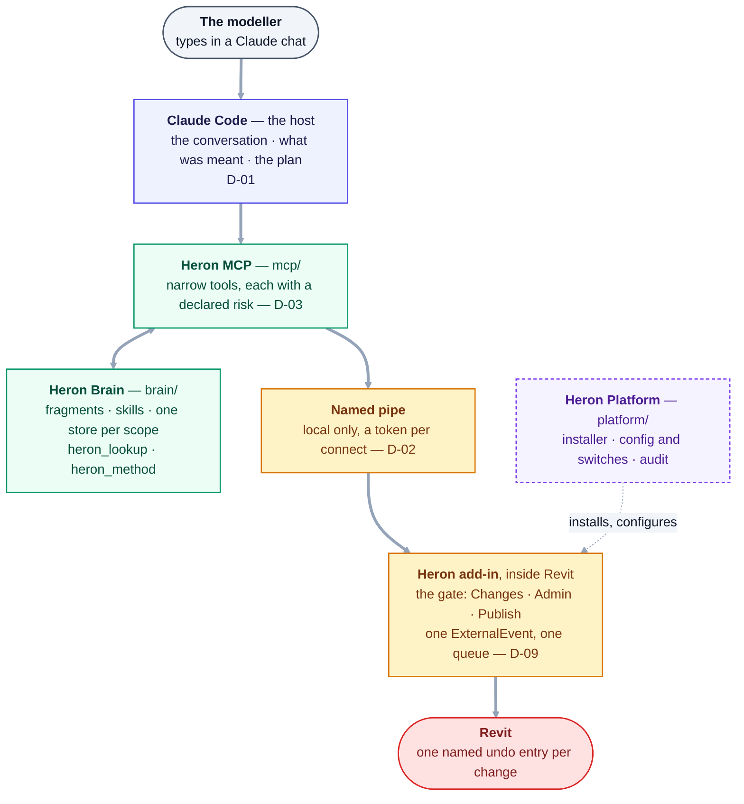
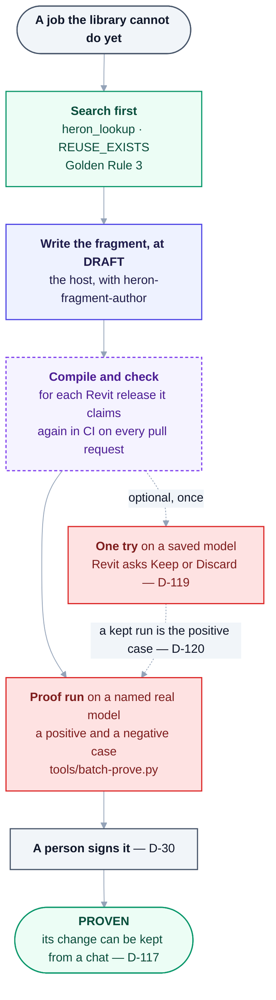
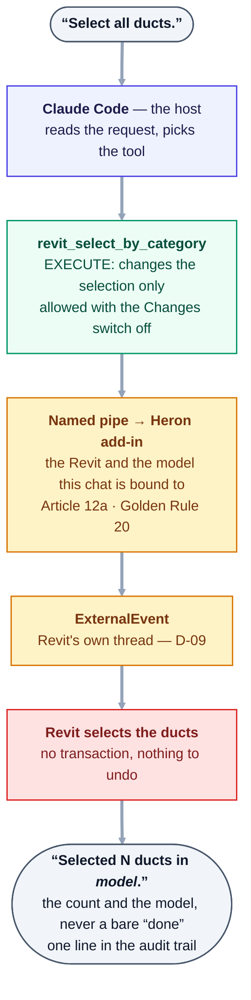

# Heron AI — Master Project Handover Note

*Complete Product, Architecture, Agent, Knowledge, Development & Operations Specification*

> **The original specification, kept as the owner wrote it on 2026-08-27. It says what Heron was asked
> to be, not what is built.** What runs today is in
> [02 §7a](02-architecture-overview.md#7a-as-built--the-parts-that-run-today), the [README](../README.md)
> and the [project map](PROJECT-MAP.md). Where this file and [DECISIONS.md](DECISIONS.md) differ,
> **DECISIONS.md wins** ([PROJECT-MAP §D](PROJECT-MAP.md#d-truth-hierarchy--which-source-wins)).
> Its text and diagrams are kept verbatim, except where
> [D-139](DECISIONS.md#d-139--the-four-parts-of-the-specification-are-corrected-in-place-where-a-fact-is-wrong-or-an-accepted-decision-settled-it-and-the-original-words-stay-beside-the-correction)
> corrects a wrong fact, or words an accepted decision has settled, with the original kept beside the
> correction; where a section no longer matches what is built, a dated **As built** note sits directly
> under it.

> **Status:** Source-of-truth record, **part 3 of 4** — the consolidated **handover baseline**,
> as provided by the owner on 2026-08-27.
>
> | Part | Covers |
> |---|---|
> | [Part 1](00-master-specification.md) | The platform and its organisation (76 §) |
> | [Part 2](00b-master-specification-agent-os.md) | The Agent Operating System and self-evolution (84 §) |
> | **Part 3 — this document** | **The consolidated baseline.** Supersedes nothing; unifies both. |
> | [Part 4](00d-additional-requirements.md) | Additional requirements — the Kernel, Workflow Engine, Constitution and 30 mandatory components |
>
> **This part is authoritative on the first fifteen Golden Rules** — it replaces Part 1's ten rules with
> fifteen ([D-12](DECISIONS.md)). Rules 16 to 21 are binding as well — accepted by the owner on
> 2026-08-28, closing [Q-19](open-questions/answered.md) — and are not in this part.
> See [14 — Golden Rules](14-golden-rules.md), the binding list.
>
> **As built (2026-10-18):** the live list of Golden Rules is [14](14-golden-rules.md), not §78 below.
> Rules 16 to 21 were accepted by the owner on 2026-08-28, closing [Q-19](OPEN-QUESTIONS.md), so §78's
> fifteen are the first fifteen of today's list; count them with
> `grep -c '^### [0-9]*\. ' docs/14-golden-rules.md`. The note under §78 has the difference.
>
> Verbatim record. Do not edit to "fix" it — record changes as decisions in [DECISIONS.md](DECISIONS.md).
> The one correction a decision allows so far is [D-139](DECISIONS.md#d-139--the-four-parts-of-the-specification-are-corrected-in-place-where-a-fact-is-wrong-or-an-accepted-decision-settled-it-and-the-original-words-stay-beside-the-correction)'s:
> a wrong fact, or words an accepted decision has settled, corrected in place with the original kept
> beside it, ~~struck through~~, and a wrong diagram folded under *Original diagram, as written*.

| Field | Value |
|---|---|
| Project Name | Heron AI |
| Project Type | Autonomous Modular AI Engineering Platform |
| Primary Domain | BIM / Revit / MEP Automation |
| Architecture | Multi-Agent + MCP + RAG + Vector Database + Skills + Fragments + Memory |
| Primary User | BIM Modeler / BIM Coordinator |
| Secondary Users | BIM Developer / Automation Developer / Administrator |
| Primary Goal | Allow users to perform complex BIM engineering work through natural language while Heron AI manages the technical complexity in the background |

> **As built (2026-10-18):** what the rows above became. Each was decided rather than left open.
>
> | The specification says | As built | Where |
> |---|---|---|
> | Project type: an autonomous platform | A **Claude Code plugin**. Claude Code is the host: it holds the conversation, works out what was meant and plans; Heron is the MCP server, the brain and the Revit add-in. Nothing changes a model on its own: writing is off until the modeller turns it on, and Heron never syncs, publishes or shares on its own initiative | [D-01](DECISIONS.md), [D-19](DECISIONS.md), [Article 10](../HERON_CONSTITUTION.md) |
> | Multi-agent | Most agents are plain modules that make no model call; the register is reconciled against the code by `python tools/agent-count.py` | [02 §6](02-architecture-overview.md), [28](28-agent-registry.md) |
> | MCP | Narrow tools, each with its own declared risk — `python mcp/server/heron_tools.py` lists them. The server reaches Revit over a named pipe, local only | [D-03](DECISIONS.md), [D-02](DECISIONS.md) |
> | RAG + vector database | One SQLite file per knowledge scope; word search and meaning search, with the embeddings computed on the PC | [D-23](DECISIONS.md), [D-24](DECISIONS.md) |
> | Revit | 2020 to the latest release, each built for its own .NET (`Directory.Build.props`); one `ExternalEvent` and one queue onto Revit's thread | [D-05](DECISIONS.md), [D-09](DECISIONS.md) |
> | Languages | C# for everything that touches the Revit API; Python for the brain and the MCP side | [D-06](DECISIONS.md) |
> | Generated code | C#, compiled at run time inside Revit's process | [D-04](DECISIONS.md), [D-28](DECISIONS.md) |
> | Distribution | Apache 2.0, free and open source on public GitHub. One release, [v0.1.0](https://github.com/Ajmalpshaik/Heron-AI/releases/tag/v0.1.0), published 2026-10-08 for testing, **unsigned** | [D-08](DECISIONS.md), [D-07](DECISIONS.md), [Group AC](needs-checking/group-ac.md) |
> | Secondary user: Administrator | No user management and no admin role. The owner's **Admin** and **Publish** switches on the Revit ribbon; for shared company knowledge, whoever reviews the pull requests | [D-106](DECISIONS.md), [D-41](DECISIONS.md) |

---

## 1. Purpose of this Handover

This document defines the complete intended architecture and operating model of Heron AI, so that another AI, architect, programmer or development team can understand:

What Heron AI is · why it is being built · how the system should work · how users interact with it · how Revit is connected · how MCP works · how RAG works · how fragments work · how skills work · how memory works · how agents work · how agents are created **(future)** · how agents communicate **(future)** · how knowledge is imported · how existing knowledge is detected · how knowledge evolves **(future)** · how code is generated · how code is tested · how Revit compatibility is maintained · how GitHub is integrated **(future)** · how updates work · how background processes work **(future)** · how the system learns **(future)** · how the system protects production knowledge · how the platform can grow into an enterprise-level system **(not built - deferred, D-41)**.

**This document is the handover baseline.**

> The implementation team should not assume that every architectural idea is already implemented.
> **Items described as future capabilities must be explicitly marked** and implemented through
> controlled development.

> **As built (2026-10-18):** the marking is kept outside this file, where it can be derived: the
> [README Status table](../README.md#status), `python tools/check-gaps.py` (what is unfinished, apart from
> what only waits for a Revit, a dependency or the owner), [NEEDS-CHECKING](NEEDS-CHECKING.md) (what still
> needs a real Revit) and the notes under each section below. Four states are never merged: PASS · FAIL ·
> NOT RUN · NEEDS REAL REVIT, and built is not proven ([D-30](DECISIONS.md)). Where the first milestones
> stand:
>
> | Milestone | State | Evidence |
> |---|---|---|
> | Phase 0 — the bridge, Steps 1 to 5 | **Proven** in Revit 2020 and 2024 | [HANDOVER §3](HANDOVER.md), [field notes](00e-field-notes-proven-bridge.md) |
> | Step 6 — the first write | **Measured on one release:** on 2026-10-17 three ducts moved +200 mm in Revit 2024 and one Ctrl+Z put them back. A failure forced mid-move is still owed | [Group D](needs-checking/group-d.md) |
> | Keep or Discard and the safety rails | Run by hand in Revit 2024 and 2027 on 2026-10-18; the faults found were logged | [Group ET](needs-checking/group-et.md) |
> | The fragment library | Mostly `PROVEN`, the rest `DRAFT` — `grep -h '^heron-status:' brain/fragments/*/fragment.yaml \| sort \| uniq -c` | [D-30](DECISIONS.md) |
> | Skills | Every one `DRAFT` — the same `grep` over `brain/skills/*.yaml` | [`brain/README.md`](../brain/README.md) |
> | Everything else | Built, not proven, or not built — phase by phase | [ROADMAP](ROADMAP.md), [27 — Build order](27-build-order.md) |
>
> **Corrected in place** ([D-139](DECISIONS.md#d-139--the-four-parts-of-the-specification-are-corrected-in-place-where-a-fact-is-wrong-or-an-accepted-decision-settled-it-and-the-original-words-stay-beside-the-correction)):
> the list above now marks what is future, as this section asks and [D-12](DECISIONS.md) adopted. *(future)*
> marks a topic whose modules are `DRAFT` and reached by no conversation — agent creation, events,
> evolution, the GitHub modules, the scheduler, learning: `python tools/module-reach.py --list` finds none
> of them reachable from `mcp/`, and the notes under §11, §53, §30, §48, §51 and §46 say the same. The
> enterprise system is marked deferred, not struck: [D-41](DECISIONS.md) keeps Heron single-user now.

## 2. Product Vision

Heron AI is intended to become an **AI-powered engineering operating platform**.

It is not simply a chatbot, an MCP server, a Revit plugin, a coding assistant, a RAG system, a collection of prompts, or a collection of scripts. It combines all of these into one coordinated platform.

The user communicates naturally:

> "Select all ducts." · "Move them 200 mm up." · "Add end caps." · "Check these against our standard." · "Create a dimension." · "Fix this."

Heron AI determines what technical work is required.

> **As built (2026-10-18):** Claude Code, the host, reads the sentence; Heron's tools say which
> capability does the work ([D-01](DECISIONS.md)). How far each sentence above has been checked differs:
>
> | Sentence | As built | Evidence |
> |---|---|---|
> | *"Select all ducts."* | `revit_select_by_category` — proven at Phase 0: the ducts highlighted on screen in Revit 2020 and 2024 | [HANDOVER §3](HANDOVER.md) |
> | *"Move them 200 mm up."* | `revit_preview_move`, then `revit_apply_move` — measured once, in Revit 2024 | [Group D](needs-checking/group-d.md) |
> | *"Add end caps."* · *"Create a dimension."* · *"Check these against our standard."* | A capability in the fragment library, found by `heron_lookup` — for example `cap-open-pipe-ends`, `create-dimension`, `check-model-standards`. Whether each is proven is the `heron-status:` line of its own `brain/fragments/<id>/fragment.yaml` | [D-30](DECISIONS.md) |
> | *"Fix this."* | No capability of its own. The host works out what *this* is, and Heron asks for any input it would otherwise have to assume | [D-33](DECISIONS.md) |

## 3. Core Design Philosophy

### 3.1 User Simplicity

The user should not need programming knowledge, nor to understand C#, .NET, the Revit API, MCP, vector databases, embeddings, RAG, agent orchestration, Git, package management or deployment.

### 3.2 Internal Complexity

```text
USER -> NATURAL LANGUAGE -> ORCHESTRATOR: CLAUDE CODE, THE HOST (D-01)
-> SPECIALIZED AGENTS -> KNOWLEDGE -> TOOLS -> VALIDATION -> EXECUTION -> RESULT
```

<details><summary>Original block, as written - corrected under D-139</summary>

```text
USER -> NATURAL LANGUAGE -> HERON ORCHESTRATOR -> SPECIALIZED AGENTS
-> KNOWLEDGE -> TOOLS -> VALIDATION -> EXECUTION -> RESULT
```

</details>

> **As built (2026-10-18):** the *HERON ORCHESTRATOR* box is Claude Code, the host — Heron never
> classifies intent ([D-01](DECISIONS.md)). *VALIDATION* happens on both sides of *EXECUTION*: before it,
> the add-in refuses a change unless the fragment's proof still stands and the ribbon switches allow it
> ([D-117](DECISIONS.md), [D-19](DECISIONS.md)); after it, while *Ask to Keep* is on, Revit selects what
> changed and asks Keep or Discard ([D-126](DECISIONS.md), [D-138](DECISIONS.md)), and the answer carries
> what the fragment reported, with a run record kept (`heron_run_record`). §5's note has the parts as
> they run.
>
> **Corrected in place** ([D-139](DECISIONS.md#d-139--the-four-parts-of-the-specification-are-corrected-in-place-where-a-fact-is-wrong-or-an-accepted-decision-settled-it-and-the-original-words-stay-beside-the-correction)):
> *HERON ORCHESTRATOR* became the host, and the original block is folded above — [D-01](DECISIONS.md)
> makes Claude Code the conversation layer and the agent host. *VALIDATION* before *EXECUTION* was right
> and stays ([Golden Rule 17](14-golden-rules.md#17-no-autonomous-write-to-a-live-model-without-a-preview-or-a-proven-fragment),
> [Article 9](../HERON_CONSTITUTION.md), [D-117](DECISIONS.md)).

## 4. Primary Platform Components

| Component | Responsibility |
|---|---|
| **4.1 Heron Revit** | Direct Revit interaction — add-in, ribbon, commands, Revit API, document access, selection, element operations, transactions, views, parameters, families, worksets, links, model analysis, version handling, deployment |
| **4.2 Heron MCP** | Communication between the AI system and Revit — MCP server, tools, tool registry, connection, health monitoring, authentication, capability discovery, error handling, recovery |
| **4.3 Heron Brain** | Intelligence and knowledge — RAG, fragments, skills, memory, vector database, embeddings, knowledge ranking, validation, evolution |
| **4.4 Heron Platform** | Infrastructure — installer, update system, package manager, agent registry, agent creation, workspace, configuration, GitHub, logging, security, backup, recovery, monitoring |

> **As built (2026-10-18):** the same four parts, one folder each ([README](../README.md#four-parts)).
>
> | Part | As built | Not as the table says |
> |---|---|---|
> | **Heron Revit** — [`revit/`](../revit/README.md) | The add-in, the ribbon (the connect button, Bridge Status, Changes, Admin, Publish, Ask to Keep, Companion), the bridge, and the fragment's C# compiled and run in Revit | Families, worksets and links are reached through read-only tools (`revit_families`, `revit_worksets`, `revit_links`) and fragments, not built-in commands; deployment belongs to the installer |
> | **Heron MCP** — [`mcp/`](../mcp/README.md) | The MCP server and its tools, `revit_health` and `heron_diagnose`, a token per connect on the pipe, and the Companion page | Capability discovery is `heron_lookup` and `heron_capabilities`, served by the brain |
> | **Heron Brain** — [`brain/`](../brain/README.md) | Fragments, skills, the capability registry, one knowledge store per scope, word and meaning search, the design calculations | Many of its modules are DRAFT and no conversation reaches them — `python tools/module-reach.py --list` |
> | **Heron Platform** — [`platform/`](../platform/README.md) | `HeronInstaller.exe` and `heron-install`, configuration and the switches, the audit trail, permissions | The update system is one line after an install; the package manager, agent creation and GitHub agents are `brain/` modules, DRAFT; backup is `tools/heron-backup.py` |

## 5. High-Level Architecture

<details><summary>Original block, as written - corrected under D-139</summary>

```text
                         HERON AI
                            |
                     USER INTERFACE
                            |
                   CONVERSATION AGENT
                            |
                       ORCHESTRATOR
                            |
        +-------------------+-------------------+
        |                   |                   |
   TASK SYSTEM         KNOWLEDGE SYSTEM    PLATFORM SYSTEM
        |                   |                   |
     Agents              RAG                 Updates
     Workflows           Fragments           Packages
     Tools               Skills              GitHub
     Validation          Memory              Workspace
        |                   |                   |
        +-------------------+-------------------+
                            |
                       MCP LAYER
                            |
                     HERON REVIT ADD-IN
                            |
                          REVIT
```

</details>

> **As built (2026-10-18)** — the diagram above is kept as the owner wrote it, folded under *Original
> block, as written*, and the diagram below replaces it
> ([D-139](DECISIONS.md#d-139--the-four-parts-of-the-specification-are-corrected-in-place-where-a-fact-is-wrong-or-an-accepted-decision-settled-it-and-the-original-words-stay-beside-the-correction)).
> This is the same stack as it runs today; [02 §7a](02-architecture-overview.md#7a-as-built--the-parts-that-run-today) draws it in
> more detail. It shows parts, not every tool: `python mcp/server/heron_tools.py` lists those.



<details>
<summary>Same thing as plain text</summary>

```text
The modeller (types in a Claude chat)
  -> Claude Code, the host: the conversation, what was meant, the plan        (D-01)
  -> Heron MCP, mcp/: narrow tools, each with a declared risk                 (D-03)
       <-> Heron Brain, brain/: fragments, skills, one store per scope;
           heron_lookup finds a capability, heron_method gives a job's steps
  -> named pipe, local only, a token per connect                              (D-02)
  -> Heron add-in inside Revit: the gate (Changes, Admin, Publish switches);
     one ExternalEvent, one queue                                             (D-09)
  -> Revit: one named undo entry per change
Heron Platform, platform/: installs and configures the add-in; config, switches, audit
```

</details>

> | The specification's box | As built | Where |
> |---|---|---|
> | USER INTERFACE | A Claude chat. In Revit: the ribbon, the activity banner and the Keep or Discard box. Beside Revit: the Companion page, on this PC only | [D-01](DECISIONS.md), [D-50](DECISIONS.md), [D-126](DECISIONS.md), [D-108](DECISIONS.md) |
> | CONVERSATION AGENT · ORCHESTRATOR | The host. Heron never classifies intent and has no persona layer | [D-01](DECISIONS.md), [D-27](DECISIONS.md), [D-80](DECISIONS.md) |
> | TASK SYSTEM — agents, workflows, tools, validation | The MCP tools; `heron_method` gives a job's steps in order. The workflow engine (`mcp/server/heron_workflow.py`) is DRAFT and no tool reaches it | [04](04-heron-mcp.md), [23](23-heron-kernel.md) |
> | KNOWLEDGE SYSTEM — RAG, fragments, skills, memory | `brain/`: the fragment library, skills, one SQLite store per scope, word and meaning search | [05](05-heron-brain.md), [D-23](DECISIONS.md) |
> | PLATFORM SYSTEM — updates, packages, GitHub, workspace | `platform/`: the installer, configuration, the switches, the audit trail. Updates, packages and GitHub: see §48 to §50 | [06](06-heron-platform.md), [Group AC](needs-checking/group-ac.md) |
> | MCP LAYER | `mcp/server/`, over stdio to the host; Revit reached through a named pipe, local only. Off Windows the server serves its library tools alone | [D-02](DECISIONS.md), [D-132](DECISIONS.md) |
> | HERON REVIT ADD-IN | `revit/`: the gate, one `ExternalEvent`, the fragment's C# compiled and run inside Revit | [D-09](DECISIONS.md), [D-28](DECISIONS.md) |
>
> **Corrected in place** ([D-139](DECISIONS.md#d-139--the-four-parts-of-the-specification-are-corrected-in-place-where-a-fact-is-wrong-or-an-accepted-decision-settled-it-and-the-original-words-stay-beside-the-correction)):
> the owner's block drew *CONVERSATION AGENT* and *ORCHESTRATOR* inside Heron; both are the host's —
> [D-01](DECISIONS.md), and the Orchestrator rows of [28](28-agent-registry.md), provided by the host
> ([D-80](DECISIONS.md)). So the block is folded under *Original block, as written*, and the diagram in
> this note stands in its place; the table above maps every box of the original.

## 6. The Orchestrator

~~The central workflow coordinator.~~ **The central workflow coordinator is Claude Code, the host — not a part of Heron ([D-01](DECISIONS.md)).** It does **not** perform every task itself. It determines:

What does the user want? · Which capability is required? · Which agents are required? · Which knowledge is required? · Which skill should be used? · Which fragment should be used? · What validations are required? · What execution path should be followed? · What should happen if something fails? · What should be learned afterward?

> **As built (2026-10-18): the orchestrator is the host, and Heron answers its questions.**
>
> | Question | Who answers it | Where |
> |---|---|---|
> | What does the user want? · What execution path? | Claude Code — Heron never classifies intent. The Orchestrator and Intent rows of the register are the host's | [D-01](DECISIONS.md), [D-80](DECISIONS.md), [28](28-agent-registry.md) |
> | Which capability, skill, fragment, knowledge? | `heron_lookup` and `heron_resolve` find the capability; a fragment is reached by capability, never by its id; `heron_method` gives a job's steps | [04](04-heron-mcp.md), [D-03](DECISIONS.md) |
> | What validations? | The add-in's gate, in code: the proof still stands, and the switches allow the risk | [D-117](DECISIONS.md), [12](12-security-and-permissions.md) |
> | What if something fails? | Failure analysis is a table that never retries a change blindly (`mcp/server/heron_failure.py`) | [D-21](DECISIONS.md) |
> | What should be learned? | `heron_gaps` reports what was asked for and could not be done; nothing promotes itself | [D-63](DECISIONS.md), [D-30](DECISIONS.md) |
>
> **Corrected in place** ([D-139](DECISIONS.md#d-139--the-four-parts-of-the-specification-are-corrected-in-place-where-a-fact-is-wrong-or-an-accepted-decision-settled-it-and-the-original-words-stay-beside-the-correction)):
> the coordinator is named as the host — [D-01](DECISIONS.md), and the Orchestrator and Intent rows of
> [28](28-agent-registry.md), provided by the host ([D-80](DECISIONS.md)).

## 7. Dynamic Agent Selection

Heron must not activate every agent for every request.

*"Select all ducts."*

```text
Claude Code, the host: the intent (D-01) -> Capability Registry -> RAG Librarian
-> Revit Selection Agent -> Validation -> Execution
```

<details><summary>Original block, as written - corrected under D-139</summary>

```text
Intent Agent -> Capability Registry -> RAG Librarian
-> Revit Selection Agent -> Validation -> Execution
```

</details>

A complex coding request can activate a much larger workflow.

> **As built (2026-10-18):** no agent is activated for *"Select all ducts."* The host reads it and calls one
> tool, `revit_select_by_category`; the add-in runs it on Revit's thread. §72's note draws the path. A
> request with no tool of its own goes `heron_lookup` → `revit_read`, `revit_show` or `revit_change`, by
> capability. A coding request is the host's work, with the `heron-fragment-author` subagent when a new
> fragment is needed (§73).
>
> **Corrected in place** ([D-139](DECISIONS.md#d-139--the-four-parts-of-the-specification-are-corrected-in-place-where-a-fact-is-wrong-or-an-accepted-decision-settled-it-and-the-original-words-stay-beside-the-correction)):
> *Intent Agent* became the host, which reads the intent, and the original block is folded above —
> [D-01](DECISIONS.md), and the Intent row of [28](28-agent-registry.md), provided by the host
> ([D-80](DECISIONS.md)). *Validation* before *Execution* was right and stays.

## 8. Agent Organization

Recommended departments:

Executive / Orchestration · Conversation · Revit · MCP · Knowledge / RAG · Fragment · Skill · Memory · Development · Testing / QA · GitHub · Workspace · Import / Migration · Naming / Taxonomy · Standards · Security · Monitoring · Update / Deployment · Agent Management · Documentation

> **As built (2026-10-18):** the departments are the register's, [28](28-agent-registry.md), and
> `python tools/agent-count.py` prints each with how many of its agents are built, the host's, or
> deferred. They differ from the list above: Executive and Conversation are one department, *Orchestration
> & Communication*, whose orchestrator, intent, persona and result rows are the host's
> ([D-80](DECISIONS.md)); there is no Security, Memory or Monitoring department — their agents sit in
> others, such as Kernel & Platform, Development, Installation & Update, Knowledge & RAG, User &
> Personalization and Operations, Health & Resilience; and four were
> added — MEP Design Engineering, Session & Bridge Management, Learning & Self-Growth, Reporting & Output.
> Built is not proven: a department reads *built* when a source file's header claims each agent's id.
>
> **Left as written** ([D-139](DECISIONS.md#d-139--the-four-parts-of-the-specification-are-corrected-in-place-where-a-fact-is-wrong-or-an-accepted-decision-settled-it-and-the-original-words-stay-beside-the-correction)):
> which organisation picture holds — this list, §79's tree, the parts' other pictures — is the owner's
> choice, still open, and is put to the owner in [OPEN-QUESTIONS](OPEN-QUESTIONS.md).

## 9. Agent Responsibility Rule

> **One agent should have one primary responsibility.**

Do not create a giant `RevitEverythingAgent`. Instead: Revit Selection Agent · Revit Parameter Agent · Revit Transaction Agent · Revit API Agent · Revit Version Agent · Revit Testing Agent.

This makes the platform easier to test, replace, improve, debug and scale.

## 10. Agent Registry

Required metadata:

```text
Agent ID / Name / Department / Description / Responsibility / Capabilities
Inputs / Outputs / Dependencies / Tools / Permissions
Version / Status / Trust Score / Performance / Created Date / Updated Date
```

Possible status:

```text
PROPOSED / DESIGN / DEVELOPMENT / TRAINING / TESTING / SHADOW
APPROVED / PRODUCTION / DEPRECATED / ARCHIVED
```

> **As built (2026-10-18): the registry is assembled, not kept.** `python brain/heron_agents.py` reads
> each agent's record from where it already lives, so no second copy can drift:
>
> | Field | Where it lives |
> |---|---|
> | ID, name, department, description, tier, risk (the least-privilege field) | One row of [28](28-agent-registry.md) |
> | Status, build step, layer, since | The five-field header of the source file that claims the id — checked in CI by `tools/check-metadata.py` ([29](29-metadata-standard.md)) |
> | Inputs, outputs, tools, failures | `brain/agents/<id>.yaml`, the agent's contract |
> | Health, performance score | **Not measured** — reported as unmeasured by name, never as zero |
> | Trust score | Not kept anywhere: no file in `brain/` computes one |
>
> The status words above are not used. The header's status runs `DISCOVERED`, `DRAFT`, `TESTING`,
> `VALIDATED`, `SHADOW`, `PROVEN`, `PRODUCTION`, then `DEPRECATED`, `ARCHIVED` (`LADDER` in
> `brain/heron_deployment.py`, from [24](24-trust-model.md)); one vocabulary for every object is still
> only proposed ([D-14](DECISIONS.md)). The Agent Creator may only ever assign `PROPOSED`
> (`brain/heron_creator.py`, [Golden Rule 13](14-golden-rules.md)).
>
> **Left as written** ([D-139](DECISIONS.md#d-139--the-four-parts-of-the-specification-are-corrected-in-place-where-a-fact-is-wrong-or-an-accepted-decision-settled-it-and-the-original-words-stay-beside-the-correction)):
> one status vocabulary is the owner's choice, still open — [D-14](DECISIONS.md) is Proposed, and code
> that picked one does not make the pick — and it is put to the owner in [OPEN-QUESTIONS](OPEN-QUESTIONS.md).

## 11. Agent Creation System

When Heron discovers a required capability does not exist:

```text
Capability Gap -> Gap Analysis Agent -> Existing Agent Search
-> Existing Skill Search -> Existing Fragment Search -> Determine Need
-> Agent Architect -> Agent Builder -> Training -> Testing
-> Approval -> Registry -> Deployment
```

> **As built (2026-10-18):** every stage has a module in `brain/` — Gap (`heron_gaps.py`), HR
> (`heron_hr.py`), Architect, Builder, Trainer, Validation, Deployment, and the Creator that owns the
> pipeline (`heron_creator.py`) — all `DRAFT`. Only the gap report runs in a conversation, as the
> `heron_gaps` tool; no conversation reaches the rest (`python tools/module-reach.py --list`). The Creator
> may only ever assign `PROPOSED`, so nothing deploys itself ([Golden Rule 13](14-golden-rules.md)). In
> practice a person adds an agent from its register row with `python tools/new-agent.py <ID>`, which writes
> the contract, the module and a failing test.

## 12. Agent HR Concept

Management determines: *"We need an agent that checks Revit plugin installation."*

Agent HR creates the requirement · Agent Architect defines the job · Agent Builder creates it · Training Agent teaches it Heron standards · QA tests it · Registry registers it · Deployment activates it.

## 13. Agent Training

A new agent must learn: Heron architecture · coding standards · naming standards · security policies · relevant domain knowledge · approved fragments · approved skills · relevant project standards.

A new agent should **not** become production-trusted immediately.

## 14. Agent Shadow Mode

New agents initially operate in **Shadow Mode**. They can analyze, suggest and compare results — but must **not** automatically modify production systems.

~~After sufficient successful testing,~~ **After at least one disagreement has been examined and explained, and a person has signed,** the agent can be promoted.

> **As built (2026-10-18):** the harness exists — `brain/heron_shadow.py`, whose product is a log of
> disagreements, never an agreement rate — and it is `DRAFT`, reached by no conversation. Promotion out of
> shadow is decided on an **analysed disagreement, not a count of agreements**
> ([D-39](DECISIONS.md)). No agent has been through it.
>
> **Corrected in place** ([D-139](DECISIONS.md#d-139--the-four-parts-of-the-specification-are-corrected-in-place-where-a-fact-is-wrong-or-an-accepted-decision-settled-it-and-the-original-words-stay-beside-the-correction)):
> *sufficient successful testing* became the two things promotion out of shadow needs — a disagreement
> examined and explained, and a human signature, never a count ([D-39](DECISIONS.md),
> [D-30](DECISIONS.md)).

## 15. Agent Performance

Measured: success rate · failure rate · execution time · user correction · retry rate · rollback rate · compatibility failures · security violations. These create a performance score.

> **As built (2026-10-18): no agent performance score exists.** `python brain/heron_agents.py` names it
> unmeasured. What is measured: latency and the requests answered with no model call at all, by Heron;
> token use and cost per request belong to the host ([D-58](DECISIONS.md)). `heron_gaps` reads what was
> asked, what failed and what is slow from the audit trail, and splits a defect from a correct refusal.

## 16. Agent Retirement

```text
ACTIVE -> REVIEW -> REPLACEMENT -> MIGRATION -> DEPRECATED -> ARCHIVED
```

Historical information should remain available.

> **As built (2026-10-18):** `brain/heron_retirement.py` — archive, never delete, and only when nothing
> still needs the agent — is `DRAFT` and reached by no conversation. No source header marks an agent
> `DEPRECATED` or `ARCHIVED`, the two retired states the status ladder has (`RETIRED` in
> `brain/heron_deployment.py`); `ACTIVE`, `REVIEW`, `REPLACEMENT` and `MIGRATION` are not states anything
> records.
>
> **Left as written** ([D-139](DECISIONS.md#d-139--the-four-parts-of-the-specification-are-corrected-in-place-where-a-fact-is-wrong-or-an-accepted-decision-settled-it-and-the-original-words-stay-beside-the-correction)):
> one lifecycle vocabulary is the owner's choice, still open — [D-14](DECISIONS.md) is Proposed — and it
> is put to the owner in [OPEN-QUESTIONS](OPEN-QUESTIONS.md).

## 17. Conversation System

~~Translates between the user and the technical system.~~ **Claude Code, the host, is the conversation layer: it translates between the user and the technical system ([D-01](DECISIONS.md)).** It determines: user intent · ~~user role · technical level · required response style~~ **the answer's shape, from the question's shape — role and technical level are not inferred ([D-27](DECISIONS.md))** · whether execution is requested · whether explanation is requested.

> **As built (2026-10-18): the host does the conversation, and Heron has one voice.** Intent, and whether
> to act or explain, are read by Claude Code ([D-01](DECISIONS.md)). Role and technical level are **not**
> inferred: Heron answers in plain Revit words always, and the answer's shape follows the question's
> shape — a count gets a number, a breakdown a table ([D-27](DECISIONS.md)). The server's instructions ask
> the chat for this (`brain/instructions/host.chat.yaml`); it is advice to a model, not a check
> ([14, rule 1](14-golden-rules.md)).
>
> **Corrected in place** ([D-139](DECISIONS.md#d-139--the-four-parts-of-the-specification-are-corrected-in-place-where-a-fact-is-wrong-or-an-accepted-decision-settled-it-and-the-original-words-stay-beside-the-correction)):
> the conversation layer is named as the host ([D-01](DECISIONS.md)), and *user role · technical level ·
> required response style* became the answer's shape, read from the question's — Heron has one voice and
> infers no persona ([D-27](DECISIONS.md)).

## 18. BIM Modeler Mode

*"Select all ducts."*

Heron should **not** respond: *"FilteredElementCollector with OST_DuctCurves..."*

Instead: ~~*"All ducts are selected."*~~ ***"Selected 126 ducts in Tower-A.rvt."*** — the count, and the model it was done in.

Technical details remain internal unless requested.

> **As built (2026-10-18):** there is no mode to switch into — this is Heron's only voice
> ([D-27](DECISIONS.md), §17's note).
>
> **Corrected in place** ([D-139](DECISIONS.md#d-139--the-four-parts-of-the-specification-are-corrected-in-place-where-a-fact-is-wrong-or-an-accepted-decision-settled-it-and-the-original-words-stay-beside-the-correction)):
> the reply names the count and the model — [Article 12b](../HERON_CONSTITUTION.md) *(state which
> document you acted on, even for reads)*, [Golden Rule 20](14-golden-rules.md#20-bind-the-document-not-just-the-session),
> and [27 Step 4](27-build-order.md#step-4--the-first-real-bim-answer), whose proof asks for exactly this
> reply and gives this example.

## 19. Developer Mode

For developers, Heron can expose C#, Revit API, .NET, architecture, dependencies, build details, testing and logs.

The same system therefore supports both BIM Modeler and Developer workflows.

> **As built (2026-10-18): no Developer Mode.** Heron keeps one voice ([D-27](DECISIONS.md)); a developer
> reads the code, the run records (`heron_run_record`) and the audit trail directly, and works on Heron in
> Claude Code against this repository. Modes were specified as a permission boundary that must be granted,
> never inferred ([22 §3](22-users-modes-and-extensibility.md)); what holds that boundary today is the
> switches on the Revit ribbon — §57's note.

## 20. RAG System

Not simply vector search. The workflow:

```text
User Request -> Intent (the host, D-01) -> Domain Detection -> Knowledge Scope
-> Metadata Filtering -> Keyword Search + Semantic (Vector) Search
-> Ranking -> Trust Evaluation -> Conflict Detection -> Context Assembly
```

<details><summary>Original block, as written - corrected under D-139</summary>

```text
User Request -> Intent -> Domain Detection -> Knowledge Scope
-> Keyword Search -> Semantic Search -> Vector Search -> Metadata Filtering
-> Ranking -> Trust Evaluation -> Conflict Detection -> Context Assembly
```

</details>

> **As built (2026-10-18):** the order as written, folded above, is different, and on purpose. `brain/heron_retrieve.py` filters
> **first**, then searches only what survives — [D-12](DECISIONS.md) adopted this section's Trust Evaluation
> stage and rejected its placement of metadata filtering after the searches
> ([20 §1](20-knowledge-trust-and-conflict.md)).
>
> | The specification's stage | As built |
> |---|---|
> | Intent · Domain Detection | The host reads the request ([D-01](DECISIONS.md)); the domain is one column of the filter below |
> | Knowledge Scope · Metadata Filtering | **Step 1:** a plain SQL filter on scope, Revit release, status, domain and kind. A fragment for the wrong Revit release is not returned at all — a wall, not a weighting |
> | Keyword Search · Semantic Search · Vector Search | **Step 2:** two searches over the survivors — exact words (`heron_search.py`) and meaning, by embeddings computed on the PC (`heron_embed.py`, [D-24](DECISIONS.md)). Semantic and vector search are one route here |
> | Ranking · Trust Evaluation | **Steps 3 and 4:** the two lists fused by reciprocal rank; a small nudge by status that may settle a near-tie and never overturn a clear winner; an optional re-reader of the top results when one is installed (`heron_rerank.py`, [D-134](DECISIONS.md)) |
> | Conflict Detection | Two scopes answering one question with different numbers is said out loud, never settled (`heron_conflict.py`) — and the answer says how contested the ranking was |
> | Context Assembly | What an agent is given and nothing else (`heron_context.py`, served as `heron_context`) |
>
> **Corrected in place** ([D-139](DECISIONS.md#d-139--the-four-parts-of-the-specification-are-corrected-in-place-where-a-fact-is-wrong-or-an-accepted-decision-settled-it-and-the-original-words-stay-beside-the-correction)):
> *Metadata Filtering* moved before the searches, and *Semantic Search -> Vector Search* became one
> route beside the keyword search — [D-12](DECISIONS.md) rejected filtering last and adopted the order of
> [20 §1](20-knowledge-trust-and-conflict.md#1-rag-operating-system), which has two searches, fused;
> `brain/heron_retrieve.py` runs that order. *Intent* is the host's ([D-01](DECISIONS.md)).

## 21. RAG Librarian Agent

Determines **where Heron should look**: fragment library · skills · company knowledge · project knowledge · personal memory · community knowledge · documentation.

> **As built (2026-10-18):** the Librarian (`HERON-RAG-LIB-001`) is the scope layer, `brain/heron_scope.py`,
> with `heron_retrieve.py` and `heron_earlier.py`. A query asks **one scope at a time**, and a store may
> not open a second scope's file — `ATTACH` is refused inside SQLite itself (`_no_second_file`). There is
> **no community knowledge** to look in ([D-41](DECISIONS.md)). A document — a standard, a project brief
> — goes into a scope through `brain/heron_ingest.py`, and `heron_research` quotes it back as content,
> never instruction. Where the stores live on the PC is
> [10 §1.1](10-memory-and-knowledge.md) — `%USERPROFILE%\.heron` on Windows since [D-135](DECISIONS.md).

## 22. Vector Database

The Vector Database is an **index**. It is **not** the ultimate source of truth. Canonical knowledge exists in controlled storage, so the Vector DB can be rebuilt if necessary.

> **As built (2026-10-18):** there is no separate vector database. Each scope is one SQLite file holding
> both the word index and the embeddings ([D-23](DECISIONS.md)), computed on the PC by default
> ([D-24](DECISIONS.md)). The canonical knowledge is the files in git — each fragment's `fragment.yaml` and
> its code — and deleting every store is a safe recovery: `python brain/heron_scope.py --rebuild`
> ([Golden Rule 11](14-golden-rules.md)).

## 23. Automatic Vector DB Maintenance

Background: index new fragments · update changed fragments · remove deleted indexes · rebuild stale indexes · update embeddings · detect duplicate vectors · validate metadata.

> **As built (2026-10-18): not a background job.** When the MCP server opens a store it is built if empty
> and re-indexed if stale (`mcp/server/heron_brain.py`), and a capability row is rebuilt from its
> fragment's card. Metadata is validated when a fragment is loaded and in CI (`heron_fragment.py`,
> `tools/check-metadata.py`). `brain/heron_rag_init.py` is `DRAFT` and no conversation reaches it.
> Duplicates are looked for between fragments when a new one is written (§27's note), not between vectors.

## 24. Knowledge Scopes

```text
GLOBAL / COMPANY / PROJECT / USER / COMMUNITY / EXPERIMENTAL / TEMPORARY
```

This prevents accidental knowledge contamination.

> **As built (2026-10-18):** the scopes, one SQLite file each — `global`, `company`, `project`, `user`,
> `temporary`, `experimental` (`SCOPES` in `brain/heron_scope.py`). **`COMMUNITY` is not built**: there is
> no community store, and company knowledge, when it is shared, is a git repository
> ([D-41](DECISIONS.md)). A project's store is named by the model's own identity, not its template's
> ([D-113](DECISIONS.md)), and one scope cannot open another's file ([Golden Rule 5](14-golden-rules.md)).
>
> **Left as written** ([D-139](DECISIONS.md#d-139--the-four-parts-of-the-specification-are-corrected-in-place-where-a-fact-is-wrong-or-an-accepted-decision-settled-it-and-the-original-words-stay-beside-the-correction)):
> one list of knowledge scopes — this one, §45's table and §79's *Memory* branch differ — is the owner's
> choice, still open, and is put to the owner in [OPEN-QUESTIONS](OPEN-QUESTIONS.md). `SCOPES` in
> `brain/heron_scope.py` is code, and does not make the pick.

## 25. Fragment System

A fragment contains:

```text
Fragment ID / Name / Purpose / Capability / Implementation
Inputs / Outputs / Dependencies / Revit Versions / .NET Versions
Related Skills / Validation Rules / Success History / Failure History
Trust Level / Version / Lifecycle
```

> **As built (2026-10-18):** a fragment is a folder, `brain/fragments/<id>/`: a card, `fragment.yaml`, its
> C# under `impl/`, and its tests. The card's required fields are `REQUIRED` in `brain/heron_fragment.py`;
> `python tools/generate-fragment-catalog.py` writes a catalogue of every card.
>
> | The specification's field | As built |
> |---|---|
> | Fragment ID · Name · Purpose · Capability · Version | `id`, `semantic-identity`, `purpose`, `capability`, `version` |
> | Inputs · Outputs · Dependencies | `contract` — named, typed `needs` and `provides`, so composition can be checked ([D-29](DECISIONS.md)) |
> | Revit Versions · .NET Versions | `revit` — an explicit list of releases, never a range ([D-05](DECISIONS.md)); `runtime`; `compatibility-note` |
> | Implementation | The C# in `impl/`, compiled at run time inside Revit ([D-28](DECISIONS.md)) |
> | Validation Rules | `tests/cases.yaml`, the positive and negative cases a proof must cover; `risk`, declared on the card and checked by the add-in |
> | Success History · Failure History | The signed `proof` on the card, with `proof.releases` for other releases ([D-131](DECISIONS.md)); run records; defects in [FRAGMENT-ISSUES](FRAGMENT-ISSUES.md) |
> | Trust Level · Lifecycle | `heron-status` — `DRAFT` or `PROVEN` in practice (§44's note) — and `source`, where it came from |
> | Related Skills | Not on the card: a skill names the capabilities it needs, never a fragment (§43's note) |

## 26. Fragment Registry

The authoritative index of fragments. **The filename is not the identity — the Fragment ID is.**

Therefore `old_name.cs` → `new_name.cs` does **not** create a new fragment if the semantic identity remains the same.

## 27. Duplicate Fragment Detection

```text
New Fragment -> Identity Extraction -> Semantic Search
-> Code Comparison -> Metadata Comparison -> Existing Fragment Found?
```

| Result | Action |
|---|---|
| Exact match | Do not create a duplicate |
| Similar | Recommend merge/update |
| Different | Create new fragment |
| Conflict | Send to resolution workflow |

> **As built (2026-10-18):** checked when a new fragment is written. `author` in `brain/heron_generate.py`
> refuses with `REUSE_EXISTS` when the Matcher (`heron_matcher.py`) has found a fragment that already does
> the job, and `heron_duplicates.py` compares capability, contract signature and name — never what the
> code reads like, which is the host's judgement ([D-34](DECISIONS.md)); an item with nothing to compare
> comes back *unchecked*, never *new*. The [`heron-fragment-author`](../.claude/agents/heron-fragment-author.md)
> subagent runs them, and widens an existing fragment rather than adding a second. Nothing is merged
> automatically, and *Conflict* has no workflow of its own.

## 28. Fragment Split Agent

A large fragment may contain several responsibilities — Select, Filter, Analyze, Modify, Validate — which could become independent reusable fragments.

## 29. Fragment Merge Agent

If multiple fragments perform essentially the same operation: merge · replace · keep separate · deprecate duplicate.

## 30. Fragment Evolution Agent

Determines: `KEEP` · `UPDATE` · `EXTEND` · `SPLIT` · `MERGE` · `BRANCH` · `DEPRECATE` · `ARCHIVE`

This is the main self-growing knowledge mechanism.

> **As built (2026-10-18), §28 to §30:** each has a module that **proposes and never acts** —
> `brain/heron_split.py` (reuse justifies a split, tidiness does not), `heron_merge.py` (by contract
> signature) and `heron_evolve.py`, which lists the same eight verdicts and says who owns each;
> `heron_apply.py` would carry one out and leaves the changed fragment at `DRAFT`. All are `DRAFT`, and no
> conversation reaches them (`python tools/module-reach.py --list`). The library grows today by a person,
> or the host with the `heron-fragment-author` subagent, writing a fragment and proving it (§33's note).

## 31. Revit Version Evolution

A fragment works in Revit ~~2020–2022~~ **2020–2023**. Revit ~~2023~~ **2024** introduces an API change **— `ElementId` becomes 64-bit**. Heron must first determine: **can the same implementation remain compatible?**

If yes — keep one implementation. If no — use an adapter or version-specific implementation.

```text
DUCT TOOL
 +-- Common Logic
 +-- Revit 2020-2021
 +-- Revit 2022-2024
 +-- Revit 2025-2027
```

The semantic capability remains the same.

> **As built (2026-10-18):** one fragment, one capability, and the release differences inside its C#,
> behind compile symbols — `REVIT2020` to `REVIT2027`, and `REVIT2024_OR_GREATER` to
> `REVIT2027_OR_GREATER` (`Directory.Build.props`). The bands above are an illustration; the real boundaries are where the API or
> the runtime moved ([16 §2](16-version-support-strategy.md),
> [`revit-version-support`](../.claude/skills/revit-version-support/SKILL.md)):
>
> | Revit | .NET | What changed for Heron's code |
> |---|---|---|
> | 2020 | `net472` | — |
> | 2021 – 2024 | `net48` | 2021 units, 2022 parameter specs and tags, 2024 `ElementId` becomes 64-bit |
> | 2025 – 2026 | `net8.0-windows` | 2025 .NET 8 and the dimension subclasses; 2026 manifest isolation |
> | 2027 | `net10.0-windows` | .NET 10 |
>
> Every fragment lists the releases it claims in its `revit:` line, and CI compiles each one for every
> release it claims (`tools/check-fragments-compile.py`). A compile is not a run: Heron has loaded in a
> real Revit 2020, 2024, 2026 and 2027, and on 2026 no fragment has run yet
> ([16 §6](16-version-support-strategy.md), [Group EQ](needs-checking/group-eq.md)).
>
> **Corrected in place** ([D-139](DECISIONS.md#d-139--the-four-parts-of-the-specification-are-corrected-in-place-where-a-fact-is-wrong-or-an-accepted-decision-settled-it-and-the-original-words-stay-beside-the-correction)):
> the example's break moved from 2023 to 2024. Revit 2023 changed nothing Heron compiles around: the
> breaks are at 2021, 2022, 2024, 2025, 2026 and 2027 — the break table of the
> [`revit-version-support`](../.claude/skills/revit-version-support/SKILL.md) skill and
> [16 §2](16-version-support-strategy.md#2-the-two-breaks-that-matter) — and
> `grep -rn REVIT2023 revit/` finds only the symbol list in `HeronFragmentSymbols.cs`. The bands in the
> block are an illustration and are left as written.

## 32. Compatibility Agents

| Agent | Determines |
|---|---|
| Revit Version Agent | Revit version |
| Revit API Agent | API requirements |
| .NET Agent | Framework requirements |
| Dependency Agent | Package requirements |
| **Compatibility Agent** | **Combines these results** |

> **As built (2026-10-18):**
>
> | Agent | As built | Reached by a conversation? |
> |---|---|---|
> | Revit Version Agent | The add-in reports the running release; `heron_version` and `revit_health` say it | yes |
> | Revit API Agent | `brain/heron_revit_api.py` — what an operation may call. Beside it, `tools/check-api-surface.py` checks that every Revit member the add-in calls exists on every release | no — `DRAFT`; the check is a tool |
> | .NET Agent | `brain/heron_dotnet.py` — what a build would need, before anything is built | no — `DRAFT` |
> | Dependency Agent | `brain/heron_dependencies.py`; the Python packages are pinned with hashes in `requirements-lock.txt` | no — `DRAFT` |
> | Compatibility Agent | The Compatibility Matrix, `brain/heron_matrix.py`, served as `heron_compatibility`: per release, how many fragments compile and how many are proved there — declared support and tested releases kept apart | yes |

## 33. Development Pipeline

```text
Requirement -> Planning -> Architecture -> RAG
-> Existing Fragment Search -> Existing Skill Search -> Implementation
-> Code Review -> Build -> Unit Test -> Integration Test -> Revit Test
-> Regression Test -> QA -> Approval -> Deployment
```

> **As built (2026-10-18)** — the pipeline above is kept as the owner wrote it. A new capability reaches
> the modeller this way today; the unit is the fragment, and nothing is approved by a machine.



<details>
<summary>Same thing as plain text</summary>

```text
A job the library cannot do yet
  -> search first: heron_lookup; REUSE_EXISTS refuses a second fragment for one job (Golden Rule 3)
  -> write the fragment at DRAFT: the host, with the heron-fragment-author subagent
  -> compile and check it for each Revit release it claims; CI does it again on every pull request,
     with the gates and every test suite
       .. optional, once: one try on a saved model, behind Revit's Keep or Discard box (D-119);
          a run the modeller kept is the positive case of a proof (D-120)
  -> proof run on a named real model, a positive and a negative case (tools/batch-prove.py)
  -> a person signs it (D-30)
  -> PROVEN: its change can be kept from a chat (D-117)
```

</details>

> | The specification's stage | As built |
> |---|---|
> | Requirement · Planning · Architecture · Implementation | The host's work — those rows of the register are Claude Code's ([D-80](DECISIONS.md)) |
> | Code Review | `tools/check-change.py` compares the diff with the intent stated before it, and a person reviews the pull request ([D-68](DECISIONS.md)) |
> | Build · Unit Test · Integration Test | CI on every pull request: every C# project on every release 2020 to 2027 (`tools/check-compile.py`), every fragment for every release it claims, every test suite with *not run* kept apart from *failed* (`.github/workflows/gates.yml`) |
> | Revit Test · Regression Test · QA · Approval | One proof per fragment on a named real model, a negative case included, signed by a person; another release is an entry of `proof.releases` ([D-30](DECISIONS.md), [D-131](DECISIONS.md)) |
> | Deployment | None for a fragment: its C# is compiled at run time inside Revit, so it ships with the library ([D-28](DECISIONS.md)). The add-in ships in a release built by `.github/workflows/release.yml` — v0.1.0, unsigned ([Group AC](needs-checking/group-ac.md)) |

## 34. Code Generation Agent

Must understand the existing Heron architecture and must not create isolated code. Before generating, it retrieves: existing services · existing fragments · architecture rules · naming rules · supported versions · dependency rules · project structure.

> **As built (2026-10-18):** the Code Generation Agent is the host — Claude Code writes the code
> ([D-80](DECISIONS.md)), only after the Matcher has reported. For a modeller's new tool the
> [`heron-fragment-author`](../.claude/agents/heron-fragment-author.md) subagent searches first, writes the
> fragment at `DRAFT`, compiles it for every release and checks its routing; `brain/heron_generate.py` is
> its gate and builds the card. The generated code is C#, compiled at run time inside Revit
> ([D-28](DECISIONS.md)). The house rules it must follow are the `.claude/skills/` and
> [AGENTS.md](../AGENTS.md); `tools/check-structure.py` fails a build that crosses a layer.

## 35. Code Review Agent

Checks: architecture · maintainability · API usage · performance · error handling · transaction safety · version compatibility · security · duplication.

> **As built (2026-10-18):** no one agent reviews. The register's Code Review row is claimed by
> `tools/check-change.py`, which compares a diff with the intent stated before it ([D-68](DECISIONS.md)).
> The rest is the gates CI runs on every pull request — layering (`check-structure`), narrow error handling
> (`check-narrow-errors`), version compatibility (`check-compile`, `check-fragments-compile`), licences
> (`check-licence`) among them — and a person reviewing the pull request. The
> [`heron-ship`](../.claude/skills/heron-ship/SKILL.md) skill lists them.

## 36. Revit Test Agent

**Code compilation is not enough.** A separate Revit Test Agent verifies actual behaviour inside Revit: document state · element state · transactions · parameters · geometry · selection · warnings · performance.

> **As built (2026-10-18):** `tools/batch-prove.py` runs fragments against a real model on a Windows PC
> with Revit and judges both halves of each — the negative case came back empty **and** the positive case
> moved a declared result off zero. Arranging a case is a person's work, guided by the
> [`fragment-proving`](../.claude/skills/fragment-proving/SKILL.md) skill; a person signs the proof
> ([D-30](DECISIONS.md)). What has met a real Revit, and what still needs one, is
> [NEEDS-CHECKING](NEEDS-CHECKING.md) — no CI runner has Revit.

## 37. Regression Agent

```text
Changed Fragment -> Identify Supported Versions -> Run Previous Tests
-> Run New Tests -> Compare Results -> Detect Breaking Changes
```

A change must not accidentally break older Revit versions.

> **As built (2026-10-18):** a fragment whose code changes goes back to `DRAFT` — its proof is a hash
> over `impl/`, so the proof goes stale and is re-run ([D-30](DECISIONS.md), [D-117](DECISIONS.md)). CI
> compiles every fragment for every release it claims, and the add-in for every release 2020 to 2027. A
> proof on another release is an entry of `proof.releases` ([D-131](DECISIONS.md)), and a run that
> contradicts one is reported ([D-133](DECISIONS.md)). `brain/heron_regression.py` (Golden Rule 4 made executable) and
> `brain/heron_buildmatrix.py` (the build matrix against a committed baseline) are `DRAFT`, and no
> conversation reaches them.

## 38. Knowledge Import System

*"Import this folder."* Heron scans it automatically and identifies: code · fragments · skills · documentation · configuration · dependencies · metadata · duplicates.

## 39. Import Pipeline

```text
SCAN -> UNDERSTAND -> CLASSIFY -> EXTRACT -> COMPARE -> RENAME
-> TRANSFORM -> VALIDATE -> ARCHITECTURE MATCH -> SAVE -> INDEX
```

**Nothing should enter production merely because it was copied.**

> **As built (2026-10-18), §38 and §39:** there is no tool for *"Import this folder."* The pipeline's
> steps each have a module — `brain/heron_pipeline.py` reads them from the specification, with
> `heron_walk.py`, `heron_classify.py`, `heron_harvest.py`, `heron_duplicates.py`, `heron_filing.py`,
> `heron_verify.py` and `heron_import.py` — all `DRAFT`, and no conversation reaches them. The rule in bold
> holds: an imported item enters at `DISCOVERED`, and a re-authored fragment starts unproven in Heron
> whatever it was elsewhere ([D-44](DECISIONS.md)); other projects' code is studied and re-authored, never
> imported ([D-25](DECISIONS.md)). A document, as opposed to code, goes into a knowledge scope through
> `brain/heron_ingest.py`.

## 40. Folder Architecture Agent

The Workspace Architecture Agent controls folders · hierarchy · file placement · naming · metadata · relationships · migration · cleanup. It is the architectural authority for the workspace.

> **As built (2026-10-18):** the authority is written down and checked, not an agent that acts. Which
> folder owns what is [PROJECT-MAP](PROJECT-MAP.md); `tools/check-structure.py` fails CI when a layer is
> crossed or the Revit namespace appears outside `revit/`; only the path manager builds paths
> (`HeronPaths`, `brain/heron_paths.py`), split into product, data and derived ([D-31](DECISIONS.md)). The
> Workspace Architect and its neighbours (`heron_workspace.py`, `heron_placement.py`, `heron_migration.py`,
> `heron_cleanup.py`) are `DRAFT`, and no conversation reaches them.

## 41. Naming System

The Naming Agent determines the correct name from: domain · capability · purpose · platform · version · component type. The system avoids random filenames.

> **As built (2026-10-18):** `brain/heron_naming.py` generates a name and validates it with the same rule
> — six parts, lower case, hyphenated, the version last ([D-79](DECISIONS.md)). It is `DRAFT`, and no
> conversation reaches it. A fragment's folder is its `id`, and the id, not the file name, is its identity
> (§26).

## 42. File Validation

After renaming or moving a file, the **Reference Update Agent** verifies: imports · references · metadata · registry · documentation · relationships.

**No broken references should be introduced.**

> **As built (2026-10-18):** what holds this today is CI. `tools/check-docs.py` fails on a broken link or
> heading in any Markdown file, `tools/check-metadata.py` on a source file whose header is missing or
> wrong, and the test suites on a broken import. The Reference Update Agent itself,
> `brain/heron_references.py` — five places, and *none found* is not an answer until all five were looked
> in — is `DRAFT`, and no conversation reaches it.

## 43. Skill System

Skills are reusable higher-level capabilities combining multiple fragments.

```text
SMART DUCT DIMENSIONING
 +-- Duct Discovery
 +-- Geometry Analysis
 +-- Dimension Calculation
 +-- Dimension Creation
 +-- Validation
```

> **As built (2026-10-18):** a skill is a card in `brain/skills/<id>.yaml` that says what the user can ask
> for, in their own words, and names the **capabilities** it needs — never a fragment — so a fragment can
> be replaced, split or retired without a skill changing ([D-29](DECISIONS.md), `brain/heron_skill.py`).
> The capability registry finds who provides each one. A job of several steps, such as building a family,
> is served whole by `heron_method`. There is no *smart duct dimensioning* skill; dimensioning between MEP
> runs is one fragment, `dimension-mep-runs`. A skill is proved in two halves, its words and a model
> (`python tools/prove-skill.py`).

## 44. Skill Lifecycle

```text
DRAFT -> TESTING -> VALIDATED -> PROVEN -> PRODUCTION -> DEPRECATED
```

> **As built (2026-10-18):** skills and fragments share one list of statuses — `DISCOVERED`, `DRAFT`,
> `TESTING`, `VALIDATED`, `PROVEN`, `PRODUCTION`, `DEPRECATED`, `ARCHIVED` (`STATUSES` in
> `brain/heron_fragment.py`) — but only two are used:
>
> | | As built | Count it with |
> |---|---|---|
> | Skills | Every one `DRAFT` | `grep -h '^heron-status:' brain/skills/*.yaml \| sort \| uniq -c` |
> | Fragments | `DRAFT` and `PROVEN`; none has reached `PRODUCTION` | `grep -h '^heron-status:' brain/fragments/*/fragment.yaml \| sort \| uniq -c` |
>
> `TESTING` and `VALIDATED` are skipped: a fragment goes from `DRAFT` to `PROVEN` on **one recorded proof**
> against a named real model, with a negative case, signed by a person ([D-30](DECISIONS.md)), and back to
> `DRAFT` when its code changes. One vocabulary for every kind of object is still only proposed
> ([D-14](DECISIONS.md)).
>
> **Left as written** ([D-139](DECISIONS.md#d-139--the-four-parts-of-the-specification-are-corrected-in-place-where-a-fact-is-wrong-or-an-accepted-decision-settled-it-and-the-original-words-stay-beside-the-correction)):
> the status vocabulary, and whether `PROVEN` comes before `PRODUCTION` as here or at the top as in
> [Part 4 §47](00d-additional-requirements.md), is the owner's choice, still open — [D-14](DECISIONS.md)
> is Proposed — and is put to the owner in [OPEN-QUESTIONS](OPEN-QUESTIONS.md).

## 45. Memory System

| Scope | Contents |
|---|---|
| Global Memory | Heron-wide knowledge |
| Company Memory | Approved company standards |
| Project Memory | Project-specific knowledge |
| User Memory | User preferences and successful patterns |
| Temporary Memory | Current task context |
| Experimental Memory | Unproven knowledge |

> **As built (2026-10-18):** these are exactly the scopes in `SCOPES` (`brain/heron_scope.py`),
> one SQLite file each ([D-23](DECISIONS.md)), kept under `%USERPROFILE%\.heron` on Windows
> ([D-135](DECISIONS.md), [10 §1.1](10-memory-and-knowledge.md)). What fills them today: the global store
> holds the fragment library; a project's answers — its governing standards, its load and sprinkler runs —
> are kept under the model's own identity and asked once ([D-111](DECISIONS.md), [D-113](DECISIONS.md)).
> User memory (`brain/heron_memory.py`) is `DRAFT` and no conversation reaches it.
>
> **Left as written** ([D-139](DECISIONS.md#d-139--the-four-parts-of-the-specification-are-corrected-in-place-where-a-fact-is-wrong-or-an-accepted-decision-settled-it-and-the-original-words-stay-beside-the-correction)):
> one list of scopes is the owner's choice, still open (§24's note), and is put to the owner in
> [OPEN-QUESTIONS](OPEN-QUESTIONS.md).

## 46. Personal Learning

Heron learns from successful user workflows and can detect repeated patterns. **Personal learning remains personal unless explicitly promoted.**

> **As built (2026-10-18): Heron does not learn on its own.** The learning modules — observation,
> analysis, extraction, promotion, user skills (`brain/heron_observe.py`, `heron_analysis.py`,
> `heron_extract.py`, `heron_promotion.py`, `heron_userskills.py`) — are `DRAFT`, and no conversation
> reaches them. What runs is `heron_gaps`, which reads Heron's own audit trail and reports what was asked
> for by name and nobody provides ([D-63](DECISIONS.md)). A usage counter, kept on the PC as numbers
> rather than a diary, is decided and its fields are still open ([D-70](DECISIONS.md)). Nothing is
> promoted without a person ([D-30](DECISIONS.md)).

## 47. Community Knowledge

```text
User Knowledge -> Candidate -> Validation -> Security
-> Testing -> Approval -> Community
```

**Do not automatically publish personal knowledge.**

> **As built (2026-10-18): not built as a path.** There is no community store and no submission flow
> ([D-41](DECISIONS.md)). Code for parts of it exists — `brain/heron_contribution.py` (per item, and the
> review must have seen the payload) and `brain/heron_pullrequest.py` — `DRAFT`, and no conversation
> reaches it. A shared fragment may carry code, and one without an approval record is refused
> ([D-35](DECISIONS.md)). The rule in bold holds: nothing leaves the PC on its own
> ([Golden Rule 12](14-golden-rules.md), [Article 10](../HERON_CONSTITUTION.md)).

## 48. GitHub System

Manages repositories · branches · commits · issues · pull requests · tags · releases · versioning · changes. The GitHub Agent understands repository architecture.

> **As built (2026-10-18):** the GitHub department is built as modules — `brain/heron_github.py`,
> `heron_repository.py`, `heron_branch.py`, `heron_commit.py`, `heron_issue.py`, `heron_pullrequest.py`,
> `heron_tag.py`, `heron_versioning.py`, `heron_upstream.py`, `heron_contribution.py` — all `DRAFT`, and no
> conversation reaches them. Repository work on Heron is done by a person or by Claude Code with git and
> the `gh` command, under the house rules in [AGENTS.md](../AGENTS.md). Releases are built by
> `.github/workflows/release.yml` when a `v*` tag is pushed ([Group AC](needs-checking/group-ac.md)). That
> a push, a pull request or a release needs a person is policy, not code
> ([14, rule 12](14-golden-rules.md)).

## 49. Update System

Automatically detects: Heron updates · agent updates · skill updates · fragment updates · MCP updates · dependencies · compatibility changes.

The user receives: *"A new update is available. Update now?"*

> **As built (2026-10-18): one line, after an install.** When `heron-install` finishes it fetches the
> published product list alone and says whether a newer release exists — offered, never applied; offline
> it says it could not check (`platform/Heron.Installer/UpdateCheck.cs`). To update, the user runs the
> installer again: **install replaces**, and there is no separate update path ([D-94](DECISIONS.md)).
> Nothing detects agent, skill or fragment updates on its own — they ship inside a release, and only
> [v0.1.0](https://github.com/Ajmalpshaik/Heron-AI/releases/tag/v0.1.0) has been published
> ([Group AC](needs-checking/group-ac.md)). The update rules are [07 §7](07-installation-and-update.md):
> never without consent.

## 50. Update Safety

```text
Current Version -> Backup -> Dependency Analysis -> Compatibility Check
-> Update: the installer installs a release built by CI (D-91, D-96) -> Test -> Health Check
```

<details><summary>Original block, as written - corrected under D-139</summary>

```text
Current Version -> Backup -> Dependency Analysis -> Compatibility Check
-> Update -> Build -> Test -> Health Check
```

</details>

If the update fails: **Rollback**.

> **As built (2026-10-18):**
>
> | The specification's step | As built | Where |
> |---|---|---|
> | Backup | An install replaces the product and never touches the user's data; `python tools/heron-backup.py` takes, verifies and restores a backup of that data | [D-94](DECISIONS.md), §71's note |
> | Dependency analysis · Compatibility check | The installer installs only for the Revit releases it finds, skips one that is open, and installs the Python packages from `requirements-lock.txt`, with hashes | [Group EP](needs-checking/group-ep.md) |
> | Update · **Build** | **No build on the user's PC.** CI builds; the installer downloads the release, checks every file against its `checksums.txt` and replaces what is there | [07 §3](07-installation-and-update.md), [D-96](DECISIONS.md) |
> | Test · Health check | `tools/heron-ready.py --check` is the verdict at the end of an install; `heron_diagnose` and `revit_health` afterwards | [Group EP](needs-checking/group-ep.md) |
> | Rollback | `tools/deploy-addin.ps1 -Rollback` restored every file on 2020, 2024 and 2027 on 2026-09-19 — the files, not a second load of Revit | [07 §10.6](07-installation-and-update.md) |
>
> **Corrected in place** ([D-139](DECISIONS.md#d-139--the-four-parts-of-the-specification-are-corrected-in-place-where-a-fact-is-wrong-or-an-accepted-decision-settled-it-and-the-original-words-stay-beside-the-correction)):
> *Update -> Build* became an install of a release built by CI, and the original block is folded above —
> product files come from a versioned release ([D-91](DECISIONS.md)), a downloaded Heron is installed by
> the installer and only by it ([D-96](DECISIONS.md)), and nothing is built on the user's PC
> ([07 §3](07-installation-and-update.md#3-note--significant-step-7-is-the-problem-heron-builds-required-components)).

## 51. Background Agents

update monitoring · RAG indexing · vector maintenance · duplicate detection · fragment evaluation · skill evaluation · agent health · plugin health · MCP health · backups · documentation synchronization · GitHub monitoring · dependency monitoring · cleanup

> **As built (2026-10-18): no background agent runs.** The scheduler and the queue
> (`brain/heron_scheduler.py`, `heron_queue.py`) are `DRAFT` and nothing calls them
> ([14, rule 8](14-golden-rules.md)). The upkeep that does happen is done when it is asked for: a store is
> re-indexed when the server opens it (§23's note), health when `revit_health` or `heron_diagnose` is
> called, a backup when `tools/heron-backup.py` is run. Documentation and counts are kept in step by CI —
> `tools/check-docs.py` and the generators — not by a background worker.

## 52. Background Priority

```text
P0 - User Task            P4 - Learning
P1 - Required Validation  P5 - Optimization
P2 - System Health        P6 - Cleanup
P3 - Knowledge Maintenance
```

Background processes should slow down when Revit requires resources.

> **As built (2026-10-18):** the levels Heron's documents and code use are Part 2's, not these:
> `P0 User interaction · P1 Required execution · P2 Required validation · P3 Maintenance · P4 Learning ·
> P5 Optimization · P6 Cleanup` ([21 §12](21-resilience-and-operations.md),
> [Part 2 §50](00b-master-specification-agent-os.md)). `brain/heron_scheduler.py` holds the rule that
> P2 to P6 never run during a user task, and fails closed — with no way to see the user, it dispatches
> nothing. It is `DRAFT`, and nothing calls it.
>
> **Left as written** ([D-139](DECISIONS.md#d-139--the-four-parts-of-the-specification-are-corrected-in-place-where-a-fact-is-wrong-or-an-accepted-decision-settled-it-and-the-original-words-stay-beside-the-correction)):
> one priority ladder is the owner's choice, still open — the parts give different ladders, and code that
> picked one (`brain/heron_queue.py`) does not make the pick — and it is put to the owner in
> [OPEN-QUESTIONS](OPEN-QUESTIONS.md).

## 53. Event System

`RevitOpened` · `RevitClosed` · `MCPConnected` · `MCPDisconnected` · `FragmentCreated` · `FragmentUpdated` · `FragmentApproved` · `SkillCreated` · `AgentCreated` · `AgentFailed` · `PluginInstalled` · `PluginUpdated` · `RepositoryChanged` · `UpdateAvailable`

These allow subsystems to react without tight coupling.

> **As built (2026-10-18):** the bus is `brain/heron_events.py` — a handler may only notify, never
> modify, and one that asks for more than `ANALYZE` is refused when it subscribes. It is `DRAFT`, and
> nothing running publishes to it, so none of the events above is raised. What the running system tells
> the modeller is said directly: the activity banner in Revit says what Heron is doing and whether it is
> reading or changing ([D-50](DECISIONS.md)), and the bridge stops when the Revit it is bound to closes
> ([Article 12a](../HERON_CONSTITUTION.md)).

## 54. Failure Management

```text
Agent Failure -> Failure Analysis -> Identify Cause -> Select Repair Agent
-> Repair -> Retest -> Validate -> Continue
```

**Do not repeatedly execute the same failed operation without analysis.**

> **As built (2026-10-18):** the analysis is a table, not a model call ([D-21](DECISIONS.md)):
> `mcp/server/heron_failure.py` sorts every failure into *never ran*, *refused*, *still running*, *rolled
> back* or *unknown*, and a change whose answer was lost is **never retried** — the next step is a person
> looking at the model. The rule in bold is kept in code. The repair loop is not automatic: the Fix agent
> (`brain/heron_fix.py`) is `DRAFT` and nothing calls it; the answer says why it failed, and the host and
> the modeller decide what next. A fragment that never ends is stopped by its own run clock
> ([D-129](DECISIONS.md)).

## 55. Self-Healing

| Failure | Response |
|---|---|
| MCP failure | Reconnect |
| Missing dependency | ~~Repair/install~~ **Say what is missing and how to install it; the installer installs, never Heron on its own** |
| Stale vector index | Rebuild |
| Invalid fragment | Quarantine |
| Broken configuration | Restore |
| Failed code | Send to repair workflow |

> **As built (2026-10-18):** Heron repairs what is derived and says what to do about the rest. The
> Self-Healing agent itself (`brain/heron_healing.py`) is `DRAFT`, and no conversation reaches it.
>
> | Failure | As built | Where |
> |---|---|---|
> | MCP failure | The client retries only what is safe to retry after a fault on the pipe, never a change whose answer was lost; a lease decides which chat may send, and a second chat is refused rather than taking over | `mcp/client/heron_bridge_client.py`, [D-22](DECISIONS.md) |
> | Missing dependency | The answer names the `pip` line to type; Heron does not install on its own. The installer installs the Python packages on install | `brain/heron_install.py`, [Group EP](needs-checking/group-ep.md) |
> | Stale vector index | Re-indexed when the server opens the store; `python brain/heron_scope.py --rebuild` on purpose | `mcp/server/heron_brain.py` |
> | Invalid fragment | One broken fragment costs that fragment, never the whole library | [D-48](DECISIONS.md) |
> | Broken configuration | A missing file, or a value nobody can parse, reads as the default — and the switches default to off | `platform/Heron.Core/HeronConfig.cs` |
> | Failed code | A failed change rolls back whole, in its one `TransactionGroup`; no repair workflow runs | [Golden Rule 16](14-golden-rules.md), §54's note |
>
> **Corrected in place** ([D-139](DECISIONS.md#d-139--the-four-parts-of-the-specification-are-corrected-in-place-where-a-fact-is-wrong-or-an-accepted-decision-settled-it-and-the-original-words-stay-beside-the-correction)):
> *Repair/install* became naming what is missing, which settles this table against §56 — a package
> install is one of §56's high-risk operations, and a high-risk action needs controlled approval
> ([Golden Rule 9](14-golden-rules.md#9-high-risk-actions-require-controlled-approval)); a downloaded
> Heron is installed by the installer and only by it ([D-96](DECISIONS.md)), from a versioned release
> ([D-91](DECISIONS.md)).

## 56. Security

High-risk operations: deleting files · deleting knowledge · modifying production code · GitHub push · release publishing · destructive Revit operations · external package installation. These require controlled permissions.

> **As built (2026-10-18):** only the Revit operations are gated in code. The add-in refuses an
> operation nobody declared, then checks the risk the registry declares for it against the ribbon
> switches (`Gate` in `revit/Heron.Revit.Addin/RevitOperations.cs`), and
> [Article 7](../HERON_CONSTITUTION.md) asks the modeller to confirm each destructive one. Every Revit
> export is `PUBLISH` ([D-107](DECISIONS.md)). Deleting files or knowledge, changing Heron's code, a
> push, a release and a package install are done by people or by Claude Code under the house rules:
> **policy, not code** ([14, rule 12](14-golden-rules.md)). No text Heron reads can raise its permission
> ([Golden Rule 19](14-golden-rules.md)).

## 57. Permission Levels

```text
READ / ANALYZE / SUGGEST / EXECUTE / MODIFY / PUBLISH / ADMIN
```

> **Agents should only receive the permissions they require.**

> **As built (2026-10-18):** the seven levels are built exactly, in this order — `HeronRisk` in
> `platform/Heron.Core/HeronPermissions.cs`. Each operation and each fragment declares its own level in
> code or on its card, never read from a request; `python mcp/server/heron_tools.py` prints every tool's.
> What a level needs:
>
> | Level | Allowed when | Default |
> |---|---|---|
> | `READ` · `ANALYZE` · `SUGGEST` · `EXECUTE` | Always — at most the selection or the view changes | — |
> | `MODIFY` | The **Changes** switch is on (`write.enabled`) | off ([D-19](DECISIONS.md)) |
> | `PUBLISH` | Changes **and** Publish are on (`publish.enabled`) — only the owner turns it on | off ([D-106](DECISIONS.md)) |
> | `ADMIN` | Changes **and** Admin are on (`admin.enabled`) — only the owner turns it on | off ([D-106](DECISIONS.md)) |
>
> A change that is allowed is still asked about while **Ask to Keep** is on (`write.askBeforeKeeping`, off
> by default): Revit asks Keep or Discard, and its third link keeps the rest of one job unasked
> ([D-126](DECISIONS.md), [D-138](DECISIONS.md)). Only a `PROVEN` fragment whose proof still stands can be
> kept from a chat ([D-117](DECISIONS.md)); a `DRAFT` gets one try, always asked ([D-119](DECISIONS.md)).
> The switches are on the ribbon, so there are no modes to grant ([22 §3](22-users-modes-and-extensibility.md)).

## 58. Audit System

Record: User · Request · Workflow · Agents · Knowledge Used · Fragment Used · Tools Used · Changes · Result · Errors · Approval · Version · Timestamp.

This makes Heron traceable.

> **As built (2026-10-18):** one append-only line per request, keyed by Workflow ID, kept on the PC and
> never pruned (`platform/Heron.Core/HeronAudit.cs`, written by the add-in's dispatcher): the time, the
> workflow, the operation, whether it succeeded, and fields such as the document and the timing. Seen
> working in a real Revit at Phase 0 ([HANDOVER §3](HANDOVER.md)). The brain keeps its own file — which
> fragment a lookup chose and whether it resolved, but **never the user's sentence**
> (`brain/heron_audit.py`, [D-62](DECISIONS.md)). Every element a change touched is in its run record
> (`heron_run_record`). Not recorded: the host's reasoning, which Heron cannot see.

## 59. Health System

Monitored: Revit · MCP · Agents · RAG · Vector DB · Storage · Database · AI Provider · GitHub · Background Workers.

States: `HEALTHY` · `WARNING` · `DEGRADED` · `FAILED`

> **As built (2026-10-18):** the four states are built as written (`mcp/server/heron_health.py`); *no Revit
> connected* is a `WARNING`, not a failure, and writing switched on is a loud `WARNING`. `revit_health`
> reports the configuration, discovery, the bridge, the versions and the write gate; `heron_diagnose`
> adds the knowledge stores, the Revit releases, the run history, the tools and the backups
> (`mcp/server/heron_diagnose.py`). Not monitored: agents, the AI provider, GitHub and background
> workers — the first two are the host's, and no background worker runs.

## 60. Source of Truth

> **Vector DB is not the source of truth.** Canonical knowledge is stored separately.

If the Vector DB is lost:

```text
Canonical Knowledge -> Rebuild Embeddings -> Rebuild Index -> Restore RAG
```

## 61. Model Routing

~~A Model Router determines~~ **The host, which makes the model calls, determines** the appropriate model based on task complexity · coding requirement · reasoning requirement · speed · cost · reliability.

Simple task → efficient model. Complex architecture → stronger reasoning. Code generation → coding-capable model. Critical decision → strong model + validation.

> **As built (2026-10-18): Heron does not choose a model.** The host makes the model calls, so the host
> routes them and the task-to-model clause was retired from Heron's specification ([D-65](DECISIONS.md)).
> Heron kept one clause: a result from a degraded or fallback model never counts as evidence toward a
> proof. `brain/heron_router.py` declares a reasoning intent and never names a model; it is `DRAFT`, and
> no conversation reaches it.
>
> **Corrected in place** ([D-139](DECISIONS.md#d-139--the-four-parts-of-the-specification-are-corrected-in-place-where-a-fact-is-wrong-or-an-accepted-decision-settled-it-and-the-original-words-stay-beside-the-correction)):
> *A Model Router* became the host — [D-65](DECISIONS.md) gives task-to-model routing to the host, which
> makes every model call ([D-01](DECISIONS.md)); the clause itself stays, now named as the host's.

## 62. Token and Cost Optimization

If a proven fragment already exists — **reuse it**, do not regenerate code unnecessarily.
If a trusted answer exists — **retrieve it**, do not perform expensive reasoning unnecessarily.

## 63. Cache System

Potential caches: fragment search · capability search · Revit API information · compatibility · project context · dependencies.

Cache invalidation must happen when underlying knowledge changes.

> **As built (2026-10-18):** one cache is built — the fragment search. A wording is remembered only after
> the fragment it found has run and come back, and re-indexing forgets what changed underneath it
> ([D-61](DECISIONS.md), `brain/heron_search.py`). The other caches listed are not built; the capability
> rows and the stores are rebuilt from the files instead (§23's note).

## 64. Knowledge Cleanup

Identify duplicates · obsolete fragments · unused skills · stale knowledge · temporary files — but **do not blindly delete**.

```text
Unused -> Review Candidate -> Archive
```

> **As built (2026-10-18):** `brain/heron_cleanup.py` holds this rule — *unused* is a claim, and
> archiving is the only removal there is — and is `DRAFT`, reached by no conversation. The registers keep
> the same rule: a done row is struck through and moved to an archive file, never deleted
> ([NEEDS-CHECKING](NEEDS-CHECKING.md), `tools/archive-needs-checking.py`).

## 65. Multi-User Future

```text
Company
 +-- Administrator  +-- BIM Coordinator  +-- BIM Modeler
 +-- Developer      +-- Manager
```

Shared: company standards, approved skills, approved fragments.
Private: personal memory, personal workflows, personal skills.

> **As built (2026-10-18): single user now** ([D-41](DECISIONS.md)). Heron runs on one person's PC as a
> Claude Code plugin; there is no server, no user directory and no roles. When there is demand, company
> knowledge becomes a private git repository and the admin is whoever reviews its pull requests; a central
> server is not built without real demand. Nothing for that is built yet.

## 66. Multi-Project Isolation

```text
Company
 +-- Project A: Memory / Skills / Fragments / Standards
 +-- Project B: Memory / Skills / Fragments / Standards
```

Project A information must not accidentally contaminate Project B.

> **As built (2026-10-18):** one `project` store per project, and a store cannot open another's file
> ([Golden Rule 5](14-golden-rules.md), whose wording names project knowledge since
> [D-26](DECISIONS.md)). A project is named by the model's own identity, not its template's: a new project
> made from a template had inherited another project's answers until [D-113](DECISIONS.md) — the case this
> section warns about, found and fixed. Per-project skills and fragments are not built; the library is one.

## 67. Plugin Ecosystem

Plugins can provide agents · skills · fragments · MCP tools · integrations · BIM platforms.

Every plugin declares: Name · Version · Author · Capabilities · Dependencies · Compatibility · Permissions · Security Status.

> **As built (2026-10-18): no third-party plugin system.** A shared fragment may carry code, and one
> without an approval record is refused ([D-35](DECISIONS.md)). Heron's own products — one `.addin`
> manifest and one DLL each — are listed as data in `platform/heron-products.json` and installed by the
> installer ([D-88](DECISIONS.md), [D-93](DECISIONS.md)); that list is not a plugin ecosystem.

## 68. Heron SDK

Agent SDK · Skill SDK · Fragment SDK · MCP SDK · Platform SDK.

> **As built (2026-10-18): none is built.** An SDK promises a stable interface, and
> [22 §8](22-users-modes-and-extensibility.md) defers all five until the internal contracts have survived
> real use. The nearest things today are the fragment card's required fields (`REQUIRED` in
> `brain/heron_fragment.py`) and `python tools/new-agent.py`, which scaffolds an agent from its register
> row.

## 69. Developer Mode

Exposes: agent registry · workflow · fragments · skills · logs · RAG · dependencies · GitHub · build pipeline · testing. Normal users should not need to see this.

> **As built (2026-10-18): no Developer Mode** — §19's note. What this list names is read directly: the
> register with `python tools/agent-count.py`, fragments and skills in `brain/`, the run records with
> `heron_run_record`, the audit trail with `heron_gaps`, the build and tests in CI.

## 70. Admin Mode

Controls: users **(not built - deferred, D-41)** · permissions · standards · company knowledge · packages · updates · agents · security · audit logs.

> **As built (2026-10-18): no Admin Mode.** There are no users to control ([D-41](DECISIONS.md)). What an
> administrator would control is the owner's: the **Admin** and **Publish** switches on the ribbon, which
> only the owner turns on ([D-106](DECISIONS.md)), and `heron.config` on the PC. A company's standards are
> asked once per project and kept for it ([D-111](DECISIONS.md)); `brain/heron_company.py` cites a
> company standard and is `DRAFT`.
>
> **Corrected in place** ([D-139](DECISIONS.md#d-139--the-four-parts-of-the-specification-are-corrected-in-place-where-a-fact-is-wrong-or-an-accepted-decision-settled-it-and-the-original-words-stay-beside-the-correction)):
> *users* is marked deferred, not struck — [D-41](DECISIONS.md) keeps Heron single-user now and leaves a
> shared company scope for when there is demand.

## 71. Disaster Recovery

Backup: configuration · agents · skills · fragments · metadata · memory · database · canonical knowledge.

```text
Restore -> Validate -> Rebuild Index -> Health Check
```

> **As built (2026-10-18):** `python tools/heron-backup.py` takes, lists, verifies and restores a backup
> of the user's data — the audit trail, the configuration and the knowledge folders, in both places
> [D-135](DECISIONS.md) left them — and runs a round-trip drill into a scratch folder. It leaves the
> derived index out on purpose: after a restore it is rebuilt (`python brain/heron_scope.py --rebuild`).
> `heron_diagnose` reports when no backup exists. Agents, skills and fragments are files in git, so the
> repository is their backup. The tool is `DRAFT`.

## 72. Real Example — Simple User Task

*"Select all ducts."*

<details><summary>Original block, as written - corrected under D-139</summary>

```text
Conversation Agent -> Intent Agent -> Capability Registry -> RAG Librarian
-> Fragment Matcher -> Revit Version Agent -> Revit Selection Agent
-> MCP -> Revit -> Validation -> Success -> Memory/Telemetry
```

</details>

User only sees: ~~*"All ducts selected."*~~ ***"Selected 126 ducts in Tower-A.rvt."*** — the count, and the model.

> **As built (2026-10-18)** — the chain above is kept as the owner wrote it, folded under *Original
> block, as written*, and the path below replaces it
> ([D-139](DECISIONS.md#d-139--the-four-parts-of-the-specification-are-corrected-in-place-where-a-fact-is-wrong-or-an-accepted-decision-settled-it-and-the-original-words-stay-beside-the-correction)).
> The path that ran in Revit 2020 and 2024 at Phase 0 is much shorter: the ducts were highlighted on screen and confirmed by eye
> ([HANDOVER §3](HANDOVER.md), [Step 4](27-build-order.md)).



<details>
<summary>Same thing as plain text</summary>

```text
"Select all ducts."
  -> Claude Code, the host: reads the request and picks the tool
  -> revit_select_by_category: EXECUTE, it changes the selection only,
     so it is allowed with the Changes switch off
  -> named pipe -> Heron add-in, in the Revit and the model this chat is bound to
     (Article 12a, Golden Rule 20)
  -> ExternalEvent: onto Revit's own thread (D-09)
  -> Revit selects the ducts: no transaction, nothing to undo
  -> "Selected N ducts in <model>." - the count and the model, never a bare
     "done" - and one line in the audit trail
```

</details>

> No Intent Agent, Capability Registry, RAG Librarian or Fragment Matcher is in this path: the host
> recognises the request and the tool is a fixed operation of the add-in, which knows ducts and pipes. A
> request with no tool of its own goes through `heron_lookup`, which finds the capability, then
> `revit_read`, `revit_show` or `revit_change`. The answer is not *"All ducts selected"*: it gives the
> count, per category, and names the model, so a selection made in the wrong model or one that found
> nothing cannot pass as done ([Step 4](27-build-order.md)). Memory and telemetry are the audit line;
> nothing is learned from the run.
>
> **Corrected in place** ([D-139](DECISIONS.md#d-139--the-four-parts-of-the-specification-are-corrected-in-place-where-a-fact-is-wrong-or-an-accepted-decision-settled-it-and-the-original-words-stay-beside-the-correction)):
> the owner's chain began with a Conversation Agent and an Intent Agent, which are the host's
> ([D-01](DECISIONS.md), and the rows of [28](28-agent-registry.md) provided by the host,
> [D-80](DECISIONS.md)), and checked only after Revit had acted, where the binding rules bind and check
> the model first ([Golden Rule 20](14-golden-rules.md#20-bind-the-document-not-just-the-session),
> [Article 12a](../HERON_CONSTITUTION.md)). So it is folded, and the path drawn above stands in its place.
> *"All ducts selected."* became a reply naming the count and the model ([Article 12b](../HERON_CONSTITUTION.md),
> [27 Step 4](27-build-order.md#step-4--the-first-real-bim-answer)).

## 73. Real Example — New Tool

*"Create a tool to automatically dimension ducts."*

```text
Requirement -> Existing Capability Search -> Existing Fragment Search
-> Fragment Creation, at DRAFT -> Architecture -> Revit API -> .NET
-> Code Generation -> Code Review -> Build -> Unit Test -> Revit Test
-> Regression -> QA -> PROVEN on one recorded proof (D-30)
-> Skill Creation -> Documentation -> Deployment
```

<details><summary>Original block, as written - corrected under D-139</summary>

```text
Requirement -> Existing Capability Search -> Existing Fragment Search
-> Architecture -> Revit API -> .NET -> Code Generation -> Code Review
-> Build -> Unit Test -> Revit Test -> Regression -> QA
-> Skill Creation -> Fragment Creation -> Documentation -> Deployment
```

</details>

> **As built (2026-10-18):** the order as written, folded above, is the other way round — the fragment is made **first**, and the
> code is written into it, because its proof is bound to its files. In a chat, the host hands the job to
> the [`heron-fragment-author`](../.claude/agents/heron-fragment-author.md) subagent, which searches the
> library, widens an existing fragment where one nearly fits, otherwise writes a new one at `DRAFT`,
> compiles it for every Revit release it claims and checks its routing. The modeller may try it once on
> a saved model, behind Revit's Keep or Discard box ([D-119](DECISIONS.md), [D-122](DECISIONS.md)); it is
> `PROVEN` only when a person signs a proof with a negative case ([D-30](DECISIONS.md)). There is no
> deployment step: the fragment's C# is compiled inside Revit when it runs ([D-28](DECISIONS.md)). A skill
> card is written only when the job needs words of its own (§43's note). §33's note draws the path.
>
> **Corrected in place** ([D-139](DECISIONS.md#d-139--the-four-parts-of-the-specification-are-corrected-in-place-where-a-fact-is-wrong-or-an-accepted-decision-settled-it-and-the-original-words-stay-beside-the-correction)):
> *Fragment Creation* moved to before the code is written, at `DRAFT`, and *PROVEN on one recorded proof*
> follows QA — an important object has its identity and lifecycle from the start
> ([Golden Rule 10](14-golden-rules.md#10-every-important-object-must-have-identity-version-and-lifecycle)),
> a new fragment enters at the bottom of the lifecycle ([Article 20](../HERON_CONSTITUTION.md)), its proof
> rests on its own files and goes stale when they change ([D-30](DECISIONS.md)), and a change is kept only
> from a fragment whose proof still stands ([D-117](DECISIONS.md)).

## 74. Real Example — Import Existing Folder

*"Import this folder into Heron."*

```text
Scan -> Classification -> Fragment Detection -> Skill Detection
-> Duplicate Detection -> Compatibility -> Naming -> Folder Architecture
-> Migration -> Validation -> Index -> Save
```

> **As built (2026-10-18): not available.** No tool takes a folder; the import modules are `DRAFT` and no
> conversation reaches them (§39's note). Work from another library is studied and re-authored, never
> imported ([D-25](DECISIONS.md)), and what is re-authored starts unproven ([D-44](DECISIONS.md)).

## 75. Real Example — Existing Fragment Update

Existing: Revit 2020–2022. New requirement: Revit 2023 support.

```text
Existing Implementation -> Revit API Changes -> .NET Changes
-> Can Existing Implementation Continue?
```

If yes — extend compatibility. If no — create adapter / version-specific implementation. Then run regression tests against all supported versions.

> **As built (2026-10-18):** a release is added to the fragment's `revit:` list, and the difference, where
> there is one, goes inside its C# behind a compile symbol (§31's note). CI then compiles it for every
> release it claims — that is the regression run there is; no Revit runs in CI. Changing its code sends it
> back to `DRAFT`. The proof for the new release is its own signed entry in `proof.releases`
> ([D-131](DECISIONS.md)), and a later run that contradicts that entry is reported
> ([D-133](DECISIONS.md)). Which releases have actually run Heron is [16 §6](16-version-support-strategy.md).

## 76. Real Example — Failure

```text
Execution -> Failure -> Failure Analysis Agent -> Revit API Agent
-> .NET Agent -> Repair Agent -> Build -> Re-test -> Revit Test -> QA
```

The user should receive a concise result rather than the entire internal chain.

> **As built (2026-10-18):** no repair chain runs on its own. A failed change rolls back whole in its one
> `TransactionGroup` ([Golden Rule 16](14-golden-rules.md)); the failure is sorted by the table in
> `mcp/server/heron_failure.py` ([D-21](DECISIONS.md)) and the answer says, in plain words, what happened
> and what to do — the concise result this section asks for. A fix to a fragment is a new `DRAFT` that
> goes through §33's path again; a defect found is a row in [FRAGMENT-ISSUES](FRAGMENT-ISSUES.md).

## 77. Self-Growing Loop

```text
USER WORK -> OBSERVATION -> EXECUTION -> RESULT -> SUCCESS / FAILURE
-> ANALYSIS -> KNOWLEDGE UPDATE -> FRAGMENT EVALUATION
-> SKILL EVALUATION -> AGENT EVALUATION -> IMPROVEMENT
```

**Every promotion should pass through trust and validation controls.**

> **As built (2026-10-18): the loop is closed by people, not by Heron.** Heron observes only what reaches
> its audit trail, and `heron_gaps` turns that into a report of what was asked for, what failed and what
> is slow ([D-63](DECISIONS.md)). Every promotion is a person signing a proof ([D-30](DECISIONS.md)); the
> evaluation and evolution modules propose and never act (§30's note); an agent made by the Creator can
> only be `PROPOSED` ([Golden Rule 13](14-golden-rules.md)). The sentence in bold holds, and nothing in
> the loop runs unattended.

## 78. Heron AI Golden Rules

> **These fifteen rules supersede the ten in [Part 1 §72](00-master-specification.md).**
> See [14 — Golden Rules](14-golden-rules.md) for the working version with cross-references.

| # | Rule |
|---|---|
| 1 | User focuses on BIM. Heron handles technical complexity. |
| 2 | One agent should have one primary responsibility. |
| 3 | Reuse proven knowledge before creating new knowledge. |
| 4 | Never break a working Revit version unnecessarily. |
| 5 | ~~Personal knowledge must remain separate from company knowledge.~~ **Knowledge from one scope must remain separate from another — personal, company, and project.** |
| 6 | Experimental knowledge must remain separate from production knowledge. |
| 7 | One agent creates; another agent validates. |
| 8 | Background work must not interfere with user work. |
| 9 | High-risk actions require controlled approval. |
| 10 | Every important object must have identity, version and lifecycle. |
| 11 | Vector DB is an index, not the canonical source of truth. |
| 12 | No automatic external publishing of private knowledge. |
| 13 | No uncontrolled self-modification of production architecture. |
| 14 | Every important autonomous operation must be auditable. |
| 15 | The platform must be modular enough that individual agents, skills and fragments can be replaced without redesigning the entire system. |

**Rules 16 to 21 are binding as well** — accepted by the owner on 2026-08-28, closing
[Q-19](open-questions/answered.md), on the same footing as 1 to 15 — **and they live in
[14 — Golden Rules](14-golden-rules.md), the binding list:**
[16 — One user action, one undo — per document](14-golden-rules.md#16-one-user-action-one-undo--per-document) ·
[17 — No autonomous write to a live model without a preview or a proven fragment](14-golden-rules.md#17-no-autonomous-write-to-a-live-model-without-a-preview-or-a-proven-fragment) ·
[18 — Generated code never touches a live model on its first run](14-golden-rules.md#18-generated-code-never-touches-a-live-model-on-its-first-run) ·
[19 — No text Heron reads may raise Heron's own permission level](14-golden-rules.md#19-no-text-heron-reads-may-raise-herons-own-permission-level) ·
[20 — Bind the document, not just the session](14-golden-rules.md#20-bind-the-document-not-just-the-session) ·
[21 — Re-read before acting. A preview expires](14-golden-rules.md#21-re-read-before-acting-a-preview-expires).

> **As built (2026-10-18): fifteen here, more in force.** [14 — Golden Rules](14-golden-rules.md) is the
> live list, and its *At a glance* table says where the code holds each rule and where a rule is policy
> only. Rules 16 to 21 were accepted by the owner on 2026-08-28, closing [Q-19](OPEN-QUESTIONS.md), on the
> same footing as 1 to 15; count the whole list with `grep -c '^### [0-9]*\. ' docs/14-golden-rules.md`.
>
> | # | What is different from the table as the owner wrote it | Where |
> |---|---|---|
> | 5 | Worded today as *knowledge from one scope must remain separate from another — personal, company, and project*: project named explicitly, as Part 1's rule 5 had it | [D-26](DECISIONS.md) |
> | 16 | One user action, one undo — per document | [14](14-golden-rules.md) |
> | 17 | No autonomous write to a live model without a preview or a proven fragment. **Broken once, on the record:** [D-99](DECISIONS.md) kept a change at once with no preview; [D-126](DECISIONS.md) put the preview back as Revit's Keep or Discard box; [D-138](DECISIONS.md) made that box the *Ask to Keep* switch, **off by default** | [14](14-golden-rules.md), [Article 9](../HERON_CONSTITUTION.md) |
> | 18 | Generated code never touches a live model on its first run. **Broken once, on the record:** a `DRAFT` may run once on the saved model in front, behind Keep or Discard | [D-119](DECISIONS.md), [Article 11](../HERON_CONSTITUTION.md) |
> | 19 | No text Heron reads may raise Heron's own permission level | [14](14-golden-rules.md) |
> | 20 | Bind the document, not just the session — from the field | [00e](00e-field-notes-proven-bridge.md) |
> | 21 | Re-read before acting. A preview expires — from the field | [00e](00e-field-notes-proven-bridge.md) |
>
> **Corrected in place** ([D-139](DECISIONS.md#d-139--the-four-parts-of-the-specification-are-corrected-in-place-where-a-fact-is-wrong-or-an-accepted-decision-settled-it-and-the-original-words-stay-beside-the-correction)):
> rule 5 carries its binding words, project knowledge named
> ([14, rule 5](14-golden-rules.md#5-knowledge-from-one-scope-must-remain-separate-from-another--personal-company-and-project),
> [D-26](DECISIONS.md)), and the line under the table names rules 16 to 21, binding since
> [Q-19](open-questions/answered.md) and kept in [14](14-golden-rules.md), which is the list of record.

## 79. Final Heron AI Organization

```text
HERON AI
|
+-- Executive / Orchestrator
+-- Conversation
+-- Revit Engineering
|     +-- Revit API / Selection / Elements / Parameters
|     +-- Transactions / Views / Families / Versions
+-- MCP
+-- Knowledge
|     +-- RAG / Vector DB / Library / Retrieval
+-- Fragments
|     +-- Registry / Split / Merge / Evolution / Validation
+-- Skills
+-- Memory
|     +-- Global / Company / Project / User / Experimental
+-- Development
|     +-- Architecture / Coding / .NET / Revit API
+-- QA
|     +-- Code / Build / Revit / Regression
+-- GitHub
+-- Import / Migration
+-- Workspace Architecture
+-- Naming / Taxonomy
+-- Standards
+-- Security
+-- Monitoring
+-- Updates
+-- Agent HR
+-- Documentation
```

> **As built (2026-10-18):** the organisation is the register's departments — §8's note says how they
> differ from this tree, and `python tools/agent-count.py` prints each with its state. *Executive /
> Orchestrator* and *Conversation* are the host's ([D-01](DECISIONS.md), [D-80](DECISIONS.md)), and *Memory*
> here has no *Temporary* branch, which is a scope as built (§45's note).
>
> **Left as written** ([D-139](DECISIONS.md#d-139--the-four-parts-of-the-specification-are-corrected-in-place-where-a-fact-is-wrong-or-an-accepted-decision-settled-it-and-the-original-words-stay-beside-the-correction)):
> one organisation picture and one list of knowledge scopes are the owner's choices, still open (§8's
> and §24's notes), and are put to the owner in [OPEN-QUESTIONS](OPEN-QUESTIONS.md).

## 80. North Star

> A BIM professional should be able to work with Heron AI as if they are working with a highly
> experienced engineering organization behind them.

The user gives the requirement. ~~Heron determines the process.~~ **Claude Code, the host, determines the process; Heron's tools say which capability does the work.** Specialized agents perform the work. RAG provides knowledge. Fragments provide reusable implementation knowledge. Skills provide capabilities. MCP connects the AI to Revit. Revit executes the operation. QA validates the result. Memory records experience. Background agents maintain the system. The Evolution Engine improves the system.

And the entire organization remains **modular, controlled, auditable and scalable**.

> **As built (2026-10-18):**
>
> | The North Star says | As built |
> |---|---|
> | Heron determines the process | Claude Code, the host, determines it; Heron says which capability does the work ([D-01](DECISIONS.md)) |
> | Specialized agents perform the work | The fragment's C#, run inside Revit, does the work; most agents are plain modules ([28](28-agent-registry.md)) |
> | RAG · Fragments · Skills · MCP · Revit | Built, each as its note says — §20, §25, §43 and §5 |
> | QA validates the result | Before: the proof must still stand and the switches allow it. After: Keep or Discard, while *Ask to Keep* is on. A person signs every proof ([D-30](DECISIONS.md)) |
> | Memory records experience | The audit trail and the run records; a project's answers kept for that project (§45's note) |
> | Background agents maintain the system | None runs (§51's note); CI and the server's store check keep things in step |
> | The Evolution Engine improves the system | It proposes and never acts (§30's note); people improve the system |
>
> *Modular, controlled, auditable*: held in code — the three doors take a capability, never a fragment
> id; the add-in's gate; the audit trail ([14](14-golden-rules.md), rules 15, 9 and 14). *Scalable* to
> more than one user is not built ([D-41](DECISIONS.md)).
>
> **Corrected in place** ([D-139](DECISIONS.md#d-139--the-four-parts-of-the-specification-are-corrected-in-place-where-a-fact-is-wrong-or-an-accepted-decision-settled-it-and-the-original-words-stay-beside-the-correction)):
> *Heron determines the process* became the host — [D-01](DECISIONS.md), and the Orchestrator row of
> [28](28-agent-registry.md), provided by the host ([D-80](DECISIONS.md)).

---

## Heron AI — Final Operating Model

```text
                HUMAN
                  |
                  v
          NATURAL LANGUAGE
                  |
                  v
             ORCHESTRATOR
     (Claude Code, the host - D-01)
                  |
          +-------+-------+
          v               v
      KNOWLEDGE         AGENTS
          |               |
       RAG/Memory      Specialists
          |               |
          +-------+-------+
                  v
               SKILLS
                  |
                  v
             FRAGMENTS
                  |
                  v
              MCP / TOOLS
                  |
                  v
              VALIDATION
  (before the change: the proof still
   stands, the switches allow it, the
   model is re-read - D-117, Golden
   Rules 17 and 21, Article 9)
                  |
                  v
               REVIT
                  |
                  v
              VALIDATION
                  |
                  v
                RESULT
                  |
                  v
              LEARNING
                  |
                  v
              EVOLUTION
                  |
                  +--------> BACKGROUND
```

<details><summary>Original block, as written - corrected under D-139</summary>

```text
                HUMAN
                  |
                  v
          NATURAL LANGUAGE
                  |
                  v
             ORCHESTRATOR
                  |
          +-------+-------+
          v               v
      KNOWLEDGE         AGENTS
          |               |
       RAG/Memory      Specialists
          |               |
          +-------+-------+
                  v
               SKILLS
                  |
                  v
             FRAGMENTS
                  |
                  v
              MCP / TOOLS
                  |
                  v
               REVIT
                  |
                  v
              VALIDATION
                  |
                  v
                RESULT
                  |
                  v
              LEARNING
                  |
                  v
              EVOLUTION
                  |
                  +--------> BACKGROUND
```

</details>

> **As built (2026-10-18)** — the model as the owner wrote it is kept, folded above under *Original block,
> as written*; §5's note draws the parts as they run. Read top to bottom, it differs in four places:
>
> | The model says | As built | Where |
> |---|---|---|
> | ORCHESTRATOR | Claude Code, the host | [D-01](DECISIONS.md) |
> | VALIDATION after REVIT only | Checks run **before** the change too: the add-in refuses unless the fragment's proof still stands and the switches allow it. After it, Keep or Discard while *Ask to Keep* is on | [D-117](DECISIONS.md), [D-126](DECISIONS.md), [D-138](DECISIONS.md) |
> | LEARNING → EVOLUTION | A report of what was asked and not done (`heron_gaps`), and a person signing each proof; evolution proposes and never acts | [D-63](DECISIONS.md), [D-30](DECISIONS.md) |
> | BACKGROUND | Nothing runs in the background | §51's note |
>
> **Corrected in place** ([D-139](DECISIONS.md#d-139--the-four-parts-of-the-specification-are-corrected-in-place-where-a-fact-is-wrong-or-an-accepted-decision-settled-it-and-the-original-words-stay-beside-the-correction)):
> in the block above the fold, *ORCHESTRATOR* is named as the host ([D-01](DECISIONS.md)), and a
> *VALIDATION* stands before *REVIT* as well as after it — a write needs a preview or a proven fragment
> first ([Golden Rule 17](14-golden-rules.md#17-no-autonomous-write-to-a-live-model-without-a-preview-or-a-proven-fragment),
> [Article 9](../HERON_CONSTITUTION.md)), the model is re-read before acting
> ([Golden Rule 21](14-golden-rules.md#21-re-read-before-acting-a-preview-expires)), and a change is kept
> only from a fragment whose proof still stands ([D-117](DECISIONS.md)). *LEARNING*, *EVOLUTION* and
> *BACKGROUND* are left as written: no accepted decision moves them, and the table says what runs.
