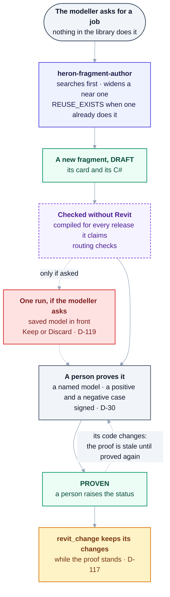
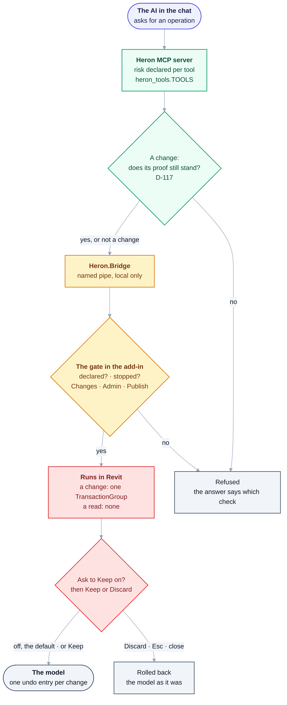
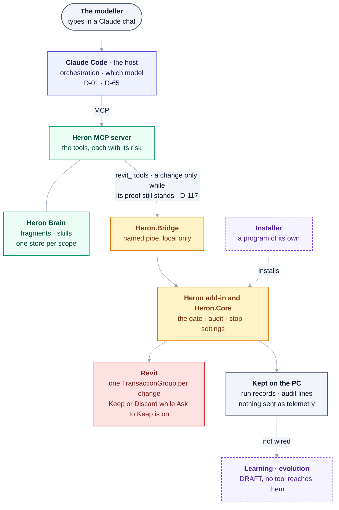

# Heron AI — Additional Master Requirements & Recommendations

> **The original specification, kept as the owner wrote it on 2026-08-27. It says what Heron was asked
> to be, not what is built.** What runs today is in
> [02 §7a](02-architecture-overview.md#7a-as-built--the-parts-that-run-today), the [README](../README.md)
> and the [project map](PROJECT-MAP.md). Where this file and [DECISIONS.md](DECISIONS.md) differ,
> **DECISIONS.md wins** ([PROJECT-MAP §D](PROJECT-MAP.md#d-truth-hierarchy--which-source-wins)).
> Its text and diagrams are kept verbatim: where
> [D-139](DECISIONS.md#d-139--the-four-parts-of-the-specification-are-corrected-in-place-where-a-fact-is-wrong-or-an-accepted-decision-settled-it-and-the-original-words-stay-beside-the-correction)
> corrects a word, the original stays beside it, struck through, and a corrected diagram's original is
> folded under it. Where a section no longer matches what is built, a dated **As built** note sits
> directly under it. The mandatory list carries one as a table, and §10, §29 and §48 each carry a
> picture of how it runs today.

> **Status:** Source-of-truth record, **part 4 of 4**, as provided by the owner on 2026-08-27.
>
> | Part | Covers |
> |---|---|
> | [Part 1](00-master-specification.md) | The platform and its organisation (76 §) |
> | [Part 2](00b-master-specification-agent-os.md) | The Agent Operating System and self-evolution (84 §) |
> | [Part 3](00c-master-handover-baseline.md) | The consolidated baseline (80 §) — authoritative on Golden Rules 1–15; the rules accepted since are in [14](14-golden-rules.md) |
> | **Part 4 — this document** | **Additional requirements.** Adds 30 mandatory components, the Kernel, the Workflow Engine and the Constitution among them. |
>
> Verbatim record. Do not edit to "fix" it — record changes as decisions in [DECISIONS.md](DECISIONS.md).
> The one correction a decision allows so far is
> [D-139](DECISIONS.md#d-139--the-four-parts-of-the-specification-are-corrected-in-place-where-a-fact-is-wrong-or-an-accepted-decision-settled-it-and-the-original-words-stay-beside-the-correction)'s:
> a wrong fact, or words an accepted decision has settled, corrected in place with the original kept
> beside it, ~~struck through~~, and a wrong diagram folded under *Original diagram, as written*.

---

## 1. Heron Core Kernel

A central **Heron Kernel** is strongly recommended — the foundation underneath everything.

```text
Heron Kernel
├── Configuration
├── Identity
├── Permissions
├── Event Bus
├── Agent Registry
├── Skill Registry
├── Fragment Registry
├── Tool Registry
├── Memory Manager
├── Workflow Manager
├── State Manager
├── Logging
└── Security
```

Every module communicates **through the Kernel** instead of directly depending on every other module. This makes Heron much more modular.

> **As built (2026-10-18): the parts exist, and there is no single Kernel that every module talks
> through.** Modules import one another directly. What holds the layering is
> [`tools/check-structure.py`](../tools/check-structure.py), which fails the build when one part depends
> on another it must not. The C# half is [`platform/Heron.Core`](../platform/README.md), with no Revit
> reference ([`tests/Heron.Kernel.TestHost`](../tests/Heron.Kernel.TestHost/Program.cs) runs it with
> none); the rest are Python modules, every one `DRAFT`. Box by box, with *Reached* read from the
> server's imports and `python tools/module-reach.py --list` on 2026-10-18:
>
> | Box | As built | Reached |
> |---|---|---|
> | Configuration | [`HeronConfig.cs`](../platform/Heron.Core/HeronConfig.cs): `Load` and `Save`, no `ApplyFromRequest`; the chat's side reads the same file through [`heron_config.py`](../mcp/client/heron_config.py) | every request |
> | Identity | [`HeronIdentity.cs`](../platform/Heron.Core/HeronIdentity.cs): one id per install, one Workflow ID per request | every request |
> | Permissions | [`HeronPermissions.cs`](../platform/Heron.Core/HeronPermissions.cs): seven levels and the owner's switches on the ribbon (§29) | every request |
> | Event Bus | [`heron_events.py`](../brain/heron_events.py) | its own test only |
> | Agent Registry | the rows of [28](28-agent-registry.md), assembled per agent by [`heron_agents.py`](../brain/heron_agents.py) | no tool the server serves |
> | Skill Registry | [`heron_skill.py`](../brain/heron_skill.py), read from [`brain/skills/`](../brain/skills/) | `heron_method`, `heron_capabilities` |
> | Fragment Registry | [`heron_fragment.py`](../brain/heron_fragment.py), read from each `fragment.yaml` | `heron_lookup`, `revit_read`, `revit_change` and the rest |
> | Tool Registry | [`HeronOperationRegistry.cs`](../platform/Heron.Core/HeronOperationRegistry.cs) per operation, `heron_tools.TOOLS` per MCP tool | every request |
> | Memory Manager | one store per scope, [`heron_scope.py`](../brain/heron_scope.py); what may be remembered, [`heron_memory.py`](../brain/heron_memory.py) | the stores: every search · the rules: their own test only |
> | Workflow Manager | [`heron_workflow.py`](../mcp/server/heron_workflow.py) (§3) | its own test only |
> | State Manager | the same file's checkpoint store; the live state is the add-in's lease, stop and run records | the add-in's: every request |
> | Logging | [`HeronAudit.cs`](../platform/Heron.Core/HeronAudit.cs), one line per request; the brain's [`heron_audit.py`](../brain/heron_audit.py) | every request |
> | Security | the gate in the add-in (§29); [`heron_secrets.py`](../brain/heron_secrets.py) (§30) | the gate: every request · secrets: no tool the server serves |
>
> The registries are derived from the files, not held ([D-40](DECISIONS.md)). Whether every module
> should go through one Kernel is left to the owner ([23 §1](23-heron-kernel.md)).

## 2. Capability Registry

Heron should know: *"What can I currently do?"*

```text
Capability:      Select Ducts
Provider:        Revit Selection Agent
Implementation:  Fragment X
Skill:           MEP Selection
Supported:       Revit 2020-2027
Status:          PROVEN
```

Before creating anything new, Heron checks this registry. This prevents unnecessary duplication.

> **As built (2026-10-18):** [`heron_capability.py`](../brain/heron_capability.py)
> (`HERON-KRN-CAP-008`, `DRAFT`) derives the registry from the fragment cards and keeps no copy of them
> ([D-40](DECISIONS.md)). A chat asks it through `heron_capabilities`, `heron_lookup` and
> `heron_resolve`. One card answers each line above: `capability:`; `heron-agent:` (the provider); the
> fragment's own folder (the implementation); `revit:`, the releases it **claims**, which
> [`heron_matrix.py`](../brain/heron_matrix.py) keeps apart from what was compiled and proved (§8); and
> `heron-status` with its `proof:` ([D-30](DECISIONS.md)). Which skills use a capability is each skill's
> `needs`. *"Before creating anything new"* holds where a fragment is made: a new one is refused
> `REUSE_EXISTS` when one already does the job (`author` in
> [`heron_generate.py`](../brain/heron_generate.py), run by the
> [`heron-fragment-author`](../.claude/agents/heron-fragment-author.md) subagent). A capability asked for
> by name that nothing provides is recorded as a want ([D-63](DECISIONS.md)).

## 3. Workflow Engine

The Orchestrator should not manually control every step. A dedicated **Workflow Engine** manages: sequential tasks · parallel tasks · dependencies · retries · failures · approvals · timeouts · rollback · checkpoints.

```text
Requirement -> Search -> Plan -> Generate -> Review -> Build -> Test -> Approved by a person -> Deploy
```

<details><summary>Original block, as written - corrected under D-139</summary>

```text
Requirement -> Search -> Plan -> Generate -> Review -> Build -> Test -> Deploy
```

</details>

> **As built (2026-10-18):** the Orchestrator is the host, Claude Code ([D-01](DECISIONS.md)), and
> Heron controls no step. A job of several steps is handed over whole by `heron_method`: what must be
> true first, the steps in order from the skill's file in [`brain/skills/`](../brain/skills/), and each
> capability with its risk and status on this Revit ([04 §8.7](04-heron-mcp.md)). The host then sends
> the steps one call at a time. The Workflow Engine is built as
> [`heron_workflow.py`](../mcp/server/heron_workflow.py) (`HERON-KRN-WFL-007`, `DRAFT`): stages in order,
> a timeout each, a retry only when the failure table says one is safe
> ([`heron_failure.py`](../mcp/server/heron_failure.py), [D-21](DECISIONS.md)), finished stages undone in
> reverse, and checkpoints (§21). It has no parallel stages and no approvals, and **nothing but
> `tests/test_workflow.py` imports it** (`grep -rn heron_workflow --include=*.py .`). The pipeline line
> above is how a new tool is made, drawn as built under §10.
>
> **Corrected in place** ([D-139](DECISIONS.md#d-139--the-four-parts-of-the-specification-are-corrected-in-place-where-a-fact-is-wrong-or-an-accepted-decision-settled-it-and-the-original-words-stay-beside-the-correction)):
> a person's approval now stands before *Deploy* in the pipeline line, as §10's line already has it, and
> the original line is folded under it - [Article 20](../HERON_CONSTITUTION.md) (*"a human grants
> production"*), [Article 18](../HERON_CONSTITUTION.md) and [Golden Rule 13](14-golden-rules.md) (Heron
> may propose a change to its own core, never apply it).

## 4. Agent Communication Protocol

Every agent receives:

```text
Task / Context / Input / Required Output / Constraints / Knowledge / Permissions / Deadline
```

And returns:

```text
Status / Result / Evidence / Errors / Confidence / Changes / Next Action
```

This prevents agents from becoming chaotic.

> **As built (2026-10-18): two shapes, and neither is this one.**
>
> - **Between the host and Heron** the MCP tool is the boundary. In: the tool's own arguments. Out: text
>   that says what ran, on which model and how far its fragment is proven, and on a failure its code and
>   the next step, from the failure table in [`heron_failure.py`](../mcp/server/heron_failure.py)
>   ([D-21](DECISIONS.md)). The permission is not handed in: the add-in decides it (§29).
> - **Between Heron's own agents**, one contract per agent in [`brain/agents/`](../brain/agents/),
>   checked by [`heron_contract.py`](../brain/heron_contract.py) (`HERON-AHR-CON-017`, `DRAFT`): `input`,
>   `output`, `allowed-tools`, `timeout-seconds`, the `failures` it names and which it may `retry`. Tier
>   and risk are refused there because [28](28-agent-registry.md) owns them. No agent calls another
>   through a contract at run time: no tool the server serves reaches `heron_contract.py`
>   (`python tools/module-reach.py --list`).
>
> Neither carries a *Confidence* (§5); a contract's `timeout-seconds` is the nearest thing to a
> *Deadline*.

## 5. Agent Confidence System

Every important agent result carries a confidence level: `HIGH` · `MEDIUM` · `LOW` · `UNKNOWN`.

**Confidence should not replace validation.** For critical operations:

```text
AI confidence + Technical validation + Testing
```

> **As built (2026-10-18): there is no confidence scale.** `HIGH`, `MEDIUM`, `LOW` and `UNKNOWN` are
> not used as one anywhere in `brain/`, `mcp/`, `platform/` or `revit/` (searched 2026-10-18). An answer
> carries how far the code behind it is proven instead: one from `revit_read` or `revit_show` says
> whether its fragment is `PROVEN` and unchanged, `PROVEN` with its code moved since, or never proved
> ([23 §6](23-heron-kernel.md)), and `revit_change` keeps a change only from a fragment whose proof still
> stands ([D-117](DECISIONS.md)). A standards or research answer with no source is treated as a bug, not
> as a low-confidence answer ([`heron_research.py`](../brain/heron_research.py),
> [`heron_iso.py`](../brain/heron_iso.py)). Of *confidence + validation + testing*, Heron supplies the
> second and the third.

## 6. Evidence System

Heron should know *why* it made a decision.

> *"This fragment was selected because it supports Revit 2020–2027 and has 98 successful executions."*

For important decisions, retain: source · fragment · skill · agent · version · validation result. This makes the system explainable.

> **As built (2026-10-18): the evidence is a recorded proof, not a count of runs.** A fragment is
> promoted on one proof in its card's `proof:` block: a named real model, a positive and a negative case,
> the fingerprint of the code it proved, and the name of the person who signed it
> ([D-30](DECISIONS.md)). A count of successful runs is not evidence, and
> [`heron_promotion.py`](../brain/heron_promotion.py) refuses one. An answer says how far its fragment is
> proven; a kept change names a run record holding every element id and the whole reply, read back by
> `heron_run_record` ([`HeronRuns.cs`](../platform/Heron.Core/HeronRuns.cs)); every request is one audit
> line keyed by Workflow ID ([`HeronAudit.cs`](../platform/Heron.Core/HeronAudit.cs)). A search reports
> what the version filter left out, with the reason ([20 §2](20-knowledge-trust-and-conflict.md)). The
> Evidence Agent's *"no evidence, no MODIFY"* (`HERON-KRN-EVD-014`) is in code as `revit_change`'s
> refusal of a fragment whose proof does not stand ([D-117](DECISIONS.md)).

## 7. Immutable Provenance

Every fragment, skill and agent has history.

```text
Fragment F-001
  v1.0 -> Created
  v1.1 -> Revit 2021 fix
  v1.2 -> Revit 2023 support
  v1.3 -> Performance improvement
```

**Never silently overwrite important knowledge.**

> **As built (2026-10-18):** fragments, skills and source files are files in git, so a fragment's
> history is `git log` over its folder ([09 §4](09-skills-and-fragments.md)). A card must carry `id`,
> `version` and `heron-status` (`REQUIRED` in [`heron_fragment.py`](../brain/heron_fragment.py)), and every
> source file a five-field header (`python tools/check-metadata.py`). A proof records the fingerprint of
> the code it proved, so a change to the code does not overwrite the proof: it makes it `STALE`, the
> answer says so, and `python tools/check-signatures.py` lists every one. Widening a `PROVEN` fragment is
> put to the owner first ([`heron-fragment-author`](../.claude/agents/heron-fragment-author.md),
> [Article 2](../HERON_CONSTITUTION.md)).

## 8. Version Compatibility Matrix

A dedicated compatibility database.

| Component | Revit | .NET | Status |
|---|---|---|---|
| Fragment A | 2020–2022 | ~~4.7.2~~ **4.7.2 for 2020; 4.8 for 2021 and 2022** | Proven |
| Fragment A | 2023–2025 | ~~New API~~ **4.8 for 2023 and 2024; .NET 8 for 2025** | Proven |
| Fragment A | 2026–2027 | ~~New API~~ **.NET 8 for 2026; .NET 10 for 2027** | Testing |

Extremely important as Heron grows.

> **As built (2026-10-18): the matrix is derived, not kept in a database.**
> [`heron_matrix.py`](../brain/heron_matrix.py) (`HERON-FRG-MTX-009`, `DRAFT`) sets each card's `revit:`
> list, which is what it **claims**, beside what `tools/check-fragments-compile.py` last compiled on this
> machine for that release and what a proof names, and never merges the states (*claimed*, *compiles*,
> *proven*, *unknown*). A chat asks it through `heron_compatibility`; `python brain/heron_matrix.py`
> prints it. A proof on a further release is an entry of `proof.releases` ([D-131](DECISIONS.md)). The
> runtime of each release is in [`Directory.Build.props`](../Directory.Build.props): `net472` for 2020,
> `net48` for 2021 to 2024, `net8.0-windows` for 2025 and 2026, `net10.0-windows` for 2027. So the
> example's 4.7.2 holds for 2020 only. Which releases a real Revit has loaded the add-in on is the table
> in [16 §6](16-version-support-strategy.md).
>
> **Corrected in place** ([D-139](DECISIONS.md#d-139--the-four-parts-of-the-specification-are-corrected-in-place-where-a-fact-is-wrong-or-an-accepted-decision-settled-it-and-the-original-words-stay-beside-the-correction)):
> the table's *.NET* column, which gave 2021 and 2022 Framework 4.7.2 and gave no runtime at all
> (*New API*) from 2023 - `HeronTfm` for each `RevitVersion` in
> [`Directory.Build.props`](../Directory.Build.props). The *Status* column is the example's and stays.

## 9. Adapter Architecture

For Revit API changes, don't duplicate everything.

```text
Common Business Logic -> Compatibility Layer -> Revit Version Adapter -> Revit API
```

This preserves one logical capability across many Revit versions.

> **As built (2026-10-18): no separate compatibility or adapter layer.** Each project is one source,
> built once per Revit release with that release's framework and the compile symbols `REVIT<year>`, and
> `REVIT<year>_OR_GREATER` from 2024 up ([`Directory.Build.props`](../Directory.Build.props)). A difference between
> releases is an `#if REVIT...` branch: in a few add-in files (`grep -rl '#if REVIT' revit platform`), and
> inside a fragment's one implementation, `impl/any/fragment.cs`, which the add-in compiles in Revit with
> its own release's symbols. `tools/check-compile.py` and `tools/check-fragments-compile.py` compile every
> release in CI. A compile is not a proof ([16](16-version-support-strategy.md)).

## 10. Sandbox System

**One of the strongest recommendations.** Any new code, fragment, skill, agent or plugin runs first inside a sandbox.

```text
Generated -> Sandbox -> Test -> Review -> Approved -> Production
```

> **As built (2026-10-18): nothing contains new code. It is watched, and it is kept only on a
> person's word.** For a new agent, the first run is watched inside the supervising process, and the word
> *sandbox* was taken out because it promised a containment the code does not give
> ([D-84](DECISIONS.md), [`heron_sandbox.py`](../brain/heron_sandbox.py)). For a new fragment the path is
> drawn below. Its one run on a live model is the recorded exception to
> [Article 11](../HERON_CONSTITUTION.md) and [Golden Rule 18](14-golden-rules.md): once, on the saved
> model in front, behind Revit's Keep or Discard box ([D-119](DECISIONS.md); seen in Revit 2024 and 2027,
> [Group EM](needs-checking/group-em.md)). No fragment is `PRODUCTION`:
> `grep -h '^heron-status:' brain/fragments/*/fragment.yaml | sort | uniq -c`.



<details>
<summary>Same thing as plain text</summary>

```text
The modeller asks for a job nothing in the library does
  -> heron-fragment-author (a subagent the host runs)
       searches first; widens a fragment that nearly does it;
       refused REUSE_EXISTS when one already does the job
  -> a new fragment at DRAFT: its card and its C#
  -> checked without Revit: compiled for every release it claims, routing checks
  -> (only if the modeller asks) one run on the saved model in front,
       behind Revit's Keep or Discard box                        D-119
  -> a person proves it on a named model, positive and negative case, and signs   D-30
  -> PROVEN, raised by a person (tools/check-signatures.py finds one left unraised)
  -> revit_change keeps its changes while the proof still stands  D-117

If its code changes, the proof is STALE: revit_change refuses it until it is proved again.
There is no separate sandbox, and no fragment is PRODUCTION.
```

</details>

## 11. Simulation / Dry Run

Before a dangerous operation, Heron should be able to say:

> *"I found 126 ducts. This operation will modify 126 elements."*

~~Then execution can happen.~~ **Then, on a count taken again just before it acts, execution can happen; if the number has changed, Heron stops and shows it again.** Very useful for BIM.

> **As built (2026-10-18): the preview is the run itself, shown in Revit and rolled back unless it is
> kept** ([D-55](DECISIONS.md)). A change asked for in a chat runs inside one open `TransactionGroup`.
> While the owner's *Ask to Keep* switch is on, Revit selects and isolates what changed and asks Keep or
> Discard ([D-126](DECISIONS.md)). The switch is **off by default**, and then the change is kept at once
> as one undo entry ([D-138](DECISIONS.md), [03 §10](03-heron-revit.md)). What is shown is what ran, so
> it cannot drift from what is kept. The move tools keep a counted preview, `revit_preview_move` then
> `revit_apply_move`, which expires and is re-counted just before writing (`preview_expired`,
> `model_moved_on` in [`RevitWrite.cs`](../revit/Heron.Revit.Addin/RevitWrite.cs);
> [Golden Rule 21](14-golden-rules.md)); a preview selects what it would change and skip, up to 500
> ([D-60](DECISIONS.md)). The box was seen in Revit 2024 and 2027
> ([Group ET](needs-checking/group-et.md)); the *Ask to Keep* switch has not run in Revit
> ([Group HG](needs-checking/group-hg.md)).
>
> **Corrected in place** ([D-139](DECISIONS.md#d-139--the-four-parts-of-the-specification-are-corrected-in-place-where-a-fact-is-wrong-or-an-accepted-decision-settled-it-and-the-original-words-stay-beside-the-correction)):
> *"Then execution can happen"* now carries the re-count before acting - [Golden Rule 21](14-golden-rules.md)
> (*"Re-read before acting. A preview expires"*) and [Article 12c](../HERON_CONSTITUTION.md). The rest of
> this note says how each path meets it.

## 12. Transaction Safety Agent

A dedicated Revit agent responsible for: transaction handling · transaction closure · rollback · failure handling · document state.

**Separate from general Revit API logic.**

> **As built (2026-10-18): code in the add-in, not an agent that reasons.** `HERON-REVIT-TSA-006` is
> claimed by [`RevitWrite.cs`](../revit/Heron.Revit.Addin/RevitWrite.cs). A fragment's change runs in one
> `TransactionGroup` named `Heron: <name>`, assimilated only when the change is kept, and otherwise rolled
> back whole: on a failure, a Discard, a stop, or a run out of time
> ([`RevitFragment.cs`](../revit/Heron.Revit.Addin/RevitFragment.cs),
> [`HeronRunClock.cs`](../revit/Heron.Revit.Addin/HeronRunClock.cs), [03 §6](03-heron-revit.md)). A
> fragment says what transaction it needs ([D-125](DECISIONS.md)), and one on the read or show path whose
> C# would open a `Transaction` is refused before it is compiled
> ([`HeronSourceScan.cs`](../platform/Heron.Core/HeronSourceScan.cs)). While a job runs, the run guard
> cancels a save, sync, export or print the job did not ask for
> ([`HeronRunGuard.cs`](../revit/Heron.Revit.Addin/HeronRunGuard.cs)). The rollback was seen in Revit on
> Discard, Esc and close ([Group ET](needs-checking/group-et.md)) and on a stop or a runaway
> ([Group EZ](needs-checking/group-ez.md)).

## 13. Revit Context Agent

Heron should automatically understand the current Revit context: ~~active document~~ **the document the chat is bound to, never simply the active one** · Revit version · active view · selected elements · linked models · worksets · view type · phase · design option · active user.

This removes unnecessary questions.

> **As built (2026-10-18): no single pass; each part is read when it is asked for.** `revit_health`
> names each connected Revit, its version and the model it has open. `revit_views`, `revit_links`,
> `revit_worksets` (with whose they are) and `revit_phases` (with the design options) read the rest
> (`python mcp/server/heron_tools.py`). The add-in writes the model in front and its active view to a file
> the Companion page reads ([`HeronLiveState.cs`](../revit/Heron.Revit.Addin/HeronLiveState.cs),
> `HERON-REVIT-CTX-007`); since 2026-10-04 the selection is not read at all. A chat works on the model it
> is bound to, not simply the one in front: a fragment is refused on another model until
> `revit_use_this_model` moves the chat ([Golden Rule 20](14-golden-rules.md),
> [Article 12b](../HERON_CONSTITUTION.md)), and with two Revits connected nothing is sent until the
> modeller chooses ([Article 12a](../HERON_CONSTITUTION.md); [27](27-build-order.md), Step 5).
>
> **Corrected in place** ([D-139](DECISIONS.md#d-139--the-four-parts-of-the-specification-are-corrected-in-place-where-a-fact-is-wrong-or-an-accepted-decision-settled-it-and-the-original-words-stay-beside-the-correction)):
> *active document* - a chat keeps to the document it is bound to and never follows the active window -
> [Golden Rule 20](14-golden-rules.md) (*"Bind the document, not just the session"*),
> [Articles 12a and 12b](../HERON_CONSTITUTION.md).

## 14. User Intent Memory

Heron should distinguish *"what the user normally likes"* from *"what the user asked this time."*

**Temporary instructions must not automatically become permanent memory.**

> **As built (2026-10-18): nothing said in a chat becomes lasting memory by itself.** What Heron keeps
> for a project is what the modeller answered when asked: its governing standards, asked once and kept
> ([D-111](DECISIONS.md)), filed under the model's own id ([D-113](DECISIONS.md), still Proposed). An
> answer kept for one model is used for another only when the modeller says so
> (`heron_earlier_answers`). `temporary` is one of six scopes, each its own store (`SCOPES` in
> [`heron_scope.py`](../brain/heron_scope.py)). [`heron_memory.py`](../brain/heron_memory.py), which
> refuses a temporary item that arrives without a time to live, and
> [`heron_profile.py`](../brain/heron_profile.py), the User Profile Agent, are `DRAFT` and imported only by
> their own tests ([10 §3, §7](10-memory-and-knowledge.md)).

## 15. Memory Promotion System

```text
Observation -> Candidate Memory -> Repeated Evidence -> Validation -> Promotion
```

This prevents bad habits from becoming system knowledge.

> **As built (2026-10-18): nothing promotes a memory.**
> [`heron_promotion.py`](../brain/heron_promotion.py) (`HERON-LRN-PRO-004`, `DRAFT`) returns a verdict and
> promotes nothing. It refuses a candidate that arrives with a count of repeats instead of a recorded
> proof, because promotion is by one proof, *"not by a count of runs"* ([D-30](DECISIONS.md)).
> [`heron_userskills.py`](../brain/heron_userskills.py) plans raising a personal skill one scope at a time
> and moves nothing ([10 §3](10-memory-and-knowledge.md)). No tool the server serves reaches either
> (`python tools/module-reach.py --list`).

## 16. Knowledge Conflict Agent

If Company Standard A and Project Standard B disagree, Heron detects the conflict instead of blindly choosing. **Priority should be configurable.**

> **As built (2026-10-18): detected, not resolved, and the priority is not configurable.**
> `heron_standards` answers each scope under its own label, and
> [`heron_conflict.py`](../brain/heron_conflict.py) (`HERON-RAG-CNF-015`, reached through that tool) names
> where they disagree, with no winner; `tests/test_conflict.py` holds that. The order between scopes is
> named and not applied ([20 §2](20-knowledge-trust-and-conflict.md)). The agent written to say a
> project's rule outranks the company's, [`heron_project.py`](../brain/heron_project.py), is `DRAFT` and no
> tool serves it.

## 17. Standards Agent

A dedicated standards subsystem for ISO · BIM standards · company standards · project standards · client standards · Revit standards · naming standards.

**Standards checking should be on-demand** unless background monitoring is explicitly required.

> **As built (2026-10-18): on demand only.** A chat asks through `heron_standards` (`READ`), and nothing
> watches a model in the background. The standards rows are one agent with a subject
> ([D-76](DECISIONS.md)); a project's governing standards are asked once and kept
> ([D-111](DECISIONS.md)); a standards answer with no citation is a bug
> ([`heron_iso.py`](../brain/heron_iso.py)). Checking a model against a standard is a fragment run through
> `revit_read`, for example `CHECK_MODEL_STANDARDS` and `CHECK_FAMILY_STANDARDS`, each with its status in
> its own card.

## 18. BIM QA Agent

Separate from coding QA. Checks: naming · parameters · categories · families · levels · worksets · views · modelling rules · MEP connectivity · coordination requirements.

This becomes a major Heron capability.

> **As built (2026-10-18):** the model checks a modeller can run are fragments, run through
> `revit_read`. Their capabilities begin `CHECK_`
> (`grep -l '^capability: CHECK_' brain/fragments/*/fragment.yaml`), and each has its own status in its
> card. [`heron_modelqa.py`](../brain/heron_modelqa.py) (`HERON-QA-BIM-011`, `DRAFT`), which would take
> the aspects above in one report, is imported only by its own test. Code QA, Revit QA and
> BIM QA are kept apart in [13 §2a](13-testing-and-quality.md).

## 19. Clash / Coordination Agent

Eventually handles clash analysis · clearance · system coordination · linked models · Navisworks-related workflows · coordination reports.

> **As built (2026-10-18): parts, and no coordination report.** `FIND_CLASHES`,
> `CHECK_OBSTRUCTIONS`, the clearance checks, `CHECK_CEILING_COORDINATION` and `CHECK_LINK_COORDINATES`
> are fragments. Taking a pipe or duct round a clash is a job `heron_method` serves, the
> [`clash-reroute`](../brain/skills/clash-reroute.yaml) skill (`DRAFT`). `EXPORT_MODEL_TO_NWC` writes a
> Navisworks file, at `PUBLISH`. Each fragment's status is in its card. Reading across loaded links
> happens only when the modeller asks ([D-59](DECISIONS.md)).
> [`heron_coordination.py`](../brain/heron_coordination.py) (`HERON-QA-CLS-012`, `DRAFT`), the arithmetic
> half of a coordination report, is imported only by its own test.

## 20. Task Memory

Heron remembers current task state. If something fails, the task is **paused** and it knows where it stopped. Then *"Continue."* resumes from the correct checkpoint.

> **As built (2026-10-18): Heron pauses no task. The conversation, and what was done in it, is the
> host's.** What Heron keeps between calls: values one call's answer carries into the next, checked by the
> add-in before anything binds (`expect_from`, [36](36-remembering-between-steps.md)); a run record for
> every kept change, read back by `heron_run_record` ([`HeronRuns.cs`](../platform/Heron.Core/HeronRuns.cs));
> and one audit line per request. A change that fails or is stopped is rolled back whole, so a job stops
> between changes, never inside one ([21 §4a](21-resilience-and-operations.md)).

## 21. Resume / Checkpoint System

```text
Step 1 ✓  Step 2 ✓  Step 3 ✓  Step 4 FAILED
```

After fixing Step 4: **continue from Step 4**, not restart everything.

> **As built (2026-10-18): built, and reached by no tool.**
> [`heron_workflow.py`](../mcp/server/heron_workflow.py) keeps each stage's output on disk under its
> Workflow ID, keyed by the hash of its input, continues from the first stage not done, and says what it
> is waiting on (`waiting_on()`). Only `tests/test_workflow.py` runs it. A job served by `heron_method`
> has no checkpoint: after a fix, the host decides which step to send again.

## 22. Queue Manager

```text
Priority 1  User request
Priority 2  Required validation
Priority 3  System maintenance
Priority 4  RAG indexing
Priority 5  Learning
```

This prevents background agents from consuming resources needed by Revit.

> **As built (2026-10-18):** [`heron_queue.py`](../brain/heron_queue.py) and
> [`heron_scheduler.py`](../brain/heron_scheduler.py) (`HERON-OPS-QUE-002`, `HERON-OPS-SCH-001`, `DRAFT`)
> hold Part 2's seven levels, `P0` to `P6`, not the five above, and never run `P2` to `P6` during a user
> task ([21 §12](21-resilience-and-operations.md)). No tool the server serves reaches them. The background
> work Heron does today is not queued: the server rebuilds an empty or stale knowledge store when it
> starts, and a heavy optional import is never made on a request thread ([D-49](DECISIONS.md)).
>
> **Left as written** ([D-139](DECISIONS.md#d-139--the-four-parts-of-the-specification-are-corrected-in-place-where-a-fact-is-wrong-or-an-accepted-decision-settled-it-and-the-original-words-stay-beside-the-correction)):
> these five priorities, Part 1's `P0` to `P5` and Part 2's `P0` to `P6` are three ladders, and no
> accepted decision picks one (`heron_queue.py` is code, not that choice); the choice is open and is put
> to the owner in [OPEN-QUESTIONS](OPEN-QUESTIONS.md), as [Q-75](open-questions/tier-2.md).

## 23. Resource Manager

Monitors CPU · RAM · disk · AI usage · vector DB load · Revit responsiveness.

**If Revit is busy, background jobs reduce or pause automatically.**

> **As built (2026-10-18):** [`heron_resources.py`](../brain/heron_resources.py) (`HERON-OPS-RES-003`,
> `DRAFT`) reads CPU, RAM and disk where the platform offers them, reports what it cannot see as
> unmeasured, and pauses nothing; it is imported only by its own test. Whether Revit is busy is answered in
> the add-in: a request Revit has not finished is answered `still_running`, not to be sent again
> ([21 §4a](21-resilience-and-operations.md)). Heron's banner in Revit never takes a click or the focus
> ([`HeronActivityBanner.cs`](../revit/Heron.Revit.Addin/HeronActivityBanner.cs)).

## 24. AI Model Abstraction Layer

Do not hard-code Heron around one AI provider.

```text
Claude Code, the host -> chooses the model and the provider -> Model
Heron, behind MCP, makes no model call of its own
```

<details><summary>Original block, as written - corrected under D-139</summary>

```text
Heron AI Interface -> Model Router -> Provider Adapter -> Model
```

</details>

This allows different models later without rebuilding Heron.

> **As built (2026-10-18): Heron makes no model call of its own** ([D-58](DECISIONS.md)); the host
> chooses the model ([D-01](DECISIONS.md), [D-65](DECISIONS.md)).
> [`heron_router.py`](../brain/heron_router.py) (`HERON-KRN-MDL-010`, `DRAFT`) declares what a task needs
> and names who chooses, never a model. [`heron_provider.py`](../brain/heron_provider.py) (`DRAFT`) is one
> adapter, a local Ollama on `127.0.0.1`, and has not met a provider. They are imported by each other and
> by `heron_availability.py`, and no tool the server serves reaches them
> ([23 §8](23-heron-kernel.md), [37](37-the-provider-adapter.md)). Embeddings run on the PC with no
> provider at all ([D-24](DECISIONS.md)).
>
> **Corrected in place** ([D-139](DECISIONS.md#d-139--the-four-parts-of-the-specification-are-corrected-in-place-where-a-fact-is-wrong-or-an-accepted-decision-settled-it-and-the-original-words-stay-beside-the-correction)):
> the line now has the host choosing and calling the model, with no Model Router in Heron, and the
> original is folded under it - [D-65](DECISIONS.md) (task to model is the host's, *"Retired from Heron's
> specification"*), [D-58](DECISIONS.md) and [D-01](DECISIONS.md) (every model call is the host's).
> *Do not hard-code Heron around one AI provider* still holds: Heron holds none.

## 25. Local / Cloud Model Routing

~~Simple task → local model. Normal task → standard model. Complex coding → powerful coding model. Critical architecture → strongest reasoning model.~~ **Which model a task gets is chosen by the host, Claude Code, not by Heron.**

**The user should not need to know which model was selected.**

> **As built (2026-10-18): retired from Heron's specification by [D-65](DECISIONS.md).** Which model a
> task gets, and where to go when a provider cannot be reached, are the host's. Heron keeps one clause: a
> result produced after a fallback is marked degraded and never counts toward a promotion. That is
> [`heron_availability.py`](../brain/heron_availability.py) (`HERON-KRN-MAV-017`, `DRAFT`), which no tool
> the server serves reaches.
>
> **Corrected in place** ([D-139](DECISIONS.md#d-139--the-four-parts-of-the-specification-are-corrected-in-place-where-a-fact-is-wrong-or-an-accepted-decision-settled-it-and-the-original-words-stay-beside-the-correction)):
> the routing line is struck, and the words after it say whose choice it is - [D-65](DECISIONS.md).

## 26. Prompt / Instruction Registry

Do not scatter prompts throughout the code. A controlled registry for: system instructions · agent instructions · skill instructions · coding rules · BIM language rules.

Then they can be **versioned and tested**.

> **As built (2026-10-18):** [`brain/instructions/`](../brain/instructions/) holds `host.chat`,
> `agent.base`, `agent.read` and `agent.modify`, validated with their cases by
> [`heron_instructions.py`](../brain/heron_instructions.py) (`HERON-KRN-PRO-011`). `host.chat` is every
> chat's server instructions, with the Constitution's Articles assembled into it at start-up, never
> copied; `tests/test_instructions.py` holds its word budget ([23 §9](23-heron-kernel.md)). The other text
> a chat reads is each tool's description, and one over its budget stops a pull request
> ([D-118](DECISIONS.md)). The three `agent.*` instructions are given to nothing that runs a model.

## 27. Evaluation System

An automated evaluation framework. Every important agent has test cases.

```text
Agent:     Duct Selection Agent
Test:      Select all ducts
Expected:  All visible ducts selected
Result:    PASS
```

The equivalent of an employee performance review.

> **As built (2026-10-18): proofs, not performance reviews.** A fragment is judged by its recorded
> proof on a named model with a negative case ([D-30](DECISIONS.md),
> [`tools/batch-prove.py`](../tools/batch-prove.py)); an add-in operation the same way, through
> [`tools/prove-agent.py`](../tools/prove-agent.py), its proofs in
> [`brain/agent-proofs/`](../brain/agent-proofs/). Whether each fragment is still found by its own
> declared sentences is CI's `tools/check-routing.py`; the owner's own questions are scored by
> `tools/score-routing.py`, and a drop is reported, never a gate ([D-100](DECISIONS.md)).
> [`heron_evaluator.py`](../brain/heron_evaluator.py), the Agent Evaluator (`HERON-AHR-EVL-007`, `DRAFT`),
> is imported by nothing but its test. The example's request is built as `revit_select_by_category`, and
> it selects every duct in the model, whether the view shows it or not
> ([`RevitOperations.cs`](../revit/Heron.Revit.Addin/RevitOperations.cs)).
>
> **Left as written** ([D-139](DECISIONS.md#d-139--the-four-parts-of-the-specification-are-corrected-in-place-where-a-fact-is-wrong-or-an-accepted-decision-settled-it-and-the-original-words-stay-beside-the-correction)):
> whether *select all ducts* takes every duct or only the visible ones is a choice no accepted decision
> or rule has made ([D-59](DECISIONS.md) settles links, not views), and what the code picked does not make
> it; the choice is open and is put to the owner in [OPEN-QUESTIONS](OPEN-QUESTIONS.md), as [Q-78](open-questions/tier-2.md).

## 28. Golden Test Library

A permanent collection of known-good cases. Every major update runs against these tests.

**Extremely important for preventing regressions.**

> **As built (2026-10-18):** [`tests/golden/cases.py`](../tests/golden/cases.py), audited without Revit
> by `tests/test_golden.py`: the cases are checked for coherence, each proof's fingerprint is recomputed,
> and a `STALE` one is reported. It runs no case: a case is proven by a person watching Revit
> ([13 §2b](13-testing-and-quality.md)). Every pull request runs the suites and the gates in
> [`gates.yml`](../.github/workflows/gates.yml), keeping NOT RUN apart from FAILED
> ([tests/README.md](../tests/README.md)); `python tools/check-gaps.py` says what is unfinished.

## 29. Security Boundary Between AI and Revit

AI should never receive unlimited direct control.

<details><summary>Original block, as written - corrected under D-139</summary>

```text
AI -> Permission Layer -> Tool Validation -> MCP -> Revit
```

</details>

**The AI requests an operation; the platform decides whether that operation is allowed.**

> **As built (2026-10-18): the deciding layer sits after MCP, inside Revit, not before it.** Risk is
> declared per MCP tool (`heron_tools.TOOLS`) and per operation
> ([`HeronOperationRegistry.cs`](../platform/Heron.Core/HeronOperationRegistry.cs)), and never read from
> a request. On the chat's side, a change from a fragment whose proof does not stand is refused before
> anything is sent ([D-117](DECISIONS.md)). Inside Revit the gate refuses an operation nobody declared,
> then anything at `MODIFY` or above while Heron is stopped, then whatever the owner's Changes, Admin and
> Publish switches do not allow (`Gate` in
> [`RevitOperations.cs`](../revit/Heron.Revit.Addin/RevitOperations.cs),
> [`HeronPermissions.cs`](../platform/Heron.Core/HeronPermissions.cs)). Nothing in a request can set a
> switch ([Golden Rule 19](14-golden-rules.md)). Seen in Revit 2024: with the switches off a change came
> back `write_disabled` and a save `publish_disabled` ([Group ES](needs-checking/group-es.md)). The whole
> decision is drawn in [12 §3a](12-security-and-permissions.md).
>
> **Corrected in place** ([D-139](DECISIONS.md#d-139--the-four-parts-of-the-specification-are-corrected-in-place-where-a-fact-is-wrong-or-an-accepted-decision-settled-it-and-the-original-words-stay-beside-the-correction)):
> the line that put the permission layer before MCP is folded above, and the picture below stands in its
> place: the permission layer comes after MCP, inside the add-in - [D-13](DECISIONS.md), which adopted this
> section as *"confirms [12 §3](12-security-and-permissions.md) exactly"* (*"The permission gate must live
> in the Revit add-in, not in the AI layer"*); the [Constitution](../HERON_CONSTITUTION.md)'s *"at the
> permission boundary inside the Revit add-in"*; [Golden Rule 9](14-golden-rules.md). In code, `Gate` in
> [`RevitOperations.cs`](../revit/Heron.Revit.Addin/RevitOperations.cs).

*The picture of §29, standing in place of the line folded above: AI, then MCP, then the checks, then the
permission gate inside Revit.*



<details>
<summary>Same thing as plain text</summary>

```text
The AI in the chat asks for an operation
  -> Heron MCP server: each tool's risk is declared in heron_tools.TOOLS, never read from a request
  -> a change only: does its fragment's proof still stand? (D-117)     no -> refused, nothing sent
  -> Heron.Bridge, a named pipe, local only
  -> the gate in the add-in, in this order:                            no -> refused, and says which
       an operation nobody declared
       anything at MODIFY or above while Heron is stopped
       the owner's switches: Changes for MODIFY, and Admin or Publish on top
  -> runs in Revit: a change inside one TransactionGroup; a read opens none
  -> Ask to Keep on? Revit asks Keep or Discard
       off (the default), or Keep  -> kept: one undo entry
       Discard, Esc, close         -> rolled back

The spec's line, folded above, puts the permission layer before MCP; as built it is after it, inside Revit.
```

</details>

## 30. Secret Management

API keys, GitHub tokens and credentials must never be stored inside fragments · skills · prompts · source code · logs. A secure credential system is required.

> **As built (2026-10-18):** [`heron_secrets.py`](../brain/heron_secrets.py) (`HERON-KRN-SEC-012`,
> `DRAFT`) gives a handle that never prints its value and one redactor, which the brain's commit, release,
> repository, import, sandbox and memory paths call. None of those is reached by a tool the server serves.
> **No credential store exists behind it** (no Credential Manager or DPAPI code), the add-in's audit line
> does not pass through the redactor, and **nothing scans a commit for a secret**: there is no pre-commit
> hook and no tool in `tools/` that does ([12 §5a](12-security-and-permissions.md), searched 2026-10-18).
> Heron's served path makes no model call of its own ([D-58](DECISIONS.md)), so it holds no provider key.

## 31. Offline / Degraded Mode

Heron should know what to do when internet, AI provider, GitHub, MCP or the vector DB is unavailable.

**Clearly identify which capabilities are unavailable** instead of failing unpredictably.

> **As built (2026-10-18): Heron needs no network to answer.** Its knowledge is local files and stores,
> and embeddings are worked out on the PC ([D-24](DECISIONS.md), [D-26](DECISIONS.md)). What is missing
> is named rather than failing: health is `HEALTHY`, `WARNING`, `DEGRADED` or `FAILED`
> ([`heron_health.py`](../mcp/server/heron_health.py)); search falls back to word match when the optional
> model is absent; a part that cannot be read costs only itself and is named ([D-48](DECISIONS.md)); off
> Windows the server serves its library tools alone and lists no `revit_` tool ([D-132](DECISIONS.md)).
> With no Heron server the host has no Heron tools, and [AGENTS.md](../AGENTS.md) says to run
> `python tools/heron-ready.py`.

## 32. Installation Wizard

```text
Install Heron -> Detect Environment -> Detect Revit Versions -> Install Components
-> Download and Verify the Released Add-in -> Deploy -> Start Revit -> Connect MCP -> Health Check -> Ready
```

<details><summary>Original block, as written - corrected under D-139</summary>

```text
Install Heron -> Detect Environment -> Detect Revit Versions -> Install Components
-> Build Required Add-in -> Deploy -> Start Revit -> Connect MCP -> Health Check -> Ready
```

</details>

The user should not need coding knowledge.

> **As built (2026-10-18):** `HeronInstaller.exe`, a window, and `heron-install`, a command line, on one
> engine in [`platform/Heron.Installer`](../platform/README.md). It reads the product list as data
> ([D-93](DECISIONS.md)), finds the Revits installed, waits while Revit is open and never closes it, and
> installs per user with no administrator rights ([D-90](DECISIONS.md)). **It builds nothing on the
> modeller's PC**: the files come from a named, published release and are checked against its checksums
> before use ([D-91](DECISIONS.md), [D-96](DECISIONS.md)); building from source is the developer's
> `tools/setup.ps1` ([D-42](DECISIONS.md)). It then sets up Heron's Python side from the hashed lock file
> and runs `tools/heron-ready.py --check`, which says READY or names what is missing. Connecting is the
> modeller's: the Heron button in Revit connects the bridge, and Claude Code starts Heron's server from
> `.mcp.json`. Run on the owner's PCs, not every row ([Group AB](needs-checking/group-ab.md),
> [Group AC](needs-checking/group-ac.md), [Group EP](needs-checking/group-ep.md)).
>
> **Corrected in place** ([D-139](DECISIONS.md#d-139--the-four-parts-of-the-specification-are-corrected-in-place-where-a-fact-is-wrong-or-an-accepted-decision-settled-it-and-the-original-words-stay-beside-the-correction)):
> *Build Required Add-in* is now *Download and Verify the Released Add-in*, and the original line is
> folded under it - [D-91](DECISIONS.md) (the files come from a versioned release, verified before use)
> and [D-96](DECISIONS.md) (a downloaded Heron is installed by the installer).

## 33. First-Run Onboarding Agent

```text
Welcome to Heron AI.
Checking your environment...
Revit detected ✓   Heron Revit ✓   MCP ✓
Knowledge Base ✓   Vector DB ✓   Agents ✓   Skills ✓
```

Then guide the user once. After that, normal usage should be almost invisible.

> **As built (2026-10-18):** the first run is [`tools/heron-ready.py`](../tools/heron-ready.py), which
> the installer runs to check the PC. Run by hand it also builds the knowledge store and fetches the
> search model once; it names each gap with the command that closes it, installs nothing itself, and reads
> the ribbon's switches without setting them. [`heron_onboarding.py`](../brain/heron_onboarding.py)
> (`HERON-INS-ONB-010`, `DRAFT`), the once-only greeting, is imported only by its own test.

## 34. Self-Diagnostics

A `Diagnose Heron` command checks Revit · MCP · Agents · Skills · Fragments · RAG · Vector DB · Storage · Dependencies · Permissions · GitHub · Updates — then provides a clean report.

> **As built (2026-10-18):** the `heron_diagnose` tool
> ([`heron_diagnose.py`](../mcp/server/heron_diagnose.py), `HERON-OPS-DIA-005`, `DRAFT`): one report over
> the connection and versions, the knowledge layer, the Revit releases, what has been failing (read from
> the audit trail), whether every declared tool is served, and the backups, each finding with what to run.
> It repairs nothing, and it does not look at agents, GitHub or updates.

## 35. Emergency Recovery Mode

**Heron Safe Mode** can disable recently installed agents, plugins, skills and fragments, and return to the last known-good configuration.

> **As built (2026-10-18): an emergency stop, and no Safe Mode.** The bridge's `stop` stops Heron
> changing anything until Revit restarts, and a running fragment is rolled back at its next check
> ([`HeronStop.cs`](../platform/Heron.Core/HeronStop.cs), [D-129](DECISIONS.md), [D-130](DECISIONS.md);
> no ribbon button, [D-46](DECISIONS.md)). It was seen in Revit 2024 and 2027
> ([Group EZ](needs-checking/group-ez.md)). Safe Mode, a sweep of the flag table back to a moment a person
> names, is [`heron_safemode.py`](../brain/heron_safemode.py) (`HERON-OPS-SAF-008`, `DRAFT`), imported only
> by its own test. Heron's own data is backed up, verified and restored by
> [`tools/heron-backup.py`](../tools/heron-backup.py), with a drill into a scratch folder.

## 36. Feature Flags

New functionality deployable behind flags.

```text
SmartDimensioning = OFF
ExperimentalRAG   = ON
NewAgentSystem    = TEST
```

> **As built (2026-10-18):** [`heron_flags.py`](../brain/heron_flags.py) (`HERON-OPS-FLG-009`, `DRAFT`)
> holds the three states, refuses any other word, and lets only a person move a flag. No tool the server
> serves reads it: it is reached from the command line of `mcp/server/heron_register.py` and from other
> `DRAFT` modules. The switches a modeller meets are the add-in's four on the ribbon, Changes, Admin,
> Publish and Ask to Keep, all off by default ([`HeronConfig.cs`](../platform/Heron.Core/HeronConfig.cs),
> [12 §1a](12-security-and-permissions.md)).

## 37. Marketplace / Extension System

A **Heron Marketplace** for Skills · Fragments · Agents · MCP tools · BIM packages · company templates.

**Imported community components should never automatically become trusted production components.**

> **As built (2026-10-18): not built.** Heron is a GitHub download, with nothing made for a store
> ([D-38](DECISIONS.md)), and there is no community store ([D-41](DECISIONS.md)). The nearest thing is the
> installer's product list, read as data ([`heron-products.json`](../platform/heron-products.json),
> [D-93](DECISIONS.md)), where one product is one ribbon tab ([D-87](DECISIONS.md)). A shared fragment
> that carries code runs only with an approval record, and without one it is refused, not warned about
> ([D-35](DECISIONS.md)); [`heron_supply.py`](../brain/heron_supply.py), which applies that, is `DRAFT` and
> no tool reaches it. A re-authored fragment starts unproven, whatever it was elsewhere
> ([D-44](DECISIONS.md)).

## 38. Trust Levels

```text
UNKNOWN -> EXPERIMENTAL -> TESTED -> VERIFIED -> PROVEN -> OFFICIAL
```

The system should use trust level when selecting knowledge.

> **As built (2026-10-18): of these six words only `PROVEN` is used, beside `DRAFT`.** A card's
> `heron-status` is one or the other (`grep -h '^heron-status:' brain/fragments/*/fragment.yaml | sort | uniq -c`),
> and its `source:` is `OFFICIAL` on every card
> (`grep -h '^source:' brain/fragments/*/fragment.yaml | sort | uniq -c`). Selection uses the status as a
> hard filter, not a weight: only a `PROVEN` fragment may run off an exact match unasked, and
> `revit_change` keeps a change only from one whose proof still stands ([D-117](DECISIONS.md),
> [20 §3](20-knowledge-trust-and-conflict.md)). Splitting trust into a lifecycle and a source is
> [D-14](DECISIONS.md), still Proposed ([24](24-trust-model.md)).
>
> **Left as written** ([D-139](DECISIONS.md#d-139--the-four-parts-of-the-specification-are-corrected-in-place-where-a-fact-is-wrong-or-an-accepted-decision-settled-it-and-the-original-words-stay-beside-the-correction)):
> this scale and §47's four levels disagree, and so does the order of `PROVEN` and `PRODUCTION`; with
> [D-14](DECISIONS.md) still Proposed the choice is open and is put to the owner in
> [OPEN-QUESTIONS](OPEN-QUESTIONS.md), as [Q-34](open-questions/from-master-specification-part-2.md).

## 39. Community Contribution System

```text
Submitted -> Security Scan -> Duplicate Check -> Architecture Check
-> Compatibility -> Testing -> Human/Policy Approval -> Community Candidate -> Verified
```

> **As built (2026-10-18): not built as a path.** There is no community store and no submission flow
> ([D-41](DECISIONS.md)); [`heron_contribution.py`](../brain/heron_contribution.py) and
> [`heron_pullrequest.py`](../brain/heron_pullrequest.py) are `DRAFT`, and no tool reaches them. Nothing
> leaves the PC on its own ([Golden Rule 12](14-golden-rules.md), [Article 15](../HERON_CONSTITUTION.md)).

## 40. Documentation Agent

Every production capability automatically maintains documentation.

```text
Code -> Documentation Agent -> README -> Metadata -> Changelog -> Compatibility
```

**Documentation should not become outdated.**

> **As built (2026-10-18): generated where there is a registry to generate from, and checked
> everywhere.** `tools/generate-fragment-catalog.py`, `generate-skill-catalog.py`, `generate-api-docs.py`,
> `generate-contract-reference.py` and `generate-agent-map.py` write from the cards, the tool schemas and
> the register, and CI fails when what they wrote is stale (*"The generated files are current"* in
> [`gates.yml`](../.github/workflows/gates.yml)). [`tools/check-docs.py`](../tools/check-docs.py) resolves
> every internal link and recomputes each count it knows; the architecture and README rows were folded
> into it ([D-77](DECISIONS.md)). Every source file's header is checked by `tools/check-metadata.py`. The
> changelog step is §41's.

## 41. Changelog Agent

Every meaningful change creates a structured changelog entry.

```text
Heron 1.4.0
Added:       Smart Duct Dimensioning
Improved:    Revit 2023 API compatibility
Fixed:       Transaction handling
Deprecated:  Old Dimension Fragment
```

> **As built (2026-10-18): not built, deferred by [D-77](DECISIONS.md).** The Change Log Agent
> (`HERON-DOC-CHG-008`) waits, and `python tools/agent-count.py` lists it under DEFERRED: there was no tag
> to write a changelog against, and *Fixed* and *Improved* cannot be told apart from a diff. A release
> has since been published, v0.1.0 of 2026-10-07 ([Group EP](needs-checking/group-ep.md)), and D-77 has
> not been revisited. The repository has no changelog file.

## 42. Dependency Intelligence

Continuously understand .NET · Revit API · NuGet packages · external libraries · MCP dependencies · Python dependencies · system requirements.

**Detect incompatible combinations before deployment.**

> **As built (2026-10-18):** the dependency graph is [`heron_graph.py`](../brain/heron_graph.py)
> (`HERON-KRN-DEP-013`, `DRAFT`): skill to capability to fragment to fragment, and each fragment's
> releases and runtimes. Every edge is worked out from the cards when asked, except skill to capability,
> the one that is stored ([D-40](DECISIONS.md)); `tools/check-gaps.py` and `tools/measure-graph.py` read
> it. Which Revit API members the add-in uses, and on which releases they exist, is read from the compiled
> assemblies by [`tools/check-api-surface.py`](../tools/check-api-surface.py). Before anything reaches a
> modeller, CI compiles the add-in for every
> release and each fragment for every release it claims, and `tools/deploy-addin.ps1` refuses a build
> whose runtime does not match its Revit. `tools/check-dependencies.py` names a missing Python package;
> the Python side is pinned with hashes in [`requirements-lock.txt`](../requirements-lock.txt); the MCP
> SDK is tracked across major versions ([D-45](DECISIONS.md)); `tools/api-changes.py` reads what changed
> between Revit releases. The NuGet packages are pinned in the project files, and nothing watches them
> for a newer version: Dependabot watches only the CI actions
> ([`dependabot.yml`](../.github/dependabot.yml)).

## 43. Supply-Chain Security

For external code and plugins: verify source · check package identity · check version · scan dependencies · detect suspicious modifications · maintain hashes/signatures where practical.

Important once Heron can install external components automatically.

> **As built (2026-10-18): Heron installs nothing from outside on its own, and what it installs is
> checked.** A downloaded Heron is installed only by its installer ([D-96](DECISIONS.md)), which checks
> each release file against the release's checksums before use
> ([`ReleaseAssets.cs`](../platform/Heron.Installer/ReleaseAssets.cs),
> [`ReleaseDownload.cs`](../platform/Heron.Installer/ReleaseDownload.cs)). pip refuses a Python package
> that is not byte for byte the one in the hashed [`requirements-lock.txt`](../requirements-lock.txt),
> and `tools/heron-ready.py` installs nothing. **The release is not code-signed**:
> [`release.yml`](../.github/workflows/release.yml) says *"NOTHING HERE IS SIGNED"*, code signing being
> its last stage, though [D-91](DECISIONS.md) speaks of a signed release. The licences of what ships are
> read from the files (`tools/check-licence.py`, [D-66](DECISIONS.md)).
> [`heron_supply.py`](../brain/heron_supply.py) (`HERON-INS-SUP-013`, `DRAFT`) refuses an unapproved
> package outright ([D-35](DECISIONS.md)), and no tool reaches it.

## 44. Human Approval Boundary

Heron should be autonomous, but not blindly autonomous. Three modes:

| Mode | For |
|---|---|
| **Automatic** | Safe operation |
| **Ask** | Important operation |
| **Require Approval** | High-risk operation |

This gives the "company employee" model without allowing uncontrolled changes.

> **As built (2026-10-18): the three modes are the risk ladder and the owner's switches on the ribbon**
> ([12 §1a](12-security-and-permissions.md)).
>
> - **Automatic:** `READ`, `ANALYZE` and `EXECUTE` (reading, the selection, the camera, opening a view)
>   need no switch.
> - **Ask:** while *Ask to Keep* is on, Revit asks Keep or Discard before a change is kept. It is **off by
>   default**, and its third link keeps the rest of one job without asking ([D-138](DECISIONS.md)).
> - **Require Approval:** `MODIFY` needs the Changes switch, and `PUBLISH` and `ADMIN` a switch of their
>   own on top ([D-19](DECISIONS.md), [D-106](DECISIONS.md)).
>
> These are standing switches the owner sets, not a yes per operation. The per-operation confirmation
> [Article 7](../HERON_CONSTITUTION.md) asks for before a delete, a purge or a bulk write has no code
> behind it on `revit_change` ([row 5b-161](fragment-issues/section-5b-rows-151-175.md)). A request the
> host calls a question is never offered a capability that changes the model ([D-128](DECISIONS.md)).
>
> **Left as written** ([D-139](DECISIONS.md#d-139--the-four-parts-of-the-specification-are-corrected-in-place-where-a-fact-is-wrong-or-an-accepted-decision-settled-it-and-the-original-words-stay-beside-the-correction)):
> these three modes are one more approval vocabulary beside the others in the four parts, and what
> separates *Ask* from *Require Approval* is not defined; with [D-14](DECISIONS.md) still Proposed the
> choice is open and is put to the owner in [OPEN-QUESTIONS](OPEN-QUESTIONS.md), as [Q-72](open-questions/tier-2.md).

## 45. Heron Organizational Model

```text
                    HERON CEO
                       |
                 ORCHESTRATOR
                       |
        +--------------+--------------+
        |              |              |
       HR          OPERATIONS      KNOWLEDGE
        |              |              |
   Agent Factory    Workflow        RAG
   Agent Training   QA              Memory
   Agent Review     Deployment      Fragments
                    Security        Skills
```

> **As built (2026-10-18): no CEO, and no orchestrator inside Heron.** The host plans and sequences the
> work, so the Orchestration rows it does are counted as the host's, never as work left
> ([D-01](DECISIONS.md), [D-80](DECISIONS.md)). The agents are a register of departments, not three
> branches: `python tools/agent-count.py` prints each department, how many of its rows a source file
> claims, the host's rows, and the ones deferred by [D-77](DECISIONS.md) ([28](28-agent-registry.md)).
> *HR*, *Operations* and *Knowledge* are departments there: Agent Lifecycle & HR; Operations, Health &
> Resilience; Knowledge & RAG. Every claimed row is `DRAFT` code, most of the HR and Operations rows are
> reached by no tool the server serves (`python tools/module-reach.py --list`), and built is not proven.
>
> **Left as written** ([D-139](DECISIONS.md#d-139--the-four-parts-of-the-specification-are-corrected-in-place-where-a-fact-is-wrong-or-an-accepted-decision-settled-it-and-the-original-words-stay-beside-the-correction)):
> this picture, §48's and [Part 1 §73](00-master-specification.md)'s are three different top-level
> organisations, and no accepted decision picks one; the choice is open and is put to the owner in
> [OPEN-QUESTIONS](OPEN-QUESTIONS.md), as [Q-76](open-questions/tier-2.md).

## 46. Most Important New Addition: Heron Constitution

Create one permanent document: **`HERON_CONSTITUTION.md`** — the rules agents must never violate.

- Do not destroy production knowledge without authorization.
- Do not overwrite proven fragments blindly.
- ~~Do not break supported Revit versions.~~ **Do not break a working Revit version unnecessarily.**
- Do not expose private memory to other users.
- Do not publish user knowledge automatically.
- Do not bypass security.
- Do not modify core architecture without approval.
- Do not execute destructive Revit operations without permission.
- Prefer reuse over regeneration.
- Validate before promotion.
- Preserve backward compatibility wherever technically possible.

**Every agent should receive the relevant constitutional rules.**

> **As built (2026-10-18):** [`HERON_CONSTITUTION.md`](../HERON_CONSTITUTION.md) exists, accepted in
> full and binding since 2026-08-28 ([D-43](DECISIONS.md)). The eleven lines above are all in it, as
> Articles 1, 2, 21, 16, 15, 13, 18, 7, 3, 4 and 21 again, in this order, beside Articles the field added
> (12a to 12c). It is amended only by decision: Article 9's exception ([D-99](DECISIONS.md), narrowed by
> [D-126](DECISIONS.md), its switch off by default since [D-138](DECISIONS.md)) and Article 11's
> ([D-119](DECISIONS.md)). Where code holds each Article is the Constitution's own *Enforcement* table,
> and where code holds each Golden Rule is [14](14-golden-rules.md)'s; two gaps they record are Article
> 7's per-operation yes on `revit_change` (§44) and Article 17's credential store (§30). *Every agent
> should receive the relevant rules* holds for one reader: every chat's server instructions, `host.chat`,
> have the Articles assembled into them at start-up. The `agent.*` instructions that declare the rest are
> given to nothing that runs a model (`python brain/heron_instructions.py`).
>
> **Corrected in place** ([D-139](DECISIONS.md#d-139--the-four-parts-of-the-specification-are-corrected-in-place-where-a-fact-is-wrong-or-an-accepted-decision-settled-it-and-the-original-words-stay-beside-the-correction)):
> the absolute *"Do not break supported Revit versions"* now has [Golden Rule 4](14-golden-rules.md)'s
> words, which [Article 21](../HERON_CONSTITUTION.md) also holds (*"wherever technically possible"*).

## 47. Four Knowledge Levels

```text
LEVEL 1 — RAW        Imported but untrusted
LEVEL 2 — TESTED     Technically tested
LEVEL 3 — VERIFIED   Reviewed and validated
LEVEL 4 — PROVEN     One recorded proof with a negative case, not a count of uses
```

<details><summary>Original block, as written - corrected under D-139</summary>

```text
LEVEL 1 — RAW        Imported but untrusted
LEVEL 2 — TESTED     Technically tested
LEVEL 3 — VERIFIED   Reviewed and validated
LEVEL 4 — PROVEN     Repeated successful production usage
```

</details>

Only proven knowledge should become the strongest default recommendation.

> **As built (2026-10-18): not used as levels.** The one trust word on a card is `heron-status`,
> `DRAFT` or `PROVEN`, and `PROVEN` means one recorded proof on a named model with a negative case, not
> repeated production use ([D-30](DECISIONS.md)); no fragment is `PRODUCTION`.
> [24 §3](24-trust-model.md) proposes these four as a band over the lifecycle, with Level 4 at
> `PRODUCTION`, under [D-14](DECISIONS.md), still Proposed. The strongest default today is what
> `revit_change` will keep: a `PROVEN` fragment whose proof still stands ([D-117](DECISIONS.md)).
>
> **Corrected in place** ([D-139](DECISIONS.md#d-139--the-four-parts-of-the-specification-are-corrected-in-place-where-a-fact-is-wrong-or-an-accepted-decision-settled-it-and-the-original-words-stay-beside-the-correction)):
> Level 4's test, *"Repeated successful production usage"*, is now one recorded proof with a negative
> case, and the original block is folded under it - [D-30](DECISIONS.md) (*"Not a count. Runs after the
> first add confidence; they are not the gate"*). Only the test changed; the level's name did not.
>
> **Left as written** ([D-139](DECISIONS.md#d-139--the-four-parts-of-the-specification-are-corrected-in-place-where-a-fact-is-wrong-or-an-accepted-decision-settled-it-and-the-original-words-stay-beside-the-correction)):
> these four levels and §38's scale disagree, and so does the order of `PROVEN` and `PRODUCTION`; with
> [D-14](DECISIONS.md) still Proposed the choice is open and is put to the owner in
> [OPEN-QUESTIONS](OPEN-QUESTIONS.md), as [Q-34](open-questions/from-master-specification-part-2.md).

## 48. Final Architecture

```text
                         HERON AI
                            |
                       HERON KERNEL
                            |
      +---------------------+---------------------+
      |                     |                     |
 ORCHESTRATION          KNOWLEDGE             PLATFORM
      |                     |                     |
 Workflow              RAG                     Installer
 Agents                Vector DB               Updates
 Agent HR              Fragments               GitHub
 Agent Factory         Skills                  Plugins
 (Model Router: host)  Memory                  Security
      |                     |                     |
      +---------------------+---------------------+
                            |
                     VALIDATION LAYER
                            |
    +---------------+-------+-------+---------------+
    |               |               |               |
 Code QA        Revit QA         BIM QA        Security QA
    |               |               |               |
    +---------------+-------+-------+---------------+
                            |
                       MCP / TOOLS
                            |
                     HERON REVIT ADD-IN
                            |
                          REVIT
                            |
                    RESULT / TELEMETRY
                            |
                       LEARNING
                            |
                       EVOLUTION

(Model Router: host)  the host, Claude Code, chooses the model; Heron routes none (D-65)
Revit QA              required beside Code QA and BIM QA (D-13; Part 2 §48)
```

<details><summary>Original block, as written - corrected under D-139</summary>

```text
                         HERON AI
                            |
                       HERON KERNEL
                            |
      +---------------------+---------------------+
      |                     |                     |
 ORCHESTRATION          KNOWLEDGE             PLATFORM
      |                     |                     |
 Workflow              RAG                     Installer
 Agents                Vector DB               Updates
 Agent HR              Fragments               GitHub
 Agent Factory         Skills                  Plugins
 Model Router          Memory                  Security
      |                     |                     |
      +---------------------+---------------------+
                            |
                     VALIDATION LAYER
                            |
          +-----------------+-----------------+
          |                 |                 |
       Code QA           BIM QA          Security QA
          |                 |                 |
          +-----------------+-----------------+
                            |
                       MCP / TOOLS
                            |
                     HERON REVIT ADD-IN
                            |
                          REVIT
                            |
                    RESULT / TELEMETRY
                            |
                       LEARNING
                            |
                       EVOLUTION
```

</details>

> **As built (2026-10-18): the same parts, arranged differently.**
> [02 §7a](02-architecture-overview.md) draws them in full. What differs from the picture above:
> orchestration and the choice of model are the host's, above MCP, not a branch under a Kernel
> ([D-01](DECISIONS.md), [D-65](DECISIONS.md)); there is no Kernel object, only `Heron.Core` inside the
> add-in and separate Python modules (§1); a change is validated twice, on the chat's side (its proof
> still stands, [D-117](DECISIONS.md)) and in Revit (the gate, then Keep or Discard while *Ask to Keep*
> is on); the result stays on the PC as a run record and an audit line, and nothing is sent anywhere as
> telemetry ([D-58](DECISIONS.md), [D-70](DECISIONS.md)); learning and evolution are `DRAFT` modules no
> tool reaches ([`heron_observe.py`](../brain/heron_observe.py), [`heron_evolve.py`](../brain/heron_evolve.py));
> and the installer is a program of its own, not a branch of the Kernel
> ([platform/README.md](../platform/README.md)).
>
> **Corrected in place** ([D-139](DECISIONS.md#d-139--the-four-parts-of-the-specification-are-corrected-in-place-where-a-fact-is-wrong-or-an-accepted-decision-settled-it-and-the-original-words-stay-beside-the-correction)):
> Revit QA is added to the validation layer, and the Model Router is marked the host's; the original
> picture is folded under the corrected one - [D-13](DECISIONS.md) (BIM QA *"a third QA type, distinct
> from Code QA and Revit QA"*), [Part 2 §48](00b-master-specification-agent-os.md) (*"Code QA ≠ Revit QA.
> Both are required."*), [D-65](DECISIONS.md).
>
> **Left as written** ([D-139](DECISIONS.md#d-139--the-four-parts-of-the-specification-are-corrected-in-place-where-a-fact-is-wrong-or-an-accepted-decision-settled-it-and-the-original-words-stay-beside-the-correction)):
> the organisation itself - a Kernel over three branches here, §45's departments and
> [Part 1 §73](00-master-specification.md)'s are three different top-level pictures, and no accepted
> decision picks one; the choice is open and is put to the owner in [OPEN-QUESTIONS](OPEN-QUESTIONS.md), as [Q-76](open-questions/tier-2.md).



<details>
<summary>Same thing as plain text</summary>

```text
The modeller                  types in a Claude chat
  -> Claude Code, the host    orchestration and the choice of model (D-01, D-65)
  -> Heron MCP server         the tools, each with its declared risk
       beside it: Heron Brain - fragments, skills, one store per scope
  -> a change only: its fragment's proof still stands (D-117)
  -> Heron.Bridge             a named pipe, local only
  -> Heron add-in + Heron.Core: the gate, the audit line, the stop, the settings
  -> Revit                    one TransactionGroup per change; Keep or Discard while Ask to Keep is on
  -> kept on the PC           run records and audit lines; nothing is sent as telemetry

Not in the path:
  learning and evolution      DRAFT modules no tool reaches
  the installer               a program of its own; it installs the add-in and the Python side

The spec's VALIDATION LAYER is the proof check on the chat's side plus the gate in Revit.
There is no Kernel object above the branches: see the note under section 1.
```

</details>

---

## Strongest recommendations — treated as mandatory, not optional

Heron Kernel · Capability Registry · Workflow Engine · Agent Registry · Agent Factory / HR · RAG Librarian · Fragment Registry + lifecycle · Skill Registry + lifecycle · Separated Memory · Vector DB management · Revit Compatibility Layer · Sandbox · Automated Testing · Golden Test Library · Version/Provenance system · Security + Permission Layer · Audit Trail · Rollback / Recovery · Background Queue · Self-Diagnostics · Automatic Installer · Automatic Update Manager · GitHub Agent · Standards Agent · BIM QA Agent · Conversation/Persona Agent · Model Router · Knowledge Trust System · Agent Performance System · Heron Constitution

> **As built (2026-10-18): each component of the list, read against the code.** *State* is one of:
> **served**, built, `DRAFT`, and reached by a tool the server serves; **every request**, C# in the add-in
> or `Heron.Core`, on every request; **reached by no tool**, built, `DRAFT`, and imported only by its own
> test, a command line or other modules nothing serves; **host**, done by Claude Code
> ([D-01](DECISIONS.md)); **not built**. Read from the code, the server's imports and
> `python tools/module-reach.py --list` on 2026-10-18. Built is not proven: what has met a real Revit is
> named in the row.
>
> | # | Component | As built | Module / evidence | State |
> |---|---|---|---|---|
> | 1 | Heron Kernel | Parts, and no single Kernel (§1) | [`platform/Heron.Core`](../platform/README.md), `tools/check-structure.py` | the C# half: every request · the Python half: mixed (§1) |
> | 2 | Capability Registry | Derived from the fragment cards (§2) | [`heron_capability.py`](../brain/heron_capability.py) | served: `heron_capabilities`, `heron_lookup`, `heron_resolve` |
> | 3 | Workflow Engine | Stages, timeouts, retries asked of the failure table, checkpoints; a job reaches the host as a method (§3) | [`heron_workflow.py`](../mcp/server/heron_workflow.py); `heron_method` | the engine: reached by no tool · the methods: served |
> | 4 | Agent Registry | The register's rows, assembled into one record per agent | [28](28-agent-registry.md), [`heron_agents.py`](../brain/heron_agents.py), `python tools/agent-count.py` | reached by no tool |
> | 5 | Agent Factory / HR | Job description, design, build, a creator that can only assign `PROPOSED`, training; a new row is scaffolded by `tools/new-agent.py` | [`heron_hr.py`](../brain/heron_hr.py), [`heron_creator.py`](../brain/heron_creator.py) | reached by no tool |
> | 6 | RAG Librarian | Chooses the scopes before anything is searched | `librarian()` in [`heron_retrieve.py`](../brain/heron_retrieve.py) | served: `heron_standards`, `heron_research` |
> | 7 | Fragment Registry + lifecycle | Cards on disk; `DRAFT` and `PROVEN` in use; promoted by one signed proof | [`heron_fragment.py`](../brain/heron_fragment.py), [D-30](DECISIONS.md), `tools/check-signatures.py` | served |
> | 8 | Skill Registry + lifecycle | Skills are the jobs `heron_method` hands over; every skill is `DRAFT` (`grep -h '^heron-status:' brain/skills/*.yaml \| sort \| uniq -c`) | [`heron_skill.py`](../brain/heron_skill.py), [`brain/skills/`](../brain/skills/) | served |
> | 9 | Separated Memory | Six scopes, one SQLite file each, and a store may not attach another | `SCOPES` and `_no_second_file` in [`heron_scope.py`](../brain/heron_scope.py), [D-23](DECISIONS.md) | served |
> | 10 | Vector DB management | The stores are rebuilt from the files when the server starts; word match built in, nearness and re-ranking optional and local | [`heron_brain.py`](../mcp/server/heron_brain.py), [`heron_embed.py`](../brain/heron_embed.py), [D-24](DECISIONS.md) | served |
> | 11 | Revit Compatibility Layer | One build per release, compile symbols, `#if` branches; every release compiled in CI (§9) | [`Directory.Build.props`](../Directory.Build.props), `tools/check-compile.py`, [`heron_matrix.py`](../brain/heron_matrix.py) | built · the add-in has loaded in a real Revit on the releases [16 §6](16-version-support-strategy.md) names |
> | 12 | Sandbox | No containment: a new agent's first run is watched ([D-84](DECISIONS.md)); a DRAFT's one run is held behind Keep or Discard ([D-119](DECISIONS.md)) (§10) | [`heron_sandbox.py`](../brain/heron_sandbox.py), `try-once` in [`heron_bridge_client.py`](../mcp/client/heron_bridge_client.py) | a sandbox: not built · the one run: seen in Revit ([Group EM](needs-checking/group-em.md)) |
> | 13 | Automated Testing | The suites and the gates on every pull request; nothing runs inside Revit by itself | [`tests/`](../tests/README.md), [`gates.yml`](../.github/workflows/gates.yml), `python tools/check-gaps.py` | built |
> | 14 | Golden Test Library | Cases audited without Revit; none is run (§28) | [`tests/golden/cases.py`](../tests/golden/cases.py) | built · a case is proven by a person in Revit |
> | 15 | Version / Provenance system | git history, the card's `id` and `version`, the proof's fingerprint (§7) | `tools/check-metadata.py`, `tools/check-signatures.py`, [`heron_versioning.py`](../brain/heron_versioning.py) | built · `heron_versioning.py`: reached by no tool |
> | 16 | Security + Permission Layer | Seven levels; Changes, Admin, Publish and Ask to Keep on the ribbon; the gate in the add-in (§29) | [`HeronPermissions.cs`](../platform/Heron.Core/HeronPermissions.cs), [`HeronOperationRegistry.cs`](../platform/Heron.Core/HeronOperationRegistry.cs) | every request · seen in Revit 2024 ([Group ES](needs-checking/group-es.md)); Ask to Keep not run ([Group HG](needs-checking/group-hg.md)) |
> | 17 | Audit Trail | One line per request, keyed by Workflow ID, never pruned; the brain's own beside it | [`HeronAudit.cs`](../platform/Heron.Core/HeronAudit.cs), [`heron_audit.py`](../brain/heron_audit.py), [D-62](DECISIONS.md) | every request |
> | 18 | Rollback / Recovery | A change rolled back whole; the stop; backups with a restore drill. Session rollback and Safe Mode written, not wired (§35) | [`RevitFragment.cs`](../revit/Heron.Revit.Addin/RevitFragment.cs), [`tools/heron-backup.py`](../tools/heron-backup.py), [`heron_rollback.py`](../brain/heron_rollback.py), [`heron_safemode.py`](../brain/heron_safemode.py) | the rollback and the stop: seen in Revit ([Group ET](needs-checking/group-et.md), [Group EZ](needs-checking/group-ez.md)) · session rollback, Safe Mode: reached by no tool |
> | 19 | Background Queue | `P0` to `P6`, and user work always wins (§22) | [`heron_queue.py`](../brain/heron_queue.py), [`heron_scheduler.py`](../brain/heron_scheduler.py) | reached by no tool |
> | 20 | Self-Diagnostics | One report, with a next step per finding (§34) | [`heron_diagnose.py`](../mcp/server/heron_diagnose.py) | served: `heron_diagnose` |
> | 21 | Automatic Installer | A window and a command line; per user; files from a published release (§32) | [`platform/Heron.Installer`](../platform/README.md), [D-90](DECISIONS.md), [D-96](DECISIONS.md) | built · run on the owner's PCs, not every row ([Group EP](needs-checking/group-ep.md)) |
> | 22 | Automatic Update Manager | Says whether a newer release exists, and updates nothing; an install replaces ([D-94](DECISIONS.md)) | [`UpdateCheck.cs`](../platform/Heron.Installer/UpdateCheck.cs), [`heron_update.py`](../brain/heron_update.py) | not built as an updater |
> | 23 | GitHub Agent | Push, pull requests and releases are a person's ([Golden Rule 12](14-golden-rules.md)) | [`heron_github.py`](../brain/heron_github.py) | reached by no tool |
> | 24 | Standards Agent | On demand; one agent with a subject ([D-76](DECISIONS.md)) (§17) | `heron_standards`, [`heron_iso.py`](../brain/heron_iso.py) | served |
> | 25 | BIM QA Agent | The `CHECK_` fragments; the one-report module written, not wired (§18) | [`heron_modelqa.py`](../brain/heron_modelqa.py) | the checks: served through `revit_read` · `heron_modelqa.py`: reached by no tool |
> | 26 | Conversation / Persona Agent | Claude Code chooses the wording and the level | `HERON-ORC-PER-003` in [28](28-agent-registry.md), [D-80](DECISIONS.md) | host |
> | 27 | Model Router | Declares the need, never a model; the host chooses ([D-65](DECISIONS.md)) (§24, §25) | [`heron_router.py`](../brain/heron_router.py) | reached by no tool |
> | 28 | Knowledge Trust System | `heron-status` and `source:` on each card; the status is a hard filter; two axes proposed (§38) | [`heron_fragment.py`](../brain/heron_fragment.py), [D-14](DECISIONS.md), still Proposed | in part, served |
> | 29 | Agent Performance System | An evaluator, and per-release performance of fragments and skills, written and not wired; Heron's own latency measured by a tool ([D-58](DECISIONS.md)) | [`heron_evaluator.py`](../brain/heron_evaluator.py), [`heron_runs.py`](../brain/heron_runs.py), `tools/measure-brain.py` | reached by no tool |
> | 30 | Heron Constitution | Binding, and amended only by decision (§46) | [`HERON_CONSTITUTION.md`](../HERON_CONSTITUTION.md), [D-43](DECISIONS.md) | binding · code holds it as its *Enforcement* table says |
>
> **Left as written** ([D-139](DECISIONS.md#d-139--the-four-parts-of-the-specification-are-corrected-in-place-where-a-fact-is-wrong-or-an-accepted-decision-settled-it-and-the-original-words-stay-beside-the-correction)):
> several of the 30 have no section of their own above, and several sections above are not on the list
> (§6, §8, §12 and §30 among them); which of the two governs is open, and is put to the owner in
> [OPEN-QUESTIONS](OPEN-QUESTIONS.md), as [Q-76](open-questions/tier-2.md).

## Build order

> **Don't start by building 100+ agents.**
>
> Build the **Kernel, Registry,** ~~Orchestrator,~~ **(not the Orchestrator: it is the host, Claude Code)**
> **Workflow Engine, RAG, Fragment/Skill system, MCP/Revit layer, and QA foundation** first.
>
> Then Heron can create and add specialized agents safely as the platform grows.

> **As built (2026-10-18):** the order followed is [27](27-build-order.md). Phase 0 (the pipe, the
> thread hop, an MCP server, *"select all ducts"*, more than one Revit) is proven on Revit 2020 and 2024.
> Step 6, the first write with its rails, was measured on Revit 2024 and is not closed. Phase 2 (the
> stores, retrieval, the Capability Registry, the dependency graph, the skills) is built and not proven.
> Of the eight named here: the Orchestrator is the host ([D-01](DECISIONS.md)); the Kernel is parts (§1);
> the Workflow Engine is built and reached by no tool (§3); the Registry, RAG, the fragment and skill
> system and the MCP/Revit layer are what a chat uses; the QA foundation is the suites and the gates
> (§28). The library was built out first, to be proved in one pass later ([D-97](DECISIONS.md)), and the
> register's agents were built as well: `python tools/agent-count.py` printed no row LEFT on 2026-10-18.
> Each is a `DRAFT` file, and built is not proven.
>
> **Corrected in place** ([D-139](DECISIONS.md#d-139--the-four-parts-of-the-specification-are-corrected-in-place-where-a-fact-is-wrong-or-an-accepted-decision-settled-it-and-the-original-words-stay-beside-the-correction)):
> *Orchestrator* is struck from what Heron builds first, because the host is the Orchestrator -
> [D-01](DECISIONS.md) (*"Claude Code (host: conversation, agents, orchestration)"*) and
> [D-80](DECISIONS.md) (the planning and sequencing rows are the host's).
