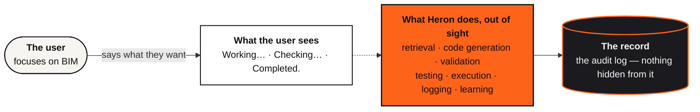

[Heron AI](../README.md) › [Documentation](README.md) › **01 — Vision & Principles**

# 01 — Vision & Principles

> Derived from [Master Specification](00-master-specification.md) §1, §2, §43–45, §72, §74, §76.
> Annotations marked **[NOTE]** are engineering commentary added during review, not part of the original spec.

| Section | In one line |
|---|---|
| [1. What Heron AI is](#1-what-heron-ai-is) | A platform for BIM work — not a chatbot |
| [2. The single defining principle](#2-the-single-defining-principle) | The user focuses on BIM |
| [3. What the user must never be required to know](#3-what-the-user-must-never-be-required-to-know) | None of the machinery |
| [4. The two personas](#4-the-two-personas) | Decided since: there are no personas, one voice |
| [5. Background intelligence](#5-background-intelligence) | Hidden from the screen, never from the record |
| [6. The Golden Rules](#6-the-golden-rules) | Where the permanent rules live |
| [7. Target experience](#7-target-experience) | Open Revit. Open Heron. Say what you want. |
| [8. Scope boundary — Revit first, not Revit forever](#8-scope-boundary--revit-first-not-revit-forever) | The core never welded to Revit |
| [9. Honest framing of ambition](#9-honest-framing-of-ambition) | A north star, not a v1 backlog |

---

## 1. What Heron AI is

Heron AI is a **modular, agent-based, self-improving AI engineering platform** for BIM work.

It is explicitly **not**:

- a chatbot
- a coding assistant
- a plain MCP server
- a single monolithic "AI brain"

It is a system that lets a BIM professional describe work in ordinary language and have the full
engineering pipeline — retrieval, code generation, validation, testing, execution, logging, learning —
happen out of sight.

## 2. The single defining principle

> **The user focuses on BIM. Heron AI focuses on everything behind the BIM work.**



<details>
<summary>Same thing as plain text</summary>

```text
The user (focuses on BIM) -> sees: Working... Checking... Completed.
Behind it, out of sight   -> retrieval, code generation, validation, testing, execution, logging, learning
Everything                -> kept in the record (the audit log)
```

</details>

Every design decision in this repository is measured against that sentence. **If a feature forces the
user to think like a programmer, the feature is wrong.**

## 3. What the user must never be required to know

C#, .NET, the Revit API, MCP, GitHub, RAG, vector databases, embeddings, fragments, skills, agent
architecture, package management, build systems, deployment, version compatibility.

**[NOTE]** This is a *requirement on the UX*, not a claim that these things are absent. All of them
exist inside Heron. The rule is that none of them ever surface unless the user has deliberately switched
into Developer Persona.

## 4. The two personas

| Persona | Who | What they see |
|---|---|---|
| **BIM Modeler Persona** | BIM Modeler, BIM Coordinator, engineer | "Select all ducts." Progress. Result. Nothing else. |
| **Developer Persona** | Developer, tool author, Heron maintainer | Full technical surface — C#, .NET, Revit API, architecture, build output, agent chain. |

The **Communication Agent** detects intent, technical level and working role, then chooses the response
style.

**[NOTE]** Since [D-01](DECISIONS.md) that work is the host's, not a Heron agent's: Claude Code works out
what was meant and chooses the wording, and Heron never classifies intent. `python tools/agent-count.py`
lists the register rows for it — `HERON-ORC-INT-002` and `HERON-ORC-PER-003` among them — as provided by
the host and never built here.

Core rule: **show the user what they need, not everything the system is doing.**

**[DECIDED 2026-08-28 — there are no personas. See [D-27](DECISIONS.md).]** ~~Recommendation: infer a
default, show it as a small persistent indicator, and let the user pin it.~~

- **Heron has one voice**: plain, non-developer language, always.
- **Nothing is inferred about the user**, so the distrust this note was written about — *the same
  question getting two different answers on two days* — is not managed, it is made impossible.
- **What varies instead is the shape of the answer**, taken from the **shape of the request**: a count
  gets a number, a breakdown gets a schedule-style table, a narrowed set gets the items and their ids,
  finished work gets a short close.
- The table above therefore describes **Developer Mode** ([22 §3](22-users-modes-and-extensibility.md)),
  which is *granted* rather than guessed — not a persona anyone can drift into.

## 5. Background intelligence

The user should not see agent chains, debugging, RAG operations, vector searches, compilation,
compatibility checks, fragment evaluation, git operations or internal routing.

The user should see:

```text
Working...
Checking...
Completed.
```

If an important decision is required, Heron asks.

**[NOTE]** "Invisible" must not mean "unaccountable". The audit log (§55) is what makes invisibility
safe: nothing is hidden from the *record*, only from the *screen*. Any operation that changes the model
or the knowledge base must be reconstructable afterwards. See
[12 — Security & Permissions](12-security-and-permissions.md).

## 6. The Golden Rules

The permanent architecture rules live in their own document: [14 — Golden Rules](14-golden-rules.md).

| Rules | Where they came from |
|---|---|
| 1 to 15 | The specification |
| 16 to 19 | Engineering review |
| 20 and 21 | The [field notes](00e-field-notes-proven-bridge.md) |

Rules 16 to 21 were accepted by the owner on 2026-08-28 ([Q-19](OPEN-QUESTIONS.md)). Together with the
[Constitution](../HERON_CONSTITUTION.md), they are the constitution of the platform. **Anything in this
repository that contradicts them is a bug in the design, not a feature.**

## 7. Target experience

> Open Revit. Open Heron. Say what you want.

- "Select all ducts."
- "Move them 200 mm up."
- "Add end caps."
- "Check the model."
- "Fix the issue."
- "Create dimensions."

## 8. Scope boundary — Revit first, not Revit forever

The core architecture must not be permanently welded to Revit. Future platform adapters: AutoCAD,
Navisworks, IFC, Rhino, Civil 3D, Blender.

**[NOTE]** The practical way to honour this without paying for it up front:

- Keep the *core* (orchestrator, brain, RAG, fragments, skills, memory, platform) free of any reference
  to the Revit API's own namespace, and put every Revit type behind the Heron Revit boundary.
- That single discipline costs almost nothing on day one and is what makes a second platform adapter
  possible later. It does **not** mean building abstractions for AutoCAD now.
- **The discipline is held in code now, not only in this note:**
  [`tools/check-structure.py`](../tools/check-structure.py) fails the build when a Revit type appears
  outside `revit/`, and the [`heron-guard`](../.claude/skills/heron-guard/SKILL.md) hook refuses such an
  edit as it is proposed ([PROJECT-MAP §B](PROJECT-MAP.md#b-folder-map)).

## 9. Honest framing of ambition

**[NOTE]** This specification describes a mature platform, most likely several years of work. It is a
**north star**, not a v1 backlog.

The correct reading:

- The **architecture** in this repository is committed to now — it shapes every file that gets written.
- The **agent catalogue** ([08](08-agent-catalog.md), about 150 named agents in the specification) is a
  target organisation chart, reached over time. How much of it is built is `python tools/agent-count.py`,
  not a number typed here.
- The **v1 scope** is deliberately small and is defined in [ROADMAP.md](ROADMAP.md).

Building 150 agents before one duct has been selected end-to-end would be the fastest way to kill the
project. The first milestone is a single thin vertical slice through every layer — reached: Phase 0 is
proven in Revit 2020 and 2024 ([What is proven](guide/what-is-proven.md#where-things-stand)).

---

↑ [Documentation](README.md) · [Home](../README.md)
