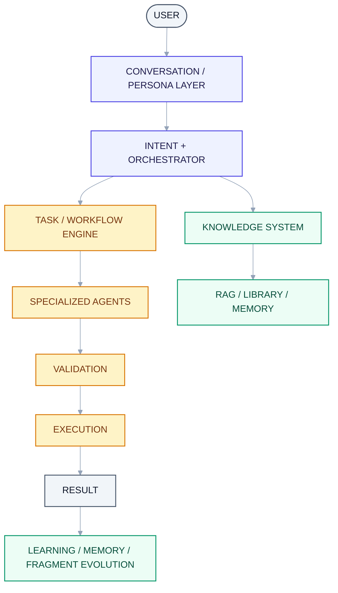
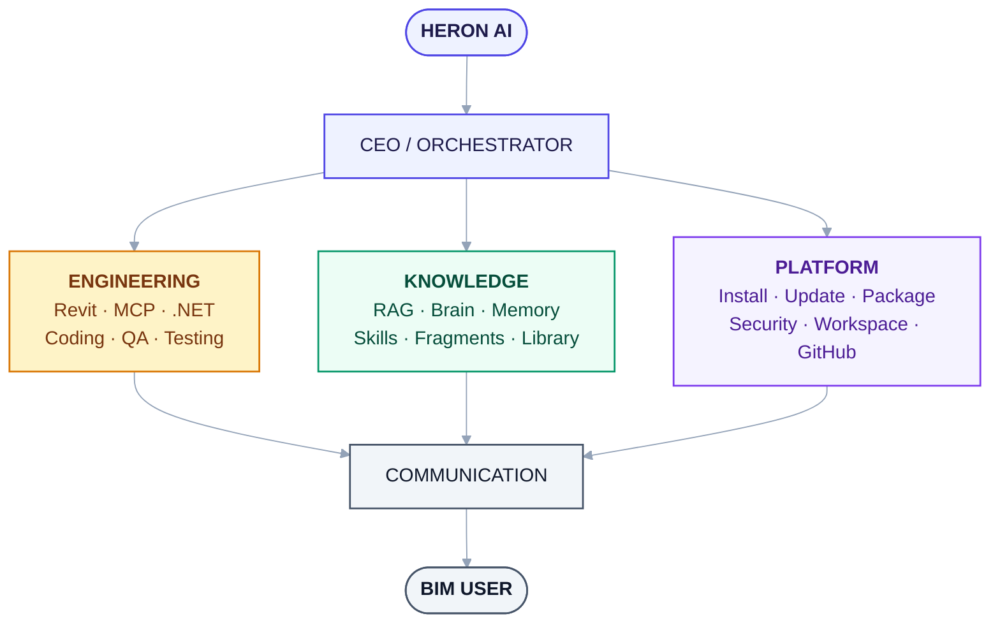
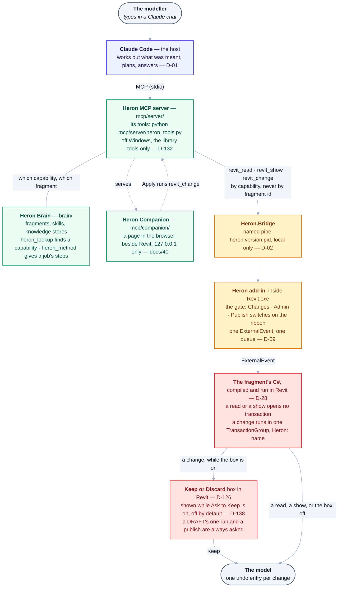

# 02 — Architecture Overview

> Derived from [Master Specification](00-master-specification.md) §3, §4, §50, §56–58, §73.
> **[NOTE]** blocks are engineering commentary added during review.

---

## 1. Layer stack



<details>
<summary>Same thing as plain text</summary>

```text
USER
 |
 v
CONVERSATION / PERSONA LAYER
 |
 v
INTENT + ORCHESTRATOR
 |
 +-------------------------------+
 |                               |
 v                               v
TASK / WORKFLOW ENGINE       KNOWLEDGE SYSTEM
 |                               |
 v                               v
SPECIALIZED AGENTS           RAG / LIBRARY / MEMORY
 |
 v
VALIDATION
 |
 v
EXECUTION
 |
 v
RESULT
 |
 v
LEARNING / MEMORY / FRAGMENT EVOLUTION
```

</details>

> **As built (2026-10-18):** this is the specification's layer stack, and it is kept as the
> specification wrote it. The build divides it differently. The top three layers belong to the host:
> Claude Code holds the conversation, works out what was meant and plans
> ([D-01](DECISIONS.md#d-01--execution-host-claude-code-plugin)). There is no persona layer, because
> Heron has one voice ([D-27](DECISIONS.md#d-27--one-voice-and-the-answers-shape-follows-the-questions-shape)).
> Heron makes no model call of its own
> ([D-58](DECISIONS.md#d-58--heron-measures-what-it-can-see-and-the-cost-meter-belongs-to-the-host)).
> §7a shows the parts that run today.

## 2. The four product parts

| Part | Owns | Document |
|---|---|---|
| **Heron Revit** | Everything touching the Revit API and the add-in | [03](03-heron-revit.md) |
| **Heron MCP** | The communication bridge between AI and Revit | [04](04-heron-mcp.md) |
| **Heron Brain** | Skills, Fragments, RAG, memory, knowledge | [05](05-heron-brain.md) |
| **Heron Platform** | Install, update, packages, registry, security, GitHub | [06](06-heron-platform.md) |

The **Heron Companion** is a page in the browser beside Revit. It shows what Heron does and lets the
modeller edit a table. It belongs to the MCP part: the chat's own server process serves it from
[`mcp/companion/`](../mcp/companion/README.md) on `127.0.0.1` only
([D-108](DECISIONS.md#d-108--the-modeller-can-see-and-edit-herons-work-in-a-local-companion-page-and-the-chat-stays-the-only-place-to-talk-to-heron),
[40](40-heron-companion.md)).

## 3. Company analogy



<details>
<summary>Same thing as plain text</summary>

```text
                    HERON AI
                       |
                 CEO / ORCHESTRATOR
                       |
       +---------------+----------------+
       |               |                |
   ENGINEERING      KNOWLEDGE       PLATFORM
       |               |                |
     Revit            RAG             Install
     MCP              Brain           Update
     .NET             Memory          Package
     Coding           Skills          Security
     QA               Fragments       Workspace
     Testing          Library         GitHub
       |               |                |
       +---------------+----------------+
                       |
                 COMMUNICATION
                       |
                  BIM USER
```

</details>

## 4. Orchestrator responsibilities

1. Understand request
2. Identify required capability
3. Select relevant agents
4. Build workflow
5. Execute workflow
6. Handle failures
7. Validate result
8. Return result
9. Trigger background learning

The Orchestrator coordinates. It does **not** accumulate domain logic. The moment it starts knowing about ducts, it has become the monolith the architecture exists to prevent.

## 5. Dynamic agent selection

Not every agent runs for every request.

| Request | Chain |
|---|---|
| "Select all ducts." | Intent → Orchestrator → Fragment Librarian → Revit Selection → Execution → Validation |
| "Create a tool that dimensions ducts." | Requirement → Architecture → RAG → Revit API → .NET → Code Gen → Review → Build → Test → Revit Test → QA → Release |

> **As built (2026-10-18):** the host picks the chain, and Heron serves it by **capability**. For
> *"select all ducts"*, `heron_lookup` finds the capability. Then `revit_read`, `revit_show` or
> `revit_change` runs the fragment that provides it, inside Revit. A request in a PROVEN capability's
> declared words, with every value given, needs only that one call
> ([04 §8.5](04-heron-mcp.md#85-one-request-fewer-turns--built-2026-09-30)). A job of several steps
> has its whole method in `heron_method` ([04 §8.7](04-heron-mcp.md#87-a-new-pc-as-quick-as-the-old-one--built-2026-10-09)).
> A new tool is written at DRAFT by the
> [`heron-fragment-author`](../.claude/agents/heron-fragment-author.md) subagent
> ([11 §3](11-orchestration-and-workflows.md#3-reference-workflow--new-tool)).

## 6. **[NOTE — critical]** "Agent" must not mean "LLM call"

This is the single most important correction to make before any code is written.

The specification names roughly **150 agents**. If each one is an LLM call, then "select all ducts" costs dozens of model round-trips: several seconds of latency and real money, for an operation that is fundamentally one `FilteredElementCollector` query.

Heron must therefore recognise **three distinct kinds of "agent"**:

| Tier | Name | Implementation | Cost | Examples |
|---|---|---|---|---|
| **T1** | **Service** | Plain deterministic code. No model call, ever. | ~0 ms | Revit Selection, Revit Transaction, Vector Search, Index Manager, Health Check, Environment Detection, File Discovery, Naming Validation |
| **T2** | **Reasoner** | One scoped LLM call with a tight contract | 100s of ms – seconds | Intent Detection, Fragment Matcher, Ranking, Failure Analysis, Content Classification |
| **T3** | **Worker** | Full agentic loop with tools | seconds – minutes | Code Generation, Architecture, Code Review, Import & Migration, Agent Creator |

Rules that follow from this:

1. **Default to T1.** An agent is only promoted to T2/T3 when the task genuinely requires judgement over ambiguous input.
2. **The happy path must be LLM-free.** Once "select all ducts" has a proven fragment, the *entire* execution — match, compatibility check, execute, validate — should be deterministic. The model is consulted for intent, then gets out of the way.
3. **Every T2/T3 agent declares its tier in the registry** (§38), so cost and latency are inspectable.
4. **Background work is T1 wherever possible.** A vector re-index must never cost money.

Rough target for a warm, cached "select all ducts": **one T2 call (intent), zero others.**

How far the chat path has got towards that, measured, is [04 §8.5](04-heron-mcp.md#85-one-request-fewer-turns--built-2026-09-30).

## 7. Where the orchestration runs — **decided**

> **[D-01](DECISIONS.md), 2026-08-27: Heron AI runs as a Claude Code plugin.**

Claude Code is the conversation layer and the agent host. Heron supplies skills, subagents, an MCP server and the Revit add-in.

Combined with **[D-06](DECISIONS.md)** (C# for Revit, Python for the brain), the stack is:

```text
Claude Code           host: conversation, agents, persona, orchestration
     |  MCP
Heron MCP Server      Python — brain, RAG, fragments, skills, memory
     |  named pipe, local only  (D-02)
Heron Revit Add-in    C# — one build per Revit version
     |  ExternalEvent
Revit
```

**What this buys.** The agent framework, conversation layer, subagent orchestration, tool routing and update mechanism all come for free. A large part of Part 4 (Heron Platform) shrinks accordingly — Claude Code already provides skills, subagents, MCP configuration and plugin updates. What remains genuinely Heron's to build is the Revit bridge, the brain, and the knowledge system.

**What this costs.** The user must install and run Claude Code and needs a Claude subscription. A BIM modeller works in a terminal, which sits in tension with Golden Rule 1 — mitigated by the Communication/Persona layer.

**[NOTE]** Keep the core host-agnostic wherever that is free. An in-Revit docked panel remains the better long-term experience for a BIM modeller, and nothing in this decision should make adding one later require a rewrite. The MCP server and the add-in are already host-independent by construction; the discipline applies only to whatever orchestration logic ends up living on the Heron side.

> **As built (2026-10-18):** talking to Heron from inside Revit was built and then removed. The modeller
> works with Heron in the Claude chat only
> ([D-104](DECISIONS.md#d-104--the-modeller-can-talk-to-the-open-chat-from-inside-revit), superseded by
> [D-105](DECISIONS.md#d-105--talk-is-removed-and-the-modeller-works-with-heron-in-the-chat-only)).
> The Companion page is a viewer and table editor beside Revit, never a second place to talk
> ([D-108](DECISIONS.md#d-108--the-modeller-can-see-and-edit-herons-work-in-a-local-companion-page-and-the-chat-stays-the-only-place-to-talk-to-heron)).

## 7a. As built — the parts that run today

The stack in §7, drawn with what it grew. This shows parts, not folders.
[PROJECT-MAP §A](PROJECT-MAP.md#a-how-a-request-travels) shows the same request folder by folder.
Never type the tool list here. `python mcp/server/heron_tools.py` prints it, with each tool's risk.



<details>
<summary>Same thing as plain text</summary>

```text
The modeller                types in a Claude chat
   |
Claude Code                 the host: works out what was meant, plans, answers   (D-01)
   |  MCP (stdio)
Heron MCP server            mcp/server/ - its tools: python mcp/server/heron_tools.py
   |                        off Windows, the library tools only                  (D-132)
   +-- Heron Brain          brain/ - fragments, skills, knowledge stores
   |                        heron_lookup finds a capability, heron_method gives a job's steps
   +-- Heron Companion      mcp/companion/ - a page in the browser beside Revit,
   |                        127.0.0.1 only; its Apply runs revit_change          (docs/40)
   |
   |  revit_read / revit_show / revit_change - by capability, never by fragment id
   |  named pipe heron.<version>.<pid>, local only                               (D-02)
Heron.Bridge
   |
Heron add-in, in Revit.exe  the gate: Changes / Admin / Publish switches on the ribbon
   |  ExternalEvent         one event, one queue                                 (D-09)
The fragment's C#           compiled and run in Revit                            (D-28)
   |                        a read or a show opens no transaction
   |                        a change runs in one TransactionGroup, "Heron: <name>"
   |
   +-- a change, while Ask to Keep is on (off by default, D-138):
   |     Revit's Keep or Discard box (D-126) - only Keep keeps it
   |     a DRAFT's one run and a publish are always asked
   +-- a read, a show, or the box off: straight on
   |
The model                   one undo entry per change
```

</details>

What each arrow leaves out, and where it is written down:

- **The gate is in the add-in, not the chat.** `write.enabled` defaults to `false`
  ([D-19](DECISIONS.md#d-19--writing-is-off-by-default-until-the-write-path-has-met-a-real-revit)), and
  Admin and Publish each have a switch only the owner turns on
  ([D-106](DECISIONS.md#d-106--admin-and-publish-each-get-a-switch-of-their-own-and-only-the-owner-turns-them-on)).
  `revit_change` keeps a change only from a fragment whose proof still stands
  ([D-117](DECISIONS.md#d-117--a-change-is-kept-only-from-a-fragment-whose-proof-still-stands)), apart
  from a DRAFT's one run
  ([D-119](DECISIONS.md#d-119--a-draft-fragment-may-run-once-on-the-model-in-front-behind-a-keep-or-discard-prompt-in-revit-and-article-11-says-so)).
- **The three doors are not the only way in.** The other `revit_` tools each send one fixed operation
  down the same pipe and through the same gate. These include the levels, views and sheets reads, the
  move preview and apply, and the temporary isolate. Their code is in the add-in, not in a fragment
  ([`revit/README.md`](../revit/README.md)).
- **The Companion never reaches Revit or an AI by itself.** It reads a state file the add-in writes,
  and the add-in opens no socket. The Revit ribbon's Companion button only hands the page's address to
  Windows ([D-109](DECISIONS.md#d-109--a-companion-button-in-revit-opens-the-page-and-a-companion-switch-turns-it-off-without-touching-heron)).
- **The engineering tools go the same way.** The HVAC and fire-protection calculations and the
  building-loads, sprinkler-layout and sprinkler-hydraulics tools are tools of the same server
  ([41](41-hvac-design.md), [42](42-fire-protection-design.md), [44](44-building-loads-from-the-model.md),
  [46](46-sprinkler-hydraulics-from-the-model.md), [47](47-sprinkler-layout-from-the-model.md)). The
  ones that read the model reach Revit through the same pipe and gate.
- **None of this is a proof.** Each document above says what has run in a real Revit and what has not.
  [NEEDS-CHECKING](NEEDS-CHECKING.md) holds what is still owed.

## 8. Agent contracts

Every agent declares:

```text
INPUT
PROCESS
OUTPUT
ERROR
STATUS
DEPENDENCIES
```

No uncontrolled agent-to-agent chatter. The Workflow/Orchestrator layer coordinates.

**[NOTE]** Recommend expressing every contract as a **JSON Schema** stored beside the agent. That gives, for free: validation at the boundary, structured-output enforcement for T2/T3 agents, generated documentation, and contract-diff detection when an agent version changes.

> **As built (2026-10-18):** each contract is a YAML file in [`brain/agents/`](../brain/agents/),
> not a JSON Schema. It declares input, output, failures and retry. Tier and risk live in the register,
> [28](28-agent-registry.md), and status lives in the module's own header.
> `python tools/agent-count.py` counts the register by department. Never type its figures here.

## 9. One responsibility per agent

| Bad | Good |
|---|---|
| `RevitSuperAgent` | `Revit Selection Agent` |
| `KnowledgeEverythingAgent` | Librarian / Retriever / Ranking / Context Builder / Validator |

**[NOTE]** The counter-pressure is real: 150 tiny modules with 150 contracts is its own maintenance burden. The discipline that keeps this healthy is **departments** — a stable outer boundary with many small parts inside. Callers depend on the *department*, not on individual agents, so agents can be split, merged or retired without breaking anything outside their department. This is what makes the Fragment Split / Merge / Evolution agents (§21–23) safe to apply to the agent layer itself.
