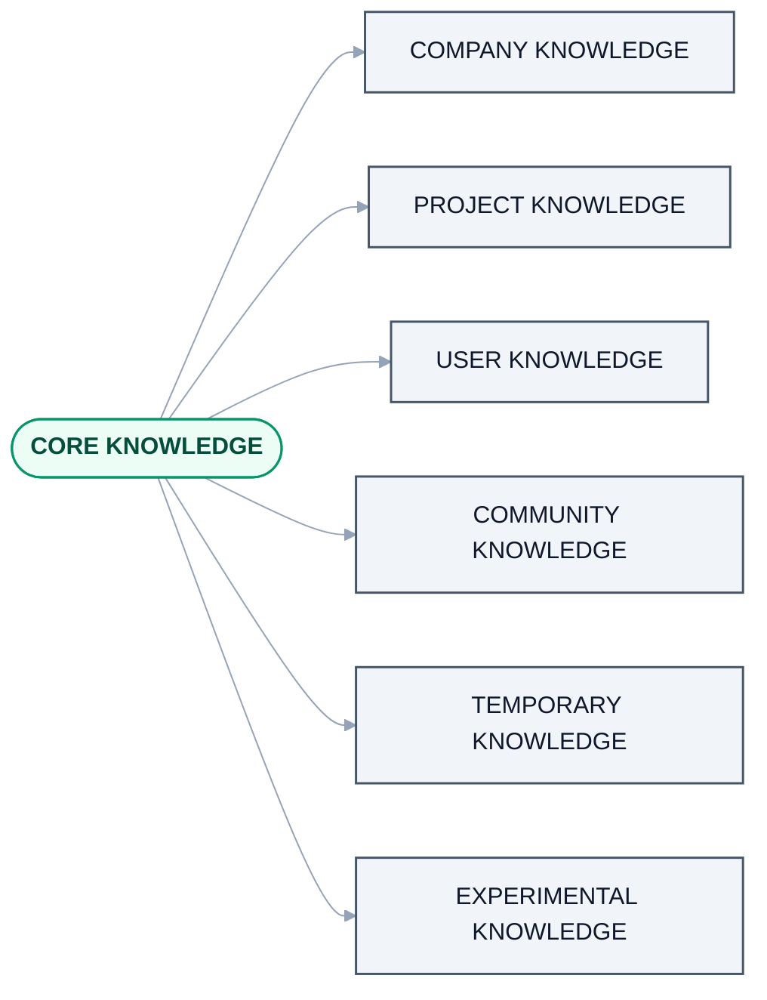
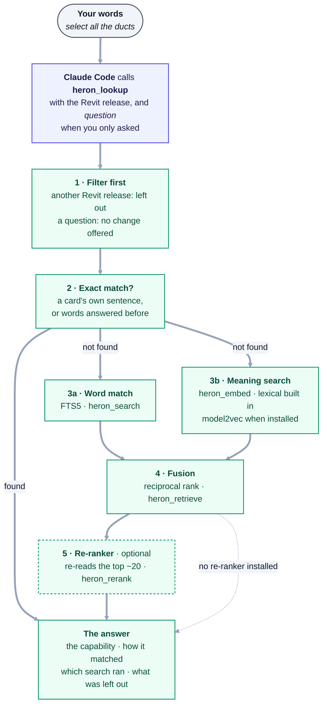

# 05 — Heron Brain (Part 3)

> Derived from [Master Specification](00-master-specification.md) §6, §15, §26, §27.
> Skills and Fragments have their own document: [09](09-skills-and-fragments.md).
> Memory and knowledge scopes have their own document: [10](10-memory-and-knowledge.md).
> **[NOTE]** blocks are engineering commentary added during review.

---

## 1. Responsibility

The intelligence and knowledge layer: Skills, Fragments, RAG, vector database, embeddings, knowledge library, personal memory, project memory, company knowledge, community knowledge, fragment lifecycle, fragment evolution, knowledge validation, knowledge ranking.

## 2. Knowledge is separated, never pooled



<details>
<summary>Same thing as plain text</summary>

```text
CORE KNOWLEDGE
|
+-- COMPANY KNOWLEDGE
|
+-- PROJECT KNOWLEDGE
|
+-- USER KNOWLEDGE
|
+-- COMMUNITY KNOWLEDGE
|
+-- TEMPORARY KNOWLEDGE
|
+-- EXPERIMENTAL KNOWLEDGE
```

</details>

*The specification's picture, not the build: there is no community store, and core knowledge is the
`global` store. The note at the end of this section lists the six stores that exist.*

This is **Golden Rule 5**. A polluted brain is unsearchable and untrustworthy, and in a consultancy setting mixing Project A's knowledge into Project B is a commercial and contractual problem, not just a technical one.

> **As built (2026-10-18):** [`heron_scope.py`](../brain/heron_scope.py) holds the scopes of
> [10 §1](10-memory-and-knowledge.md#1-memory-scopes) as `heron_scope.SCOPES`: global, company,
> project, user, temporary and experimental. Each is one SQLite file, and `ATTACH` is refused at the
> engine, so a query across two scopes cannot be written. There is no community store. Shared company knowledge is a git repository
> when there is demand ([D-41](DECISIONS.md#d-41--single-user-now-company-knowledge-is-a-git-repo-and-the-admin-is-the-reviewer)).
> A project's store is keyed by the model's own `CreationGUID`, never guessed
> ([D-113](DECISIONS.md#d-113--a-projects-kept-answers-are-filed-under-the-models-own-id-and-answers-kept-under-its-templates-id-are-asked-about)).

---

## 3. RAG Department

| Agent | Responsibility | Tier |
|---|---|---|
| RAG Librarian Agent | Decide *which scopes* to search | T1/T2 |
| Knowledge Discovery Agent | Find potentially relevant information | T1 |
| Retriever Agent | Retrieve candidates | T1 |
| Fragment Matcher Agent | Match request against existing fragments | T2 |
| Skill Matcher Agent | Find applicable skills | T2 |
| Ranking Agent | Rank retrieved information | T1/T2 |
| Context Builder Agent | Assemble task context | T1 |
| Embedding Agent | Create embeddings | T1 |
| Vector Search Agent | Search the vector DB | T1 |
| Index Manager Agent | Maintain indexes | T1 |
| Re-index Agent | Update indexes on change | T1 |
| Duplicate Detection Agent | Find duplicate knowledge | T1 |
| Knowledge Validation Agent | Check retrieved information | T2 |
| Citation/Source Agent | Track provenance | T1 |
| Knowledge Evolution Agent | Restructure knowledge when required | T3 |

> **As built (2026-10-18):** these are modules, not running agents. Each module's header names the agent
> it implements; `grep -l 'HERON-RAG' brain/*.py mcp/server/*.py tests/*.py` finds them, and
> [28](28-agent-registry.md) is the register. Every one is `DRAFT`.

| Agent | Where it lives, as built |
|---|---|
| RAG Librarian | [`heron_scope.py`](../brain/heron_scope.py) - one store per scope; `heron_retrieve.librarian` - asks each scope on its own; [`heron_earlier.py`](../brain/heron_earlier.py) |
| Knowledge Discovery | [`heron_ingest.py`](../brain/heron_ingest.py) - a document into one scope |
| Retriever | [`heron_search.py`](../brain/heron_search.py) - word match, and the identity and cache routes |
| Fragment Matcher | [`heron_matcher.py`](../brain/heron_matcher.py) |
| Skill Matcher | [`mcp/server/heron_brain.py`](../mcp/server/heron_brain.py) - the jobs a `heron_lookup` answer names, through `heron_skill.methods_for` |
| Ranking | [`heron_retrieve.py`](../brain/heron_retrieve.py) - fusion; [`heron_rerank.py`](../brain/heron_rerank.py) - the optional re-ranker |
| Context Builder | [`heron_context.py`](../brain/heron_context.py), with `heron_retrieve.py` |
| Embedding, Vector Search | [`heron_embed.py`](../brain/heron_embed.py) |
| Index Manager | `heron_search.py` |
| Re-index, Duplicate Detection | No module's header names them; [`tests/test_maintenance.py`](../tests/test_maintenance.py) does. The re-ingest of a changed document and the report of a byte-identical clause are in `heron_ingest.py` (`refresh`, `duplicate_clauses`) |
| Knowledge Validation | [`heron_knowledge.py`](../brain/heron_knowledge.py) |
| Citation / Source | [`heron_ground.py`](../brain/heron_ground.py) |
| Knowledge Evolution | [`heron_evolution.py`](../brain/heron_evolution.py) |

[28](28-agent-registry.md) adds two the table above does not list: Knowledge Conflict,
[`heron_conflict.py`](../brain/heron_conflict.py), and Research,
[`heron_research.py`](../brain/heron_research.py).

---

## 4. **[NOTE]** Retrieval is not only vector search

The spec leans heavily on embeddings. For this domain that is the wrong default on its own.

BIM and Revit queries are full of **exact tokens** that embeddings handle badly: `OST_DuctCurves`, `BuiltInParameter.RBS_DUCT_BOTTOM_ELEVATION`, `ElementId`, a shared-parameter GUID, `Revit 2024`. Pure semantic search will confidently return the *nearly* right parameter, which in a model-modifying system is worse than returning nothing.

**Recommended retrieval stack:**

1. **Structured filter first** — scope, domain, Revit version, status. This is a SQL `WHERE`, not a search. It eliminates most of the corpus for free and enforces Golden Rule 5 at the query level.
2. **Hybrid search** — BM25/FTS keyword search **and** vector search over the survivors.
3. **Reciprocal rank fusion** to merge the two result sets.
4. **Re-rank** the top ~20 by fragment quality signals (status, success rate, recency, version match).
5. **Exact-match short circuit** — if a proven fragment's semantic identity matches the request exactly, skip the model entirely and execute it.

That last point matters most: the common case ("select all ducts", asked for the 400th time) should cost **one lookup**, not a retrieval pipeline.

> **As built (2026-10-18):** all five stages exist, in a different order from the list above: the
> exact-match short circuit runs straight after the filter, before anything is searched. §4.1 draws the
> order the code runs, and its table says where each stage lives.
> [`retrieval-history.md`](../brain/retrieval-history.md) records what each stage was measured to do,
> and at what library size.

### 4.1 How Heron finds the right tool for your words

As built (2026-10-18), read from `heron_retrieve.find()` and `heron_brain.lookup()`.



**Solid arrows are the path a lookup takes; the dotted arrow is the path with no re-ranker installed**,
where fusion's order comes back unchanged and the answer says `re-rank: not used`. The dashed box is the
optional install. `revit_read`, `revit_show` and `revit_change` given your words (`request`) run this
same lookup before they run anything.

<details>
<summary>Same thing as plain text</summary>

```text
Your words            "select all the ducts"
   |
Claude Code           calls heron_lookup with the Revit release, and `question` when you only asked
   |                  (revit_read / revit_show / revit_change given your words run the same lookup)
1  Filter first       heron_retrieve.eligible
   |                  another Revit release  -> left out, not ranked lower
   |                  a question             -> nothing that changes the model is offered (D-128)
2  Exact match?       heron_search: a card's own sentence (identity), or these words answered before (cache)
   +-- found ------------------------------------------------------------> the answer
   +-- not found
        |
   3a Word match                  3b Meaning search
      FTS5, heron_search             heron_embed: lexical built in, model2vec when installed
        |                              |
        +--------------+---------------+
                       |
4  Fusion             reciprocal rank, heron_retrieve
   |
5  Re-ranker          optional - re-reads the top ~20, heron_rerank
   |                  not installed -> fusion's order, unchanged, and the answer says so
   |
The answer            the capability, how it matched (identity / cache / hybrid / nothing),
                      the fragment behind it, which search ran, and what step 1 left out
```

</details>

| Step | What it does, as built | Code | Spec stage in §4 |
|---|---|---|---|
| **1 · Filter first** | A plain SQL `WHERE` over status, Revit release, domain and kind. A fragment for another release is **absent, not demoted**. When the host calls the request a question, every fragment above `question_ceiling()` - the level just below `revit_change`'s, read from the tool registry - is absent too ([D-128](DECISIONS.md#d-128--a-request-the-host-calls-a-question-is-never-offered-a-capability-that-changes-the-model)). The answer counts both | `heron_retrieve.eligible` | 1 |
| **2 · Exact match** | `identity`: the words are a card's own declared sentence - one lookup, no search. Only a `PROVEN` fragment may run off it unasked, and through a door only when every value it needs is given ([04 §8.5](04-heron-mcp.md#85-one-request-fewer-turns--built-2026-09-30)). `cache`: these words were answered before - a candidate, never a decision. Step 1 applies to both | `heron_search.short_circuit`, `heron_search.recall` | 5 |
| **3a · Word match** | FTS5 over the fragments step 1 kept, ranked by bm25 | `heron_search.keywords` | 2 |
| **3b · Meaning search** | `lexical` is built in: character n-grams, measured as *not* meaning. `model` is model2vec when it is installed and its weights can be fetched; sentence-transformers is tried next. Which one ran is recorded on the answer | [`heron_embed.py`](../brain/heron_embed.py) | 2 |
| **4 · Fusion** | Reciprocal rank fusion of the two lists (`RRF_K`). The meaning route's vote is weighted by which backend ran (`VECTOR_WEIGHT_BY_BACKEND`), and a status nudge smaller than one rank settles near-ties only | `heron_retrieve.retrieve` | 3, and 4's status signal |
| **5 · Re-ranker** | A cross-encoder reads each (question, passage) pair of the top ~20 (`heron_rerank.SHORTLIST`) together. The passage is the card's identity, its first declared sentences, its capability and its domain ([D-134](DECISIONS.md#d-134--the-re-ranker-reads-a-cards-first-declared-sentences-beside-its-identity-carried-in-the-store)). With nothing installed, fusion's order comes back unchanged | [`heron_rerank.py`](../brain/heron_rerank.py) | 4 |
| **The answer** | The capability, the route (`identity`, `cache`, `hybrid` or `nothing`), the fragment behind it as evidence, a `nearness` and a `re-rank` line saying which search ran, and how many fragments step 1 left out | `heron_brain.lookup`, the `heron_lookup` tool | - |

What to install for 3b and 5, and what each was measured to do, is
[WHAT-TO-INSTALL §2](WHAT-TO-INSTALL.md#2-optional--the-two-search-add-ons).

## 5. **[NOTE]** Vector store choice

Requirements: local-first, embeddable, no server to install, works offline, handles metadata filtering well, and survives being copied around with the workspace folder.

| Option | Assessment |
|---|---|
| **SQLite + `sqlite-vec`** | Single file, zero install, real SQL for the structured filter, FTS5 for keyword search — all three retrieval stages in one engine. Strong default. |
| **LanceDB** | Good embedded option, columnar, strong filtering. |
| **ChromaDB** | Easy to start, heavier at scale, weaker structured filtering. |
| **Qdrant / Weaviate / pgvector** | Server-based. Rejects the "user installs nothing" requirement. |

**Recommendation: SQLite + `sqlite-vec` + FTS5.** One file per knowledge scope keeps scope separation physical rather than merely logical — which makes Golden Rule 5 impossible to violate by accident, and makes "archive this project" a file copy.

Tracked as [Q-10](OPEN-QUESTIONS.md).

> **As built (2026-10-18):** decided as
> [D-23](DECISIONS.md#d-23--the-knowledge-store-is-sqlite-one-file-per-scope), one SQLite file per
> scope, with FTS5 for keywords. `sqlite-vec` is used when it loads. Where a Python build cannot load
> extensions, the same cosine is computed in Python over the same stored bytes. Either way the vectors
> stay in the scope's own file ([`heron_embed.py`](../brain/heron_embed.py)).

## 6. **[NOTE]** Embedding model choice — the offline question

Embeddings can be produced by a cloud API or a local model.

| | Cloud embeddings | Local embeddings |
|---|---|---|
| Quality | Higher | Good enough for this corpus |
| Cost | Per token, forever, including re-indexing | Zero |
| Offline | No | Yes |
| **Sends project data off the machine** | **Yes** | **No** |

The last row is decisive for BIM consultancy work. Indexing a project's knowledge means sending project content to a third party. Many client contracts — and effectively all government or defence work — prohibit that.

**Recommendation: local embedding model by default** (a small sentence-transformer class model), with cloud embeddings as an opt-in for users who have no such restriction. This also makes re-indexing free, which the background system (§48) depends on.

Tracked as [Q-11](OPEN-QUESTIONS.md) and the wider data-residency question [Q-12](OPEN-QUESTIONS.md).

> **As built (2026-10-18):** decided as
> [D-24](DECISIONS.md#d-24--embeddings-are-computed-locally-by-default), and the cloud opt-in in the
> recommendation above was withdrawn the same day by
> [D-26](DECISIONS.md#d-26--the-model-file-is-never-uploaded). Embeddings are computed on the machine,
> with no opt-in and no setting. [`heron_embed.py`](../brain/heron_embed.py) uses a trained encoder when
> one is installed, and the built-in lexical backend otherwise. Each answer says which one ran. What to
> install is [WHAT-TO-INSTALL](WHAT-TO-INSTALL.md).

---

## 7. Vector database maintenance

Automatic background operations: new fragment indexing, updated fragment indexing, deleted fragment removal, embedding updates, duplicate detection, index repair, stale knowledge detection, metadata synchronisation.

The user never manages the vector database manually.

**[NOTE]** Two things make this safe and cheap:

- **Content-hash based indexing.** Re-embed only when content actually changed, not when a file's mtime moved. Otherwise every git operation triggers a full re-index.
- **The index is derived, never authoritative.** Fragments and skills live as files with metadata (git-tracked, human-readable, diffable). The vector DB is a rebuildable cache. If it is ever corrupt, deleting it must be a safe recovery action. Never store the only copy of knowledge inside the vector store.

> **As built (2026-10-18):** both hold. Indexing is content-hashed, so an unchanged file costs nothing.
> A lookup re-reads a card only when its bytes change, never on its mtime
> ([04 §8.5](04-heron-mcp.md#85-one-request-fewer-turns--built-2026-09-30)). The stores are derived:
> `python brain/heron_scope.py --rebuild` puts them back from disk
> ([Golden Rule 11](14-golden-rules.md)). There is no background agent: the MCP server prepares the
> store once on a background thread when it starts (`heron_brain.warm_store`), and after that a card
> changed on disk reaches its row on the next lookup. A store that has drifted from the cards is named in
> the `heron_lookup` answer.

---

## 8. **[NOTE]** Knowledge validation is where trust is won or lost

`Knowledge Validation Agent` and `Citation/Source Agent` are listed almost in passing, but they carry the platform's credibility.

Two failure modes to design against explicitly:

1. **Confident wrong retrieval.** A fragment written for Revit 2021 gets applied in 2025 and silently misbehaves. Mitigation: version compatibility is a **hard filter before ranking**, never a soft signal.
2. **Invented standards.** §47 already forbids this. Enforce it structurally: any claim about ISO 19650, QCS, Ashghal or a company standard must carry a citation to an indexed source document. **No source, no claim.** A standards answer with no citation is a bug, not a low-confidence answer.

> **As built (2026-10-18):** the first is the version wall in §4. For the second,
> [`heron_ground.py`](../brain/heron_ground.py) checks a proposed answer against the clauses it cites
> and flags an added fact; the chat reaches it through `heron_check`.
> [`heron_research.py`](../brain/heron_research.py) marks an outside answer with nothing cited
> `UNCITED`. Even a well-formed citation stays `UNVERIFIED` until the document it cites is ingested.
> Where two scopes give a different number for one question, `heron_standards` says so and settles
> nothing ([`heron_conflict.py`](../brain/heron_conflict.py)). What the brain has been run against is
> in [`brain/README.md`](../brain/README.md).
