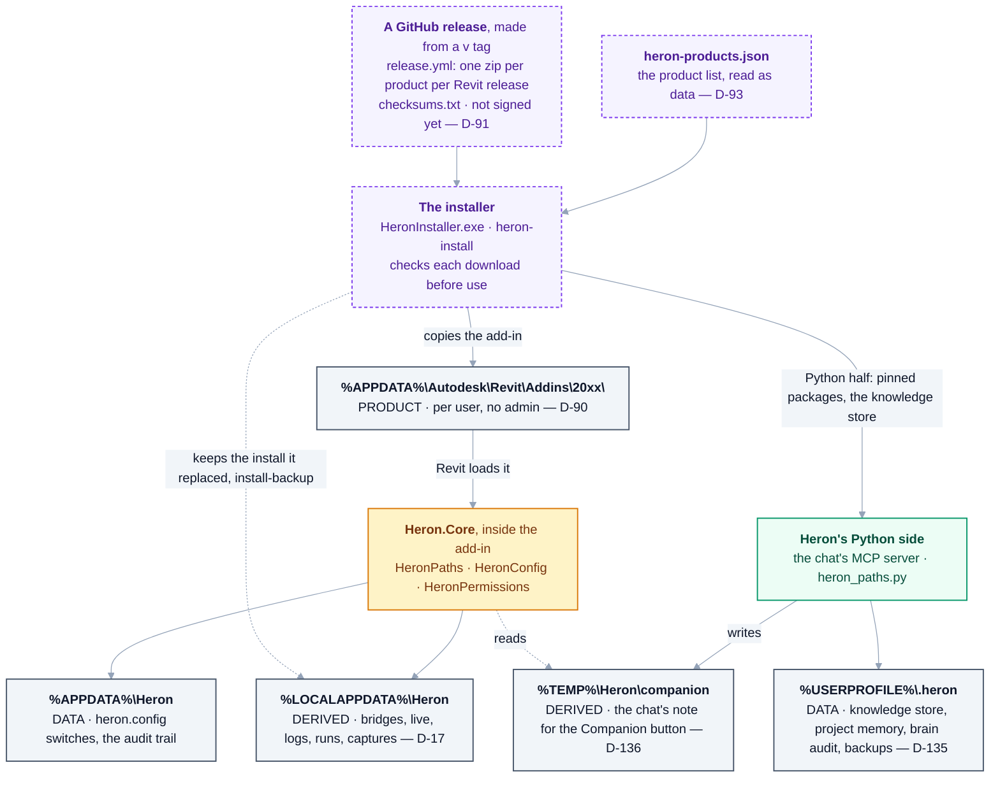

# 06 — Heron Platform (Part 4)

> Derived from [Master Specification](00-master-specification.md) §7, §31, §32, §36–39, §60–63, §70, §71.
> Installation and updates have their own document: [07](07-installation-and-update.md).
> **[NOTE]** blocks are engineering commentary added during review.

---

## 1. Responsibility

Installer, update system, package manager, agent registry, agent creator, agent training, agent validation, workspace management, GitHub integration, security, logging, backup, recovery, health monitoring, configuration, documentation, release management.

---

## 2. Workspace architecture

Conceptual separation (physical names finalised at implementation time, owned by the Folder Architecture Agent):

```text
Heron
|
+-- Core
+-- Agents
+-- Revit
+-- MCP
+-- Brain
+-- RAG
+-- Skills
+-- Fragments
+-- Memory
+-- Projects
+-- Company
+-- Community
+-- Packages
+-- Configuration
+-- Logs
+-- Tests
+-- Documentation
+-- Cache
+-- Backup
```

**[NOTE]** One distinction is missing and matters a great deal: **product vs. data**.

| Class | Contents | Lifecycle |
|---|---|---|
| **Product** | Core, Agents, Revit, MCP, Packages | Replaced wholesale on update. User never edits. |
| **Data** | Brain, Skills, Fragments, Memory, Projects, Company, Logs, Backup | Belongs to the user. Must survive every update, uninstall and reinstall. |
| **Derived** | Cache, vector indexes | Safe to delete at any time. Rebuildable. |

If these three sit in one tree, the first update that "cleans and reinstalls" destroys the user's accumulated knowledge — the very thing the platform exists to build. Recommendation: product under an install location, data under the user profile (or a user-chosen workspace), derived under a cache location, and the update system physically unable to write to the data class.

Tracked as [Q-13](OPEN-QUESTIONS.md).

> **As built (2026-10-18):** answered by
> [D-31](DECISIONS.md#d-31--product-data-and-derived-are-already-separated-and-the-code-is-the-record).
> The split is in code: [`HeronPaths.cs`](../platform/Heron.Core/HeronPaths.cs) is the only thing that
> builds a Heron path, and `IsSafeToDelete` returns false for anything under data. Runtime state stays
> on the machine ([D-17](DECISIONS.md#d-17--runtime-state-is-machine-local-not-roaming)). Heron's
> Python side keeps its data in `%USERPROFILE%\.heron`, where a Microsoft Store Claude's private copy of
> AppData cannot reach it
> ([D-135](DECISIONS.md#d-135--herons-python-side-keeps-its-data-in-userprofileheron-and-the-companions-notes-in-the-temporary-folder-where-a-store-claudes-copy-cannot-reach-them)).

### 2a. As built — the platform's parts, and where each writes on the PC (2026-10-18)

How a Heron product reaches a PC, and which folder each part then writes. Folders are Windows'
own names for them. `python brain/heron_paths.py --where` prints the Python side's home on a PC.



<details>
<summary>Same thing as plain text</summary>

```text
A GitHub release, from a v tag      release.yml: one zip per product per Revit release,
                                     checksums.txt, not signed yet                   (D-91)
heron-products.json                  the product list, read as data                  (D-93)
   |
The installer                        HeronInstaller.exe / heron-install; checks each download
   |
   +-- copies the add-in to  %APPDATA%\Autodesk\Revit\Addins\20xx\   PRODUCT, per user (D-90)
   |      and keeps the install it replaced in %LOCALAPPDATA%\Heron\install-backup
   |      Revit loads it -> Heron.Core inside the add-in (HeronPaths, HeronConfig, HeronPermissions)
   |         writes  %APPDATA%\Heron          DATA: heron.config switches, the audit trail
   |         writes  %LOCALAPPDATA%\Heron     DERIVED: bridges, live, logs, runs, captures (D-17)
   |         reads   %TEMP%\Heron\companion   DERIVED: the chat's note for the Companion button
   |
   +-- Python half: pinned packages, the knowledge store
          Heron's Python side (the chat's MCP server, heron_paths.py)
             writes  %USERPROFILE%\.heron     DATA: knowledge store, project memory, brain audit,
                                              and tools/heron-backup.py's backups (D-135)
             writes  %TEMP%\Heron\companion   the note the add-in reads (D-135, D-136)
```

</details>

| Folder | Class | Written by | Safe to delete? | Why it is there |
|---|---|---|---|---|
| `%APPDATA%\Autodesk\Revit\Addins\20xx\` | PRODUCT | the installer, or `tools/deploy-addin.ps1` | replaced on update | per user, no administrator rights ([D-90](DECISIONS.md#d-90--install-stays-per-user-and-never-asks-for-administrator-rights)) |
| `%APPDATA%\Heron` | DATA | the add-in | **no** - `IsSafeToDelete` refuses it | the switches in `config\heron.config` and the audit trail, which is evidence ([Golden Rule 14](14-golden-rules.md)) |
| `%LOCALAPPDATA%\Heron` | DERIVED | the add-in; and `tools/deploy-addin.ps1`, which the installer runs, keeps the install it replaced in `install-backup\` | yes | runtime state stays on the machine ([D-17](DECISIONS.md#d-17--runtime-state-is-machine-local-not-roaming)) |
| `%TEMP%\Heron\companion` | DERIVED | the chat; the add-in only reads it | yes | a Store Claude's private copy of AppData does not reach it; from inside Revit it is found by stepping out of Revit's GUID-named temporary folder ([D-136](DECISIONS.md#d-136--the-companions-folder-is-the-users-temporary-folder-found-from-inside-revit-by-stepping-out-of-a-guid-named-one)) |
| `%USERPROFILE%\.heron` | DATA | the Python side, and `tools/heron-backup.py`'s backups | **no** | out of a Store Claude's reach; `HERON_DATA` moves it ([D-135](DECISIONS.md#d-135--herons-python-side-keeps-its-data-in-userprofileheron-and-the-companions-notes-in-the-temporary-folder-where-a-store-claudes-copy-cannot-reach-them)) |

What has run on a real PC is not this diagram's to say: the installer's rows are NEEDS-CHECKING Groups
[AB](needs-checking/group-ab.md) and [EP](needs-checking/group-ep.md), and the Companion folder's is
[HF](needs-checking/group-hf.md).

---

## 3. Agent Registry

Every agent has an entry:

```text
Agent ID
Agent Name
Department
Responsibility
Capabilities
Inputs
Outputs
Dependencies
Required Skills
Allowed Tools
Version
Status
Health
Owner
```

Statuses: `PROPOSED` → `DEVELOPMENT` → `TESTING` → `APPROVED` → `ACTIVE` → `DISABLED` → `DEPRECATED` → `ARCHIVED`

**[NOTE]** Add three fields the spec omits:

| Field | Why |
|---|---|
| **Tier** (T1 service / T2 reasoner / T3 worker) | See [02 §6](02-architecture-overview.md). Makes cost and latency inspectable, and stops silent promotion of a cheap service into an expensive LLM call. |
| **Risk level** | Which permission level this agent's actions require. Drives the security gate. |
| **Contract schema path** | The JSON Schema for INPUT/OUTPUT. Makes contracts machine-checkable and diffable across versions. |

> **As built (2026-10-18):** the register is [28](28-agent-registry.md), and it carries tier and risk.
> Each agent's contract is a YAML file in [`brain/agents/`](../brain/agents/), not a JSON Schema, and
> status is the module's own `Heron-Status` header. Nothing that can be derived is stored twice
> ([D-40](DECISIONS.md#d-40--the-dependency-graph-is-sqlite-and-an-edge-is-derived-before-it-is-stored)).
> `python tools/agent-count.py` counts the register by department.

---

## 4. Agent Creation & Training

The **Agent Creator Agent** decides whether a new capability warrants a new agent:

1. Analyze requirement → 2. Determine responsibility → 3. Check existing agents → 4. Check overlap → 5. Design → 6. Specification → 7. Implementation → 8. Tests → 9. Validate → 10. Register → 11. Approval → 12. Activate.

The **Agent Training Agent** supplies architecture rules, coding standards, company standards, naming standards, security rules, domain knowledge, examples, approved fragments and approved skills before an agent goes active.

**[NOTE — the sharpest risk in the whole specification]**

An AI system that autonomously writes, approves and activates new agents which then execute code against live project models is a genuinely dangerous construction. Not theoretically — practically. The failure mode is not dramatic; it is a subtly wrong agent quietly promoted to `ACTIVE` and then applied to a client's model at 4pm on a submission day.

Proposed hard boundaries, to be treated as non-negotiable:

1. **Agent creation is always a proposal.** `PROPOSED` is the only status the system may assign to itself.
2. **A human approves the `PROPOSED → APPROVED` transition.** Always. This is the one place where "the user does BIM work, Heron does everything else" is deliberately broken, and it should be.
3. **New agents run in a sandbox first** — a detached copy of a model, never the live document.
4. **`ACTIVE` requires a passing test suite** the agent did not write for itself.
5. **Self-modification of Core is forbidden.** Heron may propose changes to its own core; it may not apply them.

The same reasoning applies to Fragment promotion — see [09](09-skills-and-fragments.md).

---

## 5. Agent Retirement

Retire when: unused, duplicated, unreliable, replaced, incompatible, or insecure. Retirement **preserves history and allows rollback** — archive, never delete.

---

## 6. Self-Growing Agents

Agent Creator, Agent Evaluator, Agent Trainer, Agent Registry, Agent Optimizer, Agent Retirement Agent, Architecture Monitor, Capability Gap Agent.

The **Capability Gap Agent** detects *"the system repeatedly needs capability X, but no suitable agent exists"* and proposes one.

**[NOTE]** This is the most valuable agent in the entire specification and probably the cheapest to build. It is essentially a report over the audit log — which requests failed, which required fallback, which the user corrected. It needs no autonomy at all to be useful. Recommendation: build it early, as a **read-only report**, long before agent auto-creation exists. It will tell you what to build next, from real usage rather than guesswork.

> **As built (2026-10-18):** built as that read-only report,
> [`brain/heron_gaps.py`](../brain/heron_gaps.py), and served as `heron_gaps`. A want is recorded when a
> capability is asked for by name and nothing provides it
> ([D-63](DECISIONS.md#d-63--a-want-is-recorded-when-a-capability-is-asked-for-by-name-and-nobody-provides-it)).
> §4's first boundary is in code: the Agent Creator,
> [`heron_creator.py`](../brain/heron_creator.py), may only ever assign `PROPOSED`. A new tool for the
> modeller is written at DRAFT by the
> [`heron-fragment-author`](../.claude/agents/heron-fragment-author.md) subagent, and a person signs its
> proof ([D-30](DECISIONS.md#d-30--a-fragment-is-promoted-by-one-recorded-proof-not-by-a-count-of-runs)).

---

## 7. Naming & Taxonomy Department

Naming Agent, Naming Validation Agent, Auto Rename Agent, Taxonomy Agent, Keyword Agent, Metadata Agent, Reference Update Agent.

Naming must be predictable and searchable.

**[NOTE]** The Auto Rename Agent is only safe because of **Knowledge Identity** (§30): identity is an ID, never a filename. Order of operations matters — identity must exist *before* anything is allowed to rename automatically. Renaming files that are identified by name is how knowledge bases lose track of themselves.

---

## 8. Folder Architecture Department

Workspace Architect, Folder Creation, Folder Validation, Folder Repair, File Placement, Template, Path Manager, Migration, Cleanup, Backup, Restore, File Registry.

**[NOTE]** `Cleanup Agent` and `Folder Repair Agent` both delete or move user files. Both must be `MODIFY`-gated, dry-run by default, and must never touch the **data** class without explicit per-run confirmation. An automatic cleanup that removes a fragment the user spent a month refining is unrecoverable trust damage.

---

## 9. GitHub Department

GitHub Agent, Repository Agent, Branch Agent, Commit Agent, Pull Request Agent, Issue Agent, Release Agent, Version Agent, Change Detection Agent, Community Contribution Agent.

> GitHub should never be treated as the user's private memory automatically.

**[NOTE]** Push, PR creation and release publishing are `PUBLISH`-level and outward-facing — they leave the machine and cannot be fully retracted. Each requires explicit per-action confirmation. In particular, **nothing derived from a client project may be pushed to a public repository, ever**, regardless of permission level. That should be a hard filter in code, not a policy in a document.

---

## 10. Package System

Optional capabilities install independently: additional BIM skills, additional Revit tools, OCR, document analysis, image analysis, speech, GraphRAG, additional AI providers, additional BIM platforms.

User says *"Install this capability."* The Package Manager resolves dependencies and compatibility.

**[NOTE]** Installing a package means **executing third-party code inside Revit, inside the user's project**. This is the highest-severity supply-chain surface in the platform. Before any marketplace exists, decide: signing, source allowlist, version pinning, and whether community packages may contain executable code at all (as opposed to declarative skills/fragments only). Tracked as [Q-18](OPEN-QUESTIONS.md).

> **As built (2026-10-18):** Q-18 is answered by
> [D-35](DECISIONS.md#d-35--a-shared-fragment-may-carry-code-and-an-unapproved-one-is-refused-not-warned-about).
> A shared fragment may carry code, and one without an approval record is refused, not warned about.
> Heron's own products come from a versioned GitHub release
> ([D-91](DECISIONS.md#d-91--product-files-come-from-a-signed-versioned-github-release)). D-91 asks for
> a **signed** one, and nothing is signed yet: code signing is the installer plan's last stage.
> [`release.yml`](../.github/workflows/release.yml) makes each release a draft, unsigned, with a
> `checksums.txt` the installer checks every download against
> ([`ReleaseAssets.cs`](../platform/Heron.Installer/ReleaseAssets.cs)), and the one published release,
> v0.1.0, is unsigned ([07](07-installation-and-update.md)). The
> product list is a manifest read as data,
> [`platform/heron-products.json`](../platform/heron-products.json)
> ([D-93](DECISIONS.md#d-93--the-product-list-is-a-manifest-read-as-data-never-a-list-written-into-the-installer)).
> Heron's Python packages are pinned in [`requirements-lock.txt`](../requirements-lock.txt). The
> Package Manager's resolver is a DRAFT module, [`heron_packages.py`](../brain/heron_packages.py). It
> works out an install order and refuses to guess one. No marketplace exists.

---

## 11. Marketplace / Community

Every community package carries: version, author, dependencies, compatibility, quality score, approval status, security status.

**[NOTE]** This is a later-phase concern and should be explicitly deferred. It needs a legal position (licensing, liability for a package that damages a model), a moderation process, and an identity system. None of that should compete with getting one duct selected correctly.

---

## 12. Documentation Agents

API Documentation, Agent Documentation, Skill Documentation, Fragment Documentation, Release Notes, Architecture Documentation, README, Change Log.

**[NOTE]** Documentation should be **generated from the registries and metadata that already exist**, not written separately and kept in sync by hand. The agent registry, skill metadata and fragment metadata are already structured; the docs are a rendering of them. Anything hand-maintained alongside them will drift within weeks.

> **As built (2026-10-18):** the documents are hand-written, so the rule is held the other way round.
> A number a command can derive is never typed. The command is named instead, and where one is typed
> anyway, `python tools/check-docs.py` checks the counts it can derive
> ([`heron-ship` §6a](../.claude/skills/heron-ship/SKILL.md)).
