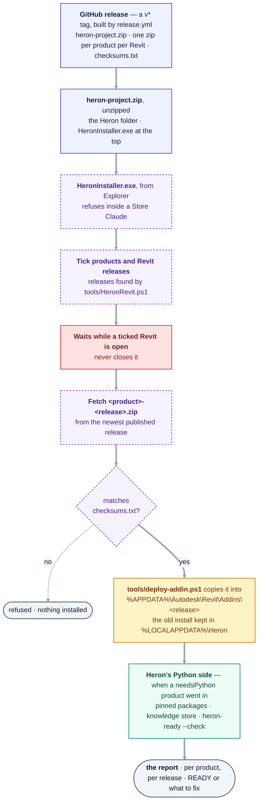

# 07 — Installation & Update

> Derived from [Master Specification](00-master-specification.md) §8, §9, §10, §11, §52.
> **[NOTE]** blocks are engineering commentary added during review.

---

## 1. Target install experience

1. User installs Claude Code.
2. User points Heron AI to a workspace folder.
3. Heron detects the environment.
4. Heron checks installed Revit versions.
5. Heron checks required dependencies.
6. Heron installs required packages.
7. Heron builds required components.
8. Heron deploys the Revit Add-in.
9. Heron configures MCP.
10. Heron registers Heron tools.
11. Heron Brain is initialised.
12. RAG database is initialised.
13. Required skills are installed.
14. Required fragments are indexed.
15. Health checks are performed.
16. User is told installation is complete.

The user never hand-edits configuration unless they deliberately enter Developer Mode.

**[NOTE]** 2026-10-17 — **steps 5, 6, 8, 11, 12 and 15 are one run of the installer now**, on the owner's
ask that day, DRAFT. **Run on the owner's laptop on 2026-10-17 and 2026-10-18 from a local build of
`main`**, not yet from a published release: READY, the packages installed for his user and the knowledge
store built, and a Python outside 3.11 to 3.14 refused by name
([NEEDS-CHECKING Group EP](needs-checking/group-ep.md), EP1 to EP3).
After the add-in goes in for each Revit, `HeronInstaller.exe` and `heron-install` set up Heron's Python
side when a product that talks to a chat was installed: the pinned packages in
[`requirements-lock.txt`](../requirements-lock.txt) with `pip --user --require-hashes`, the knowledge store
through `tools/heron-ready.py`, and `heron-ready --check` as the health check
([`PythonSetup`](../platform/Heron.Installer/PythonSetup.cs)). It is **asked, not done unasked** - the
window and the command say what Install will do before it is pressed, [Q-39](OPEN-QUESTIONS.md)'s rule and
[section 9](#9-self-healing-52)'s *missing dependency → install → confirm* - and it installs packages
only, never Python itself. Step 9 is unchanged: `.mcp.json` ships in the folder. Signing (Stage 8) is
left until Heron is finished, by the owner's word the same day.

### The installer as built — one run, from the release to READY

Checked against [`release.yml`](../.github/workflows/release.yml), the window's
[`Program.cs`](../platform/Heron.Installer.App/Program.cs),
[`InstallEngine`](../platform/Heron.Installer/InstallEngine.cs),
[`ReleaseDownload`](../platform/Heron.Installer/ReleaseDownload.cs) and
[`ReleaseAssets`](../platform/Heron.Installer/ReleaseAssets.cs),
[`WindowsAdapters`](../platform/Heron.Installer/WindowsAdapters.cs) and
[`PythonSetup`](../platform/Heron.Installer/PythonSetup.cs). `heron-install` runs the same engine with
the ticks given on its command line.



<details>
<summary>Same thing as plain text</summary>

```text
GitHub release (v* tag, release.yml)  heron-project.zip, <product>-<release>.zip each, checksums.txt
  -> heron-project.zip, unzipped      the Heron folder; HeronInstaller.exe at the top
  -> HeronInstaller.exe from Explorer refuses inside a Microsoft Store Claude (Q-63)
  -> tick products and Revit releases releases found by tools/HeronRevit.ps1
  -> wait while a ticked Revit is open never closes it
  -> fetch <product>-<release>.zip    from the newest PUBLISHED release (a draft is not one)
  -> matches checksums.txt?           no  -> refused, nothing installed
                                      yes -> tools/deploy-addin.ps1 copies it into
                                             %APPDATA%\Autodesk\Revit\Addins\<release>\<folder>,
                                             the old install kept in %LOCALAPPDATA%\Heron\install-backup
  -> Heron's Python side              only when a product with needsPython went in:
                                      pinned packages, knowledge store, heron-ready --check
  -> the report                       per product, per release
```

</details>

**Two branches the diagram leaves out.** A Heron folder that already holds a build of Heron for any
release installs from its builds and downloads nothing — the developer's and the offline route
(`InstallerScreen.AnythingBuilt`). And
`heron-install --no-python` leaves the Python side out. **What has run:** the download half from the
published v0.1.0 ([Group AC](needs-checking/group-ac.md), 2026-10-08) and the whole flow from a local
build of `main` on the owner's laptop ([Group EP](needs-checking/group-ep.md), 2026-10-17 and
2026-10-18) — not yet from a published release that carries the Python half.

## 1a. The user journey — what actually happens

**[NOTE]** Added 2026-08-27 from the owner's question: *someone sees this on GitHub, opens Claude Code,
adds a folder, pastes the link, and it installs itself — is that right?*

Mostly. Three corrections, one of which matters a great deal.

### The flow, corrected

```text
1.  Install Claude Code                          once, ever
2.  Install the Heron plugin                     one documented command
3.  Heron detects Revit 2020-2027                which versions are present
4.  "Close Revit so I can install the add-in"    mandatory - see below
5.  Heron deploys the add-in per version         per-user, no admin rights
6.  Start Revit -> ribbon -> Heron (toggle)      explicit, by design
7.  Open a project folder in Claude Code         THIS is the workspace
8.  Work
```

### Correction 1 — **do not "paste a link and let it run"**

> *"They copy the link, paste it, and run it."*

This is the one to change, and it is not a style preference.

*Point an AI at a URL and let it execute whatever it finds there* is the exact shape of a supply-chain
attack. It is also the pattern a contractor's IT department is trained to refuse — and Heron's users
work at contractors. For a tool that **writes to live client models**, it is the wrong first impression
and the wrong precedent.

It also contradicts Heron's own rules. [Golden Rule 19](14-golden-rules.md) says no text Heron reads
may raise its own permission level. A pasted URL whose contents become instructions is precisely that,
performed by the user's own hand.

**Instead: one documented command that fetches a signed release.** The user reads the command in the
README before running it, the command is the same for everyone, and what it downloads is a **versioned
release artefact** — not whatever the default branch happens to say today.

| Pattern | Verdict |
|---|---|
| *"Paste this URL and let the AI do what it says"* | **No.** Arbitrary instruction execution |
| *"Run this documented command, which installs release v0.1.0"* | **Yes.** Auditable, versioned, repeatable |

### Correction 2 — **the folder is the project workspace, not the installation**

> *"Everything will be downloaded into that folder… then it will search from this folder."*

Two different things are being conflated, and separating them is
[D-17](DECISIONS.md) and [06 §2](06-heron-platform.md):

| What | Where | Why |
|---|---|---|
| **Heron's code** | the plugin location | Replaced wholesale on update. The user never edits it |
| **Heron's brain** — skills, fragments, learned patterns, audit log | `%APPDATA%\Heron` for the add-in's settings and audit; `%USERPROFILE%\.heron` for the Python side's knowledge store, project memory and audit since [D-135](decisions/D-135.md) | **The user's.** Must survive every update, uninstall and folder deletion |
| **Runtime state** — bridges, logs, caches | `%LOCALAPPDATA%\Heron` | Machine-local, rebuildable, safe to delete |
| **The project folder** | wherever the user opens | **Project scope** — this project's standards, decisions and notes |

If everything lived in the project folder, then deleting a finished project would destroy a year of
accumulated knowledge. That is the exact failure the product / data / derived split exists to prevent.

**What the folder is genuinely for:** BIM work *is* per project, so a per-project workspace is right.
It holds Project-scope knowledge ([10](10-memory-and-knowledge.md)) and keeps one client's decisions
out of another's. Opening a different folder should change **which project Heron is working on** — not
which Heron is running, and not what it has learned.

### Correction 3 — **download a release, do not build on the user's machine**

Already settled in section 3 below, but it bears repeating here because the pasted-link flow implies it:
building needs the .NET SDK, MSBuild and Revit API assemblies. A BIM modeller on a locked-down corporate
laptop has none of those and cannot install them without a ticket.

**CI builds; the user downloads.** The source stays available for anyone who wants to build it — that is
what open source means — but nobody has to.

### What the owner got right

- **Claude Code is the entry point.** That is [D-01](DECISIONS.md).
- **Installation is automatic after that one command.** Detect Revit versions, install, deploy, verify —
  the user is never asked to edit a config file.
- **"Close Revit first" is mandatory, not politeness.** Assemblies loaded into Revit cannot be unloaded,
  so an installer that copies over a running add-in silently fails or half-updates
  ([section 7](#7-note-update-rules)). `deploy-addin.ps1` already refuses when Revit is running.
- **Connecting stays explicit.** A Revit that was never connected is invisible to every chat
  ([00e](00e-field-notes-proven-bridge.md)). That is a safety property, not friction — nothing reaches a
  model the user did not offer up.

### Two audiences, two flows

| | **BIM user** | **Developer** |
|---|---|---|
| Gets Heron by | the release download, `heron-project.zip`, prebuilt and unsigned — [WHAT-TO-INSTALL](WHAT-TO-INSTALL.md) | `git clone`, build from source |
| Needs | Claude Code, Revit, **Python** *([Q-39](OPEN-QUESTIONS.md))* | Claude Code, Revit, **Python**, .NET SDK |
| Add-in deployed by | **`HeronInstaller.exe`, and nothing else** — [D-96](DECISIONS.md) — run from outside the Claude app ([Q-63](OPEN-QUESTIONS.md)) | `tools/setup.ps1`, or `tools/deploy-addin.ps1` for one release |
| Sees | *"Selected 126 ducts in Tower-A"* | agent chains, logs, the build pipeline |

**THE RIGHT-HAND COLUMN DOES NOT WORK FOR THE LEFT-HAND ONE, AND THAT WAS FOUND BY DOING IT.**
[D-96](DECISIONS.md), from `AA9` on 2026-09-21. Windows marks everything that arrives through a
browser, and the common `RemoteSigned` execution policy **refuses to run a downloaded unsigned script
at all** — so somebody who downloads Heron cannot run `deploy-addin.ps1`, and the error they get says
*"is not digitally signed"* without ever mentioning the download. The `Unblock-File` that would clear
the mark is **inside the script being refused**, so it cannot save itself.

**The installer walks past this**, because it launches PowerShell with `-ExecutionPolicy Bypass` —
which is now load-bearing rather than a convenience. **A `git clone` is not a download**, carries no
mark, and is why the developer column is unaffected.

**[NOTE — open]** The exact plugin install command must be verified against current Claude Code plugin
documentation before it goes in the README. Publishing an install command that does not work is worse
than publishing none. [Q-38](OPEN-QUESTIONS.md) is answered as far as it can be — deferred to
publication ([D-42](DECISIONS.md)). Meanwhile a modeller's route is the release download and
`HeronInstaller.exe`, which needs no command at all.

---

## 2. Installation Agents

| Agent | Responsibility |
|---|---|
| Installation Orchestrator | Controls the whole workflow |
| Environment Detection | Windows, Revit versions, .NET, dependencies, workspace, storage, runtimes |
| Revit Installation | Add-in installation |
| Revit Deployment | Build and deploy the add-in |
| MCP Installation | Install and configure MCP |
| Dependency | Check and install dependencies |
| Configuration | Create required configuration |
| Brain Initialization | Initialise Heron Brain |
| RAG Initialization | Vector DB, indexes, embedding config, knowledge directories |
| Health Check | Verify everything works |

---

## 3. **[NOTE — significant]** Step 7 is the problem: "Heron builds required components"

Building the Revit add-in on the user's machine requires the .NET SDK, MSBuild, and the Revit API assemblies (`RevitAPI.dll`, `RevitAPIUI.dll`) for each target version. On a BIM modeller's locked-down corporate laptop, none of that is present and installing it may require IT approval.

It also contradicts the core promise: a user who must install a build toolchain has become a developer.

**Recommendation: do not build on the user's machine.**

| | Build on user machine | Ship prebuilt binaries |
|---|---|---|
| Toolchain required | .NET SDK, MSBuild, Revit SDK | None |
| Install time | Minutes, fragile | Seconds |
| Failure modes | Many, hard to diagnose remotely | Few |
| Fits the user promise | No | Yes |

Build in **CI** (GitHub Actions), produce a signed artefact per Revit version, and have the installer copy the right one. The build path stays available in Developer Mode for people extending Heron.

This makes step 7 disappear from the normal user's install, which is exactly what §1 of the spec asks for.

**Built this way.** [`.github/workflows/release.yml`](../.github/workflows/release.yml) builds one zip
per product per Revit release when a `v*` tag is pushed, through `tools/build-release-assets.py`, and
`HeronInstaller.exe` copies the right one ([D-96](DECISIONS.md)). The first release,
[v0.1.0](https://github.com/Ajmalpshaik/Heron-AI/releases/tag/v0.1.0) of 2026-10-08, was built and
uploaded by that workflow. **It is not signed**: signing is Stage 8, left until Heron is finished on the
owner's word.

---

## 4. **[NOTE]** Revit API assemblies cannot be redistributed

`RevitAPI.dll` and `RevitAPIUI.dll` are Autodesk's and are not redistributable. In CI they must come from either the official NuGet packages that exist for this purpose, or from a licensed installation. They are referenced with `<Private>false</Private>` / *Copy Local = false* so they are never shipped — Revit supplies them at runtime.

Worth confirming early, because it constrains the CI design.

---

## 5. **[NOTE]** Admin rights

Per-user add-in deployment (`%AppData%\Autodesk\Revit\Addins\<version>\`) needs no administrator rights. Per-machine (`%ProgramData%`) does.

Default to per-user. In a large contractor's environment, an installer that demands admin rights simply does not get installed.

---

## 6. Update system

Periodically checks the official Heron source and determines: installed version, latest version, changed components, compatibility, required migrations, security updates.

> *"A new Heron AI update is available. Update now?"*

Must support: version detection, download, dependency update, component update, migration, validation, **rollback**.

## 7. **[NOTE]** Update rules

1. **Never auto-update without consent.** A tool that silently changes behaviour mid-project is a liability during a submission.
2. **Never update while Revit is open with unsaved work.** Check first.
3. **The add-in update needs a Revit restart** — assemblies loaded into Revit cannot be unloaded. Say so plainly; do not report success for something that has not taken effect in memory.
4. **Back up the data class before migrating it.** Fragments, skills and memory are irreplaceable.
5. **Rollback must be tested**, not merely implemented. An untested rollback path is not a rollback path.
6. **Never touch the data class during a product update.** See [06 §2](06-heron-platform.md).
7. **Version pinning.** A user mid-delivery must be able to say "not now" and stay pinned without being asked again every day.

## 8. **[NOTE]** Migration is the hard part

Fragment schema, skill metadata, registry format and the vector index format will all change. Every change needs a forward migration, and each migration must be:

- **idempotent** (safe to run twice),
- **versioned** (the data records the schema version it was written with),
- **reversible or backed up**.

The vector index is the easy case — it is derived, so the migration is "delete and rebuild". Fragments and memory are the real work.

---

## 9. Self-healing (§52)

| Condition | Response | Permission |
|---|---|---|
| MCP disconnected | reconnect | automatic |
| missing dependency | install | confirm |
| stale index | rebuild | automatic |
| invalid fragment | quarantine | automatic |
| duplicate fragment | merge **proposal** | confirm |
| failed code | send to repair workflow | automatic (sandbox only) |
| outdated package | update **proposal** | confirm |

**[NOTE]** The split above is the safe reading of "controlled self-healing": Heron may freely repair **derived** state (indexes, caches, connections) and may freely *propose* anything else. It may not silently modify **product** or **data** state. Quarantine is the right default for a broken fragment — reversible, visible, and it stops the bad fragment being used without destroying it.

---

## 10. THE FIRST REAL INSTALL — 2026-09-19, on the owner's PC, all three releases

**[NOTE]** This section supersedes every earlier claim in this document about what has and has not been
installed. Until this date Heron had been *deployed* many times and had never been **installed and
started like a product**: built from a named commit, placed by the documented script, started by a
person, and checked against what Revit itself recorded. Everything above was reasoning about text.
This is the run.

`tools/check-package.py` has always ended by naming four questions it cannot answer, and saying that a
green run there is not an install and must never be reported as one. **All four are now answered, on
Revit 2020, 2024 and 2027, with evidence Revit wrote rather than evidence Heron wrote about itself.**

### 10.1 The arrangement

| | |
|---|---|
| Machine | the owner's PC — Windows 11 Pro 10.0.26200, user `AjmalAlavudheen` |
| Rights | **not elevated.** Checked with `WindowsPrincipal.IsInRole(Administrator)` → `False`, before and after |
| Commit | `48ae1dc` |
| Built with | .NET SDK 10.0.303, `dotnet build -c Debug -p:RevitVersion=<release>` |
| Placed by | `tools/deploy-addin.ps1`, the documented path, one release at a time |
| Releases | 2020, 2024 and 2027 — every Revit on the machine |

Each release was built **separately** and deployed before the next was built, because the build output
folder is shared and the newest build wins the search. That is not a precaution invented here; it is the
failure recorded in `deploy-addin.ps1`'s own comment from 2026-09-08, whose only symptom was *"Revit
cannot run the external application Heron AI"* with nothing to say why.

### 10.2 What was installed, and how each was checked to be the right thing

| Release | Runtime, read back from the deployed file | Assembly SHA-256 | `deps.json` |
|---|---|---|---|
| 2020 | `.NETFramework,Version=v4.7.2` | `2B3FA216843451A07E7C3B2CAF14F1223574048F9A5A3D2616A82E18BDB6B3E5` | absent — correct |
| 2024 | `.NETFramework,Version=v4.8` | `8A3922C3D7D3BD85CE0F223AF7DD1953A8F902B9853C1E34C6F4BDE18B72B90A` | absent — correct |
| 2027 | `.NETCoreApp,Version=v10.0` | `5B5935C869AB6F6480D6B45D8103FCB0ADC1465CE7D083950AB2DC7141C58A20` | present, `v10.0` |

The runtime was read out of the **deployed** bytes, not out of the build log — for 2020 and 2024 from
the target-framework moniker in the assembly, for 2027 from `runtimeTarget.name` in the deployed
`deps.json`. Three different runtimes across three releases is the thing `docs/16` promises and the
thing a single-release test can never show.

**A gap in the deploy script's own guard, found by doing this and worth knowing about.** The guard
separates builds by whether a `deps.json` exists, which distinguishes .NET from .NET Framework — so it
catches a 2027 build going into 2024. **It cannot tell net472 from net48**, because neither emits one.
A 2024 build deployed into 2020 would pass every check in the script. It did not happen here — the
monikers above were read back per release and are correct — but the guard is narrower than it looks,
and nothing else stands behind it.

> **It happened on 2026-09-20, and the guard was replaced the same day.** A session built for 2024 and
> deployed for 2020; the script said *Deployed* and `.NETFramework,Version=v4.8` went into
> `Addins\2020`. Caught by reading the assembly, not by anything in the script. `deploy-addin.ps1` now
> reads the `TargetFrameworkAttribute` out of the assembly it is about to copy and refuses on any
> disagreement, which covers all eight releases and both pairs the old proxies could not separate. Six
> cases were run to prove it - see **Group Z** in [NEEDS-CHECKING](NEEDS-CHECKING.md). **The paragraph
> above stays as written**, because it is the record of the gap being spotted a day before it bit.

### 10.3 Question 1 — the add-in actually loads, on each release

**Answered YES on all three.** Revit's own journal, not Heron's log:

```text
2020   journal.0447.txt   API_SUCCESS { Starting External Application: Heron AI,
                            Class: Heron.Revit.Addin.HeronApplication,
                            Vendor : AJPS(Ajmal PS - Heron AI),
                            Assembly: Heron\Heron.Revit.Addin.dll }

2024   journal.0136.txt   API_SUCCESS { Starting External Application: Heron AI, ...
                            Assembly Version: 0.1.0.0 }

2027   journal.0012.txt   API_SUCCESS { Starting External Application: Heron AI, ...
                            Assembly Version: 0.1.0.0 }
```

**The ribbon built on all three.** Each journal records the same three buttons registering, and names
the file each came from:

| Button id | text | class |
|---|---|---|
| `HeronBridgeToggle` | Heron | `Heron.Revit.Addin.ConnectCommand` |
| `HeronStatus` | Bridge Status | `Heron.Revit.Addin.StatusCommand` |
| `HeronWriteToggle` | Changes | `Heron.Revit.Addin.WriteToggleCommand` |

with `parentId: CustomCtrl_%CustomCtrl_%Heron AI%Bridge%HeronBridge` — tab **Heron AI**, panel
**Bridge**. Both event registrations succeeded too (`ViewActivated`, `DocumentClosing`).

> **Those two labels changed on 2026-09-20 and this paragraph is left as it was.** It is the journal's
> own wording on the day it was read, and a proof is not edited after the fact
> ([Golden Rule 4](14-golden-rules.md)). What a journal written today would say instead is
> `%Heron%AI Bridge%` - tab **Heron**, panel **AI Bridge**, per
> [D-85](DECISIONS.md). The three button ids and their texts are unchanged, so the table above still
> reads true. Looking at the new labels in Revit is `Z1` in [NEEDS-CHECKING](NEEDS-CHECKING.md).
**No journal contains *"cannot run the external application"*.** Heron's own log agrees, three lines:

```text
2026-09-19 20:21:24Z  Heron loaded. Revit 2024, add-in 0.1.0.0, pid 36216.
2026-09-19 20:24:01Z  Heron loaded. Revit 2020, add-in 0.1.0.0, pid 23928.
2026-09-19 20:25:24Z  Heron loaded. Revit 2027, add-in 0.1.0.0, pid 21620.
```

### 10.4 Question 4 — Revit discovers the manifest from the per-user folder

**Answered YES on all three, and this is the strongest evidence of the four**, because Revit names the
path itself rather than being asked about it. Every pushbutton line above carries its assembly:

```text
assembly: C:\Users\AjmalAlavudheen\AppData\Roaming\Autodesk\Revit\Addins\<release>\Heron\Heron.Revit.Addin.dll
```

Three further checks, because one line naming a path is not the same as nothing else being able to
supply it:

1. **Nothing per-machine exists to shadow it.** `%ProgramData%\Autodesk\Revit\Addins` and the `AddIns`
   folder of each of the three Revit installations were searched for anything named `Heron*`. All four
   locations: nothing. The per-user manifest is the only one on the machine.
2. **The deployed file is the one held open.** While each Revit ran, opening its deployed
   `Heron.Revit.Addin.dll` for write failed — Revit has *that* copy locked, not another.
3. **Revit 2027 says it outright**, in two lines no other release emits:

```text
The add-in folder 'C:\Users\AjmalAlavudheen\AppData\Roaming\Autodesk\Revit\Addins\2027\Heron'
  was registered for the context 'DEFAULT'.

[Jrn.AddInManifest] Rvt.Attr.AddInManifest: Heron.addin
  Rvt.Attr.AddInType: ExternalApplication   Rvt.Attr.AddInName: Heron AI
  Rvt.Attr.AddInVersion: 0.1.0.0            Rvt.Attr.CommandVendorId: AJPS
  Rvt.Attr.AddInCodeSigningStatus: Unsigned
  Rvt.Attr.AddInLoadFailureMessage: NoError  , 0.248000
```

`AddInLoadFailureMessage: NoError`, in 0.248 seconds, from a manifest called `Heron.addin` in the
per-user folder. That is the question answered in Revit's own words.

**And the no-admin promise in [section 5](#5-note-admin-rights) held.** Six deploys, three rollbacks and
three uninstall-and-restore cycles, all writing only to `%APPDATA%` and `%LOCALAPPDATA%`, from a
non-elevated shell. **No UAC prompt appeared at any point.**

### 10.5 Question 2 — an upgrade over a previous version keeps the user's settings

**Answered YES on all three.** Every release already had an install on it, so each deploy *was* an
upgrade rather than a first install. `%APPDATA%\Heron\config\heron.config` was hashed before and after
each one:

```text
SHA-256  9FC06D52CEBB099977BF0EBF9C68389652D717A84A9F536351ADBDF7FBC7FB39
```

**That hash is unchanged across all six deploys** — 2020, 2024 and 2027, twice each. The file's own
first lines say *"Owned by you. Never overwritten by an update"*, and that is now measured rather than
asserted. It carries `write.enabled = true`, which is the switch [D-19](DECISIONS.md) puts writing
behind — `HeronPermissions` refuses `MODIFY` and above without it. An update silently resetting it is
exactly the failure this question exists for.

**[NOTE]** `tools/heron-backup.py` cites this as *"docs/12 section 9"*. There is no section 9 in
[12](12-security-and-permissions.md) — it has six — and that document never mentions `write.enabled`.
The citation was stale, was repeated here from it on 2026-09-19, and was caught by `check-docs.py`
refusing the dead link. Corrected in both places to [D-19](DECISIONS.md), which is where the rule
actually lives.

The rest of the data class was counted too, and did not move:

| | before | after |
|---|---|---|
| `audit/` | 3 files, 4,049,586 bytes | 3 files, 4,049,586 bytes |
| `knowledge/` | 4 files, 4,235,331 bytes | 4 files, 4,235,331 bytes |

This is the product/data split from [06 §2](06-heron-platform.md) doing its job: `deploy-addin.ps1`
writes only inside `Addins\<release>\Heron`, and never reaches the folder holding the user's own work.

### 10.6 Question 3 — a rollback recovers a working install

**Answered YES on all three — but only after building the thing that makes it possible, because it did
not exist.** See [section 10.8](#108-the-defect-this-run-found) for what was wrong and why it went
unnoticed. Filed as row 147 in [FRAGMENT-ISSUES.md](FRAGMENT-ISSUES.md).

The test is a real round trip, not a file copy checked by eye. For each release: a **genuinely
different build** was made (`-p:Version=0.1.1`) and deployed over the good one, standing in for an
update that turns out badly; then `-Rollback`; then every file compared.

| Release | good build | bad build deployed over it | after rollback | files restored | files differing |
|---|---|---|---|---|---|
| 2020 | `2B3FA216…` 0.1.0.0 | `C119604C…` 0.1.1.0 | `2B3FA216…` 0.1.0.0 | 22 | **0** |
| 2024 | `8A3922C3…` 0.1.0.0 | `6E712353…` 0.1.1.0 | `8A3922C3…` 0.1.0.0 | 22 | **0** |
| 2027 | `5B5935C8…` 0.1.0.0 | `D34B37DF…` 0.1.1.0 | `5B5935C8…` 0.1.0.0 | 15 | **0** |

Every file in the deployed folder was hashed and compared, not just the add-in assembly — so the
restored `deps.json` on 2027, the four ribbon icons and all the dependency assemblies are included in
the zero. The manifest came back on all three. `heron.config` was unchanged throughout.

**The counts differ on purpose.** 22 files on the .NET Framework releases against 15 on 2027, because
2020 and 2024 carry the `System.*` compatibility assemblies that .NET 10 has in the box, and 2027
carries a `deps.json` that they do not. A rollback that restored the same number of files everywhere
would mean it was not really reading what was there.

**What this does not prove**, said plainly because [section 7](#7-note-update-rules) rule 5 is about
exactly this: it proves the *files* come back. A rollback is only complete when the restored install
also loads, and the restored install is byte-identical to the one proved in 10.3 — so it loads for the
same reason that one did. It is not an independent observation, and no release was restarted a second
time to make it one.

### 10.7 End to end, beyond the four questions — 2024

The four questions stop at *installed*. The owner then connected from the ribbon and the whole path was
exercised:

```text
20:22:00Z  Bridge listening on heron.2024.36216. Newest connection takes the pipe ...
20:22:00Z  Connected from the ribbon.

$ python mcp/client/heron_bridge_client.py ping
pong  <-  Revit 2024, session 36216   (2 ms)
          add-in 0.1.0.0, protocol 2
```

He also used the **Changes** button on Revit 2020 — `Write permission set to False from the ribbon`,
then `True` two seconds later. That is the ribbon proving itself: a button that was found, drawn well
enough to click, and wired to something real.

### 10.8 The defect this run found

**Nothing could roll back the add-in, and Heron's own update gate refused to ship without proof that
something could.**

- `tools/heron-backup.py` protects `%APPDATA%\Heron` — the **data** class. It has never touched the
  add-in.
- `tools/deploy-addin.ps1` overwrote the previous install with `Copy-Item -Force` and **kept nothing**.
- `brain/heron_update.py` **refuses** any release whose `rollback_tested` is absent or thin, with
  `ROLLBACK_NOT_TESTED` and the words *"a claim, not a test"*.

So the product class — the one thing an update actually replaces — was the one thing with no way back,
while the gate demanded a rollback test that nothing in the repository could perform. A `grep` for
`rollback` across every `.ps1`, `.py` and `.cs` returns plenty in the fragments and in `heron_update.py`
and nothing at all in the deploy path.

**Why it stayed hidden is the part worth keeping.** `heron-backup.py` is thorough, well argued, and has
a `drill` command that passes — it was run here first and reported *"the restore path works"*. It does,
for what it covers. The word *backup* existing in the repository, attached to something that genuinely
worked, is what made the missing half invisible. A guard that passes while the thing beside it is
absent reads as coverage.

**Fixed in `tools/deploy-addin.ps1`**, and proved in 10.6:

- every deploy now copies the install it is about to replace into
  `%LOCALAPPDATA%\Heron\install-backup\<release>\`, with a `replaced.json` recording the release, the
  UTC time, the assembly version, its SHA-256 and the file count;
- `-Rollback` puts it back and verifies what was **written** rather than what was intended, the same
  way the deploy path does;
- `-Remove` takes a backup first, because an uninstall is what somebody reaches for when things are
  already going wrong;
- the copy is taken at the **last** moment before overwriting, after every other check has passed, so a
  run that throws on the wrong build flavour does not spend the rollback point on a no-op.

**Two limits, stated rather than discovered later.** The copy is **one deep** — an update that has gone
wrong twice running is a case for rebuilding from source, not for a longer history. And it lives in
`%LOCALAPPDATA%`, which is machine-local and not roamed: **losing the profile or the disk loses it**,
and the way back from that is `dotnet build` and deploy again. Calling it a backup of the product would
overstate it; the product's real home is git. It is the previous install, kept so that an update which
turns out badly has somewhere to go at the moment it is noticed.

**The `-Remove` path gained a guard it never had.** The running-Revit check now covers remove and
rollback as well as install. It did not before: `Remove-Item` on an assembly Revit has loaded fails
part-way through the folder, leaving a partial install and reading as *"the uninstall went wrong"*
rather than *"close Revit first"*.

### 10.9 Four observations recorded because they will be rediscovered otherwise

1. **`Assembly version conflict in some references in Heron.Revit.Addin.dll`** appears in the 2024 and
   2027 journals as `API_ERROR`. **It is not a Heron fault and it is not fatal.** The same line appears
   in the same startup for roughly thirty other add-ins, including Autodesk's own Precast, Energy
   Analysis, Structural Ribbon and Results Builder, plus Enscape, DiRoots ProSheets and AJ Tools. Heron
   loaded and registered all three buttons immediately after it. Anyone grepping a journal for `ERROR`
   will find this first and should not stop there.
   **Not harmless on a .NET Revit (2025 on) when the module named is the C# compiler** - found
   2026-10-17, [row 5b-575](fragment-issues/section-5b-rows-401-425.md): on Revit 2026 the line read
   *"Microsoft.CodeAnalysis of version 4.8.0.0 conflicts with same preloaded module of version 4.14.0.0"*,
   and every fragment then failed to compile. On 2020 and 2024 the same line meant nothing. **Repaired in
   code the same day, not yet run in Revit** ([group GW](needs-checking/group-gw.md)): on 2025 and later
   Heron's compiler loads in a load context of its own, so the line - if Revit still prints it - should
   mean nothing there either; GW7 records whether it does.
2. **Revit 2027 records `AddInCodeSigningStatus: Unsigned`.** It loaded anyway, and no release refused
   it. But 2027 is the release that bothers to say so, and the trend across Revit versions is toward
   caring more rather than less. Worth knowing before a release is cut, not after.
3. **Stale bridge files linger.** `%LOCALAPPDATA%\Heron\bridges` held two files naming dead processes
   (`0.1.0-testhost`, PIDs long gone) alongside the live one. **The client chose correctly anyway** —
   `ping` answered from session 36216, the real one — so this is an observation and not a defect. It
   would become one if anything ever picked a bridge file without checking the process is alive.
4. **Revit 2020's journal is less informative than 2024's and 2027's**, and the difference is the
   journal, not the add-in: it omits `Assembly Version:` from the external-application line and leaves
   the pushbutton `name:` field empty. Do not read either absence as something failing on 2020.

### 10.10 What is still not proved

Answering these four questions does not finish [section 6](#6-update-system). The following remain, and
none of them was attempted here:

- **A real update over the wire.** Everything above deploys from a local build. Version detection,
  download, and the *"A new Heron AI update is available"* consent flow have never run. *(Since: the
  download and the version check have run - below. An update to a newer version, and its consent, have
  not.)*
- **A migration.** [Section 8](#8-note-migration-is-the-hard-part) is the hard part and no fragment,
  skill, registry or index migration has ever been written or run. Question 2 proves an upgrade leaves
  settings **untouched**; it says nothing about an upgrade that must legitimately **change** them.
- **Version pinning.** Rule 7 — a user mid-delivery saying *"not now"* and staying pinned — has no
  implementation to test.
- **The install command itself.** [Q-38](OPEN-QUESTIONS.md) is still open: the plugin install command
  in the README is unverified, and everything above starts from a git clone and a `dotnet build`. **The
  developer path is proved; the BIM user's path is not.** *(Since: Q-38 is answered only as far as
  "deferred to publication" - [D-42](DECISIONS.md) - so the plugin command is still unverified, and a
  modeller's route is the release download and `HeronInstaller.exe`, whose download half has run -
  below.)*

**What has run since, recorded in the register rather than here.**

- **2026-10-08, the published release** ([Group AC](needs-checking/group-ac.md)): `heron-project.zip`
  downloaded from v0.1.0 and unzipped into an empty folder, then `heron-install.exe --releases 2027
  --products heron-bridge` with no `--from` - *"Files come from Heron's published release"*, *"1
  installed, 0 failed"*, and the version check *"This is the newest published version (0.1.0)"*. Revit
  2027 loading those published bytes was **not seen** - it stopped at Autodesk licensing - and the
  window's own Install (`AC2`) was not run.
- **2026-10-17, the owner's laptop** ([Group EP](needs-checking/group-ep.md), EP1): `HeronInstaller.exe`,
  built locally from `main`, fetched v0.1.0's add-in from the published release, checked each zip against
  its `checksums.txt`, installed it into Revit 2020, 2024, 2026 and 2027 and set up Heron's Python side;
  Revit 2026 then loaded Heron and connected from the ribbon.
- **2026-10-18, the laptop again** ([Group EP](needs-checking/group-ep.md), EP3): a Python 3.10 and a 3.15,
  each put first on the path for one run, were refused by name with the command that fixes it. Still
  from a local build: the only published release is v0.1.0, which carries no Python half.

So the download half of the BIM user's path has run. An update to a newer version - there is none yet -
with its consent, a migration and version pinning have not.
