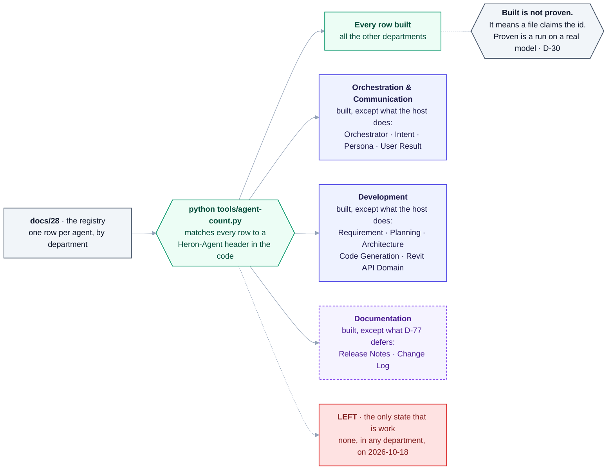

# 08 — Agent Catalogue

> Every agent named in the [Master Specification](00-master-specification.md), consolidated by department.
> Tier column is an engineering recommendation (see [02 §6](02-architecture-overview.md)), not part of the original spec:
> **T1** = deterministic service, no model call · **T2** = single scoped LLM call · **T3** = full agentic loop.
>
> This is a **target organisation chart**, not a v1 backlog. See [ROADMAP.md](ROADMAP.md) for what actually gets built first.
>
> **For the full list — every agent, what it does, its tier, risk level and build step — see
> [28 — The Complete Agent Registry](28-agent-registry.md).** This document explains the *shape*;
> that one is the reference table.
>
> **As built (2026-10-18):** the registry, not this catalogue, is what the code is counted against.
> `python tools/agent-count.py` prints, per department and per tier, how many of its rows are built,
> provided by the host ([D-01](DECISIONS.md), [D-80](DECISIONS.md)), deferred by a decision, or left - so
> no such number is typed on this page. **"Built" there means a file claims the id and its tests pass**
> ([37 §4](37-the-provider-adapter.md)); it is not a proof against a real Revit ([D-30](DECISIONS.md)).

## At a glance — the departments and their state

As `python tools/agent-count.py` sorted the registry on 2026-10-18. It prints the numbers; the picture
only names the departments that are not simply *every row built*. [28](28-agent-registry.md) has the
same as a table.



**Blue is Claude Code** doing the work in the chat, on purpose ([D-01](DECISIONS.md),
[D-80](DECISIONS.md)); it is never counted as work left. **Dashed is waiting on a decision**, not on
anybody's time.

<details>
<summary>Same thing as plain text</summary>

```text
docs/28 (one row per agent) -> python tools/agent-count.py (rows matched to Heron-Agent headers)
  -> every row built ............ all the other departments
  -> Orchestration & Communication: built, except what the host does
       (Orchestrator, Intent, Persona, User Result)
  -> Development: built, except what the host does
       (Requirement, Planning, Architecture, Code Generation, Revit API Domain)
  -> Documentation: built, except Release Notes and Change Log, deferred by D-77
  -> LEFT, the only state that is work: none, in any department, on 2026-10-18
Built is not proven: it means a file claims the id. Proven is a run on a real model (D-30).
```

</details>

---

## Summary

| Department | Spec § | Agents |
|---|---|---|
| Orchestration & Communication | §45, §50, §51 | 5 |
| Installation | §9 | 10 |
| Revit | §12, §13 | 23 |
| MCP | §14 | 11 |
| Fragment lifecycle | §19–23, §25 | 6 |
| RAG | §26 | 15 |
| Knowledge Import & Migration | §29 | 14 |
| Naming & Taxonomy | §31 | 7 |
| Folder Architecture | §32 | 12 |
| GitHub | §36 | 10 |
| Agent lifecycle / self-growth | §37, §39, §70 | 8 |
| Development | §41 | 18 |
| BIM Standards | §46 | 9 |
| Background | §49 | 1 |
| Documentation | §63 | 8 |
| **Total (before de-duplication)** | | **~157** |

Several names appear in more than one department (Duplicate Detection, Migration, Validation, Agent Creator, Agent Trainer, Backup). The table counts the specification's own lists; the distinct agents, after de-duplication and with the rows added since, are the registry's - `python tools/agent-count.py`.

---

## Which agents belong to which build step

> Added 2026-08-27. The catalogue answers *what exists*; this answers *what to build now*.
> Build order: [27](27-build-order.md).

**The whole of Phase 0 and Phase 1 needs a small part of the registry** — `python tools/agent-count.py`
prints how many rows carry a build step, and how they stand. The rest are not deferred out of caution;
they have nothing to act on until the layers below them exist.

The table below names the principal agents per step. The authoritative per-agent assignment is the
**Step** column in [28 — The Complete Agent Registry](28-agent-registry.md).

| Step | Agents built | Tier |
|---|---|---|
| **1 — prove the pipe** | MCP Server, MCP Connection, Revit Connection, Revit Version | all T1 |
| **2 — thread hop** | Revit Application, Revit Document, Revit Transaction *(skeleton only)* | all T1 |
| **3 — MCP server** | MCP Tool Registry, MCP Health, Revit Plugin Health | all T1 |
| **4 — first BIM answer** | Revit Selection, Revit Category, Revit Element · **Intent**, **Communication/Persona** | T1 + two T2, both the host's ([D-01](DECISIONS.md)) |
| **5 — multi-Revit** | MCP Recovery, MCP Version, MCP Compatibility | all T1 |
| **6 — first write** | **Transaction Safety**, Revit Context, Revit Warning, MCP Security, Failure Analysis | all T1 — Failure Analysis was T2 until [D-21](DECISIONS.md) |

**Every agent in that table is T1 except two** — plain deterministic modules with no model call at
all. Only Intent and Persona reason, and both are the host's ([D-01](DECISIONS.md)), so Heron builds
neither. Failure Analysis was the third until [D-21](DECISIONS.md) made it a table of Heron's own
error codes.

### Why the agents cannot be built first

**[NOTE]** A natural question: *build the agent layer first, then assign agents to each phase.* The
definitions should indeed exist first — and they do. But **building** them first does not work, for
three reasons the mapping above makes concrete:

1. **Most agents are not a separate build.** Most of them are T1 services
   ([02 §6](02-architecture-overview.md); `python tools/agent-count.py` gives the split by tier) — they *are* the implementation of steps 1–6, not a layer
   added afterwards. Building the Revit Selection Agent **is** building step 4. There is no separate
   "agent work" to schedule.
2. **An agent with nothing beneath it is a text file.** A Revit Selection Agent calls an MCP tool, which
   calls the bridge, which marshals onto the Revit thread. Until steps 1–2 exist there is nothing for it
   to call, and no way to test whether its contract is right.
3. **Contracts written before first contact are wrong.** [The field notes](00e-field-notes-proven-bridge.md)
   are the proof: the connect-time snapshot, the stale document name, the active-document hazard — none
   were predictable from a specification. They were found by running the software. An agent contract
   written before step 2 would encode the same wrong assumptions, and then every one of them would
   need revising instead of the handful a step touches.

This is also the explicit instruction closing [Part 4](00d-additional-requirements.md):

> *"Don't start by building 100+ agents. Build the Kernel, Registry, Orchestrator, Workflow Engine, RAG,
> Fragment/Skill system, MCP/Revit layer, and QA foundation first. Then Heron can create and add
> specialized agents safely as the platform grows."*

**What is right in the instinct:** agents should be **defined** and **assigned** before implementation,
so work is scoped rather than improvised. That is exactly what this catalogue and the table above are
for. The rest arrive when the Capability Gap report ([06 §6](06-heron-platform.md)) shows real
demand — built from usage, not from a list.

---

## Orchestration & Communication

| Agent | Tier | Responsibility |
|---|---|---|
| Orchestrator | T2 | Central coordinator — understand, select, sequence, validate, return. **The host's** ([D-01](DECISIONS.md)) |
| Intent Agent | T2 | Classify what the user is asking for. **The host's** ([D-01](DECISIONS.md)) |
| Communication / Persona Agent | T2 | Detect persona and technical level; choose response style. **The host's** ([D-01](DECISIONS.md)) |
| Failure Analysis Agent | T1 | Determine why something failed. **T1, not T2, since [D-21](DECISIONS.md)**: Heron's failures are its own bounded set of codes |
| Fix Agent (selected per failure) | T3 | Apply a targeted repair |

## Installation (§9)

Installation Orchestrator (T1) · Environment Detection (T1) · Revit Installation (T1) · Revit Deployment (T1) · MCP Installation (T1) · Dependency (T1) · Configuration (T1) · Brain Initialization (T1) · RAG Initialization (T1) · Health Check (T1)

**All T1.** Installation is deterministic. Nothing here should ever cost a model call.

## Revit (§12, §13)

Connection · Document · Application · UI · Ribbon · Selection · Element · Category · Parameter · Family · View · Workset · Link · Transaction · Warning · Performance · Export · Import · API · Version · Compatibility · Deployment · **Plugin Health**

All **T1** except **Revit API Agent (T2)**, which reasons about correct API usage for novel operations.

## MCP (§14)

Connection · Server · Tool Registry · Configuration · Health · Authentication · Version · Compatibility · Recovery · Logging · Security

**All T1.** Transport must never require a model call.

## Fragment lifecycle (§19–23, §25)

| Agent | Tier | Responsibility |
|---|---|---|
| Fragment Validation Agent | T2 | Correctness, API, versions, deps, metadata, duplication, reusability |
| Fragment Performance Agent | T1 | Success, failure, timing, corrections, reuse, error frequency |
| Fragment Split Agent | T3 | Decompose a compound fragment into reusable units |
| Fragment Merge Agent | T2 | Detect and propose merging near-identical fragments |
| Fragment Evolution Agent | T3 | Keep / improve / adapt / version-branch / split / merge / deprecate |
| Regression Testing Agent | T1 | Build and test every supported version; reject unsafe changes |

## RAG (§26)

Librarian · Knowledge Discovery · Retriever · Fragment Matcher · Skill Matcher · Ranking · Context Builder · Embedding · Vector Search · Index Manager · Re-index · Duplicate Detection · Knowledge Validation · Citation/Source · Knowledge Evolution

Mostly **T1**; Fragment Matcher, Skill Matcher and Knowledge Validation are **T2**; Knowledge Evolution is **T3**.

## Knowledge Import & Migration (§29)

Import · File Discovery · Content Classification · Fragment Extraction · Skill Extraction · Metadata Extraction · Duplicate Detection · Compatibility · Migration · Rename · Architecture Matching · Validation · Indexing · Approval

Extraction and classification are **T2/T3** — this is genuine judgement work over unstructured input. Discovery, indexing and rename are **T1**.

## Naming & Taxonomy (§31)

Naming · Naming Validation · Auto Rename · Taxonomy · Keyword · Metadata · Reference Update

**T1** except Naming and Taxonomy (**T2**).

## Folder Architecture (§32)

Workspace Architect · Folder Creation · Folder Validation · Folder Repair · File Placement · Template · Path Manager · Migration · Cleanup · Backup · Restore · File Registry

**All T1.** Cleanup, Repair and Migration are `MODIFY`-gated and dry-run by default.

## GitHub (§36)

GitHub · Repository · Branch · Commit · Pull Request · Issue · Release · Version · Change Detection · Community Contribution

**All T1** except Commit (T2, for message generation) and Community Contribution (T2).
Push / PR / Release are `PUBLISH`-level and require explicit per-action confirmation.

## Agent lifecycle & self-growth (§37, §39, §70)

| Agent | Tier | Responsibility |
|---|---|---|
| Agent Creator | T3 | Decide whether a new agent is needed; design and generate it |
| Agent Evaluator | T2 | Assess an agent's real performance |
| Agent Trainer | T2 | Supply standards, rules, examples before activation |
| Agent Registry | T1 | System of record for every agent |
| Agent Optimizer | T2 | Improve an existing agent |
| Agent Retirement Agent | T1 | Retire with history preserved and rollback possible |
| Architecture Monitor | T2 | Detect architectural drift |
| Capability Gap Agent | T1 | *"X is needed repeatedly and no agent covers it."* |

**Capability Gap Agent is the highest value / lowest cost agent in the catalogue** — it is a report over the audit log and should be built early. See [06 §6](06-heron-platform.md). *As built: it was, on 2026-09-07 — [`brain/heron_gaps.py`](../brain/heron_gaps.py), served as `heron_gaps`.*

## Development (§41)

Requirement · Planning · Architecture · Code Generation · C# · .NET · Revit API · Code Review · Security Review · Build · Unit Test · Integration Test · Revit Test · Regression Test · Performance · QA · Documentation · Release

Build and the test runners are **T1**. Requirement, Architecture, Code Generation, Code Review, Security Review and QA are **T2/T3**.

**[NOTE]** `C# Agent`, `.NET Agent` and `Revit API Agent` overlap heavily and are strong candidates for merging into a single **Code Domain Agent** with retrieval over three knowledge sets. Three near-identical agents is exactly the duplication the Fragment Merge Agent exists to prevent — the same discipline should apply to agents themselves. *As built: the registry split the `.NET Agent` three ways by risk instead ([28](28-agent-registry.md), "When to split an agent"), and the Revit API Domain Agent is the host's ([D-80](DECISIONS.md)).*

## BIM Standards (§46)

BIM Standard · Company Standard · ISO Standards · Naming Standard · Modeling Standard · QA/QC Standard · LOD · Documentation Standard · Project Standard

**T2**, all of them citation-bound: no indexed source, no claim (§47).

## Background (§49)

Background Scheduler Agent — **T1**. Priorities P0 (user task) through P5 (cleanup). User work always wins.

## Documentation (§63)

API Docs · Agent Docs · Skill Docs · Fragment Docs · Release Notes · Architecture Docs · README · Change Log

**T1** where generated from registries and metadata; **T2** only for prose.

---

## **[NOTE]** How to read this catalogue

**Most agents are T1** — ordinary deterministic modules. Many are a single class with a handful of methods.

The things that are "AI agents" in the expensive sense are the **T2** and **T3** rows, a small minority: `python tools/agent-count.py` prints how many of each the registry holds. That is a tractable number, and it is the number that determines running cost and latency.

Framing the catalogue this way turns an intimidating agent architecture into: a normal application of deterministic services, some narrow model calls, and fewer still genuine agentic workflows.
