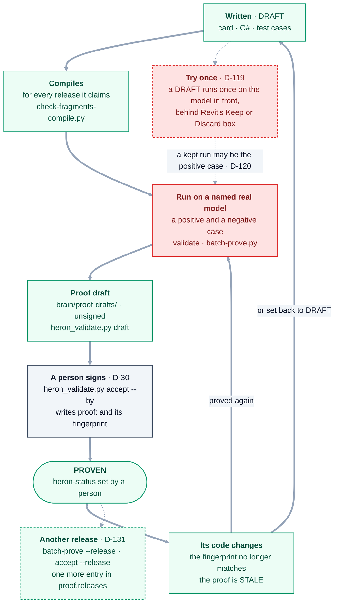

# 09 — Skills & Fragments

> Derived from [Master Specification](00-master-specification.md) §16–25, §30, §42.
> **[NOTE]** blocks are engineering commentary added during review.

---

## 1. The distinction

The spec uses both terms extensively but never defines the boundary. Proposed definition, to be confirmed:

| | **Skill** | **Fragment** |
|---|---|---|
| Answers | *What the user can ask for* | *How it is actually done* |
| Audience | User-facing | Internal |
| Example | "Select Ducts" | `filter-elements-by-category`, `get-active-selection`, `set-selection` |
| Cardinality | One skill uses many fragments | One fragment serves many skills |
| Named in | BIM language | Technical capability language |
| Changes when | The user's need changes | The API or implementation changes |

A skill is a **capability the user recognises**. A fragment is a **reusable implementation unit**. The generic `Select Elements` fragment in §21 is reused by Select Ducts, Select Pipes, Select Cable Trays, Select Equipment and Select Doors — five skills, one fragment.

Tracked as [Q-8](OPEN-QUESTIONS.md).

> **As built (2026-10-18):** answered by
> [D-29](DECISIONS.md#d-29--a-fragment-is-a-composable-piece-not-a-whole-answer). The skill is
> confirmed as proposed, and the fragment is a composable piece with a declared contract. A third kind,
> the **recipe**, is named for a job that genuinely cannot be composed. Skills are
> [`brain/skills/*.yaml`](../brain/skills/). They name **capabilities, never fragments**, so a fragment
> can be replaced without editing a skill. The chat gets a skill's ordered steps from `heron_method`.
> Fragments are reached by capability through `revit_read`, `revit_show` and `revit_change`
> ([04 §3](04-heron-mcp.md#3-note-tool-granularity--the-central-mcp-design-decision)).

### 1.1 Skill, capability, fragment

As built (2026-10-18). The example is the real `select-elements` skill, with two of the capabilities
its `needs:` lists.

```mermaid
%%{init: {"themeVariables": {"edgeLabelBackground":"#F1F5F9","lineColor":"#94A3B8","textColor":"#0F172A","tertiaryTextColor":"#0F172A"}}}%%
flowchart LR
    U(["<b>You ask for a job</b><br/><i>select all the ducts</i>"])
    HM["<b>heron_method</b><br/>gives the chat<br/>the steps, in order"]
    SK["<b>Skill</b> · select-elements<br/>your words · steps · needs"]
    C1["<b>Capability</b><br/>FILTER_ELEMENTS_BY_CATEGORY"]
    C2["<b>Capability</b><br/>SET_SELECTION"]
    F1["<b>Fragment</b> · FRG-ELE-001<br/>card + C#"]
    F2["<b>Fragment</b> · FRG-SEL-001<br/>card + C#"]
    AD["<b>Revit add-in</b><br/>compiles and runs it"]

    U ==> HM ==>|reads| SK
    SK ==>|needs| C1 & C2
    C1 ==>|provided by| F1
    C2 ==>|provided by| F2
    F1 & F2 ==>|revit_read · show · change| AD

    classDef user fill:#F1F5F9,stroke:#475569,stroke-width:1.5px,color:#0F172A
    classDef brain fill:#ECFDF5,stroke:#059669,stroke-width:1.5px,color:#064E3B
    classDef addin fill:#FEF3C7,stroke:#D97706,stroke-width:1.5px,color:#78350F
    class U user
    class HM,SK,C1,C2,F1,F2 brain
    class AD addin
```



**A skill and a capability are words in files; only the fragment is code.** The skill names the
capability, and which fragment provides it is looked up when it runs - so a fragment can be replaced,
split or retired and no skill changes.

<details>
<summary>Same thing as plain text</summary>

```text
You ask for a job        "select all the ducts"
   |
heron_method             gives the chat the steps, in order
   |  reads
Skill                    brain/skills/select-elements.yaml - your words, the steps, `needs:`
   |  needs
   +-- Capability FILTER_ELEMENTS_BY_CATEGORY  -- provided by -->  Fragment FRG-ELE-001
   +-- Capability SET_SELECTION                -- provided by -->  Fragment FRG-SEL-001
   +-- the rest of its `needs:`                (not drawn)
                                                                       |
                                     revit_read / revit_show / revit_change
                                                                       |
                                                        Revit add-in compiles and runs it
```

</details>

| Word | What it is | Where it lives |
|---|---|---|
| **Skill** | A job a modeller recognises, in their own words: `utterances`, the steps (`purpose`), `preconditions`, and `needs` - capabilities, never fragment ids | [`brain/skills/<id>.yaml`](../brain/skills/). `python brain/heron_skill.py` validates them and says whether every capability they need is provided |
| **Capability** | What is to be done, as one name in capitals - `SET_SELECTION`. Not stored as a record of its own: its risk, its releases and its best status are derived from the fragments that provide it ([D-40](DECISIONS.md#d-40--the-dependency-graph-is-sqlite-and-an-edge-is-derived-before-it-is-stored)) | The `capability:` line of each `fragment.yaml`; [`heron_capability.py`](../brain/heron_capability.py) |
| **Fragment** | How it is done: a card - identity, contract, risk, the releases it claims, its proof - and C# for every release it claims. Its kind is `filter`, `action` or `recipe` (D-29) | [`brain/fragments/<name>/`](../brain/fragments/): `fragment.yaml`, `impl/any/fragment.cs`, `tests/cases.yaml` |
| **`heron_method`** | Hands the chat one skill's whole method: the steps in order, what must be true first, and each capability with its risk and status on this Revit, or why it cannot run here | `heron_brain.method`, served by [`heron_mcp_server.py`](../mcp/server/heron_mcp_server.py) |
| **`heron_lookup`** | Turns your words into a capability, and names the jobs it is one step of | [05 §4.1](05-heron-brain.md#41-how-heron-finds-the-right-tool-for-your-words) |
| **`revit_read` · `revit_show` · `revit_change`** | Run a capability's fragment in Revit, through the door its declared risk allows | [04 §3](04-heron-mcp.md#3-note-tool-granularity--the-central-mcp-design-decision); the add-in's [`RevitFragment.cs`](../revit/Heron.Revit.Addin/RevitFragment.cs) |

**When a capability has more than one provider, two parts of Heron choose differently.**
`heron_capability.resolve` - which `heron_resolve`, `heron_method` and `heron_capabilities` use - orders
the providers by status, `PROVEN` first, then by id, and given a Revit release leaves out a provider not
declared for it. The three `revit_` doors read the cards on disk and take the first folder, by name,
whose `capability:` matches (`_fragment_for` in `heron_mcp_server.py`). The two agree while every
capability has one provider; `grep -h '^capability:' brain/fragments/*/fragment.yaml | sort | uniq -d`
prints any capability that has more.

---

## 2. Skill metadata

```text
Skill ID
Name
Description
Domain
Required Agents
Required Fragments
Revit Versions
.NET Versions
Dependencies
Risk Level
Status
Success Rate
Created Date
Updated Date
```

**[NOTE]** Add: **Example utterances** (what the user might actually say) and **Preconditions** (document open, elements selected, worksharing state). Utterances drive matching quality directly; preconditions let Heron fail early with a useful message instead of failing deep inside a transaction.

> **As built (2026-10-18):** both additions were taken. Every skill file carries `utterances` and
> `preconditions`, beside `needs`, the capabilities it uses. `python brain/heron_skill.py` validates the
> skills and counts them.

---

## 3. Fragment content

A fragment is not a snippet of code. It carries:

purpose · inputs · expected output · implementation · API requirements · dependencies · version compatibility · validation rules · usage history · success rate · failure history · related fragments · related skills

## 4. Knowledge identity (§30)

```text
Fragment ID
Semantic Identity
Domain
Capability
Version
Dependencies
Metadata
History
```

Identity is **never the filename**. Rename the file and Heron still knows it is the same knowledge object.

**[NOTE]** Recommendation on storage format: **one folder per fragment**, containing a metadata file (YAML front-matter or JSON), the implementation(s), and tests. Human-readable, git-diffable, mergeable, and reviewable in a pull request. A fragment stored only as a database row cannot be code-reviewed, and code review is the mechanism §40 depends on.

Version-specific implementations live side by side:

```text
fragments/select-elements-by-category/
  fragment.yaml            <- identity, metadata, compatibility
  impl/net48/...           <- Revit 2020-2024
  impl/net8/...            <- Revit 2025+
  tests/
  history.jsonl            <- usage, success, failure
```

> **As built (2026-10-18):** one folder per fragment, as recommended, under
> [`brain/fragments/`](../brain/fragments/). The layout differs in two ways:
>
> ```text
> brain/fragments/<name>/
>   fragment.yaml            <- identity, contract, risk, revit:, runtime:, utterances, proof
>   impl/any/fragment.cs     <- one implementation for every release
>   tests/cases.yaml
> ```
>
> - **There are no per-runtime folders.** Where releases differ, the one file branches on the compile
>   symbols (`REVIT2024_OR_GREATER` and the rest, [16](16-version-support-strategy.md)). Check with
>   `ls brain/fragments/*/impl/ | sort | uniq -c`.
> - **There is no `history.jsonl`.** What ran is in the audit trail and the run records
>   ([`HeronRuns.cs`](../platform/Heron.Core/HeronRuns.cs)), and a fragment's proof is the `proof:` block
>   of its own `fragment.yaml`.
>
> `python brain/heron_fragment.py` validates every card and counts them.

---

## 5. Fragment lifecycle

```text
DISCOVERED -> DRAFT -> TESTING -> VALIDATED -> PROVEN -> PRODUCTION -> DEPRECATED -> ARCHIVED
```

> A fragment should not automatically become production knowledge simply because it worked once.

**[NOTE]** The spec gives the states but not the **gates**. Without explicit criteria, promotion becomes a judgement call an agent will make inconsistently. Proposed gates:

| Transition | Gate |
|---|---|
| DISCOVERED → DRAFT | Has identity + metadata + a stated purpose |
| DRAFT → TESTING | Has tests; passes Fragment Validation |
| TESTING → VALIDATED | Tests pass on **every declared supported version** |
| VALIDATED → PROVEN | N successful real executions, zero unexplained failures, no user corrections *(N to be set — suggest 10)* |
| PROVEN → PRODUCTION | **Human approval.** Explicit, recorded, one person |
| any → DEPRECATED | Replaced, unreliable, or incompatible |
| DEPRECATED → ARCHIVED | After a retention period; never deleted |

The `PROVEN → PRODUCTION` human gate is the fragment-level equivalent of the agent-approval boundary in [06 §4](06-heron-platform.md). It is the point where knowledge starts being trusted without review, and it should cost one human click.

Tracked as [Q-9](OPEN-QUESTIONS.md) for the value of N and who may approve.

> **As built (2026-10-18): superseded by
> [D-30](DECISIONS.md#d-30--a-fragment-is-promoted-by-one-recorded-proof-not-by-a-count-of-runs), not
> a count.** A fragment is promoted on **one recorded proof against a real model**. The proof has a
> positive case, a negative case, and a second route to the answer where one exists, and the person who
> ran it signs it with their name and the date. Its fingerprint makes it stale the moment the code
> changes. The statuses in use are `DRAFT` and `PROVEN`. Count each with
> `grep -h '^heron-status:' brain/fragments/*/fragment.yaml | sort | uniq -c`. No fragment is
> `PRODUCTION`. At run time, `revit_change` keeps a change only from a fragment whose proof still stands
> ([D-117](DECISIONS.md#d-117--a-change-is-kept-only-from-a-fragment-whose-proof-still-stands)). A
> DRAFT may run once on the model in front, behind Revit's Keep or Discard box, and the modeller judges
> that run
> ([D-119](DECISIONS.md#d-119--a-draft-fragment-may-run-once-on-the-model-in-front-behind-a-keep-or-discard-prompt-in-revit-and-article-11-says-so),
> [D-122](DECISIONS.md#d-122--under-article-19-the-modeller-judges-a-drafts-one-run-and-the-agent-that-wrote-it-only-starts-it)).
> Unifying the status words is still only proposed
> ([D-14](DECISIONS.md#d-14--unify-six-status-vocabularies-into-two-orthogonal-axes)).

### 5.1 A fragment's life

As built (2026-10-18), read from [`heron_fragment.py`](../brain/heron_fragment.py),
[`heron_validate.py`](../brain/heron_validate.py), [`batch-prove.py`](../tools/batch-prove.py) and
[`check-signatures.py`](../tools/check-signatures.py). How to arrange a proof that means something is
the [`fragment-proving`](../.claude/skills/fragment-proving/SKILL.md) skill.



**Solid arrows are the way to PROVEN and back; dotted arrows are the two side doors, and the dashed
boxes are optional.** Nothing on the machine side writes `heron-status`: `accept` writes only the proof,
`batch-prove` stops the batch if any status moved, and the step to PROVEN is a person's edit. Nothing
sets a stale fragment back to DRAFT by itself either - the checks in the table fail until a person
proves it again or sets it back.

<details>
<summary>Same thing as plain text</summary>

```text
Written, DRAFT          card, C#, test cases
   |
Compiles                for every release its card claims - tools/check-fragments-compile.py
   |
Run on a named          a positive and a negative case, recorded -
real model              heron_bridge_client.py validate, or tools/batch-prove.py for many
   |
Proof draft             brain/proof-drafts/, `by:` left empty - heron_validate.py draft
   |
A person signs (D-30)   heron_validate.py accept --by "Name" - writes `proof:` and its fingerprint
   |
PROVEN                  heron-status set by a person; check-signatures.py fails a signature left unused
   |
Its code changes        fingerprint no longer matches -> the proof is STALE
   +-- proved again ---------------> back to "Run on a named real model"
   +-- or set back to DRAFT -------> back to "Written"

Side doors
  DRAFT  ..> Try once (D-119)        runs once on the saved model in front, behind Keep or Discard;
                                      a kept run may be the positive case of a proof (D-120)
  PROVEN ..> Another release (D-131) batch-prove --release, then accept --release:
                                      one more entry in proof.releases
```

</details>

| Step | Command | What it refuses or catches |
|---|---|---|
| **Written** | `python brain/heron_fragment.py` | A card that is not well-formed; a `PROVEN` one with no proof, or one whose proof no longer matches its code |
| **Compiles** | `python tools/check-fragments-compile.py`, run by CI's compile job | C# that will not build for a release the card claims, or that does not leave what its contract `provides`. A compile is not a proof |
| **Run on a real model** | `python mcp/client/heron_bridge_client.py validate <fragment>`, or `python tools/batch-prove.py jobs.yaml` for many | `batch-prove`: a fragment already `PROVEN` (`ALREADY`), a positive case that never moved off zero, and any `heron-status` that moved during the batch |
| **Proof draft** | `python brain/heron_validate.py draft <slug> --from <run-record.json>` | A case the run did not contain - written `NOT ESTABLISHED`, never filled in. `by:` is left empty, so an unsigned draft cannot pass validation |
| **Signed** | `python brain/heron_validate.py accept <slug> --by "Name"` | Writes `proof:` only, reads the file back, and restores it if `heron-status` moved ([D-30](DECISIONS.md#d-30--a-fragment-is-promoted-by-one-recorded-proof-not-by-a-count-of-runs)) |
| **PROVEN** | A person edits `heron-status:`; `python tools/check-signatures.py`, a CI gate | Fails on a signed `DRAFT` whose code has not changed and was never promoted (`UNUSED`). A signed `DRAFT` whose code changed since is reported `STALE`, not failed; one held on purpose carries `proof-held:` |
| **Stale** | `python brain/heron_fragment.py`; `tests/test_fragment_store.py`; `revit_change` | A `PROVEN` card whose fingerprint no longer matches fails the first two, and `revit_change` will not keep its change ([D-117](DECISIONS.md#d-117--a-change-is-kept-only-from-a-fragment-whose-proof-still-stands)) |
| **Try once** | `python mcp/client/heron_bridge_client.py try-once <fragment>` | Anything but a `DRAFT` at risk `MODIFY`; a version already kept; a model that is not the one in front, or not saved ([D-119](DECISIONS.md#d-119--a-draft-fragment-may-run-once-on-the-model-in-front-behind-a-keep-or-discard-prompt-in-revit-and-article-11-says-so), [D-121](DECISIONS.md#d-121--d-84s-cost-is-read-again-a-never-proved-fragment-runs-only-on-a-saved-model-with-nothing-unsaved)) |
| **Another release** | `python tools/batch-prove.py jobs.yaml --release <year>`, then `heron_validate.py accept <slug> --release <year> --by "Name"` | A fragment not `PROVEN` or whose proof is stale; a release the card does not claim, or one already recorded; a run record naming another Revit (`WRONG RELEASE`) ([D-131](DECISIONS.md#d-131--a-proof-on-another-revit-release-is-an-entry-of-proofreleases-and-a-second-route-on-a-proven-fragment-is-written-by-accept-signed)) |

---

## 6. Fragment Split / Merge / Evolution

- **Split** (§21) — decompose a compound fragment into reusable units. Drives reuse.
- **Merge** (§22) — detect near-identical fragments; propose merge / replace / keep separate / deprecate.
- **Evolution** (§23) — decide: unchanged, improved, adapter, version-specific, split, merge, deprecate.

**[NOTE]** All three **propose**; none may apply autonomously to anything at `PRODUCTION`. Splitting a production fragment silently changes the behaviour of every skill that depends on it. These agents should open a proposal — in practice, a pull request — which is exactly what the GitHub department is for.

**[NOTE]** Split has a real failure mode: over-decomposition. Ten fragments each three lines long, with nine layers of indirection, is worse than one clear fragment. Suggested guard: a fragment should only be split when the extracted part has **at least two distinct consumers, actual or clearly imminent**. Reuse justifies a split; tidiness does not.

> **As built (2026-10-18):** all three propose and none applies.
> [`heron_split.py`](../brain/heron_split.py) proposes a split only where two real consumers exist,
> [`heron_merge.py`](../brain/heron_merge.py) proposes merge, replace, keep separate or deprecate, and
> [`heron_evolve.py`](../brain/heron_evolve.py) routes each verdict to the agent that owns it. Each
> returns a proposal and writes nothing. All are `DRAFT`, and no MCP tool reaches them.

---

## 7. Version compatibility (§24)

Every code-bearing fragment records its Revit and .NET compatibility, **determined from the build environment, never guessed**.

Compatibility is a **hard filter before ranking**, not a ranking signal. A fragment that does not support the running Revit version must be structurally unable to be selected. See [05 §8](05-heron-brain.md).

> **As built (2026-10-18):** each card declares `revit:` and `runtime:`, and retrieval's version filter
> leaves an incompatible fragment out rather than ranking it low
> ([05 §4](05-heron-brain.md#4-note-retrieval-is-not-only-vector-search)).
> `python tools/check-fragments-compile.py` compiles every fragment for every release, and
> `tools/check-api-surface.py` checks the Revit members they call. A compile is not a proof. Which
> releases a proof names is [NEEDS-CHECKING Group EQ](needs-checking/group-eq.md).

## 8. Regression testing (§25)

On every change to an existing fragment:

1. Identify supported versions
2. Build/test each supported implementation
3. Compare previous behaviour
4. Detect breaking changes
5. **Reject unsafe changes**
6. **Preserve the previous working implementation**

This is Golden Rule 4 made executable. See [13 — Testing & Quality](13-testing-and-quality.md).

> **As built (2026-10-18):** steps 1 and 2 are each card's `revit:` list and
> `tools/check-fragments-compile.py` (§7), which builds and does not run. Steps 3 to 6 are
> [`heron_regression.py`](../brain/heron_regression.py): it compares results it is handed against what
> the card claims, and refuses a claimed release with no result rather than counting it as passed.
> [`heron_buildmatrix.py`](../brain/heron_buildmatrix.py) compares the build matrix, release by release,
> with the recorded [`regression-matrix.json`](../brain/regression-matrix.json). Both are `DRAFT`, their
> suites run on test data, and no MCP tool reaches either.

---

## 9. Code generation rule (§42)

Generated code must know and follow: folder structure, naming conventions, metadata standards, coding standards, supported Revit versions, supported .NET versions, existing services, existing fragments, existing agents, dependency rules.

**Reuse existing approved components before generating anything new** (Golden Rule 3).

**[NOTE]** Enforce this mechanically rather than by instruction. Before the Code Generation Agent runs, the Fragment Matcher must have searched and reported. If a proven fragment covers ≥80% of the request, generation is not permitted to start from scratch — it must start from that fragment. Otherwise the knowledge base fills with near-duplicates, and the Merge Agent spends its life cleaning up after the Generation Agent.

> **As built (2026-10-18): enforced, without the percentage.** The Fragment Matcher answers `matched`,
> `partial` or neither, never a score. The Fragment Creation Agent refuses to author when either list is
> non-empty ([`heron_generate.py`](../brain/heron_generate.py),
> [`heron_matcher.py`](../brain/heron_matcher.py)). [PROPOSALS F24](proposals/f24.md) says why `partial`
> is stricter than *"≥80%"*. The host-side loop that searches first and then writes the fragment is the
> [`heron-fragment-author`](../.claude/agents/heron-fragment-author.md) subagent.

---

## 10. **[NOTE]** The runtime execution question

This is unresolved in the spec and it is architecturally decisive: **when Heron generates new code, how does that code actually run inside Revit?**

| Approach | How | Verdict |
|---|---|---|
| **A. Compile & load at runtime** | Roslyn compiles C#, assembly is loaded into Revit | Assemblies **cannot be unloaded** from .NET Framework (Revit ≤2024). Every iteration leaks. Version churn during development makes this painful. `AssemblyLoadContext` helps only on .NET 8 (Revit 2025+). |
| **B. Scripting layer** | Python (pyRevit / IronPython / Python.NET) or Roslyn *scripting* | Iterate freely, no assembly leak, fast feedback. Slower execution; needs a runtime dependency. |
| **C. Precompiled only** | Fragments ship as compiled, signed, tested assemblies | Safest and fastest. New capability requires a build + release cycle, so "Heron writes a new tool during the session" is not immediate. |
| **D. Hybrid** | Scripting for DRAFT/TESTING, precompiled for PRODUCTION | Iteration where it is needed, safety where it matters. |

**Recommendation: D.** It maps exactly onto the fragment lifecycle already specified — experimentation happens in a scripting sandbox, and the `PROVEN → PRODUCTION` gate is precisely where a fragment gets compiled, signed and shipped. The lifecycle in §18 turns out to *describe* this hybrid, which is a good sign the design is coherent.

The user's existing pyRevit work is directly relevant here and may already answer half the question.

Tracked as decision **D-04**, [Q-7](OPEN-QUESTIONS.md).

> **As built (2026-10-18):** [D-04](DECISIONS.md#d-04--generated-code-execution-hybrid) settled *hybrid*,
> and [D-28](DECISIONS.md#d-28--generated-code-is-c-compiled-at-run-time-in-process) named the runtime:
> **Roslyn C# scripting, in process, through the bridge**, with no Python runtime and no HTTP server in
> the add-in. Today every fragment, DRAFT or PROVEN, is compiled when it runs, inside Revit
> ([`RevitFragment.cs`](../revit/Heron.Revit.Addin/RevitFragment.cs)). The compile is cached by the
> fragment's source, so a changed fragment compiles fresh. On Revit 2025 and later the compiler is loaded
> into a load context of Heron's own ([revit/README](../revit/README.md)). The precompiled `PRODUCTION`
> half of the hybrid is not built, because no fragment is `PRODUCTION`.
