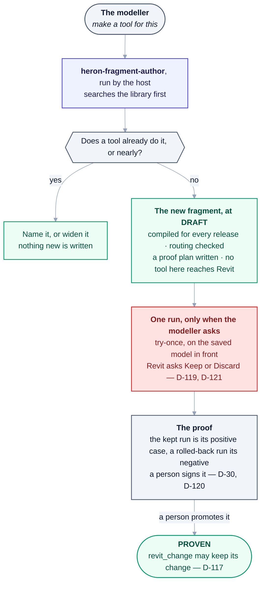
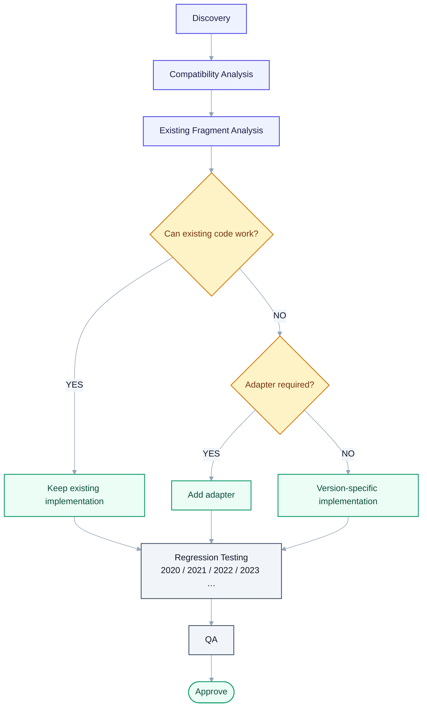

# 11 — Orchestration & Reference Workflows

> Derived from [Master Specification](00-master-specification.md) §48–52, §56, §58, §65–69.
> **[NOTE]** blocks are engineering commentary added during review.

---

## 1. Orchestrator responsibilities

1. Understand request → 2. Identify required capability → 3. Select relevant agents → 4. Build workflow → 5. Execute → 6. Handle failures → 7. Validate result → 8. Return result → 9. Trigger background learning.

The Orchestrator coordinates. It must not become the monolith.

**[NOTE]** The practical discipline: the Orchestrator may know about **capabilities and departments**. It must never know about **ducts, elevations or worksets**. The moment BIM domain knowledge appears in the orchestrator, every future change starts touching it, and it becomes the single file nobody dares edit.

---

## 2. Reference workflow — simple BIM task

User: *"Select all ducts."*

```text
Intent Detection -> BIM Persona -> Task Classification -> Fragment Librarian
-> Existing Fragment Found -> Compatibility Check -> Revit Connection Check
-> Execute -> Validate Selection -> Return Result -> Record Success
```

If an approved fragment exists, **reuse it**. Do not generate code (Golden Rule 3).

**[NOTE]** This is the path that must be fast, because it is 90% of real usage. Target after warm-up: **one T2 call (intent) and nothing else.** Everything downstream — fragment lookup, compatibility filter, execution, validation — is deterministic.

There is a further optimisation worth designing in: an **utterance cache**. The exact string "select all ducts" maps to a known skill after the first time. Subsequent identical requests skip intent detection entirely and cost nothing at all. Cache on normalised utterance + document context, invalidated when the skill changes.

> **As built (2026-10-18):** the steps are split between the host and Heron.
>
> ```text
> Claude Code (the host) -> what was meant                          (D-01; no persona, D-27)
> -> heron_lookup        -> the capability: version filter first,
>                           then identity / cache / keywords / meaning
> -> revit_read / revit_show / revit_change
>                        -> the add-in's gate, then the fragment compiled and run in Revit
> -> the answer          -> what Revit reported, with how far the fragment is proven
> ```
>
> A request in a PROVEN capability's declared words, with every value given, runs in that one door
> call ([04 §8.5](04-heron-mcp.md#85-one-request-fewer-turns--built-2026-09-30)). The utterance cache
> exists, but it returns a **candidate, never a decision**, and a wording is remembered only once its
> fragment has run and come back
> ([D-61](DECISIONS.md#d-61--only-a-run-that-came-back-may-be-cached-and-re-indexing-forgets-what-changed-underneath-it),
> [`heron_search.py`](../brain/heron_search.py)).

---

## 3. Reference workflow — new tool

User: *"Create a tool that automatically dimensions ducts."*

```text
Requirement -> Librarian -> Existing Skill/Fragment Search -> Architecture
-> Revit API -> .NET -> Code Generation -> Code Review -> Build -> Test
-> Revit Test -> Regression -> QA -> Fragment Creation -> Skill Creation
-> Documentation -> Approval -> Production
```

**[NOTE]** Eighteen stages, several of them T3. This is minutes of work and real cost, and that is appropriate — it is a genuine software delivery pipeline compressed into one request. But two things must be true or it will not be trusted:

1. **The user is told this is the expensive path**, up front: *"This needs a new tool. It'll take a few minutes — I'll build and test it, then show you before anything touches your model."*
2. **`Approval` is a human gate.** The pipeline may reach the door of production autonomously. A person opens it.

The pipeline should also be **resumable**. Failing at the Build stage after twelve stages of work must not discard everything before it.

> **As built (2026-10-18):** the new-tool path is the
> [`heron-fragment-author`](../.claude/agents/heron-fragment-author.md) subagent, run by the host. It
> searches first and widens an existing tool rather than adding a second. Then it writes the new
> fragment at DRAFT, compiles it for every Revit release, and checks its routing. None of its tools
> reaches Revit. The one run on the model is D-119's try-once, started only when the modeller asks for
> it in the chat. Revit then asks the modeller Keep or Discard
> ([D-119](DECISIONS.md#d-119--a-draft-fragment-may-run-once-on-the-model-in-front-behind-a-keep-or-discard-prompt-in-revit-and-article-11-says-so),
> [D-121](DECISIONS.md#d-121--d-84s-cost-is-read-again-a-never-proved-fragment-runs-only-on-a-saved-model-with-nothing-unsaved),
> [D-122](DECISIONS.md#d-122--under-article-19-the-modeller-judges-a-drafts-one-run-and-the-agent-that-wrote-it-only-starts-it)).
> The `Approval` gate is a person signing the proof
> ([D-30](DECISIONS.md#d-30--a-fragment-is-promoted-by-one-recorded-proof-not-by-a-count-of-runs),
> [D-120](DECISIONS.md#d-120--a-run-the-modeller-kept-after-checking-it-is-the-positive-case-of-a-proof-and-the-negative-case-is-still-its-own-rolled-back-run)).
> A job of several steps with fragments that already exist, such as building a family, is a method the
> chat reads from `heron_method` ([43](43-building-revit-families.md)).

The new-tool path as it runs, beside the eighteen stages above. Nothing in it reaches production without
a person, and the generated code meets a model once, behind the modeller's own Keep or Discard.



<details>
<summary>Same thing as plain text</summary>

```text
The modeller: "make a tool for this"
 -> heron-fragment-author, run by the host: searches the library first
 -> Does a tool already do it, or nearly?
      yes -> name it, or widen it; nothing new is written
      no  -> the new fragment, at DRAFT: compiled for every release, routing checked,
             a proof plan written; no tool here reaches Revit
          -> one run, only when the modeller asks: try-once on the saved model in front,
             Revit asks Keep or Discard (D-119, D-121)
          -> the proof: the kept run is its positive case, a rolled-back run its negative;
             a person signs it (D-30, D-120)
          -> a person promotes it -> PROVEN: revit_change may keep its change (D-117)
```

</details>

---

## 4. Reference workflow — knowledge import

```text
Import -> Scan -> Classify -> Extract -> Identify Fragments -> Compare Existing
-> Duplicate Check -> Compatibility Check -> Naming -> Architecture -> Migration
-> Validation -> Index -> Approval -> Save
```

See [10 §5](10-memory-and-knowledge.md) for the constraints — read-only source, reviewable manifest, everything enters at `DISCOVERED`.

---

## 5. Reference workflow — fragment update across versions



<details>
<summary>Same thing as plain text</summary>

```text
Discovery -> Compatibility Analysis -> Existing Fragment Analysis
-> Can existing code work?
     YES -> keep existing implementation
     NO  -> adapter required?
              YES -> add adapter
              NO  -> version-specific implementation
-> Regression Testing (2020 / 2021 / 2022 / 2023 ...) -> QA -> Approve
```

</details>

Existing versions must remain functional. This is Golden Rule 4.

> **As built (2026-10-18):** an adapter and a version-specific implementation are both branches inside
> the fragment's one `impl/any/fragment.cs`, on the compile symbols
> ([09 §4](09-skills-and-fragments.md#4-knowledge-identity-30)). The automatic part of regression testing
> is `python tools/check-fragments-compile.py`, which compiles every fragment for every release. A proof
> on a further release is an entry of `proof.releases`
> ([D-131](DECISIONS.md#d-131--a-proof-on-another-revit-release-is-an-entry-of-proofreleases-and-a-second-route-on-a-proven-fragment-is-written-by-accept-signed)),
> and a run that contradicts one is reported
> ([D-133](DECISIONS.md#d-133--a-run-that-contradicts-a-proofreleases-entry-is-reported-as-one-that-contradicts-the-proof-is)).
> `Approve` is a person's signature on the proof, never a machine's
> ([D-30](DECISIONS.md#d-30--a-fragment-is-promoted-by-one-recorded-proof-not-by-a-count-of-runs)).

---

## 6. Failure handling (§51)

```text
Task -> Agent A -> FAILED -> Failure Analysis -> Find reason
     -> Select Fix Agent -> Fix -> Re-test -> Validation -> Continue
```

> The system should not blindly retry the same failed action repeatedly.

**[NOTE]** Retry policy, made concrete:

| Failure class | Policy |
|---|---|
| **Transport** (pipe dropped, Revit busy) | Retry with backoff, bounded attempts |
| **Precondition** (no document open, nothing selected) | Do not retry. Tell the user what is missing. |
| **Permission** (element owned by another user) | Do not retry. Report and offer alternatives. |
| **Revit operation genuinely failed** | Do not retry. Send to Failure Analysis. |
| **Generated code failed** | Repair loop, **hard-capped** (suggest 3 attempts), sandbox only |

An unbounded repair loop against a live model is the worst failure mode in the system: it burns money, and each attempt is another chance to damage something. Cap it, then ask the user.

> **As built (2026-10-18):** failure analysis is a table, not a model call
> ([D-21](DECISIONS.md#d-21--failure-analysis-is-a-table-not-a-model-call),
> [`heron_failure.py`](../mcp/server/heron_failure.py)), and its refusals name the switch or step that is
> missing. The add-in tells *Revit is busy* apart from *the work is slow*
> ([03 §4](03-heron-revit.md#4-note--critical-the-revit-api-threading-constraint)). A modeller's
> **Discard** is their answer, not a fault, and is never retried
> ([Article 25](../HERON_CONSTITUTION.md)). A generated fragment gets one run on the model, not a repair
> loop (§3).

**[NOTE]** Failures are the highest-value training signal in the platform. Every failure should be recorded with enough structure for the Capability Gap Agent to aggregate: what was asked, what was selected, what failed, at which stage, and what the user did next. The single most useful report Heron can produce in month one is *"here are the ten things people asked for that I could not do."*

---

## 7. Background system (§48, §49)

Background work: update checking, dependency checking, vector indexing, re-indexing, duplicate detection, fragment scoring, fragment validation, fragment evolution, memory organisation, knowledge cleanup, agent health, plugin health, MCP health, compatibility checks, backup, log processing, performance analysis, documentation sync.

Scheduler priorities:

```text
P0 — User task
P1 — Required validation
P2 — Required maintenance
P3 — Knowledge improvement
P4 — Optimization
P5 — Cleanup
```

**[NOTE]** Three constraints the scheduler must respect, or background work will make Heron feel slow and get switched off:

1. **Never run P2–P5 while a user task is active.** Revit is single-threaded for API work and the user is already sharing that thread.
2. **Never run heavy background work while Revit is open.** Re-indexing competes for the same machine the user is modelling on. Idle time, or Revit closed, is the right window.
3. **Background work must be cheap.** Anything on a timer that costs money per run will eventually cost a surprising amount. This is another argument for local embeddings ([05 §6](05-heron-brain.md)).

> **As built (2026-10-18):** Part 2 widened this ladder to seven levels, P0 to P6
> ([21 §12](21-resilience-and-operations.md#12-background-workers-and-priority)). The queue and the
> scheduler use that ladder ([`heron_queue.py`](../brain/heron_queue.py),
> [`heron_scheduler.py`](../brain/heron_scheduler.py)). The scheduler fails closed: when it cannot tell
> whether a user task is running, background work waits. Both are DRAFT, and the MCP server calls
> neither (`grep -rn 'heron_queue\|heron_scheduler' mcp/`). The background work the server does today
> is its own start-up: it loads the search model and prepares the knowledge store before the first
> lookup ([04 §8.6](04-heron-mcp.md#86-a-chat-starts-ready--built-2026-10-01)).

---

## 8. Performance architecture (§56)

Not every agent runs for every request. The Orchestrator selects dynamically.

**[NOTE]** Worth setting explicit budgets now, so regressions are visible:

| Path | Target |
|---|---|
| Cached utterance → known skill | < 500 ms, zero model calls |
| Simple BIM task, warm | < 3 s, one model call |
| Simple BIM task, cold | < 10 s |
| Standards check over a model | minutes, with progress, cancellable |
| New tool creation | minutes, with progress, resumable, human approval |

If "select all ducts" ever takes 30 seconds, the platform has failed at its core promise regardless of how sophisticated the architecture underneath is. The user has a mouse. It is faster.
