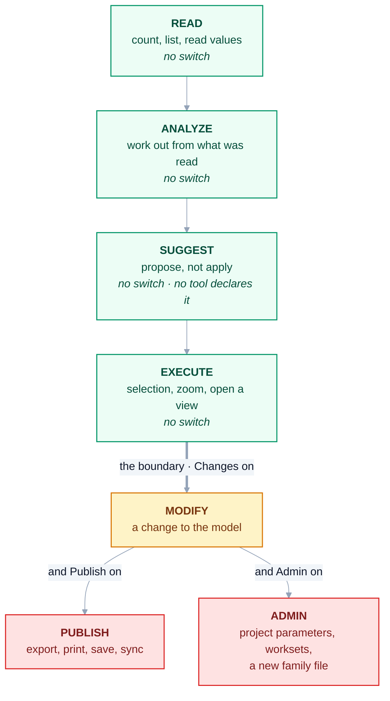
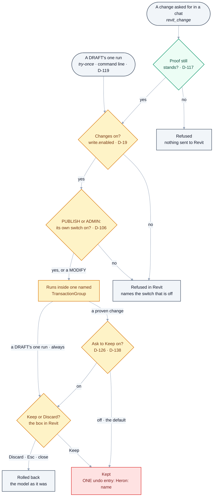

# 12 — Security, Permissions & Audit

> Derived from [Master Specification](00-master-specification.md) §53–55.
> **[NOTE]** blocks are engineering commentary added during review.

---

## 1. Permission levels

```text
READ
ANALYZE
SUGGEST
EXECUTE
MODIFY
PUBLISH
ADMIN
```

Normal BIM operations can be automated. High-risk operations require confirmation.

**[NOTE]** Proposed concrete mapping:

| Level | Meaning | Confirmation | Examples |
|---|---|---|---|
| `READ` | Observe only | none | count elements, read parameters, list views |
| `ANALYZE` | Compute over what was read | none | clash summary, standards check, model statistics |
| `SUGGEST` | Propose a change without applying it | none | "these 12 ducts breach the standard, here is the fix" |
| `EXECUTE` | Non-destructive model action | none | change selection, open a view, zoom |
| `MODIFY` | Changes the model | **preview + confirm** | move elements, set parameters, place families |
| `PUBLISH` | Leaves the machine | **explicit, per action** | git push, PR, release, community submission, export to a shared location |
| `ADMIN` | Changes Heron itself | **explicit, per action** | install package, modify core config, activate an agent, run arbitrary code |

The important boundary is `EXECUTE | MODIFY`. Everything above it changes something the user cares about and cannot always undo.

**[NOTE]** Built 2026-10-17: `EXECUTE` runs with Changes off from a chat — `revit_show`, and Revit's
temporary isolate as fixed operations ([04 §8.9](04-heron-mcp.md)). A selection or a zoom inside a linked
model is the same: not touching the link, so no confirmation ([D-124](DECISIONS.md)). **First seen in
Revit on 2026-10-18** (Revit 2024.3). A selection and a zoom through `revit_show` were not refused for
Changes and left the element count and the Undo list as they were (ES1). A view opened with Changes off
(ES9). Revit's temporary isolate, with Changes off, **does** add an Undo entry (ES3). Sources:
[NEEDS-CHECKING Group ES](needs-checking/group-es.md). The linked-model rows were not run.

> **As built (2026-10-18):** the seven levels are `HeronRisk` in
> [`HeronPermissions.cs`](../platform/Heron.Core/HeronPermissions.cs) and the same seven in
> [`heron_tools.py`](../mcp/server/heron_tools.py); `python mcp/server/heron_tools.py` lists every MCP
> tool with its level, and no tool declares `SUGGEST`. The *Confirmation* column is met by switches the
> owner sets on Revit's ribbon, read inside the add-in and all off by default in
> [`HeronConfig.cs`](../platform/Heron.Core/HeronConfig.cs): **Changes** (`write.enabled`) for
> `MODIFY` and above ([D-19](DECISIONS.md)), and **Admin** (`admin.enabled`) and **Publish**
> (`publish.enabled`), each on top of Changes ([D-106](DECISIONS.md)). As built, `PUBLISH` is a Revit
> export, print, save or sync, and `ADMIN` is project parameters, worksets, global parameters or a new
> family file — not the git, release and package actions the table names. With Changes on, a change
> asked for in a chat is kept at once as one undo entry unless **Ask to Keep** (`write.askBeforeKeeping`,
> off by default) is on, when Revit shows it and asks Keep or Discard ([D-126](DECISIONS.md),
> [D-138](DECISIONS.md)) — so `MODIFY`'s *preview + confirm* is the owner's switch, recorded as a break
> of [Golden Rule 17](14-golden-rules.md).

### 1a. The ladder and its switches — as built (2026-10-18)

This section adds pictures and tables beside the rule above. It does not change the rule. Read from
`HeronRisk` and `HeronPermissions.Allows` in
[`HeronPermissions.cs`](../platform/Heron.Core/HeronPermissions.cs), the defaults in
[`HeronConfig.cs`](../platform/Heron.Core/HeronConfig.cs), and `heron_tools.TOOLS`.



<details>
<summary>Same thing as plain text</summary>

```text
READ      count, list, read values           no switch
ANALYZE   work out from what was read        no switch
SUGGEST   propose, not apply                 no switch   (no tool declares it)
EXECUTE   selection, zoom, open a view       no switch   <- HeronPermissions.ReadOnlyCeiling
======================= the boundary =======================
MODIFY    a change to the model              Changes
PUBLISH   export, print, save, sync          Changes AND Publish
ADMIN     project parameters, worksets,      Changes AND Admin
          a new family file
```

</details>

**Each level, as built.** The *From a chat* column comes from `python mcp/server/heron_tools.py`, which
lists every tool with its level.

| Level | As built, it is | Switch it needs | From a chat, through |
|---|---|---|---|
| `READ` | count, list and read values; Heron's own library | none | `revit_read`, the fixed readers such as `revit_levels`, every `heron_` tool |
| `ANALYZE` | working out from what was read; a picture of a view | none | `revit_read`, `revit_view_image`, the loads and sprinkler tools |
| `SUGGEST` | proposing without applying | none | no tool declares it. A fragment declared `SUGGEST` is under `revit_show`'s ceiling and above `revit_read`'s |
| `EXECUTE` | the selection, the camera, the active view | none: `ReadOnlyCeiling` | `revit_show`, `revit_select_by_category`, `revit_isolate_temporary`, `revit_reset_temporary` |
| `MODIFY` | a change to the model | **Changes** | `revit_change`, `revit_apply_move`, and the Companion page's Apply |
| `PUBLISH` | an export, a print, a save, a sync with central | **Changes and Publish** | `revit_change`, sent as `run_fragment_publish` |
| `ADMIN` | a project or global parameter, a workset, a new family file | **Changes and Admin** | `revit_change`, sent as `run_fragment_admin` |

**The four switches.** Each is a button under *Heron > AI Bridge* on Revit's ribbon. The add-in reads
them fresh on every call. Nothing in a request can set them ([Golden Rule 19](14-golden-rules.md)).

| Button | Setting in `heron.config` | Default in `HeronConfig.cs` | What it does | Decision |
|---|---|---|---|---|
| **Changes** | `write.enabled` | off | lets `MODIFY` through, and must be on under Publish and Admin | [D-19](DECISIONS.md#d-19--writing-is-off-by-default-until-the-write-path-has-met-a-real-revit) |
| **Publish** | `publish.enabled` | off | lets `PUBLISH` through, only while Changes is on | [D-106](DECISIONS.md#d-106--admin-and-publish-each-get-a-switch-of-their-own-and-only-the-owner-turns-them-on) |
| **Admin** | `admin.enabled` | off | lets `ADMIN` through, only while Changes is on | D-106 |
| **Ask to Keep** | `write.askBeforeKeeping` | off | lets nothing through. While on, Revit shows a change and asks Keep or Discard before keeping it | [D-126](DECISIONS.md#d-126--revit-asks-the-modeller-keep-or-discard-before-a-change-from-a-chat-is-kept), [D-138](DECISIONS.md#d-138--the-keep-or-discard-question-gets-a-switch-on-the-ribbon-and-its-box-can-keep-the-rest-of-one-job-without-asking) |

**What has met Revit.** On 2026-10-18, on Revit 2024.3 and the scratch model *Heron Safety 2024*, the
owner turned Changes, Admin and Publish off on the ribbon. A `create-duct` then came back
`write_disabled` and a `save-document` came back `publish_disabled`. With Publish on, the same
`save-document` had saved the file. Sources: [NEEDS-CHECKING Group ES](needs-checking/group-es.md), the note under its table, and
[Group EX](needs-checking/group-ex.md) row EX1. Every combination of the three switches is run without
Revit by `tests/Heron.Kernel.TestHost` section 8, and section 9 runs every combination with the show
door. The *Ask to Keep* button has **not** run in Revit
([Group HG](needs-checking/group-hg.md)).

---

## 2. High-risk operations (§53)

Deleting files · deleting Revit elements · purge · replacing code · modifying GitHub repositories · pushing code · publishing releases · changing configuration · installing external packages.

**[NOTE]** Additions to that list, drawn from what actually goes wrong in Revit work:

| Operation | Why |
|---|---|
| **Sync With Central** | Pushes changes to every other user on the project. Never automatic. |
| **Delete / purge unused** | Frequently irreversible in practice, and removes things other users depend on. |
| **Bulk parameter write** | One wrong value across 5,000 elements is a very bad afternoon. |
| **Family reload / replace** | Affects every instance in the model. |
| **Workset changes** | Affects other users' visibility and ownership. |
| **Changing view templates** | Silently changes every view using the template — often noticed only at print. |
| **Anything that touches a linked model** | Not your model to modify. |

---

## 3. Where the gate is enforced — **confirmed by Part 4 §29**

> ```text
> AI -> Permission Layer -> Tool Validation -> MCP -> Revit
> ```
>
> *"The AI requests an operation; the platform decides whether that operation is allowed."*
> — [Part 4 §29](00d-additional-requirements.md)

**The permission gate must live in the Revit add-in, not in the AI layer.**

The AI layer is a persuadable component. Heron reads content it does not control: imported documents, family names, shared parameter descriptions, model text notes, community fragments. Any of those can carry text aimed at the model. Prompt injection through a family name is an unusual attack, but the consequence — a `MODIFY` or `ADMIN` call on a live project model — is severe enough to design against.

Therefore:

1. Risk level is declared in the **tool registry**, not decided per call.
2. The **add-in** enforces the gate. A high-risk tool returns `REQUIRES_CONFIRMATION` plus a description of the intended effect. It does not execute.
3. Confirmation comes from the **user**, through UI Heron controls, scoped to **that one call**.
4. The model cannot grant itself permission, cannot mark a call pre-approved, and cannot escalate its own level.
5. All of it is logged.

Stated as a rule: **no text Heron reads may ever raise Heron's own permission level.**

> **As built (2026-10-18):** points 1, 4 and 5 hold — risk is declared per tool in
> [`heron_tools.py`](../mcp/server/heron_tools.py) and per operation in
> [`HeronOperationRegistry.cs`](../platform/Heron.Core/HeronOperationRegistry.cs), the add-in decides in
> `HeronPermissions.Allows()`, and every request is a line in the audit trail (§5). Points 2 and 3 are
> met differently: **no code returns `REQUIRES_CONFIRMATION`**. A call above what the switches allow is
> refused, and the refusal names the switch (`HeronPermissions.RefusedBy`). The confirmation is the
> owner's switch on the ribbon and, while Ask to Keep is on, Revit's Keep or Discard box for that one
> change ([D-126](DECISIONS.md), [D-138](DECISIONS.md)); nothing in a request can set either
> ([Golden Rule 19](14-golden-rules.md)).

### 3a. How a change asked for in a chat is decided — as built (2026-10-18)

This section adds a picture beside the rule above. It does not change the rule. The order is the
code's: the proof is checked on the chat's side before anything is sent, and the switches are checked
inside Revit. Checked against `revit_change` in
[`heron_mcp_server.py`](../mcp/server/heron_mcp_server.py) (`risk_refusal`, `unproven_refusal`),
`cmd_try_once` in [`heron_bridge_client.py`](../mcp/client/heron_bridge_client.py), `Gate` in
[`RevitOperations.cs`](../revit/Heron.Revit.Addin/RevitOperations.cs), and `Run` in
[`RevitFragment.cs`](../revit/Heron.Revit.Addin/RevitFragment.cs).



<details>
<summary>Same thing as plain text</summary>

```text
A change asked for in a chat (revit_change)
  1. Proof still stands? PROVEN, and its code unchanged since (D-117)   - checked on the chat's side
       no  -> refused, nothing sent to Revit
  2. Changes on? (write.enabled, D-19)                                   - checked inside Revit
       no  -> refused, naming the switch
  3. PUBLISH or ADMIN: its own switch on as well? (D-106)
       no  -> refused, naming the switch
  4. Runs inside one named TransactionGroup
  5. Ask to Keep on? (write.askBeforeKeeping, D-126, D-138)
       off (the default) -> kept at once
       on  -> the Keep or Discard box in Revit
  6. Keep               -> kept: ONE undo entry, "Heron: <name>"
     Discard, Esc, close -> rolled back, the model as it was

A DRAFT's one run (try-once, command line only, D-119)
  MODIFY and DRAFT only, once per version kept, on a saved model in front
  -> Changes on? -> runs inside one named TransactionGroup -> the box, always -> Keep or rolled back

Also, not drawn:
  - Before the switches, the gate refuses anything at MODIFY or above while Heron is stopped (21 §4).
  - With Ask to Keep on, the box's third link "Keep, and keep the rest of this job without asking"
    keeps this chat's next changes to the same model without the box, until ten minutes pass with
    none (HeronKeepGrant.IdleLimit). A publish and a DRAFT's one run are still asked.
  - A change Revit counted nothing in is kept without the box, and its answer says so.
  - After the box, the switches are read again; one turned off meanwhile rolls the change back
    (permission_withdrawn).
```

</details>

**Seen in Revit on 2026-10-18** (Revit 2024.3 and 2027.3, scratch models, with the box then on by
default): Keep kept one undo entry, and Discard, Esc and the close button each kept nothing
([NEEDS-CHECKING Group ET](needs-checking/group-et.md), rows ET2, ET3, ET5, ET11, ET13). A change Revit
counted nothing in was kept without the box (ET10). The *Ask to Keep* button and the job's grant have
**not** run in Revit ([Group HG](needs-checking/group-hg.md)). A `DRAFT`'s one run through `try-once`
was also seen the same day ([Group EM](needs-checking/group-em.md), EM1 to EM6 on 2024 and 2027). Keep
was kept, Discard and Esc were rolled back, an unsaved model or one not in front was refused before
anything ran, and a version already kept was refused by the command line.

---

## 4. **[NOTE]** Data confidentiality — the question that decides deployability

Every request potentially sends project content — element names, parameter values, family names, project identifiers, sometimes drawing content — to a model provider.

For BIM consultancy work, and especially for government or defence projects in Qatar and the wider region, this is frequently prohibited by contract.

Three positions, and the choice must be deliberate:

| Position | Meaning | Consequence |
|---|---|---|
| **Cloud only** | All reasoning via a hosted model API | Best quality. Unusable on restricted projects. |
| **Local only** | Local model, local embeddings, no egress | Deployable anywhere. Lower reasoning quality, real hardware cost. |
| **Hybrid, per project** | Project metadata sets the policy | Best fit for reality. Requires the policy to be enforced in code. |

~~**Recommendation: hybrid, enforced structurally.**~~ **DECIDED 2026-08-28 — and the answer does not sit in any row of the table above.** See [D-26](DECISIONS.md).

The table asks *which content may leave*. The rule Ajmal actually set draws the line at **the file, not the information**: a `.rvt`, an `.rfa`, a family or project template is **never** uploaded — partly confidentiality, and partly that it is hundreds of megabytes and no useful answer needs it. Project names, element data, sizes, room names, engineering reasoning and code are the work, and they travel like any other conversation with an assistant.

**Two things from the strict reading survive on their own merits**, and both are worth keeping: embeddings stay **local**, now on the re-indexing argument rather than the confidentiality one ([D-24](DECISIONS.md)); and a tool **answers a question, never returns the model**, which is as much about a useful answer as a private one.

**Unchanged and permanent:** Heron's own replies *are* the conversation, so they reach the host by its design — the paragraph opening this section stands and always will. [Q-40](OPEN-QUESTIONS.md) asked whether identifiers should be redacted before Heron says them; the answer is **no**, for exactly the reason above.

Also needed regardless of position:

- A plain statement of **what is sent, to whom, and when**, that a user can show their client.
- **Redaction** of identifiers before anything leaves.
- **Zero-retention** confirmation from the provider where the deployment requires it.
- An honest answer to *"does using Heron breach our NDA?"* — the person deploying it will be asked.

Tracked as [Q-12](OPEN-QUESTIONS.md), answered on 2026-08-28 as [D-26](DECISIONS.md). The plain
statement the first bullet asks for is [DISCLAIMER — What Heron sends where](../DISCLAIMER.md); the
second bullet's redaction is not built, because [Q-40](OPEN-QUESTIONS.md)'s answer was no.

---

## 5. Audit log (§55)

Recorded for every important action: user request · selected agents · selected fragment · execution · result · errors · changes · approvals · version · timestamp.

**[NOTE]** Additions:

| Field | Why |
|---|---|
| **Document identity** | Which model, which project, which Revit version |
| **Permission decision** | What was gated, what was confirmed, by whom |
| **Element identities touched** | `UniqueId` list — the only way to answer "what did Heron change?" later |
| **Transaction group name** | Ties the log entry to the Revit undo stack |
| **Model call count and cost** | Makes spend visible instead of surprising |
| **Duration per stage** | Feeds performance work and the Capability Gap Agent |

Storage: append-only, structured (JSONL), rotated, and **local**. The audit log contains project information and must obey the same egress rules as everything else.

The audit log is what makes the "invisible background work" of §2.2 acceptable rather than alarming. Invisible on screen, fully recorded on disk. This is now [Golden Rule 14](14-golden-rules.md).

> **As built (2026-10-18):** [`HeronAudit.cs`](../platform/Heron.Core/HeronAudit.cs) writes one JSON
> line per request, keyed by Workflow ID, under the data folder, and **never prunes it** — not rotated,
> on purpose, because the trail must outlive an update and a reinstall. What is pruned is derived: the
> verbose add-in log (`log.retainDays`) and each write's full detail in
> [`HeronRuns.cs`](../platform/Heron.Core/HeronRuns.cs) (`runs.retainDays`). The brain writes its own
> audit file beside it ([D-62](DECISIONS.md)).

---

## 5a. Secret management (Part 4 §30)

> API keys, GitHub tokens and credentials must **never** be stored inside fragments, skills, prompts,
> source code or logs.

**[NOTE]** This becomes urgent rather than theoretical once the repository is public
([D-07](DECISIONS.md)). Anything committed to a public repository is compromised permanently — history
persists, forks propagate.

Requirements:

1. **A credential store** outside the workspace, in the **data** class ([06 §2](06-heron-platform.md)) —
   Windows Credential Manager or DPAPI-protected local storage. Never a file in the repo tree.
2. **Redaction on the way out.** The audit log, error messages, evidence records and anything shown to a
   model pass through a redactor. A token that reaches a log has already leaked.
3. **Secrets are never a fragment input.** A fragment that needs credentials receives a *handle*, and the
   Kernel resolves it at call time.
4. **Pre-commit scanning**, as a second layer — see [17 §2](17-open-source-and-distribution.md).

This is Article 17 of the [Constitution](../HERON_CONSTITUTION.md).

> **As built (2026-10-18):** items 2 and 3 are [`brain/heron_secrets.py`](../brain/heron_secrets.py) — a
> handle that never prints its value, and one redactor that the brain's commit, release, repository,
> import, sandbox and memory paths call. Item 1's store reaches that module as an injected backend, and
> **no Credential Manager or DPAPI backend exists in the code**; the add-in's audit line does not pass
> through the redactor. Item 4 is **not built**: no pre-commit hook or tool in this repository scans for
> secrets. Searched 2026-10-18 (`grep -rln "CredentialManager\|ProtectedData\|DPAPI"`, the hooks in
> `.claude/settings.json`, and `tools/`).

---

## 6. **[NOTE]** Safety rules specific to an AI that edits live models

Proposed additions to the Golden Rules, in [14](14-golden-rules.md):

> **16.** Every model-modifying operation runs in exactly one named `TransactionGroup`. One user action, one undo.

> **17.** No autonomous write to a live project model without either a preview the user accepted, or a proven PRODUCTION fragment. Heron never triggers Sync With Central on its own initiative.

> **18.** Generated code never executes against a live model on its first run. Sandbox, or detached copy, first.

> **19.** No text Heron reads may raise Heron's own permission level.

These four are what separate a tool a BIM manager will approve for use on live projects from one they will ban after the first incident.

> **As built (2026-10-18):** all four were accepted on 2026-08-28 and are official — [14](14-golden-rules.md)
> holds their current wording, and records rule 17 as broken on the record by the owner's Ask to Keep
> switch ([D-99](DECISIONS.md), then [D-126](DECISIONS.md) and [D-138](DECISIONS.md)) and rule 18 by a
> `DRAFT` fragment's one run behind Keep or Discard ([D-119](DECISIONS.md)).

The fifth originally proposed here — *"Heron never syncs, publishes or shares on its own initiative"* — is now **official Golden Rule 12** ([Baseline §78](00c-master-handover-baseline.md)). Its Revit-specific half, Sync With Central, moved into rule 17 above.
