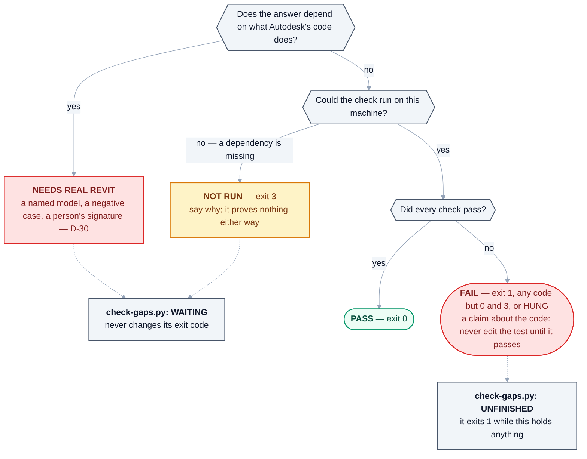

# 13 — Testing & Quality

> Derived from [Master Specification](00-master-specification.md) §25, §40, §64.
> **[NOTE]** blocks are engineering commentary added during review.

---

## 1. Eight testing levels

| Level | Scope | Runs where |
|---|---|---|
| 1 | Agent unit testing | CI, no Revit |
| 2 | Fragment testing | CI, mocked Revit |
| 3 | Skill testing | CI, mocked Revit |
| 4 | MCP testing | CI, mock add-in |
| 5 | Revit integration testing | **Needs real Revit** |
| 6 | Version regression testing | **Needs every supported Revit** |
| 7 | Full workflow testing | Needs real Revit |
| 8 | User acceptance testing | Human |

### 1a. As built — where each level runs today, and what it can say (2026-10-18)

The table above is the specification's. This is what runs. No mocked Revit exists, on purpose (§3a).

| Level | What runs | Where | Can say |
|---|---|---|---|
| 1 Agent unit | every `tests/test_*.py` suite, no Revit | cloud CI on every pull request and push to `main` - the job *"Every suite, and NOT RUN kept apart from FAILED"* in [`gates.yml`](../.github/workflows/gates.yml), and the same every Monday against that day's dependencies ([`weekly.yml`](../.github/workflows/weekly.yml)); locally `python tools/check-gaps.py` | PASS · FAIL · NOT RUN |
| 2 Fragment | each fragment's C# compiled for every release it claims (`tools/check-fragments-compile.py`), and its own declared words still reaching it (`tools/check-routing.py`, `tools/check-intrusion.py`); what it does to a model is a signed proof (`tools/batch-prove.py`, [D-30](DECISIONS.md)) | cloud CI for the compile and the routing; the owner's PC for the proof | PASS · FAIL · NEEDS REAL REVIT |
| 3 Skill | `tests/test_skills.py`: each skill well formed and naming capabilities that have a provider - not that it works | cloud CI | PASS · FAIL |
| 4 MCP | the real server against a stand-in Revit (`test_mcp_serves.py`, `test_mcp_stdio.py`), the pipe round trip (`test_bridge_roundtrip.py`) | **NOT RUN in cloud CI**: the MCP SDK and the .NET test host are left out there on purpose; `test_mcp_serves.py` runs on a Windows runner when a pull request touches the installer, the Python lock, `tools/heron-ready.py` or the release builder ([`windows.yml`](../.github/workflows/windows.yml)), and on the owner's PC | PASS · FAIL · NOT RUN |
| 5 Revit integration | the [NEEDS-CHECKING](NEEDS-CHECKING.md) rows, through the bridge | the owner's PC, with Revit | NEEDS REAL REVIT until a dated run says PASS or FAIL |
| 6 Version regression | the add-in compiled for every release (`tools/check-compile.py`, CI's *"The C# compiles, 2020 to 2027"*); loading on each release is [Group EQ](needs-checking/group-eq.md) | cloud CI for the compile; a real Revit of each release for the rest | a compile PASS or FAIL; NEEDS REAL REVIT |
| 7 Full workflow | whole jobs from a chat, such as a family build timed by `tools/time-family-build.py` | the owner's PC | NEEDS REAL REVIT |
| 8 User acceptance | the owner, in his own work | the owner's PC | what he saw, recorded in a NEEDS-CHECKING row |

How a result is filed, whatever level it came from:



<details>
<summary>Same thing as plain text</summary>

```text
Does the answer depend on what Autodesk's code does?
  yes -> NEEDS REAL REVIT   a named model, a negative case, a person's signature (D-30)
  no  -> Could the check run on this machine?
           no, a dependency is missing -> NOT RUN (exit 3): say why; it proves nothing
           yes -> Did every check pass?
                    yes -> PASS (exit 0)
                    no  -> FAIL (exit 1, any code but 0 and 3, or HUNG past the suite's time limit):
                           a claim about the code - never edit the test until it passes

python tools/check-gaps.py files them:
  FAIL                       -> UNFINISHED   it exits 1 while this holds anything, 0 otherwise
  NOT RUN, NEEDS REAL REVIT  -> WAITING      never changes its exit code
  PASS                       -> neither list
```

</details>

The four are never merged. **Dotted arrows are where [`tools/check-gaps.py`](../tools/check-gaps.py) files
each result**: its exit code follows UNFINISHED alone, so read its buckets rather than its code. On the
Windows runner a NOT RUN fails the job, because that runner exists to be the machine those suites wait
for ([`tests/README.md`](../tests/README.md)).

## 2. QA principle (§40)

> **One agent creates. Another agent validates. No agent approves itself.**

```text
Requirement -> Architecture -> Implementation -> Review -> Build
-> Test -> Revit Test -> QA -> Approval -> Release
```

## 2a. Three kinds of QA, not one

[Part 4 §18](00d-additional-requirements.md) and [Part 2 §48](00b-master-specification-agent-os.md)
together establish that "QA" means three genuinely different things:

| QA type | Asks | Runs |
|---|---|---|
| **Code QA** | Is the code correct, safe, maintainable? | CI, no Revit |
| **Revit QA** | Does it behave correctly *inside Revit*? | In Revit |
| **BIM QA** | Is the resulting **model** correct? | In Revit, against the model |

**Code QA ≠ Revit QA ≠ BIM QA.** All three are required, and the third is the one BIM professionals
actually care about.

**BIM QA** checks naming · parameters · categories · families · levels · worksets · views · modelling
rules · MEP connectivity · coordination requirements.

**[NOTE]** BIM QA is not really a test stage — it is a **product capability**. *"Check this model
against our standard"* is one of the six example requests in [Part 1 §1](00-master-specification.md).
The same engine that validates Heron's own output is the one a user invokes directly. Building it once
and using it in both places is a significant economy, and it means the QA engine gets exercised daily
rather than only in CI.

## 2b. Evaluation System and the Golden Test Library

[Part 4 §27–28](00d-additional-requirements.md) make automated evaluation a mandatory component.

| | |
|---|---|
| **Agent** | Duct Selection Agent |
| **Test** | Select all ducts |
| **Expected** | All visible ducts selected |
| **Result** | PASS |

> A permanent collection of known-good cases. Every major update runs against these tests.

**[NOTE]** This adopts the golden-file mechanism proposed in §4 below, and it is what makes
[Golden Rule 4](14-golden-rules.md) executable rather than aspirational.

Two things determine whether it works:

1. **Start it in Phase 1, not Phase 5.** A golden library only has value proportional to how long it has
   been accumulating. Started late, it encodes today's behaviour as correct — including today's bugs.
2. **Every fixed bug adds a case.** That is the discipline that makes the library grow from real
   failures rather than from imagination, and it is the same signal the Capability Gap report uses.

> **As built (2026-10-18):** the library is [`tests/golden/cases.py`](../tests/golden/cases.py), audited
> by [`tests/test_golden.py`](../tests/test_golden.py) without Revit - it checks the cases are coherent,
> recomputes each proof's fingerprint and reports the STALE ones, and says what is proven. It does not
> run a case: a case is proven only by a person watching Revit. Fragments carry their own proof in their
> card's `proof:` block ([D-30](DECISIONS.md)) instead of a golden file.

---

## 3. **[NOTE — the hardest engineering problem in the project]** Testing against Revit

Levels 5–7 require a running Revit with a document open. That is genuinely difficult to automate:

- Revit is a large GUI application with a licence check.
- It cannot run headless in any officially supported way.
- Standard test runners cannot drive the Revit API — code must execute inside Revit's process, in API context.
- CI runners do not have Revit, and Autodesk licensing generally does not permit putting it on arbitrary cloud machines.

**Known approaches:**

| Approach | Description | Assessment |
|---|---|---|
| **In-Revit test runner add-in** | A Heron add-in command that runs the suite inside Revit and writes results to disk | Practical, well-established pattern. Needs a person or a scheduled job to launch Revit. |
| **Revit in journal/automation mode** | Drive Revit via journal files | Brittle, poorly documented, but usable for smoke tests. |
| **Self-hosted CI runner with Revit installed** | A physical or VM machine with licensed Revit versions, registered as a CI runner | The realistic answer for level 6. Costs a machine and licences. |
| **Design Automation for Revit (APS)** | Autodesk's cloud service that runs Revit add-ins | Real, supported, cloud-based — but a constrained environment, no UI, and it costs per run. Worth evaluating seriously for regression testing. |
| **Mock the Revit API** | Interface over every Revit type, mock in unit tests | Essential for levels 1–4. Proves the logic, proves nothing about Revit. |

**Recommendation:**

- Levels 1–4 in normal CI against a **mocked Revit boundary**. This is why every Revit type must sit behind the Heron Revit boundary ([01 §8](01-vision-and-principles.md)) — testability, not just portability.
- Levels 5–7 via an **in-Revit test runner**, launched manually at first, then on a self-hosted runner once the matrix is worth automating.
- Evaluate **Design Automation for Revit** for level 6 before building a machine room.

Tracked as [Q-14](OPEN-QUESTIONS.md).

> **As built (2026-10-18):** Q-14 is answered - a written register, not an automated runner:
> [`NEEDS-CHECKING.md`](NEEDS-CHECKING.md) holds every unproven claim in dependency order with what PASS
> looks like ([answer](open-questions/answered.md)). In practice levels 5 to 7 run through the bridge from
> the owner's PC: [`tools/batch-prove.py`](../tools/batch-prove.py) runs fragments against the open model
> and writes a proof draft a person signs ([D-30](DECISIONS.md)). No self-hosted runner with Revit and no
> Design Automation run exists; CI compiles every release ([`.github/workflows/gates.yml`](../.github/workflows/gates.yml))
> and runs no Revit.

---

## 3a. Offline-provable, or real Revit — the line, and where it is drawn

§3 recommends levels 1–4 against a mocked Revit boundary and 5–7 inside a real Revit. That is a
recommendation; **this is the list**, and it exists because *"we should test more of it offline"* is
not actionable and *"these things are already testable offline and these are not"* is.

**The rule that decides the line:** a thing is offline-provable when the answer depends only on what
Heron itself declares, computes or writes. It needs a real Revit the moment the answer depends on what
**Autodesk's code does**.

| Offline-provable | What proves it today |
|---|---|
| Which capability a request resolves to, and which fragment provides it | `heron_capability.py`, `tests/test_capability.py` |
| Whether a fragment can still be found by its own declared words | `tools/check-routing.py`, `tools/check-intrusion.py` |
| Whether a contract is well formed, and whether one fragment's `provides` satisfies another's `needs` | `heron_fragment.py`, `tests/test_graph.py` |
| Lifecycle state, and whether a promotion is permitted | `heron_fragment.py`, `tests/test_fragment_store.py` |
| Result and error contracts, and the refusal wording | `tests/test_write_safety.py`, `tests/test_failure_analysis.py` |
| Whether an agent triggers on the right request and not on the wrong one | `tests/test_validate_agent.py`, `tests/test_skills.py` |
| Report and catalogue generation | `tests/test_catalog.py` |
| Which capabilities are available **and why one is not** | `mcp/server/heron_runtime.py`, `tests/test_runtime_snapshot.py` |
| Layering, in both languages, and the adapter boundary | `tools/check-structure.py` |
| Whether a change stayed inside the parts it declared | `tools/check-change.py`, `tests/test_change_gate.py` |
| The add-in manifest, the install path, and the release-to-runtime map | `tools/check-package.py`, `tests/test_package_gate.py` |
| That the C# compiles on every declared release | `tools/check-compile.py`, `tools/check-api-surface.py` — needs the .NET SDK, not Revit |

| Needs a real Revit — and **no mock may stand in for it** | Why |
|---|---|
| Any call into the Revit API | The answer is Autodesk's, not Heron's |
| Transactions, `TransactionGroup`, and one-undo behaviour | [Golden Rule 16](14-golden-rules.md) is a claim about Revit's undo stack |
| Element creation, modification, deletion, geometry | The model is the thing being asserted about |
| Units as the model stores them | A millimetre passed where feet were wanted produces no error — only a wrong model |
| Connector behaviour, links, worksharing ownership | Behaviour that exists only in a live document |
| Whether the add-in loads at all, on each release | Revit's own manifest reader decides |
| Whether an install, upgrade or rollback works | Windows, a per-user folder, and a previous version |

**A mocked Revit that returned plausible element counts would produce green suites and no knowledge
whatever.** That is why nothing in `tests/` does it, and why [D-30](DECISIONS.md) asks for a named
model, a negative case and a fingerprint instead. A compile is not a proof; a passing suite is not a
proof; and a suite that *could not run* is not a pass either — [`tests/README.md`](../tests/README.md)
keeps the three apart with exit codes.

**Everything in the first table can be added to without asking anybody for a machine.** That is the
practical point of drawing the line: it names where more automation is honest, and where more
automation would only be more confident.

---

## 4. Regression testing (§25)

On every change to an existing fragment:

1. Identify supported versions
2. Build/test each supported implementation
3. Compare previous behaviour
4. Detect breaking changes
5. **Reject unsafe changes**
6. **Preserve the previous working implementation**

**[NOTE]** "Compare previous behaviour" needs a concrete mechanism, or it will not happen. The workable one is **golden-file testing**: each fragment has a fixed test model and a recorded expected result (element counts, `UniqueId` sets, parameter values, geometry hashes). A change that alters the golden output is a breaking change by definition, and must be explicitly acknowledged rather than silently accepted.

This makes Golden Rule 4 executable instead of aspirational.

## 5. **[NOTE]** Test models are project assets

The regression suite needs a small library of controlled `.rvt` files: an MEP model with ducts and pipes, a worksharing-enabled model, a model with known warnings, a model with links, a deliberately messy model.

These must be:

- **version-migrated** for each supported Revit release (a 2020 file opened in 2025 is silently upgraded — the suite must use per-version copies),
- **small** (git-friendly; consider Git LFS),
- **synthetic** — never a real client model. A client model in a git repository is a confidentiality breach waiting to happen.

Building these early costs a day and saves months.

## 6. **[NOTE]** What "success rate" actually measures

The Fragment Performance Agent tracks success rates, and the fragment lifecycle promotes on them. Worth being precise, or the number will mislead:

- **Success ≠ correct.** A fragment that selects 0 ducts "succeeded". Validation must assert the *expected* outcome, not merely the absence of an exception.
- **A user correction is a failure**, even if the operation succeeded technically. If the user immediately undoes it or rephrases, that is the strongest negative signal available and should be weighted accordingly.
- **Sample size matters.** 3/3 is not a 100% success rate. Promotion gates need a minimum N ([09 §5](09-skills-and-fragments.md)).

## 7. Quality gates before PRODUCTION

| Gate | Requirement |
|---|---|
| Tests exist | Written by a different agent than the implementer |
| Tests pass | On **every** declared supported version |
| No regression | Golden files unchanged, or change explicitly approved |
| Code review | By a separate agent (§40) |
| Security review | For anything at `MODIFY` or above |
| Real usage | N successful executions, no unexplained failures |
| **Human approval** | One person, recorded |
