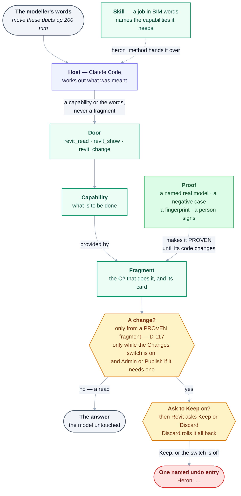

# 15 — Glossary

Terms used throughout the Heron AI documentation. Where a term is contested or newly defined
during review, the defining document is linked.

**How the words most used below fit together** — one request, from the modeller's words to Revit's
undo list. Every box is a term defined on this page.



<details>
<summary>Same thing as plain text</summary>

```text
The modeller's words  -> Host (Claude Code) works out what was meant
                         a Skill, a job of several steps, reaches the host whole through heron_method
Host -> a Door (revit_read, revit_show, revit_change), with a Capability or the words, never a fragment
Capability -> provided by a Fragment: the C# that does it, and its card
Proof (named real model, negative case, fingerprint, signed by a person) -> the fragment is PROVEN,
  until its code changes
A change? no, a read -> the answer, the model untouched
          yes        -> only from a PROVEN fragment (D-117; a DRAFT gets one asked try-once, D-119)
                     -> only while the Changes switch is on (and Admin or Publish if it needs one)
                     -> Ask to Keep on: Revit asks Keep or Discard; Discard rolls it all back
                     -> Keep, or Ask to Keep off -> one named undo entry, "Heron: ..."
```

</details>

---

## Heron concepts

| Term | Meaning |
|---|---|
| **Agent** | A component with one responsibility, a declared contract, an identity, a version and a lifecycle. Not necessarily an LLM call — see *Tier*. Every agent is listed in [28](28-agent-registry.md); `python tools/agent-count.py` counts them. |
| **Department** | A group of related agents behind a stable boundary. Callers depend on the department, not on individual agents. |
| **Skill** | What a modeller can ask for, in their own words and in BIM language — "Select Ducts". One YAML file in `brain/skills/` that names the **capabilities** it needs, never a fragment. A job of several steps, building a family above all, is a skill, and the `heron_method` tool hands its whole method to the chat. Not the same thing as the house rules in `.claude/skills/`, which are for people working on Heron. [09](09-skills-and-fragments.md) |
| **Fragment** | A reusable implementation unit, named in technical language: one folder in `brain/fragments/` holding its **card**, its C# under `impl/` and its cases under `tests/`. The add-in compiles it and runs it inside Revit. A fragment is a filter, an action or, where a job cannot be composed, a recipe ([D-29](DECISIONS.md)). One fragment serves many skills. [09](09-skills-and-fragments.md) |
| **Card** | A fragment's `fragment.yaml`: its identity, the capability it provides, its risk, its contract, the words it answers to and its proof. On the Companion page the word is also used for one of its panels. |
| **Capability** | *What you want done*, named without naming who does it — `FILTER_ELEMENTS_BY_CATEGORY`. Each fragment's card declares the one it provides. Skills and the chat ask for capabilities and never for a fragment, so a provider can be added, split or retired without changing a caller (`brain/heron_capability.py`). [18 §2](18-agent-operating-system.md) |
| **Method** | A job's whole method: what must be true first, the steps in order, and each capability it uses with its risk. It is a skill, handed over by `heron_method` with every capability resolved against the Revit in front. |
| **Tier** | Whether an agent is **T1** (deterministic service, no model call), **T2** (one scoped LLM call) or **T3** (full agentic loop). [02 §6](02-architecture-overview.md) |
| **Scope** | Which knowledge partition something belongs to: Global (the specification's *Core*), Company, Project, User, Temporary, Experimental — `heron_scope.SCOPES` in [`heron_scope.py`](../brain/heron_scope.py), one SQLite file each ([D-23](DECISIONS.md)). *Community* is a **source** in the proposed trust model ([24](24-trust-model.md)), not a scope. [10 §1](10-memory-and-knowledge.md) |
| **Persona** | **Not a setting in Heron.** The specification had one — BIM Modeler or Developer, choosing how much technical detail is shown ([01 §4](01-vision-and-principles.md)) — and [D-27](DECISIONS.md) removed it: Heron has one voice, plain BIM language, and what varies is the **shape** of the answer, read from the shape of the request (a count gets a number, a breakdown a table). Nothing detects who is talking. The one place wording may change is Developer **Mode**, which is granted, never inferred ([22 §2–§3](22-users-modes-and-extensibility.md)) |
| **Knowledge Identity** | The stable ID of a knowledge object, independent of its filename. [09 §4](09-skills-and-fragments.md) |
| **Lifecycle** | The state progression of a fragment, skill or agent, from proposal through production to archive. See *Status vocabularies* below. |
| **Golden Rule** | A permanent architectural constraint. [14](14-golden-rules.md) |
| **Product / Data / Derived** | The three classes of file in the workspace. Product is replaced on update, Data belongs to the user and must survive, Derived is a rebuildable cache. [06 §2](06-heron-platform.md) |
| **Data home** | Where Heron's Python side keeps the DATA it writes — the knowledge stores, every project's memory and the brain's audit: `HERON_DATA` when set, on Windows `%USERPROFILE%\.heron`, anywhere else none. Outside `%APPDATA%` because a Microsoft Store Claude keeps a private copy of that folder. The add-in's own settings and audit stay in `%APPDATA%\Heron`. [D-135](DECISIONS.md) · `python brain/heron_paths.py --where` |

## Revit & BIM

| Term | Meaning |
|---|---|
| **Revit API** | Autodesk's .NET API for Revit. Callable only from the Revit main thread, inside a valid API context. [03 §4](03-heron-revit.md) |
| **API context** | A moment when Revit permits API calls — inside an `IExternalCommand`, `IExternalEventHandler`, `Idling` handler, or a document/application event. |
| **ExternalEvent** | The mechanism for asking Revit to run code on its main thread from a background thread. The backbone of the Heron bridge. |
| **Transaction** | The unit of model modification. Nothing changes a Revit model outside one. |
| **TransactionGroup** | A wrapper over several transactions that can be assimilated into a single undo entry. The basis of Golden Rule 16: every change Heron makes is one named group, `Heron: <name>`, and one entry in Revit's undo list. |
| **ElementId** | A per-document, per-session element identifier. **Not stable** — 32-bit before Revit 2024, 64-bit from 2024. |
| **UniqueId** | A stable GUID-based element identifier. What Heron stores and transmits. |
| **Worksharing** | Revit's multi-user mode: a central model plus local copies, with element ownership and Sync With Central. |
| **Workset** | A named partition of a worksharing-enabled model, with ownership and visibility. |
| **Add-in** | A `.NET` assembly plus a `.addin` manifest, loaded by Revit at startup. Cannot be unloaded without restarting Revit. |
| **LOD** | Level of Development / Detail — how much a model element is committed to at a given stage. |
| **ISO 19650** | The international standard for information management in BIM projects. |
| **QCS** | Qatar Construction Specifications. |
| **Ashghal** | Qatar's Public Works Authority; publishes its own BIM requirements. |
| **IFC** | Industry Foundation Classes — the open, vendor-neutral BIM exchange format. |

## Using Heron on a model

| Term | Meaning |
|---|---|
| **Door** | One of the three MCP tools a fragment is run through. Each takes a capability, or the modeller's words, never a fragment's id, and refuses a fragment above its own ceiling: **`revit_read`** (nothing above `ANALYZE`; no transaction open, so Revit refuses a change), **`revit_show`** (nothing above `EXECUTE`: select, zoom, open a view) and **`revit_change`** (a change from a `PROVEN` capability only, kept as one undo entry). [04 §8](04-heron-mcp.md) |
| **Library tools** | The tools that answer from the files that shipped with Heron and need no Revit — `heron_tools.LIBRARY` in `mcp/server/heron_tools.py`. Off Windows they are the only tools served, and no `revit_` tool appears. [D-132](DECISIONS.md) |
| **Changes switch** | The **Changes** button on the Heron ribbon, `write.enabled` in `heron.config`. Off by default: Heron reads the model and changes nothing until it is on. [D-19](DECISIONS.md) |
| **Admin / Publish switches** | Two more ribbon buttons, off by default, that only the owner turns on. A fragment declared `ADMIN` or `PUBLISH` runs only while its own switch is on, as well as Changes. [D-106](DECISIONS.md) |
| **Ask to Keep** | The ribbon switch, `write.askBeforeKeeping`, that decides whether Revit asks **Keep or Discard** before a change from the chat is kept. **Off by default**: the change is then kept at once, still as one undo entry. [D-138](DECISIONS.md) |
| **Keep or Discard** | Revit's own question after a change from the chat has run, while Ask to Keep is on. What the change added and changed is selected and isolated in the active view, when that model is the one in front, and nothing is kept until the modeller presses Keep; Discard, Esc or closing the box rolls the whole change back. A third link keeps this change and the rest of the same chat's job on the same model without asking, until ten quiet minutes pass; a publish and a DRAFT's one run are asked every time. A Discard is the modeller's answer, never retried. [D-126](DECISIONS.md), [D-138](DECISIONS.md) |
| **Try-once** | A `DRAFT` fragment's one run on the saved model in front, behind the Keep or Discard box, only when the modeller asks: `python mcp/client/heron_bridge_client.py try-once <fragment>`. The modeller judges it; a run kept after checking can be the positive case of its proof. [D-119](DECISIONS.md), [D-120](DECISIONS.md), [D-121](DECISIONS.md), [D-122](DECISIONS.md) |
| **Run record** | One file per fragment write, written by the add-in under `%LOCALAPPDATA%\Heron\runs` (`HeronPaths.Runs`, DERIVED): every element the change touched and its whole reply, named by its workflow id. The chat is given only a short report and pages the rest with `heron_run_record`; files older than `runs.retainDays` are pruned. Not the audit trail, which is DATA and never pruned. |
| **Run clock** | A check the add-in puts into a fragment's code, so a fragment that never ends is stopped, rolled back and answered before the bridge stops waiting for it. [D-129](DECISIONS.md) |
| **Run guard** | Revit's own events, listened to only while a Heron job runs, so a job cannot save, sync, export or print a model that was already open, or start a new document, unless its operation's level allows it — Constitution Article 10 held in code (`HeronRunGuard.cs`, `HeronRunPolicy.cs`). |
| **Heron Companion** | A page in the modeller's browser, beside Revit, served by the chat's own MCP process on `127.0.0.1` only. It shows which model and view are in front and what the chat asked Heron to do, and holds tables and calculation panels the modeller can apply there; an Apply goes through the same path as `revit_change`. It never talks to an AI. The **Companion** button in Revit opens the page of a running chat. [40](40-heron-companion.md), [D-108](DECISIONS.md), [D-109](DECISIONS.md) |
| **Live file** | `%LOCALAPPDATA%\Heron\live\pid-N.json`, written by the add-in while Heron is connected: which model and view are in front. The Companion reads it instead of asking Revit through the pipe. [40 §6](40-heron-companion.md) |

## Proof and status

| Term | Meaning |
|---|---|
| **Proof** | One recorded run against a **named real model**, with a positive case, a **negative case** that was supposed to return nothing and did, and a staleness fingerprint, signed by a person under their name and the date. A compile is not a proof; a passing test is not a proof. [D-30](DECISIONS.md) |
| **Negative case** | The half of a proof that runs where the fragment should find nothing — another level, a category the model lacks — and checks that it does. Without it a fragment that ignores its input looks the same as one that works. |
| **Tracking** | The substitute for a negative case where none can exist, as for an agent that lists whatever model it is given: the answer must follow the input across two models, or across several values of one argument. [D-53](DECISIONS.md) |
| **Fingerprint** | A hash of a fragment's own implementation, or an add-in agent's source, taken when the proof is signed. If the code changes, the proof reads **stale** — evidence about code that has since moved on. |
| **`PROVEN`** | A fragment's `heron-status` once it carries a proof that still matches its code. `revit_change` runs only a `PROVEN` capability whose proof still stands. [D-117](DECISIONS.md) |
| **`DRAFT`** | A fragment's, skill's or module's `heron-status` before proof: new, or set back when its code changed under its proof. Count both: `grep -h '^heron-status:' brain/fragments/*/fragment.yaml \| sort \| uniq -c`. |
| **Proof draft** | The evidence a validation run gathered, arranged as a proof and left **unsigned** for a person — `brain/proof-drafts/` for fragments, `brain/agent-proof-drafts/` for add-in agents. The machine never signs. |
| **Proof on another release** | A further run of a `PROVEN` fragment on one more Revit release, signed as an entry of its `proof.releases`; a second route is signed the same way. [D-131](DECISIONS.md) |

## Platform & AI

| Term | Meaning |
|---|---|
| **Host** | The AI application providing the conversation — Claude Code. It decides what the user meant; Heron never classifies intent. Not part of Heron. [D-01](DECISIONS.md) |
| **MCP** | Model Context Protocol — the interface through which the AI layer calls Heron's tools. `python mcp/server/heron_tools.py` lists every tool and what it may do to the model. [04](04-heron-mcp.md) |
| **RAG** | Retrieval-Augmented Generation — retrieving relevant knowledge before reasoning over it. [05](05-heron-brain.md) |
| **Embedding** | A vector representation of text, used for semantic similarity search. Heron computes them on the PC, never in a cloud ([D-24](DECISIONS.md)): a built-in character-pattern backend that needs nothing installed, and a trained model2vec model, which understands meaning, when it is installed ([`heron_embed.py`](../brain/heron_embed.py)). |
| **Hybrid search** | Combining keyword and vector search, then fusing the rankings. What [`heron_retrieve.py`](../brain/heron_retrieve.py) does: a hard filter first (scope, Revit release), then word match (SQLite FTS5) and meaning, fused by reciprocal rank, and an optional re-ranker re-reads the top of the list when it is installed ([D-134](DECISIONS.md)). [05 §4](05-heron-brain.md) |
| **Golden file test** | A test that compares output against a recorded expected result. How "never break a working version" is enforced. [13 §4](13-testing-and-quality.md) |
| **Sandbox** | In the specification, an isolated environment — a detached model copy — where unproven code runs before it is allowed near a live project. **Heron has none by that name today.** The runner that watches a new agent's first run was renamed *watched, not contained*, because it isolates nothing ([D-84](DECISIONS.md)); and a `DRAFT` fragment's first run is its one *try-once* on the saved model in front, behind Keep or Discard ([D-119](DECISIONS.md), [D-121](DECISIONS.md)). |
| **Prompt injection** | Instructions hidden in content the system reads (a family name, an imported document) attempting to make the model act on them. Countered by Golden Rule 19. |
| **Audit log** | The append-only structured record of every significant action. What makes invisible background work acceptable. The add-in writes its own; the brain writes a second for what it answered without Revit ([D-62](DECISIONS.md)). [12 §5](12-security-and-permissions.md) |

## Kernel & platform

| Term | Meaning |
|---|---|
| **Heron Kernel** | The spine every module talks through instead of depending on each other. Holds the registries, permissions, event bus, state and logging. **Plumbing, never intelligence** — no BIM knowledge lives in it. [23 §1](23-heron-kernel.md) |
| **Capability Registry** | *"What can Heron currently do?"* The Orchestrator matches **capabilities**, never agent names — which is what makes agents replaceable. [18 §2](18-agent-operating-system.md) |
| **Workflow Engine** | Owns ordering, retries, timeouts, rollback and checkpoints. The Orchestrator decides *what*; this ensures it *happens correctly*. The Orchestrator is the host ([D-01](DECISIONS.md)); the engine is [`heron_workflow.py`](../mcp/server/heron_workflow.py), DRAFT, and no tool the server serves calls it yet. [23 §3](23-heron-kernel.md) |
| **Checkpoint** | Persisted stage output letting a failed multi-stage workflow resume from the failed step rather than restarting. [23 §4](23-heron-kernel.md) |
| **Evidence** | The stated reasons behind a decision — which fragment, which versions, what success history. For a `MODIFY`, **no evidence means refused, not downgraded**. [23 §6](23-heron-kernel.md) |
| **Confidence** | An agent's self-reported certainty (`HIGH`/`MEDIUM`/`LOW`/`UNKNOWN`). **Never a substitute for validation.** [23 §5](23-heron-kernel.md) |
| **Model Router** | Chooses the model class for a task. Heron declares *intent*; the host resolves it. [23 §8](23-heron-kernel.md) |
| **Prompt/Instruction Registry** | One versioned, testable home for all system and agent instructions — never scattered through code. [23 §9](23-heron-kernel.md) |
| **Dependency graph** | Skills → fragments → API → runtime → packages. Makes the blast radius of a change computable instead of requiring a full test sweep. [21 §1](21-resilience-and-operations.md) |
| **Shadow Mode** | A new agent or fragment runs on real requests with its **output discarded**, so evidence accrues without risk. Leaving it takes an analysed **disagreement** and a person's signature, never a count of agreements ([D-39](DECISIONS.md)). [`heron_shadow.py`](../brain/heron_shadow.py) keeps that disagreement log; it is DRAFT and runs neither side itself. [18 §4](18-agent-operating-system.md) |
| **Emergency Stop** | Halts Heron in one Revit: changes are refused, reads go on, and a fragment running at that moment is stopped at its next check and rolled back. **There is no ribbon button** ([D-46](DECISIONS.md)), and no MCP tool sends it; the bridge's `stop` operation sets it — today `python mcp/client/heron_bridge_client.py stop`, with `--session` naming the Revit when more than one is connected — and it lasts until Revit restarts ([D-129](DECISIONS.md), [D-130](DECISIONS.md)). Whether a Revit no chat holds should take a stop from anyone is still open ([Q-71](OPEN-QUESTIONS.md)). [21 §4](21-resilience-and-operations.md) |
| **Safe Mode** | Disables recently installed components and returns to last-known-good. [21](21-resilience-and-operations.md) |
| **Workflow ID** | The correlation key tying one user sentence to every agent, retrieval, model call and element touched. [21 §13](21-resilience-and-operations.md) |
| **Constitution** | The runtime-enforceable subset of the Golden Rules, written as prohibitions and injected into agents. All 30 Articles are binding ([D-43](DECISIONS.md)). [HERON_CONSTITUTION.md](../HERON_CONSTITUTION.md) |

## Bridge & sessions *(field-proven)*

| Term | Meaning |
|---|---|
| **Bridge** | The per-Revit connection between the MCP server and the add-in: a local named pipe, never a network socket. One per Revit **process**. [25](25-multi-session-and-binding.md) |
| **Discovery file** | `%LOCALAPPDATA%\Heron\bridges\<pid>.json` — an **address book**, not a status report. Static facts only; the document name is deliberately absent. [25 §2](25-multi-session-and-binding.md) |
| **Session binding** | One chat, one Revit. Asked once, sticky, and **fails closed** if that Revit closes. Never guessed. [25 §3](25-multi-session-and-binding.md) |
| **Lease** | Prevents a second chat taking over a Revit mid-job — and is what makes `(free)`/`(in use)` truthful in the picker. Scoped to the **process**, not the document. [25 §3](25-multi-session-and-binding.md) |
| **Document pinning** | Binding a write to a specific document by identity, so the user clicking to another project cannot move the target. [Golden Rule 20](14-golden-rules.md), [25 §4](25-multi-session-and-binding.md) |
| **Stale read** | Acting on a picture of the model that has since changed. *"The real danger is not the freeze, it is the stale read."* [Golden Rule 21](14-golden-rules.md), [25 §5](25-multi-session-and-binding.md) |

## Standards & references

| Term | Meaning |
|---|---|
| **Reference model** | A correctly delivered model used as a source to **infer** a standard from, rather than writing one out. [10 §5a](10-memory-and-knowledge.md) |
| **Profile** | The abstraction extracted from a reference model — conventions, frequencies, exceptions, provenance. **The model is discarded; the profile is kept.** [10 §5a](10-memory-and-knowledge.md) |
| **Checkset** | Autodesk Model Checker's XML rule format. One of Heron's export targets — readable and runnable **without Heron**. [10 §5a](10-memory-and-knowledge.md) |
| **IDS** | buildingSMART **Information Delivery Specification** — the open XML standard for machine-readable information requirements, official since June 2024. Heron's other export target. |

## Status vocabularies

> **The [unified trust model](24-trust-model.md) proposes to replace these ([D-14](DECISIONS.md), still
> Proposed, so nothing below is superseded yet).** It collapses six competing vocabularies across the
> four specifications into two orthogonal axes.

**Lifecycle** — one vocabulary for fragments, skills, capabilities **and** agents:

`DISCOVERED` → `DRAFT` → `TESTING` → `VALIDATED` → `SHADOW` → `PROVEN` → `PRODUCTION` → `DEPRECATED` → `ARCHIVED`

**What the code accepts today** is the list in `brain/heron_fragment.py` (`STATUSES`), which has no
`SHADOW` stage. Which of those the library actually holds, and how many of each:
`grep -h '^heron-status:' brain/fragments/*/fragment.yaml | sort | uniq -c`.

**Source** — fixed at creation, never advances:

`OFFICIAL` · `COMPANY` · `PROJECT` · `USER` · `COMMUNITY` · `IMPORTED` · `UNKNOWN`

**Knowledge levels** — a derived band over lifecycle, used for ranking and for gating writes:

| Level | Stages | May be used for |
|---|---|---|
| **L1 RAW** | `DISCOVERED`, `DRAFT` | inspection only |
| **L2 TESTED** | `TESTING`, `VALIDATED` | `READ` / `ANALYZE` / `SUGGEST` |
| **L3 VERIFIED** | `SHADOW`, `PROVEN` | `MODIFY` **with an accepted preview** |
| **L4 PROVEN** | `PRODUCTION` | `MODIFY` unattended |

**This band is part of the proposed model, not what a change from the chat obeys today.** That rule is
narrower and set elsewhere: `revit_change` runs a `PROVEN` capability only, while the Changes switch is on
([D-117](DECISIONS.md), [D-19](DECISIONS.md)); Revit asks Keep or Discard only while Ask to Keep is on,
and it is off by default — the one exception the [Constitution](../HERON_CONSTITUTION.md)'s Article 9
records ([D-138](DECISIONS.md)). No fragment has reached `PRODUCTION`.

**Permission levels:** `READ` · `ANALYZE` · `SUGGEST` · `EXECUTE` · `MODIFY` · `PUBLISH` · `ADMIN`

**Scheduler priorities:** `P0` user interaction · `P1` required execution · `P2` required validation · `P3` maintenance · `P4` learning · `P5` optimization · `P6` cleanup — the ladder of [21 §12](21-resilience-and-operations.md#12-background-workers-and-priority) and `PRIORITIES` in [`heron_queue.py`](../brain/heron_queue.py). `P2` to `P6` never run during a user task. The queue and the scheduler are DRAFT and the server calls neither
