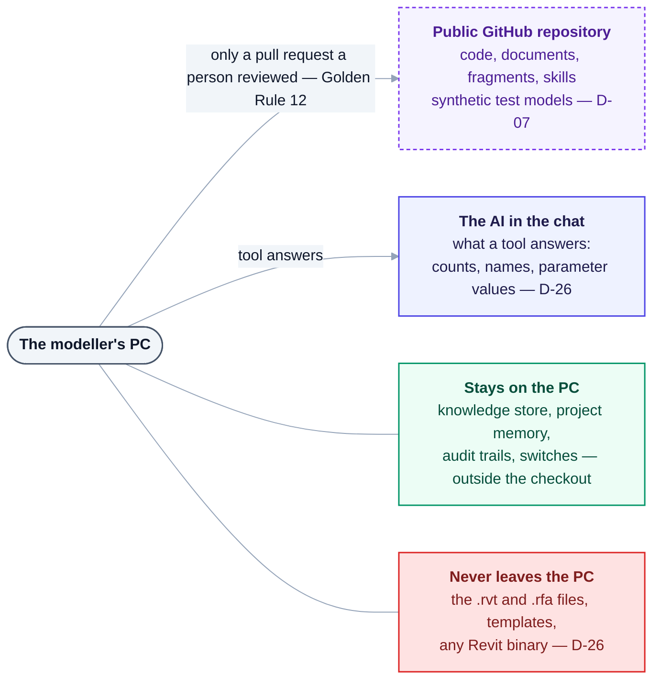

# 17 — Open Source & Distribution

> **Decided 2026-08-27 ([D-07](DECISIONS.md)):** Heron AI ships as a **free, open-source product
> on public GitHub**, installable by anyone. An app-store listing follows later, also free.

---

## 1. What this decision changes

Being open source from the start is a good fit for this platform — the community knowledge system,
the fragment marketplace and the GitHub department in the specification all assume an open ecosystem.
But it changes several things that were previously simple.

| Area | Before (private) | Now (public open source) |
|---|---|---|
| Code visibility | Nobody | Everyone, permanently, including forks |
| Secrets | Low risk | **Any committed secret is compromised forever** |
| Client data | Local concern | **Must never reach the repository** |
| Support burden | None | Issues, PRs, questions from strangers |
| Liability | Personal | Needs an explicit warranty disclaimer |
| Governance | You decide | Needs a stated contribution process |
| Breaking changes | Free | Break other people's work |

---

## 2. The critical separation — code is public, knowledge is not

This is the most important consequence, and it must be structural rather than a matter of care.

| PUBLIC REPOSITORY | LOCAL MACHINE ONLY |
|---|---|
| Core engine | User memory |
| Revit add-in source | Project memory |
| MCP server | Company standards |
| Agent definitions | Client project data |
| Core fragments & skills | Audit logs |
| Documentation | Vector indexes |
| Tests + synthetic models | Imported private tooling |

The product/data/derived split in [06 §2](06-heron-platform.md) already draws this line. Open sourcing
makes it load-bearing: **the data class must live outside the repository directory entirely**, so that
`git add -A` cannot possibly capture a client's project knowledge.

Concrete protections:

1. Data lives under the user profile, **never** under the repo.
2. `.gitignore` blocks the data paths anyway, as a second layer.
3. A pre-commit secret/PII scan.
4. Test models are **synthetic**, never real client models ([13 §5](13-testing-and-quality.md)).
5. Community contribution stays a per-item human review — Golden Rule 12, [10 §4](10-memory-and-knowledge.md).

> **As built (2026-10-18):** 1 holds - the Python side keeps its data in `%USERPROFILE%\.heron`
> ([D-135](DECISIONS.md)) and the add-in its own in `%APPDATA%\Heron` (`HeronPaths.Data`), never in the
> checkout; 2 holds -
> [`.gitignore`](../.gitignore) blocks the data class anyway. **3 is not built:** no secret or PII scan
> was found in `tools/`, `.github/workflows/` or the hooks in `.claude/settings.json`.
> [CONTRIBUTING.md](../CONTRIBUTING.md) names real model data and credentials as reasons a change is
> rejected, which is a reviewer's check, not a scan.

### 2a. As built — what is public, what stays on the PC, what never leaves (2026-10-18)



<details>
<summary>Same thing as plain text</summary>

```text
The modeller's PC
  -> Public GitHub repository   code, documents, fragments, skills, synthetic test models (D-07)
                                only through a pull request a person reviewed (Golden Rule 12)
  -> The AI in the chat         what a tool answers: counts, names, parameter values (D-26)
  Stays on the PC               knowledge store, project memory, audit trails, switches -
                                outside the checkout
  Never leaves the PC           the .rvt and .rfa files, templates, any Revit binary (D-26)
```

</details>

| What | Where it lives | Can it leave the PC? | What holds the line |
|---|---|---|---|
| Heron's code, documents, fragments, skills, synthetic test models | the public repository | yes - it is public | [D-07](DECISIONS.md), Apache 2.0 ([D-08](DECISIONS.md)) |
| The knowledge store, project memory, the brain's audit | `%USERPROFILE%\.heron` | no | outside the checkout ([D-135](DECISIONS.md)); `*.db` and `*.sqlite` are git-ignored |
| The add-in's switches and audit trail | `%APPDATA%\Heron` | no | `HeronPaths.Data` ([06 §2a](06-heron-platform.md)) |
| Source documents - PDFs, specifications, standards | wherever the modeller keeps them | may go to a cloud store under [D-82](DECISIONS.md); **no such path is built** - embeddings are computed on the PC ([`heron_embed.py`](../brain/heron_embed.py)) | `*.pdf`, `*.docx`, `*.xlsx` are git-ignored |
| What a tool answers - counts, names, parameter values | the chat | yes, to the AI in the conversation | [D-26](DECISIONS.md): fine in the conversation |
| The `.rvt` and `.rfa` files, templates, any Revit binary | the modeller's disk, open in Revit | **never** | [D-26](DECISIONS.md); D-82 keeps Revit model data out of any cloud store; `*.rvt`, `*.rfa`, `*.rte`, `*.rft` are git-ignored |

The add-in reads the model in place and opens no socket ([03 §1a](03-heron-revit.md)). What is still
missing is the scan this section's point 3 asks for.

**A single accidental commit of a client model or a project knowledge base is not recoverable.**
Git history persists, GitHub caches, forks propagate. This deserves more care than any other
consequence of going open source.

---

## 3. Licence — needs deciding

Not yet chosen. See [Q-27](OPEN-QUESTIONS.md).

> **As built (2026-10-18):** decided - **Apache 2.0**, as recommended below ([D-08](DECISIONS.md), Q-27
> answered). [`LICENSE`](../LICENSE) and [`NOTICE`](../NOTICE) are in place, and
> `python tools/check-licence.py` is one of the checks CI decides a pull request on.

| Licence | Character | Fit |
|---|---|---|
| **MIT** | Maximum permissiveness. Anyone may use, modify, sell. | Most common for Revit/BIM tooling. Best for adoption. |
| **Apache 2.0** | Permissive + explicit patent grant + explicit warranty disclaimer. | Slightly better legal protection for a tool that modifies client models. |
| **GPL-3.0** | Derivatives must also be open source. | Protects against a closed commercial fork. Deters company adoption; many firms forbid GPL. |
| **MPL-2.0** | File-level copyleft. | Middle ground. |

**Recommendation: Apache 2.0.** It is permissive enough for company adoption (which matters — the target
users work at contractors and consultancies with legal review), while its explicit warranty disclaimer
directly addresses the liability question for a tool that writes to live project models.

MIT is the reasonable alternative if maximum familiarity matters more than the disclaimer.

---

## 4. Repository files required before going public

| File | Purpose | Status |
|---|---|---|
| `LICENSE` | The licence text | ✅ **Apache 2.0, in place** ([D-08](DECISIONS.md), `Q-27` answered) |
| `README.md` | What it is, install, quick start | ✅ exists. *As built (2026-10-18): it still asks modellers not to install yet, and points a tester at [`WHAT-TO-INSTALL.md`](WHAT-TO-INSTALL.md)* |
| `CONTRIBUTING.md` | How to propose fragments, skills, agents | ✅ exists |
| `CODE_OF_CONDUCT.md` | Standard | ✅ exists |
| `SECURITY.md` | How to report a vulnerability privately | ✅ exists — and it stays **important**, because this tool writes to project models |
| `CHANGELOG.md` | Generated by the Change Log Agent (§63) | ⏳ **still pending** - the Change Log Agent is deferred by [D-77](DECISIONS.md) |
| `NOTICE` | Apache 2.0's attribution file | ✅ exists |
| `.github/ISSUE_TEMPLATE/` | Bug / feature / fragment proposal | ✅ exists |
| `.github/workflows/` | CI: build matrix, tests, release | ✅ **exists** - [`gates.yml`](../.github/workflows/gates.yml) (the gates, every release compiled, the test sweep), `windows.yml`, `weekly.yml` and `release.yml`; `Q-49` is answered |
| `DISCLAIMER` | Explicit "no warranty, verify your models" | ✅ [`DISCLAIMER.md`](../DISCLAIMER.md) exists |

---

## 5. Disclaimer — say it plainly and early

Heron modifies live project models. Users must be told, in the README and at install time, in terms
a BIM manager can act on:

> Heron AI modifies Revit models. Always work on a copy or a backed-up model. Verify every change
> before issuing. The authors accept no liability for defects, data loss, or model corruption arising
> from its use.

This is not legal boilerplate to bury. It is the honest framing that lets a BIM manager approve the
tool for use — and it pairs with the safety rules (undo, preview, sandbox, audit log) that make the
statement credible rather than an excuse.

---

## 6. Contribution model

The specification's community lifecycle (§35) maps directly onto GitHub:

```text
User Knowledge -> Candidate -> Review -> Validation
-> Community Proposal -> Pull Request -> Review -> Approved -> Community Knowledge
```

That is a pull request with an automated validation pipeline. What CI must check on every
fragment contribution:

- Metadata is complete and schema-valid
- Version compatibility is **declared and tested**, not asserted
- Tests exist and pass across the runtime representatives
- No duplicate of an existing fragment
- Risk level is declared
- **No client data, no secrets, no real project models**

Contributed fragments enter at `DISCOVERED` and walk the lifecycle like everything else
(Golden Rule 6). Nothing arrives as production knowledge because a stranger said it works.

---

## 7. Distribution channels

| Channel | Timing | Notes |
|---|---|---|
| **GitHub releases** | Phase 0 onwards | Signed per-version add-in builds + MCP server. *As built (2026-10-18): [`release.yml`](../.github/workflows/release.yml) builds the release assets, and an early v0.1.0 is published for testing only - **unsigned**, since code signing is the installer plan's last stage (that file's own header)* |
| **Claude Code plugin** | Phase 0 onwards | The primary front end ([D-01](DECISIONS.md)) |
| **Autodesk App Store** | Later, free | Their review constrains packaging and permissions — worth reading the requirements before the installer is finalised, not after |
| **pip / npm** | If the brain ships separately | Depends on the Python packaging decision |

---

## 8. Versioning and compatibility promises

Once other people depend on it, breaking changes cost them work. Adopt **semantic versioning** and
state the promise plainly:

| Component | Promise |
|---|---|
| MCP tool contracts | Breaking change = major version |
| Fragment metadata schema | Migration provided, always |
| Agent contracts | Breaking change = major version |
| Supported Revit versions | Removal = major version, announced in advance |

This is Golden Rule 4 extended to the people who build on Heron.

---

## 9. **[NOTE]** What open source does not solve

Worth being clear-eyed, because open source is often expected to supply things it does not:

- **It does not provide users.** A public repository with no users is a private repository with extra risk.
- **It does not provide contributors.** Almost all open source is written by one or two people. Plan
  for that being true here.
- **It does not remove the support burden** — it creates one. Issues arrive from people running
  configurations you have never seen.
- **It does not protect the idea.** Anyone may fork and commercialise it under MIT or Apache.

None of these are reasons not to do it. The specification's community and marketplace design is
genuinely stronger in the open. But the reason to be open should be *"the knowledge ecosystem only
works if it is shared"* — which is true here — rather than an expectation that publishing brings help.
