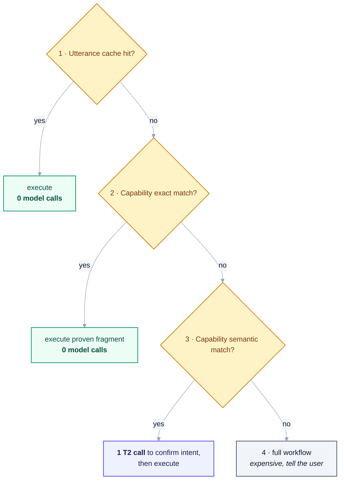
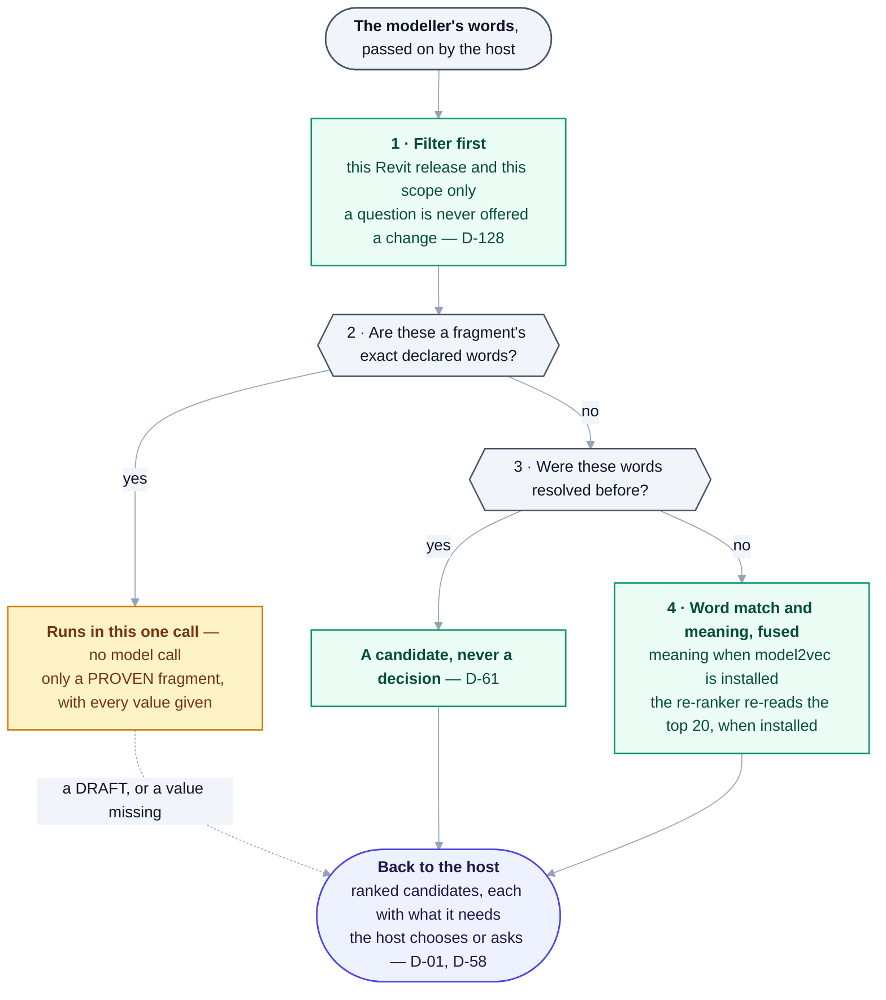

# 19 — Context Management, Model Routing & Cost

> Derived from [Master Specification Part 2](00b-master-specification-agent-os.md) §14–§18, §58–§60.
> **[NOTE]** blocks are engineering commentary added during review.

---

## 1. Context Manager

**Built 2026-09-09 as [`brain/heron_context.py`](../brain/heron_context.py)**, and served to the host as
the `heron_context` MCP tool. §2's parts budget is enforced there — a part outside the path's budget
**raises** rather than being dropped — and every part carries a `source`, which is §1's traceability.

**Three of this document's seven pieces are real; four are not, and only one of those four is
outstanding.** The model router, the fallback and cost accounting were placed in the **host** by
[D-58](DECISIONS.md), because Heron makes no model calls and per-request cost exists only inside the
process that made one. **Compression is the one genuinely unbuilt piece**, deliberately — see §2.

The Context Manager decides what each agent actually receives:

what the user said · what project is active · what Revit version is active · what knowledge is
relevant · what fragment is relevant · what skill is relevant · what previous conversation is relevant ·
what technical information is required

> **Only required information should be passed to the agent.**

**[NOTE]** This is one of the highest-leverage components in the platform and it is easy to
under-build. AI systems do not fail loudly when over-fed context — they fail *quietly*, by attending to
the wrong thing and producing a confident, plausible, wrong answer. In a system that then writes to a
live project model, that is the dangerous failure mode.

The Context Manager should be **T1 wherever possible** — deterministic filtering by project, version,
scope and capability, not a model deciding what is relevant. Using a model to choose context for
another model doubles cost to solve a problem that structured filters solve for free.

---

## 2. Context Compression

**The budget below is built and enforced. The compression is not, and that is a decision.**
[`brain/heron_context.py`](../brain/heron_context.py) implements this table as `BUDGET`, in **parts**
rather than tokens — Heron has no tokeniser, and inventing a number would be worse than counting a real
thing ([D-58](DECISIONS.md)). **No compressor exists.** The question [24 §7](24-trust-model.md) held
open about text Heron carries was answered on 2026-09-20 by
[D-81](DECISIONS.md#d-81--carried-text-is-stamped-not-scanned) — stamped with its source, never scanned —
and it asked for no compressor. The request itself always crosses byte for byte (`FULL_ONLY` in
`heron_context.py`), because `OST_DuctCurves` is the token a wrong compressor would damage first.

With 20,000 fragments, 5,000 skills and 500 agents, nothing can send everything.

```text
User Request -> Semantic Classification -> Relevant Domain -> Relevant Project
-> Relevant Capability -> Relevant Knowledge -> Minimal Context
```

Reduces token usage, latency, confusion, hallucination and cost.

**[NOTE]** Note the order: **domain and project narrow before semantics do.** That is correct and worth
protecting — it is a structured filter (cheap, exact, and it enforces
[Golden Rule 5](14-golden-rules.md) scope isolation at query time) applied before anything expensive
runs. The same principle as the retrieval stack in [05 §4](05-heron-brain.md).

**[NOTE]** A concrete budget is worth setting now, because "minimal context" is otherwise unfalsifiable:

| Path | Context budget |
|---|---|
| Cached utterance → known skill | none — no model call at all |
| Simple BIM task | intent + active project + Revit version + one matched capability |
| Standards check | the above + the specific standard clauses cited, not the whole standard |
| Code generation | the above + the closest existing fragment + its tests + the API surface used |

If a context assembly exceeds its budget, that is a bug in retrieval, not a reason to raise the budget.

---

## 3. Model Router

| Task | Model class |
|---|---|
| Simple task | Fast model |
| Complex reasoning | Stronger reasoning model |
| Code generation | Coding model |
| Document classification | Efficient model |
| Critical architectural decision | High-reasoning model + validation |

**[NOTE — tension with [D-01](DECISIONS.md), needs resolving]**

Heron runs as a **Claude Code plugin**. In that arrangement **Claude Code chooses the model**, not
Heron. A Heron-owned Model Router partly duplicates something the host already does, and the two could
disagree.

Three ways to reconcile it:

| Option | How | Assessment |
|---|---|---|
| **A. Host routes; Heron declares intent** | Heron's agent/subagent definitions declare their reasoning needs; Claude Code resolves them to models | Simplest. Works today. Heron never hard-codes a model id. **Recommended.** |
| **B. Heron routes for its own calls** | Heron's Python brain calls model APIs directly for T2 work, routing itself | Full control and real cost savings on high-volume T2 work. But adds an API key, a second billing relationship, and duplicated capability |
| **C. Hybrid** | Host routes conversational work; Heron routes internal batch work (embedding, classification, bulk scoring) | Likely the real end state. Batch classification of 20,000 fragments should not run on a frontier model |

**Recommendation: A now, C later.** The routing *intent* — which is what §17 actually specifies — gets
recorded in the capability registry as the **cost tier** regardless of who resolves it. That way the
design survives either choice.

Tracked as [Q-30](OPEN-QUESTIONS.md).

> **As built (2026-10-18): the tension is resolved.** Q-30 was closed by Part 4 §24's model abstraction
> layer: Heron declares the intent, and the host resolves it
> ([23 §8](23-heron-kernel.md#8-ai-model-abstraction-layer--resolves-an-open-tension)).
> [`heron_router.py`](../brain/heron_router.py) chooses *who* chooses and never a model. Heron makes no
> model call of its own, so routing, fallback and cost belong to the host
> ([D-58](DECISIONS.md#d-58--heron-measures-what-it-can-see-and-the-cost-meter-belongs-to-the-host)).
> One provider adapter is built and unused: [`heron_provider.py`](../brain/heron_provider.py) (DRAFT)
> talks to a local Ollama on `127.0.0.1` only, nothing in `brain/` or `mcp/server/` imports it, and it
> has not met a provider ([37](37-the-provider-adapter.md), NEEDS-CHECKING
> [K3](needs-checking/group-k.md)).

**[NOTE]** Whatever is chosen, never hard-code model identifiers in agent definitions. Models change
faster than architectures. Declare *"this needs strong reasoning"*, and resolve it in one place.

---

## 4. Model Fallback

```text
Primary Model -> Failure -> Fallback Model -> Validation
```

> The system should never silently produce an inferior result without awareness.

**[NOTE]** Two rules that make this safe rather than merely resilient:

1. **A fallback result is marked as such** — in the audit log, in the confidence value, and in the
   fragment's execution history. A result produced under fallback must never be counted as evidence
   toward promoting a fragment to `PROVEN`.
2. **Fallback does not apply to high-risk work.** If a `MODIFY` operation's reasoning step fell back to
   a weaker model, stop and tell the user rather than proceeding with reduced confidence. Falling back
   is fine for classification; it is not fine for something about to change 247 ducts.

---

## 5. Cost Optimization

> - If a **proven fragment exists** → **DO NOT GENERATE NEW CODE.**
> - If an **exact answer exists in trusted knowledge** → do not reason expensively.

**[NOTE]** Part 2 states from the *waste* side what [02 §6](02-architecture-overview.md) derived from
the *architecture* side and §83 states from the *modularity* side. All three converge on the same rule,
which is a strong signal it is correct:

> **The common case must be deterministic. The model is for the uncommon case.**

Made concrete as an enforced pipeline order:



<details>
<summary>Same thing as plain text</summary>

```text
1. Utterance cache hit?          -> execute, 0 model calls
2. Capability exact match?       -> execute proven fragment, 0 model calls
3. Capability semantic match?    -> 1 T2 call to confirm intent, then execute
4. No capability?                -> full workflow (expensive, tell the user)
```

</details>

Steps 1 and 2 must be tried **before** any model is invoked, structurally — not as an optimisation
added later. If step 4 is ever reached for *"select all ducts"* after the first time, something is broken.

> **As built (2026-10-18): the order holds, and two steps run differently from the diagram.**
> [`heron_search.py`](../brain/heron_search.py) tries the identity route first and the utterance cache
> second.
>
> - **A cache hit is not executed.** It comes back as a candidate, never a decision, and a wording is
>   cached only after its fragment has run and come back
>   ([D-61](DECISIONS.md#d-61--only-a-run-that-came-back-may-be-cached-and-re-indexing-forgets-what-changed-underneath-it)).
>   Replaying it unasked would let one accepted guess harden into a habit.
> - **Step 3 makes no model call on Heron's side.** Keyword and meaning matches go back to the host as
>   ranked candidates, each with what it needs typed, and the host confirms
>   ([D-01](DECISIONS.md#d-01--execution-host-claude-code-plugin),
>   [D-58](DECISIONS.md#d-58--heron-measures-what-it-can-see-and-the-cost-meter-belongs-to-the-host)).
>
> Step 2 runs in one tool call: the declared words of a PROVEN capability, with every value given
> ([04 §8.5](04-heron-mcp.md#85-one-request-fewer-turns--built-2026-09-30)). How often a request was
> answered with no model needed is measured by `tools/measure-routes.py`.

The order as it runs, in `find` in [`heron_retrieve.py`](../brain/heron_retrieve.py) and the doors' one-call
path. Set it beside the diagram above: no step executes off the cache, and no step calls a model.



<details>
<summary>Same thing as plain text</summary>

```text
The modeller's words, passed on by the host
1. Filter first: this Revit release and this scope only; a question is never offered a change (D-128)
2. A fragment's exact declared words?
     yes -> runs in this one call, no model call - only a PROVEN fragment, with every value given
            (a DRAFT, or a value missing: back to the host as a candidate)
     no  -> 3
3. These words resolved before?
     yes -> a candidate, never a decision (D-61) -> back to the host
     no  -> 4
4. Word match and meaning, fused (meaning when model2vec is installed);
   the re-ranker re-reads the top 20, when installed -> back to the host
Back to the host: ranked candidates, each with what it needs; the host chooses or asks (D-01, D-58)
```

</details>

---

## 6. Caching

Caches: capability lookup · fragment lookup · API knowledge · version compatibility ·
dependency analysis · project context.

> Cache invalidation must happen when relevant knowledge changes.

**[NOTE]** The [event system](18-agent-operating-system.md) is what makes invalidation tractable —
`FragmentUpdated` invalidates the fragment and capability caches; `RevitOpened` invalidates version and
project context. Without events, cache invalidation becomes guesswork and stale results are worse than
no cache.

**[NOTE]** Add one cache Part 2 does not list, and which pays for itself faster than any of the others:

> **Utterance cache** — normalised user phrasing → resolved capability.
> After the first *"select all ducts"*, every later identical request skips intent detection entirely.

Invalidate on `SkillCreated`, `FragmentApproved` and project change. In real BIM work the same handful
of phrases recur constantly, so hit rates should be high.

> **As built (2026-10-18):** invalidation runs on content, not events. A cached wording carries its
> fragment's fingerprint, which is the same hash D-30 uses to call a proof stale, and re-indexing drops a
> row written against old bytes ([D-61](DECISIONS.md#d-61--only-a-run-that-came-back-may-be-cached-and-re-indexing-forgets-what-changed-underneath-it)).
> A card's parse is kept until its bytes change
> ([04 §8.5](04-heron-mcp.md#85-one-request-fewer-turns--built-2026-09-30)). The add-in's compile cache
> is keyed by the fragment's source. The event bus exists as a module,
> [`heron_events.py`](../brain/heron_events.py), and no cache listens to it.

---

## 7. Observability

Metrics: task latency · agent latency · retrieval latency · model latency · token usage ·
success rate · failure rate · retry count · rollback count.

**[NOTE]** Two additions worth making, both cheap:

| Metric | Why |
|---|---|
| **Model calls per user request** | The single number that tells you whether the T1/T2/T3 discipline is holding. If it drifts from ~1 to ~12, the architecture is eroding. |
| **Cost per user request** | Makes the [visible cost meter](PROPOSALS.md) possible, and turns cost from a monthly surprise into a live signal. |

**[NOTE]** These metrics are also the input to the **Capability Gap** report and the
**Agent Optimizer**. They should be written into the same audit log
([12 §5](12-security-and-permissions.md)) rather than a separate telemetry system — one append-only
record, many readers.

> **As built (2026-10-18):** the two additions were split by
> [D-58](DECISIONS.md#d-58--heron-measures-what-it-can-see-and-the-cost-meter-belongs-to-the-host).
> Cost per request is the host's. *Model calls per request* is replaced by what Heron can count: how
> often it answered with no model needed at all, through the identity and cache routes. Latency is
> Heron's. The add-in writes one audit line per request, and the brain writes its own audit file
> ([D-62](DECISIONS.md#d-62--the-brain-writes-its-own-audit-file-and-the-reader-that-already-merges-does-the-merging)).
> [`tools/time-family-build.py`](../tools/time-family-build.py) reads a chat's transcript and the audit
> trail and times a whole job ([04 §8.7](04-heron-mcp.md#87-a-new-pc-as-quick-as-the-old-one--built-2026-10-09)).
