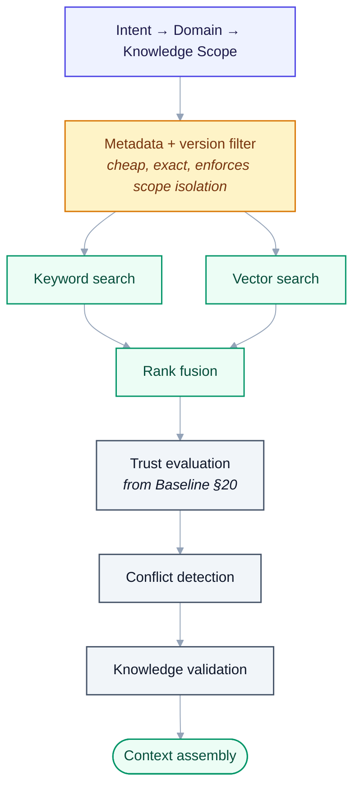
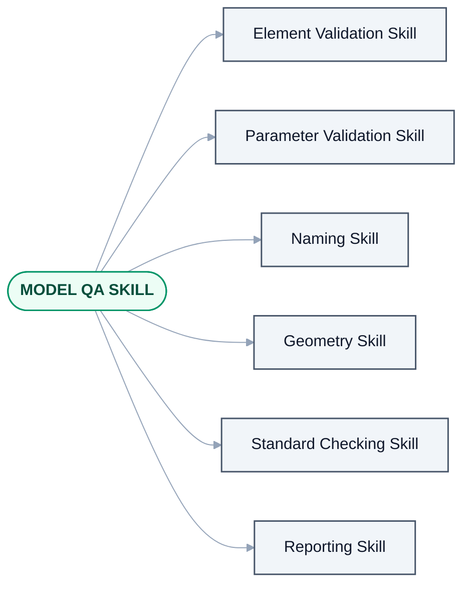

# 20 — Knowledge Trust, Conflict & Evolution

> Derived from [Master Specification Part 2](00b-master-specification-agent-os.md)
> §19–§29, §33–§37, §61–§64.
> Complements [05 — Heron Brain](05-heron-brain.md), [09 — Skills & Fragments](09-skills-and-fragments.md)
> and [10 — Memory & Knowledge](10-memory-and-knowledge.md).
> **[NOTE]** blocks are engineering commentary added during review.

---

## 1. RAG Operating System

```text
User Request -> Intent -> Domain -> Knowledge Scope
-> Semantic Search -> Keyword Search -> Metadata Filtering -> Vector Search
-> Candidate Ranking -> Conflict Detection -> Knowledge Validation -> Context Assembly
```

**[NOTE — this closes a gap flagged in the Part 1 review]**

[PROPOSALS A17](PROPOSALS.md) raised that Part 1's retrieval was vector-only, which handles exact
technical tokens (`OST_DuctCurves`, `BuiltInParameter.RBS_*`, shared-parameter GUIDs) badly. Part 2
specifies **keyword search and metadata filtering alongside vector search**, which is the hybrid
approach [05 §4](05-heron-brain.md) recommended. The gap is closed.

Two refinements still worth applying:

1. **Reorder slightly.** Scope and metadata filtering should run **before** the expensive searches, not
   between or after them — filtering first eliminates most of the corpus for free and enforces
   [Golden Rule 5](14-golden-rules.md) at query time rather than at ranking time.
2. **Fuse rather than concatenate.** Keyword and vector results need reciprocal rank fusion, otherwise
   one modality dominates arbitrarily.

**[NOTE]** The [Baseline §20](00c-master-handover-baseline.md) restates this pipeline with metadata
filtering moved *after* all three searches, and adds an explicit **Trust Evaluation** stage before
conflict detection. The added Trust Evaluation stage is an improvement and is adopted. The filter
placement is not — running metadata filtering last means embedding and searching a corpus that is about
to be discarded, which is the single most wasteful thing a retrieval pipeline can do.

**Adopted order**, combining the best of all three statements:



<details>
<summary>Same thing as plain text</summary>

```text
Intent -> Domain -> Knowledge Scope
-> Metadata + version filter   (cheap, exact, enforces scope isolation)
-> Keyword search + Vector search   (in parallel, over the survivors)
-> Rank fusion
-> Trust evaluation             (from Baseline §20)
-> Conflict detection
-> Knowledge validation
-> Context assembly
```

</details>

**Conflict Detection as a pipeline stage is new in Part 2 and is a genuine improvement** — see §4 below.

> **As built (2026-10-18):** the adopted order is the order of
> [`heron_retrieve.py`](../brain/heron_retrieve.py) up to rank fusion. The metadata and version filter
> runs first, and an excluded fragment is reported with its reason. Then come keywords (FTS5) and
> nearness, then reciprocal rank fusion, then an optional re-rank. The later stages are separate tools,
> not one pipeline:
>
> - **Trust** is the fragment's own status. Only a `PROVEN` fragment may run off an exact match
>   unasked, and `revit_change` keeps a change only from one whose proof still stands
>   ([D-117](DECISIONS.md#d-117--a-change-is-kept-only-from-a-fragment-whose-proof-still-stands)).
> - **Conflict detection** runs across scopes in `heron_standards`
>   ([`heron_conflict.py`](../brain/heron_conflict.py)). It surfaces a disagreement and settles nothing.
> - **Knowledge validation** is `heron_check` against the cited clauses
>   ([`heron_ground.py`](../brain/heron_ground.py)).
> - **Context assembly** is `heron_context` ([`heron_context.py`](../brain/heron_context.py),
>   [19 §1](19-context-and-cost.md#1-context-manager)).
>
> Document clauses come back in their own labelled answer, never fused with fragments and never behind
> the version filter ([`brain/README.md`](../brain/README.md)). The lookup order as it runs, with the
> identity and cache routes ahead of the search, is drawn in [19 §5](19-context-and-cost.md#5-cost-optimization).

---

## 2. Knowledge Hierarchy

```text
1. Active Project Knowledge
2. Approved Company Knowledge
3. Proven User Knowledge
4. Approved Community Knowledge
5. General Heron Knowledge
6. Experimental Knowledge
7. Temporary Knowledge
```

Project-specific knowledge overrides generic knowledge where appropriate.

**[NOTE]** This ordering is correct and important: a project's own standard beats the company default,
which beats a stranger's community fragment. It is exactly how a competent engineer weighs sources.

One caveat worth building in: **"overrides" must not mean "silently replaces".** When project knowledge
overrides company knowledge, the answer should say so — *"using this project's duct sizing table, which
differs from the company default"*. A silent override is how a modeller ends up confidently applying the
wrong standard, having never been told a choice was made.

> **As built (2026-10-18):** the hierarchy is named and **not applied**. `heron_standards` returns each
> scope's answer under its own label, and [`heron_conflict.py`](../brain/heron_conflict.py) has no
> winner and no resolve, which `tests/test_conflict.py` holds. The agent written to say *"this
> project's rule outranks the company default"* out loud is
> [`heron_project.py`](../brain/heron_project.py). It is DRAFT, and no tool serves it.

---

## 3. Knowledge Trust levels

```text
EXPERIMENTAL -> UNVERIFIED -> TESTED -> VALIDATED -> PROVEN -> PRODUCTION -> DEPRECATED
```

**[NOTE]** This mirrors the fragment lifecycle ([09 §5](09-skills-and-fragments.md)) and should be
**the same field**, not a parallel one. Two independent status vocabularies on the same object will
drift apart, and then nobody knows which one governs retrieval.

Trust must be a **hard filter before ranking, not a ranking signal**, for two specific cases:

- **Version compatibility** — a fragment that does not support the running Revit version must be
  structurally unselectable, not merely ranked lower.
- **`EXPERIMENTAL` / `UNVERIFIED`** — never reachable for a `MODIFY` operation on a live model.
  That is [Golden Rule 17](14-golden-rules.md).

> **As built (2026-10-18):** a fragment carries one status field, `heron-status`, and only `DRAFT` and
> `PROVEN` are in use ([09 §5](09-skills-and-fragments.md#5-fragment-lifecycle)). Unifying the status
> words is still proposed, not decided
> ([D-14](DECISIONS.md#d-14--unify-six-status-vocabularies-into-two-orthogonal-axes)). Both hard filters
> are built. A fragment for another release is absent from retrieval. A `DRAFT` cannot keep a change
> through `revit_change`
> ([D-117](DECISIONS.md#d-117--a-change-is-kept-only-from-a-fragment-whose-proof-still-stands)); its one
> exception is a single run on the model in front, behind Revit's Keep or Discard box
> ([D-119](DECISIONS.md#d-119--a-draft-fragment-may-run-once-on-the-model-in-front-behind-a-keep-or-discard-prompt-in-revit-and-article-11-says-so)).

---

## 4. Knowledge Conflict Resolution

```text
Conflict Detected -> Compare Version -> Compare Source -> Compare Trust
-> Compare Project Context -> Compare Test History
-> Conflict Resolution Agent -> Decision
```

> If confidence is insufficient: **ask the user.**

**[NOTE]** This is one of the most valuable additions in Part 2, and it is the mechanism that prevents
the classic failure of accumulated knowledge bases: two fragments disagree, retrieval returns whichever
ranked higher that day, and the system becomes quietly non-deterministic.

Three things to make it work in practice:

1. **Detect conflicts at write time, not only at read time.** When a fragment is created or imported,
   compare it against what already covers the same capability. Resolving a conflict once, at ingest, is
   far cheaper than resolving it on every query — and it stops the knowledge base accumulating
   contradictions in the first place.
2. **"Ask the user" needs a threshold and a memory.** Define the confidence level below which Heron
   asks, and **record the answer as a decision** so the same question is not asked again next week.
   A system that asks the same question repeatedly is worse than one that guesses.
3. **Conflicts are a signal, not just a problem.** A recurring conflict usually means two fragments
   should be merged, branched by version, or scoped to different projects. Route persistent conflicts to
   the Fragment Evolution Engine rather than resolving them one query at a time forever.

---

## 5. Fragment identity & duplicate detection

Identity is independent of filename, folder, formatting, author and location — based on semantic
purpose, capability, implementation identity, metadata and relationships.

```text
New Fragment -> Identity Extraction -> Semantic Comparison -> Metadata Comparison
-> Code Comparison -> Existing Fragment Search
```

| Result | Action |
|---|---|
| Exact duplicate | Already exists. No update required. |
| Similar | Existing fragment may be improved. |
| New | Create new fragment. |
| Conflict | Human / Resolution Agent review. |

**[NOTE]** This is the mechanism that makes importing the existing `AJ-Tools` / `PyRevit-Tools` /
`AEB-Tools` libraries safe. Without it, importing years of accumulated tooling would produce hundreds
of near-duplicate fragments and the knowledge base would be unusable on day one.

**[NOTE]** "Similar → existing fragment may be improved" is the highest-value branch and the easiest to
get wrong. It should produce a **diff and a proposal**, never an automatic merge — the imported version
may be better, worse, or right for a different Revit version. See [Golden Rule 4](14-golden-rules.md).

---

## 6. Fragment versioning and branching

```text
Fragment: DUCT-ENDCAP
  v1.0  Revit 2020
  v1.1  Revit 2020-2022
  v2.0  Revit 2020-2027
```

```text
Common Fragment
  +-- Revit 2020-2021 implementation
  +-- Revit 2022-2024 implementation
  +-- Revit 2025-2027 implementation
```

> The common semantic capability remains **one fragment**. Implementation details branch internally.

**[NOTE — this confirms the approach in [16](16-version-support-strategy.md)]**

Part 2 states explicitly what [16 §5](16-version-support-strategy.md) proposed: one semantic fragment,
multiple internal implementations, never unrelated fragments per version. This is the fragment-level
mirror of the platform-level adapter layer, and it is what makes
[D-05](DECISIONS.md) (Revit 2020 → latest) affordable.

It also means **capability, not implementation, is what the Capability Registry exposes** — the
Orchestrator asks for `ADD_DUCT_END_CAP` and never learns that three implementations exist.

> **As built (2026-10-18):** one fragment, one implementation file, `impl/any/fragment.cs`. Where
> releases differ, it branches inside on the compile symbols rather than in separate implementation
> folders ([09 §4](09-skills-and-fragments.md#4-knowledge-identity-30)). The capability is what callers
> name. [`heron_capability.py`](../brain/heron_capability.py) derives the registry from the cards, and
> the three doors take a capability, never a fragment id.

---

## 7. Fragment Evolution Engine

Decides: `KEEP` · `UPDATE` · `EXTEND` · `SPLIT` · `MERGE` · `BRANCH` · `DEPRECATE` · `ARCHIVE`

**[NOTE]** Part 2 adds `EXTEND` and `BRANCH` to Part 1's list. `BRANCH` is the important one — it is the
decision that keeps Golden Rule 4 satisfiable when a new Revit version needs different code.

All eight outcomes must **propose**, never apply autonomously, to anything at `PRODUCTION`
([09 §6](09-skills-and-fragments.md)). Splitting or merging a production fragment silently changes the
behaviour of every skill that depends on it.

---

## 8. Skill composition



<details>
<summary>Same thing as plain text</summary>

```text
MODEL QA SKILL
 +-- Element Validation Skill
 +-- Parameter Validation Skill
 +-- Naming Skill
 +-- Geometry Skill
 +-- Standard Checking Skill
 +-- Reporting Skill
```

</details>

**[NOTE]** Skills composing from skills is new in Part 2 and is the right model — it is how a real QA
procedure is actually structured. Two guards:

- **Composition must be acyclic**, and validated as such at registration. A skill graph with a cycle
  will hang or recurse.
- **Risk level propagates upward.** A composite skill inherits the highest risk level of its parts. A
  "reporting" skill that contains one `MODIFY` sub-skill is a `MODIFY` skill, and must be gated as one.

> **As built (2026-10-18):** no skill in [`brain/skills/`](../brain/skills/) names another skill yet.
> Each one's `needs` lists capabilities only, so composition in the library is one level deep. Both
> guards are written for when one does: [`heron_composition.py`](../brain/heron_composition.py) (DRAFT)
> names a cycle, and refuses a declared risk lower than what the skill composes. The gate in the add-in
> reads the risk of each operation it is sent, never a skill's.

---

## 9. Quality scores

**Knowledge quality:** accuracy · relevance · freshness · usage · success rate · source trust ·
compatibility.

**Skill quality:** success · user corrections · execution time · failure rate · compatibility.

> Poor-performing skills automatically enter review.

**[NOTE]** Same caution as the agent trust score ([18 §5](18-agent-operating-system.md)):

- **Success ≠ correct.** A fragment selecting 0 ducts "succeeded". Validation must assert the expected
  outcome, not merely the absence of an exception.
- **A user correction is a failure.**
- **Show sample size.** 3/3 is not 100%.
- **Score per Revit version.** A blended score hides the version-specific breakage that
  [D-05](DECISIONS.md) makes most likely.

---

## 10. Knowledge garbage collection

```text
Unused -> Candidate for Archive -> Review -> Archive
```

> The Cleanup Agent should **not blindly delete**.

**[NOTE]** Correct, and it should go one step further: **archive, never delete** — matching agent
retirement (§13) and fragment lifecycle. Storage is cheap; a fragment someone spent a month refining is
not recoverable once gone.

"Unused" also needs care as a criterion. A fragment used once a year — during a specific project phase,
or for an annual submission — is not dead. Suggested rule: a fragment is a GC candidate only if unused
**and** superseded **and** not referenced by any skill.

> **As built (2026-10-18):** the library is files in git ([23 §7](23-heron-kernel.md#7-immutable-provenance)),
> so nothing is lost when a card is retired. The Cleanup agent,
> [`heron_cleanup.py`](../brain/heron_cleanup.py) (DRAFT), archives and never deletes. It calls
> nothing *unused* without evidence, and its suite asserts that the module holds no delete call.

---

## 11. Continuous learning

```text
Observed -> Candidate -> Validated -> Approved -> Production
```

> Prevents accidental learning from becoming production truth.

**[NOTE]** This is [Golden Rule 6](14-golden-rules.md) applied to learning, and the five stages map
cleanly onto the fragment lifecycle. Keeping them as **one vocabulary** rather than two parallel ones
avoids the drift problem noted in §3 above.

The most valuable thing to learn from is **failure**, not success — see
[11 §6](11-orchestration-and-workflows.md). A pattern that keeps failing is more informative than one
that keeps working.
