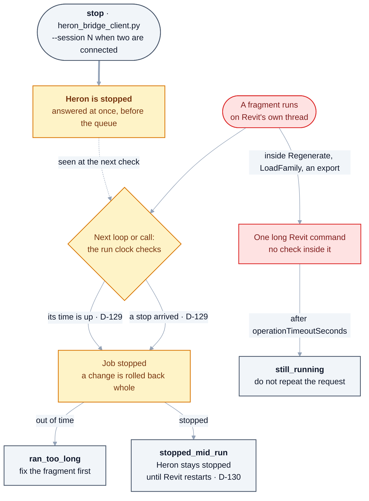

# 21 — Resilience, Safety & Operations

> Derived from [Master Specification Part 2](00b-master-specification-agent-os.md)
> §38–§45, §49–§58, §75–§79.
> **[NOTE]** blocks are engineering commentary added during review.
>
> **As built (2026-10-18):** these sections have code now. Every file below is `DRAFT` and tested without
> Revit. Each file's header names the agent it implements, where it implements one. The *Reached by*
> column is what imports or runs the file, found with `grep` on 2026-10-18; a file reached only by its
> own command line is not called by anything else in Heron.
>
> | § | Built in | Reached by | Met a real Revit |
> |---|---|---|---|
> | §1 Dependency graph | [`heron_graph.py`](../brain/heron_graph.py) | `tools/check-gaps.py`, `tools/measure-graph.py` | not needed: it reads Heron's own files |
> | §4 Emergency stop | the run clock, [`HeronRunClock.cs`](../revit/Heron.Revit.Addin/HeronRunClock.cs), and the bridge's `stop`, [`HeronStop.cs`](../platform/Heron.Core/HeronStop.cs) ([D-129](DECISIONS.md), [D-130](DECISIONS.md)) | every fragment run; `heron_bridge_client.py stop` | **yes**, 2026-10-18 on Revit 2024.3 and 2027.3 (§4) |
> | §5 Health | [`heron_health.py`](../mcp/server/heron_health.py) | the `revit_health` and `heron_diagnose` tools | not recorded here |
> | §6 Self-healing | [`heron_healing.py`](../brain/heron_healing.py) | its own command line only | — |
> | §9 Configuration | [`heron_configuration.py`](../brain/heron_configuration.py) | its own command line only | — |
> | §10 Migration | [`heron_migration.py`](../brain/heron_migration.py) | its own command line only | — |
> | §12 Background workers | [`heron_scheduler.py`](../brain/heron_scheduler.py) | its own command line only | — |
> | §13 Audit | [`heron_audit.py`](../brain/heron_audit.py) for the brain; the add-in's [`HeronAudit.cs`](../platform/Heron.Core/HeronAudit.cs) | `heron_brain.py`, `heron_ingest.py`; every add-in request | the add-in's audit file was read on the owner's laptop for the timings in [04 §8.7](04-heron-mcp.md) |
> | §13 Workflow engine | [`heron_workflow.py`](../mcp/server/heron_workflow.py) | **nothing but `tests/test_workflow.py`**: the server does not import it | — |

---

## 1. Dependency Graph — **new in Part 2, and important**

```text
Skill -> Fragment -> Revit API -> .NET -> Package
```

```text
.NET Update -> Dependency Graph -> Affected Fragments
-> Affected Skills -> Affected Agents -> Testing
```

**[NOTE]** This is the missing piece that makes [D-05](DECISIONS.md) (Revit 2020 → latest) and
[Golden Rule 4](14-golden-rules.md) operationally possible.

Without a dependency graph, "does this change break anything?" can only be answered by testing
everything — which, across eight Revit versions and thousands of fragments, is not affordable. With
one, the blast radius of a change is computable, and only the affected subset needs the full matrix.

It is also what turns the [Regression Testing Agent](13-testing-and-quality.md) from a good intention
into a targeted operation.

### What it needs to hold

| Edge | Example |
|---|---|
| skill → skill | `Model QA` composes `Parameter Validation` |
| skill → fragment | `Select Ducts` uses `filter-by-category` |
| fragment → fragment | one fragment calls another |
| fragment → Revit API surface | uses `FilteredElementCollector`, `OST_DuctCurves` |
| fragment → runtime | requires `net48` or `net8` |
| fragment → package | third-party dependency |
| capability → agent | which agents provide it |
| agent → capability | what it provides |

**[NOTE]** Both specifications name a **Knowledge Graph** in the architecture line, but this dependency
graph is the only place it is actually specified. That is fine — a dependency graph over capabilities,
skills, fragments and API surfaces is far more useful here than a general semantic knowledge graph, and
it has a clear job. Recommend building exactly this and not more.

**Storage:** this is ordinary relational data with recursive queries. SQLite handles it well
(`WITH RECURSIVE`), and it sits naturally beside the knowledge store recommended in
[05 §5](05-heron-brain.md). A dedicated graph database is not warranted. Tracked as
[Q-31](OPEN-QUESTIONS.md).

> **As built (2026-10-18):** Q-31 is answered by [D-40](DECISIONS.md) - SQLite, as recommended, and an
> edge is **derived** before it is stored (the Revit API members from the compiled assembly, through
> `tools/check-api-surface.py`), never typed by hand. Built as
> [`brain/heron_graph.py`](../brain/heron_graph.py) (`HERON-KRN-DEP-013`), DRAFT.

---

## 2. Safety architecture — autonomy proportional to risk

| Risk | Autonomy | Examples |
|---|---|---|
| **Low** | Automatic | search, classification, indexing, analysis, backup, health check |
| **Medium** | Controlled automatic | file rename, file movement, code generation, fragment updates |
| **High** | Requires approval | deleting production knowledge, modifying repositories, publishing releases, destructive Revit operations, major architecture changes |

**[NOTE]** This maps cleanly onto the permission levels in [12 §1](12-security-and-permissions.md):
Low ≈ `READ`/`ANALYZE`, Medium ≈ `SUGGEST`/`EXECUTE`, High ≈ `MODIFY`/`PUBLISH`/`ADMIN`.

One adjustment: **`MODIFY` on a live project model belongs in High, not Medium.** Part 2 places "code
generation" and "fragment updates" in Medium, which is right — those touch Heron's own artefacts. But
moving 247 ducts in a client's model is a different category of act, and belongs behind a preview and a
confirmation ([Golden Rule 17](14-golden-rules.md)).

> **As built (2026-10-18):** `MODIFY` and above need the owner's Changes switch, and `PUBLISH` and `ADMIN`
> need a switch of their own as well. The confirmation is Revit's Keep or Discard box, shown only while
> the owner's *Ask to Keep* switch is on, and that switch is off by default
> ([D-138](DECISIONS.md#d-138--the-keep-or-discard-question-gets-a-switch-on-the-ribbon-and-its-box-can-keep-the-rest-of-one-job-without-asking)).
> So with Changes on and *Ask to Keep* off, a change is kept without a preview. [Golden Rule 17](14-golden-rules.md)
> records that break. The whole decision is drawn in [12 §3a](12-security-and-permissions.md).

---

## 3. Human approval gates

> Approval occurs only at **meaningful boundaries**.

Useful: *"I found a new implementation that changes the existing production fragment for Revit 2020–2027.
Approve replacement?"*

Never: *"I am searching the fragment database."*

**[NOTE]** This is an important corrective. Over-asking destroys a tool as surely as under-asking
damages a model — a user who is asked twelve times per task starts clicking Yes without reading, and
then the gate protects nothing.

Proposed rule of thumb:

> **Ask when the answer would change what Heron does, and the user is the only one who can know it.**

Ask about: replacing a production fragment · modifying a live model · publishing anything · installing
third-party code · resolving a knowledge conflict Heron cannot settle.

Never ask about: searching, ranking, indexing, classifying, health checks, or anything read-only.

---

## 4. Emergency Stop — **new in Part 2, and necessary**

```text
STOP ALL AGENTS
STOP BACKGROUND TASKS
DISABLE AUTO-UPDATE
DISABLE AUTO-EXECUTION
```

**[NOTE]** Correctly identified as increasingly important as autonomy grows. Three requirements to make
it real rather than nominal:

1. **It must be reachable when Heron is misbehaving.** A stop button implemented *inside* the agent
   system is useless when that system is stuck. It belongs in the **Revit add-in UI** — a ribbon button
   that works regardless of what the Python side is doing — plus a file-based kill switch the add-in
   checks before executing anything.
2. **Stopping must leave the model clean.** A stop mid-operation rolls back the open `TransactionGroup`
   ([Golden Rule 16](14-golden-rules.md)). Never a half-applied change.
3. **It must be sticky.** After an emergency stop, Heron stays stopped until a person restarts it. It
   does not quietly resume on the next request or after a restart.

**[NOTE 2026-10-17]** Requirement 3 is **amended by [D-130](DECISIONS.md)**, on the owner's answer to
[Q-68](open-questions/from-master-specification-part-2.md): a stop lasts until Revit is restarted, and a
restart clears it - *"after a restart"* no longer holds, and the rest of the requirement does. Requirements
1 and 2 moved the same day ([D-129](DECISIONS.md)): the bridge's `stop` operation reaches the add-in
while Revit is busy - a pipe operation rather than the file named above - and a fragment already
running is stopped at its next check and its `TransactionGroup` rolled back. A single long Revit API
call still cannot be interrupted.

### 4a. How a stuck run is stopped — as built (2026-10-18)

This section adds a picture and a table beside the requirements above. It does not change them. Checked
against [`HeronRunClock.cs`](../revit/Heron.Revit.Addin/HeronRunClock.cs),
[`HeronStop.cs`](../platform/Heron.Core/HeronStop.cs), `AnswerStop` and `Dispatch` in
[`RevitDispatcher.cs`](../revit/Heron.Revit.Addin/RevitDispatcher.cs), `Gate` in
[`RevitOperations.cs`](../revit/Heron.Revit.Addin/RevitOperations.cs), `cmd_stop` in
[`heron_bridge_client.py`](../mcp/client/heron_bridge_client.py), and the failure table in
[`heron_failure.py`](../mcp/server/heron_failure.py).

**What there is, against requirement 1.** There is no Emergency Stop button on the ribbon
([D-46](DECISIONS.md)), no file-based kill switch, and no MCP tool. The one way to set the stop is
`python mcp/client/heron_bridge_client.py stop`. It must be run with the client id of the chat that holds
that Revit (`HERON_CLIENT_ID`), and it needs `--session <pid>` when more than one Revit is connected. Two
things stop a stuck fragment, and both act at the fragment's next check. That check is a call
`HeronStackGuard` puts at the top of every loop and every method in fragment code.



<details>
<summary>Same thing as plain text</summary>

```text
A fragment runs on Revit's own thread. At every loop and every call it asks the run clock (D-129).

  its time is up  -> the whole job is rolled back -> ran_too_long
                     (the limit is revit.operationTimeoutSeconds, 60 s by default in HeronConfig.cs,
                      less a margin from HeronRunClock.BudgetFor, so this answer arrives first)
  a stop arrived  -> the whole job is rolled back -> stopped_mid_run
                     Heron then stays stopped until Revit is restarted (D-130)

The stop: python mcp/client/heron_bridge_client.py stop [--session N]
  answered on a bridge thread before the queue, so it reaches a Revit whose thread is held
  only the chat that holds that Revit can stop it (its HERON_CLIENT_ID); another is refused
  with two Revits connected and no --session, nothing is sent and both are listed

What no check can reach: one long Revit command (Regenerate, LoadFamily, an export).
  It finishes first. After revit.operationTimeoutSeconds the chat is told still_running.

A read opens no transaction, so there is nothing to roll back: the answer says Heron counted the model
before and after it, and nothing was changed.
The trip is sticky: a fragment that catches the stop and returns is rolled back all the same.
The Keep or Discard box is shown after the fragment has returned, outside the clock, so a
modeller taking their time never trips it.
```

</details>

**What the modeller is told.** The sentences are the add-in's own (`HeronRunClock.Why`, `ClockStopped`,
`AnswerStop`, `HeronStop.Message`, `RevitDispatcher`). `heron_failure.py` sorts each answer under
*Model* and *Next step*.

| When | Answer | They read | The model | Next step |
|---|---|---|---|---|
| A fragment runs out of time | `ran_too_long` | *"'name' ran out of time and was stopped after N seconds - its limit, set inside the M seconds Heron waits for Revit ... A loop that never ends is the usual cause"* | a change: rolled back, and the answer says whether Revit confirmed it. A read: counted, nothing changed | fix the fragment before sending it again |
| `stop` is run while a job runs | the stop's own answer | *"Heron is stopped. Revit is running a job now: a fragment stops at its next pass through a loop or a call and is rolled back ..."* | not touched by the stop itself | — |
| The stopped job | `stopped_mid_run` | *"'name' was stopped part way through, because Heron was told to stop while it ran."* and *"Heron stays stopped until Revit is restarted: reading the model still works ..."* | rolled back | do not send it again |
| Any change while stopped | `stopped` | *"Heron is stopped. Nothing was sent to Revit. Ctrl+Z in Revit undoes anything that already happened."* | nothing sent | restart Revit to work again |
| One long Revit command | `still_running` | *"Revit started the request but has not finished within N seconds. It is still working; do not repeat the request."* | still being worked on | wait |

While Heron is stopped, reads, the selection and zoom still work: the gate refuses only `MODIFY` and
above.

**Seen in Revit on 2026-10-18** ([NEEDS-CHECKING Group EZ](needs-checking/group-ez.md), the owner's
laptop, scratch models, with throwaway probe fragments deleted afterwards). On Revit 2024.3 a runaway
fragment was answered `ran_too_long` after 50 s with the rollback confirmed and the element count
unchanged, and so was one that caught the stop (EZ1). Revit came back by itself in the same process
(EZ2). A `stop` from a second pipe answered at once, and the runaway was `stopped_mid_run` six seconds
after it started. A change was then refused `stopped` while a read still answered. A stranger's client id
was refused (EZ3). On Revit 2027.3 the runaway came back `ran_too_long` at 50 s (EZ4, its first half).
**Found and since fixed:** that run's `stop` went to every connected Revit and stopped another chat's
Revit 2020. Since then the client sends it to one Revit and needs `--session` when there are two
([row 5b-1094](fragment-issues/section-5b-rows-401-425.md)). That fix is held by `tests/test_bridge_stop.py`
and has **not** run in Revit (EZ6). **Not run:** the after-restart half of EZ3, and anything on Revit 2020.
Whether an idle Revit should take a stop from any client id is
[Q-71](open-questions/tier-2.md).

**[NOTE]** Worth pairing with the **panic button** proposed in [PROPOSALS B3](PROPOSALS.md) —
*"undo everything Heron did today"*. Emergency Stop halts what is running; the panic button reverses
what already ran. Together they are the two controls that make people willing to try an autonomous tool
on real work at all.

---

## 5. Health monitoring

Monitored: Revit Connection · MCP · Agents · RAG · Vector DB · Database · Storage · GitHub ·
AI Provider · Background Workers. Each reports `HEALTHY` · `WARNING` · `DEGRADED` · `FAILED`.

**[NOTE]** One structured health object, one overall verdict, per-check detail — consumed by the
installer, the self-healing system, the user-facing "is Heron working?" answer, and failure analysis.
See [03 §3](03-heron-revit.md).

`DEGRADED` is a useful addition over Part 1's binary framing: Heron working without GitHub, or without
the vector index, is degraded rather than failed, and should say so instead of pretending everything
is fine.

---

## 6. Self-healing

| Condition | Flow | Permission |
|---|---|---|
| MCP disconnected | Detect → Recovery Agent → Reconnect → Health check | automatic |
| Vector index corrupted | Detect → Rebuild → Validate | automatic |
| Dependency missing | Detect → Install/Repair → Build → Validate | **confirm** |

**[NOTE]** The split from [07 §9](07-installation-and-update.md) holds: Heron may freely repair
**derived** state (indexes, caches, connections) and may freely *propose* anything else. Installing a
dependency means executing third-party code and should be confirmed, not automatic.

---

## 7. Source of Truth Principle

```text
Canonical Knowledge  ->  Vector DB
```

> **The Vector DB is an index, not the ultimate source of truth.**

**[NOTE — this confirms the position in [05 §7](05-heron-brain.md)]**

Part 2 states it explicitly, and it is the rule that makes disaster recovery possible: if the index is
corrupt, deleting and rebuilding it must always be a safe action. Fragments and skills live as
human-readable, git-diffable files with metadata; the index is derived.

This also means **the index never needs backing up** — only the canonical knowledge does. That
simplifies the backup strategy considerably.

---

## 8. Backup and disaster recovery

Backup covers: configuration · agents · skills · fragments · metadata · database · vector indexes ·
memory · project knowledge. Versioned.

```text
Detect -> Repair -> Restore Configuration -> Restore Knowledge
-> Rebuild Vector Index -> Health Check
```

**[NOTE]** Refinement, following from §7: back up the **data class** ([06 §2](06-heron-platform.md)) and
configuration. Do **not** back up the vector index — rebuild it. Backing up a derived artefact adds
size and creates the risk of restoring a stale index over fresh knowledge.

**[NOTE]** Restore must be **tested**, not merely implemented. An untested restore path is not a
restore path — it is a belief. Recommend a periodic automated drill: restore into a scratch location,
rebuild the index, run health checks, compare.

---

## 9. Configuration management

Version-controlled: supported Revit versions · enabled agents · enabled skills · AI provider ·
model routing · security policies · update policies · company standards. Changes auditable.

**[NOTE]** Two constraints:

1. **Security and permission policy is configuration, so configuration is a security boundary.** Editing
   it is `ADMIN`. Nothing Heron reads — a document, a community package, a model comment — may change
   it ([Golden Rule 19](14-golden-rules.md)).
2. **Configuration is Product/Data-split too.** Machine-specific settings (Revit paths, which versions
   are installed) differ from portable policy (company standards, enabled skills). Only the second
   should be shareable or committed.

---

## 10. Migration architecture

```text
Heron v1 -> Migration Agent -> Schema Migration -> Knowledge Migration
-> Agent Migration -> Skill Migration -> Validation -> Heron v2
```

> Old data should not simply be discarded.

**[NOTE]** Every migration must be **idempotent** (safe to run twice), **versioned** (data records the
schema version it was written with), and **backed up first**. The vector index is the easy case —
delete and rebuild. Fragments, memory and the agent registry are the real work.

See [07 §8](07-installation-and-update.md).

---

## 11. Build pipeline and QA separation

```text
Requirement -> Architecture -> Code -> Static Analysis -> Build
-> Unit Tests -> Integration Tests -> Revit Tests -> Regression Tests
-> QA -> Package -> Release
```

> **No component should enter production by simply compiling successfully.**

> **Code QA ≠ Revit QA.** Both are required.

**[NOTE]** The separation of Code QA from Revit QA (§48) is a real insight and matches how BIM tooling
actually fails. Code that compiles, passes unit tests and reviews cleanly can still be wrong inside
Revit — wrong transaction handling, wrong element filter, wrong behaviour on a worksharing model, wrong
result on a linked model.

This is the strongest argument for solving the "how do we test against real Revit" problem properly
([13 §3](13-testing-and-quality.md), [Q-14](OPEN-QUESTIONS.md)). Every other test level can run in CI.
This one cannot, and it is the one that catches the failures that reach the user.

---

## 12. Background workers and priority

```text
P0 User interaction   P1 Required execution   P2 Required validation
P3 Maintenance        P4 Learning             P5 Optimization        P6 Cleanup
```

> If the user starts a heavy Revit operation, background indexing should reduce or pause its workload.

**[NOTE]** Part 2 expands Part 1's six levels to seven and adds the crucial behavioural rule: background
work **yields** to interactive work rather than merely ranking below it.

The three constraints from [11 §7](11-orchestration-and-workflows.md) still apply — never run P2–P6
during a user task, prefer running heavy work while Revit is closed, and keep background work cheap
(which is another argument for local embeddings, [05 §6](05-heron-brain.md)).

---

## 13. Audit architecture

```text
User Request -> Workflow ID -> Agents -> Knowledge Used -> Fragment Used
-> Code Generated -> Tests -> Result -> Changes
```

**[NOTE]** The **Workflow ID** is new in Part 2 and is exactly right. It is the correlation key that
ties one user sentence to every agent call, retrieval, model call, transaction and element touched — and
it is what makes the "what did Heron change?" report ([PROPOSALS B2](PROPOSALS.md)) a query rather than
a feature.

Combined with the fields recommended in [12 §5](12-security-and-permissions.md) — document identity,
permission decisions, element `UniqueId`s, transaction group name, model call count, per-stage duration
— the audit log becomes the single source for debugging, the cost meter, the capability gap report and
the trust scores. One append-only record, many readers.
