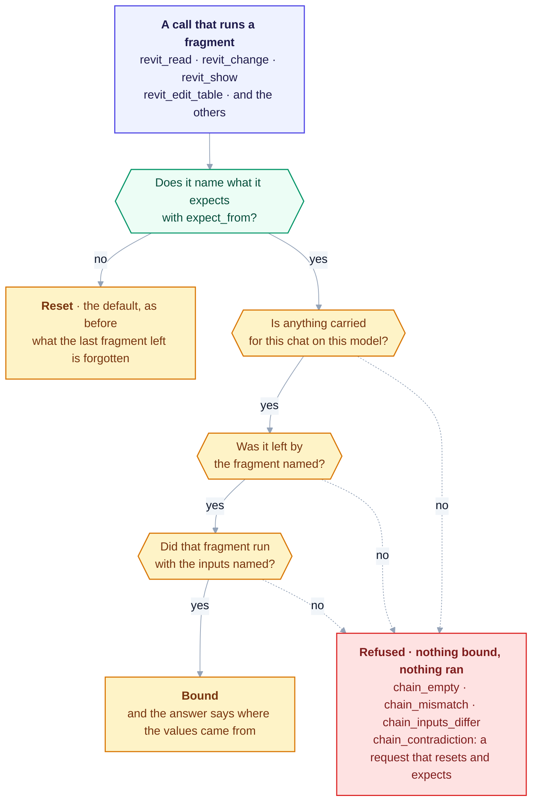

<!--
Heron-Agent:  none
Heron-Step:   17
Heron-Status: DRAFT
Heron-Since:  0.1.0
Heron-Layer:  brain
See docs/29-metadata-standard.md
-->

# 36 — Remembering between steps, and the check that makes it safe

**A DESIGN NOTE, NOT A DECISION.** No decision number has been spent on it. It was written so the
plan could be read before any code was. If it is accepted it becomes a `D-` entry in
[DECISIONS.md](DECISIONS.md) and this file becomes its background.

> **As built (2026-10-18): BUILT; RUN ON A REAL MODEL, NOT SIGNED.** §4's opt-in expectation was built
> on 2026-09-16 and merged the next day (#165, commit `5669e7e5`) as the request's `expectChain`,
> checked by the add-in's binder in [`RevitFragment.cs`](../revit/Heron.Revit.Addin/RevitFragment.cs)
> before anything binds, and as the
> `expect_from` input of `revit_read`, `revit_show`, `revit_change`, `revit_edit_table`,
> `revit_building_loads` and `revit_sprinkler_hydraulics`. A call that declares nothing still resets, as
> §4 asks. Four refusals each have their own name - `chain_empty`, `chain_mismatch`,
> `chain_inputs_differ`, `chain_contradiction` - held by
> [`tests/test_chain_expectation.py`](../tests/test_chain_expectation.py). **§6's pair was run** on
> `4355-BHVD-3D-50C10-BL001A`, Revit 2020, on 2026-09-16: the same carried values bound under a matching
> declaration and were refused under a mismatched one, and `chain_mismatch` fired too -
> [FRAGMENT-ISSUES row 115](fragment-issues/section-5-rows-101-125.md), *"proved on both legs, awaiting
> signature"*. `chain_empty` and `chain_contradiction` are tested off Revit only.

### At a glance — the check as built

Read from [`heron_bridge_client.py`](../mcp/client/heron_bridge_client.py), which sends either a reset
or an expectation and never both, and the binder in
[`RevitFragment.cs`](../revit/Heron.Revit.Addin/RevitFragment.cs), which asks the questions below in this
order before anything binds.



**Green is the MCP side, which decides what to send; amber is the add-in inside Revit, which forgets,
checks and binds.** The pair §6 asks for - the same carried
values bound under a matching declaration and refused under a mismatched one - was run on a real model
on 2026-09-16, as the note above says, and awaits a signature.

<details>
<summary>Same thing as plain text</summary>

```text
A call that runs a fragment (revit_read, revit_change, revit_show, revit_edit_table, ...)
  -> does it name what it expects with expect_from?
       no  -> reset, the default as before: what the last fragment left is forgotten
       yes -> is anything carried for this chat on this model?      no -> refused: chain_empty
           -> was it left by the fragment named?                    no -> refused: chain_mismatch
           -> did that fragment run with the inputs named?          no -> refused: chain_inputs_differ
           -> bound, and the answer says where the values came from
A request that both resets and expects is refused first: chain_contradiction.
A refusal binds nothing and runs nothing.
```

</details>

**The owner asked the question that produced it**, on 2026-09-16, in his own words: *an agent that
cannot remember is crippled — so add a layer that confirms the remembered thing is the right thing,
before it is used.* This note says what that would take, what is already built, and what it costs.

---

## 1. The problem, measured today rather than imagined

Asked to isolate the pipes in `{3D - ajmal.al}` (`4355-BHVD-3D-50C10-BL001A`, Revit 2020), Heron
did the first half perfectly and then could not hand it on.

| Step | Fragment | Result |
|---|---|---|
| Find the pipes | `select-by-category-name` | **120 found**, `resolvedTo: Pipes`, 0 near misses |
| Isolate them | `isolate-elements` (`PROVEN`) | **refused** |

The refusal, verbatim:

> *"'elements (IList<Element>)' was never supplied. Nothing is selected in Revit, and no earlier
> fragment in this session left a value of that name. Running anyway would report 0 results, which
> reads as 'there was nothing to find' rather than 'nobody was asked'."*

**Both fragments work. Neither is at fault.** What is missing is the join. And the join is missing
*on purpose*: `cmd_fragment` sends `chain: "reset"` on every call
([`heron_bridge_client.py`](../mcp/client/heron_bridge_client.py), in `cmd_fragment`), so the 120 elements are
forgotten before the next command starts.

**THE RESET IS RIGHT, AND THIS NOTE DOES NOT PROPOSE REMOVING IT.** The hazard it prevents is named
exactly in the code that does it:

> *"elements collected by something nobody remembers running"*

That is the whole argument for the current behaviour, and it is a good one. A later command
silently inheriting an earlier command's list — different category, different view, different job
from an hour ago — and changing all of them is worse than any refusal.

**So the question is not "reset or remember". It is "what would have to be true for remembering to
be safe".**

---

## 2. Three quarters of the answer is already built

This is the part that makes the proposal small. `Chain`
(the `Chain` class in [`RevitFragment.cs`](../revit/Heron.Revit.Addin/RevitFragment.cs)) already records:

```csharp
public readonly Dictionary<string, object> Values;
public string Document;         // whose elements these are
public string By;               // the fragment that left them
public DateTime TouchedUtc;
```

**Which document, which fragment, and when — already stored.** `Document` is already a staleness
guard: values from another model cannot be used here. And `By` is already *surfaced*, in the
binding note every reply carries:

> `elements from find-views (11)`
> `elements from the selection (10)`

That note is not decoration. [fragment-proving](../.claude/skills/fragment-proving/SKILL.md) rule 5
exists because of it: `find-overlapping-lines` once answered on **a stale selection of ten equipment
items**, looked perfectly healthy, and only that line gave it away.

**So Heron already knows where a value came from. It just tells a person afterwards instead of
checking beforehand.** The gap is one of timing, not of information.

---

## 3. What is actually missing

Two things, and only two.

**(a) What the producer RAN WITH.** `By` says `select-by-category-name`. It does not say
`categoryName=Pipes, inViewOnly={3D - ajmal.al}`. Those are the inputs that make one list of
elements different from another list from the same fragment — and telling those two apart is the
entire safety question.

**(b) A caller-declared EXPECTATION.** Nothing today lets a caller say what it believes it is
about to consume. The chain is taken on trust or not at all.

---

## 4. The proposal

**The caller states what it expects. The executor refuses anything else.**

Concretely, a consuming call would carry an expectation alongside its capability:

```
expect-chain: elements from select-by-category-name
              where categoryName=Pipes, inViewOnly={3D - ajmal.al}
```

and the executor's binding step — the one already written as
*"1. THE CHAIN"* / *"2. THE SELECTION"* at
`BindNeeds` in [`RevitFragment.cs`](../revit/Heron.Revit.Addin/RevitFragment.cs) — would gain a third
question between them: **does what is carried match what was declared?**

- **Matches** → use it, and say so in the read-back exactly as now.
- **Does not match** → refuse, naming both what was expected and what was actually carried.
- **Nothing declared** → reset, precisely as today. **The current behaviour stays the default.**

That last line is the important one. This is **opt-in per call**, so every fragment, proof and job
file already written keeps behaving exactly as it does now. Nothing silently changes meaning.

**IT IS THE SAME TRICK HERON ALREADY PLAYS ON CODE.** Every `PROVEN` fragment carries a
**fingerprint**, and a proof reports `STALE` when the code moves underneath it
([D-30](DECISIONS.md)). This is that idea pointed at *data* instead of at *source*. Not a new
invention — an existing pattern, applied twice.

---

## 5. Why the obvious shortcut is wrong

There is already a switch that keeps the chain: `--keep-chain`. **Turning it on by default would
be a mistake**, and the reason is written down rather than guessed:

> *"THE CHAIN OUTRANKS THE SELECTION ... so keeping it everywhere would make `set-selection`
> decorative in the middle of every arrangement already written, and those proofs would quietly
> begin testing something other than what they say."*

**That is the failure mode to fear here: not a crash, but a library of proofs that still pass while
checking something else.** Any design that keeps the chain must either preserve that precedence or
change it deliberately, with the affected proofs re-run. A declared expectation avoids the problem
entirely, because a call that declares nothing gets today's behaviour.

`--keep-chain` also already refuses to run without a `--setup` to keep something *from*, for exactly
the reason this note is about: *"what would survive is whatever an earlier run left behind."* The
instinct is already in the codebase. This note gives it a way to say yes as well as no.

---

## 6. What it costs, honestly

| | |
|---|---|
| **Where the change lands** | `RevitFragment.cs` — **add-in C#**, not a fragment |
| **Therefore** | a Revit restart to load, every iteration. Fragments update live; this does not |
| **Risk level** | it sits in the binding path that **every** fragment goes through, read and write alike |
| **Proving** | needs D-30 treatment of its own: a positive (matching expectation binds) and a negative (mismatched expectation refuses, and refuses for the stated reason) |

**The negative case is the one that matters and the one that is easy to fake.** A test where the
expectation mismatches and the call refuses proves nothing on its own — a call that refuses
*everything* passes it. The honest proof is a pair: the **same** carried value, accepted under a
matching expectation and refused under a mismatched one, with nothing else changed.

---

## 7. What this does not fix

- **It does not make Heron select pipes.** `revit_select_by_category` understands
  `duct, duct curves, ducts, ductwork` and refused `pipes` on 2026-09-16. That is a separate gap.
- **It does not settle the routing hazard.** On the same day, *"isolate all the pipes but leave out
  the condensate drain"* resolved first to **`SET_MEP_SLOPE`** — a fragment that changes pipe
  geometry — 2.4 ranks clear of the runner-up. A safe chain does not help if the wrong capability
  is chosen to begin with. That belongs with the `SET_ELEMENT_PHASE` finding in
  [FRAGMENT-ISSUES row 107](FRAGMENT-ISSUES.md)'s neighbourhood and needs its own row.
- **It does not remove the need for a person.** A declared expectation is a guard against a stale
  value, not against a wrong intention.

---

## 8. Open questions, for the owner rather than for me

1. **How exact should a match be?** Fragment name alone is weak — two runs of
   `select-by-category-name` with different categories both satisfy it. Fragment plus every input
   is strict and may be tedious to write. **Recommendation: fragment plus the inputs the caller
   names, ignoring the rest** — the caller declares what it cares about.
2. **Should a match also require freshness?** `TouchedUtc` is already recorded. A chain older than
   some seconds is more likely to be a leftover than a hand-over.
3. **Should the everyday tools compose at all?** This note assumes `revit_change` stays one
   capability per call. A composing tool — *"select these, then isolate them"* — is a larger design
   and would need this one first.
4. **Is it worth it before the routing hazard is fixed?** A safe hand-off into a
   confidently-wrong capability is not obviously progress.

---

## 9. Recommendation

**Worth building, and not first.** The design is small because the machinery is mostly there, and
the opt-in shape means it cannot break what already works. But it lands in the binding path every
fragment uses, it costs a Revit restart per iteration, and §7's second bullet is a sharper danger
to a modeller than a missing hand-off: a request that changes pipe geometry when the user asked to
*look* at something.

**Suggested order:** the routing hazard first, this second, a composing tool third if it is still
wanted.
