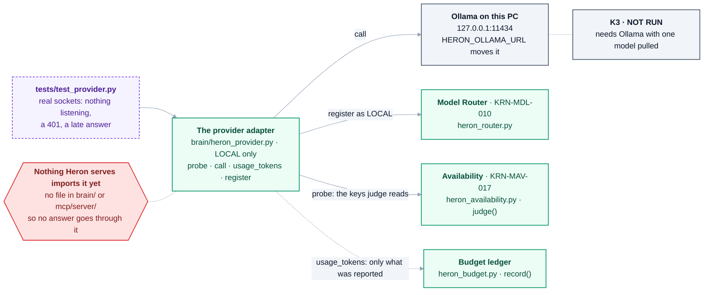

# 37 — The Provider Adapter

> **Status:** a scope, not an implementation. Written 2026-09-17 after the last of the five blocking
> decisions closed and the register stopped being the bottleneck.
>
> **As built (2026-10-18): BUILT, NOT RUN AGAINST A PROVIDER.** The first adapter §3 asks for was built
> the same day (#168, commit `c4aed3b1`): [`brain/heron_provider.py`](../brain/heron_provider.py) - one
> `LOCAL` adapter for Ollama at `127.0.0.1:11434` (`HERON_OLLAMA_URL` moves it), standard library only,
> with `probe`, `call`, `usage_tokens` and `register`. Its `call` takes a model and a prompt, not §2.4's
> intent-shaped signature. [`tests/test_provider.py`](../tests/test_provider.py) runs it over real
> sockets - a refused connection with nothing listening, a 401, a late answer - and its first run found
> the kind of shape mismatch §6 predicted, in `counts_as_evidence()` rather than `record()`: it read keys
> the adapter's result did not carry (NEEDS-CHECKING [K3](needs-checking/group-k.md)). **K3 is still NOT RUN:** it needs Ollama installed
> with one model pulled. Nothing in `brain/` or `mcp/server/` imports the adapter yet, so no answer Heron
> serves goes through it.

### At a glance — the adapter as built, and what nothing uses yet

Read from [`heron_provider.py`](../brain/heron_provider.py) on 2026-10-18: it registers with the router,
hands `judge()` the keys it reads, and adds up only the token counts a provider reported. A search for
`heron_provider` finds it imported by its own test and nothing else.



**The dotted arrow to the ledger is a shape, not a wire**: `usage_tokens` returns a total that
`record()` could take, and nothing calls `record()` with it yet. **Built is not run**: no provider has
answered it on the owner's PC, which is what K3 asks for.

<details>
<summary>Same thing as plain text</summary>

```text
tests/test_provider.py (real sockets: nothing listening, a 401, a late answer)
  -> the provider adapter, brain/heron_provider.py, LOCAL only: probe, call, usage_tokens, register
       call                 -> Ollama on this PC, 127.0.0.1:11434 (HERON_OLLAMA_URL moves it)
       register as LOCAL    -> Model Router, heron_router.py (KRN-MDL-010)
       probe                -> Availability, heron_availability.py judge() (KRN-MAV-017)
       usage_tokens         -> a total the budget ledger's record() could take - not wired
Nothing Heron serves imports it yet: no file in brain/ or mcp/server/, so no answer goes through it.
K3 is NOT RUN: it needs Ollama with one model pulled.
```

</details>

Three agents in this system decide **which** model to use, **whether it is reachable** and **what it
cost**. All three are built, all three are tested, and **not one of them has ever met a provider.**

There is no adapter to call. *(So it stood on 2026-09-17, when §1 to §6 were written - the greps in §1
included. The note at the top says what was built that day.)*

---

## 1. What is actually missing, exactly

`HERON-KRN-MDL-010` — [`brain/heron_router.py`](../brain/heron_router.py) — answers *which adapter*:

```python
return {"adapter": name, "reason": "..."}
```

**It returns a string.** Nothing in this repository says what a caller does with that string. There is
no `call()`, no `complete()`, no `probe()` — a grep for any of them across `brain/` finds nothing.

So the gap is not a missing feature in an existing thing. It is the **one layer underneath three
finished ones**, and the three are:

| agent | file | what it does with a provider it has never had |
|---|---|---|
| `KRN-MDL-010` Model Router | `heron_router.py` | picks one by intent, refuses a cloud one for confidential work |
| `KRN-MAV-017` Availability | `heron_availability.py` | sorts a probe into reachable / auth / slow / too small |
| the budget ledger | `heron_budget.py` | records **only what a provider reported**, because [D-58](DECISIONS.md) says Heron has no tokeniser |

[NEEDS-CHECKING **K3**](NEEDS-CHECKING.md) already says this in one sentence: *"No adapter exists to
call."* That row is the acceptance test for this work and was written before the work was scoped.

---

## 2. The interface, derived from the three callers rather than invented

Every field below is **already required by code that is already written**. Nothing here is a new idea;
it is the shape the existing three have been waiting for.

### 2.1 Registration — from `Router.register`

```python
router.register(name, kind, intents, strong)
```

| field | from | rule |
|---|---|---|
| `name` | `heron_router.py` | how the router names it back to the caller |
| `kind` | `KINDS = (LOCAL, HOST, CLOUD)` | **only `LOCAL` keeps the work on the machine**, and confidential routing depends on it being honest |
| `intents` | `INTENTS` | some of `CLASSIFY`, `EXTRACT`, `SCORE`, `SUMMARISE`, `REASON` |
| `strong` | `heron_router.py` | whether it can serve `REASON`, the one intent marked `strong` |

### 2.2 The probe — from `judge()`

`heron_availability.judge()` reads exactly these keys, and its own comments say what each mistake costs:

```python
{"reachable": bool,        # nothing answered -> UNREACHABLE
 "auth": bool,             # MISSING IS NOT YES - a question nobody asked is not a yes
 "latency_ms": int,        # over the ceiling -> SLOW, not down
 "context_limit": int,     # under what THIS request needs -> TOO_SMALL, not down
 "error": str or None}     # the probe itself failed -> PROBE_FAILED, nothing is known
```

**`auth` missing is treated as a failure, deliberately.** An adapter that does not check credentials
must not report `True` by omission — that path is already written and already tested.

### 2.3 The usage report — from `Ledger.record`

```python
ledger.record(scope, amount, unit, reported_by)
```

`reported_by` is required and is not decoration. **Units are matched, never converted** — a budget in
tokens takes tokens; a price list in this repository would be out of date the week it was written.

So the adapter reports **the provider's own usage field, under the provider's own name**, and reports
nothing when the provider reported nothing. K3's pass condition is exactly this: *"the usage field names
in a real reply matching what `record()` asks for."*

### 2.4 The call itself — the only genuinely new thing

```python
call(intent, prompt, *, needs_context=0, confidential=False) -> {
    "ok": bool,
    "text": str,            # what came back
    "usage": {...},         # the provider's own fields, unrenamed
    "degraded": bool,       # TRUE if this was a fallback
    "why": str,
}
```

**`degraded` is not optional.** `heron_availability.counts_as_evidence()` already exists for it: under
[docs/24](24-trust-model.md) a fragment is promoted on successful real executions, and an answer from the
second-choice provider *because the first was down* is evidence about the fallback, not about the
fragment. That reasoning is written and unused.

---

## 3. Which provider first

**One adapter, `LOCAL` kind, against a model already on the machine.**

| why | |
|---|---|
| **Confidential routing is untested and cannot be tested without it** | The router refuses cloud adapters for confidential work and refuses *everything* when no local one is registered. Both branches are written; neither has ever had a `LOCAL` adapter to prove against |
| **No key, no spend, no rate limit** | The first adapter should fail for adapter reasons, not billing ones |
| **It is the harder half** | A cloud adapter is an HTTP call. A local one has to answer what "reachable" and "context_limit" even mean for a model on disk — and those answers are what `judge()` has been asserting about in the abstract |

A `CLOUD` adapter should follow, because **`auth` and `context_limit` are the two probe fields a local
model barely exercises** — a real `401` is the thing K3 explicitly asks for.

---

## 4. What it unblocks

| | |
|---|---|
| **K3** in NEEDS-CHECKING | the row that names this as its precondition |
| **These Development agents** | `DEV-REQ-001`, `DEV-PLN-002`, `DEV-ARC-003`, `DEV-GEN-004`, `DEV-RAP-007` — all T2 or T3, so all of them need a model call and none can run. *As built (2026-10-18): the registry now records all five as **provided by the host** ([D-80](DECISIONS.md)) - Claude Code does that language work - so they wait on no adapter; `python tools/agent-count.py` counts them in its HOST column* |
| **every other T2/T3 in the register** | they are counted as built because a file claims them; what they have never done is make a call |

That last row is the uncomfortable one and it should be said plainly: **"built" in this register means a
file claims the id and its tests pass.** For a T1 agent that is the whole job. For a T2 or T3 it is
everything except the part that needs a model.

---

## 5. What this scope does NOT include

**No agent row.** The only `adapter` rows in [docs/28](28-agent-registry.md) are the deferred CAD ones —
AutoCAD, Navisworks, IFC, Rhino. This is **infrastructure under three existing agents**, not one
more Revit Engineering row, and giving it an id would be inventing a row nobody wrote.

**No model choice for the product.** Which local model, and whether Heron ships one, is a product
decision and the owner's.

**No tokeniser.** [D-58](DECISIONS.md) settled that and this must not quietly reopen it. If a provider
reports no usage, the ledger records nothing, and a ledger with a gap is honest where an estimate is not.

**No retry or backoff policy.** `judge()` already distinguishes `auth` (retrying will not help) from
`slow` (it might). Acting on that distinction is a separate piece of work and should not be smuggled in
under "adapter".

---

## 6. The risk worth naming in advance

**The three finished agents were all written from documentation.** Their tests feed them probes that a
test wrote, in the shape the author expected a provider to use.

K3 says this in its own words: *"A FAIL here is the cheapest it will ever be — a shape mismatch found
before any number depends on it."*

So the likely outcome of the first real adapter is **not** that it works. It is that one of the three
learns its assumed shape was wrong — most probably `record()`, because usage field names differ between
providers and nothing has ever checked one against a real reply.

**That is the point of doing it now**, while nothing downstream depends on a number.
