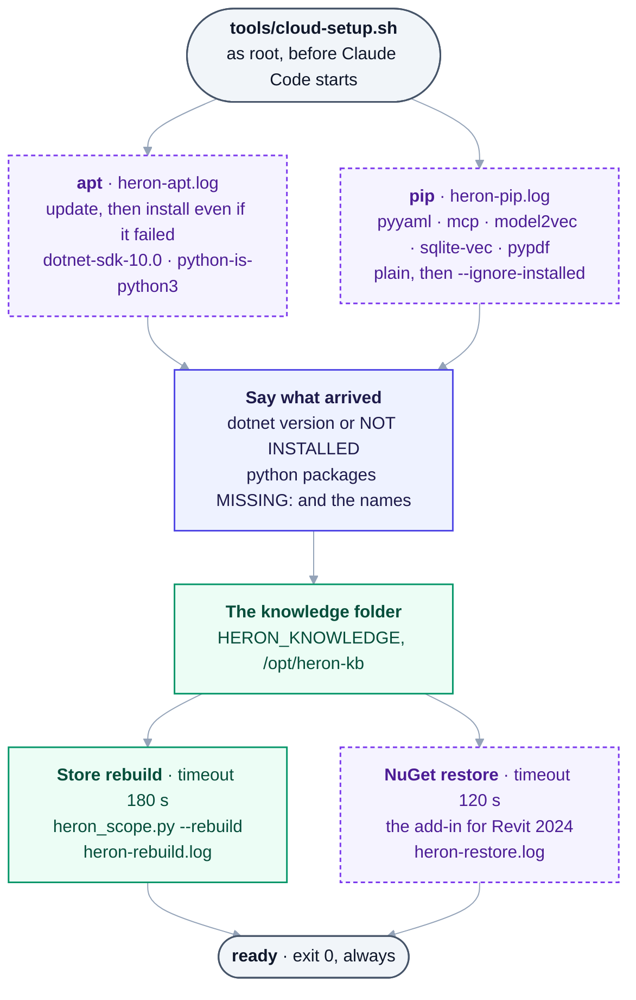

# 38 — The cloud environment

> **Status:** set up and measured 2026-09-22. The four field values below are what is configured;
> everything stated about what runs there is measured on this repository, or taken from a file in it
> that recorded the measurement.

A Claude Code cloud session runs on **Ubuntu 24.04 in Anthropic's datacentre**, from a fresh clone of
this repository. It is not the owner's PC and cannot reach it. That makes it the right place for most
of Heron and the wrong place for the rest, and the line between them is not where people guess it is.

**The cloud is not a weaker machine. It is a machine with no Revit.** Every one of this repository's
CI gates already runs on `ubuntu-latest`, including the C# compiling for Revit 2020 through 2027
([30](30-compiling-away-from-windows.md)), so *"it needs Windows"* is true of far less of this project
than the registers assumed for months.

---

## 1. The four fields

Set in **Add cloud environment**, in the Claude desktop app or at claude.ai/code.

### Name

    Heron

### Network access — **Custom**, with the default list still ticked

Tick **"Also include default list of common package managers"**, then add:

    huggingface.co
    *.huggingface.co
    hf.co
    *.hf.co

### Environment variables

    HERON_KNOWLEDGE=/opt/heron-kb
    HERON_CLIENT_ID=ajmal-pc
    DOTNET_CLI_TELEMETRY_OPTOUT=1
    DOTNET_NOLOGO=1
    DOTNET_SKIP_FIRST_TIME_EXPERIENCE=1
    PYTHONUTF8=1
    PYTHONIOENCODING=utf-8

`HERON_KNOWLEDGE` is the one that is not optional. `heron_scope.knowledge_dir()` reads it first, then
Heron's home - `HERON_DATA`, or `%USERPROFILE%\.heron` on Windows ([D-135](DECISIONS.md)) - and returns
`None` on Linux with neither, and every brain call that keeps knowledge then dies with *"No HERON_DATA,
no Windows profile and no HERON_KNOWLEDGE, so there is nowhere to keep knowledge"*.
[`.github/workflows/gates.yml`](../.github/workflows/gates.yml) does the same thing for the same
reason, so this is the supported path rather than a workaround.

`/opt` rather than `$HOME`, because the setup script runs as root and the session may not.

`HERON_CLIENT_ID` matches [`.mcp.json`](../.mcp.json), so a command typed at a shell carries the same
chat id as the MCP server. No Revit is reachable from a cloud session, so it can never compete for a
lease — it is set so that a command copied out of a session prompt is correct wherever it is run.

### Setup script

[`tools/cloud-setup.sh`](../tools/cloud-setup.sh), pasted whole into the box. Section 3 says what it
does and, as importantly, what it refuses to do.

---

## 2. Why **Custom** and not **Trusted**

**Trusted already covers everything else.** `archive.ubuntu.com` and `security.ubuntu.com` for the
.NET SDK, `api.nuget.org` for the Revit API reference packages, `pypi.org`, `github.com`,
`packages.microsoft.com`. Nothing in section 3 needs a domain outside that list —

**except `huggingface.co`, which is not on it at all.**

That single absence is the difference between Heron understanding a question and matching its letters.
`pip install model2vec` succeeds — pypi.org answers 200 — and then `StaticModel.from_pretrained` has
to reach `huggingface.co` for the weights. [`brain/heron_embed.py`](../brain/heron_embed.py) has this
written down twice already, as a 403 recorded 2026-08-28 and re-checked 2026-09-11, and its fallback
reports itself as *"built-in character n-grams — tolerant of spelling and word order, but **NOT
meaning**"*.

**Four lines, not one, and the extra three are the point.** Hugging Face serves metadata from
`huggingface.co` and the weight files themselves from separate storage hosts under `hf.co`. One line
would have looked correct and failed at the download.

**The tick box is load-bearing.** Custom *without* "Also include default list" allows **only** what is
typed, so PyPI, NuGet and the Ubuntu archive would all be gone and nothing would install at all.

**Nothing here costs money and nothing needs an account.** `minishlab/potion-base-8M` is public and
ungated: measured on the owner's PC 2026-09-22, 59 MB in the Hugging Face cache with `HF_TOKEN` unset
and no stored login file. Trusted alone still works — it costs retrieval quality, and every answer
says so.

### Whether it worked, in one line

Run this **inside the cloud session**, never on the owner's PC — that machine answers `model`
regardless of what the cloud can reach, so asking it proves nothing about the environment:

```bash
python -c "import sys; sys.path.insert(0,'brain'); import heron_embed; print(heron_embed.backend())"
```

| It answers | Meaning |
|---|---|
| `('model', 'a trained model - this one understands meaning')` | the four domains are reachable |
| `('lexical', 'built-in character n-grams ...')` | the weights were refused, and the reply names its own remedy |

**Ask once per environment, and ask early.** Both backends return results and neither raises, so an
environment with no weights looks exactly like a working one until a question turns on meaning rather
than on shared words. This is the only thing on this page that cannot be checked from a checkout.

---

## 3. What the setup script does, and the three things it will not do

In order: the .NET 10 SDK and `python-is-python3` from apt, side by side with PyYAML, `mcp`, `model2vec`,
`sqlite-vec` and `pypdf` from pip; the knowledge directory; then a fragment index rebuild and a NuGet restore, run
in parallel. The rebuild and the restore are bounded with `timeout`. Every failure is kept in a named
log rather than raised, and the script's last lines say what did not arrive - `dotnet ... NOT
INSTALLED`, or `python packages MISSING:` and the names - because the exit code cannot say it.



**Two pairs run side by side**, each pair waited for together: apt with pip, then the rebuild with the
restore. A step that fails leaves its log and the script carries on. Read from the script itself on
2026-10-18.

<details>
<summary>Same thing as plain text</summary>

```text
tools/cloud-setup.sh, as root, before Claude Code starts
  together:  apt  (update, then install anyway)  dotnet-sdk-10.0, python-is-python3   -> heron-apt.log
             pip  pyyaml mcp model2vec sqlite-vec pypdf (plain, then --ignore-installed) -> heron-pip.log
  then:      say what arrived - the dotnet version or NOT INSTALLED; python packages MISSING: ...
  then:      the knowledge folder, HERON_KNOWLEDGE (/opt/heron-kb)
  together:  heron_scope.py --rebuild (timeout 180 s)   dotnet restore for Revit 2024 (timeout 120 s)
  ready - exit 0, always
```

</details>

**On 2026-09-22 it installed nothing, and exited 0.** The image carries two third-party PPAs that
answered 403, so `apt-get update` failed while the Ubuntu archive's own lists came down fine - and the
install was chained on with `&&`. pip stopped because it cannot uninstall a package Debian installed:
`--upgrade` asked for a newer PyYAML than Debian's, and `mcp` needs a newer PyJWT. So the update's exit
code no longer gates the install, and pip tries a plain install first, then `--ignore-installed`,
which installs beside Debian's copies and never removes one, and last the same with
`--break-system-packages`. `mcp` stays unpinned
([D-45](DECISIONS.md#d-45--heron-tracks-the-mcp-sdk-across-major-versions-the-way-it-tracks-revit-releases)):
both of its suites pass on SDK 2.2.0 as well as 1.x. [FRAGMENT-ISSUES row 5b-167](FRAGMENT-ISSUES.md)
has the logs; [`tests/test_cloud_setup.py`](../tests/test_cloud_setup.py) runs the script against
stand-ins that fail the way that image did.

**`python-is-python3` is not housekeeping.** The hooks in
[`.claude/settings.json`](../.claude/settings.json) and [`.mcp.json`](../.mcp.json) run `python`, and a
stock Ubuntu 24.04 image ships `python3` only. A hook whose command is not found is read as no
objection, so without it the boundary guard would let every edit through, and nothing would say why.

**It does not install `sentence-transformers`.** That pulls torch — 500 MB to 2 GB — to re-order a
shortlist it already has. [`requirements-optional.txt`](../requirements-optional.txt) gives the same
reasoning in the same words.

**It does not build the bridge test host**, although the host builds and runs here perfectly well -
[30 §5](30-compiling-away-from-windows.md). The environment is snapshotted after the script
finishes, and a test host inside a snapshot is a **stale** test host, which reads exactly like a bridge
defect. Build it in-session instead, fresh:

```bash
dotnet build tests/Heron.Bridge.TestHost -p:RevitVersion=2024 \
  -p:HeronTfm=net10.0 -p:OutputPath=bin/x64/Debug-net10.0/
python tests/test_bridge_roundtrip.py
```

The suite picks the framework from the newest runtime `dotnet --list-runtimes` shows - .NET 10 on this
image - and when the host is missing it exits 3 and prints the exact build it wants. **Run the command
it prints over this one.** This block said `net8.0` until 2026-10-17, and that build left the suite
exiting 3 ([row 5b-942](fragment-issues/section-5b-rows-401-425.md)).

**It does not exit non-zero, ever.** A setup script that exits non-zero fails the session outright.

### The rebuild is warm, not stale

`python brain/heron_scope.py --rebuild` — measured 2026-09-22 at **19 s for 395 fragments** — is in the
script so that the first `heron_lookup` of a session answers, instead of reporting *"the knowledge
store is EMPTY."* It is safe to snapshot because `heron_search.library_digest()` hashes the fragment
files **as bytes, not by mtime**, for the reason that module states outright: *a git checkout moves
every file's mtime without changing a character.* A fresh clone therefore does not invalidate it, and a
real edit does.

---

## 4. What a cloud session can and cannot do

| | |
|---|---|
| Every CI gate | yes - `check-decision-titles` after `git fetch --unshallow`, since a session starts from a shallow clone |
| The C# compiles, Revit 2020–2027 | yes — `python tools/check-compile.py` |
| Every fragment's C#, against every release it claims | yes |
| Every test suite but the ones below | yes |
| `test_bridge_roundtrip` | yes, after the build in §3 |
| `test_mcp_serves`, `test_served_claims`, `test_mcp_stdio`, `test_loads_finalize` | yes — the script installs `mcp` |
| `test_routing_phrases` | yes, where §2's one-line check answers `model`; otherwise it exits 3, COULD NOT RUN |
| The `heron` server's library tools - `heron_lookup`, `heron_resolve`, `heron_capabilities`, `heron_method`, `heron_standards` | yes - served from 2026-10-17, and no `revit_` tool ([D-132](DECISIONS.md)) |
| The brain: lookup, gaps, routing, retrieval | yes |
| **Proving a fragment or skill against a model** | **no. Needs Revit** |
| **Add-in load, upgrade, rollback, manifest discovery** | **no. Needs a real Windows install** |

So a cloud session goes **further than CI does**. `gates.yml` leaves the suites it names in its
`known-not-runnable.txt` list unrun - the MCP SDK and the .NET host drag in dependencies a hosted runner
should not carry, and the trained embedding is not there; this environment installs the SDK and the
embedding and builds the host on request, so **nothing in `tests/` is out of its reach** once §2's check
answers `model`.

No total is written here on purpose. One was — *"196 of 199"* — and
[`check-docs.py`](../tools/check-docs.py) caught it on this page's first run: the source said **219**.
A count typed into a sentence is a count that goes stale, so derive it:

```bash
ls tests/test_*.py | wc -l
```

**The trap worth naming.** In a cloud session **Heron's MCP server does not start**, so the host lists
no `heron` tool at all and reports the server as failed to connect (`CONNECTION_CLOSED`). That is
deliberate: the server's `__main__` exits **2** on anything but Windows - *"Heron's bridge uses Windows
named pipes. Revit is Windows-only."* - before it serves a tool. **It looks like a broken setup the
first time it is seen, and it is not one.** The server's own code is still tested here, in-process:
`tests/test_mcp_serves.py` and `tests/test_served_claims.py` import it and call its tools directly.
Measured 2026-09-23 and again 2026-10-08, both in cloud sessions
([row 5b-162](fragment-issues/section-5b-rows-151-175.md)).

**Since 2026-10-17 the server starts here, with its library alone** ([D-132](DECISIONS.md), answering
Q-67). Off Windows it registers `heron_tools.LIBRARY` and nothing else, so the host lists those library
`heron_` tools and **no `revit_` tool** - which is how a chat in a cloud session knows there is no Revit
here - and its instructions and a lookup's version line say *"No Revit on this machine (it is not
Windows)"*. The paragraph above is what was true before, kept as it was. A session that started before
the change, or on a branch without it, still shows `CONNECTION_CLOSED`. `tests/test_mcp_stdio.py` starts
the real server here over stdio and holds the list. **Seen in a real cloud session's host list on
2026-10-17**: the five library tools, no `revit_` tool, and a lookup that answered ([D-132](decisions/D-132.md)).

---

## 5. The machine, and the three constraints it imposes

4 vCPU, 16 GB RAM, 30 GB disk. Ubuntu 24.04 on x86-64. The setup script runs **as root**, before Claude
Code launches.

- **It must exit 0.** A non-zero exit fails the session, so every non-critical step is guarded.
- **It must finish in about five minutes**, or the snapshot is not built and every later session pays
  the install again. The two slow halves run in parallel with `&` and `wait` for that reason alone.
- **The filesystem is snapshotted; running processes are not.** Packages installed and files written
  carry over. Anything merely running does not. The script re-runs when its text changes, when the
  allowed domains change, or after roughly seven days.

---

## 6. What this does not prove

**It proves nothing about behaviour, on any release.** That is the sentence
[30 §3](30-compiling-away-from-windows.md) ends on and it has not weakened: code that compiles on eight
releases can still move a duct 200 feet instead of 200 millimetres. `D3` in
[`NEEDS-CHECKING.md`](NEEDS-CHECKING.md) — *move them, then measure one* — is what catches that, and no
environment substitutes for it. *(D3 passed on the owner's PC on 2026-10-17, +200.0000 mm on Revit 2024 -
[Group D](needs-checking/group-d.md); a cloud session could not have run it.)*

**So the work a cloud session hands back is always the same shape**: it builds, it is gated, it is
tested, and the question left over is whether it does the right thing in a model. That question is
answered at the owner's PC, and `python tools/owner-queue.py` is the list of them.
