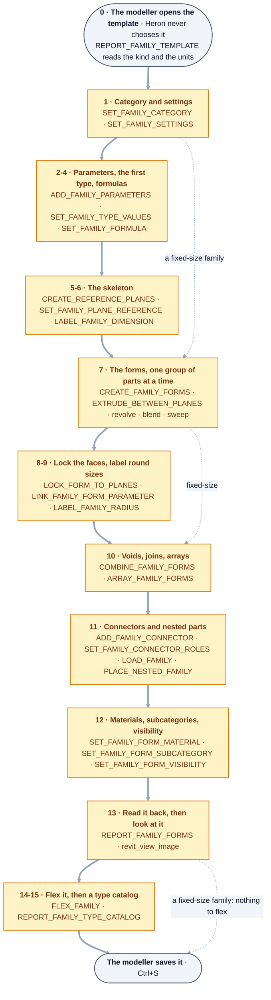

<!--
Heron-Agent:  none
Heron-Step:   17
Heron-Status: DRAFT
Heron-Since:  0.1.0
Heron-Layer:  brain
See docs/29-metadata-standard.md
-->

# 43 — Building Revit families: every kind, and what makes one parametric

**Asked 2026-10-01 by the owner:** *"you have very good for family creation but i need parametric family
creation also ... line based family, ceiling based, patterns, floor based, wall based, all kind of this
including family creation and parametrics, all kind of knowledge related to family creation - do the deep
research."*

**What this page is.** The knowledge behind Heron's family tools, gathered in one place and written in
Heron's own words: which template makes which kind of family, how each kind is built, what makes a family
resize, and exactly where Revit's API stops. The skills in [`brain/skills/`](../brain/skills/) carry the
METHOD for each kind in the order it has to happen; the fragment cards carry what each tool does. This page
is the reasoning both stand on. **It is not authority** - where a card, a register row or the code
disagrees with a sentence here, the more specific source wins and the sentence is a defect
([PROJECT-MAP §D](PROJECT-MAP.md)).

**What is proven is each card's to say, not this page's.** Every tool and skill this page names was
built `DRAFT`, and stays so until it has been run on a real family with a negative case
([D-30](DECISIONS.md)). The register rows that owe those runs are
[NEEDS-CHECKING Group BV](needs-checking/group-bv.md).

> **As built (2026-10-18):** many of the §11 tools are now `PROVEN` - proved in family documents in
> Revit 2024 on 2026-10-03 (#395, commit `931777ea`), each proof in its
> own card's `proof:` block - and others, `REPORT_FAMILY_TEMPLATE`, `ADD_FAMILY_TYPE_PARAMETER`,
> `SET_FAMILY_SETTINGS`, `SET_FAMILY_CONNECTOR_ROLES` and `ADD_FAMILY_CONNECTOR` among them, are still
> `DRAFT`. **Every family skill is still `DRAFT`.** Read the state from the cards, never from here:
> `grep -H '^heron-status:' brain/fragments/<folder>/fragment.yaml brain/skills/<skill>.yaml`. Since
> 2026-10-09 (#451) a chat gets each skill's method through the `heron_method` tool - its jobs carry the
> skills' names, `family-creation` to `lighting-fixture-family-creation`.
> **Checked 2026-10-18 - a DRAFT step is refused, not run.** Since [D-117](decisions/D-117.md)
> (2026-10-17) `revit_change` keeps a change only from a PROVEN fragment, family documents included:
> called in a cloud container, it refused `SET_FAMILY_SETTINGS`, `LOCK_FORM_TO_PLANES` and `FLEX_FAMILY`
> with *"... is DRAFT ... Nothing was sent to Revit"*, and let `ADD_FAMILY_PARAMETERS`, PROVEN, through
> to its next check. A DRAFT step's change is kept only through `try-once`, once per version, behind
> Revit's Keep or Discard box ([D-119](decisions/D-119.md)). `family-creation`'s preconditions say so
> themselves since #665 (2026-10-18): a DRAFT step *"is refused by revit_change (D-117); it can only be
> tried once with the bridge client's try-once, on a family saved first with nothing unsaved"* - read
> back through `heron_method family-creation` the same day.

| What it produced | Where it lives |
|---|---|
| **Eleven new tools** for the kinds of family the library could not build or could not read: the template report, filled and masking regions, flip controls, adaptive points, curves through points, conceptual forms, a Family Type parameter, a type catalog, 2D lines for profiles and detail items, an opening in a hosted family's host, a sweep drawn with a loaded profile | §11, and each card in [`brain/fragments/`](../brain/fragments/) |
| **One tool widened**: `set-family-settings` takes Cut with Voids When Loaded, Maintain Annotation Orientation, Rotate with Component, Keep Text Readable, Enable Cutting in Views, Part Type and Profile Usage as well as its four switches | [its card](../brain/fragments/set-family-settings/fragment.yaml) |
| **Seven new skills**, one per kind, and `family-creation` widened | §11 |
| **What to measure in Revit** | [Group BV](needs-checking/group-bv.md) |
| **What disagrees, and a possible defect found on the way** | [FRAGMENT-ISSUES rows 5b-280 to 5b-282](FRAGMENT-ISSUES.md) |

## At a glance

**The method, in the order `heron_method family-creation` serves it.** The order is not a preference:
two steps taken the other way round break a family in a way that looks fine until somebody resizes it.
The numbers are the method's own step numbers.



**A method served as DRAFT; each step's own status is the card's.** `heron_method family-creation` prints
every capability with its risk and status - read the state there, never from this page. A DRAFT step that
changes the family is refused by `revit_change` today (the status above). A **fixed-size** family takes
steps 0, 1, 7, 10, 11, 12 and 13 only - the dotted arrows. What the newer tools still owe is in
[Group BV](needs-checking/group-bv.md). Checked against `brain/skills/family-creation.yaml`, the
`heron_method` tool in `mcp/server/heron_mcp_server.py`, and its answer on 2026-10-18.

<details>
<summary>Same thing as plain text</summary>

```text
 0     the modeller opens the template (Heron never chooses it); REPORT_FAMILY_TEMPLATE reads kind and units
 1     category and settings          SET_FAMILY_CATEGORY, SET_FAMILY_SETTINGS
 2-4   parameters, first type, formulas  ADD_FAMILY_PARAMETERS, SET_FAMILY_TYPE_VALUES, SET_FAMILY_FORMULA
 5-6   the skeleton                   CREATE_REFERENCE_PLANES, SET_FAMILY_PLANE_REFERENCE, LABEL_FAMILY_DIMENSION
 7     the forms, group by group      CREATE_FAMILY_FORMS, EXTRUDE_BETWEEN_PLANES, revolve, blend, sweep
 8-9   lock faces, label round sizes  LOCK_FORM_TO_PLANES, LINK_FAMILY_FORM_PARAMETER, LABEL_FAMILY_RADIUS
 10    voids, joins, arrays           COMBINE_FAMILY_FORMS, ARRAY_FAMILY_FORMS
 11    connectors, nested parts       ADD_FAMILY_CONNECTOR, SET_FAMILY_CONNECTOR_ROLES, LOAD_FAMILY,
                                      PLACE_NESTED_FAMILY
 12    materials and visibility       SET_FAMILY_FORM_MATERIAL, SET_FAMILY_FORM_SUBCATEGORY,
                                      SET_FAMILY_FORM_VISIBILITY
 13    read back, then look           REPORT_FAMILY_FORMS, revit_view_image
 14-15 flex, then a type catalog      FLEX_FAMILY, REPORT_FAMILY_TYPE_CATALOG
 then  the modeller saves it (Ctrl+S)

A fixed-size family: steps 0, 1, 7, 10, 11, 12 and 13 only.
```

</details>

**Which job for which kind of family.** The template decides the kind (§1); the job's name is what
`heron_method` takes, and each one keeps `family-creation`'s steps in their order and adds what its kind
needs. Read from each skill's `purpose` in [`brain/skills/`](../brain/skills/) on 2026-10-18; §1 has
how Revit reports each kind, and §11 the tools each one uses.

| Kind | The template the modeller opens | `heron_method` job | What its method adds |
|---|---|---|---|
| Level- or work-plane-based - equipment, a valve, a box | a Generic Model, or the category's own | `family-creation` | the base method above |
| Wall-, ceiling-, floor-, roof- or face-based | the host's own template; face-based for a host in a linked model | `hosted-family-creation` | reads the host first; an opening in the host, `CREATE_FAMILY_HOST_OPENING` |
| Line-based - a lintel, a cable ladder run | a line-based template | `line-based-family-creation` | the Length from the two clicks; the template's planes never moved |
| Adaptive component | Generic Model Adaptive | `adaptive-family-creation` | numbered points, `PLACE_ADAPTIVE_POINTS`, `DRAW_FAMILY_POINT_CURVES`, `CREATE_CONCEPTUAL_FORM` |
| Pattern-based curtain panel | a pattern-based template | `pattern-based-family-creation` | points and lines, not planes; the tile pattern of the surface it fills |
| Profile | a Profile template | `profile-family-creation` | 2D lines in its one view; used in a sweep with `SET_FAMILY_SWEEP_PROFILE` |
| Detail item, line-based detail, annotation symbol | a Detail Item or Generic Annotation template | `detail-family-creation` | 2D lines and filled regions in one view |
| Duct or pipe fitting | a Generic Model set to Pipe or Duct Fittings | `mep-fitting-family-creation` | its Part Type, connectors and sizes that routing preferences can use |
| Door, window | the Door or Window template | `door-window-family-creation` | the host wall with its opening already cut; the template's planes never moved |
| Structural framing, structural column | the framing or column template | `structural-family-creation` | Member Left and Right planes; Material for Model Behavior, Section Shape |
| Lighting fixture | the Lighting Fixture template | `lighting-fixture-family-creation` | its light source, `SET_FAMILY_LIGHT_SOURCE`, and a power connector |
| Swapping in-place families for a loadable one | - | `replace-in-place-family` | the swap, whatever the hosting, carrying the data across |

---

## 0. How this was researched, and how sure each fact is

Six research passes ran on 2026-10-01, one per subject: templates and hosting; pattern-based and adaptive
families; parameters, formulas, lookup tables and type catalogs; profile, detail and annotation families;
reference lines, arrays, constraints, nesting and best practice; and MEP families. Two more ran on 2026-10-02 when
the owner asked for everything to be checked again: doors, windows, curtain panels and railings; and structural
framing and columns, masses, lighting and best practice. On those two, every page except GitHub was refused for
direct fetch, so they rest on search extracts and on Autodesk's own SDK samples and The Building Coder's archive
read in full on GitHub. A seventh pass read
**every Revit API member a tool here calls in the reference assemblies and XML documentation of all eight
releases, 2020 to 2027** - the `Nice3point.Revit.Api.RevitAPI` NuGet packages, the same source
[`tools/check-api-surface.py`](../tools/check-api-surface.py) downloads - with
[`tools/api-surface`](../tools/api-surface/)'s `--members` reader.

**What the cloud session could not reach, said plainly:** the environment's network policy refused
`help.autodesk.com`, `forums.autodesk.com`, The Building Coder's blog host, `revitapidocs.com` and AUGI,
and the session's web-search allowance ran out part-way. So facts from Autodesk Help and the forums come
from **search-engine extracts** of the named pages, and facts from The Building Coder and the API help
from public **mirrors** of them (Jeremy Tammik's own `tbc` archive and the ADN API help pages on GitHub).
Every fact below carries one of three marks:

| Mark | Means |
|---|---|
| **API** | Read in Revit's own reference assemblies and XML remarks, for each release named, by this session |
| **SOURCED** | Stated by a named Autodesk page, Autodesk developer post or a published Revit API answer, read through an extract or a mirror |
| **UNSURE** | Practice, inference, or two sources disagreeing - owed a run in Revit before anything is built on it |

**Nothing was copied.** The mechanisms are re-authored, as [31](31-studying-the-existing-libraries.md)
requires; no sentence, code or file name from any source is carried into Heron.

---

## 1. The template decides the kind, and nothing changes it later

A family's KIND - how it is placed, what it hangs on, how its size reaches it - comes from the template it
was started from. **SOURCED:** Revit has no function to turn a wall-based family into a face-based one; the
accepted routes are starting again in the right template and copying the geometry across, or nesting the
old family inside a new one. **API:** the kind can be READ - `Family.FamilyPlacementType`,
`IsCurtainPanelFamily`, `IsConceptualMassFamily`, `AdaptiveComponentFamilyUtils.IsAdaptiveComponentFamily`
and the family's "Host" parameter (`FAMILY_HOSTING_BEHAVIOR`), all present 2020 to 2027 - and that is what
[`REPORT_FAMILY_TEMPLATE`](../brain/fragments/report-family-template/fragment.yaml) does before anything is
built.

| Kind | Placement Revit reports (**API**) | How it is placed | What the template already holds | Heron's method |
|---|---|---|---|---|
| Level-based (Generic Model, furniture, equipment) | `OneLevelBased` | one click, on a level | Center (Left/Right), Center (Front/Back), Ref. Level | `family-creation` |
| Work-plane-based | `WorkPlaneBased`, with the Work Plane-Based switch on | on a level, plane or face, and moves with it | as above | `family-creation` |
| Face-based | `WorkPlaneBased`, the switch off - the rule BV1 checks | on any face, any angle, in a linked model too | a placeholder host the project never shows (**SOURCED**) | `hosted-family-creation` |
| Wall-, ceiling-, floor-, roof-based | `OneLevelBasedHosted` | only on that host | a sample wall, ceiling, floor or roof | `hosted-family-creation` |
| Line-based | `CurveBased` | two clicks; they set its Length | the built-in instance Length (`FAMILY_LINE_LENGTH_PARAM`) and the planes it is measured between | `line-based-family-creation` |
| Two-level (a column) | `TwoLevelsBased` | between a base and a top level | a lower and an upper reference level | `structural-family-creation` for a structural column, `family-creation` for an architectural one |
| Structural framing | `CurveDrivenStructural` | between two points | Member Left and Member Right planes and a sample extrusion locked to them (**SOURCED**, §7) | `structural-family-creation` |
| Door, window | `OneLevelBasedHosted` | in a wall | a host wall with an opening already cut, Width and Height (**SOURCED**, §7) | `door-window-family-creation` |
| Lighting fixture | as its template - free, ceiling-, wall- or face-based | as its host | a light source (**SOURCED**, §10) | `lighting-fixture-family-creation` |
| Adaptive component | `Adaptive` | its numbered points clicked in order | whatever points are placed | `adaptive-family-creation` |
| Pattern-based curtain panel | `IsCurtainPanelFamily` true, with reference points in it - only a conceptual family holds them, and the flag alone is not trusted to tell it from a classic curtain wall panel (BV1) | applied to a divided surface, one per cell | a tile pattern grid, its points and lines (**SOURCED**) | `pattern-based-family-creation` |
| Detail item / line-based detail | `ViewBased` / `CurveBasedDetail` | in one view; the line-based one with two clicks | its view, its planes | `detail-family-creation` |
| Profile | the Profiles category | chosen in a sweep, wall sweep, reveal, railing or mullion | one plan view and two planes (**SOURCED**) | `profile-family-creation` |
| Annotation, tag, title block | an annotation category | in a view or on a sheet | its view | `detail-family-creation`; a tag `tag-family-creation` - labels by hand or copied from a seed, §8.3 |

**Which template to start from - the order that decides it.** **SOURCED** (Autodesk's content team, via The
Building Coder): decide by FUNCTION first - is it hosted, and on what; if not, is it level-based, two-level,
line-based, face-based or adaptive - and only then by category. The template carries the hosting, the
placement and any special editor; the CATEGORY carries the options in Family Category and Parameters, the
subcategories, the built-in parameters, and how it schedules. **SOURCED:** a family that must sit on walls
or ceilings in a LINKED model has to be face-based - wall- and ceiling-based families cannot host on a
linked element - and where a category has no face-based template, the route Autodesk teaches is a
face-based Generic Model with its category changed.

**Where the templates are.** **SOURCED, and the sources disagree:** Autodesk's own pages print the family
template folder both as `...\RVT 2024 Release\Family Templates\` and as `...\RVT 2026\Family Templates\`;
the imperial set is `English_I` and the metric set, named `Metric ...`, is `English`. From Revit 2022 the
templates install as optional "Essential" content, and from 2025 they arrive in a package that can be
missing. **So a path is never typed** - [`CREATE_FAMILY_DOCUMENT`](../brain/fragments/create-family-document/fragment.yaml)
takes the template as an input, and the right folder is Options > File Locations, which the API reads as
`Application.FamilyTemplatePath`. Which metric file names ship in each release was not confirmed by any
source this session could read - **UNSURE**, and the reason no Heron card names one as fact.

---

## 2. What makes a family parametric

**SOURCED** (Autodesk's content team): *bones, muscle, skin*. The bones are reference planes and lines; the
muscle is the dimensions, the labels on them and the formulas; the skin is the solids, voids and symbolic
lines. The strongest constraint a family has is a **labelled dimension between two reference planes**, and
geometry is tied to the planes, never to other geometry. **API** echoes it in Revit's own warning: constraints
between geometry *"can behave unpredictably"*; constrain to levels, reference planes or reference lines.

The order, which is the order of `family-creation` and is not a preference:

1. **Category and settings** - the category brings built-in parameters everything after builds on.
2. **Parameters**, then **their values in a type** - a new length reads 0, and a label put on a 0 drives its
   planes onto each other. **API:** `FamilyManager.Set` needs a current type; a family with none has no
   `CurrentType` and refuses.
3. **Formulas** where one size follows another.
4. **Reference planes** at the positions the sizes put them, each with its **Is Reference**.
5. **Labels** on dimensions between the planes; an **EQ** across a centre plane keeps a shape centred.
6. **Forms drawn exactly on the planes, then locked to them.** A face drawn at the right place and not locked
   stays where it was drawn when the plane moves, and looks parametric until the first flex.
7. **Flex** - change the values and measure the geometry, at sizes that are really different and not square.

**Reference planes - what Is Reference does (SOURCED; integer values UNSURE).** Is Reference decides what a
project can dimension or snap to once the family is placed. The named values - Left, Center (Left/Right),
Right, Front, Center (Front/Back), Back, Bottom, Center (Elevation), Top - are strong references, each held by
at most one plane, and **API** a dimension to a named reference survives the family being swapped for another
with the same names, where one to a Strong or Weak Reference is not guaranteed to. A Not a Reference plane
still builds the family but gives the project nothing. A plane's NAME has nothing to do with its Is
Reference. Two planes with **Defines Origin** make the insertion point; the template's own planes carry it,
and are neither moved nor deleted.

**Constraint failures, in Revit's own words (API, `BuiltInFailures`).** *"Constraints are not satisfied"*;
*"Dimension overconstrains the Family"*; *"Reference Planes are overconstrained"*; *"Labeling this dimension
would overconstrain the sketch"*. A padlock cannot be set on a labelled, radial, diameter, arc-length or
multi-segment dimension; an EQ works on a multi-segment linear dimension only.

**Arrays (API).** A linear array keeps 2 to 200 members and a radial one 3 to 200; from 2025 Revit's remarks
add that in a FAMILY an array may hold 0 or 1, its missing members kept as placeholders. Its count is
labelled with an Integer parameter, and Revit itself suggests a NESTED family arrayed rather than identical
forms, for speed.

---

## 3. Parameters

**Three kinds (SOURCED).** Built-in parameters cannot be removed or renamed and schedule. FAMILY parameters do
not schedule and cannot be tagged. SHARED parameters carry a GUID from the office's shared parameter file and
are the only ones a tag or a multi-category schedule can read. **API:** `ReplaceParameter` turns a family
parameter into a shared one and back, carrying formulas and labels with it.

**Type or instance.** A size that describes the product is TYPE; anything that varies per placed copy - a
line-based family's Length, a nominal diameter a fitting takes from its run - is INSTANCE. **API:** a type
parameter's formula cannot use an instance parameter (*"Instance Parameters can't be used in Type Parameter
formulas"*), and an Image parameter can only be type.

**Reporting parameters (SOURCED, API).** A reporting parameter is read OFF the geometry by its dimension - it
never drives it and takes no formula. It is instance, a length or an angle, on one dimension, never a
multi-segment one; an arc length can only be labelled as reporting. **SOURCED:** it may feed other formulas
only when its dimension's references are all host elements, such as levels; a reporting parameter measured
off the family's own geometry may label but not feed a formula.

**The data types (API, `SpecTypeId`).** Common: Angle, Area, Cost per Area, Currency, Distance, Fill Pattern
(from 2023), Image, Integer, Length, Mass Density, Material, Multiline Text, Number, Rotation Angle, Slope,
Speed, Text, Time, URL, Volume, Yes/No, with discipline kinds such as HVAC Air Flow (`SpecTypeId.AirFlow`),
Piping Flow (`Flow`) and Electrical Power. A **Family Type** parameter's data type is a CATEGORY.

**The 2021 to 2025 migration (API, SOURCED).** 2021 brought `ForgeTypeId` units and specs; 2022 deprecated
`ParameterType` for `GetDataType()` and added `GroupTypeId`, with `ForgeTypeId` overloads of `AddParameter`
and `ReplaceParameter`; 2023 removed `ParameterType`; 2024 deprecated the `BuiltInParameterGroup` overloads;
2025 removed them. So every Heron tool that adds a parameter picks its call by signature at run time, and
Revit 2020 always takes a different path from 2027. The palette's "Other" group is an EMPTY `ForgeTypeId`.
**API:** `FamilyManager.SetDescription` sets a parameter's tooltip.

**A Family Type parameter (API, SOURCED).** It swaps WHICH TYPE of a nested part - or which loaded profile - a
type uses. It belongs to one category, and every loaded family of that category is offered; Revit refuses to
make one while no family of the category is loaded. **SOURCED:** linking an element's parameter to a family
parameter can fail (an Autodesk-acknowledged defect), and setting a value on the current type before linking
is the reported way round it - which is the order
[`ADD_FAMILY_TYPE_PARAMETER`](../brain/fragments/add-family-type-parameter/fragment.yaml) takes. Which of a
nested copy's own parameters carries the link no source could show: **UNSURE**, and that tool reports the one
Revit took.

---

## 4. Formulas

**SOURCED (Autodesk Help, extracts) and API:**

- Operators `+ - * / ^`; functions including `sqrt`, `sin`, `cos`, `tan`, `asin`, `acos`, `atan`, `round`,
  `roundup`, `rounddown`, `if`, `and`, `or`, `not`, `size_lookup`. **API:** `FormulaManager.GetFunctions()`
  answers for the running release.
- `if(condition, value if true, value if false)`; comparisons are `<`, `>` and `=` - **Autodesk's help says
  `<=` and `>=` are not implemented**, so `a <= b` is written `not(a > b)`. No source shows a later release
  adding them: **UNSURE** for 2025 to 2027.
- `and`, `or` and `not` take Yes/No values; text may be an `if` result, but no operation works on text.
- A value may carry its unit: `3000mm`, `Width + 100 mm`.
- **Parameter names are case-sensitive** and keep their spaces.
- **SOURCED:** a formula string is written WITHOUT a leading `=` (Autodesk's own training labs), and
  `SetFormula(p, null)` clears one (the API help). **API:** `SetFormula` refuses a circular chain of
  references, a parameter that cannot take a formula, and a family with no current type.

**Patterns built from that syntax - not proven in Revit:** keep a size from collapsing,
`if(L < 1 mm, 1 mm, L)`; clamp, `if(W < 300 mm, 300 mm, if(W > 1200 mm, 1200 mm, W))`; a count that follows a
length, `rounddown(Length / Spacing) + 1`, guarded on 2020 to 2024 as
`if(Length < Spacing, 2, rounddown(Length / Spacing) + 1)` - a formula names no value of its own, so the
guard tests the parameters themselves.

**Two sources disagree, and both are recorded.** The API's own remarks for a global parameter's formula say a
Length may not feed an Integer or Number formula, while `Count = Length / Spacing` is everyday family practice.
**NEEDS-CHECKING BV14** settles it in Revit.

---

## 5. Lookup tables and type catalogs

**Lookup tables (SOURCED, API).** Since Revit 2014 a lookup table's CSV is imported INTO the family and kept
there. Its header names each column `Name##KIND##UNIT` - `ND##length##millimeters`, `Note##other##`,
`Count##number##general`; **API** the header separator may be a comma, semicolon, colon or pipe. A formula
reads it with `size_lookup(Table, "Column", default, key1, key2, ...)`, the default answering when no row
matches. **SOURCED, and in conflict with a Heron card:** several sources say the FIRST column holds row names
and is never searched - the first key is matched against the second column - while
[`write-family-size-table`](../brain/fragments/write-family-size-table/fragment.yaml)'s purpose calls the first
column the key. Both are recorded ([row 5b-281](FRAGMENT-ISSUES.md)); **NEEDS-CHECKING BV15** settles it with
a negative case. **SOURCED (Autodesk's developers, via The Building Coder):** from Revit 2021.1 a UTF-8 or
UTF-16 CSV is read as such only WITH a byte-order mark; without one it is read as ANSI. **API:**
`FamilySizeTableManager` creates, imports, exports and removes tables, in a family or a project document.

**Type catalogs (SOURCED, API).** A text file with the family's name and `.txt`, beside the `.rfa`, makes Revit
show **Specify Types** on loading, so a project takes only the types it picks. Its first line STARTS with the
delimiter and names each column `Name##KIND##UNIT`; each line after is a type and its values. Revit has no
call that writes or reads one, but **API** it does give the exact words: `UnitUtils.GetTypeCatalogStringForSpec`
and `GetTypeCatalogStringForUnit` from 2021, `GetTypeCatalogString` before - which matters because **SOURCED**
Revit renamed some unit words in 2021 and older catalogs stopped loading.
[`REPORT_FAMILY_TYPE_CATALOG`](../brain/fragments/report-family-type-catalog/fragment.yaml) builds the text
from those calls and writes nothing; File > Export > Family Types is Revit's own way and the comparison its
proof uses. How Revit reads Yes/No cells, quoted cells and the file's encoding are **UNSURE** (BV10).

**Seen in Revit 2024, 2026-10-06/07, building Rejin's pipe support (`GM_PipeSupport_FloorType1`, its table `GM_PipeSupport_Schedule`).** (1) `size_lookup`'s FIRST argument must be a **Text parameter holding the table's name**, not the name itself: `size_lookup(GM_PipeSupport_Schedule, "Overall", 85.8 mm, Pipe 1 Size Used)` was refused *"It is an invalid formula string"*, and the same formula through a type parameter `Lookup Table Name` = `GM_PipeSupport_Schedule` was accepted. (2) The table's first column held row names (`ND25`, `ND32`, ...) with an empty header cell, the ND key in the second, and every lookup keyed on ND answered from the second column - the sources' reading of row 5b-281. That is the positive half only; an ND that sits ONLY in the first column was not tried, so **BV15's negative case is still owed** before `write-family-size-table`'s card is changed.

---

## 6. Forms: the classic Family Editor and the conceptual one

**The classic forms** - extrusion, blend, revolve, sweep, swept blend, solid or void - are built in every
family that is not conceptual, on reference planes and levels; Heron builds them with the form tools of
[Group BL](needs-checking/group-bl.md) and makes them behave with
[Group BM](needs-checking/group-bm.md). A void made through the API cuts nothing until it is combined.

**The conceptual forms** - in a mass, an adaptive component and a pattern-based panel - are one kind,
`Form`, built on POINTS and the LINES drawn through them. **API:** a single closed profile and no depth makes a
surface (`NewFormByCap`), a closed profile pushed along its normal an extrusion (`NewExtrusionForm`, the
direction's length its depth), two or more profiles a loft (`NewLoftForm`); `NewRevolveForms` can make several
forms from one call, and `NewFormByThickenSingleSurface` thickens a single-surface form. Points come from
`NewReferencePoint`, lines through them from `NewCurveByPoints` - **API:** both refuse a family that is not
conceptual; **SOURCED:** Autodesk's own adaptive sample calls them in an adaptive family. **API:** in these families a
solid can be cut by a void with `SolidSolidCutUtils`, which refuses ordinary families. **SOURCED:** a profile
family cannot be used in a conceptual family; a small nested adaptive family stands in for one.

Autodesk's remark on `NewExtrusionForm` names the families it refuses as *"Conceptual Mass, 2D, or other
family where extrusions cannot be created"* - the same words as the classic blend's, and very likely copied:
which conceptual families take each call is **NEEDS-CHECKING BV6**.

**Conceptual masses (SOURCED unless marked).** A mass family starts from the Mass template; Create Form makes
an extrusion, a revolve (a profile and an axis), a sweep (along a path in one plane), a swept blend (several
profiles along one curve), a loft (profiles on two or more planes) or a surface (from an open line). MODEL lines
are consumed by the form they make; REFERENCE lines stay and drive it (two sources) - which is why Heron's
point-curve tool draws reference lines by default. Reference points are free, hosted or driving. **Divide
Surface** lays U and V grids on a face - both on by default, each by number or by distance, or by intersecting
levels, planes or lines - and a pattern-based panel family is applied to the divided surface's cells; the tile
pattern decides how many cells one panel takes (Rectangle 1 x 1, Hexagon 2 x 3, Octagon 3 x 3, Arrows 3 x 4 and
the rest), the panels are adaptive and schedule as curtain panels. **Mass Floors** are cut at chosen levels in
the PROJECT and report area, perimeter, volume and exterior surface; Gross Volume, Gross Surface Area and Gross
Floor Area are read-only and schedulable. An in-place mass is for one-off massing, a mass family for repeats.
**In the project (built 2026-10-28, DRAFT, [Group JN](needs-checking/group-jn.md)):** `REPORT_MASSES` reads every
mass's gross values and mass floors with their Usage, totals them by level and by use, gives plot ratio and site
coverage from a site area, and names unjoined masses that overlap - **SOURCED:** Autodesk Help, joining mass
instances removes the overlap from gross volume and floor area; and Revit makes no mass floor at a level on the
top face of a mass. `SET_MASS_FLOOR_USAGE` and `REMOVE_MASS_FLOORS` set and take off mass floors by level, and
`CREATE_WALLS_BY_FACE` makes Wall by Face - Curtain System by Face is `CREATE_CURTAIN_SYSTEM` ([Group JM](needs-checking/group-jm.md)). **API:** `FaceWall.Create` and
`NewCurtainSystem2` exist 2020 to 2027; **no class or call makes Floor by Face or Roof by Face, and none makes an
in-place family**, on any release - read off the reference assemblies on 2026-10-28.
**API:** `DividedSurface.Create` with each direction's `SpacingRule` - a number or a distance - and
`NewRevolveForms` exist 2020 to 2027; `DIVIDE_FAMILY_SURFACE` and `CREATE_CONCEPTUAL_FORM`'s axis wrap them, owed
BV21 and BV22.

---

## 7. Hosted, line-based, pattern-based and adaptive families

**Hosted (SOURCED unless marked).** A wall-, ceiling-, floor- or roof-based family is placed only where such
a host exists; its template carries a sample host. The Family Editor's **Opening** tool is offered in hosted
templates; **API** `FamilyItemFactory.NewOpening(host, profile)` takes a wall or a ceiling and nothing else,
and an opening's sketch cannot be locked to planes through the API - so an API-made opening is a fixed size.
Whether a VOID in a wall-, ceiling-, floor- or roof-based template cuts the host without Cut Geometry: no
source said - **UNSURE**, BV12. In a FACE-BASED family an unattached void does not cut the host on placement:
either the void is cut into the template's host extrusion with Cut Geometry in the Family Editor, so every
placement cuts its host, or **Cut with Voids When Loaded** is switched on and the modeller cuts in the project.
**API:** `InstanceVoidCutUtils` is the project's half - a copy with unattached voids and that switch on cuts
host elements and Generic Model or structural copies. **Two Autodesk pages list different categories** a
family's voids may cut (one adds Casework, Furniture and Specialty Equipment): both recorded, **UNSURE**.

**Measured 2026-10-22 on Revit 2020, a FLOOR-based family** (Metric Plumbing Fixture floor based, a floor
drain built through Heron - [row 5b-1324](fragment-issues/section-5b-rows-401-425.md)): a void extrusion made
through the API does NOT cut the template's floor by itself, and loaded into a project the family cut no
floor - the host read six faces and its volume unchanged, the drain's grate stayed buried - with *Cut with
Voids When Loaded* off and then on. After *Modify > Geometry > Cut* in the Family Editor, the sample floor
first and then each void, and a reload, every host floor was cut. So the UNSURE above is answered for a
floor: **the cut is made in the Family Editor, by hand, before loading**, and **API:** nothing makes it on
any release 2020 to 2027, read in the eight releases' own XML remarks, word for word the same -
`SolidSolidCutUtils.AddCutBetweenSolids` throws for *"a project document or ... a conceptual model, pattern
based curtain panel, or adaptive component family"* and for an element that is not *"solid and ... a
GenericForm, GeomCombination, or a FamilyInstance"* (a void is not solid; a floor is none of the three);
`Document.CombineElements` takes a `CombinableElement`, and a `Floor`, `RoofBase`, `Wall` or `Ceiling` is a
`HostObject`; `JoinGeometryUtils.JoinGeometry` is *"not available for family documents"* and joins rather
than cuts; `InstanceVoidCutUtils.AddInstanceVoidCut` cuts with *"the unattached voids inside a cutting
instance"* - a loaded family, in a project; `FamilyItemFactory.NewOpening` takes a wall or a ceiling; and no
member of `GenericForm`, `Extrusion`, `Floor` or `HostObject` is about a cut. Revit's own message for the
case, on every release (`FormFailures.VoidFormsNotUsed`): *"Some Void Forms of this family do not cut
anything and will be deleted. To make a Void Form cut something else use the Cut Geometry tool."*
[`hosted-family-creation`](../brain/skills/hosted-family-creation.yaml) step 5 now says so and tells the
modeller the hand step; whether Heron should do more - a nested void family through `InstanceVoidCutUtils`,
if Revit takes it in a family document, which is NEEDS REAL REVIT - is [Q-85](open-questions/tier-2.md). A
wall-, ceiling- or roof-based template's void was not measured: BV12 still asks.

**Line-based.** Its Length is a built-in INSTANCE parameter, set by the two clicks; geometry runs the full
length by being locked to the start and end planes, and a part that repeats is an array whose last member is
locked to the end plane, its count a formula of the Length. **API:** a line-based model family is placed with
`NewFamilyInstance(Line, ...)` overloads; a line-based detail item with `NewFamilyInstance(Line, FamilySymbol,
View)`.

**Pattern-based panels (SOURCED, API).** The template carries a tile pattern grid - Rectangle by default - and
the points of one tile. **API:** the tile patterns are Rectangle, Triangle (bent and flat), Rhomboid, Hexagon,
Half Step, Third Step, Triangle, Rectangle and Rhomboid Checkerboard, Triangle Step, Arrows, ZigZag, Octagon and
Octagon Rotate; `Family.CurtainPanelTilePattern` is **read-only on every release**, and only the spacing can be
set - the pattern is chosen by hand in the Type Selector, and it must be the pattern of the divided surface the
panel is applied to. A divided surface takes a tile pattern or a curtain panel family's type as its own type.

**Adaptive components (SOURCED, API).** A point is a Reference Point, a Placement Point (clicked, in its number
order) or a Shape Handle Point (moved after placement). Each placement point's **Orientation** - Instance
(xyz) by default, Instance (z) then Host (xy), Host (xyz), Host and Loop System (xyz), Global (xyz), Global (z)
then Host (xy) - maps to `AdaptivePointOrientationType`. **Repeat** spreads copies along a divided path or
surface, and refuses a family with shape handles.

**Points that follow a line or a point (API, 2026-10-02).** A reference point can be HOSTED - on a line at a
normalised distance from its start (`Application.NewPointOnEdge` with a `PointLocationOnCurve`), or on one of a
point's own three planes (`PointOnPlane.NewPointOnPlane` on `ReferencePoint.GetCoordinatePlaneReferenceXY`, `YZ`
or `XZ`) - and follows its host. That is how a two-point beam gets its section: points on point 1's plane square
to the line, a loop through them, and `NewSweptBlendForm` along the line, whose remarks ask for a path in one
plane and each profile square to it. Built into `PLACE_ADAPTIVE_POINTS` and `CREATE_CONCEPTUAL_FORM`, owed BV19
and BV20.

**Doors (SOURCED unless marked).** The Door template is wall-hosted, Doors category, with a host wall and an
opening already cut in it (two sources agree). That its opening is sized by the Width and Height planes out of the
box is implied by practitioners' guides and by code that sets only Width and Height - **UNSURE**, no official
statement found. With a frame, the opening is re-locked to the Rough Width and Rough Height planes (one author,
twice). **API** names the door's built-in parameters: Width, Height, Thickness, Rough Width, Rough Height, Wall
Closure, Fire Rating, Function, Operation, Construction Type, Frame Type, Frame Material, Finish, Cost - the
first six are also Autodesk's documented door type properties, and Rough Width and Height serve schedules and
export. **Wall Closure** is a type parameter that overrides the wall's Wrapping at Inserts ("By Host" defers to
the wall), and a reference plane's own Wall Closure property marks where the layers wrap. The plan swing is
symbolic lines on a "Plan Swing" subcategory, the elevation swing an "Elevation Swing" subcategory - neither is a
built-in category, and whether the template ships them was not found (**UNSURE**); the built-in door
subcategories are Frame/Mullion, Glass, Opening, Panel and Hidden Lines (**API**). The modeller adds a frame
sweep along the opening's edges, a panel extrusion locked to the Width and Height planes with its own Thickness
plane, and material parameters; the plan swing and the hardware are commonly NESTED and a swappable panel is a
nested family chosen by a Family Type parameter (two sources), with a reference line driving a swing angle -
which Heron cannot build (§9). In plan the 3D panel and frame are hidden and symbolic lines shown. The process
practitioners give: origin, planes, parameters, several host thicknesses, two or more types, flex, then
geometry, then test. Reference-plane names inside the Door template: **not found**.

**Windows (SOURCED unless marked).** The Window template is wall-hosted, Windows category - Autodesk's own SDK
sample refuses any other category - with a stand-in host wall, an opening cut, the exterior and interior sides
marked, and a few starting parameters. **API:** Width and Height are built-in; the instance parameters are Sill
Height and Head Height, and the template's Default Sill Height is the bottom's height above the level, so Head =
Default Sill Height + Height (two sources). Rough Width and Height, Wall Closure and Construction Type as for a
door. The SDK sample, unchanged 2010 to 2025, looks for planes "Exterior", "Center (Front/Back)", "Top" or
"Head" and "Sill" or "Bottom", and views "Exterior" and "Right" - whether every release keeps those names was not
verified (**UNSURE**). Built-in window subcategories: Frame/Mullion, Glass, Opening, Sill/Head, Hidden Lines
(**API**). The Opening tool exists only in host-based templates and is sketched to reference planes.

**Curtain wall panels, and curtain wall doors and windows (SOURCED unless marked).** A classic curtain panel -
not the pattern-based one - is sized by the CURTAIN GRID: it cannot be sized by dragging or by its properties,
takes its cell's size when loaded, and resizes with the wall (two sources). Its four template planes stand for
the bounding grid lines and geometry is locked to them, with no Width or Height of its own to add - a forum
answer, **UNSURE**; **API** has built-in `CURTAIN_WALL_PANELS_WIDTH` and `_HEIGHT`. Its category is Curtain
Panels, which can be changed to Doors or Windows - the panel then still lists in panel schedules and lacks the
standard door and window parameters (a forum answer). A CURTAIN WALL DOOR is a panel family swapped in by the
Type Selector, sized by the panel, the base mullion deleted to reach the wall's base; an ordinary door's geometry
is moved into one by pasting it into a curtain-panel door family and locking it to the template's planes. The
exact template file names were not confirmed (**UNSURE**), and that a curtain wall door has no host opening is
an inference (**UNSURE**).

**Railings: balusters, posts, panels and rails (SOURCED unless marked).** Three baluster templates - Baluster,
Baluster - Panel and Baluster - Post - in their own "Railings > Balusters" folder (2024, a forum answer), each a
special-function template. Posts go at the start, corners and end and at divisions; panels span between them,
and the panel template carries a slope angle. **API** built-ins: Baluster Height, Top Cut Angle, Bottom Cut Angle,
Slope Angle, Post, and Baluster Width. The cut angles trim the baluster to the slope it stands on (**UNSURE**);
the Post template has "Top" and "Top of Post" planes whose difference is a forum question (**UNSURE**). A
panel's centre plane is the pattern's location line and must stay pinned; Width is a type parameter. The
RAILING TYPE places balusters (family, base and top attachment with offsets, spacing) - that it drives Baluster
Height is an inference (**UNSURE**) - and its Rail Structure gives each rail a PROFILE family, height, offset and
material: the profile's Defines Origin crossing lands at the rail's height, and Profile Usage filters which
profiles each list offers, `<Generic>` showing everywhere (two sources) - `SET_FAMILY_SETTINGS` sets Profile
Usage. A continuous Top Rail or Handrail type takes a Supports family and beginning and end Terminations; a
termination's Extension Length cuts the rail back. Template names for supports and terminations: **not found**.

**Structural framing - beams and braces (SOURCED unless marked).** Two framing templates exist, Beams and
Braces and Complex and Trusses (a forum answer). The beam is placed by two points: its **Left** and **Right**
planes are the location line's ends at the join and set its length, so the beam stretches with its supports,
while **Member Left** and **Member Right** are the geometry's ends - the template's sample extrusion is locked to
them, and so are Autodesk's own steel sweeps (two sources). **API** built-ins: Length runs handle to handle and
is read-only; **Cut Length** (`STRUCTURAL_FRAME_CUT_LENGTH`) is the physical length, read-only (two sources);
whether Cut Length can feed a formula is a forum question (**UNSURE**). Since 2014 Start/End Extension (an
unjoined end) and Start/End Join Cutback (a joined end) are built-in instance parameters - extension parameters
a pre-2014 family carries are deleted, or they add to the built-in ones. At Coarse a beam shows a stick symbol,
and **Symbolic Representation** (`FAMILY_SYMBOLIC_REP`) chooses the family's own lines or the project's
settings (two sources). **Material for Model Behavior** (`FAMILY_STRUCT_MATERIAL_TYPE`) gives Steel and Wood
cutback and shape handles, Concrete auto-join and rebar without handles, Precast both, Other neither -
`SET_FAMILY_SETTINGS` sets it, and **Section Shape** too (BV23). **Section Shape** adds schedulable dimension
parameters; a custom steel section is Not Defined and has no connection
geometry. The analytical model was made automatically before 2023 and separately from 2023. A CUSTOM SECTION is
the template extrusion's profile edited in the Left view with planes and size parameters, sketched clear of the
planes and then aligned and locked (two sources) - Heron cannot edit a sketch, so its route is a NEW extrusion of
the section on a plane facing left or right, its end faces locked to Member Left and Member Right, and the
template's sample deleted (`structural-family-creation`).

**Columns (SOURCED unless marked).** The column template opens with a front elevation showing the lower and
upper reference levels, a plan with two sets of EQ dimensions, and a 3D view; a Generic Model changed to the
column category does NOT get the two levels (two sources). The geometry's top is locked to the upper level and
its bottom to the lower one, so Base and Top Level and their offsets drive the height. **API** built-ins:
**Moves With Grids** (`INSTANCE_MOVES_WITH_GRID_PARAM`) ties a vertical column, or a slanted one's ends, to the
grids; **Column Style** (`SLANTED_COLUMN_TYPE_PARAM`) is Vertical, Slanted - End Point Driven or Slanted - Angle
Driven, with Top and Base Cut Style and Extension; only STRUCTURAL columns slant. A structural column takes a
Structural Material; an architectural column takes the material of the walls it joins, and framing and isolated
foundations join only structural columns (two sources). What a family needs in order to slant: **not found**.

---

## 8. 2D families: profiles, detail items, annotations

**8.1 Profiles (SOURCED, API).** A profile is drawn with DETAIL lines in the template's one plan view, and
**every line in a profile family is part of the profile** - closed loops that do not cross, a loop inside
another a hole; construction lines belong in a nested detail item. **Profile Usage** (`FAM_PROFILE_USAGE`,
the `ProfileFamilyUsage` enum) decides where Revit offers it: Any (Generic, offered everywhere), Wall Sweep,
Reveal, Fascia, Gutter, Slab Edge, Railing, Stair Nosing, Mullion, Slab Metal Deck, Continuous Footing, Stair
Tread, Stair Riser, Stair Support. **SOURCED:** the Profiles category is internal and is not in a document's
category list - Heron reads it from the loaded families. Inside another family a sweep takes a loaded
profile as its Profile (`PROFILE_FAM_TYPE`, with Angle, flip and offsets beside it) - and a Family Type
parameter of the Profiles category swaps it per type.

**8.2 Detail items (SOURCED, API).** Detail lines, filled regions, masking regions, nested detail items and
text. **API:** a filled region in a 2D family's view is `FilledRegion.Create(..., viewId, ...)` on every release;
in a 3D model family a region on a sketch plane arrived in **2023**, and `CreateMaskingRegion` in **2024**
for both. Before 2024 a filled region type with its Masking box ticked hides what is behind it the same way.
**SOURCED:** a detail line's detail levels are not set like a symbolic line's; they live in bits of its
`GEOM_VISIBILITY_PARAM`.

**8.3 Annotations, tags and title blocks - the one wall (SOURCED, API).** A **LABEL** - the text that shows a
parameter's value - **cannot be created through Revit's API on any release from 2020 to 2027**: there is no
public call for it, and 2027 adds a public `AnnotationLabel` that READS a label and nothing more. A text note
can be placed in a family's view where the family allows text. So a tag or title block gets its labels by
hand, or copied from a seed family of the same category that already holds them (§8.3a) - and a Heron skill
says so BEFORE starting, never after. Rotate with Component, Keep Text Readable and, from 2021, Rotate Text with
Component are the family's own switches.

**8.3a Labels, member by member, 2020 to 2027 (API, read 2026-10-21).** Asked by Ajmal PS while building the
pipe tag *TRG_Pipe_Tag* on Revit 2020: can Heron make, place, edit and read a label - its parameters in order,
each one's sample value, prefix, suffix, spaces, break, and its unit format (*Edit parameter's unit format*:
units, rounding, symbol, + sign, digit grouping). Read off the shipped reference assemblies of all eight
releases with [`tools/api-surface`](../tools/api-surface/) (`--dump` and `--members`, the cache
[`tools/check-api-surface.py`](../tools/check-api-surface.py) fills), and for 2027 every package from
2027.0.0 to 2027.3.0 with each member's visibility - public or internal - and `RevitAPI.xml`'s text.

| What the Edit Label dialog does | 2020 - 2026 | 2027 (2027.0.0 to 2027.3.0) |
|---|---|---|
| Find the labels in a family | No class of their own. `TextElement`'s one public subclass is `TextNote`, so a label is a text element that is not a text note. **UNSURE** that Revit hands a label back that way - row IJ1 | `AnnotationLabel : TextElement`, public |
| Which parameters it shows, in order | **No member** | `GetParameterFormatting()`, in the label's order; each entry's `GetParameterDefinition(doc)` names the parameter. Public, read |
| Sample value | No member | `SampleText` - read public, **set internal** |
| Prefix, suffix | No member | `Prefix`, `Suffix` - read public, set internal |
| Spaces | No member | `LeadingSpaces` - read public, set internal |
| Break (a new line before it) | No member | `LeadingLineBreak` - read public, set internal |
| Wrap between parameters only | No member | `UseNonBreakingSpaces` - read public, set internal |
| Unit format of one parameter | `Element.GetParameterFormatOptions(ElementId)` exists, but needs the parameter's id, which nothing here gives | The same call, with the id the definition gives. Whether it returns the label's own override is **UNSURE** - row IJ3. **No release has a setter**: `SetParameterFormatOptions` is in none |
| Make a label | **No member on any release.** `FamilyItemFactory` has no label call | `AnnotationLabel.Create(doc, viewId, position, formatting, typeId)` and `CanCreateAnnotationLabels` **exist and are INTERNAL** in every 2027 package; `RevitAPI.xml` documents them as if public |
| Change its parameters, sample, prefix, suffix, spaces, break | No member | `SetParameterFormatting`, every setter, and the `AnnotationLabelParameterFormatting(Document, InternalDefinition)` constructor - **all internal** |
| Move it | `TextElement.Coord` read and set; `ElementTransformUtils.MoveElement` | the same |
| Its width | `TextElement.Width` read and set, inside `GetMinimumAllowedWidth` and `GetMaximumAllowedWidth` | the same |
| Horizontal and vertical alignment | `HorizontalAlignment` (Left, Center, Right), `VerticalAlignment` (Top, Middle, Bottom), read and set | the same |
| Keep Readable | `KeepRotatedTextReadable`, read and set | the same |
| Its label type | `Element.ChangeTypeId` to one of `GetValidTypes()`; the type's own properties are a text type's | the same |
| Its text | `TextElement.Text` read and set. What it returns for a label, and what setting it does, is **UNSURE** - Heron never sets it | the same |
| Copy one | `ElementTransformUtils.CopyElements(View, ids, View, Transform, CopyPasteOptions)`. Revit's own failure `FamilyFailures.CannotPasteLabelsAcrossFamilies` - *"Can't paste Labels across Families of different Categories"* - is in every release, so Revit itself pastes a label only between families of ONE category | the same |
| Start the Label tool for the modeller | `PostableCommand.Label` - places nothing; the modeller clicks and fills the dialog | the same |

**What that means for a modeller, plainly.**

- **Made**: by hand on every release, or copied from a seed family of the same category (§8.3b). Not by the
  API - on 2027 the call is there and Autodesk has not opened it. **Heron does not call an internal member**:
  it is not part of the API an add-in is given, can change in any update without notice, and nothing could
  prove it stays safe. When a release makes `AnnotationLabel.Create` public, `tools/api-surface --members
  AnnotationLabel` shows it and a `CREATE_FAMILY_LABEL` for that release is a small job.
- **Read**: on every release, where it is, its type, width, alignment and what Revit says its text is; on
  **2027 only**, its parameters in order, each one's sample value, prefix, suffix, spaces and break, and -
  UNSURE - its unit format. `REPORT_FAMILY_LABELS`.
- **Edited**: on every release, its position, width, alignment and Keep Readable
  (`SET_FAMILY_LABEL_LAYOUT`), and its type (`CHANGE_ELEMENT_TYPE`). **Never through the API on any release**:
  which parameters it shows, their order, sample value, prefix, suffix, spaces, break, unit format and
  Wrap between parameters only. Those are the Edit Label dialog's, by hand.
- **UI automation of the Edit Label dialog** was assessed and not built: [Q-82](OPEN-QUESTIONS.md).

**8.3b The seed route - copy a label that is already right (DRAFT, NEEDS REAL REVIT).**
`COPY_LABELS_FROM_FAMILY` copies labels view to view from a seed family open in the same Revit into the family
in front, refuses a seed of another category in Revit's own words, puts the first label at a point, and reads
each copy back against its seed - on 2027 parameter by parameter. **Whether a copied label keeps its parameter
binding, sample value, prefix, suffix and unit format is measured by NEEDS-CHECKING
[Group IJ](needs-checking/group-ij.md), not claimed here.** If it does, the seed library is small and made once
by hand, in Revit, per office:

| Seed family (one per tag category, made from that category's tag template) | One label per line, sample value set, each from Edit Label |
|---|---|
| `Heron Seed - Pipe Tags.rfa` | System Abbreviation · Diameter, prefix `Ø` · Bottom Elevation, prefix `BOP `, mm, + sign · Top Elevation, prefix `TOP ` · Centerline Elevation, prefix `CL ` · Size · Length · Slope · Type Mark · Comments |
| `Heron Seed - Duct Tags.rfa` | System Abbreviation · Size · Width x Height · Diameter, prefix `Ø` · Bottom Elevation, prefix `BOD ` · Flow · Velocity · Type Mark · Comments |
| `Heron Seed - Mechanical Equipment Tags.rfa` | Mark · Type Mark · Family Name · Type Name · Comments, and the office's shared parameters for capacity and power |
| `Heron Seed - Title Blocks.rfa` | Sheet Number · Sheet Name · Drawn By · Checked By · Sheet Issue Date · Project Name · Project Number · Current Revision |

One label per line, so a copy picks exactly one; the office's own shared parameters go into the seed from the
office's shared parameter file, so the GUID that travels is the office's. The library is the office's to keep
where it keeps families; Heron names no folder for it.

---

## 9. Nested families, reference lines and angles

**Nesting (SOURCED).** SHARED nested families can be selected, tagged and scheduled on their own in a
project; non-shared ones act as one unit with their host. A nested parameter is driven by linking it to a
host parameter of the same kind - the Associate Family Parameter button - and one host parameter may drive
many. Heron's tools for it are [Group BR](needs-checking/group-br.md)'s and `ADD_FAMILY_TYPE_PARAMETER`.

**Reference lines and angles - where the API stops, and why Heron stops with it.** **SOURCED:** a part that
rotates - a door leaf, a louvre blade, a lamp head - is built on a REFERENCE LINE, not a plane: its end can be
locked as a hinge, an angular dimension to it is labelled with an Angle parameter, and the line carries its own
work planes - one along it, one across it and one at each end - that the part is modelled on. **API:** the line
itself can be made (`NewModelCurve`, then `ModelCurve.ChangeToReferenceLine`, every release) and an angle
labelled (`NewAngularDimension` in a family, `Dimension.FamilyLabel`). **But no documented call gives a
reference to one of the line's own planes**, so no form can be put on one. **SOURCED:** the only route found,
by a forum user's trial, builds such a reference out of the line's stable representation with a numeric suffix -
a string Autodesk's own remarks say is not meant to be parsed. Heron does not build on an undocumented string;
reference-line angles stay **NOT YET**, recorded in [row 5b-280](FRAGMENT-ISSUES.md). The documented route to a
bend whose angle the types choose is a REVOLVE whose end angle is linked to an Angle parameter
(`LINK_FAMILY_FORM_PARAMETER`). **SOURCED:** since 2019 users report errors at angles below 0 or above 180
degrees with the line's end locked.

**A nested work-plane-based family on a vertical plane (seen in Revit 2024, 2026-10-06).** Building Rejin's pipe support, nested work-plane-based parts placed by `PLACE_NESTED_FAMILY` on a VERTICAL reference plane still came in upright - the nested family's Z along the world's Z - not turned onto the plane. The orientations the support needed (a C-channel upright, reversed, turned or lying flat) were therefore built INSIDE the nested family as separate bodies, each with `Visible` driven by a Yes/No formula, and the host picks one. Whether this is Revit's rule or the fragment's choice of direction is **NEEDS-CHECKING CP4**. Two reading traps came with it: a formula-driven Yes/No reads `<blank>` in `REPORT_FAMILY_PARAMETERS` (row 5b-351; read it through a temporary Length `if(flag, 1 mm, 0 mm)`), and `REPORT_BOUNDING_BOX` counts the hidden bodies too (row 5b-352). **Never probe whether a family is loaded with a placement run, even without `--write`** - it left a real instance behind twice (row 5b-350).

**A nested part made from inside its host, in its own window (API, measured 2026-10-07, Revit 2024).** The `family-creation` skill's step 11 makes a part that is not a family yet - a car's tyre - in its own window, shows it to the modeller, then brings it back. Three facts of Revit's shape it rests on: **a document can be saved only while no transaction group is open in it**, so the part is saved by `SAVE_DOCUMENT` run from the host, never from itself (row 5b-365); **the window in front cannot be closed by any API call** - `Document.Close` refuses the active document, and `PostableCommand.Close` is documented as "Close Revit", the whole application - so the host is brought forward first and the part closed from behind; and **only a window that has a file can be brought forward** (`OpenAndActivateDocument` takes a path), so a host never saved is asked to be saved once, or the part's window is left for the modeller to close. A load reads the part's FILE, so `LOAD_FAMILY` refuses a part still open with unsaved work (row 5b-360). [NEEDS-CHECKING CS](needs-checking/group-cs.md).

---

## 10. MEP families

**Connectors (API, SOURCED).** Five kinds: duct, pipe, electrical, conduit, cable tray -
`ConnectorElement.CreateDuctConnector` and its four siblings, each on a planar face, every release. A connector
points OUT of its face, and the arrow says which way a duct or pipe is drawn from it - not the flow. **API:**
`ChangeHostReference` (2023+) says a connector on a face alone sits at the face's PLANE ORIGIN and can be moved
along it, where an edge loop fixes it at the loop - **which puts a sentence of Heron's
[`add-family-connector`](../brain/fragments/add-family-connector/fragment.yaml) card in doubt** ("at that face's
centre"), recorded in [row 5b-282](FRAGMENT-ISSUES.md) and not fixed here. A family has one PRIMARY connector
per domain (`AssignAsPrimary`); linked connectors pass flow through only when their system is Global.
[`SET_FAMILY_CONNECTOR_ROLES`](../brain/fragments/set-family-connector-roles/fragment.yaml) sets both - it
reports a linked pair that is not Global rather than changing its system, and whether Revit links the second
end by itself is BV17's question. A
FITTING's connectors take the Fitting system, which is what shows their Angle - and an elbow whose connector
Angle is not linked to its Angle parameter does not flex in a run. **API, read off all eight releases
2026-10-22 (row 5b-1317):** a connector element's tick boxes and the rest of its typed values are ordinary
built-in parameters on it - `RBS_ADJUSTABLE_CONNECTOR` ("Allow Slope Adjustments", the box a drain's pipe
connectors need ticked), `CONNECTOR_UTILITY_PARAM` ("Utility"), `CONNECTOR_ANGLE` ("Angle"),
`RBS_FLOW_FACTOR_PARAM` ("Flow Factor"), `RBS_DUCT_FLOW_PARAM` / `RBS_PIPE_FLOW_PARAM` (a preset "Flow") and
`RBS_ELEC_POWER_FACTOR_STATE` ("Power Factor State") - which `SET_FAMILY_CONNECTOR_ROLES` version 4 sets as
`allowSlopeAdjustments`, `utility`, `angle`, `flowFactor`, `presetFlow` and `powerFactorState`, and
`REPORT_FAMILY_CONNECTORS` version 2 reads; **UNSURE** which domains carry Utility until
[Group IR](needs-checking/group-ir.md).

**Part Type (API, SOURCED).** `FAMILY_CONTENT_PART_TYPE`, the `PartType` enum. It decides which routing
preference group offers a fitting and what a part may be swapped for: pipe fittings Cap, Cross, Elbow, Flange,
Lateral Cross, Lateral Tee, Mechanical Coupling, Multi Port, Spud (adjustable, perpendicular), Tee, Transition,
Union, Wye; duct fittings add Offset, Pants and Taps; pipe accessories Attaches To, Breaks Into, End Cap,
Valve - Breaks Into, Valve - Normal; electrical equipment Panelboard, Switchboard, Transformer, Other Panel,
Equipment Switch.

**Fittings in depth (the pass of 2026-10-28, on the owner's request to be advanced in fitting families).**
Search extracts only - `help.autodesk.com`, the Autodesk forums, Arkance's and RevitCity's pages were refused
for direct fetch from the cloud session. What it changed is
[`mep-fitting-family-creation`](../brain/skills/mep-fitting-family-creation.yaml).

- **Routing preference groups (API, read in the XML of all eight releases 2020 to 2027, 2026-10-28).**
  `RoutingPreferenceRuleGroupType`: Segments, Elbows, Junctions ("e.g. takeoff, tee, wye, tap"), Crosses,
  Transitions ("the multi-shape transitions may have their own groups"), Unions ("connect two segments
  together"), MechanicalJoints ("connect fitting to fitting, segment to fitting, or segment to segment"),
  TransitionsRectangularToRound, TransitionsRectangularToOval, TransitionsOvalToRound and Caps - the same
  twelve members, Undefined among them, on every release. A web extract said older reference pages list
  fewer; the assemblies do not. `AddRule`'s remark: it throws when "the rule is not valid for this group
  (e.g. an elbow may not be added to the junction group)". `PartType` (all eight releases) holds TapAdjustable,
  TapPerpendicular, SpudAdjustable, SpudPerpendicular, Pants, Offset, MultiPort, LateralTee, LateralCross,
  PipeFlange and PipeMechanicalCoupling, and `PreferredJunctionType` holds Tee and Tap.
- **Part Types by category (SOURCED, Autodesk Help through extracts).** Duct fittings (2017 help): Cap, Cross,
  Elbow, Lateral Cross, Lateral Tee, Multi Port, Offset, Pants, Tap - Adjustable, Tap - Perpendicular, Tee,
  Transition, Union, Wye. Pipe fittings (2022 help): Cap, Cross, Elbow, Flange, Lateral Cross, Lateral Tee,
  Mechanical Coupling, Multi Port, Spud - Adjustable, Spud - Perpendicular, Tee, Transition, Union, Wye - Spud
  where a duct has Tap. Arkance's note: a custom fitting without its Part Type is not offered in the type's
  fitting list.
- **Preferred Junction Type (SOURCED).** A duct or pipe type's routing preferences choose Tee or Tap where
  both would fit (`RoutingConditions.PreferredJunctionType` in the API).
- **Specific angles (SOURCED, Autodesk Help, Specify Angles).** Mechanical Settings > Angles: use any angle
  the fitting allows, an angle increment, or specific angles from a fixed list - 90, 60, 45, 30, 22.5 and
  11.25 according to a forum answer, which also says the list cannot be added to. Revit applies them while a
  run is laid out or changed. A formula in the family restricting the angle was reported not to hold against
  the run's own angle (**UNSURE**, one forum answer).
- **Connector Angle (SOURCED, forum answers).** A custom elbow that would not flex was put right by linking
  each Fitting connector's Angle to the family's Angle - what `SET_FAMILY_CONNECTOR_ROLES` "angle=[Angle]"
  does. The primary connector shows an X in the Family Editor.
- **Loss method (SOURCED, Autodesk Help, Specify a Pressure Loss Method, 2016 to 2026).** A pipe fitting's
  method - "K Coefficient from Table" and its table - is the TYPE's, set in Family Types in the Family Editor;
  a duct fitting's ("Coefficient from ASHRAE Table") is always the placed instance's; an instance may take
  "Use Definition on Type". Nothing in Heron sets either: the skill says them as hand steps.
- **Allow Slope Adjustments on a fitting (UNSURE, forum answers only).** Practitioners say the box is hidden
  while a connector's system is Fitting - they switch to Global, tick, and switch back - and that it lets a
  sloped pipe enter a little off square rather than sloping the fitting's branches. Whether
  `SET_FAMILY_CONNECTOR_ROLES` "allowSlopeAdjustments=yes" is kept on a Fitting connector is therefore owed a
  run; the tool reads it back. Connector tolerance is described two different ways by two answers.
- **Taps and spuds (UNSURE).** The API's `NewTakeoffFitting` makes a takeoff from ONE connector and the main
  it sits on; one forum answer says a duct tap family has two connectors, another that a converted tap's
  extra one can be removed. The skill reads Revit's own tap before building one rather than choosing.
- **Instance sizes (practice, and Revit's own formula rule).** A fitting's connectors take their size from
  the run, so the sizes linked to them are instance parameters, and a type parameter cannot be given a formula
  reading an instance one. Revit's own elbows use Nominal Diameter, Nominal Radius and Angle (an RTC handout
  on pipe fittings, through an extract).
- **Not found in this pass:** where a pipe Flange is offered in routing preferences, and the connector rules
  of Pants, Offset, Multi Port and Lateral Cross - the skill reads Revit's own of the kind first.

**Fixtures and equipment (SOURCED).** Plumbing fixtures take cold and hot water IN and sanitary OUT; a supply
terminal is In and its source Out. Lighting fixtures define their light source - shape and distribution,
including a photometric web (IES) - in the Family Editor; **API** `LightFamily` sets the shape and
distribution styles and `LightType` each type's emit size, spot angles, IES file, intensity and colour, all
2020 to 2027 - [`SET_FAMILY_LIGHT_SOURCE`](../brain/fragments/set-family-light-source/fragment.yaml). **API,
and UNSURE where it matters:** the reference gives emit sizes in feet, spot angles in RADIANS but a photometric
web's tilt in DEGREES, illuminance in lux at a distance in feet - and a wattage or efficacy as "a universal
unit value" in the constructor's remark but W and lm/W in the properties', so since version 2 (2026-10-21) the
tool writes a wattage as W at lm/W and keeps it only when Type Properties' own Wattage, out of internal units,
reads what was asked; it compares what Type Properties shows with what was asked (BV18). **API, 2020 to 2027:**
shape and distribution are "a family element parameter" - one for every type - and the rest of a light type
"family type parameters", which Revit may lose when both change in one transaction (5b-1297), so the tool takes
one half per call; `GetNumberOfLightTypes` can list fewer light types than the family has (5b-1298) and nothing
makes one, so version 2 works through `FamilyManager.Types`, each made current and proved from its own Type
Properties. The Light Source tick box is `SET_FAMILY_SETTINGS` "Light Source=yes" since 2026-10-21 - Revit's
switch `LIGHTING_FIXTURE_LIGHT_EMITTER` ("Light Emitter"), the write proved by `GetLightFamily`, which refuses a
family without it (**UNSURE** until Group IK). Revit 2022 added the Fire Protection, Medical Equipment and
Audio Visual Devices categories and 2023 Mechanical Control Devices and Plumbing Equipment - none exists on
2020 or 2021. Room Calculation Point keeps a family at a room's edge in the right room. **API:** an
electrical connector's "Apparent Load" was renamed "Apparent Power" in 2025 - parameters are found by their
built-in id, never their name.

**Lighting fixtures (SOURCED unless marked).** The Lighting Fixture templates come free-standing, ceiling-based
and wall-based, each with its host, planes and a light source; a fixture that must sit on faces in a LINKED
model is a face-based Generic Model changed to Lighting Fixtures, as §1 says of any category. The **Light
Source** box in Family Category and Parameters is usually on; a family has ONE light source - more lights are
nested fixture families. The **Light Source Definition** picks the shape (point, line, rectangle, circle) and the
distribution (spherical, hemispherical, spot, photometric web); the source shows as a yellow outline and belongs
just below the opening, touching no geometry. A spot's beam, field and tilt angles are type values; the help's
extracts give their range as up to 160° while the API remarks give the tilt from -180° to 180° (**UNSURE**,
BV18). **Initial Intensity** is wattage with efficacy, luminous flux, luminous intensity, or illuminance at a
distance - lumens give the most predictable renderings; **Initial Color** a preset or a kelvin value, with a
separate Color Filter; **Light Loss Factor** a single value or the product of seven factors, 1 meaning no loss.
The fixture's ELECTRICAL connector sits on the Ref. Level, its Load Classification, Voltage and Apparent Load
linked to family parameters - `ADD_FAMILY_CONNECTOR` with a power system, then `LINK_FAMILY_PARAMETER`. Aiming a
source on more than one axis by parameters is a forum question (**UNSURE**). **API:** no release has a setter
for `LightFamily.GetLightSourceTransform`; its remark says the transform follows the light source as the
modeller moves or rotates it, so `SET_FAMILY_LIGHT_SOURCE` version 2 moves and rotates the element of the Light
Source category with `ElementTransformUtils` and reads the transform back (**UNSURE** until Group IK).

---

## 11. What Heron can build now, kind by kind

| Kind | Skill | The new tools it uses |
|---|---|---|
| Level- and work-plane-based | [`family-creation`](../brain/skills/family-creation.yaml), widened | `REPORT_FAMILY_TEMPLATE`, `ADD_FAMILY_TYPE_PARAMETER`, `DRAW_FAMILY_FILLED_REGION`, `ADD_FAMILY_FLIP_CONTROL`, `REPORT_FAMILY_TYPE_CATALOG` |
| Wall-, ceiling-, floor-, roof-, face-based | [`hosted-family-creation`](../brain/skills/hosted-family-creation.yaml) | `CREATE_FAMILY_HOST_OPENING`, `SET_FAMILY_SETTINGS` (Cut with Voids When Loaded, Maintain Annotation Orientation) |
| Line-based | [`line-based-family-creation`](../brain/skills/line-based-family-creation.yaml) | `REPORT_FAMILY_TEMPLATE` with the arrays and locks already built |
| Pattern-based panel | [`pattern-based-family-creation`](../brain/skills/pattern-based-family-creation.yaml) | `DRAW_FAMILY_POINT_CURVES`, `CREATE_CONCEPTUAL_FORM`, `PLACE_ADAPTIVE_POINTS` for points hosted on its edges, `DIVIDE_FAMILY_SURFACE` in the mass it fills |
| Conceptual mass | [`mass-family-creation`](../brain/skills/mass-family-creation.yaml), and in the project [`massing-study`](../brain/skills/massing-study.yaml) (both DRAFT, Group JN) | `CREATE_CONCEPTUAL_FORM` (every form, a revolve too), `DIVIDE_FAMILY_SURFACE`; in the project `REPORT_MASSES`, `SET_MASS_FLOOR_USAGE`, `REMOVE_MASS_FLOORS`, `CREATE_WALLS_BY_FACE`; a curtain system on a mass is `CREATE_CURTAIN_SYSTEM` (Group JM) (built 2026-10-28, DRAFT) |
| Adaptive component | [`adaptive-family-creation`](../brain/skills/adaptive-family-creation.yaml) | `PLACE_ADAPTIVE_POINTS` (free or hosted), `SET_ADAPTIVE_POINT_ORIENTATION` (each placement point's Orientation - DRAFT, Group JK), `DRAW_FAMILY_POINT_CURVES`, `CREATE_CONCEPTUAL_FORM` (a sweep along a path for a two-point beam) |
| Profile | [`profile-family-creation`](../brain/skills/profile-family-creation.yaml) | `DRAW_FAMILY_DETAIL_LINES`, `SET_FAMILY_SETTINGS` (Profile Usage), `SET_FAMILY_SWEEP_PROFILE` |
| Detail item, annotation symbol | [`detail-family-creation`](../brain/skills/detail-family-creation.yaml) | `DRAW_FAMILY_DETAIL_LINES`, `DRAW_FAMILY_FILLED_REGION` |
| Tag - pipe, duct, equipment, any tag category | [`tag-family-creation`](../brain/skills/tag-family-creation.yaml) | `REPORT_FAMILY_LABELS`, `COPY_LABELS_FROM_FAMILY`, `SET_FAMILY_LABEL_LAYOUT` (DRAFT, Group IJ), with the category, line, type and load tools already built |
| Duct or pipe fitting | [`mep-fitting-family-creation`](../brain/skills/mep-fitting-family-creation.yaml) | `SET_FAMILY_SETTINGS` (Part Type) with the size table and connector tools already built, `SET_FAMILY_CONNECTOR_ROLES` |
| Door, window, curtain wall door | [`door-window-family-creation`](../brain/skills/door-window-family-creation.yaml) | `REPORT_FAMILY_TEMPLATE`, `ADD_FAMILY_TYPE_PARAMETER`, `ADD_FAMILY_FLIP_CONTROL` with the form, symbol and nesting tools already built |
| Structural framing, structural column | [`structural-family-creation`](../brain/skills/structural-family-creation.yaml) | `REPORT_FAMILY_TEMPLATE`, `SET_FAMILY_SETTINGS` (Material for Model Behavior, Section Shape) with the extrusion, lock and delete tools already built |
| Lighting fixture | [`lighting-fixture-family-creation`](../brain/skills/lighting-fixture-family-creation.yaml) | `SET_FAMILY_LIGHT_SOURCE`, `ADD_FAMILY_CONNECTOR` |

**NOT YET, and why - so that nobody reads this table as more than it is:**

| Not built | Why |
|---|---|
| A part that rotates about a reference line | No documented call gives a reference line's planes (§9) |
| A label in a tag, symbol or title block | Revit's API cannot make one on any release, and cannot change what one shows (§8.3a). **Built 2026-10-21, DRAFT:** `REPORT_FAMILY_LABELS` reads them (their parameters on 2027 only), `SET_FAMILY_LABEL_LAYOUT` moves and sizes them, `COPY_LABELS_FROM_FAMILY` copies them from a seed family of the same category (§8.3b) - owed Group IJ |
| Setting a pattern-based panel's tile pattern | `CurtainPanelTilePattern` is read-only (§7) |
| A point hosted on a line at a ratio; a profile on a point's plane | **Built 2026-10-02** - `PLACE_ADAPTIVE_POINTS` hosts points on a line (`NewPointOnEdge`) or on a point's own plane (`PointOnPlane.NewPointOnPlane`), and `CREATE_CONCEPTUAL_FORM` sweeps a profile along a path (`NewSweptBlendForm`) - the two-point beam; owed BV19 and BV20 |
| A connector's primary flag, linked connectors, a light source | **Built 2026-10-02** - `SET_FAMILY_CONNECTOR_ROLES` and `SET_FAMILY_LIGHT_SOURCE`, owed BV17 and BV18. The Light Source tick, the light source's position and aim, a wattage, loss factor, dimming and filter **built 2026-10-21**, owed Group IK (§10); by hand only unticking Light Source |
| A hosted opening whose size follows a parameter | An opening's sketch cannot be locked through the API; a void is the route, owed BV12. **Measured 2026-10-22 on a floor-based family:** the void does not cut the template's host by itself and no API call makes it cut - the modeller cuts it with Cut Geometry in the Family Editor, host first then the void, before loading (§7, row 5b-1324, Q-85) |
| Divide Surface on a mass, a revolve form in a conceptual family | **Built 2026-10-02** - `DIVIDE_FAMILY_SURFACE` (a number or a distance each way, and a tile pattern or a loaded panel family) and `CREATE_CONCEPTUAL_FORM` with an axis; owed BV21 and BV22 |
| A structural family's Material for Model Behavior and Section Shape | **Built 2026-10-02** - `SET_FAMILY_SETTINGS`, owed BV23 |
| A structural family's Symbolic Representation | Its built-in parameter exists, but no source gave the values it stores - set by hand until one does |
| Editing a template's own sketch - a beam's section, a door's opening | No Heron tool edits a sketch; a new form locked to the planes is the route |

---

## 12. Before a family leaves the modeller's desk

**SOURCED** where a source said it; the rest is practice and marked so.

- **The template by function first, the category second** (§1); a face-based family where a linked model
  will host it.
- **Planes, then labels, then forms locked to the planes** - never geometry to geometry (§2).
- **Values before labels**, two or more types made before any geometry, and every type flexed, the host
  flexed too for a hosted family (SOURCED: Autodesk's content team's process).
- **Name what a project dimensions to** with the named Is Reference values, consistently across families that
  will be swapped for one another.
- **Shared parameters** for anything a tag or schedule reads (§3).
- **Light geometry:** visibility by detail level, a plan symbol at coarse, nested arrays rather than many
  identical forms (SOURCED, Revit's own warning text); **no imported CAD in a family** (SOURCED: it
  severely degrades performance); few voids (practice, UNSURE).
- **In-place families are for one-off project content** - they live only in that project and cannot be opened
  as family documents through the API (SOURCED).
- **Author in the oldest release the office uses** - a family cannot be saved back to an earlier release
  (practice; the rule as a rule is UNSURE).
- **Visibility settings** decide where a form shows: Plan/RCP, Front/Back, Left/Right, "when cut in Plan/RCP" where
  the category allows, and Coarse, Medium and Fine; a form always shows in 3D (two sources). **Symbolic lines**
  are not geometry and show only in views parallel to the one they were drawn in - 2D at Coarse, 3D at Fine is
  the common split (one blog).
- **Subcategories** carry line weight, colour, pattern and material in Object Styles - one per part a project
  will want to switch off or restyle.
- **Defines Origin** on the two perpendicular planes at the insertion point (two sources). **Is Reference:** Not a
  Reference cannot be dimensioned or snapped to, Weak is reached with Tab, Strong and the named values (Left,
  Right, Top, the Centers...) are strong - each named value used once, and a plane's Name has no effect;
  labelled instance parameters on weak or strong planes get shape handles (two sources).
- **The build order** Autodesk's content team gives: template, insertion point, planes, parameters and
  constraints, host thicknesses, two or more types, flex, THEN geometry, then a project test; constrain to
  planes, never geometry, and flex early (two sources).
- **File size:** native geometry only - a 94 kB DWG has been measured adding over 500 kB; few voids; nest rather
  than array many copies; no groups; purge, nested families included (one blog). A nesting depth limit: **not
  found**.
- **Naming:** the NBS BIM Object Standard names an object by fields - Type, Subtype, Source, Product or Range,
  Differentiator - PascalCase inside a field, underscores between (its own page, read as an extract); drafts
  differ on the order and on a Role field (**UNSURE**). The office's own standard wins where it has one.
- **Level of development is not level of detail:** BIMForum's LOD 100 is a symbol, 200 generic, 300 specific, 350
  adds interfaces, 400 fabrication; Coarse, Medium and Fine are a VIEW's setting.

---

## 13. Where each conflict and debt is kept

| What | Where |
|---|---|
| The runs every new tool owes, with negative cases | [NEEDS-CHECKING Group BV](needs-checking/group-bv.md) and [`tools/jobs/family-kinds-2026-10-02.yaml`](../tools/jobs/family-kinds-2026-10-02.yaml) |
| The new tools and skills, and reference-line angles left NOT YET | [Row 5b-280](FRAGMENT-ISSUES.md) |
| A lookup table's first column: a Heron card and the sources disagree | [Row 5b-281](FRAGMENT-ISSUES.md) |
| A connector's position on its face: a Heron card and Autodesk's remark disagree | [Row 5b-282](FRAGMENT-ISSUES.md) |

---

## 14. Sources

Read through the extract or mirror each line says. None is quoted at length; the mechanisms are re-authored.

- **Revit API reference assemblies and XML documentation, 2020 to 2027** - `Nice3point.Revit.Api.RevitAPI`
  2020.2.90, 2021.1.100, 2022.1.80, 2023.1.90, 2024.3.60, 2025.4.60, 2026.4.10 and 2027.3.0, on nuget.org.
- **Autodesk Help** (search extracts): About Family Templates; Family Category and Parameters; Cut Geometry in a
  Family; Openings in families; Reference planes and Is Reference; Reference lines and angular constraints;
  Valid formula syntax; Conditional statements; Lookup tables; Create a type catalog; Reporting parameters;
  Connector properties and Part Types; Light source definition - help.autodesk.com, cloudhelp 2016 to 2027.
- **The Building Coder** (Jeremy Tammik's `tbc` archive on GitHub): key concepts of the Family Editor (Autodesk's
  content team); family API; type catalogs; encoding of lookup tables; form creation and debugging; What's New
  posts for the 2011, 2013, 2014, 2016, 2021, 2022, 2023, 2024 and 2025 APIs.
- **ADN DevTech** Revit API help pages and training labs on GitHub; Autodesk's AEC DevBlog posts on profiles,
  detail lines and labels.
- **Autodesk forums** (search extracts): converting hosted to face-based families; face-based voids;
  reference line planes; line-based families; Family Type parameter association; rotation limits since 2019.
- **The fittings pass of 2026-10-28** (search extracts): the Revit API reference's
  `RoutingPreferenceRuleGroupType`, `RoutingConditions.PreferredJunctionType` and `NewTakeoffFitting`; Autodesk
  Help's Part Types, Specify Angles and Specify a Pressure Loss Method; Arkance's note on fitting behaviour; an
  RTC handout on creating pipe fittings; and forum answers on elbow connector angles, specific angles, taps and
  Allow Slope Adjustments - each marked in §10.
- **AUGI, Arkance, Imaginit, Novedge and practitioners' notes** (search extracts) for practice, each marked
  where used.
- **The 2026-10-02 passes** (search extracts unless said): Autodesk Help on door and window type properties,
  Wall Closure, curtain panels and curtain wall doors, baluster placement and rail structure, continuous rail
  supports and terminations, Profile Usage, the Opening tool and Elevation Swing; **Autodesk's Revit SDK sample
  WindowWizard**, read in full in Jeremy Tammik's `RevitSdkSamples` archive on GitHub (the window template's
  planes, views and category); a public mirror of the Revit 2026 API help on GitHub (built-in parameter and
  subcategory names); Autodesk University handouts on family basics, railing panels and rail profiles; and
  practitioners' guides to door, window and curtain-door families and forum answers on curtain panels,
  baluster planes and cut angles - each marked where used. The second pass added Autodesk Help on framing and
  column parameters, extensions and cutbacks, symbolic representation, slanted columns, analytical models,
  conceptual forms, divided surfaces and surface patterns, mass floors, lighting fixture templates, the light
  source definition, initial intensity, colour and light loss, visibility settings, symbolic lines,
  subcategories, Defines Origin and Is Reference; Autodesk's 2023 blog post on analytical model automation;
  Autodesk Learn units on structural and lighting fixture families; the NBS page on its BIM Object Standard and
  BIMForum's LOD specification; and practitioners' notes on family origins, flexing, symbolic geometry and
  file size.
