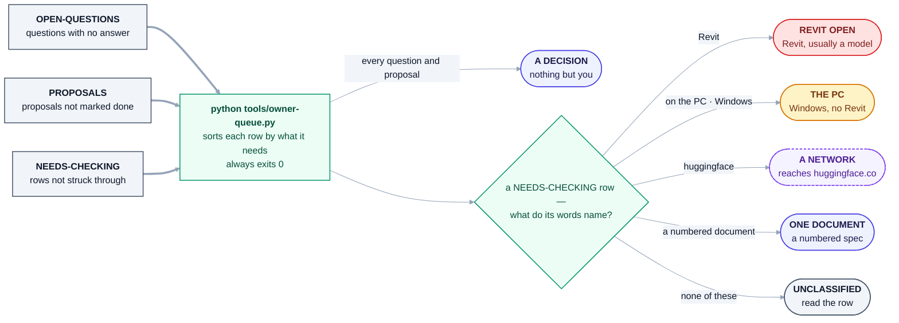

# For the owner

> | | |
> |---|---|
> | **Type** | Permanent page. **Structure only — it carries no list.** |
> | **For** | Ajmal PS, and anyone doing the updating |
> | **Authority** | None. Every register named below wins over this page |
> | **Status** | Live. Opened 2026-09-12 |
> | **Never** | **Do not type a list of items into this file.** See [§6](#6-why-this-page-holds-no-list) |

**Everything waiting on you, in one place, without this page holding a list that can go stale.**

---

## 1. Run this first

```bash
python tools/owner-queue.py
```

It reads [OPEN-QUESTIONS](OPEN-QUESTIONS.md), [NEEDS-CHECKING](NEEDS-CHECKING.md) and
[PROPOSALS](PROPOSALS.md) **as they are right now** and groups everything waiting on you by *what you
need in front of you*. It decides nothing, changes nothing, and always exits 0 — a list of work
waiting on a person is not a build failure.

**Each line is a summary. The register it names is the authority** — open the row before acting on it.

**Two things it leaves out, and says so at its foot:** open defects in
[FRAGMENT-ISSUES](FRAGMENT-ISSUES.md), which no bucket holds, and the plans in `docs/work-notes/plans/`,
which are schedules. The same foot prints how many fragments are still `DRAFT` against how many are
proved, counted from disk as it runs.

---

## 2. The buckets, and what each one means

> **This heading said *"The five buckets"* until 2026-09-16 and the table under it had SIX rows,
> matching the six `tools/owner-queue.py` defines.** A typed number, on the page whose
> [§6](#6-why-this-page-holds-no-list) is titled *why this page holds no list*. It is not a list
> of items, which is what that section forbids - it is a count of the buckets those items fall
> into, and it went stale the same way. **The number is gone; the rows are the answer.** Derive
> them from the tool rather than from here:
>
> ```bash
> grep -oE '^    \("[A-Z][^"]+"' tools/owner-queue.py
> ```

The tool sorts by **what you must have in front of you**, because that is what decides whether a thing
can be done this morning or not at all. **A bucket with nothing in it is not printed**, so a run can show
fewer headings than the table below — on 2026-10-18 *ONE DOCUMENT* printed nothing.

**What is waiting on you, and where it comes from** — read from `BUCKETS`, `classify()` and the three
readers in [`tools/owner-queue.py`](../tools/owner-queue.py). No counts here: the tool prints them.



<details>
<summary>Same thing as plain text</summary>

```text
OPEN-QUESTIONS  (questions with no answer)   --+
PROPOSALS       (proposals not marked done)  --+--> python tools/owner-queue.py  (always exits 0)
NEEDS-CHECKING  (rows not struck through)    --+
                                                     |
    every open question and proposal  ------------>  A DECISION     nothing but you
    a NEEDS-CHECKING row, by its own words           REVIT OPEN     mentions Revit (and not "no Revit")
    and its group's heading, tested in this order:   THE PC         "on the PC", "owner's PC", Windows, setup.ps1
                                                     A NETWORK      huggingface, sentence-transformers, "reach a model"
                                                     ONE DOCUMENT   "document" with "numbered" or "clause"
                                                     UNCLASSIFIED   none of those - read the row
```

</details>

| Bucket | What it needs | What to do with it |
|---|---|---|
| **A DECISION** | Nothing but you | Every open question and every proposal not marked done — the questions [D-139](DECISIONS.md) put to you from the specification land here like any other. Answer it in the register it came from. An answer in chat is lost; an answer in the file is a decision |
| **ONE DOCUMENT** | A numbered specification | **This unblocks more than anything else.** See [§4](#4-the-one-thing-that-unblocks-the-most) |
| **REVIT OPEN** | Revit, and usually a model | Say *"Revit is open"* and **which model** — that decides what can be proved |
| **THE PC** | Windows. No Revit | Runnable any time you are at the machine |
| **A NETWORK** | A machine that can reach `huggingface.co` | Your PC can. This container cannot, and never could |
| **UNCLASSIFIED** | The tool could not tell | **Read the row.** A queue that silently drops an item is worse than no queue |

---

## 3. What you can safely use TODAY

**This is the part that is not a task.** Heron is usable now, on one condition.

| | Safe on a live project? |
|---|---|
| Fragments that are **`PROVEN`** and **`READ`** | **Yes.** A `READ` fragment cannot modify a model — that is enforced, not promised |
| Fragments that are **`PROVEN`** and **`MODIFY`** | **A copy only**, until the owner says otherwise. The rollback check built 2026-10-17 passed every rollback row run in Revit 2024 and 2027 on 2026-10-18, on scratch copies — EO1, EO2, EO4, EO5 (its second half; the first could not be arranged apart) and, on 2027, EO7; a refused move (EO6) was not arranged, and nothing ran on 2020 ([Group EO](needs-checking/group-eo.md)) — but a rollback that reported success and kept a rename anyway ([A16b](needs-checking/group-a.md)) has never been run again and is still open |
| `delete-elements` | **No. Do not run it** until the owner says otherwise. It wiped a model twice on 2026-09-09 and the second hung Revit hard enough to need a forced close ([section 1c](fragment-issues/section-1c.md)). It has since been proved on a test model with the elements counted before and after ([row 55](fragment-issues/section-5-rows-051-075.md)), and its `heron-status` now reads `PROVEN` — whether that lifts this rule is the owner's call, because a delete can take far more than it was handed, and with *Ask to Keep* off — the default — nothing asks before it is kept ([row 5b-161](fragment-issues/section-5b-rows-151-175.md), open) |

Derive the counts rather than reading them here:

```bash
for f in brain/fragments/*/fragment.yaml; do
  printf '%s %s\n' "$(grep -m1 '^heron-status:' "$f" | awk '{print $2}')" \
                   "$(grep -m1 '^risk:' "$f" | awk '{print $2}')"
done | sort | uniq -c | sort -rn
```

**If a write ever looks wrong: close the model WITHOUT saving.** Three rollback failures are on record
— the worst took a model from 9,628 elements to 3,966 — and in every one the file on disk was fine. The
damage stays in the live session. That is the difference between a bug and a data-loss bug.

**How a change from a chat is kept — your switches on the Heron ribbon.** Nothing changes the model
unless **Changes** is on ([D-19](DECISIONS.md)); **Admin** and **Publish** guard their own kinds of job
([D-106](DECISIONS.md)). **Ask to Keep** decides whether Revit shows you the change first
([D-126](DECISIONS.md), [D-138](DECISIONS.md)): **off by default**, and then a change is kept at once as
one named entry in Revit's undo list; **on**, Revit selects what changed and asks *Keep* or *Discard*,
and nothing stays until you press Keep. The box's third link keeps the change and the rest of that chat's
job on that model without asking, until ten quiet minutes pass. Even under that grant, a publish and a
never-proved fragment's one run are asked. **Built for 2020 to 2027; the Ask to Keep switch itself has
not been run in Revit yet** ([Group HG](needs-checking/group-hg.md)) — the Keep or Discard box it turns on was, in Revit 2024 and 2027 on
2026-10-18 ([Group ET](needs-checking/group-et.md)).

---

## 4. The one thing that unblocks the most

**One real numbered specification document.** A company standard if one is numbered, otherwise one QCS
section. **Numbered is the only hard condition**, because clause numbers are what make a citation
testable.

Every test document so far was written to be easy. This single item settles whether the chunker, the
citation path and the refusal behaviour survive a genuine specification — and it replaces an invented
clause number the plan has carried since the start.

**No register row asks for it, so `owner-queue.py` does not show it:** read 2026-10-18, its
*ONE DOCUMENT* bucket was empty, and the ask lives only in the plan
[`work-notes/plans/next-steps-2026-09-12.md`](work-notes/plans/next-steps-2026-09-12.md) (A3, blocking
its S-4 and W-7) — a work note, which §5 says is never the only home of an owner's item. Until a register
carries it, this section is where it is said.

---

## 5. Where everything lives

**Two kinds of file, and the difference decides whether it can be deleted.**

| | Kind | Holds | Deleted? |
|---|---|---|---|
| [DECISIONS.md](DECISIONS.md) | Register | What was decided, and why | **Never.** Append-only |
| [OPEN-QUESTIONS.md](OPEN-QUESTIONS.md) | Register | What nobody has answered | **Never** |
| [NEEDS-CHECKING.md](NEEDS-CHECKING.md) | Register | Claims nothing has proved | **Never** |
| [FRAGMENT-ISSUES.md](FRAGMENT-ISSUES.md) | Register | Fragments that misbehave, and the queue | **Never** |
| [PROPOSALS.md](PROPOSALS.md) | Register | Reviewed gaps, risks and ideas | **Never** |
| [HANDOVER.md](HANDOVER.md) | Work note | Where the last session stopped | Stays — it is the cold start |
| [handover-archive/](handover-archive/README.md) | Archive | Finished sittings, one file each | Kept, never read to work |
| [work-notes/](work-notes/README.md) | Work notes | Plans somebody is executing | **Yes — that is the test** |

**On your PC, Heron's own files are in these places** ([D-135](DECISIONS.md), [D-136](DECISIONS.md)):
the add-in's settings (`heron.config`) and its audit trail in `%APPDATA%\Heron`; the brain's knowledge
store, each project's memory and its audit in `%USERPROFILE%\.heron`, where a Reset of the Store Claude
app cannot reach them; the Companion's notes in `%TEMP%\Heron\companion`; and what belongs to this PC
alone - bridges, logs, run records and the install a rollback goes back to - in `%LOCALAPPDATA%\Heron`
([D-17](DECISIONS.md), `HeronPaths.Derived`). This said *"three places"* until 2026-10-18 and left the
last one out.
`python brain/heron_paths.py --where` names the brain's home on the PC it runs on and the old places it
was carried from, and
[WHAT-TO-INSTALL §6](WHAT-TO-INSTALL.md#6-where-everything-lives-on-your-pc) has the rest.

**The rule that matters: a question, a decision or an unproven claim must NEVER live only in
`work-notes/`.** That folder's lifecycle ends in deletion. On 2026-09-12 a work note was found holding
two unanswered questions while `OPEN-QUESTIONS.md` said one question was open — deleting it would have
destroyed both.

---

## 6. Why this page holds no list

**Every stale claim found on 2026-09-12 was a typed list.**

| The sentence | What was true |
|---|---|
| `OPEN-QUESTIONS.md` — *"1 open"* | three were open |
| `NEEDS-CHECKING.md` — *"two rows have been added: `A10` and `A11`"* | six had been |
| `HANDOVER.md` §1–§3 — *"the repository is private… 7 fragments, all DRAFT… 17 suites"* | public, 360 fragments, 197 proven, 57 suites |

None of them was ever wrong when written. Each was written once and never re-derived, and each was read
and believed by later sessions — **one of which added a row and left the sentence saying "two" in the
same change.**

So this page carries the **structure** and `tools/owner-queue.py` carries the **content**. If you find
yourself about to type a list of items here, that is the failure above, beginning again.

> **The repository's own rule, and it is older than this page:** *name the command that derives it,
> never the number.*

---

## 7. The line that governs everything

**Green is not proven.** [D-30](DECISIONS.md) — the machine gathers evidence, **a person signs it**.

Every measurement not taken at your PC was taken on a Linux container with no Revit, and **no compiler
and no test in this repository can tell you whether a duct moves 200 millimetres or 200 feet.**

That is not pessimism about the tooling. It is the reason [§3](#3-what-you-can-safely-use-today) has
three rows instead of one.
