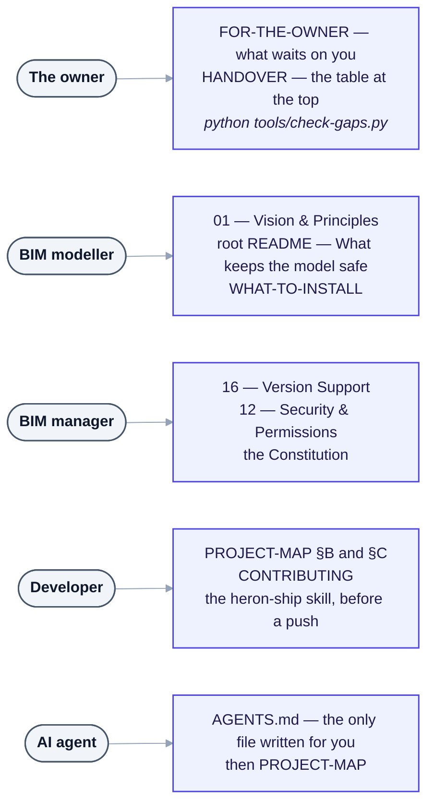

# Heron AI — Documentation Index

> **Status:** **Phase 0 is complete** — Steps 1 to 5, proven in real Revit 2020 and 2024
> ([00e](00e-field-notes-proven-bridge.md), [HANDOVER §3](HANDOVER.md)). **Step 6 (the first write) is
> measured on one release**: three ducts moved 200 mm in Revit 2024 on 2026-09-07
> ([B8](NEEDS-CHECKING.md)), and **on 2026-10-17 a tape measure was put on it** — three ducts +200.0000 mm
> each, a pinned one beside them unmoved, one undo (`D1` to `D6`, [Group D](needs-checking/group-d.md)),
> Revit 2024 and free ducts only.
> **A change asked for in a chat runs inside one named `TransactionGroup`**, and while the ribbon's
> **Ask to Keep** is on, Revit asks the modeller **Keep or Discard** before it is kept
> ([D-126](DECISIONS.md), [D-138](DECISIONS.md)). Ask to Keep is off by default, and then the change is
> kept at once, still as one undo entry. That box and the rails beside it — try-once, the run guard,
> dialogs, the rollback check, the run clock — were run by hand in Revit 2024 and 2027 on 2026-10-18,
> PASS, FAIL and NOT RUN kept apart row by row in [Group ET](needs-checking/group-et.md) and groups EM,
> EX, EL, EO, EZ, ER, EK, ES, EV, EJ and CP. The faults found are rows 5b-1090 to 5b-1095 of
> [FRAGMENT-ISSUES](FRAGMENT-ISSUES.md); the fixes merged since for 5b-1090 to 5b-1094, 5b-1100 and
> 5b-1137 have not been run in Revit.
> **Phase 2 (Steps 7 to 14) is built.** **Every skill is `DRAFT`; most fragments are `PROVEN`, and no
> count is typed here** — derive both:
> `grep -h '^heron-status:' brain/fragments/*/fragment.yaml | sort | uniq -c` and
> `grep -h '^heron-status:' brain/skills/*.yaml | sort | uniq -c`.
>
> **Do not trust this paragraph over the tool.** `python tools/check-gaps.py` is computed from disk on
> every run and sorts everything into *unfinished* and *waiting*; this sentence is typed. Where they
> disagree, the tool is right. Then pick up from [**HANDOVER.md**](HANDOVER.md).

## Which document do I read?

Find yourself on the left; read the box on the right, top line first. The same routes, with what to read
at each stop, are [PROJECT-MAP §E](PROJECT-MAP.md#e-routes-by-role).



<details>
<summary>Same thing as plain text</summary>

```text
The owner      FOR-THE-OWNER (what waits on you) -> HANDOVER, the table at the top
               -> python tools/check-gaps.py
BIM modeller   01 Vision & Principles -> root README, "What keeps the model safe" -> WHAT-TO-INSTALL
BIM manager    16 Version Support -> 12 Security & Permissions -> the Constitution
Developer      PROJECT-MAP sections B and C -> CONTRIBUTING -> the heron-ship skill before a push
AI agent       AGENTS.md, the only file written for you -> then PROJECT-MAP
```

</details>

The links: [FOR-THE-OWNER](FOR-THE-OWNER.md) · [HANDOVER](HANDOVER.md) · [01](01-vision-and-principles.md) ·
[What keeps the model safe](../README.md#what-keeps-the-model-safe) · [WHAT-TO-INSTALL](WHAT-TO-INSTALL.md) ·
[16](16-version-support-strategy.md) · [12](12-security-and-permissions.md) ·
[Constitution](../HERON_CONSTITUTION.md) · [PROJECT-MAP](PROJECT-MAP.md) · [CONTRIBUTING](../CONTRIBUTING.md) ·
[heron-ship](../.claude/skills/heron-ship/SKILL.md) · [AGENTS.md](../AGENTS.md).

## Decided so far

| | Decision |
|---|---|
| **Host** | Claude Code plugin — skills, subagents, MCP server, Revit add-in *([D-01](DECISIONS.md))*. The host decides what the user meant; Heron never classifies intent |
| **Revit support** | 2020 → latest, and every future release *([D-05](DECISIONS.md))* |
| **Languages** | C# for everything touching Revit · Python for the brain and the MCP side *([D-06](DECISIONS.md))* |
| **Transport** | Named pipes — add-in is the server, local-only by construction *([D-02](DECISIONS.md))* |
| **Revit threading** | One `ExternalEvent`, one request queue, one handler *([D-09](DECISIONS.md))* |
| **MCP tools** | Narrow tools, each with its own declared risk level *([D-03](DECISIONS.md))*. A fragment is reached by **capability** through three doors — `revit_read`, `revit_show` and `revit_change` — never by its id ([04 §8](04-heron-mcp.md)). The list, with what each tool may do: `python mcp/server/heron_tools.py` |
| **Off Windows** | No Revit can be there, so the server serves its library tools alone and no `revit_` tool *([D-132](DECISIONS.md))* |
| **Generated code** | Hybrid — C# compiled at run time inside Revit's process, and into an assembly only at `PRODUCTION`, which no fragment has reached *([D-04](DECISIONS.md), [D-28](DECISIONS.md))* |
| **Changing the model** | Off until the ribbon's **Changes** switch is on *([D-19](DECISIONS.md))*. One request is one named `TransactionGroup` and one undo entry (Golden Rule 16); while **Ask to Keep** is on, Revit asks Keep or Discard first *([D-126](DECISIONS.md), [D-138](DECISIONS.md))*. **Admin** and **Publish** each have a switch of their own *([D-106](DECISIONS.md))* |
| **Proof** | One recorded run against a named real model, with a negative case and a staleness fingerprint. A compile or a passing test is not one *([D-30](DECISIONS.md))* |
| **Licence** | Apache 2.0 *([D-08](DECISIONS.md))* |
| **Distribution** | Free and open source on public GitHub; app store later, also free *([D-07](DECISIONS.md))* |
| **Repo visibility** | Private until the licence and safety files existed and Phase 0 worked *([D-10](DECISIONS.md))*. Both are met, and the [root README](../README.md) says the repository is public so the work is open, not yet to be installed |
| **Building on** | the owner's earlier brain and Revit-connector work, upgraded to this architecture |

> **If you are the owner, start at [FOR-THE-OWNER.md](FOR-THE-OWNER.md).** One page for
> everything waiting on you, across every register — and it holds no list of its own, because
> `python tools/owner-queue.py` derives one at the moment you ask. Three typed lists were found
> stale on 2026-09-12, which is why.

**Nothing gates any phase.** How many questions are answered and open is derived on
[OPEN-QUESTIONS](OPEN-QUESTIONS.md) and checked by `tools/check-docs.py`; which of them wait on the owner
is `python tools/owner-queue.py`. Neither is typed here. Every question, answered or not, keeps its
answer in that register — [`open-questions/answered.md`](open-questions/answered.md) and the tier files
beside it.

**Specification is complete in four parts.** Part 1 is the platform and its organisation; Part 2 is the
Agent Operating System; Part 3 is the consolidated baseline, **authoritative on Golden Rules 1 to 15**
(Part 1's ten became fifteen, [D-12](DECISIONS.md)) — rules 16 to 21 were accepted beside them on
2026-08-28, and [14](14-golden-rules.md) holds all 21; Part 4 adds the **Kernel**, the **Workflow Engine**,
the **Constitution** and 30 mandatory components ([D-13](DECISIONS.md)). They say what Heron was asked
to be, not what is built, and where one differs from [DECISIONS.md](DECISIONS.md) the decision wins.
**Since 2026-10-18 a wrong fact in them, or words an accepted decision already settled, is corrected in
place with the original kept beside it, struck through** ([D-139](DECISIONS.md#d-139--the-four-parts-of-the-specification-are-corrected-in-place-where-a-fact-is-wrong-or-an-accepted-decision-settled-it-and-the-original-words-stay-beside-the-correction));
each section's dated *As built* note says what was corrected and on what evidence.

**The [Constitution](../HERON_CONSTITUTION.md) is binding** — all 30 Articles, accepted 2026-08-28
([D-43](DECISIONS.md)). **One item is agreed in direction and not signed off:** the
[unified trust model](24-trust-model.md) — six competing status vocabularies resolved into two axes
([Q-34](OPEN-QUESTIONS.md), [D-14](DECISIONS.md) still proposed).

Review of all four parts: [PROPOSALS](PROPOSALS.md).

---

## Start here

| If you want to… | Read |
|---|---|
| **Pick up where the last session stopped** | [**HANDOVER.md**](HANDOVER.md) |
| **Find which folder owns what, and where to start a change** | [**PROJECT-MAP.md**](PROJECT-MAP.md) |
| Work on Heron as an AI agent | [**AGENTS.md**](../AGENTS.md) |
| Understand what Heron AI is | [01 — Vision & Principles](01-vision-and-principles.md) |
| See the original specification — the owner's words, with D-139's corrections beside them | [00 — Master Specification](00-master-specification.md) |
| Know what is missing or risky | [PROPOSALS.md](PROPOSALS.md) |
| Know what still needs deciding | [OPEN-QUESTIONS.md](OPEN-QUESTIONS.md) |
| Know what gets built first | [ROADMAP.md](ROADMAP.md) |
| **Actually start building** | [**27 — Build Order**](27-build-order.md) |
| Know the non-negotiables | [14 — Golden Rules](14-golden-rules.md) and the [Constitution](../HERON_CONSTITUTION.md) |
| Open a pull request | [CONTRIBUTING.md](../CONTRIBUTING.md) — the process, the code style and what gets a change rejected outright |
| Know **what to install** for Heron — Python first — and what is optional | [WHAT-TO-INSTALL.md](WHAT-TO-INSTALL.md) |

---

## Core documents

**Every numbered document, by what it is about.** The tables after this one list them again by number,
with what each covers.

| Theme | Documents | Read it when |
|---|---|---|
| **The specification** — the destination. Corrected in place only as [D-139](DECISIONS.md) allows, the original words struck through beside each correction | [00](00-master-specification.md) Part 1 · [00b](00b-master-specification-agent-os.md) Part 2 · [00c](00c-master-handover-baseline.md) Part 3 · [00d](00d-additional-requirements.md) Part 4 · [00e](00e-field-notes-proven-bridge.md) field notes, observed rather than designed | you need the original requirement, word for word |
| **What Heron is, and its rules** | [01](01-vision-and-principles.md) Vision · [14](14-golden-rules.md) Golden Rules · [Constitution](../HERON_CONSTITUTION.md) · [15](15-glossary.md) Glossary | first, and whenever a rule is in question |
| **The product parts** | [02](02-architecture-overview.md) Architecture · [03](03-heron-revit.md) Revit add-in · [04](04-heron-mcp.md) MCP · [05](05-heron-brain.md) Brain · [06](06-heron-platform.md) Platform · [07](07-installation-and-update.md) Install and update · [25](25-multi-session-and-binding.md) Multi-session and binding | you change one part |
| **Agents and the kernel** | [08](08-agent-catalog.md) Agent catalogue · [28](28-agent-registry.md) Agent registry · [11](11-orchestration-and-workflows.md) Orchestration · [18](18-agent-operating-system.md) Agent OS · [19](19-context-and-cost.md) Context and cost · [22](22-users-modes-and-extensibility.md) Users and modes · [23](23-heron-kernel.md) Kernel | you touch an agent, or how work is ordered |
| **Knowledge and trust** | [09](09-skills-and-fragments.md) Skills and fragments · [10](10-memory-and-knowledge.md) Memory and knowledge · [20](20-knowledge-trust-and-conflict.md) Knowledge trust · [24](24-trust-model.md) Trust model · [36](36-remembering-between-steps.md) Remembering between steps | you touch the library or the stores |
| **Safety and quality** | [12](12-security-and-permissions.md) Security and permissions · [13](13-testing-and-quality.md) Testing · [21](21-resilience-and-operations.md) Resilience · [16](16-version-support-strategy.md) Version support | before anything writes to a model, or ships |
| **What a modeller gets** — built, not proven | [40](40-heron-companion.md) Companion · [41](41-hvac-design.md) HVAC · [42](42-fire-protection-design.md) Fire protection · [43](43-building-revit-families.md) Families · [44](44-building-loads-from-the-model.md) Building loads · [46](46-sprinkler-hydraulics-from-the-model.md) Sprinkler hydraulics · [47](47-sprinkler-layout-from-the-model.md) Sprinkler layout | you work on one of these features |
| **How the work is done** | [27](27-build-order.md) Build order · [29](29-metadata-standard.md) Metadata · [30](30-compiling-away-from-windows.md) Compiling away from Windows · [38](38-the-cloud-environment.md) Cloud environment · [37](37-the-provider-adapter.md) Provider adapter · [17](17-open-source-and-distribution.md) Open source and distribution | you build, compile or release |
| **Research** — studied, never imported | [26](26-prior-art-revit-mcp.md) Prior art · [31](31-studying-the-existing-libraries.md) Studying the libraries · [32](32-master-architecture-reconciliation.md) Master Architecture reconciled · [33](33-external-repository-research.md) External repositories · [34](34-patterns-adapted.md) Patterns adapted · [34](34-project-perfection-and-continuous-upgrade-plan.md) Upgrade plan, executed · [35](35-independent-study-notes-open-design-awesome-llm-apps-openhands.md) Study notes · [39](39-three-downloaded-skill-sets.md) Three skill sets · [45](45-five-more-downloaded-skill-files.md) Five more skill files | before proposing something another project does |

### By number

| # | Document | Covers |
|---|---|---|
| 00 | [Master Specification — Part 1](00-master-specification.md) | The platform and its organisation, §1–§76. The owner's intent, with a dated *As built* note under each section that no longer holds and [D-139](DECISIONS.md)'s corrections in place. |
| 00b | [Master Specification — Part 2](00b-master-specification-agent-os.md) | The Agent Operating System and self-evolution, §1–§84. The owner's intent, noted and corrected the same way. |
| 00c | [Master Handover Baseline — Part 3](00c-master-handover-baseline.md) | The consolidated baseline, §1–§80. **Authoritative on Golden Rules 1–15**; all 21 are in [14](14-golden-rules.md). |
| 00d | [Additional Requirements — Part 4](00d-additional-requirements.md) | Kernel, Workflow Engine, Constitution, 30 mandatory components, §1–§48. The owner's intent, noted and corrected the same way. |
| 00e | [Field Notes — Proven Bridge Behaviour](00e-field-notes-proven-bridge.md) | **Observed, not designed.** Multi-Revit, session binding, the stale read. Proven live 2026-08-20. |
| 01 | [Vision & Principles](01-vision-and-principles.md) | What Heron is, personas, the defining principle |
| 02 | [Architecture Overview](02-architecture-overview.md) | Layers, four parts, orchestration, **agent tiers** |
| 03 | [Heron Revit](03-heron-revit.md) | Add-in, Revit agents, **threading, transactions, versions** |
| 04 | [Heron MCP](04-heron-mcp.md) | The bridge, tool design, permission boundary |
| 05 | [Heron Brain](05-heron-brain.md) | RAG, retrieval strategy, vector store, embeddings |
| 06 | [Heron Platform](06-heron-platform.md) | Workspace, registry, agent lifecycle, packages, GitHub |
| 07 | [Installation & Update](07-installation-and-update.md) | Install flow, build strategy, updates, self-healing |
| 08 | [Agent Catalogue](08-agent-catalog.md) | The original catalogue of agents by department, with tiers. [28](28-agent-registry.md) is the complete registry |
| 09 | [Skills & Fragments](09-skills-and-fragments.md) | The knowledge units, lifecycle, gates, code execution |
| 10 | [Memory & Knowledge](10-memory-and-knowledge.md) | Scopes, isolation, import, community |
| 11 | [Orchestration & Workflows](11-orchestration-and-workflows.md) | Reference workflows, failure handling, performance |
| 12 | [Security & Permissions](12-security-and-permissions.md) | Permission levels, gate location, confidentiality, audit |
| 13 | [Testing & Quality](13-testing-and-quality.md) | Eight test levels, testing against real Revit, regression |
| 14 | [Golden Rules](14-golden-rules.md) | The non-negotiables — **21 official rules**, 16–21 accepted 2026-08-28. The runtime-enforceable subset is the [Constitution](../HERON_CONSTITUTION.md) |
| 15 | [Glossary](15-glossary.md) | Terms, Revit concepts, status vocabularies |
| 16 | [Version Support Strategy](16-version-support-strategy.md) | **Revit 2020 → latest** — the two API breaks, multi-targeting, adapters, test matrix |
| 17 | [Open Source & Distribution](17-open-source-and-distribution.md) | Licence, public/private separation, contribution, disclaimer, channels |

### From Master Specification Part 2 — the Agent Operating System

| # | Document | Covers |
|---|---|---|
| 18 | [Agent Operating System](18-agent-operating-system.md) | **Capability Registry**, dynamic discovery, Agent HR, **Shadow Mode**, trust scores, events |
| 19 | [Context & Cost](19-context-and-cost.md) | Context Manager, compression, model routing, fallback, caching, observability |
| 20 | [Knowledge Trust & Conflict](20-knowledge-trust-and-conflict.md) | Knowledge hierarchy, trust levels, **conflict resolution**, fragment branching, quality scores |
| 21 | [Resilience & Operations](21-resilience-and-operations.md) | **Dependency graph**, safety tiers, **emergency stop**, health, self-healing, backup, migration |
| 22 | [Users, Modes & Extensibility](22-users-modes-and-extensibility.md) | Conversation intelligence, User/Developer/Admin modes, multi-user, platform adapters, plugins, SDK |

### From Additional Requirements Part 4

| # | Document | Covers |
|---|---|---|
| 23 | [Heron Kernel & Workflow Engine](23-heron-kernel.md) | **The Kernel**, five registries, Workflow Engine, checkpoints, **Evidence System**, model abstraction, prompt registry |
| 24 | [The Unified Trust Model](24-trust-model.md) | **Resolves six competing status vocabularies** into two orthogonal axes: lifecycle and source |
| — | [**HERON_CONSTITUTION.md**](../HERON_CONSTITUTION.md) | 30 Articles agents must never violate — the runtime-enforceable subset of the Golden Rules |

### From the field

| # | Document | Covers |
|---|---|---|
| 25 | [Multi-Session & Document Binding](25-multi-session-and-binding.md) | **Field-proven.** Bridge discovery, one chat one Revit, **document pinning**, **the stale read**, turn-taking, cross-document work |

### Research

| # | Document | Covers |
|---|---|---|
| 26 | [Prior Art: Existing Revit MCP Servers](26-prior-art-revit-mcp.md) | What already exists, what it confirms, **the two gaps every project shares**, pyRevit Routes |
| 27 | [**Build Order**](27-build-order.md) | **Start here to build.** Six numbered steps, each independently provable |
| 28 | [**The Complete Agent Registry**](28-agent-registry.md) | **Every agent** — ID, what each one does, tier, risk level, build step. How many, and how many are built: `python tools/agent-count.py` |
| 29 | [Metadata Standard](29-metadata-standard.md) | The five fields every artefact carries — and how they tie the code back to the registry |
| 30 | [Compiling Away From Windows](30-compiling-away-from-windows.md) | **The compile gate runs anywhere.** All eight releases, 2020–2027, from NuGet on Linux; what a pass proves; the 2020-only defect it caught on its first run; and why three releases were skipped for a reason that was about the SDK package, not the operating system |
| 31 | [Studying The Existing Libraries](31-studying-the-existing-libraries.md) | **How a fragment is studied and re-authored, never imported.** What travels (the mechanism, the scar) and what cannot (the code, the words, the proof); the owner's three rules — check and edit, add, split; and why 221 verified fragments arrive here as 221 unproven ones |
| 32 | [**The Master Architecture document, reconciled**](32-master-architecture-reconciliation.md) | **Read this before building anything from [`HERON_AI_MASTER_ARCHITECTURE.md`](../HERON_AI_MASTER_ARCHITECTURE.md).** The audit that document demands of itself, done against this repository: **nine of its platform modules already exist here, four of them stricter than it asks for.** What is genuinely missing, ranked — **and partly closed since**: at audit time the Context Manager and the six things beside it in [19](19-context-and-cost.md) had no implementation of any kind, and [`brain/heron_context.py`](../brain/heron_context.py) was built the same day. Three of the seven are now real; **four remain absent on purpose**, three of them placed in the host by [D-58](DECISIONS.md). And what is rejected, with reasons, so the same proposals are not made again. [D-57](DECISIONS.md) |
| 33 | [The External Repository Research Matrix](33-external-repository-research.md) | **The fifteen projects [`HERON_AI_MASTER_ARCHITECTURE.md`](../HERON_AI_MASTER_ARCHITECTURE.md) §10 asks about — read twice: from their pages, then by cloning and reading every one.** The file-level pass **disagreed with the page-level one in ten of the fifteen entries** (§4a), corrected five licence cells and three of this document's own claims, and changed two decisions. **Six projects agree with Heron** — §1 separates the three that are shared convention from the four that are a design that could have gone otherwise. **Nothing is adopted as code**, and one project is **AGPLv3** against Heron's Apache 2.0 |
| 34 | [The Patterns, Adapted](34-patterns-adapted.md) | **Not *what* those projects are — *how* they get their result, and what that is worth to a modeller.** Each pattern's heading carries its verdict — built, already held, adopted as a rule, answered as a decision, or rejected — and `grep '^### 2\.' docs/34-patterns-adapted.md` lists them. Among those built: tiered depth and the cut marker, which together take a generation packet from **5,737 characters to 372 with the request byte-identical**, the boundary hook, and the three checks the improvement gate is made of. The ones that waited on the owner were answered as [D-60](DECISIONS.md), [D-81](DECISIONS.md) and [D-66](DECISIONS.md). The lesson three of them taught from different directions: **a rule in code beats a rule in prose** |
| 34 | [Project Perfection and Continuous Upgrade Plan](34-project-perfection-and-continuous-upgrade-plan.md) | **Executed 2026-09-12 - do not run it again.** The plan for studying outside repositories for principles rather than code; what it produced is the Improvement Gate (`check-change.py`, `change-evidence.py`, `check-package.py`). Shares its number with [34 — The Patterns, Adapted](34-patterns-adapted.md) |
| 35 | [Independent Study Notes: OpenDesign, Awesome LLM Apps, OpenHands](35-independent-study-notes-open-design-awesome-llm-apps-openhands.md) | The second pass over the three repositories [34](34-project-perfection-and-continuous-upgrade-plan.md) referenced — corrections to it, stronger evidence, and what each one is worth to Heron specifically |
| 36 | [Remembering Between Steps](36-remembering-between-steps.md) | **A design note, not a decision** — no `D-` number has been spent on it. Its opt-in check was built on 2026-09-16 as the request's `expectChain`, and both legs were run on a real model in Revit 2020 and are not yet signed — the dated *As built* note at its top |
| 37 | [The Provider Adapter](37-the-provider-adapter.md) | **Written as a scope.** Three agents decide which model to use, whether it is reachable and what it cost. One `LOCAL` adapter for Ollama, `brain/heron_provider.py`, has been built and tested since — **not run against a provider** ([K3](needs-checking/group-k.md)), and nothing Heron serves goes through it yet |
| 38 | [**The Cloud Environment**](38-the-cloud-environment.md) | **Where Heron work runs when it is not on the owner's PC.** The four fields to set; why **Custom** network access rather than Trusted, which does not carry `huggingface.co` and so silently costs retrieval its meaning; what a cloud session runs that CI does not — every suite in `tests/`, against the three CI leaves unrun — and the three things the setup script deliberately refuses to do |
| 39 | [Three Downloaded Skill Sets, Studied](39-three-downloaded-skill-sets.md) | **Another product's Revit connector notes, an office master prompt and a studio toolkit index, read lesson by lesson against Heron's code.** Nothing copied. What came out: a roof slope Heron had named as missing in its own words, a step-by-step building-shell skill, a defect their same-name scar exposed in Heron's parameter fragments, and a list of what their connector does that Heron does not - left unbuilt on purpose. **Its best lesson is a scar whose cause was never isolated:** the same roof error Heron had already traced to a different one |
| 40 | [Heron Companion](40-heron-companion.md) | **Built, not proven in Revit - allowed by D-108 and D-109.** A local page beside Revit that shows the live selection and every Heron call the chat makes, and gives editable tables - a settings change's values, or elements and their parameters - that the modeller applies there with no message to the chat; the load and sprinkler panels of [44](44-building-loads-from-the-model.md), [46](46-sprinkler-hydraulics-from-the-model.md) and [47](47-sprinkler-layout-from-the-model.md) live on it too. Where it lives and why (inside each chat's MCP process, with Revit's state read from a file, never the pipe); the ten places the request and Heron's rules disagreed and how each was settled; and in §21 what was built |
| 41 | [**HVAC Design**](41-hvac-design.md) | **Built, not proven against a project.** What Heron now works out before a duct is drawn - loads, supply air, ASHRAE 62.1 outdoor air, psychrometrics, duct friction and sizing, fan power, diffusers, chilled water - read from HAP, ASHRAE, SMACNA and the rest and re-authored as the `heron_hvac` tool. Why every design value is ASKED for and a standard's figure only OFFERED (D-33); why a load here is a peak estimate and not HAP; how far each reference table was checked; what is known about Qatar; seven conflicts recorded, not resolved; and what is not built |
| 42 | [**Fire Protection Design**](42-fire-protection-design.md) | **Built, not proven against a project.** What Heron now works out before a sprinkler is placed - hazard classes looked up and never decided, sprinkler spacing, counts and a drawn layout checked as NFPA 13 measures it, the design area, pipe schedules including sprinklers above and below a ceiling, the obstruction rules, a hydraulic solve of a tree or a grid, the water supply, storage, pumps, standpipes, extinguishers and detectors - as the `heron_fire` tool. Why a criterion is ASKED and a table asked about is answered; why a figure nobody could check is not held at all; what is known about Qatar; ten conflicts, six of them the owner's own file against NFPA; and what is not built |
| 43 | [Building Revit Families](43-building-revit-families.md) | **Every kind of family, and what makes one parametric** - which template makes which kind and why nothing changes it later, the planes-labels-locks method, parameters, formulas, lookup tables and type catalogs, hosted, line-based, pattern-based, adaptive, profile, detail and annotation families, MEP fittings, and exactly where Revit's API stops: no label on any release, no reference line's planes. Each fact marked API, SOURCED or UNSURE; researched 2026-10-01 with the Autodesk hosts out of the cloud session's reach |
| 44 | [Building Loads from the Model](44-building-loads-from-the-model.md) | **Every Space's heating and cooling load from the Revit model in one run** - the study of a published residential load skill (39 tests pass, 8 defects found, not copied and why), what it has that Heron lacks, the Space take-off reader, the building runner over `heron_hvac`, block load, the two gates, the Companion Loads panel, the load calculation sheet, owner questions and build phases. **Written as a design; §11 onward records what was built from it from 2026-10-04** (`brain/heron_takeoff.py`, `heron_building_loads.py`, `heron_loads_report.py`, the `revit_building_loads` tool). Built, not proven - its read, `report-space-envelope`, is `DRAFT` |
| 45 | [Five More Downloaded Skill Files, Studied](45-five-more-downloaded-skill-files.md) | **The same folder as [39](39-three-downloaded-skill-sets.md), shared again with five new files - a Revit scripting toolkit, a data-exchange and validation toolkit, an IFC toolkit, a computational-design toolkit and a larger copy of the connector notes - read line by line against Heron's code.** Nothing copied. Most of what is Revit, Heron already does. What came out: **three defects in Heron's own fragments** found by checking their lessons against the code, eight DRAFT fragments widened and one added, a pre-IFC-export recipe, and a list of what is worth building but touches a PROVEN fragment, left for the owner |
| 46 | [Sprinkler Hydraulics from the Model](46-sprinkler-hydraulics-from-the-model.md) | **One sprinkler system's hydraulic calculation from the Revit model, in the Companion.** A new read, `REPORT_SPRINKLER_NETWORK`, gives every pipe, fitting, valve and head and how they connect; the brain joins it into the fire engine's network, asks only what the model cannot say - the standard, the criteria, each sprinkler type's K, the fittings' equivalent lengths - suggests the remote area, solves it with the existing `hydraulic`, and writes the calculation sheet. The plan, its independent review (20 findings, all taken) and what phase 1 built. Writes nothing to Revit. Built, not proven |
| 47 | [Sprinkler Layout from the Model](47-sprinkler-layout-from-the-model.md) | **Sprinklers laid out in the rooms the modeller selects, of any shape, previewed in the Companion and placed level by level.** A new read, `REPORT_SPRINKLER_LAYOUT_SPACES`, gives each room's outline, holes, level, ceilings and the heads already there; the fire engine's new `sprinkler_layout_room` lays it out on the fewest heads that pass the same measure `sprinkler_spacing` uses; Apply places one level through the proven `PLACE_FAMILY_INSTANCES` and reads the heads back. The plan and its independent review (19 findings, all taken). Writes to Revit only on Apply, with the Changes switch on. Built, not proven |

## Working documents

| Document | Purpose |
|---|---|
| [**HANDOVER.md**](HANDOVER.md) | Where the last session stopped — what exists, what is **proven** rather than merely built, and what to say to carry on |
| [**FOR-THE-OWNER.md**](FOR-THE-OWNER.md) | Everything waiting on the owner, across every register. Structure only - the list is `python tools/owner-queue.py` |
| [**FRAGMENT-ISSUES.md**](FRAGMENT-ISSUES.md) | The register of fragments with something wrong - section 5 found by proving, 5b by reading. Finished rows move to [`fragment-issues-archive/`](fragment-issues-archive/README.md) |
| [**NEEDS-CHECKING.md**](NEEDS-CHECKING.md) | The proving register — every unproven claim as a numbered item, grouped by what it needs. `python tools/check-gaps.py` reads this file |
| [PROPOSALS.md](PROPOSALS.md) | Gaps found in review, feature ideas, strategic questions |
| [FRAGMENT-REVIEW-PLAN-CHATGPT-2026-09-07.md](work-notes/plans/FRAGMENT-REVIEW-PLAN-CHATGPT-2026-09-07.md) | An outside review of the fragment library. **Partly implemented** — C03, C04, C09 and N01–N09 are done; **C01, C02, C05–C08 and the S01–S05 splits are still plan only.** Its own baseline numbers are a dated snapshot |
| [OPEN-QUESTIONS.md](OPEN-QUESTIONS.md) | Every question, prioritised, with answer slots. **The count is derived** — `python tools/check-docs.py` reads the questions themselves and fails if the progress line disagrees. Q-72 to Q-78, opened 2026-10-18 under [D-139](DECISIONS.md) point 4, are the policy choices in the specification that no accepted decision settles |
| [ROADMAP.md](ROADMAP.md) | Phase 0 → Phase 7, and what is deliberately deferred |
| [DECISIONS.md](DECISIONS.md) | Append-only log of decisions actually made |
| [**work-notes/**](work-notes/README.md) | **What work is going on right now** — active plans, execution records, temporary notes. Operational workspace, never specification |
| [REVIEW-LEDGER.tsv](REVIEW-LEDGER.tsv) | Which source file was read, by whom, at which blob, and the verdict. Written and read by `python tools/review-ledger.py`, never by hand |
| [../tools/](../tools/README.md) | Every gate, report and generator — among them the link and count checker that keeps these documents honest (`check-docs.py`), the owner's queue and the agent map |

### The folders in `docs/`

| Folder | What it holds |
|---|---|
| [`decisions/`](decisions/D-01.md) | One file per decision, `D-NN.md`, since 2026-09-23. [DECISIONS.md](DECISIONS.md) is the index and the rules |
| [`open-questions/`](open-questions/tier-1.md) | [OPEN-QUESTIONS.md](OPEN-QUESTIONS.md), one file per tier or section |
| [`needs-checking/`](needs-checking/group-a.md) | [NEEDS-CHECKING.md](NEEDS-CHECKING.md), one file per group |
| [`fragment-issues/`](fragment-issues/section-1.md) | [FRAGMENT-ISSUES.md](FRAGMENT-ISSUES.md), one file per section or band of rows |
| [`proposals/`](proposals/part-a.md) | [PROPOSALS.md](PROPOSALS.md), one file per part or numbered proposal |
| [`fragment-issues-archive/`](fragment-issues-archive/README.md) | Finished FRAGMENT-ISSUES rows, written by `tools/archive-fragment-issues.py`. Not a live obligation |
| [`needs-checking-archive/`](needs-checking-archive/README.md) | Finished NEEDS-CHECKING rows, written by `tools/archive-needs-checking.py`. Not a live obligation |
| [`handover-archive/`](handover-archive/README.md) | One note per finished session, moved out of [HANDOVER.md](HANDOVER.md). Narrative, never a register |
| `proof/` | Screenshots that NEEDS-CHECKING rows cite as evidence. Which groups cite them: `grep -l 'proof/' docs/needs-checking/*.md` |
| [`work-notes/`](work-notes/README.md) | Temporary operational work - see the row above |

---

## Reading conventions

- **[NOTE]** blocks are engineering commentary added during review — not part of the original specification.
- The four parts of the [Master Specification](00-master-specification.md) are changed only through a
  decision. The one that allows an edit in the file is [D-139](DECISIONS.md): a wrong fact, or words an
  accepted decision settled, corrected in place with the original struck through beside it and a dated
  note naming the evidence. A policy choice no decision has made stays as written and goes to
  [OPEN-QUESTIONS](OPEN-QUESTIONS.md).
- 🔴 blocking · 🟠 important · 🟡 worth doing · 🔵 idea

---

## The one-line version

> The user focuses on BIM. Heron AI focuses on everything behind the BIM work.
