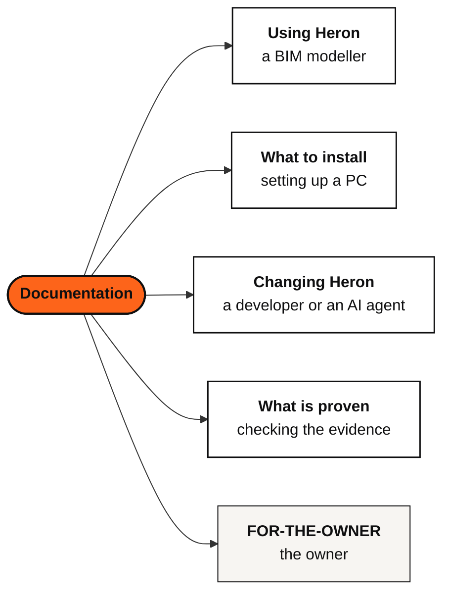

[Heron AI](../README.md) › **Documentation**

# Heron AI — Documentation

**Start with the door that fits you.** Each page is short and links to the next; nothing here needs
reading top to bottom.

> **Heron can be installed now, as an early unsigned build** — [Install](../README.md#install) on the
> home page has the steps, and what has and has not been checked ([D-190](DECISIONS.md)).
> Where the work stands today is [What is proven](guide/what-is-proven.md), and
> `python tools/check-gaps.py` is computed from disk on every run: **where a sentence and the tool
> disagree, the tool is right.**

## Pick your door



<details>
<summary>Same thing as plain text</summary>

```text
A BIM modeller           -> Using Heron
Setting up a PC          -> What to install
A developer or AI agent  -> Changing Heron  (an AI agent reads AGENTS.md first)
Checking the evidence    -> What is proven
The owner                -> FOR-THE-OWNER
```

</details>

| You are… | Start at | Then |
|---|---|---|
| **a BIM modeller or coordinator** | [**Using Heron**](guide/using-heron.md) · [**Revit tool catalogue**](guide/revit-tool-catalogue.md) | [What keeps the model safe](guide/safety.md) · [01 — Vision & Principles](01-vision-and-principles.md) |
| **setting up a PC** | [**Installing Heron**](guide/install.md) · [**What to install**](WHAT-TO-INSTALL.md) | Step by step, troubleshooting, update and removal · Python first, then what is optional · [System requirements](guide/system-requirements.md) - what each piece costs on disk · [CHANGELOG](../CHANGELOG.md) |
| **changing Heron** | [**Changing Heron**](guide/changing-heron.md) | [PROJECT-MAP](PROJECT-MAP.md) · [CONTRIBUTING](../CONTRIBUTING.md) · the [`heron-ship`](../.claude/skills/heron-ship/SKILL.md) skill before a push |
| **an AI agent** | [**AGENTS.md**](../AGENTS.md) — short, and the only file written for you | then [PROJECT-MAP](PROJECT-MAP.md) |
| **checking what is proven** | [**What is proven**](guide/what-is-proven.md) | [NEEDS-CHECKING](NEEDS-CHECKING.md) · `python tools/check-gaps.py` |
| **the owner** | [**FOR-THE-OWNER**](FOR-THE-OWNER.md) — one page for everything waiting on you, and it holds no list: `python tools/owner-queue.py` derives one | [HANDOVER](HANDOVER.md) — the table at the top |
| **a BIM manager** | [16 — Version Support](16-version-support-strategy.md) | [12 — Security & Permissions](12-security-and-permissions.md) · the [Constitution](../HERON_CONSTITUTION.md) |

The same routes, with what to read at each stop: [PROJECT-MAP §E](PROJECT-MAP.md#e-routes-by-role).

## The sections

| Section | What is in it |
|---|---|
| [**How Heron works**](guide/how-heron-works.md) | The four parts, one request step by step, what runs where, how the right tool is found |
| [**What keeps the model safe**](guide/safety.md) | The switches, Keep or Discard, one Undo, and every guard |
| [**Rules and decisions**](guide/rules-and-decisions.md) | The Golden Rules, the Constitution, what is decided, the specification in four parts |
| [**Every document**](guide/all-documents.md) | All the numbered documents, by theme and by number |
| [**Registers and working documents**](guide/registers.md) | HANDOVER, NEEDS-CHECKING, FRAGMENT-ISSUES, OPEN-QUESTIONS, work notes, and the folders in `docs/` |
| [**Research**](guide/research.md) | What was studied, the rule that governs it, and what it gave Heron |

## If you want to…

| If you want to… | Read |
|---|---|
| **Pick up where the last session stopped** | [**HANDOVER.md**](HANDOVER.md) |
| **Find which folder owns what, and where to start a change** | [**PROJECT-MAP.md**](PROJECT-MAP.md) |
| Understand what Heron AI is | [01 — Vision & Principles](01-vision-and-principles.md) |
| See the original specification — the owner's words, with D-139's corrections beside them | [00 — Master Specification](00-master-specification.md) |
| Know what is missing or risky | [PROPOSALS.md](PROPOSALS.md) |
| Know what still needs deciding | [OPEN-QUESTIONS.md](OPEN-QUESTIONS.md) |
| Know what gets built first | [ROADMAP.md](ROADMAP.md) |
| **Actually start building** | [**27 — Build Order**](27-build-order.md) |
| Know the non-negotiables | [14 — Golden Rules](14-golden-rules.md) and the [Constitution](../HERON_CONSTITUTION.md) |
| Look up a word | [15 — Glossary](15-glossary.md) |
| Open a pull request | [CONTRIBUTING.md](../CONTRIBUTING.md) — the process, the code style and what gets a change rejected outright |
| Know **what to install** for Heron — Python first — and what is optional | [WHAT-TO-INSTALL.md](WHAT-TO-INSTALL.md) |
| Find a script that checks links or derives a count | [tools/](../tools/README.md) |

---

## The one-line version

> The user focuses on BIM. Heron AI focuses on everything behind the BIM work.

↑ [Home](../README.md)
