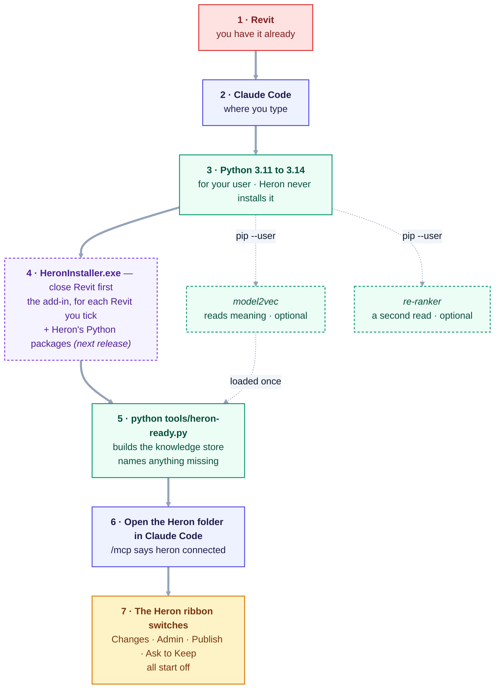
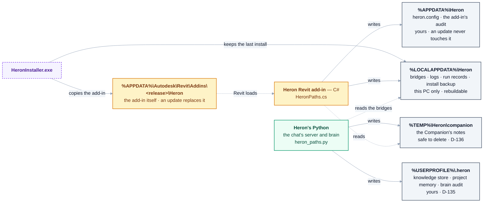

# What to install for Heron — and what is optional

> | | |
> |---|---|
> | **Type** | Permanent page, in plain words. **It copies no package list and no download size** — each line points to the file or command that owns it |
> | **For** | Anyone setting up a PC for Heron, and anyone asking *"why did Heron pick the wrong tool?"* |
> | **Authority** | None of its own. [`requirements.txt`](../requirements.txt) and [`requirements-optional.txt`](../requirements-optional.txt) are the lists, [Q-39](open-questions/answered.md) settled what a user must install, [07](07-installation-and-update.md) is how Heron is installed, and [`brain/retrieval-history.md`](../brain/retrieval-history.md) holds every measurement. Where this page disagrees with them, **they win** |
> | **Opened** | 2026-09-24, with the first measurement of the search add-ons on the owner's own questions |

> **The first release, [v0.1.0](https://github.com/Ajmalpshaik/Heron-AI/releases/tag/v0.1.0), was
> published on 2026-10-08**, on the owner's word, so a new teammate could install Heron. It is an early,
> **unsigned** build, and the [main README](../README.md) still asks modellers not to install Heron until
> it is announced.
>
> **The installer is in that release, never in the code.** Searching the code will not find
> `HeronInstaller.exe` — it is built, and [`.gitignore`](../.gitignore) keeps it out on purpose. It sits
> at the top of `heron-project.zip` on the release page: row 6 below. With a copy of the code,
> `.\tools\setup.ps1` builds and installs Heron with no installer at all —
> [section 4](#4-only-to-build-heron-yourself).

## At a glance

A new PC, top to bottom. The two dotted green boxes are optional; everything else is needed.



<details>
<summary>Same thing as plain text</summary>

```text
1  Revit                          you have it already
2  Claude Code                    where you type
3  Python 3.11 to 3.14            for your user; Heron never installs Python itself
4  HeronInstaller.exe             close Revit first; the add-in for each Revit ticked,
                                  and Heron's Python packages (from the next release)
5  python tools/heron-ready.py    builds the knowledge store, names anything missing
6  Open the Heron folder in Claude Code; /mcp says heron connected
7  Heron ribbon switches          Changes, Admin, Publish, Ask to Keep - all start off

Optional, after 3:  model2vec (reads meaning; heron-ready loads it once)
                    re-ranker  (a second read of the top picks)
```

</details>

**Where the range 3.11 to 3.14 comes from:** `LOCK_OLDEST_MINOR` and `LOCK_NEWEST_MINOR` in
[`tools/heron-ready.py`](../tools/heron-ready.py), and `OldestMinor` and `NewestMinor` in
[`PythonSetup.cs`](../platform/Heron.Installer/PythonSetup.cs) — the installer refuses a Python outside
it by name. **Box 4's Python half is not in v0.1.0**: on that release, PyYAML and `mcp` are the lock line
in [section 1](#1-what-every-pc-needs), by hand.

| Thing | Needed? | How to get it | How to check it |
|---|---|---|---|
| **Revit** | Yes | You have it | `heron-install --list` names the releases Heron finds |
| **Claude Code** | Yes | From Anthropic — a program of its own, no Node | In the Heron folder, `/mcp` lists `heron` |
| **Python 3.11 to 3.14** | Yes | `winget install Python.Python.3.12 --scope user` | `python --version` in a **new** terminal |
| **Heron's add-in** | Yes | `HeronInstaller.exe`, at the top of `heron-project.zip`, Revit closed — the one way a modeller installs it ([D-96](DECISIONS.md)) | The Heron tab, the next time Revit opens |
| **PyYAML and `mcp`** | Yes | The installer, from the next release. On v0.1.0, the lock line in [section 1](#1-what-every-pc-needs) | `python tools/check-dependencies.py` |
| **The first-chat set-up** | Yes, once per PC | `python tools/heron-ready.py` | `python tools/heron-ready.py --check` ends `READY` |
| **model2vec** | No | `pip install --user model2vec` | `python brain/heron_embed.py` says `Backend: model` |
| **The re-ranker** | No — read [section 2](#2-optional--the-two-search-add-ons) first | `pip install --user sentence-transformers`, then `python brain/heron_rerank.py --fetch --yes` | `python brain/heron_rerank.py` |
| **Git, the .NET 10 SDK** | Only to build Heron | [Section 4](#4-only-to-build-heron-yourself) | `git --version` · `dotnet --version` |

## The short answer

| **Every PC needs** | **Optional** | **Only to build Heron yourself** |
|---|---|---|
| Revit · Claude Code · Python · two Python packages · Heron itself | the two search add-ons, and more Python packages | Git · the .NET SDK |

**None of it needs administrator rights.** Everything installs for your own Windows user.

## 1. What every PC needs

| | What | Why Heron needs it | How to install it — for your user only | How to check it |
|---|---|---|---|---|
| 1 | **Revit** | Heron works inside it | You have it already. `heron-install --list` names the releases Heron finds on the PC | Revit opens |
| 2 | **Claude Code** | Where you type. Claude decides what you meant; Heron does the Revit work | From Anthropic. It is a program of its own and does not need Node ([Q-39](open-questions/answered.md)) | Open the Heron folder in it: `/mcp` lists `heron` |
| 3 | **Python** | Heron's brain, and its connection to Claude, are written in Python | `winget install Python.Python.3.12 --scope user`, or Python from the Microsoft Store | `python --version` in a new terminal. Claude Code starts Heron with the plain command `python`, so that command has to answer |
| 4 | **PyYAML** — Heron's only *required* Python package | Every Heron tool is described in a file Heron reads with it | In the Heron folder: `python -m pip install --user --require-hashes -r requirements-lock.txt` — one line for rows 4 and 5, every package pinned and hashed, the versions the installer puts on a PC. Python 3.11 to 3.14. [`requirements.txt`](../requirements.txt) stays the list of what Heron needs | `python tools/check-dependencies.py` |
| 5 | **The MCP package** (`mcp`) | It is the line between Claude Code and Heron | The same line as row 4. Never `mcp` on its own and unpinned: that pulled a `cryptography` which broke on import, on 2026-09-16 ([README](../README.md)) | the same command |
| 6 | **Heron itself** | The Heron tab in Revit | **Close Revit first**, then double-click `HeronInstaller.exe` in the Heron folder | The Heron tab appears the next time Revit opens |

**The Heron folder is the download.** On the [Releases page](https://github.com/Ajmalpshaik/Heron-AI/releases),
download `heron-project.zip` and unzip it where you want to keep Heron — **the installer is inside it**,
at the top of the zip, beside the files rows 2 and 4 use. The other zips on that page are the plugin
itself, one per Revit release; the installer fetches those, so you do not need to. Nothing is signed
yet, so Windows says *"Windows protected your PC"* the first time: *More info*, then *Run anyway*.

**Install both 4 and 5** — the one line does. Installing `mcp` on its own does not bring PyYAML with it
(measured 2026-09-24). **Not on v0.1.0:** its download has no `requirements-lock.txt`, which came on
2026-10-17; the next release's download is built to carry it - run from a local build on the owner's laptop
that evening, not yet downloaded from a published release ([Group EP](needs-checking/group-ep.md)).
Heron's setup check looked only for `mcp` until 2026-10-09 and asks for both since - changed in the
script and **not yet run on Windows** ([row 5b-201](FRAGMENT-ISSUES.md)). Without PyYAML, Heron
still talks to Revit, but every question to its knowledge answers *"needs PyYAML"* until it is
installed.

**Why `mcp` is on the optional list:** Heron's own tools and tests run without it. You need it the
moment you want to ask Heron something from Claude.

**From the next release, the installer does rows 4 and 5 and section 1a for you** - built 2026-10-17,
**run on the owner's laptop that evening and again on 2026-10-18, each time from a local build**: READY,
its Python half about 70 s on a PC that had none of the packages, and on 2026-10-18 a Python 3.10 and a
3.15 refused by name with the command that fixes it ([NEEDS-CHECKING Group EP](needs-checking/group-ep.md)).
When you install the AI Bridge connector, `HeronInstaller.exe` also installs Heron's Python packages at
the pinned versions in
[`requirements-lock.txt`](../requirements-lock.txt) - for your Windows user, no administrator rights,
every file checked against its hash - then builds Heron's knowledge store and runs `heron-ready --check`,
saying each step as it goes. It needs row 3 first: **it never installs Python itself**, and says so with
the one command when `python` does not answer. `heron-install --no-python` leaves this half out.
**v0.1.0 does not do this** - on it, rows 4 and 5 and section 1a are still done by hand.

## 1a. Every new PC — one command before the first chat

Once on every PC, after the list above, in the Heron folder:

```bash
python tools/heron-ready.py
```

From the next release the installer runs it for you, twice - to build, then `--check` as the verdict
(above). By hand it is the same command, and still worth running after anything changes.

It checks the list above and **builds what a first chat would otherwise build while you wait** —
Heron's knowledge store, and the search model if you installed it. It installs nothing; anything
missing is named with the command that fixes it. **On the owner's new laptop, 2026-10-08, the first
*"create a family"* took over seven minutes where the office PC took one or two** — his report, not a
measurement — and this is the part of that gap Heron can close for you.

Then, the three things only you can do:

1. **Open the Heron folder in Claude Code, answer Yes to trusting it, and approve the `heron` server**
   when Claude Code asks. The old PC remembers both answers; a new one asks once.
2. **Type `/mcp` — `heron` must say connected.** If it does not, Claude has no Heron tools and will try
   to do the job by reading Heron's files, which is the slow way. Run `python tools/heron-ready.py`
   again; it names what is missing.
3. **Switch on what the job needs on the Heron ribbon, before you ask.** They start off on every new
   PC: **Changes** for any change, **Admin** for a new family file, **Publish** to save it. A refusal
   costs a turn. **Ask to Keep** starts off too: on, Revit shows each change and asks *Keep* or
   *Discard* before it stays; off, a change is kept at once as one undo entry
   ([D-138](decisions/D-138.md) - built, the switch not yet run in Revit: [Group HG](needs-checking/group-hg.md)).

Claude Code's own memory of your old PC does not come across. It does not need to: Heron hands Claude
a job's whole method — every step of building a family, in order — through its `heron_method` tool.

## 1b. If your Claude app came from the Microsoft Store — install from your own terminal

**How to tell:** the folder `%LOCALAPPDATA%\Packages\AnthropicPBC.Claude_…` exists (Windows chooses the
letters after the underscore). `python tools/heron-ready.py` says so in a section **2a** when it finds one.

**What it means.** Windows gives that app **a private copy of `%APPDATA%` and `%LOCALAPPDATA%`**.
Everything Claude starts — its own shell, and Heron's server — writes into that copy, and sees the copy
laid over your real folders. **Your own terminal and Revit see only the real folders.** Think of it as a
link only Claude has loaded: Claude sees the link over the model and draws into the link, and everyone
else sees only the model.
Measured on the owner's laptop on 2026-10-10 ([row 5b-417](fragment-issues/section-5b-rows-401-425.md)):
every package Claude had installed was in the copy and none was in the real folder, so
`heron-ready --check` said **READY** inside Claude and **NOT READY** in his own terminal.

1. **Install Python packages from your own terminal** — Windows Terminal or PowerShell, opened outside
   Claude. Never ask Claude to install them for you: they would land only in its copy again. **Or let
   the installer do it**: double-click `HeronInstaller.exe` in File Explorer, or run `heron-install` from
   your own terminal. Since 2026-10-17 both refuse to run from inside Claude, because an add-in installed
   from there would land where Revit never looks ([row 5b-495](fragment-issues/section-5b-rows-401-425.md) -
   it refused, as it should, on the owner's laptop on 2026-10-17; whether the add-in really would have
   missed Revit there is [row 5b-1066](fragment-issues/section-5b-rows-401-425.md)).
2. **Install the versions Claude's copy already holds.** `python tools/heron-ready.py`, run in your own
   terminal, prints the `pip install --user` line with each version pinned. A *different* version would
   leave two copies of one package mixed together in Claude's view. Leaving a package out is safe. **The
   installer installs the lock's versions instead** - the two disagree, and which one a PC like this should
   end up with is Ajmal PS's to settle ([row 5b-1065](fragment-issues/section-5b-rows-401-425.md)).
3. **A Reset or uninstall of the Claude app deletes its copy** — the packages Claude installed itself.
   **Heron's own data is no longer in it** ([D-135](decisions/D-135.md), 2026-10-18): the knowledge store,
   each project's memory (load runs, standards, earlier answers) and the brain's record of what each chat
   asked live in **`%USERPROFILE%\.heron`** — `C:\Users\<you>\.heron` — which the app does not copy. The first
   chat on the new Heron **copies** what the old places held into it, and deletes nothing; the old copies stay
   until you choose to remove them ([row 5b-419](fragment-issues/section-5b-rows-401-425.md)).
   `python brain/heron_paths.py --where` names that folder and the old places; `--carry` copies again.
   **That copy has run on the owner's laptop**, 2026-10-18, with nothing failed and the old copy unchanged
   ([Group HF](needs-checking/group-hf.md), HF1 and HF2); removing the old copies has not been put to him
   (HF6).
4. **Load reports** saved with no folder chosen and the model never saved go under that knowledge folder,
   so they are on the real disk now and open from Explorer - not yet tried
   ([row 5b-418](fragment-issues/section-5b-rows-401-425.md); HF3 made no loads report, the owner
   postponing the loads re-run).
5. **Revit's Companion button** reads each chat's note from `%TEMP%\Heron\companion`, which both sides see,
   once the add-in is rebuilt from the same change; an add-in installed before it still looks in the old
   folder and will not find the chat ([row 5b-416](fragment-issues/section-5b-rows-401-425.md)). Revit runs with a
   temporary folder of its own inside that one, so the add-in steps out of it to find yours
   ([row 5b-1100](fragment-issues/section-5b-rows-401-425.md), [D-136](decisions/D-136.md)). **The first try
   failed on exactly that** - Revit 2024, 2026-10-18 ([Group HF](needs-checking/group-hf.md), HF4) - and
   D-136 is the fix; **the fix has not been tried in Revit.**

**Installing is settled: from outside Claude, by the installer** — [Q-63](OPEN-QUESTIONS.md),
2026-10-17. **Where Heron keeps what it writes is settled too:** outside the app's copy, where a Reset
cannot reach it — built 2026-10-18 as [D-135](decisions/D-135.md). Heron's settings file `heron.config`
still has a copy of its own on such a PC; which one Heron should believe is [Q-70](OPEN-QUESTIONS.md).

## 2. Optional — the two search add-ons

When you type *"select all ducts"*, Heron has to pick the right tool out of its library. **That pick is
the search.** Heron sends the best few to Claude and Claude chooses from those — so when the right tool
is not in that short list, Claude never sees it. **Heron works without either add-on:** the basic search
is built in, and every answer says which search ran.

| Level | What it does | Needs | What the first measurement says |
|---|---|---|---|
| **Basic** | Matches letters and words. It does not understand meaning, and its own code says so | Nothing — built in | It is what runs when nothing else is installed |
| **Trained search model** (`model2vec`) | Understands meaning: *"stop the air going the wrong way"* can reach the flow-direction check without sharing a word with it | A small download, once | **Finds more of your questions** — and sent more *"just asking"* questions to a tool that changes the model |
| **Re-ranker** (`sentence-transformers`) | A second, careful read of the top 20 picks, the question and each description together | The largest optional download in Heron | **Worse at picking tools.** Right on the one standards-document question measured |

**The measurement, 2026-09-24:** your 79 real questions, asked of all three levels at the same library
size. The trained model put the right tool in the **top three for 30** of 64 where basic search managed
25, and handed a model-changing tool to **9** questions that asked for no change, where basic search
handed one to 5. The re-ranker dropped **right-first from 19 to 12** and raised that 9 to **15**. Every
figure, and what was not measured, is in [`brain/retrieval-history.md`](../brain/retrieval-history.md)
under that date.

**Why a wrong pick is not a wrong edit:** with **Changes** off on the ribbon — the default — a tool that
changes the model cannot run. A wrong pick is a wrong suggestion.

**Are these "AI"?** Small trained helpers with **one job**: score how close your sentence is to each
tool's description. They cannot talk, decide, write code or touch Revit. **They run on your own PC and
send nothing anywhere.** Claude still decides what you meant; these only help the right tool reach it.

**To install the trained model:** `pip install --user model2vec`, then `python brain/heron_embed.py`
should answer `Backend: model`.

**The re-ranker — read before you agree.** `python brain/heron_rerank.py` says what it is and how big,
before anything downloads. The size it prints is a field reading, and a Linux machine downloaded more
than it says ([row 5b-200](FRAGMENT-ISSUES.md)); it has not been measured on Windows. **It also costs
memory for as long as a chat is open:** measured 2026-10-11 on the owner's laptop (15.8 GB), with the
trained model and the re-ranker installed, each open chat's Heron held 2.0 to 2.3 GB, and seven chats open
at once left 492 MB free - there is no reading from before the install, so the re-ranker's own share of
that is not known. If you still want it: `pip install --user sentence-transformers`, then
`python brain/heron_rerank.py --fetch --yes`.

**To take either one away:** `pip uninstall` the same package. Heron goes back to the level below and
says so on every answer.

## 3. Optional — more Python packages

[`requirements-optional.txt`](../requirements-optional.txt) lists the rest — on the day this page was
written, a faster vector search and a PDF reader for standards documents. It also names
`huggingface_hub`, which either search add-on brings with it, so it never needs installing on its own:
Heron imports it by name to load the search model from your PC. **Do not install that file in
one command:** it holds the re-ranker too. `python tools/check-dependencies.py` says what each one buys
and whether you have it.

## 4. Only to build Heron yourself

A modeller installing a release needs none of this.

| | What | Why |
|---|---|---|
| **Git** | To copy the source from GitHub | A released download needs no Git |
| **The .NET SDK — version 10, not 8** | To compile the Revit add-in for every release Heron supports | Revit 2027 runs on .NET 10, so only the 10 SDK builds every release — [30](30-compiling-away-from-windows.md) has the rest, and how on Linux |

A developer deploys the add-in with `tools/setup.ps1` rather than the installer, which also checks
Python, `mcp` and PyYAML first — [07](07-installation-and-update.md).

**To make the download itself**, installer included: `python tools/build-release-assets.py --out dist`
builds every product for every release and puts `HeronInstaller.exe` at the top of
`dist\heron-project.zip` — [`tools/README.md`](../tools/README.md).

## 5. Check what you have

```bash
python tools/check-dependencies.py
```

It names every Python package Heron can use, whether this PC has it, what it buys, and what happens
without it. It fails only when a **required** one is missing.

## 5a. When a Revit job runs long — Claude Code's own limits

**With Claude Code's defaults, nothing here needs changing.** This section is for a PC where somebody
has set a tool timeout lower.

A Heron tool that sends a fragment can wait minutes on Revit — a slow fragment, a family build, or you
answering a prompt in Revit. Since 2026-10-17 Heron tells Claude every few seconds that it is still
waiting for Revit — how often is `WAIT_NOTE_S` in
[`heron_bridge_client.py`](../mcp/client/heron_bridge_client.py) ([docs/04 §7.1](04-heron-mcp.md#71-the-first-half-is-built--heron-says-it-is-still-waiting-2026-10-17)).
**That has been tested against a stand-in Revit only. It has not been seen in a real chat yet**
([NEEDS-CHECKING EJ](needs-checking/group-ej.md)).

What Claude Code does with those notes, from [its MCP docs](https://code.claude.com/docs/en/mcp),
[its environment variables page](https://code.claude.com/docs/en/env-vars) and
[its changelog](https://github.com/anthropics/claude-code/blob/main/CHANGELOG.md), read on 2026-10-17:

| | What Claude Code does | The setting |
|---|---|---|
| **Shows them** | *"The task's entry shows the latest progress the server has reported."* Changelog 2.1.153 fixed the notes not showing in the collapsed tool view, and 2.1.283 fixed them being dropped once a call moved to the background | — |
| **Keeps the idle timer from firing** | A call that sends *"no response and no progress notification"* for the idle window is stopped with an error. For a server like Heron's that window is 30 minutes, and each note starts it again | `CLAUDE_CODE_MCP_TOOL_IDLE_TIMEOUT`, in milliseconds |
| **Does NOT extend the overall limit** | *"progress notifications from the server don't extend it."* Unset, that limit is about 28 hours | `MCP_TOOL_TIMEOUT`, in milliseconds, or a `"timeout"` in milliseconds on the `heron` entry in `.mcp.json` |
| **Moves a long call aside** | A call still running after two minutes becomes a background task, so you can keep typing. The limits above still apply to it | `CLAUDE_CODE_MCP_AUTO_BACKGROUND_MS` |

**If `MCP_TOOL_TIMEOUT` or the `heron` entry's `"timeout"` is set on this PC, keep it above Heron's own
wait for a fragment.** Heron gives up on Revit at
`python -c "import sys; sys.path.insert(0, 'mcp/client'); import heron_config; print(heron_config.fragment_timeout())"`
seconds, run in the Heron folder. It never drops below `FRAGMENT_FLOOR_S` in
[`heron_config.py`](../mcp/client/heron_config.py), and it grows when `revit.operationTimeoutSeconds` is
raised in Heron's settings. A limit below it stops Claude waiting while
Revit is still working, and a change sent to Revit may still be kept. To raise it for every Claude Code
session, put it under `env` in Claude Code's `settings.json` — for 30 minutes:

```json
{ "env": { "MCP_TOOL_TIMEOUT": "1800000" } }
```

**Not known yet:** whether Claude Code sends the `progressToken` that Heron waits for before it sends a
note. Its docs do not say, and Heron sends nothing without one. EJ1 is the run that answers it.

## 6. Where everything lives on your PC

**Who writes where.** Checked against [`HeronPaths.cs`](../platform/Heron.Core/HeronPaths.cs) — the
add-in's paths — and [`brain/heron_paths.py`](../brain/heron_paths.py), the Python side's home.



<details>
<summary>Same thing as plain text</summary>

```text
HeronInstaller.exe   copies the add-in   -> %APPDATA%\Autodesk\Revit\Addins\<release>\Heron
                     keeps the last one  -> %LOCALAPPDATA%\Heron\install-backup
Revit add-in (C#)    writes              -> %APPDATA%\Heron         heron.config, audit      yours
                     writes              -> %LOCALAPPDATA%\Heron    bridges, logs, runs      rebuildable
                     reads               <- %TEMP%\Heron\companion  the Companion's notes
Heron's Python       writes              -> %USERPROFILE%\.heron    knowledge, memory, audit yours (D-135)
                     reads the bridges   <- %LOCALAPPDATA%\Heron\bridges
                     writes              -> %TEMP%\Heron\companion  safe to delete (D-136)
```

</details>

| | Where |
|---|---|
| **The Revit add-in** | `%AppData%\Autodesk\Revit\Addins\<release>\Heron` — per-user, no administrator rights |
| **The add-in's settings and its audit trail** | `%APPDATA%\Heron` — `heron.config` is in `config\`. With a Microsoft Store Claude the app also keeps a copy of its own ([Q-70](OPEN-QUESTIONS.md)) |
| **Heron's knowledge store, each project's memory, the brain's audit** | `%USERPROFILE%\.heron` — `C:\Users\<you>\.heron`, outside any app's private copy ([D-135](decisions/D-135.md)); `HERON_DATA` moves it. `python brain/heron_paths.py --where` names it |
| **The Companion's notes** | `%TEMP%\Heron\companion` — safe to delete ([D-136](decisions/D-136.md)) |
| **Bridges, logs, run records, the install a rollback goes back to** | `%LOCALAPPDATA%\Heron` — machine-local, never roamed ([D-17](DECISIONS.md)) |
| **Python packages** | Your own Python's user folder — and with a Microsoft Store Claude, a second copy of whatever Claude installed, which only Claude sees ([1b](#1b-if-your-claude-app-came-from-the-microsoft-store--install-from-your-own-terminal)) |
| **The search add-ons' model files** | `C:\Users\<you>\.cache\huggingface` |
| **The Heron folder** | The code and the tools. **None of the installs above** — so a Heron folder copied to another PC needs this page's list done again there |
| **GitHub** | The code and these lists. **Never** the model files, and never your settings |

After the first download, the search add-ons read their files from your own PC.

## 7. What is not decided yet

- **Nothing installs Python itself for you.** From the next release the installer installs Heron's
  Python *packages* - asked, before Install is pressed, never unasked - and `tools/setup.ps1` still
  *tells* rather than installs. Python itself stays yours to install: [Q-39](open-questions/answered.md)'s
  words, pulling a runtime onto somebody's machine unasked is what a careful user and a corporate laptop
  are both right to refuse. Whether a release should ever bundle Python is still open
  ([Q-38](open-questions/from-master-specification-part-2.md#q-38--what-is-the-exact-install-command-new)).
- **Whether the re-ranker should read standards documents only**, and not tool cards, is a code change
  nobody has made.
- **Why it misreads tools is not settled.** It is given a one-line description of each tool and not the
  tool's example phrases, and its model was trained on web searches. Neither has been tried another way.
