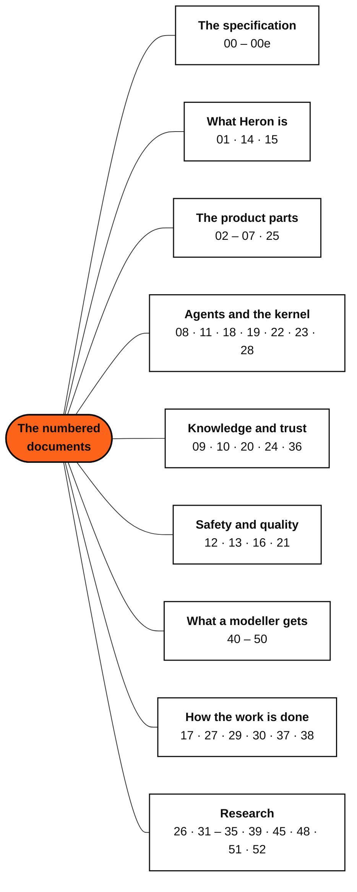

[Heron AI](../../README.md) › [Documentation](../README.md) › **Every document**

# Every document

Every numbered document — first by what it is about, then by number.



<details>
<summary>Same thing as plain text</summary>

```text
The specification         00 - 00e
What Heron is             01, 14, 15 and the Constitution
The product parts         02 - 07, 25
Agents and the kernel     08, 11, 18, 19, 22, 23, 28
Knowledge and trust       09, 10, 20, 24, 36
Safety and quality        12, 13, 16, 21
What a modeller gets      40 - 44, 46, 47, 49, 50
How the work is done      17, 27, 29, 30, 37, 38
Research                  26, 31 - 35, 39, 45, 48, 51, 52
```

</details>

## By theme

| Theme | Documents | Read it when |
|---|---|---|
| **The specification** — the destination. Corrected in place only as [D-139](../DECISIONS.md) allows, the original words struck through beside each correction | [00](../00-master-specification.md) Part 1 · [00b](../00b-master-specification-agent-os.md) Part 2 · [00c](../00c-master-handover-baseline.md) Part 3 · [00d](../00d-additional-requirements.md) Part 4 · [00e](../00e-field-notes-proven-bridge.md) field notes, observed rather than designed | you need the original requirement, word for word |
| **What Heron is, and its rules** | [01](../01-vision-and-principles.md) Vision · [14](../14-golden-rules.md) Golden Rules · [Constitution](../../HERON_CONSTITUTION.md) · [15](../15-glossary.md) Glossary | first, and whenever a rule is in question |
| **The product parts** | [02](../02-architecture-overview.md) Architecture · [03](../03-heron-revit.md) Revit add-in · [04](../04-heron-mcp.md) MCP · [05](../05-heron-brain.md) Brain · [06](../06-heron-platform.md) Platform · [07](../07-installation-and-update.md) Install and update · [25](../25-multi-session-and-binding.md) Multi-session and binding | you change one part |
| **Agents and the kernel** | [08](../08-agent-catalog.md) Agent catalogue · [28](../28-agent-registry.md) Agent registry · [11](../11-orchestration-and-workflows.md) Orchestration · [18](../18-agent-operating-system.md) Agent OS · [19](../19-context-and-cost.md) Context and cost · [22](../22-users-modes-and-extensibility.md) Users and modes · [23](../23-heron-kernel.md) Kernel | you touch an agent, or how work is ordered |
| **Knowledge and trust** | [09](../09-skills-and-fragments.md) Skills and fragments · [10](../10-memory-and-knowledge.md) Memory and knowledge · [20](../20-knowledge-trust-and-conflict.md) Knowledge trust · [24](../24-trust-model.md) Trust model · [36](../36-remembering-between-steps.md) Remembering between steps | you touch the library or the stores |
| **Safety and quality** | [12](../12-security-and-permissions.md) Security and permissions · [13](../13-testing-and-quality.md) Testing · [21](../21-resilience-and-operations.md) Resilience · [16](../16-version-support-strategy.md) Version support | before anything writes to a model, or ships |
| **For a modeller, in plain words** | [Installing Heron](install.md) · [Revit tool catalogue](revit-tool-catalogue.md), generated from the cards · [Using Heron](using-heron.md) · [CHANGELOG](../../CHANGELOG.md) | you install Heron, or want to know what a tool does |
| **What a modeller gets** — built, not proven | [40](../40-heron-companion.md) Companion · [41](../41-hvac-design.md) HVAC · [42](../42-fire-protection-design.md) Fire protection · [43](../43-building-revit-families.md) Families · [44](../44-building-loads-from-the-model.md) Building loads · [46](../46-sprinkler-hydraulics-from-the-model.md) Sprinkler hydraulics · [47](../47-sprinkler-layout-from-the-model.md) Sprinkler layout · [49](../49-saved-commands-and-the-heron-panel.md) Saved commands · [50](../50-qa-checklists.md) QA checklists | you work on one of these features |
| **How the work is done** | [27](../27-build-order.md) Build order · [29](../29-metadata-standard.md) Metadata · [30](../30-compiling-away-from-windows.md) Compiling away from Windows · [38](../38-the-cloud-environment.md) Cloud environment · [37](../37-the-provider-adapter.md) Provider adapter · [17](../17-open-source-and-distribution.md) Open source and distribution | you build, compile or release |
| **Research** — studied, never imported | [Research](research.md) has the list, and the rule that governs it | before proposing something another project does |

## By number

### The platform — from Master Specification Part 1

| # | Document | Covers |
|---|---|---|
| 00 | [Master Specification — Part 1](../00-master-specification.md) | The platform and its organisation, §1–§76. The owner's intent, with a dated *As built* note under each section that no longer holds and [D-139](../DECISIONS.md)'s corrections in place |
| 00b | [Master Specification — Part 2](../00b-master-specification-agent-os.md) | The Agent Operating System and self-evolution, §1–§84. The owner's intent, noted and corrected the same way |
| 00c | [Master Handover Baseline — Part 3](../00c-master-handover-baseline.md) | The consolidated baseline, §1–§80. **Authoritative on Golden Rules 1–15**; all 21 are in [14](../14-golden-rules.md) |
| 00d | [Additional Requirements — Part 4](../00d-additional-requirements.md) | Kernel, Workflow Engine, Constitution, 30 mandatory components, §1–§48. The owner's intent, noted and corrected the same way |
| 00e | [Field Notes — Proven Bridge Behaviour](../00e-field-notes-proven-bridge.md) | **Observed, not designed.** Multi-Revit, session binding, the stale read. Proven live 2026-08-20 |
| 01 | [Vision & Principles](../01-vision-and-principles.md) | What Heron is, personas, the defining principle |
| 02 | [Architecture Overview](../02-architecture-overview.md) | Layers, four parts, orchestration, **agent tiers** |
| 03 | [Heron Revit](../03-heron-revit.md) | Add-in, Revit agents, **threading, transactions, versions** |
| 04 | [Heron MCP](../04-heron-mcp.md) | The bridge, tool design, permission boundary |
| 05 | [Heron Brain](../05-heron-brain.md) | RAG, retrieval strategy, vector store, embeddings |
| 06 | [Heron Platform](../06-heron-platform.md) | Workspace, registry, agent lifecycle, packages, GitHub |
| 07 | [Installation & Update](../07-installation-and-update.md) | Install flow, build strategy, updates, self-healing |
| 08 | [Agent Catalogue](../08-agent-catalog.md) | The original catalogue of agents by department, with tiers. [28](../28-agent-registry.md) is the complete registry |
| 09 | [Skills & Fragments](../09-skills-and-fragments.md) | The knowledge units, lifecycle, gates, code execution |
| 10 | [Memory & Knowledge](../10-memory-and-knowledge.md) | Scopes, isolation, import, community |
| 11 | [Orchestration & Workflows](../11-orchestration-and-workflows.md) | Reference workflows, failure handling, performance |
| 12 | [Security & Permissions](../12-security-and-permissions.md) | Permission levels, gate location, confidentiality, audit |
| 13 | [Testing & Quality](../13-testing-and-quality.md) | Eight test levels, testing against real Revit, regression |
| 14 | [Golden Rules](../14-golden-rules.md) | The non-negotiables — **21 official rules**, 16–21 accepted 2026-08-28. The runtime-enforceable subset is the [Constitution](../../HERON_CONSTITUTION.md) |
| 15 | [Glossary](../15-glossary.md) | Terms, Revit concepts, status vocabularies |
| 16 | [Version Support Strategy](../16-version-support-strategy.md) | **Revit 2020 → latest** — the two API breaks, multi-targeting, adapters, test matrix |
| 17 | [Open Source & Distribution](../17-open-source-and-distribution.md) | Licence, public/private separation, contribution, disclaimer, channels |

### The Agent Operating System — from Master Specification Part 2

| # | Document | Covers |
|---|---|---|
| 18 | [Agent Operating System](../18-agent-operating-system.md) | **Capability Registry**, dynamic discovery, Agent HR, **Shadow Mode**, trust scores, events |
| 19 | [Context & Cost](../19-context-and-cost.md) | Context Manager, compression, model routing, fallback, caching, observability |
| 20 | [Knowledge Trust & Conflict](../20-knowledge-trust-and-conflict.md) | Knowledge hierarchy, trust levels, **conflict resolution**, fragment branching, quality scores |
| 21 | [Resilience & Operations](../21-resilience-and-operations.md) | **Dependency graph**, safety tiers, **emergency stop**, health, self-healing, backup, migration |
| 22 | [Users, Modes & Extensibility](../22-users-modes-and-extensibility.md) | Conversation intelligence, User/Developer/Admin modes, multi-user, platform adapters, plugins, SDK |

### The kernel — from Additional Requirements Part 4

| # | Document | Covers |
|---|---|---|
| 23 | [Heron Kernel & Workflow Engine](../23-heron-kernel.md) | **The Kernel**, five registries, Workflow Engine, checkpoints, **Evidence System**, model abstraction, prompt registry |
| 24 | [The Unified Trust Model](../24-trust-model.md) | **Resolves six competing status vocabularies** into two orthogonal axes: lifecycle and source |
| — | [**HERON_CONSTITUTION.md**](../../HERON_CONSTITUTION.md) | 30 Articles agents must never violate — the runtime-enforceable subset of the Golden Rules |

### From the field, and how the work is done

| # | Document | Covers |
|---|---|---|
| 25 | [Multi-Session & Document Binding](../25-multi-session-and-binding.md) | **Field-proven.** Bridge discovery, one chat one Revit, **document pinning**, **the stale read**, turn-taking, cross-document work |
| 27 | [**Build Order**](../27-build-order.md) | **Start here to build.** Six numbered steps, each independently provable |
| 28 | [**The Complete Agent Registry**](../28-agent-registry.md) | **Every agent** — ID, what each one does, tier, risk level, build step. How many, and how many are built: `python tools/agent-count.py` |
| 29 | [Metadata Standard](../29-metadata-standard.md) | The five fields every artefact carries — and how they tie the code back to the registry |
| 30 | [Compiling Away From Windows](../30-compiling-away-from-windows.md) | **The compile gate runs anywhere.** All eight releases, 2020–2027, from NuGet on Linux; what a pass proves; the 2020-only defect it caught on its first run; and why three releases were skipped for a reason that was about the SDK package, not the operating system |
| 36 | [Remembering Between Steps](../36-remembering-between-steps.md) | **A design note, not a decision** — no `D-` number has been spent on it. Its opt-in check was built on 2026-09-16 as the request's `expectChain`, and both legs were run on a real model in Revit 2020 and are not yet signed — the dated *As built* note at its top |
| 37 | [The Provider Adapter](../37-the-provider-adapter.md) | **Written as a scope.** Three agents decide which model to use, whether it is reachable and what it cost. One `LOCAL` adapter for Ollama, `brain/heron_provider.py`, has been built and tested since — **not run against a provider** ([K3](../needs-checking/group-k.md)), and nothing Heron serves goes through it yet |
| 38 | [**The Cloud Environment**](../38-the-cloud-environment.md) | **Where Heron work runs when it is not on the owner's PC.** The four fields to set; why **Custom** network access rather than Trusted, which does not carry `huggingface.co` and so silently costs retrieval its meaning; what a cloud session runs that CI does not — every suite in `tests/`, against the three CI leaves unrun — and the three things the setup script deliberately refuses to do |

### What a modeller gets — built, not proven

| # | Document | Covers |
|---|---|---|
| 40 | [Heron Companion](../40-heron-companion.md) | **Built, not proven in Revit - allowed by D-108 and D-109.** A local page beside Revit that shows the live selection and every Heron call the chat makes, and gives editable tables the modeller applies there with no message to the chat; the load and sprinkler panels of 44, 46 and 47 live on it too. Where it lives and why (inside each chat's MCP process, with Revit's state read from a file, never the pipe); the ten places the request and Heron's rules disagreed and how each was settled; and in §21 what was built |
| 41 | [**HVAC Design**](../41-hvac-design.md) | **Built, not proven against a project.** Loads, supply air, ASHRAE 62.1 outdoor air, psychrometrics, duct friction and sizing, fan power, diffusers, chilled water — as the `heron_hvac` tool. Every design value is ASKED for and a standard's figure only OFFERED (D-33); a load here is a peak estimate; how far each reference table was checked; what is known about Qatar; seven conflicts recorded, not resolved; and what is not built |
| 42 | [**Fire Protection Design**](../42-fire-protection-design.md) | **Built, not proven against a project.** Hazard classes looked up and never decided, sprinkler spacing, counts and a drawn layout checked as NFPA 13 measures it, the design area, pipe schedules, the obstruction rules, a hydraulic solve of a tree or a grid, the water supply, storage, pumps, standpipes, extinguishers and detectors — as the `heron_fire` tool. Why a criterion is ASKED; why a figure nobody could check is not held at all; what is known about Qatar; ten conflicts, six of them the owner's own file against NFPA; and what is not built |
| 43 | [Building Revit Families](../43-building-revit-families.md) | **Every kind of family, and what makes one parametric** — which template makes which kind, the planes-labels-locks method, parameters, formulas, lookup tables and type catalogs, every family kind, MEP fittings, and exactly where Revit's API stops: no label on any release, no reference line's planes. Each fact marked API, SOURCED or UNSURE; researched 2026-10-01 with the Autodesk hosts out of the cloud session's reach |
| 44 | [Building Loads from the Model](../44-building-loads-from-the-model.md) | **Every Space's heating and cooling load from the Revit model in one run.** Written as a design; §11 onward records what was built from it from 2026-10-04 (`brain/heron_takeoff.py`, `heron_building_loads.py`, `heron_loads_report.py`, the `revit_building_loads` tool), and §13 the air systems serving the Spaces (`heron_loads_systems.py`, 2026-10-19). Built, not proven - its read, `report-space-envelope`, is `DRAFT` |
| 46 | [Sprinkler Hydraulics from the Model](../46-sprinkler-hydraulics-from-the-model.md) | **One sprinkler system's hydraulic calculation from the Revit model, in the Companion.** A new read, `REPORT_SPRINKLER_NETWORK`; the brain asks only what the model cannot say, suggests the remote area, solves it with the existing `hydraulic`, and writes the calculation sheet. The plan, its independent review (20 findings, all taken) and what phase 1 built. Writes nothing to Revit. Built, not proven |
| 47 | [Sprinkler Layout from the Model](../47-sprinkler-layout-from-the-model.md) | **Sprinklers laid out in the rooms the modeller selects, of any shape, previewed in the Companion and placed level by level.** A new read, `REPORT_SPRINKLER_LAYOUT_SPACES`; the fire engine's `sprinkler_layout_room`; Apply places one level through the proven `PLACE_FAMILY_INSTANCES` and reads the heads back. The plan and its independent review (19 findings, all taken). Writes to Revit only on Apply, with the Changes switch on. Built, not proven |
| 49 | [Saved Commands and the Heron Panel](../49-saved-commands-and-the-heron-panel.md) | **A job the modeller kept, saved from the chat as a named command with its inputs, and run again from a panel docked in Revit.** One capability per command (one click, one undo); run through `revit_change`'s own body, so every rule and Keep or Discard apply as for a chat. [D-151](../decisions/D-151.md), proposed. Compiled for 2020 to 2027 and tested without Revit; not run in a real Revit |
| 50 | [QA Checklists](../50-qa-checklists.md) | **Checks written in the modeller's own words, saved as a named checklist and run in one go** — from the chat, or the Companion's QA Checklist page. Each check is one capability that only reads, with a pass rule on one output it declares. PASS means *meets the value checked*; NOT RUN says why and is never a pass. [D-152](../decisions/D-152.md), proposed. Tested without Revit; not run in a real Revit |

Research — 31, 32 and 52 (31 holds what were 26, 31, 33 to 35, 39, 45, 48 and 51) — is on its own page: [Research](research.md).

## Reading conventions

- **[NOTE]** blocks are engineering commentary added during review — not part of the original
  specification.
- The four parts of the [Master Specification](../00-master-specification.md) are changed only through a
  decision. The one that allows an edit in the file is [D-139](../DECISIONS.md): a wrong fact, or words an
  accepted decision settled, corrected in place with the original struck through beside it and a dated
  note naming the evidence. A policy choice no decision has made stays as written and goes to
  [OPEN-QUESTIONS](../OPEN-QUESTIONS.md).
- 🔴 blocking · 🟠 important · 🟡 worth doing · 🔵 idea

---

↑ [Documentation](../README.md) · [Home](../../README.md)
