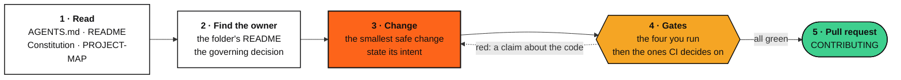

[Heron AI](../../README.md) › [Documentation](../README.md) › **Changing Heron**

# Changing Heron — for a developer or an AI agent

**Serving a modeller's Revit request is not changing Heron.** That goes through Heron's own tools, never
by reading this repository — [AGENTS.md](../../AGENTS.md) says so in its first lines. This page is for
changing Heron itself.

## The route of a change



<details>
<summary>Same thing as plain text</summary>

```text
1 Read        AGENTS.md, README, the Constitution, PROJECT-MAP
2 Find owner  the README of the folder you change, the decision that governs it
3 Change      the smallest safe change, with its intent stated
4 Gates       the four you run locally, then every gate CI decides on - red goes back to 3
5 PR          the process in CONTRIBUTING
```

</details>

## Each step, and the page that owns it

| Step | Page | Why |
|---|---|---|
| **Read first** | [**AGENTS.md**](../../AGENTS.md) | Short, and the rules for anyone changing Heron — the reading order, what is never done, how to work |
| | [HERON_CONSTITUTION.md](../../HERON_CONSTITUTION.md) | The binding Articles |
| **Find which folder owns it** | [**PROJECT-MAP §B**](../PROJECT-MAP.md#b-folder-map) | Folders, entry points and the layering the checker enforces |
| **Find where to start** | [PROJECT-MAP §C](../PROJECT-MAP.md#c-change-map--where-to-start) | *"I need to…"* → the file and the skill to read |
| **Know which source wins** | [PROJECT-MAP §D](../PROJECT-MAP.md#d-truth-hierarchy--which-source-wins) | Rules over decisions over intent; code over prose |
| **The house rules** | [`.claude/skills/`](../../.claude/skills/README.md) | The only tree of house rules — not `brain/skills/`, which is what Heron does for a modeller |
| **Before you push** | [`heron-ship`](../../.claude/skills/heron-ship/SKILL.md) | The gates in order, which failures are the machine rather than your change, and how to capture a change's evidence |
| **The pull request** | [CONTRIBUTING.md](../../CONTRIBUTING.md) | The process, the code style and what gets a change rejected outright |

## The folders you will touch

| Folder | Read its README |
|---|---|
| `revit/` — C#, loads into Revit | [revit/README.md](../../revit/README.md) |
| `mcp/` — Python, the bridge and the Companion | [mcp/README.md](../../mcp/README.md) |
| `brain/` — Python, fragments, skills, retrieval | [brain/README.md](../../brain/README.md) |
| `platform/` — paths, config, the installer | [platform/README.md](../../platform/README.md) |
| `tools/` — every gate and report | [tools/README.md](../../tools/README.md) |
| `tests/` — the suites; **read the exit codes first** | [tests/README.md](../../tests/README.md) |

## How the work is done

| Document | Covers |
|---|---|
| [27 — Build Order](../27-build-order.md) | What gets built, in what order, each step with its gate |
| [29 — Metadata Standard](../29-metadata-standard.md) | The five fields every source file carries |
| [30 — Compiling Away From Windows](../30-compiling-away-from-windows.md) | The compile gate for every release, from Linux |
| [16 — Version Support Strategy](../16-version-support-strategy.md) | Revit 2020 → latest, and the API breaks |
| [38 — The Cloud Environment](../38-the-cloud-environment.md) | Where Heron work runs when it is not on the owner's PC |
| [HANDOVER.md](../HANDOVER.md) | **Only** if you are continuing unfinished work |

---

↑ [Documentation](../README.md) · [Home](../../README.md)
