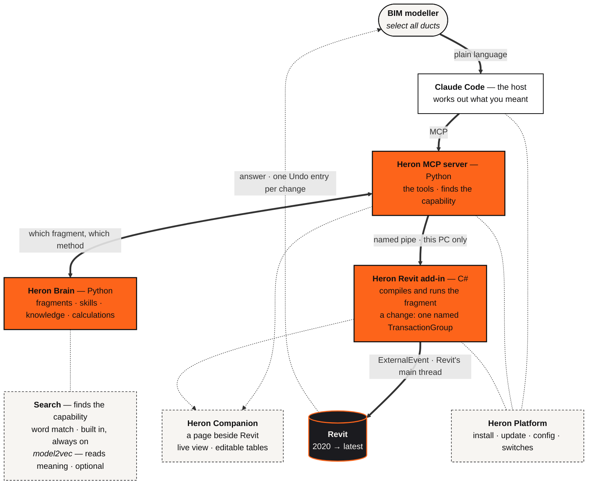
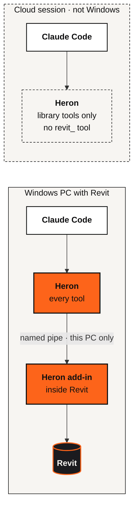

[Heron AI](../../README.md) › [Documentation](../README.md) › **How Heron works**

# How Heron works

Four parts, one path for every request, and two places it can run. For the code-level map —
which folder owns what — see [PROJECT-MAP](../PROJECT-MAP.md).

## Four parts

| Part | Responsibility | Folder |
|---|---|---|
| **Heron Revit** | The add-in, the ribbon, and everything touching the Revit API | [`revit/`](../../revit/README.md) |
| **Heron MCP** | The controlled bridge between the AI and Revit, and the Companion page | [`mcp/`](../../mcp/README.md) |
| **Heron Brain** | Fragments, skills, capabilities, knowledge, design calculations | [`brain/`](../../brain/README.md) |
| **Heron Platform** | Install, update, configuration, switches, packages | [`platform/`](../../platform/README.md) |

## How it fits together



<details>
<summary>Same thing as plain text</summary>

```text
BIM modeller          plain language
     |
Claude Code           host: works out what the modeller meant (D-01)
     |  MCP
Heron MCP server      Python: the tools, finds the capability  <->  Heron Brain: fragments, skills,
     |  named pipe, this PC only                                      knowledge, calculations
     |                                                                Search: word match (built in),
     |                                                                model2vec (optional)
Heron Revit add-in    C#: compiles and runs the fragment; a change runs in one named TransactionGroup
     |  ExternalEvent, Revit's main thread
Revit                 2020 -> latest

Heron Companion       a page beside Revit: live view of Heron's work, editable tables
Heron Platform        install, update, config, switches - under all of them
```

</details>

- **Solid arrows are the live request path.**
- **Dotted lines** are what comes back, the Companion page showing what Heron does, and Heron Platform
  holding the other parts up — it installs, updates and configures them rather than sitting in the
  call chain.

## One request, step by step

1. You type *"set the Mark of these doors to D-01"*.
2. Claude Code asks `heron_lookup` which capability serves it. Heron's search matches your words — by
   meaning too, when model2vec is installed.
3. It calls `revit_change` with your words. The server sends the job down the named pipe to the add-in.
4. The add-in compiles the fragment and runs it on Revit's main thread, inside one named
   `TransactionGroup`.
5. With **Ask to Keep** on, Revit shows the change and asks **Keep or Discard**; Discard, Esc or closing
   the box rolls it back ([D-126](../DECISIONS.md)). With it off — the default — the change is kept at
   once ([D-138](../DECISIONS.md)).
6. Either way the change is **one** entry in Revit's Undo list, named *"Heron: …"*. Ctrl+Z takes it back.

What decides whether step 3 may run at all — the switches and the proof — is on
[What keeps the model safe](safety.md).

## What runs where



<details>
<summary>Same thing as plain text</summary>

```text
Windows PC with Revit    Claude Code -> Heron (every tool) -> named pipe, this PC only
                         -> Heron add-in inside Revit -> Revit
Cloud session            Claude Code -> Heron (library tools only, no revit_ tool)
```

</details>

- **The pipe never leaves the PC.** The add-in is a named-pipe server, local-only by construction
  ([D-02](../DECISIONS.md)).
- **Off Windows there is no Revit to reach**, so the server serves only its library tools and no
  `revit_` tool ([D-132](../DECISIONS.md)). Everything that needs a model runs on the modeller's
  Windows PC.
- Where a cloud session is set up, and what it runs: [38 — The Cloud Environment](../38-the-cloud-environment.md).

## How Heron finds the right tool

**Search is how the brain finds the capability for your words.**

| Level | What it does | Installed |
|---|---|---|
| **Word match** | Matches letters and words | Built in, always runs |
| **model2vec** | Reads meaning — *"stop the air going the wrong way"* can reach the flow-direction check without sharing a word with it | Optional |
Without model2vec Heron uses the word match, and **every answer says which search ran**. Measured on
2026-11-26 at 753 fragments, neither was clearly better on the owner's questions, so model2vec stays
optional. A third level, a **re-ranker** that gave the top picks a second, slower read, was removed on
2026-11-26 ([D-201](../decisions/D-201.md)): no clear gain, and the largest download Heron had.
[WHAT-TO-INSTALL §2](../WHAT-TO-INSTALL.md#2-optional--the-trained-search-model) has the figures and how
to install or remove model2vec.

## Go deeper

| Document | Covers |
|---|---|
| [PROJECT-MAP §A](../PROJECT-MAP.md#a-how-a-request-travels) | The same path, folder by folder |
| [02 — Architecture Overview](../02-architecture-overview.md) | Layers, four parts, agent tiers |
| [03 — Heron Revit](../03-heron-revit.md) · [04 — Heron MCP](../04-heron-mcp.md) · [05 — Heron Brain](../05-heron-brain.md) · [06 — Heron Platform](../06-heron-platform.md) | One part each |
| [25 — Multi-Session & Document Binding](../25-multi-session-and-binding.md) | One chat, one Revit, and the pinned document |

---

↑ [Documentation](../README.md) · [Home](../../README.md)
