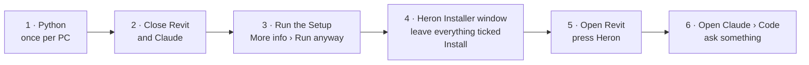

[Heron AI](../../README.md) › [Documentation](../README.md) › **Installing Heron**

# Installing Heron

**One file installs Heron into every Revit on your PC, for your own Windows user, with no administrator
rights.** This page takes you from download to your first request, then covers updating, removing and
the problems people actually meet. It is the step-by-step version of
[What to install](../WHAT-TO-INSTALL.md), which is the whole picture and wins where the two differ.

Like loading a family into a project: the Setup puts the add-in where each Revit looks for it, and
Revit picks it up the next time it opens.

| | |
|---|---|
| **The file** | `HeronSetup-<version>-unsigned.exe` - on the [latest release page](https://github.com/Ajmalpshaik/Heron-AI/releases/latest) |
| **It is unsigned** | No code-signing certificate yet ([D-173](../decisions/D-173.md), [D-190](../decisions/D-190.md)), so Windows warns you once - step 3 |
| **It changes nothing in your models** | Heron starts read-only. It changes a model only after you turn **Changes** on |
| **What each tool does** | [The Revit tool catalogue](revit-tool-catalogue.md) |
| **What changed in each version** | [CHANGELOG](../../CHANGELOG.md) |

---

## 1. Before you start

What a PC needs - the full list with disk sizes is [System requirements](system-requirements.md):

| You need | Notes |
|---|---|
| **Windows and Revit** | Any Revit from 2020 to 2027 - the Setup finds each one on the PC |
| **Python 3.11 to 3.14** | For your own user. Heron never installs Python itself. The range is `LOCK_OLDEST_MINOR` and `LOCK_NEWEST_MINOR` in [`tools/heron-ready.py`](../../tools/heron-ready.py) |
| **Claude Code** | The Claude app's **Code** tab, where you type your requests |
| **No administrator rights** | Everything installs for your own Windows user |

**Which Revit releases have been run, not just built.** Every release is compiled for 2020 to 2027.
What has actually been watched working is narrower, and it is said plainly:

| Revit | What was run |
|---|---|
| **2020, 2024, 2026, 2027** | The v0.2.0 Setup installed into each on the owner's PC on 2026-11-16, and uninstalled cleanly, and each loads Heron's add-in there. Heron's tools are proved almost entirely on Revit 2020 and 2024 models; on 2026 and 2027 they are built and loaded, and next to none is proved. Each tool's own releases are in [the catalogue](revit-tool-catalogue.md) |
| **2021, 2022, 2023, 2025** | **Never run** - there is no such Revit on the owner's PC. Built for, and expected to work; not watched working |

**For the version you are installing:** its release notes say what was run with that exact Setup and
what was not. A Setup is built and checked file by file before it is published; it is not always run
in every Revit first, and the notes say which.

---

## 2. Install, step by step



**Step 1 - Install Python, once per PC.** Open **Windows Terminal** (Start menu, type *Terminal*) and
run:

```bash
winget install Python.Python.3.12 --scope user
```

Close that terminal when it finishes. A new terminal must answer `python --version` with 3.11 to 3.14.

**Step 2 - Close Revit, and close the Claude app** (its icon in the system tray too) if you want Heron
added to Claude Code in the same go. The Setup waits while Revit is open and names the Revit it found.

**Step 3 - Double-click `HeronSetup-<version>-unsigned.exe`.** Windows says *"Windows protected your
PC"* because the file is not signed: click **More info**, then **Run anyway**. A short copying window
puts Heron's folder in `%LOCALAPPDATA%\Programs\Heron AI`.

**Step 4 - The Heron Installer window opens.** Leave everything as it is:

- every Revit year it found, ticked;
- **Set up Heron's AI side too** - installs Heron's Python packages at pinned, hash-checked versions,
  builds its knowledge store and runs its readiness check;
- **Add Heron to Claude Code** - so every Claude chat can reach Heron, in any folder.

Press **Install**, wait for the report at the bottom (the Python half takes about a minute on a PC that
has none of the packages), then **Close**.

**Step 5 - Open Revit.** A **Heron** tab is on the ribbon. Open a model and press **Heron** on its **AI
Bridge** panel: the heron turns **orange** when it is connected. The tab's buttons are listed in
[the catalogue](revit-tool-catalogue.md#the-heron-tab-in-revit).

**Step 6 - Your first request.** Open the Claude app, go to **Code**, choose **This computer** and any
folder, and ask in plain words, for example:

- *"which views have no view template?"*
- *"total duct length by size"*
- *"select all ducts on Level 2"*

Heron picks the tool, runs it inside Revit and answers in the chat. These change nothing.

---

## 3. Turning on changes

Heron starts with every switch **off**, so it only reads. When you want it to change a model, press
**Settings** on the Heron tab:

| Switch | Turn it on for |
|---|---|
| **Changes** | Any change to the model |
| **Admin** | Project-wide settings, and a new family file |
| **Publish** | Writing files outside the model - an export, a saved family |
| **Ask to Keep** | Revit shows each change and asks **Keep** or **Discard** before it stays |
| **Companion** | The Companion page, which shows what the chat is doing |

Every change is **one entry in Revit's Undo list** - Ctrl+Z takes the whole of it back. Heron never
saves, syncs or exports on its own. More: [What keeps the model safe](safety.md).

---

## 4. When something goes wrong

| What you see | What it means, and what to do |
|---|---|
| *"Windows protected your PC"* | The file is unsigned. **More info › Run anyway.** Check the file against the SHA-256 in its release notes if you want to be sure it is the published one |
| The Setup stops: *Python not found* | Step 1 was skipped, or the terminal was opened before Python finished. Run the `winget` line, open a **new** terminal, run the Setup again |
| *"Close Revit first ... Open now: Revit 2024"* | Close every Revit named, then press Install again. Nothing was installed |
| No **Heron** tab in Revit | Revit was open during the install, or that year was unticked. Run **Start menu › Heron AI › Heron Installer**, tick the year, **Install**. The add-in's log is `%LOCALAPPDATA%\Heron\logs\addin-<date>.log` |
| The install refused *a second copy of Heron* | Another Heron manifest for that Revit year is in Revit's add-in folders - the message names the path. Remove the old one, then install again |
| The **Heron** button stays grey, never orange | Press it again; then **Heron ▾ › Bridge Status**, which says what the connection found |
| Claude does not know Heron | In the Claude chat type `/mcp` - `heron` must say **connected**. If Claude was open during the install, its tick was skipped: close Claude completely and run the Heron Installer again from the Start menu |
| *"Changes is off"* or a refusal naming a switch | Turn that switch on in **Settings** (section 3). A refusal naming **D-117** means that tool is not proved yet - the catalogue marks each one |
| The Claude app came from the Microsoft Store | Install from **File Explorer or your own terminal, never from inside Claude** - the installer refuses there. [What to install §1b](../WHAT-TO-INSTALL.md#1b-if-your-claude-app-came-from-the-microsoft-store--install-from-your-own-terminal) says why |
| Anything else | In the Heron folder, `python tools/heron-ready.py --check` names what is missing and the command that fixes it. Then [open an Issue](https://github.com/Ajmalpshaik/Heron-AI/issues) |

---

## 5. Updating

**Run the newer Setup over the old one.** There is no separate update step: an install replaces what
is there ([D-94](../DECISIONS.md)). Close Revit and Claude, double-click the new
`HeronSetup-<version>-unsigned.exe`, press **Install**. Your Heron settings and history stay.

---

## 6. Removing Heron

**Settings › Apps › Installed apps › Heron AI › Uninstall**, with Revit closed. It first names every
Revit year Heron is in and asks; then it takes the add-in out of each one, removes Heron's folder and
the Claude Code entry it added. Your own Heron settings and history (`%USERPROFILE%\.heron`) stay.

**Heron Installer › Remove Heron** takes Heron out of Revit only, and leaves the folder and the Claude
Code entry until you uninstall from Installed apps.

---

## Pictures still owed

This page has no screenshots on purpose: the pictures under `docs/proof/` show the installer and the
ribbon before their 2026-11 redesign, and a picture of a window that has changed is worse than none.
These are owed, taken from the current release on a real PC:

1. The Setup's copying window, and the Heron Installer window with both ticks on.
2. The Heron Installer's report after Install.
3. The Heron tab in Revit, Heron disconnected and connected (orange).
4. The **Heron ▾** drop-down open, and the **Settings** window.
5. A first request answered in a Claude chat.

---

**Also:** [What to install](../WHAT-TO-INSTALL.md) - the whole picture · [System requirements](system-requirements.md) ·
[Using Heron](using-heron.md) · [The Revit tool catalogue](revit-tool-catalogue.md) ·
[07 - Installation and update](../07-installation-and-update.md), the design behind it.
