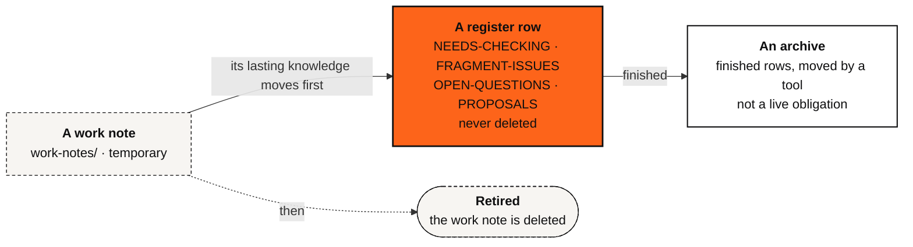

[Heron AI](../../README.md) › [Documentation](../README.md) › **Registers and working documents**

# Registers and working documents

The pages that keep track of the work: what is owed a real Revit, what is broken, what is undecided, and
where the last session stopped. **They are context, never authority** — which source wins is
[PROJECT-MAP §D](../PROJECT-MAP.md#d-truth-hierarchy--which-source-wins).

## Where a finding goes



<details>
<summary>Same thing as plain text</summary>

```text
A work note (temporary)  -> its lasting knowledge moves to a register row first -> then it is deleted
A register row (kept)    -> finished -> moved to an archive by a tool, no longer a live obligation
```

</details>

Why a register is never filed under `work-notes/`, and the one exception, is
[PROJECT-MAP — authority and lifecycle](../PROJECT-MAP.md#authority-and-lifecycle-are-different-questions-and-this-is-where-they-get-confused).

## The working documents

| Document | Purpose |
|---|---|
| [**HANDOVER.md**](../HANDOVER.md) | Where the last session stopped — what exists, what is **proven** rather than merely built, and what to say to carry on |
| [**FOR-THE-OWNER.md**](../FOR-THE-OWNER.md) | Everything waiting on the owner, across every register. Structure only — the list is `python tools/owner-queue.py`. Three typed lists were found stale on 2026-09-12, which is why |
| [**FRAGMENT-ISSUES.md**](../FRAGMENT-ISSUES.md) | The register of fragments with something wrong — section 5 found by proving, 5b by reading. Finished rows move to [`fragment-issues-archive/`](../fragment-issues-archive/README.md) |
| [**NEEDS-CHECKING.md**](../NEEDS-CHECKING.md) | The proving register — every unproven claim as a numbered item, grouped by what it needs. `python tools/check-gaps.py` reads this file |
| [OPEN-QUESTIONS.md](../OPEN-QUESTIONS.md) | Every question, prioritised, with answer slots. **The count is derived** — `python tools/check-docs.py` reads the questions themselves and fails if the progress line disagrees. Q-72 to Q-78, opened 2026-10-18 under [D-139](../DECISIONS.md) point 4, are the policy choices in the specification that no accepted decision settles |
| [PROPOSALS.md](../PROPOSALS.md) | Gaps found in review, feature ideas, strategic questions |
| [ROADMAP.md](../ROADMAP.md) | Phase 0 → Phase 7, and what is deliberately deferred |
| [DECISIONS.md](../DECISIONS.md) | Append-only log of decisions actually made |
| [**work-notes/**](../work-notes/README.md) | **What work is going on right now** — active plans, execution records, temporary notes. Operational workspace, never specification |
| [FRAGMENT-REVIEW-PLAN-CHATGPT-2026-09-07.md](../work-notes/plans/FRAGMENT-REVIEW-PLAN-CHATGPT-2026-09-07.md) | An outside review of the fragment library. **Partly implemented** — C03, C04, C09 and N01–N09 are done; **C01, C02, C05–C08 and the S01–S05 splits are still plan only.** Its own baseline numbers are a dated snapshot |
| [project-perfection-and-continuous-upgrade-plan-2026-09-12.md](../work-notes/plans/project-perfection-and-continuous-upgrade-plan-2026-09-12.md) | **Executed 2026-09-12 — do not run it again.** The plan for studying outside repositories for principles rather than code; what it produced is the Improvement Gate (`check-change.py`, `change-evidence.py`, `check-package.py`). It was `docs/34`, beside [34 — The Patterns, Adapted](../34-patterns-adapted.md), until it moved here on 2026-11-15 ([PROPOSALS F4](../PROPOSALS.md)); kept for its reasoning |
| [REVIEW-LEDGER.tsv](../REVIEW-LEDGER.tsv) | Which source file was read, by whom, at which blob, and the verdict. Written and read by `python tools/review-ledger.py`, never by hand |
| [../tools/](../../tools/README.md) | Every gate, report and generator — among them the link and count checker that keeps these documents honest (`check-docs.py`), the owner's queue and the agent map |

## The folders in `docs/`

| Folder | What it holds |
|---|---|
| [`decisions/`](../decisions/D-01.md) | One file per decision, `D-NN.md`, since 2026-09-23. [DECISIONS.md](../DECISIONS.md) is the index and the rules |
| [`open-questions/`](../open-questions/tier-1.md) | [OPEN-QUESTIONS.md](../OPEN-QUESTIONS.md), one file per tier or section |
| [`needs-checking/`](../needs-checking/group-a.md) | [NEEDS-CHECKING.md](../NEEDS-CHECKING.md), one file per group |
| [`fragment-issues/`](../fragment-issues/section-1.md) | [FRAGMENT-ISSUES.md](../FRAGMENT-ISSUES.md), one file per section or band of rows - and one file per row, `row-5b-N.md`, for each 5b row written since 2026-11-12, so two branches adding rows share no file |
| [`proposals/`](../proposals/part-a.md) | [PROPOSALS.md](../PROPOSALS.md), one file per part or numbered proposal |
| [`fragment-issues-archive/`](../fragment-issues-archive/README.md) | Finished FRAGMENT-ISSUES rows, written by `tools/archive-fragment-issues.py`. Not a live obligation |
| [`needs-checking-archive/`](../needs-checking-archive/README.md) | Finished NEEDS-CHECKING rows, written by `tools/archive-needs-checking.py`. Not a live obligation |
| [`handover-archive/`](../handover-archive/README.md) | One note per finished session, moved out of [HANDOVER.md](../HANDOVER.md). Narrative, never a register |
| [`brand/`](../brand/README.md) | Heron's logo, app icons, colours and font name - the one place a logo or icon is taken from |
| `proof/` | Screenshots that NEEDS-CHECKING rows cite as evidence. Which groups cite them: `grep -l 'proof/' docs/needs-checking/*.md` |
| [`work-notes/`](../work-notes/README.md) | Temporary operational work - see the table above |
| [`guide/`](../README.md) | These short reading pages - the documentation front door links every one |

---

↑ [Documentation](../README.md) · [Home](../../README.md)
