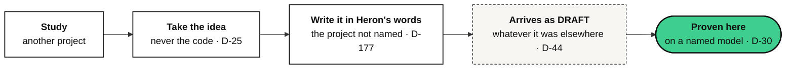

[Heron AI](../../README.md) › [Documentation](../README.md) › **Research**

# Research — studied, never imported

Heron is built by people who read other people's work. **[D-25](../DECISIONS.md) is the rule: studied
and re-authored, never imported.**



<details>
<summary>Same thing as plain text</summary>

```text
Study another project -> take the idea, never the code (D-25)
  -> write it in Heron's own words, the project not named (D-177)
  -> it arrives as DRAFT, whatever it was elsewhere (D-44)
  -> it is proven here, on a named real model (D-30)
```

</details>

- **No code is taken.** What is taken is the *thinking*, rewritten in Heron's own shape, and every
  capability starts at `DRAFT` here whatever status it held where it was read.
- **The project or person an idea came from is not named** in anything written since
  [D-177](../decisions/D-177.md). The older notes that named projects were merged into one on 2026-11-24,
  and that one names none.
- **Where a project's licence forbade reading its source, its source was not read** — that is recorded
  per row in [31 research](../31-research.md), not assumed.

## The research documents

| # | Document | Covers |
|---|---|---|
| 31 | [**Research: what Heron learned from other projects**](../31-research.md) | **One page for all of it** - merged on 2026-11-24 from the former notes 26, 31, 33, 34, 35, 39, 45, 48 and 51 (git history holds the originals). The method, what travels and what cannot, [the research rule](../31-research.md#6-studying-an-outside-project---the-research-rule), every pattern with its verdict, the licence finding, where Heron stands against other Revit AI tools, Revit lessons, and [what is still owed](../31-research.md#11-still-owed) |
| 32 | [**The Master Architecture document, reconciled**](../32-master-architecture-reconciliation.md) | **Read this before building anything from [`HERON_AI_MASTER_ARCHITECTURE.md`](../../HERON_AI_MASTER_ARCHITECTURE.md).** The audit that document demands of itself, done against this repository: nine of its platform modules already exist here, four of them stricter than it asks for. What is genuinely missing, ranked — and partly closed since: of the seven things beside the Context Manager in [19](../19-context-and-cost.md), three are now real and four remain absent on purpose, three of them placed in the host by [D-58](../DECISIONS.md). And what is rejected, with reasons, so the same proposals are not made again. [D-57](../DECISIONS.md) |
| 52 | [Revit Ribbon Coverage](../52-revit-ribbon-coverage.md) | **Every Revit ribbon tab, 2020 to 2027, checked tool by tool against Heron's library on 2026-11-01** - what is covered, what is missing, what Revit's API cannot do, and what is still unsure. A picture of that day, not a build list: ask `heron_lookup` before building anything it calls missing |

## What studying gave Heron

Each idea below is something in Heron that is different for having read another project's work. The
projects are not named ([D-177](../decisions/D-177.md)).

| The idea | What it became here |
|---|---|
| A way to check a generated claim against its source that **calls no model at all** — and *"the human applies, the agent never submits"* | The second had already been reached here independently, as [D-30](../DECISIONS.md) |
| A chunk of text is embedded having lost its document | For a numbered standard, its heading path answers that for free |
| Two retrieval systems, read and **not adopted** | Both need servers Heron may not have. One's reviewable chunk boundaries stayed |
| A local document parser | Still an open question rather than a dependency |
| Vector search in a single file, with no server to install | What made [D-23](../DECISIONS.md) possible |

What each studied project became, including the ones **measured and rejected** — a rejection with a
number saves the next person a week — is in [31 research](../31-research.md).

---

↑ [Documentation](../README.md) · [Home](../../README.md)
