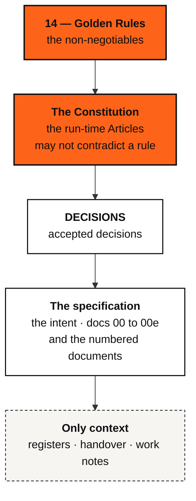

[Heron AI](../../README.md) › [Documentation](../README.md) › **Rules and decisions**

# Rules and decisions

What Heron is **allowed** to do, why it is built the way it is, and what is still undecided.

## Which rule wins



<details>
<summary>Same thing as plain text</summary>

```text
Golden Rules  >  Constitution  >  DECISIONS  >  the specification (intent)  >  only context
```

</details>

**Top wins.** Code that breaks a rule is a **defect**, and the rule is never edited to match it. What
Heron *actually does* is a second list — the code, then a recorded proof, then metadata — and both are
explained in [PROJECT-MAP §D](../PROJECT-MAP.md#d-truth-hierarchy--which-source-wins).

## The rule books

| Document | What it is |
|---|---|
| [**14 — Golden Rules**](../14-golden-rules.md) | The non-negotiables — 21 official rules, with the reason for each and where the code holds it |
| [**HERON_CONSTITUTION.md**](../../HERON_CONSTITUTION.md) | 30 Articles agents must never violate — the runtime-enforceable subset of the Golden Rules |
| [**DECISIONS.md**](../DECISIONS.md) | The append-only log of decisions actually made; one file per decision in [`decisions/`](../decisions/D-01.md) |
| [The specification](../00-master-specification.md) | The owner's original requirement, in four parts — below |
| [OPEN-QUESTIONS.md](../OPEN-QUESTIONS.md) | Every question still to decide, with answer slots |
| [PROPOSALS.md](../PROPOSALS.md) | Gaps found in review, feature ideas, strategic questions |

## Decided so far

| | Decision |
|---|---|
| **Host** | Claude Code plugin — skills, subagents, the MCP server, the Revit add-in *([D-01](../DECISIONS.md))*. The host decides what the user meant; Heron never classifies intent |
| **Revit support** | **2020 → latest**, and every future release *([D-05](../DECISIONS.md))*. Declared support and tested releases are different lists — `heron_compatibility` tells them apart |
| **Languages** | C# for everything touching Revit · Python for the brain and the MCP side *([D-06](../DECISIONS.md))* |
| **Transport** | Named pipes — the add-in is the server, local-only by construction *([D-02](../DECISIONS.md))* |
| **Revit threading** | One `ExternalEvent`, one request queue, one handler *([D-09](../DECISIONS.md))* |
| **MCP tools** | Narrow tools, each with its own declared risk level *([D-03](../DECISIONS.md))*. A fragment is reached by **capability** through three doors — `revit_read`, `revit_show` and `revit_change` — never by its id ([04 §8](../04-heron-mcp.md)). The list, with what each tool may do: `python mcp/server/heron_tools.py` |
| **Off Windows** | No Revit can be there, so the server serves its library tools alone and no `revit_` tool *([D-132](../DECISIONS.md))* |
| **Generated code** | Hybrid *([D-04](../DECISIONS.md))* — C# compiled at run time inside Revit's process, and into an assembly only at `PRODUCTION` *([D-28](../DECISIONS.md))*. No fragment is `PRODUCTION` yet, so today every one, `PROVEN` included, is compiled at run time |
| **Changing the model** | Off until the **Changes** switch is on, in Heron's Settings window since [D-150](../decisions/D-150.md) *([D-19](../DECISIONS.md))*. One request is one named `TransactionGroup` and one undo entry (Golden Rule 16); while **Ask to Keep** is on, Revit asks Keep or Discard first *([D-126](../DECISIONS.md), [D-138](../DECISIONS.md))*. **Admin** and **Publish** each have a switch of their own *([D-106](../DECISIONS.md))* |
| **Proof** | One recorded run against a named real model, with a negative case and a staleness fingerprint. A compile or a passing test is not one *([D-30](../DECISIONS.md))* |
| **Licence** | Apache 2.0 *([D-08](../DECISIONS.md))* |
| **Distribution** | Free and **open source** on public GitHub; an app store later, also free *([D-07](../DECISIONS.md))*. An Autodesk App Store listing is kept possible, and nothing is built for it *([D-38](../DECISIONS.md))* |
| **Repo visibility** | Private until the licence and safety files existed and Phase 0 worked *([D-10](../DECISIONS.md))*. Both are met, and the [home page](../../README.md) says the repository is public so the work is open, not yet to be installed |
| **Building on** | The owner's earlier brain and Revit-connector work, upgraded to this architecture |

## The specification, in four parts

| Part | Document | What it is |
|---|---|---|
| 1 | [00 — Master Specification](../00-master-specification.md) | The platform and its organisation |
| 2 | [00b — Agent Operating System](../00b-master-specification-agent-os.md) | The Agent Operating System and self-evolution |
| 3 | [00c — Master Handover Baseline](../00c-master-handover-baseline.md) | The consolidated baseline, **authoritative on Golden Rules 1 to 15** |
| 4 | [00d — Additional Requirements](../00d-additional-requirements.md) | The **Kernel**, the **Workflow Engine**, the **Constitution** and 30 mandatory components ([D-13](../DECISIONS.md)) |
| — | [00e — Field Notes](../00e-field-notes-proven-bridge.md) | **Observed, not designed** — the proven bridge's behaviour |

- **Part 1's ten rules became fifteen** ([D-12](../DECISIONS.md)); rules 16 to 21 were accepted beside
  them on 2026-08-28, and [14](../14-golden-rules.md) holds all 21.
- **The four parts say what Heron was asked to be, not what is built.** Where one differs from
  [DECISIONS.md](../DECISIONS.md), the decision wins.
- **Since 2026-10-18 a wrong fact in them, or words an accepted decision already settled, is corrected
  in place with the original kept beside it, struck through**
  ([D-139](../DECISIONS.md#d-139--the-four-parts-of-the-specification-are-corrected-in-place-where-a-fact-is-wrong-or-an-accepted-decision-settled-it-and-the-original-words-stay-beside-the-correction));
  each section's dated *As built* note says what was corrected and on what evidence. A policy choice
  no decision has made stays as written and goes to [OPEN-QUESTIONS](../OPEN-QUESTIONS.md).
- Review of all four parts: [PROPOSALS](../PROPOSALS.md).

## The Constitution, and the one item not signed

- **The [Constitution](../../HERON_CONSTITUTION.md) is binding** — all 30 Articles, accepted 2026-08-28
  ([D-43](../DECISIONS.md)).
- **One item is agreed in direction and not signed off:** the [unified trust model](../24-trust-model.md)
  — six competing status vocabularies resolved into two axes ([Q-34](../OPEN-QUESTIONS.md),
  [D-14](../DECISIONS.md) still proposed).

## What is still open

**Nothing gates any phase.** How many questions are answered and open is derived on
[OPEN-QUESTIONS](../OPEN-QUESTIONS.md) and checked by `tools/check-docs.py`; which of them wait on the
owner is `python tools/owner-queue.py`. Neither is typed here. Every question, answered or not, keeps
its answer in that register — [`open-questions/answered.md`](../open-questions/answered.md) and the tier
files beside it.

---

↑ [Documentation](../README.md) · [Home](../../README.md)
