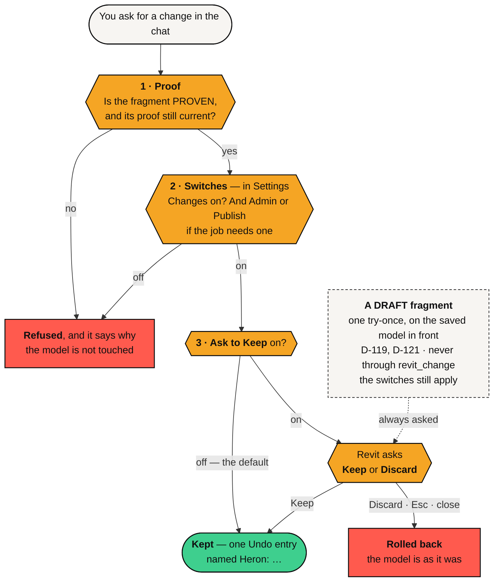

[Heron AI](../../README.md) › [Documentation](../README.md) › **What keeps the model safe**

# What keeps the model safe

**Heron may read your model and do nothing else until you say so.** Before anything changes, a request
has to pass every check below, and whatever is kept is one entry in Revit's Undo list.

## The checks a change passes



<details>
<summary>Same thing as plain text</summary>

```text
You ask for a change in the chat
  -> is the fragment PROVEN, its proof current?     no  -> refused, says why, model not touched (D-117)
  -> are the switches on, in Settings? Changes, and
     Admin or Publish if the job needs one          off -> refused, says why, model not touched
  -> Ask to Keep on?                                off (the default) -> kept at once
                                                    on  -> Revit asks Keep or Discard
       Keep -> kept          Discard, Esc or close -> rolled back, the model is as it was
Kept = one Undo entry named "Heron: ..."

A DRAFT fragment: one try-once, on the saved model in front (D-119, D-121) - never
through revit_change; the switches still apply, and Revit always asks Keep or Discard.
```

</details>

## The guards, one by one

| Guard | What it does | Where |
|---|---|---|
| **Changes** switch | Heron may read the model and nothing else until you turn it on. `write.enabled` defaults to `false`. Since 2026-11-07 this switch, Ask to Keep, Admin and Publish are in Heron's **Settings** window, not on the ribbon | [D-19](../DECISIONS.md) · [D-150](../decisions/D-150.md) · `platform/Heron.Core/HeronConfig.cs` |
| **Ask to Keep** switch | Revit asks Keep or Discard before a change from a chat is kept. Off by default; its box can keep the rest of one job without asking | [D-126](../DECISIONS.md), [D-138](../DECISIONS.md) |
| **The delete box** | Anything a change would delete is shown in Revit first - *Delete N elements?*, by category, with what goes along with them - and nothing goes until you press Delete. Ask to Keep on or off, and never skipped for a job. Built, not yet run in Revit | [D-142](../DECISIONS.md) |
| **Admin** and **Publish** switches | Off by default, and only the owner turns them on | [D-106](../DECISIONS.md) |
| **One request, one Undo** | Every change is one named `TransactionGroup`; on any failure the whole of it rolls back | [Golden Rule 16](../14-golden-rules.md) |
| **The right model** | With more than one Revit open Heron sends nothing until you choose; once bound it stays bound to that document | [Golden Rule 20](../14-golden-rules.md) · [Article 12a](../../HERON_CONSTITUTION.md) |
| **A run that never ends** | A fragment carries a run clock, and the bridge can stop Heron; the stop lasts until Revit restarts | [D-129](../DECISIONS.md), [D-130](../DECISIONS.md) |
| **Never on its own** | No Sync With Central, no publish, no export to a shared place unless you ask | [Article 10](../../HERON_CONSTITUTION.md) |

## How much of this has met a real Revit

The guards above are **rules and code**; whether each one has run in Revit is a separate question, and
its answer lives on [What is proven](what-is-proven.md#where-things-stand). The short version: the
Keep or Discard box and the rails beside it were run by hand in Revit 2024 and 2027 on 2026-10-18
([Group ET](../needs-checking/group-et.md)); the delete box has not been run yet.

## Read next

| Document | Covers |
|---|---|
| [12 — Security & Permissions](../12-security-and-permissions.md) | Permission levels, where the gate sits, confidentiality, audit |
| [The Constitution](../../HERON_CONSTITUTION.md) | The binding Articles an agent may never break |
| [14 — Golden Rules](../14-golden-rules.md) | The non-negotiables, with the reason for each |
| [25 — Multi-Session & Document Binding](../25-multi-session-and-binding.md) | Why Heron never guesses which Revit, or which project |

---

↑ [Documentation](../README.md) · [Home](../../README.md)
