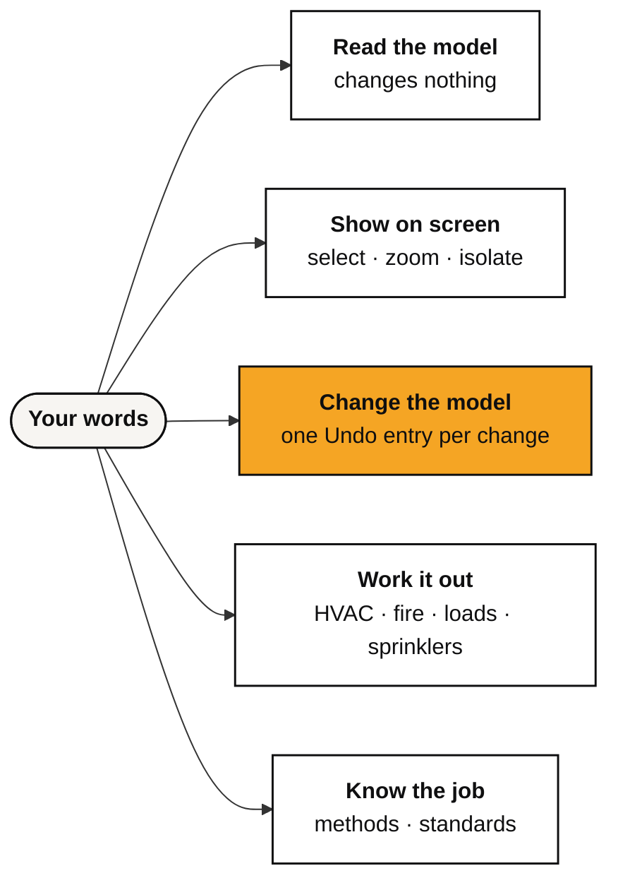

[Heron AI](../../README.md) › [Documentation](../README.md) › **Using Heron**

# Using Heron — for a BIM modeller

> **Heron can be installed now, as an early unsigned build.** The steps are under
> [Install](../../README.md#install) on the home page; everything a PC needs is
> [What to install](../WHAT-TO-INSTALL.md).

## What it does

You describe the work in ordinary language:

```
"Select all ducts."
"Move them 200 mm up."
"Which views have no template?"
"Lay out sprinklers in these rooms."
"Build me a parametric door family."
```

Behind that sentence, Heron finds the right capability, runs it inside Revit, checks the result and
keeps a record. You never have to know C#, the Revit API, MCP, RAG, vector databases, build systems or
version compatibility.

It is **not** a chatbot, a coding assistant, or a plain MCP server.

## What you can ask it today

**Every Revit tool, by job, with the words that reach it:** [the Revit tool catalogue](revit-tool-catalogue.md).

Every request goes through Heron's **MCP tools**. They fall into five groups:



<details>
<summary>Same thing as plain text</summary>

```text
Your words -> Read the model     changes nothing
           -> Show on screen     select, zoom, isolate
           -> Change the model   one Undo entry per change
           -> Work it out        HVAC, fire, loads, sprinklers
           -> Know the job       methods, standards
```

</details>

| Group | What it does | Main tools |
|---|---|---|
| **Read the model** | Answers questions and changes nothing — views, sheets, schedules, families, levels, rooms, systems, parameters, links, imports, phases, worksets, groups, annotation | `revit_read` and the `revit_views`, `revit_sheets`, `revit_systems`… family, and `revit_model_dashboard` for the whole model on the Companion page |
| **Show on screen** | Selects, zooms, isolates or hides for now. Changes what you see, never the model | `revit_select_by_category`, `revit_show`, `revit_isolate_temporary` |
| **Change the model** | Renames, sets parameters, changes types, places and builds — one named Undo entry per change | `revit_change`, `revit_apply_move`; `revit_undo_last` takes Heron's own last change back with Revit's Undo |
| **Work it out** | HVAC and fire-protection calculations, building loads, sprinkler layout and hydraulics | `heron_hvac`, `heron_fire`, `revit_building_loads`, `revit_sprinkler_layout`, `revit_sprinkler_hydraulics` |
| **Know the job** | Finds the right capability, gives the method for a job of several steps (a family above all), answers standards questions against their sources | `heron_lookup`, `heron_method`, `heron_standards`, `heron_check` |

The full list, with what each tool may do to the model, is printed by:

```bash
python mcp/server/heron_tools.py
```

## What sits behind the tools — fragments

**A fragment is one small Revit job written in C#** — *"add an elbow to the grid heads in this view"* —
compiled and run inside Revit. The AI never names a fragment: it asks a tool for a **capability**, and
Heron picks the fragment.

- Each fragment is `DRAFT` until it has **one recorded proof against a named real model, with a
  negative case** ([D-30](../DECISIONS.md)). Then it is `PROVEN`.
- **Only a `PROVEN` fragment's change is kept in a model** ([D-117](../DECISIONS.md)).
- A `DRAFT` can be tried **once, on a saved model**, and Revit always asks Keep or Discard
  ([D-119](../DECISIONS.md)).

Count both, never trust a typed number:

```bash
grep -h '^heron-status:' brain/fragments/*/fragment.yaml | sort | uniq -c
```

How a fragment becomes `PROVEN`, and how it goes back: [What is proven](what-is-proven.md#the-life-of-a-fragment).

## What matters most to you

**Read and write are different things, and what keeps you safe is the switch, not the library.** Heron
reads the model and changes nothing until you turn **Changes** on. The whole story, with the diagram:
[**What keeps the model safe**](safety.md).

## Read next

| Page | For |
|---|---|
| [What keeps the model safe](safety.md) | The switches, Keep or Discard, and the one Undo |
| [How Heron works](how-heron-works.md) | The four parts and the path of one request |
| [01 — Vision & Principles](../01-vision-and-principles.md) | What Heron is meant to be, and why |
| [15 — Glossary](../15-glossary.md) | Every word on these pages, defined |
| [Installing Heron](install.md) | Download to first request, troubleshooting, update and removal |
| [Revit tool catalogue](revit-tool-catalogue.md) | Every tool by job - what it does, what it needs, and whether a chat can use it today |
| [What to install](../WHAT-TO-INSTALL.md) | The whole picture of what a PC needs, and what is optional |

---

↑ [Documentation](../README.md) · [Home](../../README.md)
