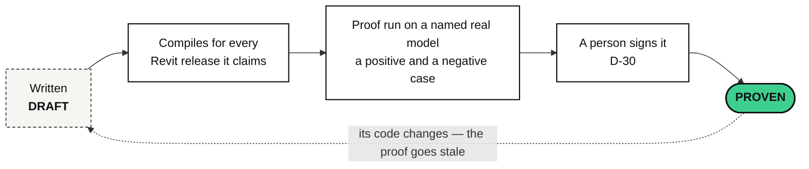

[Heron AI](../../README.md) › [Documentation](../README.md) › **What is proven**

# What is proven

**Built and proven are different words here, on purpose.** A compile is not a proof and a passing test
is not a proof: a proof is a recorded run against a **named real model**, with a negative case and a
staleness fingerprint ([D-30](../DECISIONS.md)).

**Do not trust a typed sentence over a tool** — this page included. `python tools/check-gaps.py` is
computed from disk on every run and sorts everything into *unfinished* and *waiting*. Where they
disagree, the tool is right.

## The life of a fragment



<details>
<summary>Same thing as plain text</summary>

```text
Written (DRAFT) -> compiles for every Revit release it claims
  -> proof run on a named real model, a positive and a negative case
  -> a person signs it (D-30) -> PROVEN
PROVEN -> its code changes -> the proof goes stale -> DRAFT again
```

</details>

- Only a `PROVEN` fragment's change is kept in a model ([D-117](../DECISIONS.md)).
- A `DRAFT` is *not proven as it stands*: new, or sent back when its code changed. It can be tried once,
  on a saved model, and Revit always asks Keep or Discard ([D-119](../DECISIONS.md)).

## Ask the tools, not this page

**No count is typed on this page — they move every hour a proving session runs, and every typed copy
has gone stale.** Derive them:

| Question | Command |
|---|---|
| How many fragments are `PROVEN`, `DRAFT` or `DEPRECATED`? | `grep -h '^heron-status:' brain/fragments/*/fragment.yaml \| sort \| uniq -c` |
| How many skills are which? | `grep -h '^heron-status:' brain/skills/*.yaml \| sort \| uniq -c` |
| What is unfinished, and what only waits for a Revit, a dependency or the owner? | `python tools/check-gaps.py` |
| Which agent proofs are current today? | `python tools/prove-agent.py check` |
| What waits on the owner? | `python tools/owner-queue.py` |
| How many agents are registered, and how many built? | `python tools/agent-count.py` |
| Does every C# project compile on every release? | `python tools/check-compile.py` |

## Where things stand

| | State | Evidence |
|---|---|---|
| **Phase 0 — the bridge** (Steps 1–5) | ✅ **Proven** in Revit 2020 and 2024. One button connects; the thread hop counted `5,844` elements in 2024 and `3,167` in 2020; *"select all ducts"* highlighted 4 in both; with two Revits open Heron refused to guess and stopped when the chosen one closed | [HANDOVER §3](../handover-archive/2026-11-24-the-long-handover-kept-whole-when-handover-was-cut-to-one-page.md#3-what-has-been-witnessed-at-a-real-revit) · [field notes](../00e-field-notes-proven-bridge.md) |
| **Step 6 — the first write** | ⚠️ **Measured on one release.** Three ducts moved 200 mm in Revit 2024 on 2026-09-07 ([B8](../NEEDS-CHECKING.md)). On 2026-10-17 a tape measure was put on it: three ducts in a copy of Autodesk's MEP sample moved **+200.0000 mm** each in Revit 2024, read two ways, a pinned duct beside them did not move, and **one** Ctrl+Z put them back (`D1` to `D6`). Free ducts only. A forced failure mid-move and the other rails are still owed | [Group D](../needs-checking/group-d.md) |
| **Keep or Discard, and the safety rails** | ⚠️ **Run in Revit 2024 and 2027 on 2026-10-18** on the owner's laptop — Keep, Discard, Esc and Undo pressed by hand, with try-once, the run guard, dialogs, the rollback check and the run clock beside them. PASS, FAIL and NOT RUN are kept apart row by row in Group ET and groups EM, EX, EL, EO, EZ, ER, EK, ES, EV, EJ and CP. Faults found were logged, not hidden: rows 5b-1090 to 5b-1095. The fixes merged since for 5b-1090 to 5b-1094, 5b-1100 and 5b-1137 have not been run in Revit | [Group ET](../needs-checking/group-et.md) · [FRAGMENT-ISSUES](../FRAGMENT-ISSUES.md) |
| **The fragment library** | Mostly `PROVEN`, the rest `DRAFT` — count with the first command above, which also counts the cards retired as `DEPRECATED` when their job was merged into another | [D-30](../DECISIONS.md) · [FRAGMENT-ISSUES](../FRAGMENT-ISSUES.md) |
| **A fragment cannot end Revit** | ✅ **Proved in front of Revit on 2026-09-16.** A runaway recursion comes back as a finding, with Revit still running. `python tests/test_stack_guard.py` prints how many fragments carry the guard | [J9](../needs-checking/group-j.md) |
| **Reading a model beyond counting it** | Four of five ran against real models and were signed between 2026-09-19 and 2026-09-22 — `revit_phases`, `revit_systems`, `revit_parameters`, `revit_groups`; `revit_links` never has. Every signed agent record had gone stale by 2026-10-18; **all fifteen were run again on Revit 2020 and signed on 2026-10-25**, and which are current today is `python tools/prove-agent.py check` — it named two as stale again on 2026-11-11 | [`brain/agent-proofs/`](../../brain/agent-proofs/README.md) |
| **Phase 2 — the brain** (Steps 7–14) | Built in full, mostly unproven: the fragment store, one knowledge store per scope, word and meaning search behind a hard Revit-version filter, the capability registry, the dependency graph | [27 — Build order](../27-build-order.md) |
| **Skills** | Every one `DRAFT` — the second command above | [`brain/README.md`](../../brain/README.md) |
| **Companion, HVAC, fire, building loads, sprinkler layout and hydraulics, family building** | Built, **not proven** — each page's status line says exactly how far | [40](../40-heron-companion.md) · [41](../41-hvac-design.md) · [42](../42-fire-protection-design.md) · [43](../43-building-revit-families.md) · [44](../44-building-loads-from-the-model.md) · [46](../46-sprinkler-hydraulics-from-the-model.md) · [47](../47-sprinkler-layout-from-the-model.md) |
| **Compiles** | Every C# project on all eight releases, 2020 to 2027 — a compile, not a proof | `python tools/check-compile.py` |
| **What is unfinished** | Derived, never typed — the tool separates what failed from what only waits for a Revit, a dependency or the owner | `python tools/check-gaps.py` |
| **Waiting on the owner** | One page, and it holds no list — the tool derives it from the registers | [FOR-THE-OWNER.md](../FOR-THE-OWNER.md) · `python tools/owner-queue.py` |
| **Open questions** | The Progress line at the top is derived and checked by `tools/check-docs.py`. Nothing gates any phase | [OPEN-QUESTIONS.md](../OPEN-QUESTIONS.md) |

## Where the evidence lives

| Register | Holds |
|---|---|
| [HANDOVER.md §3](../handover-archive/2026-11-24-the-long-handover-kept-whole-when-handover-was-cut-to-one-page.md#3-what-has-been-witnessed-at-a-real-revit) | The witnessed list, item by item |
| [NEEDS-CHECKING.md](../NEEDS-CHECKING.md) | Everything still owed a real Revit, one numbered item each, grouped by what it needs |
| [FRAGMENT-ISSUES.md](../FRAGMENT-ISSUES.md) | Fragments with something wrong — found by proving, or by reading |
| [`brain/agent-proofs/`](../../brain/agent-proofs/README.md) | The signed record of each agent run against a real model |
| [00e — Field Notes](../00e-field-notes-proven-bridge.md) | The bridge's behaviour as observed, not designed |

Every register, and how a finding moves through them: [Registers and working documents](registers.md).

## Is the repository safe to be public?

**It is public.** [D-07](../DECISIONS.md) still reads *"has not been done"*; that file is append-only, so
the mismatch is logged as **F38** in [PROPOSALS.md](../PROPOSALS.md) for the owner to close.

Of the four conditions D-07 set, three are plainly met — the licence is chosen (Apache 2.0,
[D-08](../DECISIONS.md)), and [DISCLAIMER.md](../../DISCLAIMER.md) and [SECURITY.md](../../SECURITY.md)
are written. The fourth is **the public-code / private-knowledge separation being verified**, and *no
record of that verification exists in this repository*. Client project data must never be able to reach
a public repository, so an unrecorded check is not a passed one.

What is in place by construction: knowledge lives outside the repository entirely, in Heron's home on
the PC — `%USERPROFILE%\.heron` on Windows since [D-135](../DECISIONS.md) — or under `HERON_KNOWLEDGE`
([`brain/heron_scope.py`](../../brain/heron_scope.py)), and [D-26](../DECISIONS.md) keeps Revit model
files from leaving the machine at all. **That is an argument, not a verification** — F38 is where
somebody writes down having actually looked. See
[17 — Open Source & Distribution](../17-open-source-and-distribution.md).

---

↑ [Documentation](../README.md) · [Home](../../README.md)
