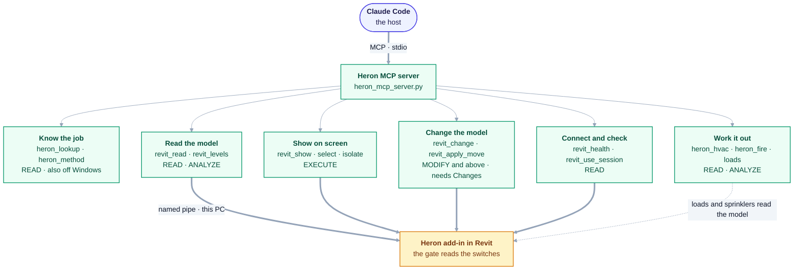

# mcp/ — Part 2, Heron MCP

**The bridge between the AI host and Revit.** Runs *outside* Revit.

| | |
|---|---|
| Language | Python |
| Runs | as a normal process on the user's PC. **Off Windows** - a cloud session - it serves only its library tools (`heron_tools.LIBRARY`) and no `revit_` tool, because no Revit can be there ([D-132](../docs/DECISIONS.md)) |
| Changing it needs | no rebuild and no Revit restart — the chat closed and reopened, which starts a new server (rule 5) |
| Talks to | Claude Code over MCP (stdio) · the Revit add-in over a **local named pipe** |

## What's here

| | Does |
|---|---|
| `client/` | Bridge discovery and the pipe client (`heron_bridge_client.py`) — finds connected Revits, verifies each answers — and `heron_config.py`, the same settings file the add-in reads, read from this side. The client is a command line too; its header lists every command, among them `doctor`, `try-once` (a `DRAFT`'s one run behind Revit's Keep or Discard box, [D-119](../docs/DECISIONS.md)) and `stop` (stops Heron in one Revit until it restarts, [D-129](../docs/DECISIONS.md), [D-130](../docs/DECISIONS.md); with two Revits connected it needs `--session <pid>` and otherwise sends nothing, [row 5b-1094](../docs/fragment-issues/section-5b-rows-401-425.md)) |
| `server/` | The MCP server, [`heron_mcp_server.py`](server/heron_mcp_server.py) — Step 3, extended since. Every tool is an `@server.tool()` function in that one file. **Three of them are the doors to the fragment library** — `revit_read` (nothing above `ANALYZE`, no transaction open), `revit_show` (nothing above `EXECUTE`: select, zoom, open a view) and `revit_change` (a `PROVEN` capability whose proof still stands, [D-117](../docs/DECISIONS.md), inside one named `TransactionGroup`, and Revit asks Keep or Discard while the ribbon's *Ask to Keep* is on - [D-126](../docs/DECISIONS.md), [D-138](../docs/DECISIONS.md)). Each takes a capability, or the user's own words, and never a fragment's id ([docs/04 §8](../docs/04-heron-mcp.md)). The other modules in the folder are in the table [below](#the-modules-beside-the-server--as-built-2026-10-18); list them with `ls server/` |
| [`companion/`](companion/README.md) | **The Heron Companion page** ([D-108](../docs/DECISIONS.md), [docs/40](../docs/40-heron-companion.md)). A small web server started inside this process when the chat calls `heron_companion`, on `127.0.0.1` only. It **shows** which Revit, model and view are in front, from the add-in's live file, and what the chat asked Heron to do; it holds the element table and the HVAC load, sprinkler hydraulic and sprinkler layout panels, whose Apply runs through `revit_change`'s own path. The selection card and the after-change tables are switched off and kept ([docs/40 §21.6](../docs/40-heron-companion.md)). It never talks to any AI and never prints to stdout |
| [`server/heron_tools.py`](server/heron_tools.py) | **What each tool can do, and the one place that says so.** Its risk is what the add-in's gate is checked against; the MCP safety labels a host sees, `revit_read`'s ceiling (nothing above `ANALYZE`) and `revit_show`'s (nothing above `EXECUTE`) are **derived** from it, never typed at a tool ([docs/04 §8](../docs/04-heron-mcp.md)). The list: `python server/heron_tools.py`; a served tool missing from it fails closed rather than defaulting to READ (`tests/test_tool_registry.py`). Two short lists live there too: `ALWAYS_LOADED`, the few tools a chat is given before it asks, held to a size budget ([D-118](../docs/DECISIONS.md)) - every other one is a search away - and `LIBRARY`, the only tools served off Windows ([D-132](../docs/DECISIONS.md)) |
| [`server/heron_brain.py`](server/heron_brain.py) | **The one place this side reaches `brain/`** — Step 14. It started with three tools on it — what Heron knows how to do, who provides a capability, and which capability a sentence needs — and there are more now. **Derive how many** rather than reading a figure here: `grep -c 'brain\.' server/heron_mcp_server.py` counts the calls, and the tools are the `@server.tool()` functions around them |

## The tools in groups — as built (2026-10-18)

Every tool is on the server's side of the pipe. The ones that reach Revit cross it to the add-in, and the
add-in's gate decides by the owner's switches. The groups are a reading aid. The complete list, with each
tool's level, is `python server/heron_tools.py`. The doors and their rules, side by side, are
[docs/04 §8.0](../docs/04-heron-mcp.md#80-the-tools-at-a-glance--as-built-2026-10-18).



<details>
<summary>Same thing as plain text</summary>

```text
Claude Code (host) --MCP, stdio--> Heron MCP server (heron_mcp_server.py)

  Know the job        heron_lookup, heron_method, ...      READ; heron_tools.LIBRARY is served off Windows too
  Work it out         heron_hvac, heron_fire, loads,       READ, ANALYZE; the loads and sprinkler tools
                      sprinklers                           read the model, none changes it
  Read the model      revit_read, revit_levels, ...        READ, ANALYZE
  Show on screen      revit_show, select, isolate          EXECUTE
  Change the model    revit_change, revit_apply_move       MODIFY and above; needs Changes on
  Connect and check   revit_health, revit_use_session      READ

Everything that reaches Revit --named pipe, this PC only--> Heron add-in, whose gate reads the switches
```

</details>

## The modules beside the server — as built (2026-10-18)

Besides `heron_tools.py` and `heron_brain.py`, which have rows above. *Used by* was found with `grep` on
2026-10-18. A module only its own command line and its tests reach is not called by a chat.

| Module | What it does | Used by |
|---|---|---|
| `heron_session` | one chat, one Revit ([docs/25 §3](../docs/25-multi-session-and-binding.md)) | the server |
| `heron_write` | the conversation half of writing: the model pin and the move's approval | the server |
| `heron_failure` | why a call failed, and whether to try again; never a blind retry | the server |
| `heron_run_records` | the short change report `revit_change` prints, and the run records `heron_run_record` pages from disk | the server |
| `heron_health` | is Heron working, as one verdict | the server (`revit_health`), `heron_diagnose` |
| `heron_diagnose` | self-diagnostics in one answer | the server (`heron_diagnose`), and its own command line |
| `heron_running_code` | whether this process still runs the Python on disk (rule 5) | the server |
| `heron_install_health` | checks an install end to end | its own command line and its tests |
| `heron_register` | registers the server with the host | its own command line and its tests |
| `heron_discovery` | reads what other MCP servers on the PC say about themselves, as claims | its own command line and its tests |
| `heron_workflow` | checkpoints and *Continue* ([docs/23](../docs/23-heron-kernel.md)) | **its tests only**: nothing imports it |
| `heron_runtime` | what Heron can do right now ([docs/04 §6b](../docs/04-heron-mcp.md)) | **its tests only, on purpose**: no tool offers it ([PROPOSALS F1](../docs/PROPOSALS.md), `tools/check-reachable.py`) |

## Rules for this folder

1. **Transport only.** No BIM logic, no knowledge, no decisions about what a duct is. Those belong in
   `brain/`. [docs/04](../docs/04-heron-mcp.md)

   **`heron_brain.py` does not bend this rule — it is what makes it affordable.** No knowledge lives
   here: that file opens a store, asks the registry and hands back rows. Every judgement about what a
   duct is stays in `brain/`, and every judgement about what the user meant stays in the host
   ([D-01](../docs/DECISIONS.md) — the Orchestrator is Claude Code, not this folder).

   It exists because until 2026-08-29 the rule was being kept by **having no route at all**: eight brain
   modules, seven fragments and ten skills, imported by nothing but their own tests, and therefore
   unreachable from any conversation. One named seam is what lets the rule hold without that.
2. **The discovery file is an address book**, not a status report. Static facts only; the document
   name is deliberately never stored — that is what caused the stale-name trap
   ([docs/25](../docs/25-multi-session-and-binding.md)).
3. **Never guess which Revit.** With more than one connected, send nothing until the user chooses.
4. **The user never sees a process number.** Version, project, availability — chosen by list number.

   > **As built (2026-10-18), not yet met.** The picker, `SessionBinding.describe` in
   > [`heron_session.py`](server/heron_session.py), shows the list number, the release,
   > `(session <pid>)` and the availability. So it shows the process number and names no project
   > ([docs/25 §2a](../docs/25-multi-session-and-binding.md)). Choosing by list number works.
5. **"Changing it needs nothing" is true of the NEXT chat, not this one.** A running server keeps the
   Python it started with. While any of its files has changed since it was loaded, every answer says to
   close and reopen the chat, and a tool that changes the model is refused
   ([`heron_running_code.py`](server/heron_running_code.py) has the decision; NEEDS-CHECKING
   [group EU](../docs/needs-checking/group-eu.md)).

## Fix things here when

Heron can't find Revit · the wrong session is picked · a stale entry lingers · the tool list is wrong ·
an MCP tool misbehaves.
