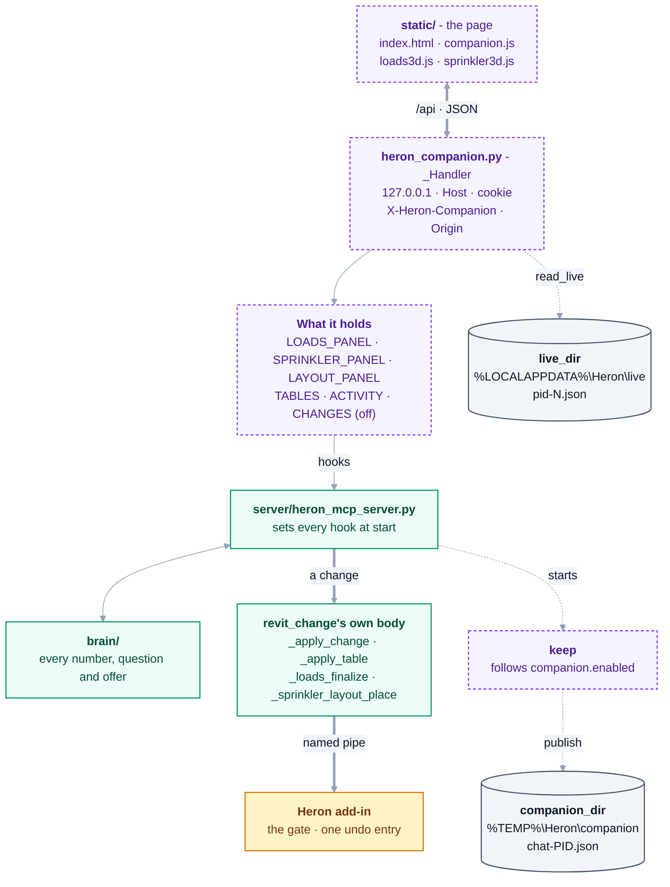

# mcp/companion/ — the Heron Companion page

**A page in the modeller's browser, beside Revit.** Allowed by [D-108](../../docs/DECISIONS.md); designed
in [docs/40](../../docs/40-heron-companion.md). The chat stays the only place to talk to Heron.

**At a glance - what is in this folder and what it talks to.** The page asks; the server answers from
what it holds; every number comes from `brain/` through a hook the MCP server sets; a change goes only
through `revit_change`'s own body. [docs/40](../../docs/40-heron-companion.md#at-a-glance) has the same
page drawn for a modeller, with each panel's status.



**Built, not proven** - [group BK](../../docs/needs-checking/group-bk.md) and the panels' own groups say
what has run in Revit. Checked against `heron_companion.py` (`PAGES`, `_Handler`, `live_dir`,
`companion_dir`, `keep`) and the hooks set near the end of `server/heron_mcp_server.py`.

<details>
<summary>Same thing as plain text</summary>

```text
static/ (the page)  <-- /api, JSON -->  heron_companion.py  _Handler: 127.0.0.1, Host, cookie,
                                                            X-Heron-Companion header, Origin
                                            |
                                        what it holds: LOADS_PANEL, SPRINKLER_PANEL, LAYOUT_PANEL,
                                        TABLES, ACTIVITY, CHANGES (switched off)
                                            |  hooks
                                        server/heron_mcp_server.py  <->  brain/ (every number)
                                            |  a change: revit_change's own body
                                            |  (_apply_change, _apply_table, _loads_finalize,
                                            |   _sprinkler_layout_place)
                                        Heron add-in - the gate, one undo entry

read_live   <- %LOCALAPPDATA%\Heron\live\pid-N.json     (the add-in writes it)
keep        -> %TEMP%\Heron\companion\chat-PID.json     (the Companion button reads it)
```

</details>

| | |
|---|---|
| Runs | inside the chat's MCP server process. The keeper (`keep`) starts it when that process starts, while the Companion switch is on (`companion.enabled`, on by default), and stops it when the switch is turned off; `heron_companion`, `revit_edit_table` and the three panel tools - `revit_building_loads`, `revit_sprinkler_hydraulics`, `revit_sprinkler_layout` - open it in the browser |
| Listens | `127.0.0.1` only, on a port Windows picks — never on the network |
| Reads | the add-in's live file, `%LOCALAPPDATA%\Heron\live\pid-N.json` (written by `revit/Heron.Revit.Addin/HeronLiveState.cs` while the Heron button is connected) |
| Changes | **only through the chat's own write path**: the page's Apply, the Loads panel's Finalize and the Sprinkler Layout's Apply run `revit_change` itself (`_apply_change`, `_apply_table`, `_loads_finalize` and `_sprinkler_layout_place` in `server/heron_mcp_server.py`) under the lock every tool call holds - the same gate, Changes switch, pin and single undo entry, and Revit's Keep or Discard box while *Ask to Keep* is on ([D-126](../../docs/DECISIONS.md), [D-138](../../docs/DECISIONS.md)) - and, since [D-117](../../docs/DECISIONS.md), only from a PROVEN fragment, so the Table's Apply and Finalize are refused today ([docs/40 §21.9](../../docs/40-heron-companion.md)). Its risk is declared in `heron_tools.COMPANION_ACTIONS` |
| Opens | a Windows folder window when Report is pressed, to ask where the HVAC load calculation sheet or the sprinkler hydraulic calculation sheet goes - its own process, nothing printed (`pick_folder`) |
| Switched off | the Selected card and the Changes tables with their colour books (owner, 2026-10-04) - kept, behind `SHOW_SELECTION` / `SHOW_CHANGES` in `static/companion.js` (and `SHOW_CHANGES` in `heron_companion.py`); see [docs/40 s21.6](../../docs/40-heron-companion.md) |
| Leaves a note | for the **Companion** button in Revit, refreshed every few seconds by the keeper: `%TEMP%\Heron\companion`, the user's temporary folder - stepped out of the GUID-named one Revit runs with, so the add-in and the chat name the same folder (`companion_dir`, [D-109](../../docs/DECISIONS.md), [D-135](../../docs/DECISIONS.md), [D-136](../../docs/DECISIONS.md)) |
| Lives | as long as the chat that opened it |

## What's here

| | Does |
|---|---|
| [`heron_companion.py`](heron_companion.py) | The server: pairing, the protection rules, which Revit to show, the keeper that follows the Companion switch (D-109), the activity list, the element table, the HVAC Load Calculation panel (docs/44), the Sprinkler Hydraulic Calculation panel (docs/46), the Sprinkler Layout panel (docs/47) and the route that opens either sheet - and the after-change tables, switched off |
| [`static/index.html`](static/index.html), [`static/companion.js`](static/companion.js), [`static/companion.css`](static/companion.css), [`static/loads3d.js`](static/loads3d.js), [`static/sprinkler3d.js`](static/sprinkler3d.js) | The page, the 3D views of the Loads panel and the Sprinkler panel, and the Sprinkler Layout panel's plans, drawn by companion.js - renderers of its own. Nothing is loaded from the internet |

## Rules for this folder

1. **Never talk to an AI.** No outgoing connection of any kind; the page is served to, and reads from,
   this PC only. `tests/test_companion.py` fails on an import that could.
2. **Never print.** This code runs inside the process that speaks MCP to Claude Code over stdout; one byte
   there breaks the chat. The test watches stdout for a whole run.
3. **Never ask Revit through the pipe to keep the page fresh.** It would raise the READING banner, queue
   work on Revit's own thread and cut the chat's connection ([docs/40 §4.2](../../docs/40-heron-companion.md)).
   Live state comes from the file.
4. **No BIM logic.** What a column or a colour means belongs in `brain/` fragments; this folder moves rows.
5. **Model text is data.** Names reach the page through `textContent`, never as HTML (Golden Rule 19).
6. **The one-time address never goes in a reply to the chat** — only to the browser.

## Fix things here when

The page will not open · it shows the wrong Revit · it says "not opened from the chat" · it stops updating ·
the Companion button in Revit says no chat is running while one is.
