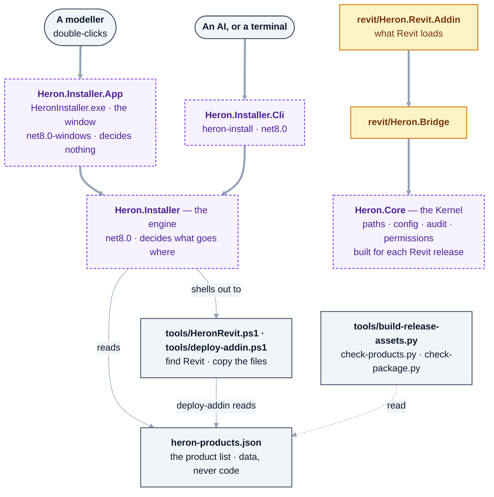

# platform/ — Part 4, Heron Platform

**The Kernel and the machinery around it.** Everything depends on this; it depends on nothing.

| | |
|---|---|
| Language | C#. The Python side keeps its own paths in [`brain/heron_paths.py`](../brain/heron_paths.py), which follows the same product / data / derived split ([D-135](../docs/DECISIONS.md)) |
| Runs | wherever it is referenced |
| Rule | **plumbing, never intelligence** |

## What's here

`Heron.Core`, and the installer. The installer is three projects on purpose: the engine is
release-independent and runs anywhere, the window needs Windows, and the command line
(`heron-install`, added 2026-09-22) is the door an AI can knock on without a mouse. Derive the list
with `find platform -name '*.csproj'`. Beside them, [`heron-products.json`](heron-products.json) is the
product list the installer reads; nothing about a product is written in code.

**Who uses which** — read from each `.csproj`'s `ProjectReference` lines and from the files that open
`heron-products.json` (`grep -rl heron-products.json --include=*.cs --include=*.py --include=*.ps1 .`).



<details>
<summary>Same thing as plain text</summary>

```text
A modeller          -> Heron.Installer.App   HeronInstaller.exe, the window, net8.0-windows, decides nothing
An AI or a terminal -> Heron.Installer.Cli   heron-install, net8.0
both                -> Heron.Installer       the engine, net8.0 - decides what goes where
                         reads      platform/heron-products.json   (the product list, data)
                         shells out tools/HeronRevit.ps1, tools/deploy-addin.ps1 (which also reads the list)
also reading the list:  tools/build-release-assets.py, tools/check-products.py, tools/check-package.py

revit/Heron.Revit.Addin  (what Revit loads) -> revit/Heron.Bridge -> Heron.Core
                                               Heron.Core is built for each Revit release's framework

Heron.Installer does NOT reference Heron.Core (see its .csproj), and nothing outside the installer
references Heron.Installer except tests/Heron.Installer.TestHost.
```

</details>

The test hosts are left out of the picture: `tests/Heron.Installer.TestHost` references the engine and
`heron-install`, the Kernel, RunGuard and ScriptIsolation hosts reference `Heron.Core`, and the
StackGuard host compiles its `HeronStop.cs` by source — `grep -l 'platform' tests/*/*.csproj`.

### `Heron.Core`

One file per class (`ls platform/Heron.Core/*.cs`), each the Kernel half of an agent in
[the registry](../docs/28-agent-registry.md):

| Class | Does | Step |
|---|---|---|
| [`HeronPaths.cs`](Heron.Core/HeronPaths.cs) | **The Path Manager** — the single place that knows where anything lives. Product, data and derived are separate in code, and `IsSafeToDelete` says yes only inside the derived folders - never for product or data. The Companion's notes are under the user's temporary folder, stepped out of the GUID-named one Revit runs with ([D-135](../docs/DECISIONS.md), [D-136](../docs/DECISIONS.md)) | 1 |
| [`HeronConfig.cs`](Heron.Core/HeronConfig.cs) | The Configuration Manager. `Load` and `Save`, and deliberately **no** `ApplyFromRequest`. Holds the ribbon's switches as settings - `write.enabled` (Changes), `admin.enabled` (Admin), `publish.enabled` (Publish) and `write.askBeforeKeeping` (Ask to Keep), all `false` by default | 1 |
| [`HeronIdentity.cs`](Heron.Core/HeronIdentity.cs) | Stable identity for the things Heron must be able to name twice | 1 |
| [`HeronOperationRegistry.cs`](Heron.Core/HeronOperationRegistry.cs) | The Tool Registry — every operation Heron will run, and the risk level of each | 3 |
| [`HeronAppend.cs`](Heron.Core/HeronAppend.cs) | One line onto the end of a file another Revit process may be appending to at the same moment — or a plain answer that it could not be done. Used by the audit trail and the add-in log | 1 |
| [`HeronAudit.cs`](Heron.Core/HeronAudit.cs) | The audit trail: one append-only line per request, keyed by Workflow ID | 4 |
| [`HeronAtomicWrite.cs`](Heron.Core/HeronAtomicWrite.cs) | Write a file so an interrupted write cannot destroy what was already there — never delete-then-move | 6 |
| [`HeronRuns.cs`](Heron.Core/HeronRuns.cs) | The run records: one file per fragment write under `HeronPaths.Runs` (DERIVED), named by its workflow id, holding every element it changed and its whole reply — written atomically, pruned by `runs.retainDays`, read back by `heron_run_record` | 7 |
| [`HeronLease.cs`](Heron.Core/HeronLease.cs) | Who currently holds a Revit, and who may therefore send it anything ([D-22](../docs/DECISIONS.md)) | 6 |
| [`HeronPermissions.cs`](Heron.Core/HeronPermissions.cs) | The seven permission levels of [docs/12 §1](../docs/12-security-and-permissions.md), in order, and what each switch lets through - Changes, Admin and Publish ([D-106](../docs/DECISIONS.md)), and whether Revit asks Keep or Discard ([D-126](../docs/DECISIONS.md)) | 6 |
| [`HeronStop.cs`](Heron.Core/HeronStop.cs) | Emergency Stop — one switch that stops Heron doing anything further. There is no ribbon button ([D-46](../docs/DECISIONS.md)); the bridge's `stop` operation sets it, the run clock rolls a running fragment back on it, and a Revit restart clears it ([D-129](../docs/DECISIONS.md), [D-130](../docs/DECISIONS.md)) | 6 |
| [`HeronSourceScan.cs`](Heron.Core/HeronSourceScan.cs) | What a fragment's own C# opens, read before it is compiled - so a fragment on the read or show path that would open a `Transaction` of its own is refused rather than trusted to Revit | 17 |
| [`HeronUnits.cs`](Heron.Core/HeronUnits.cs) | Unit conversion. Millimetres, which is what the user says, to whatever Revit wants | 6 |

### `Heron.Installer` — RUN ON THE OWNER'S PC, NOT EVERY ROW

The install engine, and **no window** — Stage 3 of
[the plugin extension plan](../docs/work-notes/plans/plugin-extension/02-implementation.md). Given the
product list, a set of products and a set of Revit releases, it decides what goes where, **waits** while
Revit is open, and reports per product per release.

| | |
|---|---|
| [`ProductManifest.cs`](Heron.Installer/ProductManifest.cs) | reads `platform/heron-products.json`. Nothing about a product is written in code |
| [`InstallPlan.cs`](Heron.Installer/InstallPlan.cs) | what will be installed where, and what is skipped **with the reason**. Pure: no files, no Revit, no clock |
| [`IRevitEnvironment.cs`](Heron.Installer/IRevitEnvironment.cs) | the two questions about Windows, as an interface, so a test can answer them |
| [`InstallEngine.cs`](Heron.Installer/InstallEngine.cs) | plan, wait, deploy, report. **It never closes Revit** |
| [`WindowsAdapters.cs`](Heron.Installer/WindowsAdapters.cs) | where it touches Windows. They shell out to the scripts in `tools/` rather than repeating their rules. **First run on the owner's PC 2026-09-21** — Group `AB` in [NEEDS-CHECKING](../docs/needs-checking/group-ab.md) |
| [`InstallerScreen.cs`](Heron.Installer/InstallerScreen.cs) | what the window and the command line may offer: which rows appear, which may be ticked, and the sentence under a greyed one |
| [`InstallSource.cs`](Heron.Installer/InstallSource.cs) | whether a named source may be used at all, and the only place a fetch address is built from what was accepted |
| [`ReleaseAssets.cs`](Heron.Installer/ReleaseAssets.cs) | what a release carries and how a downloaded file is checked. Pure; agrees with `tools/build-release-assets.py` |
| [`ReleaseDownload.cs`](Heron.Installer/ReleaseDownload.cs) | fetches a product's files from a **named release**, verifies them before use, unpacks them. Nothing downloaded is executed |
| [`ProductFolder.cs`](Heron.Installer/ProductFolder.cs) | the same as the download, minus the wire: Heron's files already on this PC, no internet |
| [`UpdateCheck.cs`](Heron.Installer/UpdateCheck.cs) | the verdict on whether a newer release exists — up to date, newer, ahead, or cannot tell |
| [`PythonSetup.cs`](Heron.Installer/PythonSetup.cs) | the second half of one install (2026-10-17): Heron's Python side after the add-in — pinned packages from `requirements-lock.txt`, the knowledge store and `heron-ready --check` — only when a product with `needsPython` went in. Decides against a fake runner; **run on the owner's laptop 2026-10-17 and 2026-10-18, not every row** — Group [`EP`](../docs/needs-checking/group-ep.md) says which passed and which are NOT RUN |
| [`ClaudeAppCopy.cs`](Heron.Installer/ClaudeAppCopy.cs) | whether this run is inside a Microsoft Store Claude's private copy of AppData, where an install lands where Revit never looks (Q-63). Both doors refuse there. **Its refusal was run from a Store-built Claude on the owner's laptop, 2026-10-17** — Group [`EP`](../docs/needs-checking/group-ep.md), row EP4 |

**It is not Kernel plumbing**, and outside this folder only its own test host references it — the
window and the command line below sit on it, and nothing outside the installer does.
It pins `net8.0` rather than following the Revit release, because it installs **for** a release without
ever loading into one.

> **Everything it DECIDES is tested here; what it DOES has run only on the owner's PC**, on
> 2026-09-21, recorded as Group `AB` in
> [`docs/needs-checking/group-ab.md`](../docs/needs-checking/group-ab.md) — it found three Revit
> releases, read the Addins folder and installed the AI Bridge. **Since then it has run twice more on the
> owner's machines**: from an unzipped `heron-project.zip` on his PC on 2026-10-08
> ([Group AC](../docs/needs-checking/group-ac.md)), and on his laptop on 2026-10-17 and 2026-10-18, fetching
> v0.1.0's add-in from the published release into four Revits and setting up the Python side
> ([Group EP](../docs/needs-checking/group-ep.md)). Rows still owed are listed there and in
> [NEEDS-CHECKING](../docs/NEEDS-CHECKING.md). **How many checks the tested half is, derive it** rather
> than reading a number here:
>
> ```bash
> dotnet run --project tests/Heron.Installer.TestHost -c Release | grep -c '^  ok '
> ```
>
> Since 2026-10-17 [`.github/workflows/windows.yml`](../.github/workflows/windows.yml) also builds and runs
> that test host on a Windows runner - no Revit and no person there, so a green run is not an install.

### `Heron.Installer.App` — SEEN ON THE OWNER'S PC, NOT EVERY ROW

The installer **window** — `HeronInstaller.exe`, Stage 4. One window, one list, two buttons.

**It decides nothing.** Which products appear, which may be ticked, what a tick installs, what is greyed
out and what the grey says all come from
[`InstallerScreen`](Heron.Installer/InstallerScreen.cs) in the project above, which is tested against a
fake Revit and a fake disk. This project draws what it is handed.

**That split is not tidiness.** A WPF window needs `net8.0-windows` and the WindowsDesktop runtime, and
this repository is developed without either — so a rule written inside the window is a rule nothing can
check. [`tests/test_installer_window.py`](../tests/test_installer_window.py) is what holds the line: it
fails if the window names a product, asks a product anything, or grows an Update or Repair button.

**No XAML.** [`revit/Heron.Revit.Addin`](../revit/Heron.Revit.Addin/) builds its windows in C# too.

> **It has been seen.** Group `AB` was run on the owner's PC on 2026-09-21: the window appeared, read
> cleanly after one layout fix, and installed the AI Bridge for real —
> [`docs/needs-checking/group-ab.md`](../docs/needs-checking/group-ab.md). **Not every row passed**:
> which are still owed or blocked is that file's and
> [NEEDS-CHECKING](../docs/NEEDS-CHECKING.md)'s answer, not this one's. The one-install lines it gained
> on 2026-10-17 - the Python half and the Store-Claude refusal - are Group
> [`EP`](../docs/needs-checking/group-ep.md). **The close-Revit line's fix of 2026-10-18
> ([row 5b-1068](../docs/fragment-issues/section-5b-rows-401-425.md)) has not been drawn in a window** -
> EP9, not run.

### `Heron.Installer.Cli` — RUN ON THE OWNER'S LAPTOP, NOT EVERY ROW

`heron-install`, Stage 6 — routes 1 and 2, the AI installing. The choices arrive already made on a
command line; everything after that is the same engine the window uses. [`Arguments.cs`](Heron.Installer.Cli/Arguments.cs)
reads the command line and refuses an unknown flag by name; [`Program.cs`](Heron.Installer.Cli/Program.cs)
wires things together and decides nothing. `net8.0`, no window, so it runs where Heron is developed.
**It has run on a PC with Revit** - from an unzipped `heron-project.zip` into Revit 2027 on the owner's
PC, 2026-10-08 ([Group AC](../docs/needs-checking/group-ac.md)), and the one install of Group
[`EP`](../docs/needs-checking/group-ep.md), 2026-10-17 and 2026-10-18, on the owner's laptop. **Its own rows are still owed** - Group `AE` in
[`docs/needs-checking/group-ae.md`](../docs/needs-checking/group-ae.md): `--list`, the wait while Revit
is open, and the refused sources.

## What will be here

Update system · package manager · event bus · workflow engine ·
the remaining registries · secret store.

**Of the update system, two halves exist and neither updates anything:**
[`UpdateCheck.cs`](Heron.Installer/UpdateCheck.cs) says whether a newer published release exists, and
[`brain/heron_update.py`](../brain/heron_update.py) holds docs/07's update rules as refusals.
`heron-install --help` says it *"never updates anything by itself"*.

## Rules for this folder

1. **No BIM knowledge, ever.** If a duct is mentioned in here, the boundary has been crossed. The
   Kernel should compile and pass its tests with no Revit knowledge present at all.
2. **No dependencies on other parts.** `platform/` is the bottom of the stack.
   Enforced by `tools/check-structure.py`.
3. **`HeronPaths` is the only thing that builds a Heron path.** Product, data and derived are separated
   in code rather than in prose, and `IsSafeToDelete` returns false for anything under data — so an
   update or a cleanup cannot reach the user's knowledge. [docs/06 §2](../docs/06-heron-platform.md)
4. **Configuration is a security boundary.** Unknown keys are ignored, not adopted. There is a `Load`
   and a `Save` and deliberately no `ApplyFromRequest` — nothing Heron *reads* may change what Heron
   *is*. [Golden Rule 19](../docs/14-golden-rules.md)

## Fix things here when

Something is written to the wrong place · config is not honoured · an update overwrote user data ·
identity or correlation ids are wrong.
