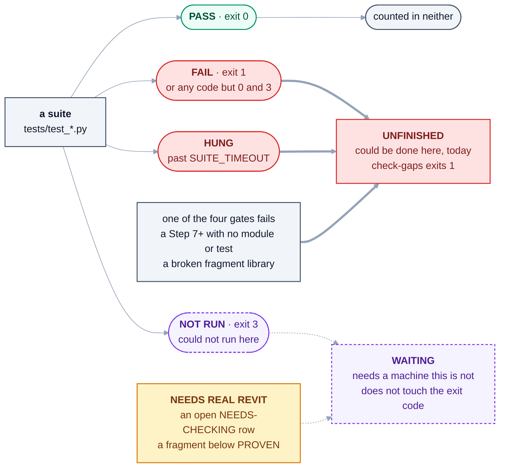

# tests/

**What is here, how to run it, and how to read an exit code.**

This is local orientation only. The testing *model* — the eight levels, what each is for — is
[docs/13](../docs/13-testing-and-quality.md). The *order to run things in before pushing* is the
[`heron-ship`](../.claude/skills/heron-ship/SKILL.md) skill. Neither is repeated here.

## What is here

| | |
|---|---|
| `test_*.py` | The suites. One file per subject, each runnable on its own, each printing what it checked rather than a dot |
| [`support/live_revit_guard.py`](support/live_revit_guard.py) | **Not a suite**, and in a folder of its own because every `.py` directly in `tests/` is one (`brain/heron_naming.py` observes it, `test_naming.py` holds it) - what a suite imports so that it never reaches the Revit running on this PC. An audit hook refuses any named-pipe open, in the suite and in a child it starts, and records any read of the real discovery folder, so the suite can fail on it. `test_mcp_serves.py` and `test_mcp_stdio.py` opened a live Revit's pipe on every run and passed until 2026-10-14 ([row 5b-461](../docs/FRAGMENT-ISSUES.md)). A suite that asks which Revits are connected points the client at an empty folder and installs this |
| [`support/scratch_audit.py`](support/scratch_audit.py) | **Not a suite** - what every suite that names `HERON_KNOWLEDGE` calls once, at module level: `scratch_audit.plant()` points `HERON_AUDIT` at a scratch folder for the whole run, and `plant(data=True)` `HERON_DATA` as well, for a suite that opens a store with `HERON_KNOWLEDGE` taken away. Both go back and the folder goes at exit. A planted store does not move its audit lines: with nothing planted they went into the owner's real brain audit, which is never pruned and which the gaps report reads as requests ([row 5b-1070](../docs/fragment-issues/section-5b-rows-401-425.md)). `test_audit_planted.py` holds every suite to it |
| [`support/slow_revit_server.py`](support/slow_revit_server.py) | **Not a suite** - what `test_mcp_stdio.py` starts as a child: the real MCP server over stdio, on any system, in front of a stand-in Revit that takes its time to answer. Only the pipe is replaced, so the bridge client's join loop and the server's progress notes are the real code ([docs/04 §7.1](../docs/04-heron-mcp.md#71-the-first-half-is-built--heron-says-it-is-still-waiting-2026-10-17)) |
| [`golden/cases.py`](golden/cases.py) | **The Golden Test Library** — a permanent record of what Heron has been *proven* to do, run again after every major change ([docs/13 §2b](../docs/13-testing-and-quality.md)) |
| [`data/owner-questions.yaml`](data/owner-questions.yaml) | **The owner's own questions**, from his log of real work, each with the capability, skill or tool that should answer it — chosen from the capability list, never from what the search returns, and confirmed by him. [`tools/score-routing.py`](../tools/score-routing.py) scores Heron's search against it and `test_score_routing.py` holds it honest. **A question here is never reworded and an answer changes only on his word** |
| [`data/plain-questions.yaml`](data/plain-questions.yaml) | **Plain questions frozen out of FRAGMENT-ISSUES rows** on 2026-10-17, where they lived only as row text: the 120 of rows 5b-477 and 5b-478, which a session wrote before reading any card, and the four of row 5b-1005 the owner asked to join them. Every one is a question; where the row names the read that answers it, that read is the `answer`. `score-routing.py` asks them beside his and never mixes the two; `test_score_routing.py` section 8 checks them word for word against the rows |
| [`data/text-note-questions.tsv`](data/text-note-questions.tsv) | **Held-out sentences about what a text note says, one-value questions and change requests on the same words**, frozen on 2026-10-17 before any wording of `READ_ELEMENT_PARAMETERS`' identity was tried (FRAGMENT-ISSUES row 5b-1007). No suite reads it: it is asked through `heron_brain.lookup` before and after a change to that card, `EDIT_TEXT_VALUES`, `CREATE_TEXT_NOTE` or the date readers. **No sentence in it is ever declared on a card** |
| [`data/material-questions.tsv`](data/material-questions.tsv) | **Held-out sentences about materials** - questions, and requests to make, select or swap one - each tagged with the card it should reach, written 2026-10-09 for FRAGMENT-ISSUES row 5b-396 before any fix was tried, and widened by sentences written to break each candidate fix. No suite reads it: it is asked through `heron_brain.lookup` on a scratch store before and after a change to a material card. A session's sentences, not the owner's, and **never declared on a card** |
| `Heron.*.TestHost/` | The C# hosts that link Heron's own C# **by source** and run it with no Revit, no Windows and no model. `Bridge` stands in for the add-in so the named-pipe round trip can be tested, and has to be built before `test_bridge_roundtrip.py` can say anything; `Kernel`, `StackGuard` and `BindingNote` each have a runner in this folder (`StackGuard` has two: `test_fragment_symbols.py` also builds it once per Revit release, to hold the release symbols a fragment is compiled with - [row 5b-181](../docs/FRAGMENT-ISSUES.md)), `Banner` has none - it is a WPF program run by hand on Windows (`shots` or `freeze`) and only built by `tools/check-compile.py` - `Installer` is run by `test_installer_engine.py`, `FailureNote` - the fragment write path's failure rule, added 2026-09-23 - by `test_failure_note.py`, `DialogNote` - how a Revit dialog met inside a job is answered, added 2026-10-17 - by `test_dialog_note.py` ([row 5b-300](../docs/fragment-issues/section-5b-rows-276-300.md)), `RollbackWitness` - whether a rollback held and whether it took the last kept job's work, added 2026-10-17 - by `test_rollback_witness.py`, `KeepQuestion` - Revit's Keep or Discard question, D-126, added 2026-10-17, and since 2026-10-18 D-138's grant to keep the rest of one job without asking (`HeronKeepGrant.cs`) - by `test_keep_question.py`, `ChangeReport` - what a write changed, counted from Revit's DocumentChanged, added 2026-10-17 - by `test_change_report.py`, `RunGuard` - the run guard's policy, which holds Constitution Article 10 while a job runs, added 2026-10-17 - by `test_run_guard.py`, and `ScriptIsolation` - another add-in's newer Roslyn loaded into the default context first and Heron still compiling on its own, added 2026-10-17 - by `test_script_isolation.py` ([row 5b-575](../docs/fragment-issues/section-5b-rows-401-425.md)); it plays Revit itself, so it links `HeronScriptHost.cs` and imports the add-in's `Heron.Scripting.targets` rather than linking the engine. Derive them: `ls -d tests/Heron.*.TestHost` |

Derive the count; do not read one here:

```bash
ls tests/test_*.py | wc -l          # how many suites
python tests/test_fragment_store.py # run one
python tools/check-gaps.py          # run them all, sorted into unfinished vs waiting
```

## The three exit codes

This is the part that is easy to get wrong, and it is written down nowhere else.

| Exit | Means | Treat as |
|---|---|---|
| **0** | Every check passed | **PASS** |
| **1** | A check failed | **FAIL** — investigate it |
| **3** | The suite **could not run** for want of an optional dependency, and says so | **NOT RUN** — it proves nothing either way |

**Exit 3 is deliberate and is not a pass.** `test_mcp_serves.py` uses it when the MCP SDK is absent,
and `test_routing_phrases.py` when the trained embedding is - its sentences are measured on the search
the owner's Heron uses, which spelling alone disagrees with ([row 5b-319](../docs/FRAGMENT-ISSUES.md)).
`tools/check-gaps.py` reads 3 as *waiting for a machine* rather than counting it green. A suite
that cannot run must never be allowed to look like one that ran.

**Every suite that cannot run says so with 3** - `test_bridge_roundtrip.py` and `test_served_claims.py`
included; the first carries the reason in its own source — *"EXIT 3, NOT 1, AND THE DIFFERENCE IS THE
WHOLE OF FRAGMENT-ISSUES ROW 162"*.

That matters more than a tidy sentence: **CI splits on the exit code**, so a suite that came back
1 where 3 was expected would be a failure rather than a skip. **On the Windows runner a 3 fails the job**
([`windows.yml`](../.github/workflows/windows.yml)): that workflow exists to be the machine those suites
wait for, so *could not run* there is a fault, not a skip. Read the output anyway — an exit code
says *whether* something ran, never *why* it broke.

## The four states, and where `check-gaps.py` puts each

**Four states, never merged** ([AGENTS.md](../AGENTS.md)): PASS · FAIL · NOT RUN · NEEDS REAL REVIT. The
first three are a suite's exit code; the fourth is something no suite can say, because nothing in this
folder proves a model changed. Read from `check_tests()`, `check_fragments()`, `check_register()` and
`main()` in [`tools/check-gaps.py`](../tools/check-gaps.py).



<details>
<summary>Same thing as plain text</summary>

```text
a suite (tests/test_*.py)
  exit 0  PASS      -> counted in neither list
  exit 1  FAIL      -> UNFINISHED   could be done here, today (any code but 0 and 3)
  HUNG (past SUITE_TIMEOUT) -> UNFINISHED
  exit 3  NOT RUN   -> WAITING      needs an optional dependency this machine has not got

also UNFINISHED: one of the four gates fails, a Step 7+ with no module in brain/ or no test,
                 a fragment library or capability registry that does not hold together
also WAITING:    NEEDS REAL REVIT - an open NEEDS-CHECKING row, or a fragment below PROVEN;
                 a row that names the owner, Windows, a network or a cloud session waits on that instead

check-gaps.py exits 1 while UNFINISHED holds anything, 0 otherwise. WAITING never changes it.
```

</details>

| State | How it shows | `check-gaps.py` files it under | A pass? |
|---|---|---|---|
| **PASS** | A suite exits 0 | Neither list — printed `ok` | Yes, for what the suite checks. Never a proof against a model |
| **FAIL** | A suite exits 1 - or any code but 0 and 3 - or does not return in time (`HUNG`) | **UNFINISHED** | No — the change, not the machine |
| **NOT RUN** | A suite exits 3, saying what it lacks | **WAITING** — *an optional dependency* | No. Proves nothing either way |
| **NEEDS REAL REVIT** | No suite says it. An open row in [NEEDS-CHECKING](../docs/NEEDS-CHECKING.md), or a fragment below `PROVEN` | **WAITING** — *a real Revit*, or whatever the row's own words name | No. Owed a recorded run on a named model ([D-30](../docs/DECISIONS.md)) |

## `check-gaps.py` runs every suite on disk

It skips none: it runs every `tests/test_*.py` it finds, one after another. A suite that cannot run here
says so with 3 and is filed under *waiting*; one that does not return within its time limit is named as
`HUNG` and counted unfinished.

Derive both rather than reading either here:

```bash
ls tests/test_*.py | wc -l     # suites on disk
python tools/check-gaps.py     # what it ran, sorted into unfinished vs waiting
```

## Before you change a test

**Never edit a test until it passes.** A red test is a claim about the code; making the claim quieter
does not make the code right. If a suite is genuinely testing the wrong thing, say so and re-base it
deliberately — `test_embed` and `test_retrieve` were re-based against a changed backend, which is a
different act from editing until green, and it was recorded as such.

**A suite that needs a real Revit is not a unit test.** Nothing in this folder proves a model changed.
That evidence lives in [`NEEDS-CHECKING.md`](../docs/NEEDS-CHECKING.md) and the proving workflow, and
a compile or a green suite is not a substitute for it ([D-30](../docs/DECISIONS.md)).
